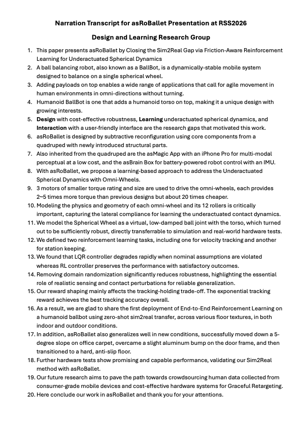

# 21 Final Project Showcase

Present what your team built, what experience/data it generated, and what the evidence supports. Use your poster, code and video to explain the same project, then demonstrate its verified capability and discuss its limits. The teaching team will announce the running order and station arrangements for the eight teams.

## What to bring

Have your poster, the submitted repository and your video ready to open. Bring the prepared system if it is part of your demonstration, together with the configuration, data or logs needed to explain one result. Keep a recorded or replay fallback available and label what it shows.

**The submission arrangements in Classes 18–20 remain unchanged.** The teaching team collects the specified versions from `main` in each assigned private team repository. Your existing files are:

| Artifact | Where to find it in your team repository |
| --- | --- |
| [Poster](module-05-final-project-submissions/18-final-poster-submission.md) | `poster/TeamNN-poster.pdf` |
| [Code and reproduction instructions](module-05-final-project-submissions/19-final-code-submission.md) | `code/`, starting with `code/README.md` |
| [Video](module-05-final-project-submissions/20-final-video-submission.md) | `video/TeamNN-video.mp4` |

Replace `NN` with your assigned team number, `01`–`08`. Class 21 adds **no new upload, worksheet or separate presentation-video file**. If the demonstrated configuration differs from the collected submission, identify the change and its effect on the evidence; it does not replace the collected version.

## Present the project

Use the following sequence with your poster or prepared visuals. Explain the important result rather than reading every worksheet entry.

1. **Claim:** What capability did you test, for which task and conditions?
2. **System and experience:** What acts, what is measured, and what data are retained? Explain the role of the operator, controller or learned component.
3. **Test and result:** Show the comparison, success/failure rule, number of attempts and strongest evidence. Distinguish your measurements from published results, simulation and replay.
4. **Conclusion:** State what the result supports, one important failure or limit, and the next experiment that could change your decision.

Rehearse with the actual visuals and media. Use readable labels and units; explain a plot's conditions before its result. Every member should understand the complete project and be ready to answer questions.

### asRoBallet example: build a spoken explanation

The original asRoBallet narration moves from the robot and research question to design, interaction, modeling and experimental findings. Use its structure to connect a physical mechanism to evidence. Its research scale and claims are references, not requirements for your course project.

*Figure 1. Original asRoBallet RSS 2026 narration transcript. [Open the full-size transcript](media/class21/asroballet-narration-original.png) · [Paper and project](https://bionicdl.ancorasir.com/?p=2238).*

| In the example | Apply it to your presentation |
| --- | --- |
| Points 2–5 establish the body, task and research gaps. | Define your task and bounded claim before implementation details. |
| Points 6–11 connect the design, interfaces and contact model. | Explain which system choices matter to your measurement or behavior. |
| Points 12–15 introduce tasks, comparisons and ablations. | Show what was compared and what evidence supports your explanation. |
| Points 16–20 discuss hardware outcomes and future direction. | Separate tested outcomes from proposed extensions; include your limits. |

For example, replace “our robot works well” with: “Under **[declared conditions]**, we observed **[result out of N attempts]**, compared with **[baseline]**. **[Failure]** limits the conclusion; next we would test **[specific uncertainty]**.” Fill these placeholders with your own evidence.

## Demonstrate the system

Prepare one understandable trial. Show the starting condition, intended action, measured outcome and success/failure rule before running it.

- Check the hardware, cables, workspace, power and identified software/configuration before enabling motion. Confirm the operator, reachable stop and reset procedure with the instructor/TA.
- Keep viewers clear of the motion area. Use the tested operating limits; stop if the configuration or behavior becomes unsafe or uncertain.
- Explain interventions and failed attempts. If live operation is unavailable, show the labelled recorded/replay fallback and state what it can establish.
- Point to the relevant log, plot or repository output. A selected successful demonstration illustrates capability; use the recorded trial counts to discuss reliability.

### asRoBallet example: use the poster during discussion

The poster groups **Design**, **Interaction** and **Learning**, then connects these panels to modeling details and comparative results. During questions, point to the panel that supports your answer and explain its scope.

*Figure 2. Original poster by Fang Wan et al. for asRoBallet, RSS 2026. [Open the full-size poster](media/class21/asroballet-poster-original.png) · [Paper and project](https://bionicdl.ancorasir.com/?p=2238) · [Authors' MuJoCo code](https://github.com/asRoBallet/asRoBallet_mujoco).*

The interaction diagram helps explain the human-to-robot pathway; the model panels explain a physical assumption; the comparison table names methods and conditions. In your own poster, make it equally easy to find **the system, the test and the evidence**. Identify which results are simulated and which are physical, and use the paper or logs when a table or clip leaves a question unresolved.

## Answer questions with evidence

Listen to the precise question, give a direct answer, then point to the supporting artifact. Distinguish what you measured, inferred, reused or have not tested. An unresolved question is useful when you can name the next check.

| Likely question | Prepare an answer using |
| --- | --- |
| What exactly did your team contribute? | Your implementation or experiment, with inherited code/data attributed. |
| How does the system generate useful experience/data? | One episode linking action, observation, outcome and intended use. |
| Why do you trust this result? | Protocol, baseline, attempts, failures and configuration. |
| What would another team need to reproduce it? | README command, required assets and expected output; identify remaining hardware needs. |
| Where does the claim stop? | A failed or untested condition and its effect on the conclusion. |
| What would you do next? | One feasible experiment that resolves an important uncertainty. |

When reviewing another team, ask one specific question about its evidence and offer one actionable suggestion. Finish by identifying what your own team learned about generating and using physical interaction data, and the next decision that evidence justifies.
