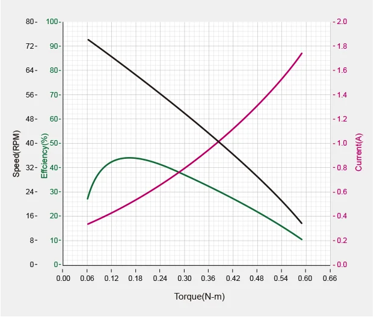
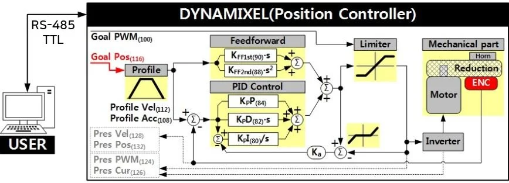
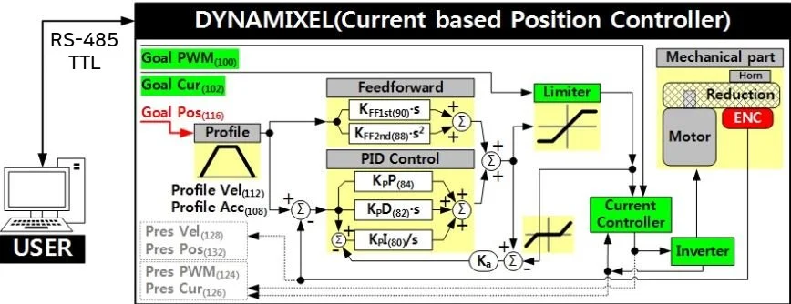
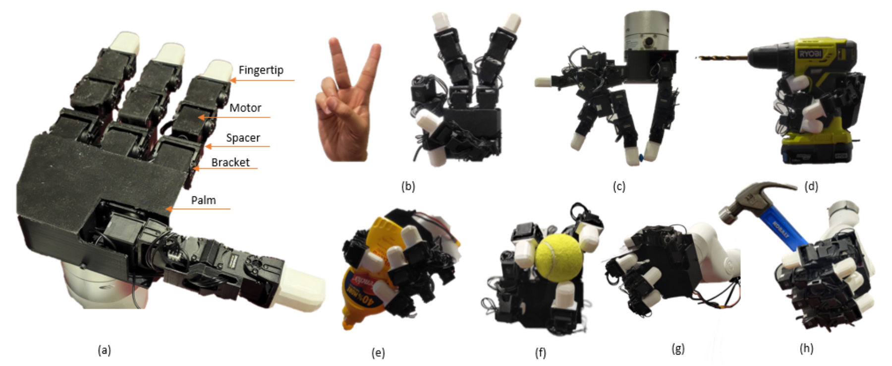
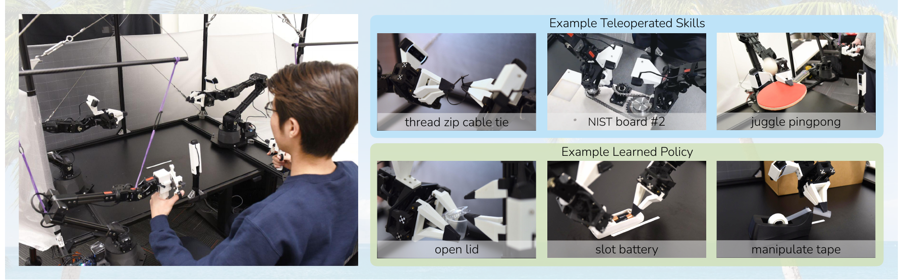
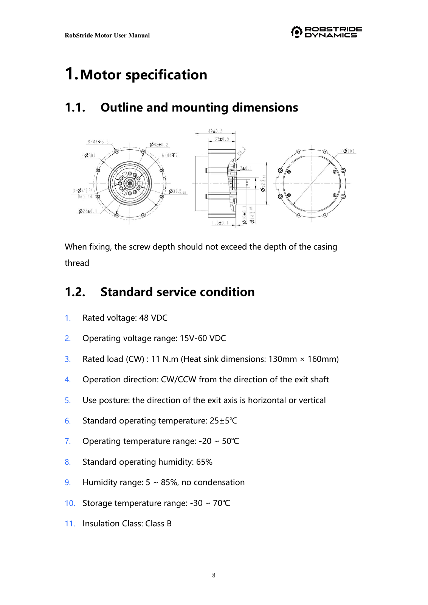
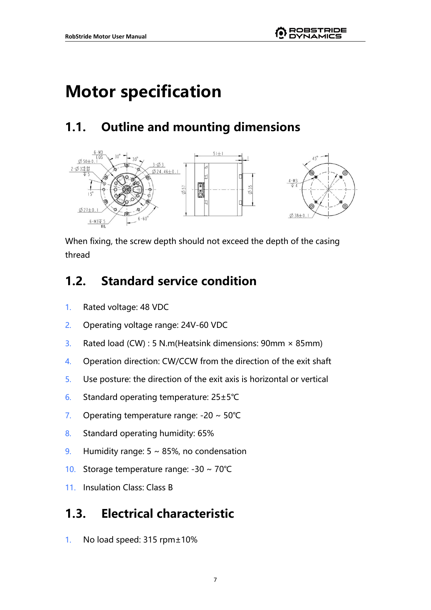

# Controlled action as a physical feedback process

## Central question

What turns a motor into an actuator capable of controlled action?

A motor turns electrical energy into mechanical action. A robot, however, needs more than a shaft that can turn. It needs to move a specified amount, follow a changing motion, maintain a configuration under a load, or regulate its interaction with an object. These tasks require us to connect a request to what the mechanism actually does.

Consider a motor attached to a small lever. A program requests a rotation of 30 degrees. The lever may reach that angle, stop short, overshoot, or fail to move. The outcome depends on the motor, transmission, supply, mounting, load and controller. The number in the program describes an intention; the mechanism must realize that intention through physical forces and motion.

**Controlled action** means influencing a physical system so that a specified property of its behaviour follows a reference, despite disturbances and imperfect knowledge. **Feedback** means using information about the resulting behaviour to change the next control effort. A **physical feedback process** connects that information to an energy-transmitting mechanism and to measurements of the mechanism or its interaction with the world.

Control can also be open loop: a predetermined input is applied without correcting from the resulting output. Here we focus on feedback because changing loads and disturbances make the achieved action uncertain. A dynamic simulation can represent that loop, but its state is model output rather than evidence of a hardware measurement.

This class develops that connection through four devices: ROBOTIS XC330-M288-T and XL330-M288-T, followed by RobStride RS06 and RS00. The same questions apply throughout: What is requested? What produces effort? What moves? What is sensed? What do the reported numbers mean?

By the end of this class, you should be able to:

- Explain how a motor, transmission, drive and sensing can form a physical feedback process.
- Distinguish position, velocity and current/torque-related requests from the resulting measured behaviour.
- Explain how transmission ratio and sensing affect actuator behaviour and physical interaction.
- Interpret the XC330/XL330 and RS06/RS00 examples using model-specific operating conditions.
- Find TDS, UDS and SDS information, check units and limits, and identify what the documents do not establish.

[Lecture](#from-a-motor-to-an-actuator) · [Instructor and TA demonstration](#instructor-and-ta-demonstration) · [Student activity](#student-activity)

Use the worked examples, source figures and official documents to answer the questions below. The physical inspection uses unpowered XC330 and XL330 units as specified in the demonstration and activity.

## From a motor to an actuator

### Action, energy and a measurable outcome

In a software interface, an action can mean changing a variable or issuing a message. In a physical system, an action must also have a mechanical consequence. A rotary actuator can exert torque, rotate a load, or resist a disturbance. Its instantaneous mechanical power at the output is

$$
P_{\mathrm{out}}=\tau_a\dot q,
$$

where $$q$$ is output angle in radians, $$\dot q$$ is output angular velocity in radians per second, and $$\tau_a$$ is applied output torque in newton metres. Torque and velocity must refer to the same shaft and sign convention.

An output delivering 0.20 N m at 2 rad/s transfers 0.40 W of mechanical power. A motor holding a stationary load can have zero output mechanical power while drawing current and producing heat. Motion alone therefore does not describe an actuator's effort, and electrical power consumption is not identical to useful mechanical power.

A motor is an energy conversion device. Electromagnetic interaction produces torque between its moving rotor and its stationary structure. The housing and mounting carry the reaction torque. Without a suitable mounting, a motor cannot establish the intended relationship between the output and the robot's body. The circuit must also provide a current path and a source of electrical energy; a command message supplies neither.

### What must be added?

A usable actuation system combines several functions. They may be separate components or integrated in one housing.

| Function | Physical or computational role | Question to ask of the device |
|---|---|---|
| Motor | Converts electrical energy into mechanical effort | Which motor construction and electrical limits apply? |
| Drive or power electronics | Switches and regulates electrical power | What current, voltage and protection functions are available? |
| Transmission, where required | Changes speed, effort and mechanical arrangement | What ratio, friction, compliance and lost motion are introduced? |
| Sensor and estimator | Measures or estimates a relevant state | Is the reported angle at the rotor or output? How is velocity obtained? |
| Controller | Uses references and feedback to determine effort | Which loop is closed, and at what level? |
| Housing, bearings and mounting | Supports forces and locates the output | What carries the load and reaction torque? |
| Communication and configuration | Connects the actuator to the rest of the system | Which command, units, mode and device identity are used? |

A reduction gear is useful when the motor's speed and torque do not suit the load, but it is not a requirement for every actuator. An encoder is useful for position feedback, but some systems use other sensors or estimates. Integration changes packaging and accessibility; it does not remove these functions.

To close a position loop, the system needs a position reference, a measurement or estimate of the relevant position, a comparison between them, and an effort-producing path that can reduce the difference. A drive that regulates current has already closed one loop, but that does not establish that output position is controlled. We must name the quantity whose loop is being discussed.

### What does the word physical require us to check?

A feedback loop can be mathematically correct while connected to the wrong evidence. An interface may display the last command as if it were the current position. An encoder may report motor rotation while a loose coupling leaves the load stationary. A simulation may update a joint coordinate directly, bypassing effort limits. A camera may report the object's motion while the controller assumes it is the actuator's output angle.

The practical question is whether the feedback is causally connected to the physical quantity that matters. We check the sensor location, calibration, timestamp, transmission and mechanism. We also check whether the actuator can supply the necessary effort within its electrical and thermal limits. Feedback cannot compensate for unlimited load, missing power, or an incorrect mechanical connection.

**Prediction question.** If the command display reads 30 degrees, what additional evidence would establish that the lever is actually at 30 degrees? Identify the reference frame and the point at which the measurement is made.

### Stepper motors, brushless motors and servo systems

A stepper motor is commonly driven through a sequence of commanded electrical states. In a position-open-loop arrangement, the controller counts commanded steps and assumes that the rotor follows. For an ideal 200-full-step-per-revolution arrangement, ten full-step commands represent an expected motion of

$$
10\frac{360^\circ}{200}=18^\circ.
$$

This is a commanded displacement, not a measurement. If the load or acceleration demand causes missed steps, the counter does not reveal the error. A stepper drive may regulate winding current even while position remains open loop. Closed-loop stepper systems add position feedback and can detect or correct tracking errors. Microstepping changes the electrical command subdivision; it does not by itself establish an equivalent improvement in loaded positioning accuracy. See Oriental Motor's [stepper fundamentals](https://www.orientalmotor.com/stepper-motors/technology/stepper-motor-basics.html) and [closed-loop systems](https://www.orientalmotor.com/stepper-motors/alphastep-closed-loop-stepper-motors.html).

A brushless motor requires a drive to coordinate currents with rotor position. Rotor position may be sensed or estimated for commutation. Successful commutation means that the motor can produce useful torque; it does not automatically mean that a robot joint follows an output-position command. A brushless motor can be part of a speed controller, a torque-related controller, or a position servo.

A **servo system** uses feedback to regulate a specified variable. The term describes an arrangement and function, rather than one electromagnetic motor construction. In automation, the motor, encoder, drive, controller and reducer may be separate products. The controller supplies motion references, the drive closes fast electrical and motion loops, and a gearbox adapts the motor to the load.

Robotics often places these functions close together to reduce joint size, wiring and assembly effort. A joint may contain a brushless motor, compact drive, encoder, bearings and a strain-wave reducer. A strain-wave transmission uses a wave generator, flexspline and circular spline to obtain reduction in a compact arrangement; it remains a transmission, not a motor or controller. See the manufacturer's [operating principles](https://legacy.harmonicdrive.net/reference/operatingprinciples/).

DYNAMIXEL modules integrate motor, reduction, sensing, electronics and a digital interface in a small addressable package. Low-reduction integrated modules such as RS06 and RS00 make another design choice: use a motor and transmission arrangement intended to retain more of the motor's direct mechanical interaction with the load.

These are overlapping alternatives. Stepper systems, industrial servos, smart modules and QDD joints continue to serve different requirements. Lower reduction is not a universal replacement for a high-ratio joint; compact integration is not a guarantee of sensing accuracy.

## Position, velocity and current/torque-related control

### Start with the physical variable

The requested variable determines what the actuator is being asked to maintain. Holding a camera at a particular orientation is different from rotating a wheel at a given speed. Both differ from applying a limited effort while touching an object.

We use distinct symbols because these quantities have different units and physical meanings.

| Symbol | Meaning | Unit |
|---|---|---|
| $$q_d$$ | Position target sent by the host | rad |
| $$q_r$$ | Position reference used internally after any profiling | rad |
| $$y_q$$ | Reported position measurement | rad |
| $$v_r$$, $$\hat v$$ | Velocity reference and estimated/reported velocity | rad/s |
| $$\tau_{\mathrm{req}}$$ | Torque or generalized-effort reference | N m |
| $$\tau_a$$ | Torque actually applied at the chosen output | N m |

The distinction between reference and response follows directly from dynamics. For a single rotational degree of freedom, a scalar form consistent with Featherstone's generalized-coordinate formulation is

$$
H(q)\ddot q+C(q,\dot q)+\tau_f(\dot q)
=\tau_a+\tau_{\mathrm{ext}}.
$$

Here $$H(q)$$ is generalized inertia; $$C(q,\dot q)$$ contains gravity and velocity-dependent bias terms; $$\tau_f$$ is a separately represented friction term; and $$\tau_{\mathrm{ext}}$$ is environmental torque acting on the mechanism. The positive direction is the direction of increasing $$q$$. Friction must not also be counted inside $$C$$ if it is included explicitly. The controller influences $$\tau_a$$; the resulting acceleration also depends on the load and external interaction (Featherstone 2008).

### Position control: where should the output be?

A position controller corrects a position error. One illustrative effort-producing law is

$$
\tau_{\mathrm{req}}
=K_p(q_r-y_q)+K_d(v_r-\hat v)+\tau_{\mathrm{ff}}.
$$

The proportional term responds to angle error. The derivative or velocity-error term provides damping relative to the requested motion. Feedforward $$\tau_{\mathrm{ff}}$$ can compensate for a predicted load or desired acceleration. With radians retained explicitly, $$K_p$$ has units N m/rad and $$K_d$$ has units N m s/rad.

Suppose $$K_p=2$$ N m/rad, $$K_d=0.10$$ N m s/rad, position error is 0.10 rad and velocity error is −0.20 rad/s. With zero feedforward,

$$
\tau_{\mathrm{req}}=2(0.10)+0.10(-0.20)=0.18\ \mathrm{N\,m}.
$$

The position term requests 0.20 N m; the damping term reduces it by 0.02 N m. This is an effort reference before actuator limits and dynamics. It is not an output-torque measurement or a set of hardware gain-register values.

A host can request an abrupt target while the device generates a bounded velocity/acceleration profile. Then $$q_d$$ and $$q_r$$ describe different stages. Increasing position gain cannot make the supply, current capability or transmission infinitely strong. It can also increase oscillation or contact force. Position control is useful for tracking configurations, but a joint prevented from moving may keep requesting effort until a limit or protective condition acts.

### Velocity control: how fast should it move?

A velocity controller regulates rotation rate. A common illustrative law includes proportional and integral action:

$$
\begin{aligned}
e_v&=v_r-\hat v,\\
\tau_{\mathrm{req}}&=K_{pv}e_v+K_{iv}\int e_v\,dt+\tau_{\mathrm{ff}}.
\end{aligned}
$$

The proportional term responds to the current velocity error; the integral term accumulates a persistent error and can help reject a steady load. Saturation requires appropriate integral handling because accumulated error can otherwise continue growing while the requested effort cannot be delivered.

Velocity control suits wheels, rollers and other tasks specified by sustained motion. A zero-velocity command requests no rotation; it does not by itself specify which angle should be retained. Position depends on the accumulated motion:

$$
q(t)=q(0)+\int_0^t\dot q(s)\,ds.
$$

An error of 0.01 rad/s sustained for ten seconds produces 0.10 rad of angle drift. This matters when a task requires a particular configuration rather than simply a motion rate.

### Current and torque-related control: how much effort should it produce?

For a simple electromagnetic model,

$$
\tau_m=k_t i_t,
$$

where $$\tau_m$$ is motor electromagnetic torque and $$i_t$$ is the appropriate torque-producing current. In a brushed DC motor this is related to armature current; in a field-oriented brushless drive the relevant current component and convention must be specified. Supply current, phase-current RMS, phase-current peak and torque-producing current are not interchangeable numerical quantities.

For an ideal rigid reduction with ratio $$N=\omega_m/\dot q$$,

$$
\omega_m=N\dot q,\qquad \tau_a=N\tau_m.
$$

A simple steady operating approximation can instead include transmission efficiency, $$\tau_a\approx\eta N\tau_m$$. Real friction, acceleration, compliance and temperature complicate this relation. An approximate efficiency factor should not be combined indiscriminately with a separate loss model that counts the same losses again.

Current regulation is valuable because electromagnetic torque is linked to current. Torque-related operation supports effort limiting, compliant behaviour and physical interaction. It still needs joint limits and an appropriate higher-level task controller: a constant torque request can accelerate a free joint rather than hold an angle.

**Current-based position control** combines objectives: follow a position reference while using a current-related bound or inner loop. Its exact meaning depends on the device. A firmware's “torque control” label does not establish that it contains an independent output-torque sensor.

### What changes when control enters the model and implementation?

In theory, we must specify state variables, references, feedback laws, units, disturbances and limits. In mechatronics, we must implement sensors, sample timing, power electronics, communication and protection. In simulation, we must specify how a control input creates force rather than assuming that writing an angle makes the mechanism instantaneously occupy it.

In MuJoCo, the same array name, `data.ctrl`, can carry different physical quantities because the actuator definition determines its meaning. A position actuator interprets its input as a reference position; a unit-gear hinge motor can interpret its input as generalized torque. Neither directly assigns the physical joint position. The model also needs a load, joint axis, inertia, losses, limits and numerical integration settings.

[Class 03](03-basic-digitization-of-physical-embodiment.md) develops this executable representation and works through the actual XC330 and RS06 model interfaces. Here, the essential point is to identify the control objective and distinguish reference, effort and resulting motion before comparing them with hardware. A digital command becomes physically interpretable only through that stated interface.

### Requested quantities are not automatically measured quantities

A command states what the system should do. A measurement is evidence of what a sensor reported. The two can agree, but agreement must be established rather than built into their names.

*Figure 1. A saved XC330 episode separates the host goal, device trajectory and reported position. The plotted signals belong to one recorded motor-only run. The reversal makes their distinct meanings visible; it does not isolate the effect of changing controller mode.*

In that record, row 400 reports goal 2330 counts, trajectory 2337 counts and position 2347 counts. Relative to the declared 2048-count reference, these are approximately 24.785, 25.400 and 26.279 degrees. The goal curve is readback of the device's goal register, not an independent timestamp of host transmission. “Trajectory” identifies the device's internal reference; “Present Position” identifies returned state information. Neither becomes interchangeable with the host goal simply because all three use position units.

The retained CSV makes the connection to the mathematical symbols explicit:

| Exported field and signal in Figure 1 | Row 400 (counts) |
|---|---:|
| `goal_position_raw`: goal register readback | 2330 |
| `position_trajectory_raw`: internal reference, corresponding to $$q_r$$ | 2337 |
| `present_position_raw`: reported position, $$y_q$$ | 2347 |

For this display, convert an already signed count $$p$$ to radians by

$$
q=(p-2048)\frac{2\pi}{4096}.
$$

The chosen zero is a plotting reference; it does not calibrate the output to the room. At this row, measured-minus-internal-reference is 10 counts, approximately 0.879°. Measured-minus-goal-readback is 17 counts, approximately 1.494°. These are two different tracking comparisons, not two estimates of a simulation error. The controller's position-error convention $$q_r-y_q$$ reverses the first sign.

The same row reports negative velocity while the angle is still positive: the output is returning from its positive peak. A positive angle therefore does not imply positive motion. This observation identifies signals and signs; it does not identify which physical effect caused their separation. The record is XC330-M288-T, ID 5, firmware 53, Mode 5, M0 motor-only configuration, at about 2.001918 s on the host receive-end clock. The [retained sample](../resources/class02/results/hardware-demo/sample-400.json) identifies its raw and converted values.

Several mechanisms can explain a discrepancy:

| Cause | What happens | How to investigate or manage it |
|---|---|---|
| Profiling | The internal reference approaches the target gradually | Log goal, profile settings and exposed trajectory separately |
| Physical dynamics and load | Inertia, friction, gravity and contact affect motion | Identify the assembly and load; compare like conditions |
| Limits and protection | Current, PWM, voltage, temperature or travel limits restrict effort | Log configuration and status; distinguish clipping from poor tuning |
| Sensing and estimation | Quantization, bias, filtering or sensor location alters the reported state | Check resolution, calibration, mounting and measurement location |
| Communication and timing | Commands and measurements refer to different times | Preserve timestamps and distinguish host time, receive time and device time |
| Representation | Wrong units, signed decoding, zero or direction creates apparent motion/error | Retain raw data, conversion rules and coordinate definitions |

These causes require different responses. A conversion error should be corrected before fitting a physical model. A real current limit should be represented, not removed from a plot. A tracking error under load is useful experimental evidence, not necessarily a fault in the data. Reporting the requested action, configuration and measured response together makes the result interpretable and repeatable.

## Smart actuators: XC330 and XL330

### What is smart about them?

The XC330 and XL330 are complete small actuation modules. Their integrated electronics expose named commands, configuration and feedback through a digital bus. “Smart” describes this integration and the ability to configure and monitor the device. It does not mean that the module has learned a task or independently understands what a robot should do.

*Figure 2. The course XC330 device and its matched geometric representation. Identify the output, fixed housing, mounting and connectors. Geometry helps locate the component in a robot model; it does not establish the internal control law or dynamic parameters. This mounting illustration is not the M0 experiment configuration: Figure 1’s M0 record has no external moving link or payload. The photograph and CAD view are supplied course materials.*

As you inspect the unpowered XC330 and XL330 passed around the room, relate the visible parts to the functions introduced earlier. The output and mounting are accessible; the internal motor, gear train, sensor and electronics are enclosed. Two bus connectors allow modules to share a daisy-chain arrangement. Their presence does not make the power source or host communication interface unnecessary.

The device's control table provides the software counterpart of the physical module: identity and mode settings, commands, limits, and reported state. A host addresses a device and reads or writes particular fields through the protocol. A successful write establishes that a command was accepted at that interface; the subsequent physical response still has to be observed.

### Compare exact models, not family names

The following extract concerns **XC330-M288-T** and **XL330-M288-T**. Other ratios and voltage variants must be checked separately.

| Property | XC330-M288-T | XL330-M288-T |
|---|---|---|
| Motor | Coreless DC | Cored |
| Gear material | Full metal; two bearings | Engineering plastic |
| Mass | 23 g | 18 g |
| Dimensions | 20 × 34 × 26 mm | 20 × 34 × 26 mm |
| Reduction | 288.35:1 | 288.4:1 |
| Stall torque at 5 V | 0.93 N m | 0.52 N m |
| No-load speed at 5 V | 81 r/min | 103 r/min |
| Supply | 3.7–6.0 V; 5 V recommended | 3.7–6.0 V; 5 V recommended |
| Position resolution | 4,096 counts/revolution | 4,096 counts/revolution |
| Interface | TTL multidrop; Protocol 2.0 | TTL multidrop; Protocol 2.0 |

*Sources: ROBOTIS n.d.-c, [XC330-M288](https://docs.robotis.com/docs/dxl/model_reference/x_series/xc_series/xc330-m288/), and ROBOTIS n.d.-d, [XL330-M288](https://docs.robotis.com/docs/dxl/model_reference/x_series/xl_series/xl330-m288/), specifications checked 17 October 2026.*

The shared envelope can simplify a mechanical comparison, but swapping modules can still change moving mass, available effort, speed and transmission behaviour. Coreless construction does not mean brushless construction. Likewise, “metal gears” and “plastic gears” identify materials; neither phrase alone is a measurement of backlash, efficiency or service life.

A simple resolution calculation is

$$
\Delta q=\frac{2\pi}{4096}\approx0.001534\ \mathrm{rad}
\approx0.08789^\circ.
$$

This describes the size of one encoder count over a revolution. Accuracy asks how close the reported angle is to an independent reference. Repeatability asks how consistently a motion returns under specified conditions. Quantization, alignment, load, compliance and backlash can affect those properties differently. A 12-bit readout does not establish a corresponding absolute accuracy.

The two quoted torque/speed values also describe different conditions. Stall torque occurs at zero speed; no-load speed occurs near zero external load. They cannot be multiplied as if the actuator delivered both simultaneously. A loaded operating point lies elsewhere on its performance characteristic, and sustained operation also depends on heating.

*Figure 3. ROBOTIS performance data retained with its original axes and typography. Speed uses the black left scale, efficiency the green left scale, and current the magenta right scale. Follow one torque value vertically to read a corresponding operating point. The crop does not print the supply/test conditions; consult the model documentation and retain any unspecified conditions. It does not establish a continuous rating. Source: [ROBOTIS XC330-M288-T model documentation](https://docs.robotis.com/docs/dxl/model_reference/x_series/xc_series/xc330-m288/).*

**Comparison question.** For a finger-mounted mechanism, why might the XL330's lower mass matter? For a loaded joint, why might the XC330's higher quoted stall torque matter? What further information would you need before selecting either for continuous operation?

### Commands, control modes and available feedback

Both exact models offer position, extended-position, velocity, current, current-based-position and PWM-related operating modes. Their meaning comes from the model's control documentation. Do not infer that two differently named modes implement the same signal path merely because both make the shaft move.

The mode changes what a command field means. In XC330's Mode 0, `Goal Current` requests current; in Mode 5 it bounds the current-related position controller. Thus the retained Mode-5 value of 300, with 1 mA units, specifies a 0.300 A bound rather than a measured current or torque. The returned current at row 400 is a separate value. Read the mode together with the field, units and limits (ROBOTIS n.d.-c).

Limits are also mode-dependent: the documented single-turn Min/Max Position Limit registers apply to Mode 3, not Mode 5. A bounded demonstration must therefore use the prepared station's actual mode and command bounds; the existence of limit registers is insufficient evidence that they constrain every mode.

*Figure 4. ROBOTIS's published DYNAMIXEL position-controller illustration. A goal enters a profile; feedback and control terms determine a limited drive output. This is a manufacturer's diagram, retaining its original typography. Read it with the exact model's control-table descriptions; the generic drawing includes interface alternatives and is not a claim that XC330 provides RS-485.*

The conceptual position-PD equation earlier is useful for reasoning about error and effort. The published device diagram gives more implementation detail, including profiling, feedforward and limits. It should not be replaced by an assumed textbook cascade. In particular, a gain-register value is not automatically a gain expressed in N m/rad.

*Figure 5. ROBOTIS's current-based position-controller illustration. Compare the additional current-related stage and limits with Figure 4. A current-related control path is not evidence of an independent torque transducer at the output.*

In the supplied XC330 record, `Present Current` is documented as current at the input supply, in 1 mA units. It should not be substituted directly into a motor winding-current equation or treated as calibrated output torque. Its variation remains useful evidence about operation when interpreted with voltage, PWM, motion and configuration.

The host rate, bus transmission rate and internal control rate are also distinct. A bus specification in Mbit/s describes communication capacity. A host log at approximately 200 samples/s describes the returned record. Neither number establishes the firmware's internal servo update rate. See ROBOTIS's [Protocol 2.0 documentation](https://docs.robotis.com/docs/dxl/protocol/protocol2/) for the packet layer.

In Figure 4, follow goal → profile → error/control terms → limited drive output → mechanical part, then trace the returned state. In Figure 5, locate the current-related bound and controller. Use the drawings to ask which loop is closed and where a limit acts, rather than treating every drawn signal as an independently measured physical quantity.

### From a module to a research system

The original **LEAP Hand** makes the connection especially concrete. Its version-1 parts list specifies sixteen XC330-M288-T units; its Lite alternative specifies XL330-M288-T replacements. The hand combines these modules with finger mechanisms, mounting, software and sensing to support robot learning. Our later in-hand manipulation material uses this family of systems. The original version and Lite specification should not be confused with later LEAP hardware revisions (Shaw, Agarwal, and Pathak 2023; [original parts list](https://v1.leaphand.com/parts)).

*Figure 6. Original LEAP Hand and examples of object grasping, extracted from Figure 1 of Shaw, Agarwal, and Pathak (2023). Source labels are retained. Identify how multiple integrated actuator modules become a dexterous mechanism; the image does not by itself establish sensing or policy performance. The [project](https://v1.leaphand.com/) provides demonstrations and hardware/code links.*

**ALOHA** is another important example. It combines bimanual teleoperation with learned manipulation using Action Chunking with Transformers. Its commercial arms use other DYNAMIXEL models, rather than the XC330 used here. The [six-degree-of-freedom ViperX 300S specification](https://docs.trossenrobotics.com/interbotix_xsarms_docs/specifications/vx300s.html) identifies XM540 and XM430 families. The learned policy chooses actions; the actuator system still turns those actions into physical motion through its existing control loops (Zhao et al. 2023).

*Figure 7. ALOHA's teleoperation arrangement and task examples, extracted from Figure 1 of Zhao et al. (2023), with original labels. Compare the high-level task with the lower-level joint actions. Videos are available on the [authors' project page](https://tonyzhaozh.github.io/aloha/).*

ROBOTIS's [OpenMANIPULATOR-X](https://emanual.robotis.com/docs/en/platform/openmanipulator_main) offers a smaller arm example using XM430-series modules. These examples share an integration strategy, not an identical actuator model. A research paper's robot name is therefore insufficient evidence for a particular motor, gear ratio or control capability; check its bill of materials and hardware revision.

## Proprioceptive and quasi-direct-drive actuation: RS06 and RS00

### Why reduce the reduction ratio?

A gearbox can increase available output torque for a given motor torque, but its effect on interaction is more complicated than that single benefit. Under an ideal rigid transmission, motor angular velocity is $$N\dot q$$. The motor rotor's kinetic energy is

$$
T_m=\frac12J_m(N\dot q)^2
=\frac12(N^2J_m)\dot q^2.
$$

The rotor therefore contributes **reflected inertia** $$N^2J_m$$ when expressed at the output. This is an energy argument: it explains why a motor's inertia can become important at the joint even if the rotor itself is small. Class 03 examines a different contribution: the distribution of the external link and payload masses. When constructing a joint model, each contribution must be included once; a fitted total inertia must not receive the same reflected term a second time.

For a hypothetical fixed $$J_m=10^{-5}$$ kg m², a ratio of 10 gives 0.001 kg m² of reflected rotor inertia; a ratio of 100 gives 0.10 kg m². This compares the same hypothetical rotor to isolate the ratio effect. It is not a numerical comparison of an XC330 and an RS06, whose motors and transmissions differ.

Reducing ratio can reduce this reflected contribution and some transmission losses, while requiring a motor capable of producing more torque directly. Gear geometry, bearing loads, cogging, friction, thermal design and control still matter. “Low ratio” alone is not a measurement of backdrivability or force-control quality.

### Why the names proprioceptive and QDD?

In robotics, **proprioception** concerns information about the robot's own state, such as joint position, velocity or internally sensed effort-related signals. It contrasts with sensing the surrounding world. A proprioceptive actuator uses internal sensing and actuation characteristics to support control of physical interaction; the term should not be interpreted as a guarantee of a dedicated output-force sensor.

Wensing et al. (2017) describe the MIT Cheetah approach through motor/transmission/control co-design for rapid physical interaction. Low transmission ratio, low reflected inertia and an interpretable relation between motor effort and output interaction are central considerations. This paper is a useful historical research reference, rather than a claim that its authors originated every use of proprioception or low-reduction actuation.

**Quasi-direct drive**, or QDD, retains a modest reduction instead of connecting the motor directly to the load. The word “quasi” matters: gears, friction and transmission dynamics remain. There is no universal numerical ratio boundary that makes every product above or below it a different physical category. Stanford Doggo provides another open research example of the approach in a quadruped (Kau et al. 2019).

These concepts matter for locomotion, teleoperation and contact-rich learning because the actuator must respond to unpredictable contact as well as track trajectories. Lower mechanical impedance and useful internal effort information can make some interaction tasks easier to implement. They do not eliminate the need to calibrate current/torque relationships, identify friction, or respect joint and thermal limits.

### Inspect the RS06 and RS00 documentation

RobStride's supplied manuals call these products integrated QDD motor modules. They combine a brushless motor, reduction, sensing and drive electronics, with CAN communication. “Smart integration” and “QDD” describe different dimensions of design; an integrated QDD module can also have configurable commands and returned state.

*Figure 8. RS06 manual, revision 260713, PDF page 9 / printed page 8. Read the mechanical views alongside the service conditions. This original supplier page retains its own typography; the full manual is provided in the [RS06 source file](../.gitbook/assets/class02/RobStride_RS06_User_Manual_260713.pdf).*

*Figure 9. RS00 manual, revision 260713, PDF page 8 / printed page 7. Compare the mounting envelope, voltage range and cooling conditions with RS06. See the [RS00 source file](../.gitbook/assets/class02/RobStride_RS00_User_Manual_260713.pdf).*

| Property in the supplied manuals | RS06 | RS00 |
|---|---|---|
| Rated voltage | 48 V | 48 V |
| Operating voltage | 15–60 V | 24–60 V |
| Reduction | 9:1 | 10:1 |
| Mass | 621 ± 3 g | 310 ± 3 g |
| Rated torque | 11 N m at 100 r/min, with specified cooling | 5 N m at 100 r/min, with specified cooling |
| Peak torque | 36 N m | 14 N m |
| CAN bitrate | 1 Mbit/s | 1 Mbit/s |

*Sources: RobStride 2026a and 2026b, RS00 and RS06 user manuals, revision 260713. Original-brand manuals, specification material and STEP files are available through [RobStride Product Information](https://github.com/RobStride/Product_Information).*

The reported electrical, mechanical and thermal conditions are part of the rating. These RS values are not a matched continuous-performance experiment against the XC330's stall value. The different motor sizes, voltages, masses and duty conditions prevent a simple claim that one architecture is intrinsically superior.

The RS06 manual also contains a useful documentation discrepancy. Its Section 1.2 specifies a 130 × 160 mm heat sink, while an electrical/thermal test caption gives 130 × 155 mm. We retain both statements, identify their locations and seek clarification before claiming a matching sustained operating condition. RS00 specifies its own cooling arrangement; it should not inherit the RS06 condition by analogy.

### Control and use in an embodied system

The RS operation-control interface exposes position, velocity, gain and feedforward-effort quantities. Its proportional/damping interpretation relates to the earlier example,

$$
\tau_{\mathrm{req}}
=K_p(q_d-y_q)+K_d(v_d-\hat v)+\tau_{\mathrm{ff}}.
$$

Here $$q_d$$ and $$v_d$$ are host position and velocity targets, expressed at the declared actuator output in rad and rad/s; $$y_q$$ and $$\hat v$$ are the returned position and velocity used by the controller. This law states an interpretation of the operation-control fields, not an identification of the module's internal drive dynamics. The host must use the model's protocol encoding, allowed ranges and units. The resulting torque-related reference still passes through the module's drive and physical limitations. Returned effort information must be interpreted according to the manufacturer's sensing/estimation description. CAN's 1 Mbit/s is a bus bitrate, not proof of a 1 MHz feedback loop.

The **Seeed reBot Arm B601-RS** connects these modules to later course work on teleoperation, data collection, learning and deployment. The published developer bill of materials lists four RS00 and three RS06 modules across the arm and gripper. This is a six-axis arm with an additional powered gripper, not seven independently oriented arm joints. Check the actual unit and shipping revision against that developer list; the RS version is distinct from the Damiao-based version. See the [developer hardware record](https://github.com/Seeed-Projects/reBot-DevArm/blob/main/hardware/reBot_B601_RS/README.md).

MIT Cheetah, Stanford Doggo and reBot illustrate different uses of low-reduction actuation. Cheetah and Doggo are historical research examples of the principle; they are not evidence that those robots used RS06 or RS00. ReBot provides the direct product connection. Together they show why motor selection, physical interaction and the software action interface have to be understood as one system.

High-ratio industrial servo joints remain appropriate when the application values compact load capacity, stiffness, precise motion and an established industrial integration. Some include dedicated torque sensing and sophisticated interaction control. QDD designs offer useful alternatives for particular contact, transparency and learning requirements; they do not make all strain-wave or other high-ratio designs obsolete.

Other families include direct-drive torque motors, belt/cable transmissions, series-elastic actuators and fluid-powered actuators. Each changes how effort, sensing and compliance are implemented. The questions developed here still apply, but their detailed design is outside this class's four-device comparison.

## Read the documents before connecting the device

### What do TDS, UDS and SDS mean?

A product document translates a component name into an engineering specification. It should tell us what a number describes, under which conditions, and how to connect or operate the device. In practice, that information is often distributed across several files.

**TDS** commonly means **Technical Data Sheet**. It summarizes technical characteristics such as voltage, dimensions, mass, speed and torque ratings. A technical manual or model-specific web page may contain the equivalent information without using “TDS” in its filename.

**UDS** means **User Data Sheet** in this course: information explaining how to use the product, comparable to a user manual or operating instructions. It covers installation, wiring, configuration, control modes, communication, feedback interpretation, faults and operating precautions. The supplier may call this document a user manual, eManual or operating guide. Record that actual title and revision. A UDS explains how to use the capabilities summarized in the TDS; the two may be combined in one source.

**SDS** means **Safety Data Sheet**. It communicates hazards and handling information for a substance or mixture. It is not a synonym for a motor's operating manual. The [OSHA SDS-format description](https://www.osha.gov/sites/default/files/publications/OSHA3514.pdf) illustrates sections such as identification, hazards, handling and exposure information. Whether a separate SDS is relevant depends on what material or product is being supplied. A finished actuator may instead be accompanied by operating warnings, electrical instructions and conformity/material declarations. A safety section in a user manual should be recorded as that section, rather than relabelled as an SDS.

The three document questions are: **what is specified** in the TDS, **how the product is used** in the UDS, and **which material hazards apply** where an SDS is relevant. The information may be distributed across files; the supplier need not use these exact acronyms or provide three separately named documents.

### What these documents look like for our four devices

| Device | TDS information: what is specified? | UDS / user-manual information: how is it used? | Drawings, safety and unresolved items |
|---|---|---|---|
| XC330-M288-T | Model-specific dimensions, ratings and performance curves | ROBOTIS model page: wiring, modes, control table, commands and feedback | Official drawing/download links and operating warnings; a separate model-specific SDS has not been established here |
| XL330-M288-T | Its own mass, construction and conditioned torque/speed ratings | Its own model page, configuration and feedback descriptions | Check exact-variant drawings and warnings; do not infer a separate SDS |
| RS06 | Manufacturer specifications and service conditions | Revision-260713 user manual: installation, CAN messages, modes and status | Figure 8 and original STEP files; manual safety sections and the cooling discrepancy |
| RS00 | Its own specifications, voltage and cooling conditions | Revision-260713 user manual and model-specific operating instructions | Figure 9 and original STEP files; manual safety information |

Open a model page and identify three different kinds of content: a rated value, an interface instruction, and an operating warning. Then open a mechanical drawing and find the units, mounting dimensions and output reference. These documents answer different questions even when they appear on the same website.

For ROBOTIS, begin at the [XC330-M288](https://docs.robotis.com/docs/dxl/model_reference/x_series/xc_series/xc330-m288/) or [XL330-M288](https://docs.robotis.com/docs/dxl/model_reference/x_series/xl_series/xl330-m288/) model page and follow its official drawing/download links. For RS06/RS00, begin at [RobStride's Product Information repository](https://github.com/RobStride/Product_Information), select the exact model and English manual, and compare the linked revision with the supplied files. Search the original brand first; distributor summaries are useful leads but should not silently replace model-specific source evidence.

### Units, limits and operating conditions

A useful specification includes a quantity, unit, condition and source. “Torque: 11” is incomplete. “RS06 rated torque: 11 N m at 100 r/min under the manual's specified cooling condition” identifies a much more meaningful operating claim. Peak, rated, continuous and stall values must retain their different meanings.

Before using a document value, ask:

1. **Which physical location?** Motor shaft or actuator output; supply current or motor current; housing temperature or winding temperature?
2. **Which units and conventions?** Degrees or radians; r/min or rad/s; current in A or mA; signed values; peak or RMS?
3. **Which operating conditions?** Supply, load, ambient temperature, cooling, duty duration and firmware/configuration?
4. **Which limits?** Electrical, mechanical, software, profile, thermal and protective limits can act at different stages.
5. **Which evidence is missing?** Accuracy, friction, latency, continuous capability or torque-sensing method may require clarification or measurement.

For example, 81 r/min converts to approximately 8.48 rad/s. That unit conversion does not turn a no-load speed into a loaded speed rating. Similarly, converting a raw position count to radians does not calibrate the mechanical zero. Correct arithmetic is necessary, but the physical meaning must survive the conversion.

When information conflicts, keep the conflicting statements and their document locations. Request clarification, examine the actual unit, or design a bounded measurement to answer the question. For research, declare what was measured, assumed and left unresolved. For an application, establish that the intended operating condition is supported before relying on it. An attractive specification should not substitute for this work.

## Instructor and TA demonstration

The teaching team demonstrates the path from an application through the asBrain/interface arrangement to the actuator and back through telemetry. Identify the actual interface in use: the saved data do not establish that a newly configured asBrain station has been tested.

*Figure 10. Course hardware components used to discuss the communication and power paths. A USB interface and a power connection perform different functions. The associated connection photograph in the package does not show a complete energized setup.*

During the demonstration, follow these questions in order:

1. Which device, firmware, mode and mechanical assembly are present? Where is electrical power supplied, and where is the mechanical output constrained?
2. What quantity does the application send? Does the interface encode a target position, speed, current-related reference or another command?
3. What bounded motion/reference does the prepared station execute? Which internal reference or profile is available to inspect?
4. Which quantities return? Identify reported position, velocity, current-related information and status without renaming them as independent output torque.
5. How do goal and response differ during motion or reversal? What evidence would distinguish a physical load effect from a unit or timing error?
6. How does the teaching team close the operation and return the station to its prepared state?

Students observe powered operation on the established teaching station. The unpowered inspection activity does not require students to connect or configure a drive. Mode comparisons use qualified operations or clearly identified records; they should not suggest that different devices and loads form a controlled causal comparison.

If a live station is unavailable, use Figure 1 and the supplied record: XC330-M288-T, ID 5, firmware 53, Mode 5, motor-only M0 assembly. Its goal, trajectory, position and electrical/status signals support the same interpretation questions. Reading RS06/RS00 protocol examples from manuals is a documentation demonstration, not a recorded or live RS motion test.

## Student activity

### Activities during the explanation and demonstration

| Activity | What to do | What the response should establish |
|---|---|---|
| Establish physical feedback | Explain what evidence is needed beyond a 30-degree command display | Separate reference, physical output and measurement location |
| Read the stepper example | Interpret ten full-step commands for an ideal 200-step/revolution arrangement | 18 degrees is a commanded expectation; feedback is needed to establish actual displacement |
| Compare control objectives | Predict behaviour when requesting angle, speed or effort | Name the regulated variable and what remains unspecified |
| Work the effort example | Evaluate the proportional and damping contributions | 0.18 N m is a hypothetical reference before limits, not measured torque |
| Read a recorded reversal | Locate goal, trajectory and reported position in Figure 1 | Identify signal identity and timing before explaining tracking differences |
| Read the product curves | Locate the stall and no-load conditions | Explain why their maxima cannot occur together |
| Identify research hardware | Find the original LEAP/Lite actuator models and one ALOHA actuator family | Distinguish a platform name from a verified model/revision |
| Follow the teaching station | Trace application, interface, power, output and returning telemetry | Connect software action to physical evidence |

### Unpowered inspection and short team comparison

Each student inspects **one unpowered XC330**, identifies its model label, output, housing/mounting and connectors, then returns it. The teaching team also circulates an unpowered XL330 for comparison. Keep power disconnected; do not disassemble either unit or force the output.

Identify which properties can be observed directly and which require documentation. For example, the connector is visible, whereas the interpretation of a current register comes from the exact model's documentation.

Teams then prepare a short XC330-M288-T/XL330-M288-T comparison using official sources. Record:

- one shared property;
- one construction or mass difference;
- one torque or speed difference, including units, supply and rating condition;
- one consequence for an intended mechanism;
- one property that remains unknown from the available evidence.

Explain why encoder resolution is not the same as positioning accuracy and why stall torque and no-load speed are not simultaneous capabilities. Return all units before submitting the short comparison. The [activity sheet](../resources/class02/activity.md) provides the response format; equivalent labelled notes are acceptable.

### Optional activities after class

1. **Find the documents yourself.** Select XC330, XL330, RS06, RS00 or a robot's other actuator. Find original-brand TDS information, UDS/user-manual information and relevant safety documentation. Record actual document titles, revisions, URLs, units and operating conditions. Identify one rating in the TDS and one instruction in the UDS that governs its use. Mark a separate SDS as not found or not established where appropriate; do not invent one.
2. **Verify a robot's actuator choice.** Choose a research system. Record exact actuator models, number and role, hardware revision, control interface and evidence source. Explain what the paper's action representation asks the low-level actuator system to do. Mark an unverified model as unresolved.
3. **Prepare a defensible selection.** Compare two actuators for a finger, arm joint or mobile mechanism. Separate requirements from advertised maxima. Identify one missing measurement that could change the decision.
4. **Interpret one real discrepancy.** Use the supplied XC330 recording or the RS06 cooling statements to explain how a researcher should preserve and investigate inconsistent information. Do not replace an unresolved condition with an assumed value.

These activities extend the same question that opened the class: how does a numerical request become controlled physical action, and what evidence lets us establish that it did?

## Carry the question forward

A command becomes motion through a particular mechanism, transmission and load. Class 03 makes that mechanism explicit in a digital representation, then asks which properties the representation preserves and which require measurement.

## References

Featherstone, Roy. 2008. *Rigid Body Dynamics Algorithms*. Springer.

Harmonic Drive. n.d. “Operating Principles.” [Manufacturer reference](https://legacy.harmonicdrive.net/reference/operatingprinciples/).

Kau, Nathan, Aaron Schultz, Natalie Ferrante, and Patrick Slade. 2019. “Stanford Doggo: An Open-Source, Quasi-Direct-Drive Quadruped.” [arXiv:1905.04254](https://arxiv.org/abs/1905.04254).

MuJoCo Developers. n.d. “XML Reference: Actuator / Position.” [Official documentation](https://mujoco.readthedocs.io/en/stable/XMLreference.html#actuator-position).

Occupational Safety and Health Administration. n.d. “Hazard Communication Standard: Safety Data Sheets.” [SDS format information](https://www.osha.gov/sites/default/files/publications/OSHA3514.pdf).

Oriental Motor. n.d.-a. “AlphaStep Closed Loop Stepper Motors.” Accessed October 17, 2026. [Closed-loop systems](https://www.orientalmotor.com/stepper-motors/alphastep-closed-loop-stepper-motors.html).

Oriental Motor. n.d.-b. “Stepper Motor Basics.” Accessed October 17, 2026. [Fundamentals](https://www.orientalmotor.com/stepper-motors/technology/stepper-motor-basics.html).

ROBOTIS. n.d.-a. “DYNAMIXEL Protocol 2.0.” Accessed October 17, 2026. [Protocol documentation](https://docs.robotis.com/docs/dxl/protocol/protocol2/).

ROBOTIS. n.d.-b. “OpenMANIPULATOR.” Accessed October 17, 2026. [Platform documentation](https://emanual.robotis.com/docs/en/platform/openmanipulator_main).

ROBOTIS. n.d.-c. “XC330-M288-T.” Accessed October 17, 2026. [Specifications and control table](https://docs.robotis.com/docs/dxl/model_reference/x_series/xc_series/xc330-m288/).

ROBOTIS. n.d.-d. “XL330-M288-T.” Accessed October 17, 2026. [Specifications and control table](https://docs.robotis.com/docs/dxl/model_reference/x_series/xl_series/xl330-m288/).

RobStride. 2026a. *RS00 User Manual*. Revision 260713. [Retained original manual](../.gitbook/assets/class02/RobStride_RS00_User_Manual_260713.pdf); [original-brand product information](https://github.com/RobStride/Product_Information).

RobStride. 2026b. *RS06 User Manual*. Revision 260713. [Retained original manual](../.gitbook/assets/class02/RobStride_RS06_User_Manual_260713.pdf); [original-brand product information](https://github.com/RobStride/Product_Information).

Seeed Studio. n.d. “reBot B601 RS.” *reBot-DevArm*, developer hardware documentation. Accessed October 17, 2026. [Bill of materials and hardware](https://github.com/Seeed-Projects/reBot-DevArm/blob/main/hardware/reBot_B601_RS/README.md).

Shaw, Kenneth, Ananye Agarwal, and Deepak Pathak. 2023. “LEAP Hand: Low-Cost, Efficient, and Anthropomorphic Hand for Robot Learning.” [arXiv:2309.06440](https://arxiv.org/abs/2309.06440). Hardware variant evidence: [original parts list](https://v1.leaphand.com/parts).

Trossen Robotics. n.d. “ViperX 300S.” [Manufacturer specifications](https://docs.trossenrobotics.com/interbotix_xsarms_docs/specifications/vx300s.html).

Wensing, Patrick M., Albert Wang, Sangok Seok, David Otten, Jeffrey Lang, and Sangbae Kim. 2017. “Proprioceptive Actuator Design in the MIT Cheetah: Impact Mitigation and High-Bandwidth Physical Interaction for Dynamic Legged Robots.” *IEEE Transactions on Robotics* 33 (3): 509–522. [https://doi.org/10.1109/TRO.2016.2640183](https://doi.org/10.1109/TRO.2016.2640183).

Zhao, Tony Z., Vikash Kumar, Sergey Levine, and Chelsea Finn. 2023. “Learning Fine-Grained Bimanual Manipulation with Low-Cost Hardware.” [arXiv:2304.13705](https://arxiv.org/abs/2304.13705); [paper, code and videos](https://tonyzhaozh.github.io/aloha/).
