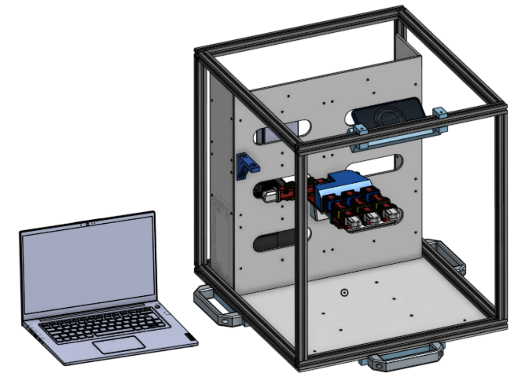
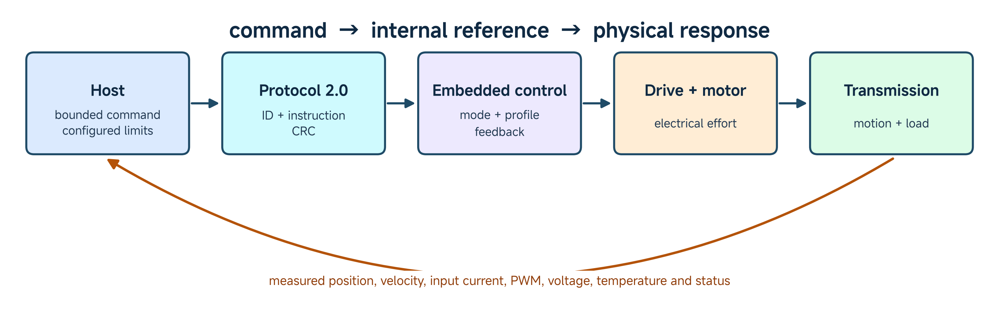
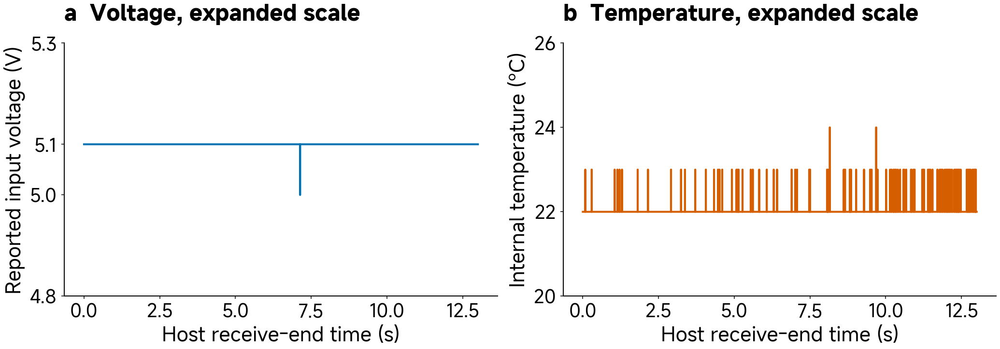

# 02 Actuator Basics for Controlled Action

**What turns a motor into an actuator capable of controlled action?** A motor produces torque, but a useful robotic joint must also accept a meaningful command, transfer effort to a mechanism, observe its state and respond within operating limits. We follow that process through the ROBOTIS XC330/XL330 and RobStride RS06/RS00 families.

*Figure 1. An AsBrainBox platform concept brings a host, a mounting structure and actuator-based mechanisms into one experimental setting. Identify the host and physical mechanisms before tracing their communication and power paths. This CAD view identifies an arrangement; it is not evidence that a particular experiment ran. [Source image](../resources/class02/media/FIGURE-CODE.md#asbrain-platform).*

The class develops three abilities: distinguish a motor from an integrated actuator; distinguish a command, an internal reference and a measured response; and read the exact model's specifications, interfaces and operating limits. The teaching-team demonstration connects application software to physical action and returning telemetry. The final activity is an unpowered XC330 inspection and an XC330/XL330 comparison.

The inspection and comparison activity is in Section 7. [Detailed technical reading](../resources/class02/reading-notes.md) · [Optional telemetry calculations](../resources/class02/telemetry-worked-example.md)

## 1. Controlled action as a physical feedback process

### Begin with the object

Look at the actuator before opening a program. Find the model label, output, mounting features and connectors. Identify which parts move relative to the housing. A mounted actuator is already part of a mechanical system: its mounting provides a reaction to the torque applied at its output.

*Figure 2. A physical XC330 beside its geometric representation. Identify the output and fixed mounting. Similar geometry helps locate interfaces, but does not establish similar behavior. [Figure source and code](../resources/class02/media/FIGURE-CODE.md#hardware-identity).*

**Predict:** a host requests a change of thirty degrees. Does the output jump, move gradually, oscillate or remain still? Name a physical condition and a controller setting that could change your prediction.

---

### Motor, transmission and integrated actuator

A motor converts electrical energy into mechanical work. An integrated actuator adds a transmission, output support, sensing, drive electronics, embedded control and a communication interface. Together, these parts turn a request into controlled action. A host application can be simple because substantial control already takes place inside the device.

The host supplies information; the electrical supply provides energy. A correct communication packet cannot move an unpowered mechanism. Conversely, connecting power does not specify the movement. The controller must interpret a command in the selected mode, and the drive must produce suitable motor effort.

The transmission connects the motor to the output. With reduction ratio $$N=\omega_m/\dot q$$, the motor rotates faster than the output. A simple steady transmission relationship is

$$
\tau_{\mathrm{out}}\approx\eta N\tau_m.
$$

Here $$q$$ is output angle, $$\omega_m$$ is motor angular velocity and $$\eta$$ represents efficiency. A 100:1 reduction gives an ideal output speed of 10 r/min from a motor speed of 1,000 r/min. Reduction trades speed for effort; it does not remove losses, backlash, compliance or thermal limits. Detailed motor and reflected-inertia derivations remain in the technical reading.

---

### Compare components at the correct level

“Brushless motor”, “harmonic drive”, “QDD actuator” and “smart servo” describe different levels of a system. A brushless motor is an electromagnetic machine: its stator windings, permanent-magnet rotor, shaft and bearings need a drive to produce controlled motion. A strain-wave transmission, often called a harmonic drive, is a reduction mechanism using a wave generator, flexspline and circular spline. It does not by itself supply the motor, sensing or controller.

A QDD actuator combines a motor and comparatively low reduction with sensing and drive control. A smart servo such as XC330 combines a different motor/transmission design with an embedded controller and a digital interface. Therefore, an integrated joint can contain both a brushless motor and a reduction mechanism; these are not four mutually exclusive motor species.

| Construction or component | What it contributes | What still needs to be identified |
|---|---|---|
| Coreless DC motor in XC330 | Converts electrical input into rotor effort | Drive, reduction, sensing and output support |
| Brushless motor | Uses electronically commutated windings and a magnetic rotor | Commutation/control, sensing and the connected mechanism |
| Strain-wave reduction | Transforms speed and effort through a reduction mechanism | Motor, bearings, sensing, elasticity, losses and control |
| QDD integrated actuator | Combines a motor, low-ratio transmission and drive/control | Exact ratio, motor properties, sensing and demonstrated operating limits |
| Smart servo such as XC330 | Packages gearing, sensing, firmware and a bus interface | Exact model, configuration, load and what each feedback channel measures |

**Inspect and explain:** a housing photograph can reveal connectors and mounting, but not all internal components or calibrated parameters. Use a section drawing or manufacturer's specification to identify construction; use measurements to establish behavior. A low gear ratio alone does not establish accurate force control, and high reduction alone does not establish poor positioning.

### Sensing makes correction possible

Let $$q(t)$$ describe physical output position and $$y(t)$$ its reported position measurement. A controller uses the measurement to compare what the mechanism is doing with what it should do. The encoder, controller and drive therefore belong to the actuator system even when they are hidden inside one housing.

Mechanical power at the output is

$$
P_{\mathrm{out}}=\tau_{\mathrm{out}}\dot q.
$$

An illustrative 0.10 N m at 2 rad/s gives 0.20 W. A stationary output has zero instantaneous mechanical power even while applying torque. Electrical losses can still produce heat. Holding a load and moving a load are consequently different operating conditions.

The mounting matters as much as the moving output. An unsecured housing can turn instead of providing the intended joint action. A useful experiment identifies what is fixed, what moves, what is measured and which reference direction is positive. These choices carry directly into the digital model in Class 03.

**Check:** identify the component that supplies energy, the component that estimates position and the component that decides how the drive responds. Which of those roles can be inferred merely from a CAD image?

## 2. Position, velocity and current-related control

### A request has meaning only through its interface

A position request specifies a target angle. A velocity request specifies how fast the output should move. A current request specifies a current-related quantity in the device's control interface. These commands answer different questions, even if they share the same communication cable.

| Mode or interface | Requested quantity | What the controller must still manage |
|---|---|---|
| Position | Desired angle | Trajectory, effort, feedback and position limits |
| Velocity | Desired angular speed | Acceleration, effort and accumulated travel |
| Current | Current-related target | Current regulation, electrical limits and mechanical response |
| Current-based position | Position with current-related control/limiting | Position/profile behavior and current-related limits |
| PWM | Drive modulation | Actual voltage, current, speed and load |

For a velocity request, position continues to change. Requesting zero velocity and requesting a particular position are therefore different instructions. For a current request, speed depends on the mechanism and load; the request does not prescribe one angle or one speed.

---

### Command, internal reference and measured response

*Figure 3. A functional command path from host through Protocol 2.0 and embedded control to physical action, with telemetry returning to the host. The embedded servo uses local feedback; the return arrow is host-visible information, not a diagram of all sensor locations. Supply current, PWM, voltage and temperature are not measured by the transmission. [Source and generation code](../resources/class02/media/FIGURE-CODE.md#command-architecture).*

Distinguish four quantities:

- $$u(t)$$: the host request, or an explicitly named goal-register readback;
- $$r(t)$$: the internal desired trajectory;
- $$q(t)$$: physical output position;
- $$y(t)$$: the reported position measurement.

Firmware can turn a sudden target into a gradual reference. Finite effort, inertia, resistance and load then affect the response. The signals have different identities even when their numerical values coincide. They can agree at a settled target; they need not be unequal at all times.

On XC330, Goal Position at address 116 holds the goal, Position Trajectory at 140 exposes an internal desired position, and Present Position at 132 reports encoder position. A later goal-register readback is also distinct from the host's original write and its timestamp.

*Figure 4. Three reported position signals from one physical XC330 episode. Left: the complete 13-second record. Right: a fixed first-reversal window, with original row 400 marked. Positions use count 2,048 as their declared zero; the horizontal axis is host receive-end time. [Data and interpretation](../resources/class02/data/xc330-hardware-demo/README.md) · [Figure code](../resources/class02/media/FIGURE-CODE.md#telemetry-motion).*

Read the reversal before doing arithmetic. The goal, internal reference and output separate while the movement changes direction. At the marked sample their relative angles are approximately 24.785°, 25.400° and 26.279°. Those observations help distinguish a requested target from the device's internal trajectory and the moving mechanism.

---

### Position holding, speed regulation and effort

Imagine three instructions applied to the same suitably configured joint. “Hold this angle” asks for position regulation. “Turn at a small constant speed” asks for velocity regulation. “Apply this current-related target” asks the drive to regulate an electrical quantity whose mechanical effect depends on the motor, transmission and load.

A slow response can have several explanations. The profile may deliberately move slowly; an effort limit may restrict acceleration; or the load may resist motion. Comparing $$u$$, $$r$$ and $$y$$ helps distinguish these cases. If $$r$$ is slow, the output may be correctly following a shaped reference. If $$r$$ changes while $$y$$ barely moves, inspect limits, configuration, faults and the mechanical system.

Current is useful telemetry, but its meaning is model-specific. XC330 reports input-supply current. That channel is not an independent measurement of output torque or motor winding phase current. A requested torque, an estimated torque and a calibrated torque measurement must be named separately. A simulator's torque command does not become a verified physical torque merely because its units are N m.

**Check:** can an actuator use electrical power while maintaining almost constant position? Can a velocity command run out of mechanical travel? Explain both using the requested quantity and the physical system.

## 3. XC330 and XL330: what smart actuation means

### Read the exact model name

The XC330-M288-T integrates a coreless DC motor, metal reduction gears, output bearings, a contactless absolute encoder, electronics and firmware. Its TTL interface carries digital instructions and status information. This integration is what makes the device convenient to use as a smart actuator; it does not guarantee a particular application accuracy or calibrated force sensing.

XC330 and XL330 are not interchangeable names for the same internal mechanism. The following exact-model values come from the ROBOTIS documents (ROBOTIS n.d.a; ROBOTIS n.d.b).

| Attribute | XC330-M288-T | XL330-M288-T |
|---|---|---|
| Motor and gears | Coreless DC; metal gears | Cored motor; engineering-plastic gears |
| Mass | 23 g | 18 g |
| Dimensions | 20 × 34 × 26 mm | 20 × 34 × 26 mm |
| Stall torque at 5.0 V | 0.93 N m | 0.52 N m |
| No-load speed at 5.0 V | 81 r/min | 103 r/min |
| Encoder resolution | 4,096 counts/revolution | 4,096 counts/revolution |

Both documents specify a 3.7–6.0 V input range with 5.0 V recommended, and a TTL multidrop interface. Similar external dimensions make this a useful comparison: matching shape does not imply identical materials, mass, effort or speed.

---

### Interpret the ratings

**Worked comparison:** at 5 V, XC330 has the greater specified stall torque, while XL330 has the greater no-load speed. Which is preferable depends on the intended task. Holding or accelerating a mechanism, achieving speed, reducing moving mass and choosing cost or durability can lead to different decisions.

Stall torque and no-load speed describe different test conditions. Stall means zero speed; no-load speed concerns very small external mechanical load. Multiplying the two extremes does not give an achievable continuous power. Sustained behavior additionally depends on heat transfer and operating limits.

A 12-bit encoder represents one revolution using 4,096 counts:

$$
\Delta q=\frac{360}{4096}\approx0.08789\text{ degrees per count}.
$$

This is resolution. Accuracy concerns agreement with the actual physical angle under stated conditions. Backlash, compliance, zero choice, assembly and calibration can affect accuracy even when the count increment is small. More digits in a log do not remove those effects.

### Read a performance curve, not just its endpoints

*Figure 5. Performance-curve extract supplied with the XC330 material and cross-checked against the XC330-M288-T documentation. Black uses the left speed axis, green the separate left efficiency axis and magenta the right current axis. Preserve the manufacturer's graphic as a source image. The crop does not state all test conditions; check its surrounding documentation before assigning a supply voltage or a sustained operating limit. [Image provenance](../resources/class02/media/FIGURE-CODE.md#manufacturer-performance-curve).*

Choose one horizontal torque coordinate, then read each curve on its own vertical scale. For example, around 0.36 N m the curves indicate a speed in the low-forties r/min, input current close to 1 A and efficiency around thirty percent. These are approximate readings from the graphic, not newly measured samples or a claim that its test condition matches our recorded episode.

The black curve decreases as load torque increases, while current increases. Efficiency rises from the low-load region and then falls. The high-efficiency operating region is not the stall point. ROBOTIS also distinguishes gradually loaded performance-curve testing from a momentary stall rating. This explains why the plotted curve can end before the quoted stall-torque extreme.

**Check the axes:** does the green value 40 mean 40 r/min, 40 A or 40%? Which conditions would you need before using the curve to select a supply or predict temperature? Do not calculate an efficiency for the physical episode from this picture and an uncalibrated torque estimate.

### Firmware is part of the system

XC330 supports current, velocity, single-turn position, extended-position, current-based position and PWM modes. Extended position changes the supported position representation; it does not remove mechanical travel constraints. The configured mode, gains, profiles and limits affect action. Changing Operating Mode can reset related fields; read configuration back after a change. A gain register value such as 800 is not automatically a physical stiffness of 800 N m/rad. An ID identifies a device, while a control-table address identifies a field within it.

In the recorded example, ID 5 uses baud selection 6, corresponding to 4 Mbit/s. That is communication speed. A logger receiving approximately 200 readings each second has an approximately 5 ms polling interval; neither number establishes the internal servo-loop frequency.

**Check:** find one property that XC330 and XL330 share and one that differs. Include the exact model, unit and condition. Explain why “both are 12-bit” is insufficient evidence that they will have identical positioning accuracy.

## 4. RS06 and RS00: proprioceptive and quasi-direct-drive actuation

### A different balance of motor and transmission

A quasi-direct-drive actuator combines a motor with a comparatively low reduction ratio. RS06 and RS00 use ratios of 9:1 and 10:1, respectively, rather than XC330-M288-T's approximately 288:1. Low reduction changes the trade between motor effort, speed, reflected inertia, friction and backdrivability. It is a design choice, not a universal performance ranking.

For an ideal transmission, $$\omega_m=N\dot q$$. A 1 rad/s output therefore corresponds to approximately 9 rad/s at the RS06 motor and approximately 288 rad/s at the XC330 motor. This comparison concerns the transmission relationship; it does not establish that both devices can deliver the same output effort under those conditions.

Motor inertia reflected to the output scales with $$N^2J_m$$ in the simple rigid-transmission model. Holding the same motor inertia fixed, increasing reduction increases that reflected term. Real devices have different motors, gear losses, elasticity and controls, so comparing gear ratios alone is insufficient to compare measured joint behavior. Class 03 will connect these physical properties to a mechanical model.

---

### What proprioception provides

In this context, proprioception means sensing variables associated with the actuator's own state: position, velocity, electrical current, temperature and status. These signals help regulate and interpret action. Their usefulness depends on where and how each quantity is measured or estimated.

The RS06/RS00 manuals describe three-phase motors, field-oriented control, position sensing and CAN communication. Current-related control and reported joint state can support compliant or effort-sensitive behavior. A current-based torque estimate still depends on the device model, calibration and transmission. It is not automatically an independent external force/torque measurement.

An actuator does not acquire whole-body intelligence merely by reporting its own state. That state becomes useful when the application connects it to a task, mechanism, environment and action policy. This is the same distinction we made between receiving a valid position packet and accomplishing a physical movement.

### Compare the two exact models

The following values refer to the supplied revision 260713 manuals, not to every device sold under a similar name (RobStride Dynamics Co., Ltd. 2026a, 2026b).

| Attribute | RS06 | RS00 |
|---|---|---|
| Rated voltage | 48 V DC | 48 V DC |
| Operating voltage range | 15–60 V DC | 24–60 V DC |
| Reduction | 9:1 | 10:1 |
| Mass | 621 ± 3 g | 310 ± 3 g |
| Rated load in the manual | 11 N m at 100 r/min, with specified cooling | 5 N m at 100 r/min, with specified cooling |
| Peak load in the manual | 36 N m | 14 N m |
| Communication | CAN, specified 1 Mbit/s | CAN, specified 1 Mbit/s |

Read the associated thermal test and mounting conditions before using the load figures. These are not directly equivalent to the XC330 stall rating. A larger numerical value does not by itself answer whether the actuator is appropriate for a particular mechanism or task.

---

### Put XC330 and RS06 beside one another

| Attribute | XC330-M288-T | RS06, manual revision 260713 |
|---|---|---|
| Supply | 3.7–6.0 V; 5.0 V recommended | 15–60 V operating; 48 V rated |
| Communication | TTL multidrop, DYNAMIXEL Protocol 2.0 | CAN, model-specific messages |
| Reduction | 288.35:1 | 9:1 |
| Mass | 23 g | 621 ± 3 g |
| Quoted output condition | 0.93 N m **stall** at 5 V | 11 N m **rated** at 100 r/min with specified cooling; 36 N m **peak** |

The last row deliberately names different rating conditions. It is not a matched test of continuous joint capability. The same host-side idea—send a target and observe feedback—therefore spans devices with very different power, mechanical and communication requirements.

### Connect the interface to a control law

The RS06 manual's operation-control interface expresses a torque reference using desired position, desired velocity, proportional and damping terms, and a feedforward contribution. A corresponding joint-level expression is

$$
\tau_{\mathrm{ref}}
=K_p(q_d-y)+K_d(\dot q_d-\hat v)+\tau_{\mathrm{ff}}.
$$

Here $$q_d$$ and $$\dot q_d$$ are desired position and velocity, $$y$$ is position feedback, and $$\hat v$$ is the device's velocity estimate. Keeping feedback distinct from physical $$q$$ preserves the signal definitions of Section 2. The equation describes requested controller effort; it does not establish that physical output torque equals that reference at every instant. Limits, transmission effects and estimation remain relevant.

**Worked example:** assume a hypothetical $$K_p=2$$ N m/rad, a position error of 0.10 rad, zero velocity error and zero feedforward. The proportional contribution is 0.20 N m. If velocity error is −0.20 rad/s and hypothetical $$K_d=0.10$$ N m s/rad, damping contributes −0.02 N m, giving a 0.18 N m reference. These numbers explain the equation; they are not station settings or a measured output-torque result.

An XC330 gain register cannot be substituted for this $$K_p$$ without a defined mapping. Likewise, DYNAMIXEL packets, IDs and register addresses cannot be sent unchanged to a RobStride CAN interface. The host software must respect each device's protocol, units, supported modes and status feedback.

Brushless motors, strain-wave transmissions and other actuator constructions extend these design choices. A motor, a reduction mechanism and an integrated joint remain different objects. Our two families are enough to examine that distinction without surveying every commercial product.

**Check:** which parts of the RS06 control equation describe a target, feedback, a gain and an effort reference? Which extra evidence would you need to call the reported quantity a calibrated physical output torque?

## 5. Read documents, interfaces and operating limits

### Find what each document can tell you

Use the **user manual** for installation, wiring, modes, registers, protocol behavior and operating restrictions. Use a **technical data sheet** for ratings, dimensions, interfaces and test conditions. Read the manufacturer's safety instructions with both. Document names vary, so inspect what the source actually contains rather than relying on an invented universal abbreviation.

| Document | Questions to answer before using the device |
|---|---|
| User manual / operating instructions | How is it installed, wired, configured, operated and maintained? What modes and faults exist? |
| Technical data sheet (TDS) | What exact model, dimensions, ratings, units and test conditions are specified? |
| Safety instructions in the manual | Which electrical, mechanical, thermal and handling restrictions apply? |
| Safety Data Sheet (SDS), when relevant to a supplied substance or material | What substance or mixture is covered, and what handling information does its supplier provide? |

Labels differ between suppliers. If a source uses “UDS”, read its own definition; do not assume a standardized document type or confuse it with a communication protocol. The required information matters more than the abbreviation.

A Safety Data Sheet normally concerns hazards of a substance or mixture. An actuator manual's safety section is not automatically an SDS. A lubricant, adhesive or battery used with the station can have its own relevant documentation.

For an actuator, a useful specification states the quantity, unit, condition and interpretation. “Torque: 0.93” is incomplete. “0.93 N m stall torque at 5 V” describes a particular rating, while a sustained joint task needs further thermal and operating information.

---

### Follow the command path through real components

The demonstration follows **application → asBrain/interface → actuator → telemetry**. At each boundary identify what is sent, what carries it, which device interprets it and what returns. If the station uses another supported interface, name it explicitly and follow the same boundaries.

*Figure 6. Actuator ports, three-conductor cable, U2D2 and power hub. The USB-to-bus interface carries host data; the hub provides a connection for external actuator power. [Figure source and code](../resources/class02/media/FIGURE-CODE.md#communication-parts).*

The two XC330 bus ports are equivalent connections to shared data, supply and ground. Daisy chaining extends the bus; cable order does not assign a device ID. An ID identifies the actuator, an address identifies one field inside it, and baud defines communication speed. A USB interface is not a substitute for the actuator's required external supply.

---

*Figure 7. The supplied component arrangement does not show the USB lead or external power source attached. Use it to identify components and missing connections. Consult the exact wiring source before energizing a station. [Figure source and code](../resources/class02/media/FIGURE-CODE.md#connection-inspection).*

For RS06/RS00, identify the CAN adapter, bus wiring, supply and model-specific protocol instead. Verify the selected interface/protocol and reported device identity. Similar host software does not make TTL and CAN connectors, supply voltages or message formats interchangeable.

### ID, field address and baud rate answer different questions

An actuator **ID** selects a device on the shared DYNAMIXEL bus. A **control-table address** selects a field within that device. **Baud rate** determines the compatible serial communication rate used by the host interface and actuator. None of these specifies the mechanical angle by itself. Protocol 2.0 also defines the instruction and packet integrity check; a correctly formed packet still needs the correct destination, field, data representation and operating context.

**Worked packet interpretation:** “ID 5, address 116, value 2330” identifies an actuator and its Goal Position field. The value 2330 is a register count, not 2330 degrees. With the recorded episode's declared reference of count 2048, it corresponds to approximately 24.785°. Reading address 132 returns Present Position instead. Sending the same number to another field does not preserve its meaning.

The Baud Rate register is address 8. Its stored value is a selection code: 6 means 4 Mbit/s for this model, rather than 6 bit/s. ID is stored at address 7. If two actuators share one ID, their replies can collide; moving a cable to a different position in the chain does not repair the duplicate identity. If the host and device use incompatible baud settings, an otherwise correct ID is insufficient for communication (ROBOTIS n.d.a, n.d.c).

For teaching-team commissioning, establish one device's identity before extending the chain:

1. With actuator power disconnected, check mounting, connectors and the approved supply. For communication setup, keep torque disabled and follow the station procedure.
2. Connect one unambiguous device; ping at its known communication rate and read its model, firmware, ID and baud selection.
3. If an ID or baud change is needed, follow the exact-model procedure, including torque-off requirements for protected fields. Change one device at a time and keep the host's settings consistent.
4. Reconnect or reboot only where the documented procedure requires it; ping again and save the configuration readback before allowing motion.

These steps explain configuration; they are not a powered student activity. A mode change can reset gains, profile or limit-related values, so read them back rather than assuming the earlier configuration survived.

### Daisy chaining shares both communication and power

The two three-pin ports extend the same data, supply and ground conductors. Each device needs a unique ID and compatible bus settings regardless of where it sits in the chain. A supported broadcast instruction has protocol-defined behavior; it is not a substitute for recording individual device identities.

Adding motors also adds power demand. Wiring and the supply carry the combined current; voltage drop can become important at distant devices. A communication symptom can therefore originate in the physical supply path as well as in an ID, baud or packet problem. For Class 02, identify that dependency; Class 05 develops multi-actuator operation.

**Diagnose before guessing:** two devices answer when connected separately, but the combined setup is unreliable. Check duplicate IDs, compatible rates, wiring/polarity and the supply path before changing controller gains. Disconnect actuator power before changing cables. DYNAMIXEL TTL settings cannot be substituted for the CAN identifier and bit-rate settings of RS06/RS00.

### Read limits before interpreting a response

Connect limits to the intended action: position travel, speed, acceleration/profile settings, current or drive limits, temperature, mounting and cooling. A command may be syntactically valid yet inconsistent with the mechanism's travel or the station's operating conditions. A fault or protection response can also explain why the output stops following a request.

Keep a concise record: exact model and firmware, interface and units, operating mode, gains/profile/limits, mechanical mounting/load, and the reported signals. Distinguish a documented rating from a station readback and from a measured response. Those are three different sources of knowledge.

**Before the break:** choose one entry from the XC330 document and one from an RS06/RS00 manual. State what the entry tells you and what it leaves unresolved for a particular task. Next, the teaching team will show how those definitions meet an actual or recorded station.

## Break

Prepare the demonstration view and the unpowered XC330 units for the final inspection. The next part follows the command and returning telemetry; students operate no powered station.

## 6. Teaching-team demonstration

### Identify the station and trace the path

Start at the application. Identify the connected device, the asBrain or other configured interface, the actuator's model/firmware and its mode. Trace the physical communication and power connections. Point to the output, mounting and available feedback. Ask the class to distinguish the target shown in the application from the returning state.

Read the station's actual configuration rather than assuming defaults. Show the selected travel, profile and effort bounds and the available stop action. The teaching team performs powered operation using its prepared station procedure. The supplied photographs and frozen configuration provide the corresponding recorded fallback.

### Show a bounded position request and its response

Use a small request already qualified for the mounted station. Ask for a prediction, then show the requested target, internal reference where exposed, measured position and status. Explain a shaped reference, a lagging physical response and a settled target using the signal identities from Section 2. Return to the prepared state through the station procedure.

For the recorded route, Figure 4 provides the same observation questions. The supplied Mode 5 episode contains 2,601 readings from a motor-only XC330. Read the three position values at the marked reversal; a full conversion exercise is optional rather than a required part of this demonstration.

### Read the complete hardware state

Position alone does not describe the actuator's operating context. The same episode also reports velocity, input current, PWM, input voltage and internal temperature. Read these channels alongside the command and internal reference; distinguish a raw control-table number from its decoded engineering quantity.

| Channel | Model-specific conversion in this saved record | Original row 400 |
|---|---|---|
| Present Position | Subtract the declared reference 2048, then multiply by 360/4096 degrees | 2347 → 26.279° |
| Present Velocity | Multiply signed raw value by 0.229 r/min | −19 → −4.351 r/min |
| Present Current | Multiply signed raw value by 1 mA | −32 → −32 mA input-supply telemetry |
| Present PWM | Multiply signed raw value by 0.113% | −8 → −0.904% |
| Present Input Voltage | Multiply raw value by 0.1 V | 51 → 5.1 V |
| Present Temperature | Already degrees Celsius | 22 → 22 °C |

These CSV raw columns are already signed where appropriate. Do not apply a second sign decode. The host's receive-end time, a device clock and the internal servo period are different timing quantities. The approximately 200 Hz record rate does not change that distinction.

*Figure 8. Input current and PWM from every row of the same physical episode. Current is input-supply telemetry; PWM is drive modulation. Neither curve independently measures output torque. [Generation code](../resources/class02/media/FIGURE-CODE.md#telemetry-electrical).*

*Figure 9. Supply voltage and internal temperature over the same episode, with explicit expanded axes. The recorded voltage spans 5.0–5.1 V and temperature 22–24 °C. This short movement is not a sustained-load thermal test. [Generation code](../resources/class02/media/FIGURE-CODE.md#telemetry-environment).*

The [complete raw/engineering-unit matrix](../.gitbook/assets/class02/Class02-raw-and-engineering-telemetry.png) preserves the assistant's six-channel overview. The separate figures above give each relationship more reading space. Use the [offline measured-record explorer](../resources/class02/RUN.md#measured-record-explorer) to inspect individual samples without connecting hardware.

**Interpret the evidence:** which signals vary during a reversal? Which describe electrical or thermal context? Explain why negative reported current cannot simply be multiplied by a nominal constant and labelled calibrated output torque. The recorded-data route supports the same observation questions as the physical demonstration; numerical conversion remains optional practice.

### Compare supported modes and device interfaces

Show the meaning of a second supported mode through a qualified station operation or a clearly identified existing recording. Position mode and current-based position mode are useful examples: both accept a position request, while their configured effort/control behavior differs. Velocity or current operation can be shown only when that station's prepared procedure covers it. A mode-selection menu alone does not demonstrate physical behavior.

For the recorded alternative, the retained Mode 3 step and Mode 5 records show two actual configurations. They come from different devices/assemblies and are **not a controlled comparison of mode performance**. Use them to identify requests and feedback. Use the RS06/RS00 manual and the actual station readback to compare CAN interface and operation-control quantities with the XC330 control table.

### Interpret the response and close the station

Choose a position, current-related, temperature or fault field and explain what it reports. Name one quantity the field does not independently measure. Ask the class to identify the complete application-to-telemetry path again, then close or disable the station using the teaching team's procedure.

A recorded demonstration preserves the same questions when powered equipment is unavailable. The [supporting resource guide](../resources/class02/README.md) identifies the offline files. The teaching team prepares and qualifies the powered station. No package installation, full campaign audit or parameter fitting belongs during the demonstration.

## 7. Student activity: unpowered inspection and comparison

Each student inspects an **unpowered XC330** and returns it. Teams then compare XC330-M288-T and XL330-M288-T using official documentation and the lesson's specification extract. Keep power disconnected; do not disassemble the device or force the output.

### Inspect and identify

Find the exact model label, output, mounting features and connectors. Identify what moves relative to the fixed housing. Record the available feedback quantities from the documentation, distinguishing them from visible physical features.

Each student returns the unit after inspection. If units are limited, rotate them within the team; the supplied photographs support identification while waiting.

### Compare the exact models

Use the [XC330 source](https://docs.robotis.com/docs/dxl/model_reference/x_series/xc_series/xc330-m288/) and [XL330 source](https://docs.robotis.com/docs/dxl/model_reference/x_series/xl_series/xl330-m288/) or the lesson's attributed extract.

| Comparison | Your response |
|---|---|
| One shared property | Name it; include units where relevant |
| Construction or mass difference | State the exact models and values/materials |
| Torque or speed difference | Include the unit, supply voltage and rating condition |
| Implication for an intended use | Explain which property matters and why |

Can the quoted stall torque and no-load speed be obtained simultaneously? Does 4,096 counts/revolution establish positioning accuracy? Use the definitions in the lesson.

### Record and return

Check that all units have been returned. Submit one short team comparison with labelled inspection notes, model-specific evidence and the interpretation. Use the [printable record](../.gitbook/assets/class02/Class02-Activity.pdf) or equivalent notes.

No software installation, powered operation, raw-data conversion or parameter fitting is required. Optional follow-up: locate three research examples using XC330/XL330; record the exact model and role, or state that the exact model could not be verified.

## 8. Optional follow-up and the next class

Find three research examples using XC330/XL330. Record the exact model, the role it plays, the source and what the source actually establishes. If an exact model cannot be verified, record that uncertainty rather than inferring it from a photograph.

For further study, [telemetry calculations](../resources/class02/telemetry-worked-example.md) develop raw-to-engineering conversions and the distinction between tracking error and a Sim2Real comparison. The [technical reading](../resources/class02/reading-notes.md) develops motor equations, step/frequency responses and the retained XC330/RS06 studies. These are supporting resources, not replacements for the planned Class 02 activity.

Class 03 asks what a digital representation of this physical system must preserve. Geometry, frames, joints, moving mass, inertia and the actuator interface follow from the boundaries identified here. A visually similar model is a starting point; behavior must be investigated as well.

## Quick reference: XC330 control-table fields

Use this table to locate information in the exact XC330-M288-T documentation, not as an instruction to write arbitrary registers. A field's address, byte width, sign, unit, access permission and mode-dependent meaning all matter. In particular, profile fields can have different meanings under velocity-based and time-based profiles. Check firmware and readback before changing a configuration.

| Purpose | Field and address | Interpretation |
|---|---|---|
| Identity and interface | Model Number (0), Firmware Version (6), ID (7), Baud Rate (8) | Device identity, unique bus address and rate-selection code |
| Control context | Drive Mode (10), Operating Mode (11), Torque Enable (64) | Profile interpretation, selected mode and drive-enable state |
| Configured bounds | PWM Limit (36), Current Limit (38), Velocity Limit (44), Max/Min Position Limits (48/52) | Limits must be interpreted in the supported mode and unit |
| Effort-related requests | Goal PWM (100), Goal Current (102) | PWM/current targets or mode-specific bounds; not measured output torque |
| Motion requests | Goal Velocity (104), Goal Position (116) | Requested speed or position in the selected mode |
| Internal profile | Profile Acceleration (108), Profile Velocity (112), Velocity Trajectory (136), Position Trajectory (140) | Profile settings and internally generated desired motion |
| Reported motion/drive | Present PWM (124), Present Current (126), Present Velocity (128), Present Position (132) | Drive-related telemetry and reported motion state |
| Timing and context | Realtime Tick (120), Present Input Voltage (144), Present Temperature (146) | Device tick, input supply and internal temperature; not a common synchronized clock |

The device tick has a documented range and wraps; it must not be substituted directly for an unbounded host timestamp. The two position channels at 116 and 132 also answer different questions even if their values happen to agree. Revisit this table when Class 03 defines the digital system boundary and Class 04 compares predicted and measured outputs.

## References and documents

ROBOTIS. n.d.a. “XC330-M288-T.” *ROBOTIS Documentation*. Accessed October 17, 2026. [Exact-model documentation](https://docs.robotis.com/docs/dxl/model_reference/x_series/xc_series/xc330-m288/).

ROBOTIS. n.d.b. “XL330-M288-T.” *ROBOTIS Documentation*. Accessed October 17, 2026. [Exact-model documentation](https://docs.robotis.com/docs/dxl/model_reference/x_series/xl_series/xl330-m288/).

ROBOTIS. n.d.c. “DYNAMIXEL Protocol 2.0.” *ROBOTIS Documentation*. Accessed October 17, 2026. [Protocol specification](https://docs.robotis.com/docs/dxl/protocol/protocol2/).

RobStride Dynamics Co., Ltd. 2026a. *RS06 User Manual*. Revision 260713. [Supplied source](../.gitbook/assets/class02/RobStride_RS06_User_Manual_260713.pdf), Sections 1, 2 and 4.3.

RobStride Dynamics Co., Ltd. 2026b. *RS00 User Manual*. Revision 260713. [Supplied source](../.gitbook/assets/class02/RobStride_RS00_User_Manual_260713.pdf), Sections 1 and 2.

Photographs and the matched CAD view were supplied by Mohamad Halwani. [Figure inputs and generation code](../resources/class02/media/FIGURE-CODE.md) · [Record identity](../resources/class02/data/xc330-hardware-demo/README.md).
