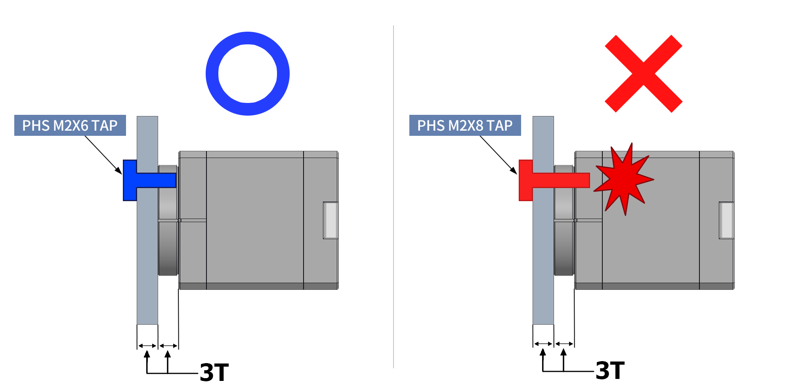

# Class 02 — Practice: inspect an actuator before using it

**Time:** 15 minutes · **Format:** pairs or small teams · **Equipment:** one unpowered XC330 station, one unpowered RS06, the figures below, and the exact-model manuals.

This is a hardware-inspection activity only. You will not power, configure, command, rotate, disassemble, or connect/disconnect any device. The goal is to separate what the hardware visibly establishes from what must be established by documentation or a later powered test.

The class page [Controlled action as a physical feedback process](02-actuator-basics-for-controlled-action.md) explains the actuator functions you are locating.

---

## Safety and handling boundary

Before starting, confirm with the TA that the station is unpowered and disconnected from its supply. Leave every switch off and every cable as found.

- Handle units by their housing, not by wires or connectors.
- Do not plug, unplug, loosen, open or re-route a connection.
- Do not force or turn an output shaft, horn or flange.
- Do not remove a horn, screw, motor or cable from its mount.
- Ask the TA before touching an item whose purpose or handling is unclear.

The purpose is to establish visible interfaces and topology, not to test motion or communication.

---
## 0. Check the XC330 Manual: 

[XC330-M288-T Manual](https://docs.robotis.com/docs/dxl/model_reference/x_series/xc_series/xc330-m288)

## 1. Read the XC330 as a physical object

Find the exact model text printed on the motor. Then locate the output horn, the horn-retaining screw, the housing, mounting points, and the two 3-pin connectors.

*Figure 1. Official ROBOTIS XC330 horn and screw installation illustration. Use it to identify the output-side parts and the difference between a mounting feature and an electrical connector. It is a documentation figure, not an instruction to remove or tighten anything in this activity. Source: ROBOTIS, XC330-M288-T e-Manual, “How to Assemble.”*

The two connectors are part of the same TTL bus path: the documentation identifies the three conductors as **GND**, **VDD**, and **DATA**. The presence of two sockets makes a daisy-chain physically possible; it does not assign an ID, prove a baud rate, or show that the motor is powered.

*Figure 2. Official ROBOTIS TTL connector pinout: GND, VDD and DATA. Compare the diagram with the visible cable and connector orientation without unplugging it. Source: ROBOTIS, XC330-M288-T e-Manual, “Connector Information.”*

**Record:** exact model label; location of the output/horn; visible mounting features; number and location of connectors; and one property that cannot be established by looking alone.

---

## 2. Trace the XC330 station without changing it

Start at the XC330 and follow every visible cable to the next component. Continue through the USB/TTL interface and the station's separate power connection. Use Figure 3 as a naming guide, but record only connections that you can actually see on your station. If a part of the path is hidden, write **not established** rather than guessing.

*Figure 3. Course hardware components used to discuss the communication and power paths. A USB interface and a power connection perform different functions. The associated connection photograph in the package does not show a complete energized setup.*

For each visible link, identify its likely role:

| Item | What to inspect | What inspection can establish | What it cannot establish |
| --- | --- | --- | --- |
| XC330 connector and cable | connector shape, cable route, second socket | a physical bus/power connection exists | device ID, baud rate or valid packets |
| USB/TTL interface | USB side and motor-bus side | where computer-side communication changes interface | that a host is sending a command |
| Separate power path | supply-side connector, switch or distribution item | that power has a distinct physical path | voltage at the motor or that power is enabled |
| Horn and mounting | output-side attachment and housing support | where the motor could transmit motion and reaction load | output angle, torque or fastening quality under load |

**Discuss:** Why does a correctly connected-looking cable not establish that the actuator is addressed correctly, configured for a mode, or receiving a command?

**Record:** the ordered visible component path, cable/connector labels where visible, and which link appears to carry communication, power, or both.

---

## 3. Inspect the RS06 as a different actuator

The RS06 should not be treated as a larger XC330. Locate its exact label, output flange or shaft, housing, mounting interface, and cable/connector. Compare the mechanical output and connection arrangement with the XC330 before consulting a specification.

*Figure 4. Retained page from the RobStride RS06 user manual. Use the labelled manual drawing together with the physical unit to identify interfaces and dimensions; do not infer an electrical rating or a performance value from appearance. Source: RobStride, RS06 User Manual, revision 260713.*

Then find one RS06 specification in the manual that cannot be safely measured here: for example, voltage range, rated torque, speed, reduction ratio, communication requirement, or a mounting dimension.

**Record:** one visible difference from the XC330 in output or mounting; one visible difference in electrical connection arrangement; and one manual claim with its unit, operating condition (if given), document revision, and page or section.

---

## 4. Consolidate the inspection record

| Item | Record |
| --- | --- |
| XC330 identity | Exact label and visible mechanical interfaces |
| XC330 connection path | Ordered visible components; communication and power distinguished where established |
| XC330 evidence boundary | One visible fact and one fact that requires documentation or a powered test |
| RS06 identity | Exact label and visible mechanical/electrical interfaces |
| RS06 documentation check | One specification with unit, condition and document location |
| Open question | What is one property inspection alone cannot establish ? |
| Open question | What is Daisy Chain ? |

Return all items to the TA. Inspection can establish visible interfaces and topology; it cannot establish powered operation, configuration, feedback validity, fastening quality under load, or actuator performance.

## Figure sources

- ROBOTIS. *XC330-M288-T e-Manual*: [retained manual](../resources/class02/materials/additional_material/manuals/XC330-M288-T_eManual.html), “How to Assemble” and “Connector Information.”
- RobStride. *RS06 User Manual*, revision 260713: [retained manual](../resources/class02/manuals/RobStride_RS06_User_Manual_260713.pdf).
