# 03 Basic Digitization of Physical Embodiment

## Central question

> What does a digital representation preserve, and which parts can we validate?

An actuator receives a command, applies effort and produces measurable motion. Digitization describes the mechanism receiving that effort: what moves, where motion occurs, how mass is distributed and how the model accepts an input. This class follows the source XC330 fixture through physical assembly, computer-aided design (CAD) and an executable MuJoCo description. [Class 02](02-actuator-basics-for-controlled-action.md) supplies the actuator functions, control objectives and manufacturer-document reading that precede this inspection.

The main route uses the **ROBOTIS XC330-M288-T** and its declared 110 g external moving fixture. The separate [RS06 fixture companion](03-rs06-fixture-digitization.md) applies the same inspection questions to a different actuator, different loads and a different controller interface. Configuration names such as B1 are local to each apparatus; they do not identify interchangeable masses or models.

By the end of this class, you should be able to:

- Explain the difference between appearance and mechanical correspondence.
- Inspect units, frames, joints, mass, inertia and actuator-input meaning.
- Identify the evidence needed before calling a model predictive.

[Lecture](#start-with-the-same-b2-assembly-in-three-records) · [Instructor and TA demonstration](#instructor-and-ta-demonstration) · [Student activity](#student-activity)

The source CAD views, models, measurements and saved load checks support the demonstration and activity. They can be completed from these prepared records.

## Start with the same B2 assembly in three records

What should remain recognizable as we move from design to simulation to hardware? The following three source views show B2 in that order. Find the fixed housing, the output axis, the link and the two payload assemblies in every view. Appearance helps establish component identity; mass properties and joint declarations require further inspection.

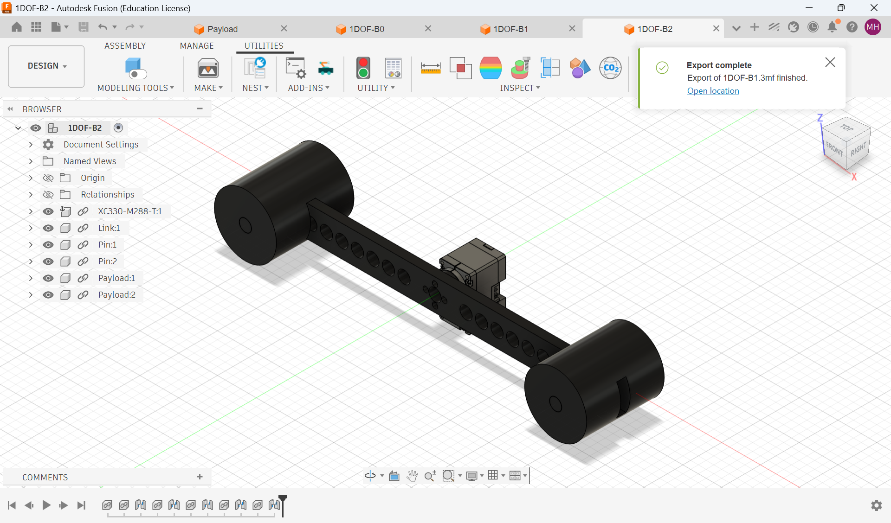

*Figure 1. B2 Fusion 360 CAD assembly.*

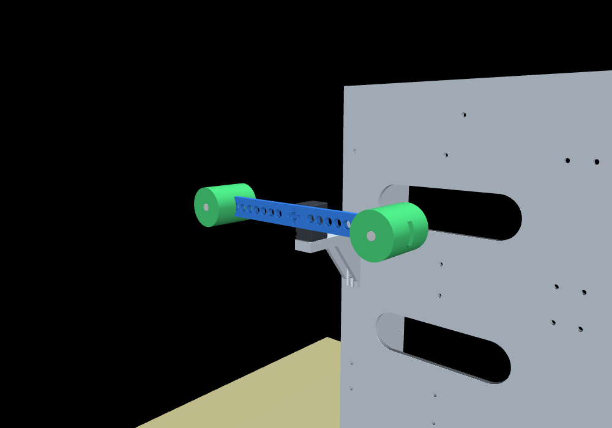

*Figure 2. B2 loaded in MuJoCo.*

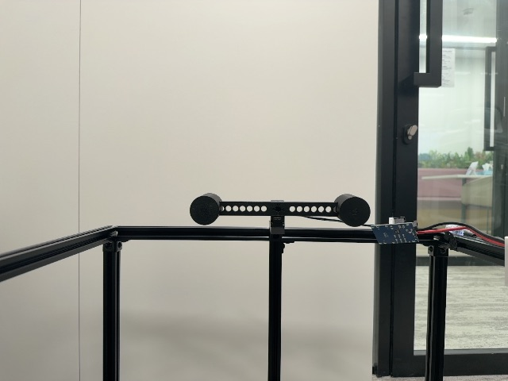

*Figure 3. Physical B2 fixture.*

The housing is fixed to the support. The output turns the link, and the attached pins and payloads move with it. Several manufactured parts therefore form one moving rigid assembly. Separate mesh or body records can preserve component bookkeeping without adding independent motion. **One hinge gives one rotational coordinate; the number of parts does not determine the number of degrees of freedom.**

## Decide what the representation must preserve

A photograph records appearance from one viewpoint. CAD describes designed geometry, assembly structure and material assignments. A simulation description additionally specifies mechanical connectivity, physical parameters, inputs and numerical rules. Two similar renderings can conceal different joint axes or inertias; camera zoom can even conceal an incorrect length scale.

Use these course definitions to state the correspondence claim. A **digital representation** describes selected physical-system properties. A **digital cousin** supports exploration of a similar mechanism without establishing correspondence to this particular unit. A **task-bounded digital twin** links an identified physical counterpart to tested predictions for stated tasks and conditions. The stronger claim needs stronger evidence. A useful geometry model can precede dynamic validation.

The source digitization chain below connects the physical measurement, CAD, MJCF and validation records. MJCF is MuJoCo’s XML model-description format. Ask which arrow supplies a declaration and which supplies evidence against a physical counterpart.

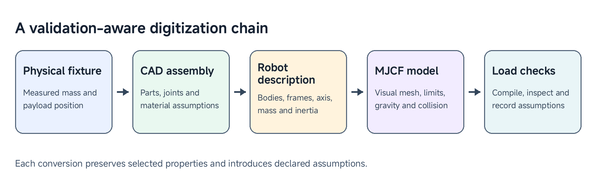

*Figure 4. Validation-aware digitization chain.*

## The physical fixture and configuration set

The fixture uses a ROBOTIS XC330-M288-T actuator, an asBrain Box platform, a printed link, pins, and payload bodies. The link has an accepted mass of 22 g. Each pin-and-payload assembly has an accepted total mass of 44 g.

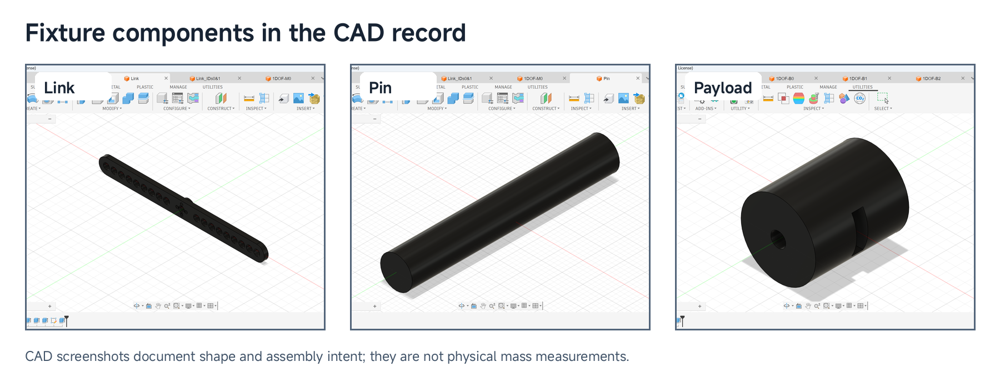

*Figure 5. Fixture components in the CAD record.*

The five supplied configurations share the same platform and actuator arrangement.

| Case | Link | Payload-centre positions | External moving mass |
|---|---:|---:|---:|
| M0 | none | — | 0 g |
| B0 | 22 g | −60 mm, +60 mm | 110 g |
| B1 | 22 g | −80 mm, +80 mm | 110 g |
| B2 | 22 g | −100 mm, +100 mm | 110 g |
| G1 | 22 g | +60 mm, +100 mm | 110 g |

*Figure 6. Declared external moving assemblies.*

The B0, B1, and B2 arrangements are symmetric about the output axis. Their ideal gravitational moments cancel at the reference pose, while their rotational inertia changes as the payloads move outward. G1 places both payloads on the same side, producing a gravity moment that is useful for studying the relationship between load position and joint torque.

## Explain why mass and placement matter

Mass, centre of mass and rotational inertia answer different questions. Mass measures translational inertia; the centre of mass is the mass-weighted mean position; rotational inertia measures resistance to angular acceleration about a specified axis. Equal moving masses can produce different joint dynamics when their placement changes.

CAD derives physical properties from shape and material assignments. Printed infill, voids, unmodelled fasteners and assembly differences can make the built object differ. Weighing the complete assembly provides evidence for its mass, but does not independently measure its centre of mass or inertia tensor. Keep source-accepted masses, CAD-derived properties, manufacturer nominal values, assumptions and later fitted parameters visibly distinct.

For a rigid component, the parallel-axis principle gives

$$
J_{\mathrm{axis}}=J_{\mathrm{COM,parallel}}+mr^2.
$$

Here $$r$$ is the perpendicular distance from the component's centre of mass to the joint axis. Add all components moving with the joint. **Analytical illustration using the declared placements:** moving both 44 g assemblies from B0's ±60 mm to B2's ±100 mm, with their orientations and internal properties unchanged, gives

$$
\begin{aligned}
\Delta J&=2(0.044)(0.100^2-0.060^2)\\
&=0.0005632\ \mathrm{kg\,m^2}.
\end{aligned}
$$

The unchanged link and central-inertia contributions cancel in this difference. This is a calculation from the declared geometry, not a new measured inertia or a replay result. The external moving mass stays $$0.022+2(0.044)=0.110\ \mathrm{kg}$$ while inertia increases. External fixture mass excludes the fixed motor housing and is not the actuator's catalogue module mass.

Gravity balance is a separate question. Equal opposite first moments can cancel while their squared-distance inertia contributions add. Thus a balanced assembly can require substantial acceleration effort. An eccentric load produces a gravity moment that also depends on the axis orientation and pose. A vertical rotation axis has no gravity moment about that axis.

| Property | Evidence to preserve |
|---|---|
| Complete link and pin–payload masses | Accepted physical values in the source measurement record |
| Component geometry and centre of mass | CAD declarations, with material and fabrication assumptions |
| Joint-axis inertia | CAD tensor, orientation and parallel-axis calculation |
| Rigid connections and collision policy | Model assumptions for the intended task |
| Additional joint losses and actuator response | Separate response experiments and fitted effective terms |

Scaling a CAD inertia with mass assumes a density change that preserves shape and centre of mass. It does not prove that the real internal mass distribution changed uniformly. That approximation must remain available for later testing.

## CAD, export, and MJCF

CAD is an efficient starting point because it records component shape, assembly structure, and reference frames. Before export, inspect the fixed component, moving component, revolute-joint axis, joint range, and component material assignment.

The model uses SI units: metres, kilograms, seconds, radians, and newton-metres. STL meshes are millimetre-scale source assets, so their MJCF mesh declarations apply a scale of `0.001`.

The key MJCF elements are:

| MJCF element | Role in the fixture |
|---|---|
| `body` | Creates the actuator, link, pin, and payload hierarchy. |
| `joint` | Defines the single revolute degree of freedom. |
| `geom` | Loads visual or collision geometry. |
| `inertial` | Sets body mass, centre of mass, and inertia tensor. |
| `actuator` | Applies the simulation control input. |
| `sensor` | Reports joint position, velocity, and actuator effort. |

The packaged joint is a hinge about the local positive `y` direction with a range of −90° to +90°. The actuator declaration provides a direct torque interface for controlled simulation experiments.

### Trace one point through frames and units

Before interpreting a coordinate, name the point, frame and unit. A body position is expressed in its parent frame; a joint axis is a direction in the frame declared by the model. The joint origin and body origin need not coincide. A point rigidly attached to the link keeps its link-frame coordinates while its world coordinates change.

The general point transformation is

$$
{}^A p_P={}^A R_B\,{}^B p_P+{}^A p_{O_B}.
$$

The rotation $${}^A R_B$$ converts components from frame B to frame A, and $${}^A p_{O_B}$$ locates B's origin in A. A point requires rotation and translation. An axis direction uses rotation alone. This is a three-dimensional point transformation, rather than a six-dimensional spatial-motion transform.

For an **illustrative** payload point initially $$r=0.100\ \mathrm m$$ along the positive x direction from a hinge rotating about positive y, its displacement from the hinge is

$$
{}^W p_P-{}^W p_J=
\begin{bmatrix}r\cos q\\0\\-r\sin q\end{bmatrix}.
$$

This expression assumes aligned zero-pose axes. At $$q=\pi/6$$ rad, the displacement is approximately $$[0.08660,0,-0.05000]^{\mathsf T}\ \mathrm m$$. Check the actual model's transforms before applying this illustration to an exported part. It explains the sign and rotation rule without claiming a newly verified hardware coordinate.

A mesh `scale="0.001 0.001 0.001"` converts millimetre vertices to metres. It does not convert `body pos`, `joint pos` or inertial-position attributes for you. Likewise, degrees shown by a viewer must be converted to radians at the simulation interface. A unitless axis vector identifies direction, not length.

### Separate visual, collision and inertial descriptions

A visual mesh supports recognition. Collision geometry defines contact surfaces. Inertial declarations specify mass, centre of mass and inertia. A simplified contact shape is acceptable only when it preserves the features needed for the contact task. Explicit inertial records can be independent of the visual or collision surface.

The source validation checks collision declarations as well as appearance. A visible platform or floor does not itself establish physical contact in the model. Inspect the actual collision flags before using the fixture for a contact task.

### Controller boundary: physical XC330 versus this MJCF model

The `<motor>` actuator in the supplied MJCF is deliberately simple: `data.ctrl[0]` is a requested **joint torque** in N m, limited to ±0.1551 N m. It does not contain the XC330 firmware, its profile generator, or its hidden current/velocity loops. This is a useful teaching boundary because it lets us add and inspect a controller explicitly.

| Physical hardware path | Matching simulation path | Same thing? |
| --- | --- | --- |
| Host writes `Goal Position` to the XC330 | A Python program sets `data.ctrl[0]` | No: one is a position request; the other is torque. |
| XC330 generates internal position/velocity trajectories and closes embedded loops | A later explicit PD law calculates torque from reference minus simulated state | Similar purpose, but not firmware equivalence. |
| `Present Position` is encoder telemetry | `data.qpos` is simulated joint state | No: one is measured; one is predicted. |

An explicit controller can turn position and velocity references into a bounded torque request:

$$
\tau_{\mathrm{cmd}} = \operatorname{sat}_{[-\tau_{\max},\,\tau_{\max}]}\!\left(
K_p(q_{\mathrm{r}}-q) + K_v(\dot q_{\mathrm{r}}-\dot q)
\right),
\qquad \tau_{\max}=0.1551\,\mathrm{N\,m}.
$$

With this direct-motor declaration, the command written to `data.ctrl[0]` is the saturated commanded torque, `tau_cmd`. The saturation function clamps the requested torque to the stated interval. The proportional gain, `Kp`, converts position error into requested torque; the velocity gain, `Kv`, opposes relative velocity.

The values `-0.1551` and `+0.1551` N m are the negative- and positive-direction torque limits of the supplied simulation actuator. Each fixture MJCF declares `ctrlrange="-0.1551 0.1551"` and `forcerange="-0.1551 0.1551"`. They are a symmetric model limit selected for this teaching plant; they are not a measured output torque, a continuous XC330 rating, or the XC330 stall-torque specification. The controller is an example of how to command the digitized plant, not a calibrated representation of the embedded XC330 controller.

## Fusion and ACDC4Robot export

The source Fusion sequence records the **B0 assembly procedure**. It illustrates joints and attachments shared by this fixture family; it is not another B2 hardware record. Read it alongside the complete model and mass record, rather than treating every visible CAD choice as an independently measured physical property.

### Locate the motor–link joint

The first two records select joint origins on the link and motor. Follow the selected component identities and the alignment of their origins. The assembly tree preserves the distinction between components even when several will move together.

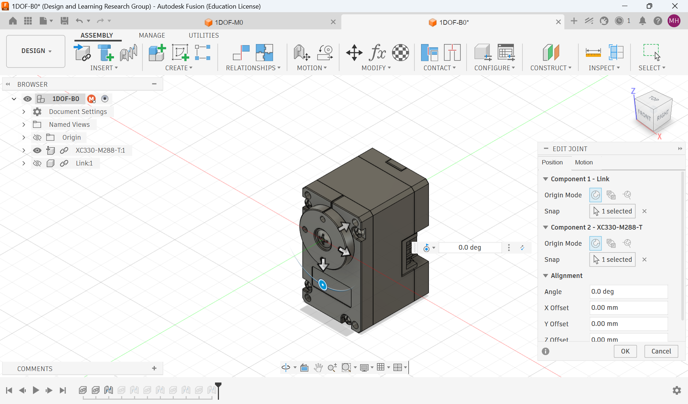

*Figure 7. Source B0 joint-origin selection at the XC330 output, with the link hidden.*

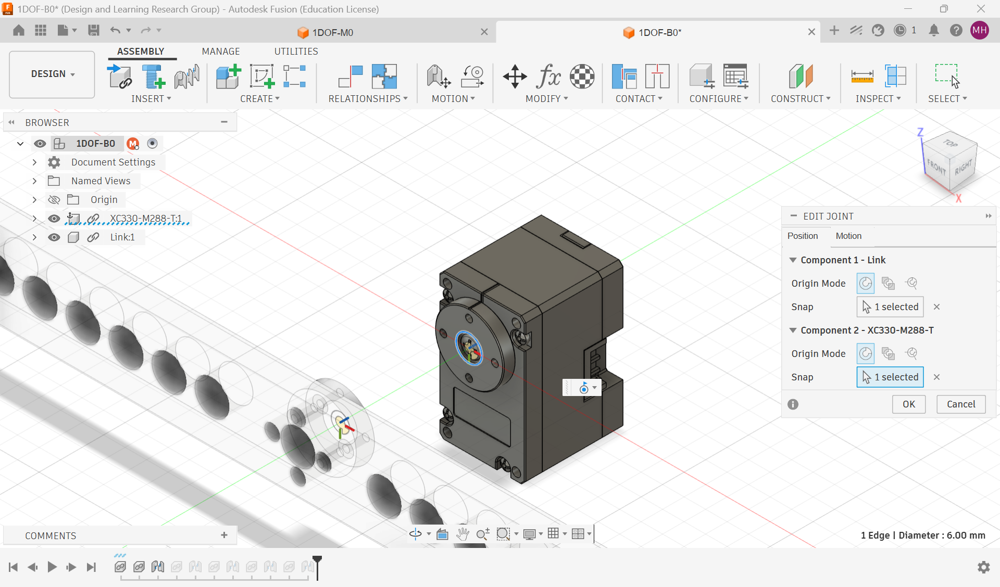

*Figure 8. Source B0 link and motor component origins selected for the joint relationship.*

### Separate revolute motion from rigid attachment

The next record declares revolute motion. Fusion shows a rotation axis in the selected joint frame; the exported MJCF expresses its hinge axis in the model's local frame. An axis label cannot be copied between these frames without tracing the export transformation.

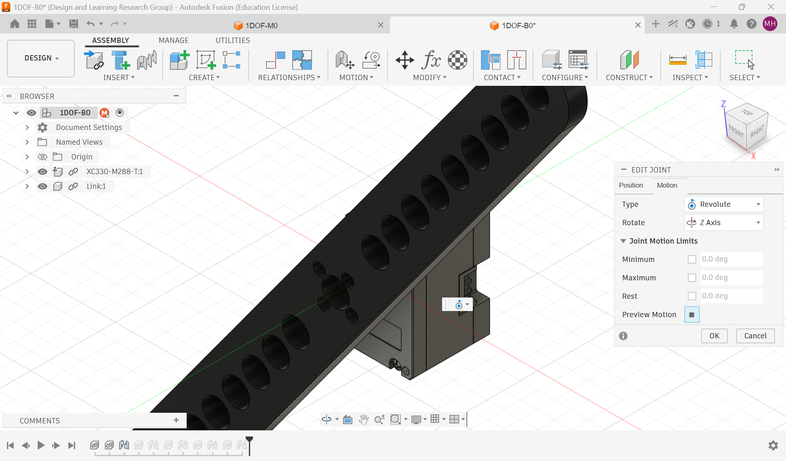

*Figure 9. Source B0 revolute-joint motion setting. The displayed axis belongs to the Fusion joint frame.*

The following records select payload and pin origins, set a rigid relationship, and repeat the attachment process for the second payload. A rigid relationship permits no relative motion; it adds mass to the moving assembly without adding another degree of freedom.

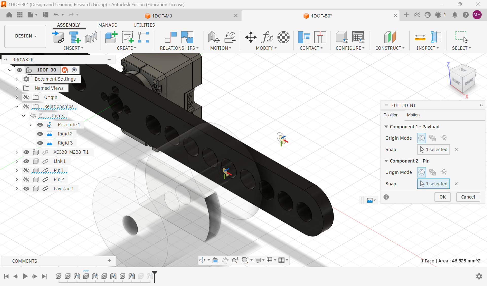

*Figure 10. Source B0 payload and pin origins selected for attachment.*

*Figure 11. Source B0 payload-to-pin relationship set to rigid.*

*Figure 12. Source B0 second payload and pin origins selected for their attachment.*

### Inspect the export boundary

ACDC4Robot selects MJCF and MuJoCo as the description and simulation targets. Component structure, joint frames and limits, mesh paths and inertial properties must still be inspected after export. Material assignments influence CAD property estimates, but these joint screenshots do not independently verify those assignments or the built mass.

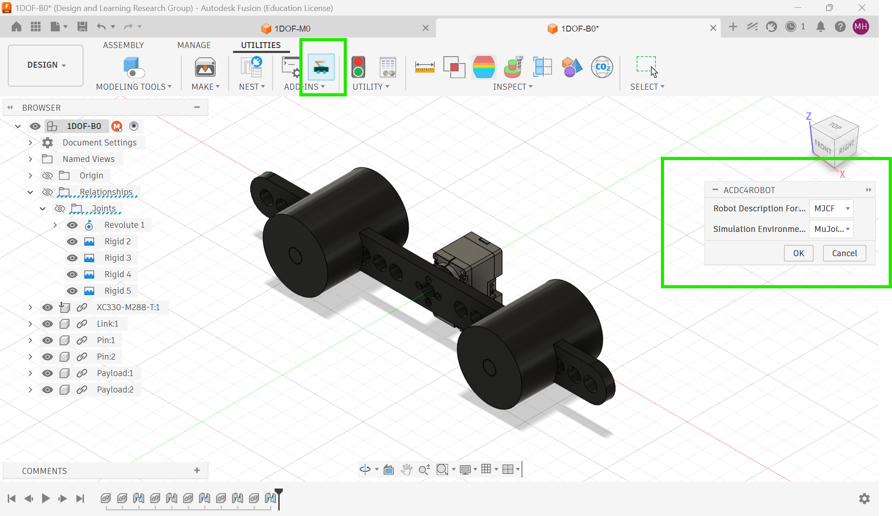

*Figure 13. Source B0 ACDC4Robot export configured for MJCF and MuJoCo.*

## Simulation model and purpose

Simulation provides a repeatable environment for a defined analysis objective. For this fixture, it supports coordinate-convention and joint-direction analysis, balanced and asymmetric payload comparison, gravity-torque estimation, reference-pose and command-profile preparation, and comparison with matched physical inputs.

For the one-degree-of-freedom fixture, the joint dynamics can be expressed as:

$$
H(q)\ddot q + C(q,\dot q) + \tau_{\mathrm{f}}(\dot q) + \tau_{\mathrm{b}}(q,\dot q)
= \tau_{\mathrm{a}} + \tau_{\mathrm{ext}}.
$$

Here, $$q$$ is the scalar joint angle, $$H(q)$$ is the generalized inertia, and $$C(q,\dot q)$$ contains gravity and velocity-dependent rigid-body bias. The terms $$\tau_f$$, $$\tau_b$$, $$\tau_a$$ and $$\tau_{\mathrm{ext}}$$ denote friction, transmission effects, delivered actuator torque, and external disturbance torque. In a multi-joint mechanism, the generalized coordinates are collected in a vector; this fixture has one generalized coordinate. The notation follows R. Featherstone, *Rigid Body Dynamics Algorithms*, Springer, 2008.

The packaged MJCF uses the declared body geometry, inertia, gravity, joint range, 2 ms timestep, implicit-fast integrator, and direct torque interface. These settings create a consistent foundation for simulation exercises.

The transmission term is included only when it represents an effect not already counted in the friction or actuator description. Do not subtract the same loss twice. For this isolated rigid hinge, fixture inertia is constant; Class 04 specializes the balance and asks which remaining effective terms can be estimated from position response.

## Representative motor simulation

A representative motor simulation combines mechanical structure with actuator and control behaviour under a shared command signal and time base.

| Data group | Values used in simulation | Practical effect |
|---|---|---|
| Rigid mechanism | axis, zero pose, range, mass, centre of mass, inertia | gravity moment, acceleration, reachable motion |
| Actuator capacity | supply voltage, current/torque limits, torque–speed curve | available torque during motion |
| Passive mechanics | breakaway, Coulomb and viscous friction, damping, compliance | slow motion, reversals, settling |
| Embedded control | operating mode, gains, filters, command rate, encoder resolution, delay | tracking, lag, overshoot, apparent stiffness |
| Experiment context | initial state, payload, command, clock, temperature, output log | repeatable comparison between simulation and experiment |

The following is a proposed sequence of checks, not a claim that every measurement has already been completed:

1. Align the zero pose, axis sign, range, geometry, and combined load inertia.
2. Use the same reference signal and time base in the physical test and simulation.
3. Identify torque capability and saturation at the operating voltage.
4. Fit breakaway, Coulomb, and viscous friction from slow sweeps and coast-down motion.
5. Identify closed-loop response using step, chirp, and load-disturbance experiments.
6. Evaluate trajectories and payload arrangements that were reserved for testing.

### Backlash and noise

Backlash is clearance in a transmission. During a reversal, input motion can pass through a small deadband before torque transfers to the output. A compliant two-body transmission, a controller deadband/hysteresis element, or an uncertainty band around reversals can represent this behaviour, depending on the exercise.

Sensor noise, encoder quantization, timing jitter, voltage variation, cable forces, and temperature-dependent friction can be represented as measured stochastic or bounded uncertainty. The important habit is to state the chosen representation and compare it with repeated observations.

## Relate printing and assembly to uncertainty

Printing turns nominal geometry into a part with an actual internal structure and interfaces. Wall count, infill and print orientation affect mass and stiffness; shrinkage, support removal and fasteners affect fit and alignment. A rigid-body model abstracts these details, so ask whether that abstraction suits the intended motion.

A useful physical inspection names one functional dimension, such as a bore or mounting-hole location, and its measurement method. It also records complete moving mass with fasteners. A ruler and scale can test selected dimensions and mass, but do not independently establish inertia, stiffness or backlash. If the shape is correct but mass differs, a mass-scaled CAD inertia is an initial approximation. If the link flexes or slips at the shaft, changing mass alone does not correct the joint model.

The source fabrication example provides a [prepared H2D link 3MF](https://github.com/asEmbodiedAISyst/2026Autumn/blob/main/course-resources/Class%2003%20%E2%80%94%20Basic%20digitization%20of%20physical%20embodiment/additional_material/demonstration/h2d/Link_for_H2D.3mf). Its guide uses millimetres, Bambu Lab H2D, a 0.4 mm nozzle and a labelled PLA preset. These identify a prepared source example, not a newly performed fabrication test. A further inspection can relate broad-face orientation and the sliced preview to the interface that must fit, then compare a prepared part's dimensions and complete mass with the declared record.

## Separate a successful load from a validated prediction

The source validation program loads the five MJCF files and checks the platform, joint structure, range, actuator, collision declarations, moving mass and gravity signature. The saved views show that the exported models load. Compare the source M0/B0/B1/B2/G1 records below with their declared load arrangements.

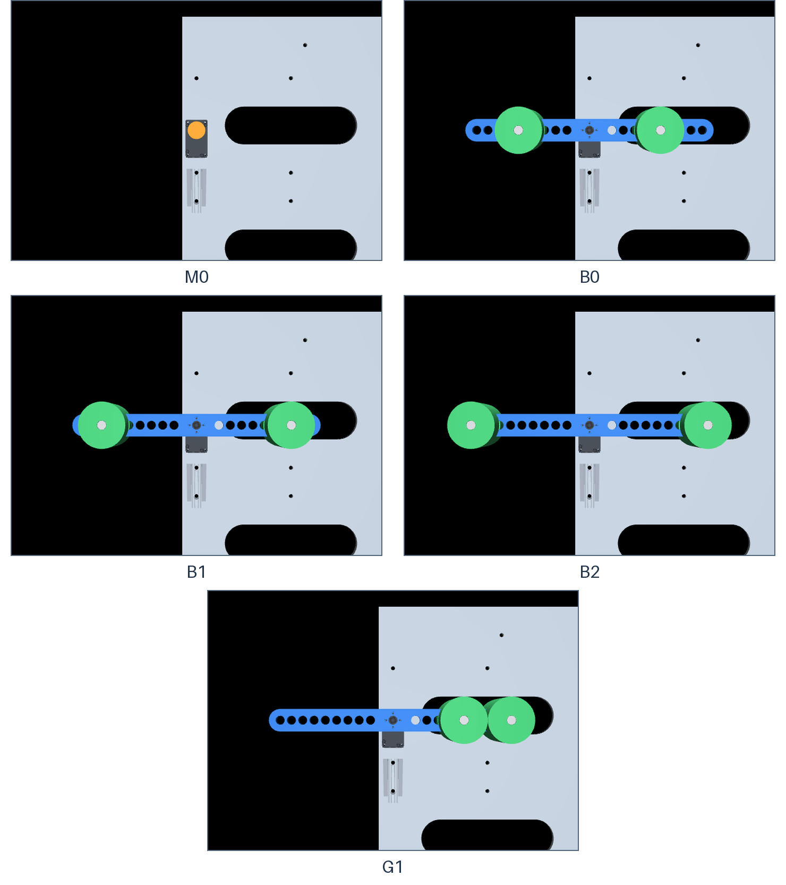

*Figure 14. Five source MJCF load checks.*

Three questions require different evidence. **Implementation:** does the executable description implement the intended topology, units and parameters? **Physical correspondence:** do its geometry, axis, moving mass and interfaces correspond to the built fixture? **Behavioral validation:** does it predict measured outputs under matched inputs and conditions? Compilation supports implementation checks; a scale or axis-direction check supports selected physical properties; a motion comparison tests prediction.

The Sim2Real gap can enter through design omissions, printing, assembly, the input/measurement interface or simulation assumptions. A delayed command can resemble excess inertia in a response plot. Check units, topology, input meaning and clocks before changing physical parameters to improve the fit. Printed infill, mounting play, cable forces and compliance also need evidence appropriate to their effect.

## Instructor and TA demonstration

**Question:** what does the source B2 record establish before a motion experiment? Use the three opening B2 views, component record, Fusion sequence, complete B2 MJCF and saved five-model validation record. The prepared records are the materials; an available unpowered fixture can make component identification more concrete.

First trace the fixed housing and moving link/payload assembly across the CAD, MuJoCo and hardware records. Identify the single revolute coordinate and the declared ±100 mm payload centres. Next follow the Fusion records: distinguish rigid payload attachments from the hinge, inspect its axis and the rigid attachments, then locate the corresponding `body`, `joint`, `inertial`, `actuator` and `sensor` declarations in the source model.

Finally compare the five saved load checks and source measurement table. Explain why B0/B1/B2 can have the same external mass and different inertia, and why G1 changes gravity loading. End by stating one supported structural claim and one behavioral question still requiring measured motion. The saved source views and validation table provide the fallback if CAD or a viewer is unavailable. The separate RS06 companion is a transfer example, not an extra XC330 validation result.

For the source fabrication extension, inspect the prepared H2D link file, declared units/material and sliced preview alongside a prepared printed part when available. Relate orientation and clearance to the mounting interface; do not wait for fabrication to finish. A comparison made from stored geometry alone remains a source-record inspection rather than a new physical measurement.

## Student activity

Inspect the source **B2 XC330** records and complete one compact inspection record. The supplied objects are the three opening B2 views, component/mass table, complete B2 MJCF and saved validation record.

1. Identify the fixed component, moving rigid assembly, joint axis, range and one input/output pair. Explain why two payload bodies do not create two extra degrees of freedom.
2. Trace one payload-centre declaration from millimetres in the configuration record to metres in the model. Name the parent frame; explain why its local coordinate is not automatically a world coordinate.
3. Recalculate the analytical B0-to-B2 inertia difference above. State what stays constant and why this is not a measured total joint inertia.
4. Separate a source physical mass, a CAD estimate and a model assumption. Use the B2 views or validation record for one observation, then identify a physical check needed before claiming dynamic correspondence.

Submit the record with the configuration and source files identified, units on the calculation, and one bounded conclusion. The task concerns inspection and explanation. Follow the preserved source package if conducting further model inspection; do not treat an unrecorded payload alteration as an existing experiment.

## Carry the model into a response test

[Class 04](04-basic-quantification-of-sim2real-gap.md) uses the source declared-110 g XC330 experiment to compare measured position with a frozen replay model. The [RS06 digitization companion](03-rs06-fixture-digitization.md) and its [identification companion](04-rs06-hardware-identification.md) keep that apparatus's CAD masses, controller interface and experiments together.

## Source records and further reading

The source package preserves the original CAD, accepted measurement record, complete MJCF/meshes, photographs and validation outputs from the course fixture record at source revision `f7c118edaadc9f33498669736fa9d99160ff629a`. The B2 views, component/configuration figures, B0 Fusion screenshots and load-check images above belong to that record. Its prepared example records support the inspection above:

| Need | Source record |
|---|---|
| Package and demonstration guide | [README](https://github.com/asEmbodiedAISyst/2026Autumn/blob/main/course-resources/Class%2003%20%E2%80%94%20Basic%20digitization%20of%20physical%20embodiment/README.md); [current demonstration notes](#instructor-and-ta-demonstration) |
| B2 CAD and MJCF | [STEP assembly](https://github.com/asEmbodiedAISyst/2026Autumn/blob/main/course-resources/Class%2003%20%E2%80%94%20Basic%20digitization%20of%20physical%20embodiment/additional_material/cad/STEP/1DOF-B2.step); [complete B2 model](https://github.com/asEmbodiedAISyst/2026Autumn/blob/main/course-resources/Class%2003%20%E2%80%94%20Basic%20digitization%20of%20physical%20embodiment/additional_material/models/1DOF-B2.xml) |
| Fabrication geometry | [Link](https://github.com/asEmbodiedAISyst/2026Autumn/blob/main/course-resources/Class%2003%20%E2%80%94%20Basic%20digitization%20of%20physical%20embodiment/additional_material/cad/3MF/Link.3mf), [Pin](https://github.com/asEmbodiedAISyst/2026Autumn/blob/main/course-resources/Class%2003%20%E2%80%94%20Basic%20digitization%20of%20physical%20embodiment/additional_material/cad/3MF/Pin.3mf), [Payload](https://github.com/asEmbodiedAISyst/2026Autumn/blob/main/course-resources/Class%2003%20%E2%80%94%20Basic%20digitization%20of%20physical%20embodiment/additional_material/cad/3MF/Payload.3mf) |
| Accepted masses and placements | [Measurement record](https://github.com/asEmbodiedAISyst/2026Autumn/blob/main/course-resources/Class%2003%20%E2%80%94%20Basic%20digitization%20of%20physical%20embodiment/additional_material/measurements/AS_BUILT_DIMENSIONS_MASSES_AND_POSITIONS.txt); [CAD comparison notes](https://github.com/asEmbodiedAISyst/2026Autumn/blob/main/course-resources/Class%2003%20%E2%80%94%20Basic%20digitization%20of%20physical%20embodiment/additional_material/measurements/CAD_COMPARISON_NOTES.txt) |
| Saved validation | [JSON record](https://github.com/asEmbodiedAISyst/2026Autumn/blob/main/course-resources/Class%2003%20%E2%80%94%20Basic%20digitization%20of%20physical%20embodiment/additional_material/results/model_validation.json); [scientific table](https://github.com/asEmbodiedAISyst/2026Autumn/blob/main/course-resources/Class%2003%20%E2%80%94%20Basic%20digitization%20of%20physical%20embodiment/additional_material/results/tables/model_validation.csv) |
| Validation implementation | [Source model checker](https://github.com/asEmbodiedAISyst/2026Autumn/blob/main/course-resources/Class%2003%20%E2%80%94%20Basic%20digitization%20of%20physical%20embodiment/additional_material/code/validate_models.py) |

Featherstone, Roy. 2008. *Rigid Body Dynamics Algorithms*. Springer. The dynamics and frame discussion supplies theory; the linked source fixture records supply this class's practical evidence.
