# 03 Basic Digitization of Physical Embodiment

## Central question

What does a digital representation preserve, and which parts can we validate?

An actuator receives a command, applies effort and produces motion that can be measured. Here we ask how to represent the mechanism receiving that effort. A digital model must specify what moves, where motion occurs, how mass is distributed and how effort enters the system. Its usefulness depends on preserving the properties needed for a stated task and checking those properties against appropriate evidence. For the actuator functions, control objectives and TDS/UDS document reading that precede this model, see [Class 02](02-actuator-basics-for-controlled-action.md).

Our running example is an XC330 actuator carrying a link and two payload assemblies. We follow it from the physical mechanism through CAD, robot description and MuJoCo. The RS06 demonstration applies the same inspection method to another actuator. The student activity returns to XC330 and changes one declared payload parameter.

The new task is to make and inspect an executable representation. Actuator-family history, product selection and control-law introductions remain in Class 02. Here, geometry, coordinate frames, rigid connections and mass distribution determine what the simulated mechanism does. Class 04 develops quantitative identification and response comparison using a separately documented 98 g campaign. It carries forward the inspection method, while keeping that campaign distinct from this 110 g structural model.

By the end, you should be able to:

- Distinguish a digital representation, digital cousin and task-bounded digital twin through their intended use and evidence of correspondence.
- Inspect geometry, frames, joints, mass, inertia and collision assumptions.
- Define validation for a physical actuator with a specified link/payload experiment.

[Lecture](#start-with-what-moves) · [Instructor and TA demonstration](#instructor-and-ta-demonstration) · [Student activity](#student-activity)

The figures, XML excerpts, tables and recorded measurements on this page support the reading and model-inspection activity. Handling a physical actuator, opening CAD and inspecting a printer are extensions when those facilities are available; identify source-record comparisons separately from measurements you make yourself.

## Geometry alone does not establish behavioral correspondence

### Start with what moves

Place the physical actuator and its link/payload assembly beside their digital representations. The housing is fixed to the support. The output shaft turns the link. The pins and payloads are attached to the link and move with it. Before discussing software, identify the relative motion: the moving assembly rotates about one axis relative to the housing.

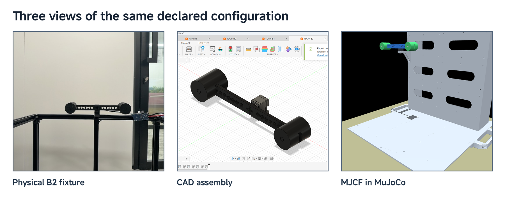

*Figure 1. The declared B2 fixture in physical, CAD and simulator views. Appearance establishes recognizable geometry; each view supports different claims about structure and behavior.*

Several manufactured parts can form one moving rigid assembly. Separate model bodies can also preserve component bookkeeping while remaining rigidly attached. Neither the number of parts nor the number of meshes determines the number of degrees of freedom. Our one hinge supplies one rotational coordinate. Adding a payload mesh should not accidentally add another independent motion.

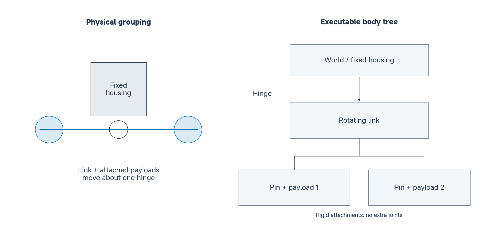

*Figure 2. Read the tree from top to bottom: the fixed housing supports one hinge, the link rotates at that hinge, and the two attached payload groups introduce no extra joints. The left sketch groups the same external mechanism physically.*

This abstraction already contains choices. We treat the link and attachments as rigid and omit cable flexibility and shaft play. Those choices may be adequate for a limited free-motion experiment. They need reconsideration if the task depends on structural vibration, backlash or cable interference.

### Ask what the representation preserves

A photograph records appearance from a viewpoint. CAD describes designed dimensions and assembly relationships. A simulation model additionally declares mechanical structure, physical parameters and the rules used to compute motion. These descriptions overlap, but none automatically supplies all the others.

Two models can produce almost identical pictures while having different joint axes or inertias. Camera zoom can conceal an incorrect length scale. Conversely, a simple link and two primitive payload shapes may preserve the properties needed for an isolated joint experiment better than a visually detailed model with incorrect physical parameters.

Use these working distinctions throughout the course. They describe the correspondence claim we will test; terminology varies across the literature, so these are course definitions rather than a universal classification:

| Representation | Claim being made |
|---|---|
| Digital representation | Selected properties of a physical system are described |
| Digital cousin | A similar model supports exploration without establishing correspondence to this particular unit |
| Task-bounded digital twin | An identified physical counterpart and defined correspondence process support tested predictions for stated tasks and conditions |

The stronger claim requires stronger evidence. Calling a CAD assembly a twin does not establish its predictive accuracy. A representation can still be useful for geometric inspection or experiment preparation before its dynamic predictions have been tested.

**Predict:** From Figure 1, what could you inspect visually? What would require a ruler, a scale or a recorded motion experiment?

## Sim2Real differences enter throughout the physical and digital chain

A requested command and reported response can differ because of delivery delays, controller behaviour and sensing. For digitization, record the controller mode, input units, limits and clock definitions as an interface contract, then inspect how the model and physical construction implement it.

| Stage | Concrete example | What to inspect or record |
|---|---|---|
| Design | A cable or compliant connection is omitted | Whether that feature matters for the intended motion |
| Manufacturing | A printed link uses infill rather than solid material | Actual dimensions, mass and process settings |
| Assembly | Clearance permits play or a shaft is misaligned | Fit, mounting, fasteners and reference pose |
| Input and observation interface | A target/reference or timestamp is interpreted differently in the model | Record mode, units, limits and clock definitions |
| Simulation | Contact is disabled or a passive effect is omitted | Explicit model settings and their intended scope |

Suppose simulated motion begins earlier than physical motion. Increasing inertia may make the simulated response look slower, but this can compensate for a timing error without explaining it. First inspect what the timestamp means, when the command is applied, and whether the physical and simulated inputs have the same interpretation.

Similarly, a nominally identical printed part can have different mass and stiffness because its material or internal structure differs. A correct outer shape does not establish the correct inertia, and a fitted parameter cannot by itself tell you which manufacturing difference caused an output discrepancy.

A useful diagnostic order is to establish units and topology, check input/output meaning and timing, inspect physical properties, and then evaluate missing mechanisms or uncertain parameters. Change one declared assumption at a time when explaining its effect. This makes the model's improvement interpretable rather than merely making one plot look closer.

**Checkpoint:** Which of the following are different problems: a reversed joint axis, an incorrect payload mass, a delayed command, and an omitted flexible connection? What evidence would distinguish them?

## CAD physical properties are estimates with limited validation

### Mass, centre of mass and inertia answer different questions

Mass quantifies a body's translational inertia. The centre of mass describes the mass-weighted mean position. Rotational inertia describes resistance to angular acceleration about a specified axis. Equal masses can have different inertia when placed at different distances from that axis.

CAD computes physical-property estimates from geometry and material assignments. A solid-material density may be a poor description of a printed component with infill and voids. Fasteners or attachments absent from CAD can also change the moving assembly. Weighing the complete assembly provides evidence for its mass, but does not independently measure its centre of mass or inertia tensor.

The inertia tensor describes a body's rotational mass distribution. A joint-axis inertia depends on that distribution, the body's orientation and the axis location. For this class, recognize the tensor in the model and understand one scalar calculation rather than deriving a full spatial-dynamics algorithm.

### Move a payload without changing its mass

For a rigid component, the parallel-axis principle gives

$$
J_{\mathrm{axis}}=J_{\mathrm{COM,parallel}}+m r^2.
$$

The first term is the component's inertia about an axis through its centre of mass parallel to the joint axis. The distance r is perpendicular to those axes. Add the contributions of all components moving with the joint. The term involving squared distance explains why placing a payload farther out increases joint inertia.

Our declared XC330 teaching family uses a 22 g link and two complete 44 g pin–payload assemblies. The included [fixture mass record](../resources/class03/records/fixture-masses.txt) reports these masses. The model's component inertias are CAD-derived estimates scaled to the recorded masses. Their status remains different from an independently measured inertia. The 110 g is **external moving fixture mass**; it excludes the fixed housing and is not the 23 g nominal XC330 module mass quoted in Class 02. The Class 02 M0 recording has no external moving fixture. A response measured in M0 does not validate the dynamics of B2.

The source XML also retains approximately 0.11859 kg on its fixed `XC330-M288-T` body, an unverified CAD/export property rather than the catalogue module mass. That fixed body does not contribute to the isolated hinge's moving inertia. Its mass record would need correction or verification before reusing the assembly in a floating-base or whole-system mass calculation.

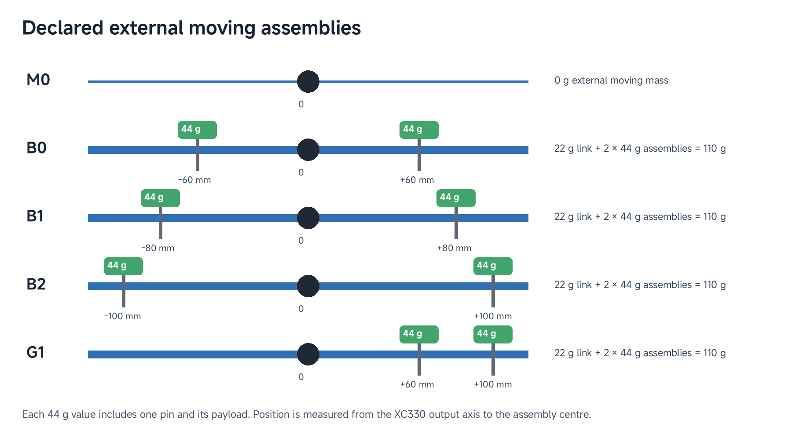

*Figure 3. B0, B1 and B2 place equal 44 g assemblies at symmetric radii. G1 places them on one side. Each complete assembly includes its pin. These are declared positions in the 110 g teaching family.*

The fixture names identify model configurations: M0 has no external link/payload load; B0, B1 and B2 use symmetric payload positions; G1 places both assemblies on the same side. The executable XC330 M0 retains a tiny dummy moving body ($$10^{-6}$$ kg and approximately $$10^{-12}$$ kg m² joint inertia). It keeps the unloaded structural model executable; it is not a measured rotor/gearbox inertia. The physical actuator still has rotating internal parts, so use M0 here to inspect structure rather than predict unloaded acceleration.

Compare B0 at ±60 mm with B2 at ±100 mm. Convert to SI units before calculating:

$$
m_{\mathrm{moving}}=0.022+2(0.044)=0.110\ \mathrm{kg}.
$$

With component orientation and internal properties unchanged,

$$
\Delta J=2(0.044)(0.100^2-0.060^2)
=0.0005632\ \mathrm{kg\,m^2}.
$$

The link and unchanged central inertia terms cancel from this difference. Moving mass stays constant while inertia increases. For the same angular acceleration, the inertial torque contribution therefore increases.

Balance is a separate question. Equal masses at opposite signed positions can have cancelling first moments, while their squared-distance inertia terms add. The ideal symmetric fixture can be balanced about a horizontal axis and still have substantial inertia. Moving both masses to one side produces a gravity moment whose magnitude and sign depend on orientation and pose. A vertical rotation axis has no gravity moment about that axis.

### Keep a property ledger

| Property | Evidence category | Meaning in this example |
|---|---|---|
| Complete link and payload masses | Source-recorded measurement | Values reported for this fixture family |
| Product dimensions | Manufacturer nominal | Reference values to compare with the available component |
| Component central inertias | CAD-derived | Estimates based on geometry and mass scaling |
| Rigid connections and collision policy | Assumed/model declaration | Choices defining the simulation task |
| Effective actuator/passive terms | Fitted when estimated from responses | Parameters whose interpretation depends on the fitted model |

Scaling a CAD inertia by a mass ratio approximates a density change while retaining shape and centre-of-mass location. It does not establish that the real internal mass distribution changed uniformly. Record that approximation so a later experiment can test its adequacy.

**Checkpoint:** A scale confirms the assembled moving mass. Which entries in the ledger remain estimates or assumptions?

## Define the single-actuator experiment before claiming validation

### Make the comparison specific

A claim such as “the model matches the actuator” leaves too much unspecified. Identify the actuator, link/payload configuration, mounting, joint zero, positive direction, command mode and operating range. State the applied input and measured output, and how their clocks are aligned.

For our later position-response experiment, the target is a specified actuator and fixture under stated commands and controller settings. Contact, thermal behavior and gearbox wear are outside this initial task. Those effects need additional states, observations or experiments before predictive claims about them are justified.

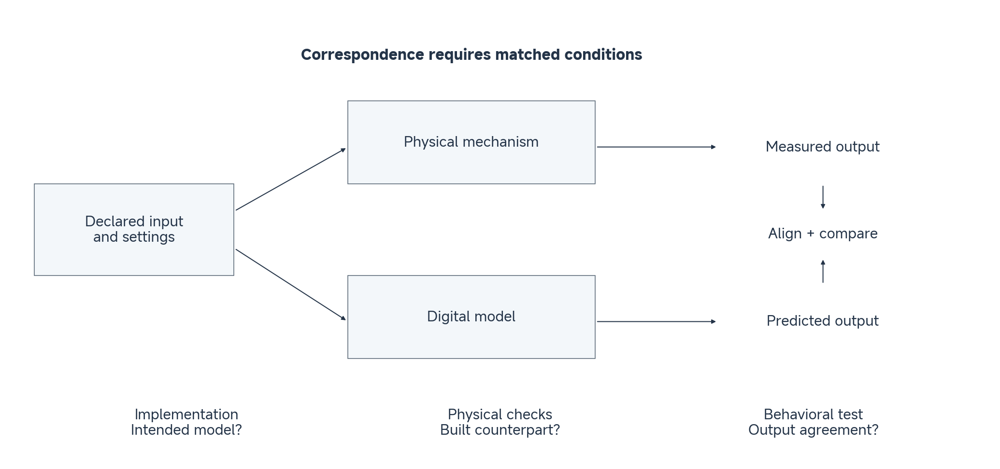

*Figure 4. Declared conceptual comparison. Physical and simulated inputs must have compatible meaning and conditions; measured and predicted outputs must be aligned before comparison. The diagram contains no experimental trajectories.*

Read Figure 4 along both branches: specify the experimental instruction and controller settings, obtain measured and predicted outputs, then align their observation times before comparing them. A hardware position request and a model torque input require an explicit controller mapping; sharing a numerical value is not enough.

Three checks answer different questions:

1. **Implementation:** does the model implement the intended body tree, units, parameters and settings?
2. **Physical correspondence:** do its dimensions, axis direction, moving mass and interfaces correspond to the built assembly?
3. **Behavioral validation:** does it predict measured outputs under matched inputs and stated conditions?

A successful compilation supports the first level. A mass measurement or axis-direction check supplies evidence for selected properties at the second. Neither substitutes for the third.

### Connect the model to mechanics

Keep the Class 02 notation: $$q$$ is the joint angle, $$y_q$$ is reported position on hardware, $$\tau_a$$ is applied joint effort and $$\tau_{\mathrm{ext}}$$ is an externally applied torque. Use $$q$$ for the physical coordinate in the balance and the corresponding model coordinate when evaluating the XML; validation compares the predicted trajectory with $$y_q$$ after aligning frames and clocks. Specialize the balance to one fixed-axis rigid assembly, for which $$H(q)=J$$ is constant and the velocity-dependent rigid-body bias vanishes:

$$
J\ddot q+\tau_f(\dot q)+\tau_g(q)
=\tau_a+\tau_{\mathrm{ext}}.
$$

Here q is in radians, angular acceleration is in rad/s², J is in kg m² and torques are in N m. The payload-placement calculation estimates a contribution to $$J$$. Gravity contributes $$\tau_g(q)$$ on the left; friction is represented separately by $$\tau_f$$. The initial free-motion comparison has no applied external contact torque, so $$\tau_{\mathrm{ext}}=0$$. This does not set friction or gravity to zero on the real device. The equation organizes physical contributions without identifying their unknown values (Featherstone 2008).

The core XC330 XML has no added joint `armature`; its compiled inertia here comes from the moving rigid bodies. If reflected motor inertia is later introduced through `armature` or a fitted total $$J$$, avoid counting it twice. The RS06 prepared model has an armature term and separate passive terms, so its numerical inertia/effort description is a different contract.

Position, velocity and current-related control laws were introduced in Class 02. Here we inspect how a particular XML exposes an input and generates $$\tau_a$$. The XC330 core uses a unit-gear torque channel; the RS06 prepared model uses a position actuator. The executable-input example below makes their distinction explicit.

### Prepare the behavioral test

Preserve the applied command sequence, controller settings, fixture identity and observations. Establish compatible time bases and compare positions at matched times. Choose an error metric and operating conditions before interpreting agreement. Keep independent trajectories for checking predictions beyond the data used to adjust the model.

Class 03 prepares a structurally inspectable representation and specifies this test. Class 04 develops identification and quantitative response comparison on its own declared fixture/data family; its scores do not validate the 110 g model inspected here. Our immediate evidence statement should say what was checked, how, and over which conditions.

**Checkpoint:** A model compiles and displays the expected assembly. What additional evidence would you need before using it to predict a new physical position trajectory?

## Follow CAD through robot description into MuJoCo

### Separate three representation layers

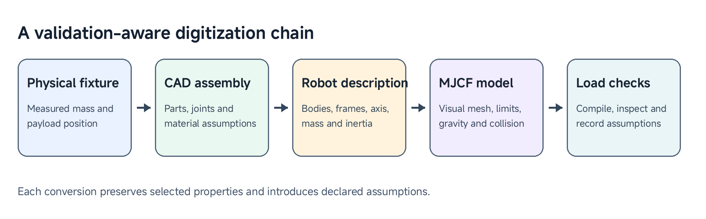

*Figure 5. The physical-to-executable chain preserves selected information at each stage. Export transfers a representation; inspection establishes what was transferred.*

CAD contains parts, dimensions, assembly relationships and material assumptions. Geometry assets contain exported surfaces and their scale. A robot description contains mechanical structure and parameter declarations. These layers remain conceptually distinct even when an exporter writes them together.

Robot description formats carry selected design information into simulation; the design-to-learning connection is developed by Qiu, Wan, and Song (2023). URDF describes robot links and joints; MJCF is MuJoCo's native model description. We use MJCF for the executable example. In MJCF, nested body elements establish the body tree, and joints introduce relative degrees of freedom. A child without joints remains fixed to its parent (MuJoCo developers n.d.-a). See the official [MuJoCo modeling guide](https://mujoco.readthedocs.io/en/3.3.7/modeling.html).

For our assembly, anchor the housing, introduce the link's hinge, and attach the payload bodies rigidly. Inspect the zero pose and axis. A visually convincing export with an unintended joint represents a different mechanism.

### Trace frames and units

A coordinate is useful only when we know **which point, which frame and which unit** it describes. Trace one identifiable point in the supplied B2 assembly: P is the origin of `Pin_1`, where the positive-side pin and payload are attached to the link. Follow it from the XML to its position in the simulator.

**Read the local coordinates.** These selected declarations place the hinge and the pin in the `Link` body:

```xml
<body name="Link" ...>
  <joint name="actuator_joint" type="hinge"
         pos="0 0.007 0" axis="0 1 0" ... />
  <body name="Pin_1" pos="0.100 0 0" ...>
    <!-- Payload_1 is rigidly attached inside this body -->
  </body>
</body>
```

This is an explanatory excerpt: the ellipses omit attributes, so load the complete B2 XML from the repository rather than copying this fragment into a viewer. Negligible export-roundoff terms are rounded here. `pos="0.100 0 0"` means that P is 0.100 m along the **Link frame's x direction** from the Link origin. It does not mean world x = 0.100 m. The hinge origin J is at [0, 0.007, 0] m in that same Link frame; the body origin and joint origin are distinct locations.

**Identify what stays fixed.** When the joint turns, P stays attached at the same Link-frame coordinates. Its world coordinates change. In this model's zero pose, the Link axes align with the world axes and the joint is located at [−0.210, 0.0035, 0.370] m in the world. The positive hinge axis is +y, so positive rotation moves the initially positive-x payload toward negative world z.

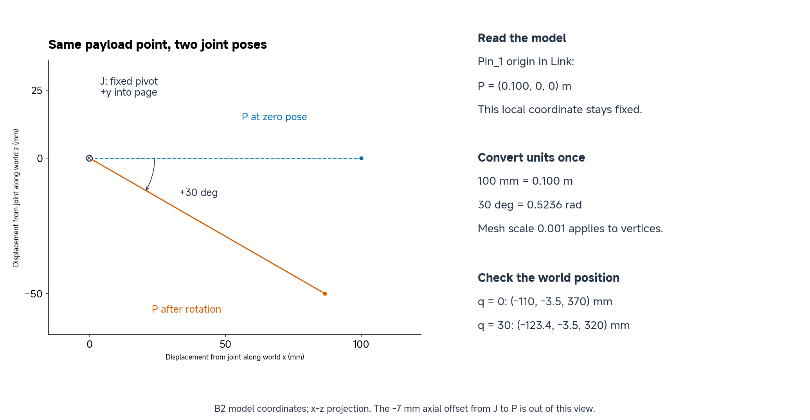

*Figure 6. The same B2 attachment point at zero and +30° joint positions. The plot shows displacement from the joint in the world x–z plane; the table reports absolute world coordinates. The 7 mm axial offset is outside this projection. These are declared model coordinates, verified against MuJoCo, rather than hardware measurements.*

**Calculate and check the world coordinates.** First state the point transformation used throughout rigid-body modeling:

$$
{}^A p_P={}^A R_B\,{}^B p_P+{}^A p_{O_B}.
$$

Here the superscript names the frame expressing the coordinates. The matrix $${}^A R_B$$ rotates coordinate components from frame B to frame A, and $${}^A p_{O_B}$$ is the position of B's origin expressed in A. A point needs both rotation and translation. An axis direction uses rotation alone: shifting the origin does not change a direction. This is a three-dimensional point transformation; it is not a six-dimensional spatial-motion transform (Featherstone 2008).

In the B2 example, rotate the displacement from J to P, not the displacement from the Link origin to P. Subtract the joint's Link-frame position before rotating; then add the joint's world position. The Link axes align with the world at zero, so this gives

$$
{}^W p_P(q)=
\begin{bmatrix}
-0.210+0.100\cos q\\
-0.0035\\
0.370-0.100\sin q
\end{bmatrix}\ \mathrm{m}.
$$

The y value includes the −0.007 m offset from J to P: 0.0035 − 0.007 = −0.0035 m. At zero angle the x and z offsets are [0.100, 0]; at +30° they become approximately [0.08660, −0.05000] m.

| Quantity | Joint at 0° | Joint at +30° |
|---|---|---|
| P in the Link frame (m) | [0.100, 0, 0] | [0.100, 0, 0] |
| P in the world frame (m) | [−0.110, −0.0035, 0.370] | [−0.123397, −0.0035, 0.320] |
| Joint input in radians | 0 | 0.523599 |

**Convert units at the correct boundary.** The CAD distance 100 mm becomes 0.100 m in the body position. `scale="0.001 0.001 0.001"` scales the mesh vertices; it does **not** scale `body pos`, `joint pos` or inertial positions for you. Writing `pos="100 0 0"` would put the attachment 100 m away. Convert display degrees to radians before assigning `data.qpos`; `compiler angle="radian"` governs angle-valued XML attributes, not a viewer's preferred display units. The joint axis [0, 1, 0] is a direction and has no length unit.

The same quantities have explicit locations in the model and simulation data:

| Geometric quantity | MuJoCo field | Frame and meaning |
|---|---|---|
| P relative to the Link origin | `model.body_pos[pin_id]` | Parent Link frame; declared Pin_1 body origin |
| J relative to the Link origin | `model.jnt_pos[joint_id]` | Link frame; declared hinge location |
| J in the world | `data.xanchor[joint_id]` | World frame; computed joint anchor |
| P in the world | `data.xpos[pin_id]` | World frame; computed Pin_1 body origin |

Here `pin_id` identifies `Pin_1`, and `joint_id` identifies `actuator_joint`. The computed fields are read after forward kinematics at the stated joint angle. Compare them with the coordinate calculation above; agreement checks the transformation implemented by this model, while physical correspondence still requires checking the built assembly.

**Checkpoint:** Why can P keep the same coordinates in `Link` while moving in the world? If the mesh looks correct but the payload is far away, which position and unit declarations should you check?

### Separate visual, collision and inertial descriptions

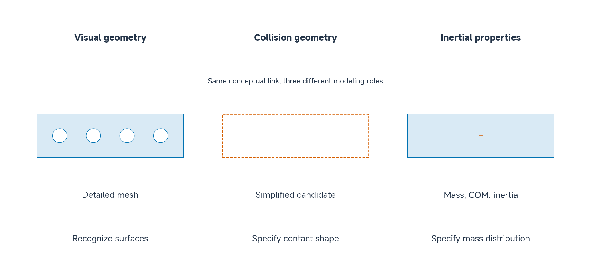

*Figure 7. Three descriptions of the same conceptual link: the visual surface retains holes, a candidate collision rectangle simplifies those surfaces, and the inertial panel marks the centre of mass while retaining the link outline. The supplied fixtures currently disable contact.*

Read Figure 7 by asking what each description controls. A simplified contact rectangle fills the visual holes; that is acceptable only when those holes are irrelevant to the contact task. The inertial description assigns mass, centre of mass and inertia independently of those surface details.

Visual geometry supports recognition. Collision geometry defines the surfaces participating in modeled contact. Explicit inertial properties describe mass distribution. A detailed visual mesh need not be the best collision approximation, and a collision approximation need not determine inertia when inertial records are supplied separately.

The supplied XC330 models disable contact participation using zero `contype` and `conaffinity` flags. A visible plane consequently does not prove floor contact. Adding a contact task would require an appropriate collision model and checks for that task. Use the [XML reference](https://mujoco.readthedocs.io/en/3.3.7/XMLreference.html) to interpret the actual declarations.

### Read a small piece of the executable description

These selected lines come from the supplied [XC330 B2 model](../resources/class03/consolidation/additional_material/models/1DOF-B2.xml); they are not a complete standalone file:

```xml
<compiler angle="radian" inertiafromgeom="false" />
<option timestep="0.002" gravity="0 0 -9.81" />
<mesh name="Link" file="assets/Link.stl" scale="0.001 0.001 0.001" />
<joint name="actuator_joint" type="hinge"
       axis="0 1 1.0963452368173417e-15"
       range="-1.5707963267948966 1.5707963267948966" />
```

The local axis is effectively [0, 1, 0], with a tiny export-roundoff component. Trace its parent transforms before interpreting world direction. The range is approximately ±90°. The explicit inertia records supply body properties; geometry is not being used to infer them automatically. The 0.002 s timestep defines numerical integration rather than a hardware sample period.

The exporter helps transfer geometry and assembly information, but it does not measure the manufactured system or supply unknown embedded control behavior. Inspect the resulting body tree, properties and effort path. The [ACDC4Robot project](https://github.com/ACDC4Robot/Fusion360) provides the Fusion export workflow used in the recorded preparation.

**Checkpoint:** Which declaration would you inspect to explain an incorrect motion direction? Which would you inspect for an incorrect mass or a missing collision?

### Trace the actuator input contract

`data.ctrl[0]` names an input slot, not a universal physical quantity. Inspect the actuator element and transmission before assigning units. The two prepared examples deliberately expose different interfaces:

| Input property | XC330 B2 | RS06 B1 |
|---|---|---|
| Requested quantity | Joint torque (N m) | Position reference (rad) |
| Input range | ±0.1551 N m | ±0.9 rad |
| Model effort bound | ±0.1551 N m | ±36 N m |

In XC330 B2, `xc330_motor` drives `actuator_joint` with `gear="1"`. Its torque channel does not contain the embedded position/current controller. In RS06 B1, `rs06_position` uses declared gains and passive terms; these do not establish exact firmware or continuous hardware behaviour.

These are model settings, not interchangeable manufacturer ratings. In particular, ±0.1551 N m is not XC330's 0.93 N m stall specification. Both model outputs are simulated generalized forces, not hardware torque measurements. The source models also have different joint axes, zeros and fixtures; matching actuator names does not align them.

For the XC330 B2 file, the decisive declaration is

```xml
<motor name="xc330_motor" joint="actuator_joint" gear="1"
       ctrllimited="true" ctrlrange="-0.1551 0.1551"
       forcelimited="true" forcerange="-0.1551 0.1551" />
```

With this unit transmission and an in-range request, the model maps $$\tau_{\mathrm{req}}$$ directly to $$\tau_a$$. The following short excerpt illustrates the input-to-effort mapping after the model has been loaded:

```python
data.ctrl[0] = 0.05  # N m for this unit-gear hinge motor
mujoco.mj_forward(model, data)
print(float(data.qfrc_actuator[0]))  # 0.05 N m
```

The prepared RS06 position actuator instead uses $$K_p=50$$ N m/rad and $$K_d=3.38$$ N m s/rad. These are physical gains in the simulation, separate from hardware gain-register values. Its `kv` term damps joint velocity; this single position actuator has no independently commanded velocity reference. With reference $$q_r=0.30$$ rad, $$q=0.20$$ rad and $$\dot q=0.40$$ rad/s, its unsaturated model effort is

$$
\tau_a=50(0.30-0.20)-3.38(0.40)=3.648\ \mathrm{N\,m}.
$$

Here 0.30 is a position reference, not a torque. Reading `qfrc_actuator` reports the simulation's resulting generalized effort. The [motor](https://mujoco.readthedocs.io/en/3.3.7/XMLreference.html#actuator-motor) and [position-actuator](https://mujoco.readthedocs.io/en/3.3.7/XMLreference.html#actuator-position) semantics are documented separately in MuJoCo's XML reference (MuJoCo developers n.d.-b). An outer position controller can be added around the XC330 torque channel later; until then, writing an angle into it does not reproduce a position servo.

**Checkpoint:** Which input would you write to request 0.05 N m in the XC330 core? Why can the same number mean something different in the RS06 model? Which physical controller and fixture would a response-validation experiment have to match?

## Relate printing and assembly to uncertainty

Printing turns nominal geometry into a part with an actual material structure and interfaces. Wall count, infill and orientation influence mass and stiffness; shrinkage, support removal and fastening can affect fit and alignment. A rigid-body model abstracts those details, so inspect whether that abstraction remains appropriate.

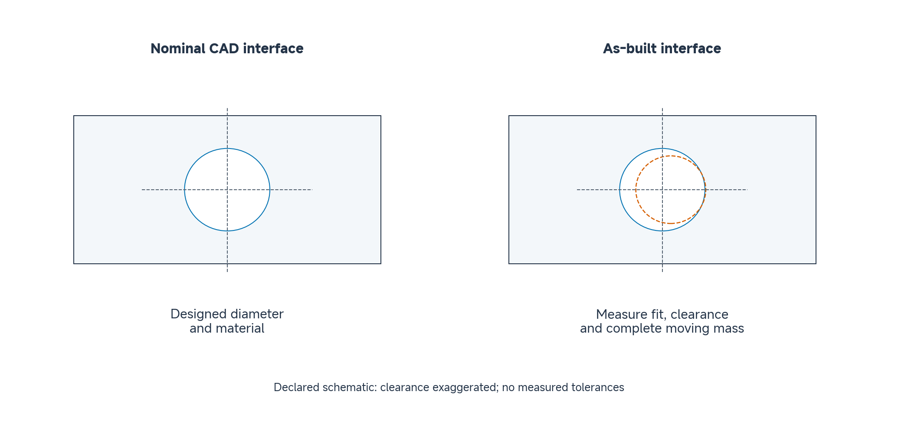

*Figure 8. The solid circle is the nominal bore. The dashed circle illustrates a possible smaller, offset as-built bore. Compare diameter and alignment rather than appearance alone; the difference is exaggerated and is not a measured tolerance.*

Choose a functional dimension, such as a shaft interface or mounting-hole location. Compare the nominal CAD value with the prepared printed part and state the measurement method. Check whether the intended fit allows rotation or creates unwanted play. Record the complete moving mass with its fasteners rather than assuming the mass of the link alone represents the assembly. If you are working from the repository alone, compare the declared CAD/model masses with the included fixture mass record and label that as a source-record check, not a new weighing experiment.

If the printed link has the expected outline but a different measured mass, update the mass record. Scaling its CAD inertia can be an initial approximation, but it retains assumptions about internal distribution. If the connection visibly flexes or moves relative to the shaft, changing mass alone will not correct the joint model.

The H2D preparation connects these decisions to fabrication. Inspect the supplied part's units, orientation, material selection and sliced preview. Relate the chosen settings to the interface that must fit. Use a prepared printed part for the physical comparison; fabrication can continue as project work.

**Checkpoint:** Which properties can a ruler and scale establish? Which would require an additional experiment before claiming a physically validated model?

## Instructor and TA demonstration

### Inspect the RS06 mechanical reference

Open the [RS06 motor STEP](../resources/class03/preparation/demonstration/rs06/RS06_vendor_motor.step) and compare its output axis and mounting interfaces with the engineering drawing. Locate the shaft centreline and mounting-hole pattern, then compare their orientation with the model. If CAD is available, inspect a nominal dimension and the reported physical properties.

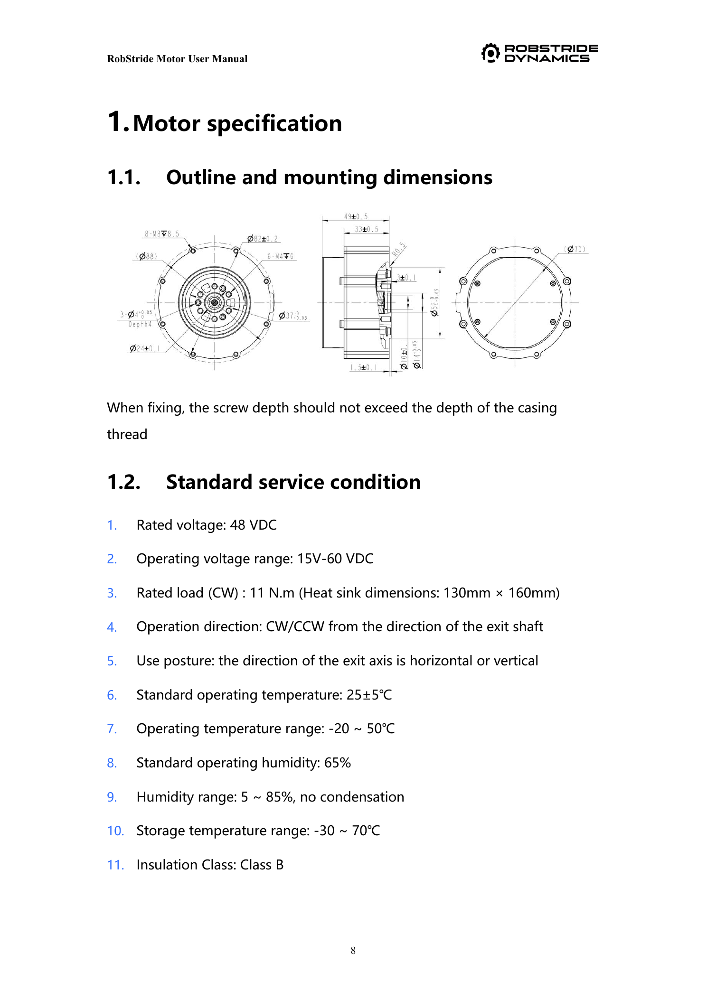

*Figure 9a. Use the shaft centreline and mounting interfaces to orient the RS06 motor reference. Drawing values are manufacturer nominal values, not measurements of the available unit. Source: RobStride RS06 documentation; see the supplied [user manual](../resources/class03/preparation/demonstration/rs06/RS06_User_Manual_260713.pdf) and [original-brand product files](https://github.com/RobStride/Product_Information).*

Keep manufacturer values, CAD estimates and actual measurements in separate ledger entries. The motor STEP is a component reference rather than a complete editable fixture assembly. Use the prepared fixture/export records to inspect the assembled mechanism.

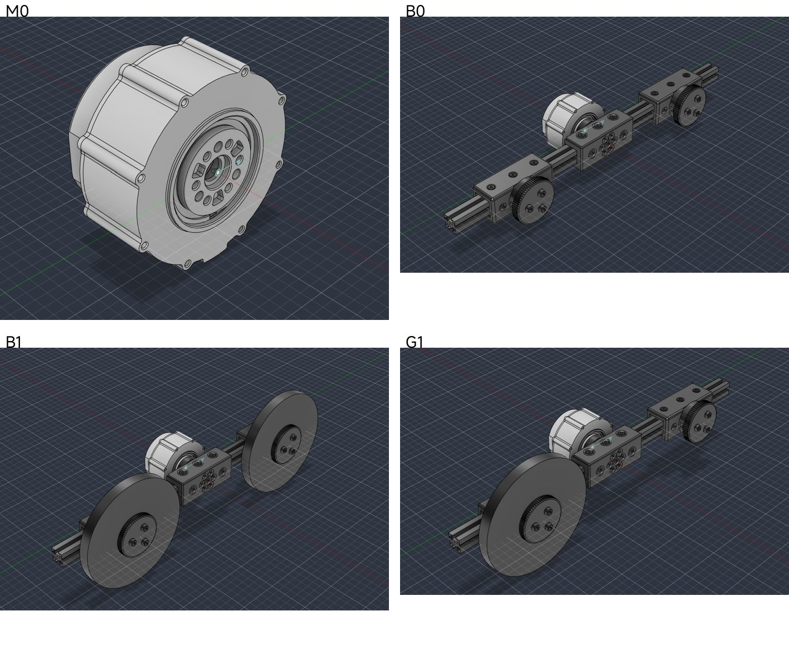

*Figure 9b. Identify the fixed motor housing and moving link: M0 has no external fixture, B0 has the balanced link, B1 adds both large end payloads, and G1 has one large end payload. These are CAD renders, not physical photographs.*

The RS06 and XC330 use different fixtures. In particular, RS06 B0 means a balanced link without the large payload discs, whereas XC330 B0 includes its two 44 g assemblies. Reuse the inspection method, not the masses or the meaning of a case label without checking the actuator family.

### Inspect the joint and export decisions

The sequence below shows the current XC330 Fusion workflow. Use it to identify the modeling decisions, then apply the same checks to the prepared RS06 model. The complete screenshots are included here so no second repository or source page is needed. A [B2 CAD assembly](../resources/class03/cad/1DOF-B2.step) is also included for geometry inspection; a STEP import should not be assumed to retain the original editable Fusion joint setup.

**1. Choose the joint origin.** The joint dialog identifies Link and XC330 as the two components. Locate the output-shaft interface and inspect the selected origins and offsets before accepting the joint.


*Figure 10a. Choose the joint origin; recorded XC330 interface view.*

**2. Align the moving link.** The transparent link and selected component origins expose the alignment decision. Check that the intended shaft and link attachment coincide; do not infer alignment only from the camera view.


*Figure 10b. Align the moving link; recorded XC330 interface view.*

**3. Set the revolute motion.** The Motion tab shows a revolute joint and a selected rotation axis. The limit checkboxes in this capture are not enabled; this screenshot does not verify the ±90° range later declared in the MJCF.


*Figure 10c. Set the revolute motion; recorded XC330 interface view.*

**4. Locate the payload and pin origins.** The Position tab selects the payload and pin attachment origins. This is an attachment-coordinate decision, not a material-property measurement.


*Figure 10d. Locate the payload and pin origins; recorded XC330 interface view.*

**5. Make the payload attachment rigid.** The Motion tab explicitly shows Rigid. The payload follows its parent attachment without introducing a second moving degree of freedom.

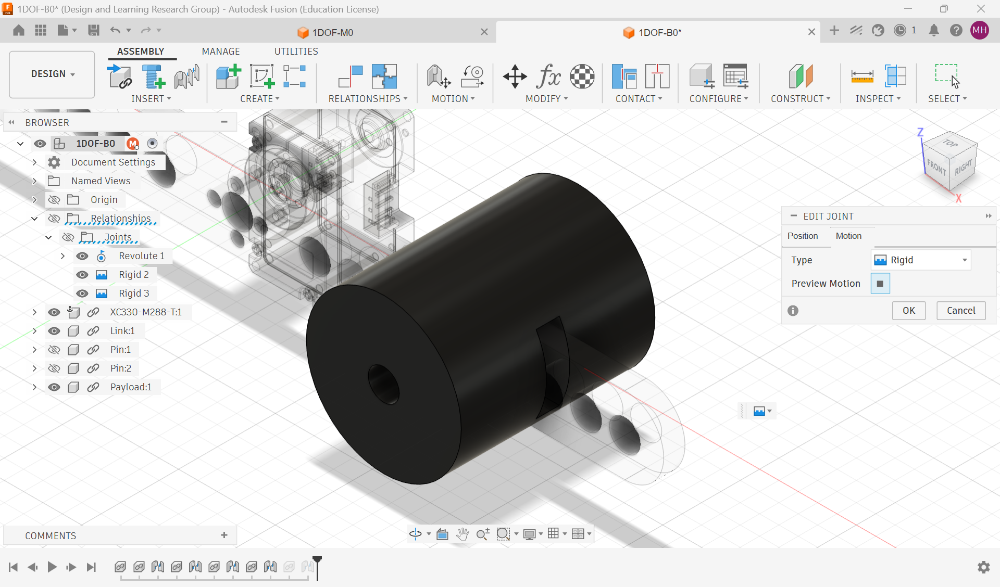

*Figure 10e. Make the payload attachment rigid; recorded XC330 interface view.*

**6. Repeat and inspect the second attachment.** The second payload/pin joint is positioned through the selected origins and offsets. Check both sides of the assembly rather than assuming that one correct attachment guarantees symmetry.

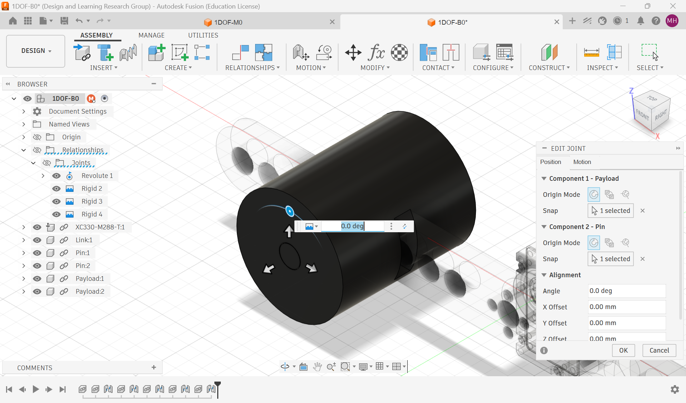

*Figure 10f. Repeat and inspect the second attachment; recorded XC330 interface view.*

**7. Export the robot description.** The ACDC4Robot dialog selects MJCF and MuJoCo. Export the assembled mechanism and inspect the generated XML and meshes; selecting an export format alone does not validate them.


*Figure 10g. Export the robot description; recorded XC330 interface view.*

Check the material assignment and CAD physical-property report separately: the joint dialogs above do not establish the component mass or inertia. Compare those estimates with the assembly's recorded mass before using them in dynamics.

The [RS06 source export](../resources/class03/preparation/rs06_fixtures/source-assets/mjcf/test_station_balanced_payload/test_station_balanced_payload.xml) and [export report](../resources/class03/preparation/rs06_fixtures/source-assets/mjcf/test_station_balanced_payload/export_report.txt) are included in this repository. Trace their mesh paths and joint declarations, then compare the source export with the prepared model below. The RS06 motor STEP is a component reference; the complete original jointed RS06 Fusion assembly is not required to follow this prepared-model inspection.

### Inspect the executable model and gravity

Load the [prepared RS06 B1 model](../resources/class03/preparation/rs06_fixtures/model-sources/B1.xml). Find `rs06_joint`, its local axis, parent transforms, range, inertial records and position actuator. Compare the source export with this prepared model to identify added actuator/passive assumptions.

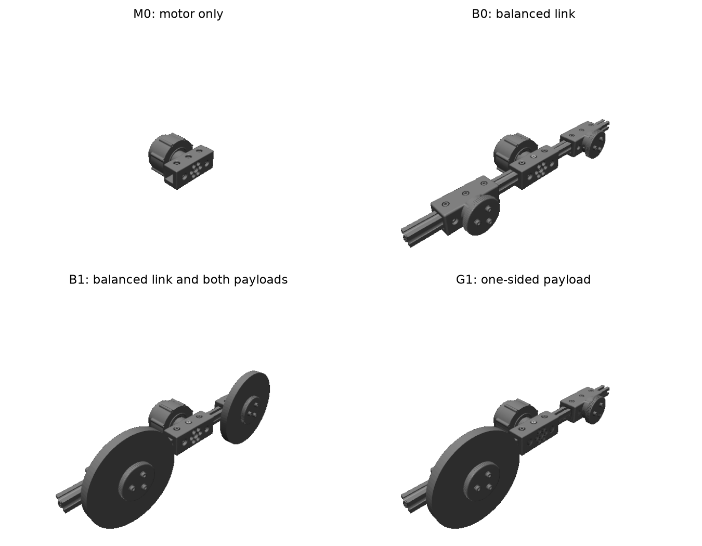

*Figure 11. Compare the loaded RS06 configurations with Figure 9b: check the link, end-payload arrangement and one-hinge structure. A changed camera view does not establish a changed mechanism.*

For both prepared models below, `rs06_joint` has local axis [−1, 0, 0] and range [−1.1, 1.1] rad. Trace the parent rotations before assigning a world direction. The position-reference range [−0.9, 0.9] rad limits commands; it is distinct from the joint range. The moving masses below sum the declared moving rigid bodies, excluding the fixed base. They are model properties, not new weighing results or the actuator module's catalogue mass.

| Fixture | Moving rigid-body mass (kg) | q / v / inputs |
|---|---:|---:|
| B1 | 2.4072134493 | 1 / 1 / 1 |
| G1 | 1.5472134493 | 1 / 1 / 1 |

Both models have one position coordinate, one velocity and one actuator input. Compare these structural properties with the XC330 example before examining gravity: the inspection questions transfer, while the numbers and local axes differ.

Inspect a small positive displacement in a viewer when available and check its direction. Compare gravity enabled and disabled at the same pose and control settings. A position actuator may resist gravity, so distinguish generalized gravity bias from net acceleration or observed movement. The saved records below use zero velocity and a 0.4 rad joint position in MuJoCo 3.3.7. The columns report gravity bias:

| Fixture | Gravity on (N m) | Gravity off (N m) |
|---|---:|---:|
| B1 | 0.0003684003 | 0 |
| G1 | 1.165962 | 0 |

A zero position command is not a torque-off command: at this 0.4 rad pose the prepared position actuator requests −20 N m to return toward zero, separately from the gravity-bias entries. The inspection script reports that actuator effort so it cannot be mistaken for gravity torque.

These are numerical checks of the declared models, not new physical measurements. At zero velocity, `qfrc_bias` contains the gravity term on the left of the dynamics equation: the unconstrained applied gravitational torque has the opposite sign. It is not the servo effort needed after adding passive terms or the net acceleration of the controlled joint. [Raw RS06 records](../resources/class03/results/class03-core/rs06-inspection.json) provide the complete saved fallback.

### Compare the printed part and H2D preparation

When a printed link is available, compare a dimension, a clearance and the assembled mass with their design/recorded values. With repository files alone, use the CAD assembly and mass record to identify the nominal values and state which physical checks remain to be performed. Open [Link_for_H2D.3mf](../resources/class03/preparation/demonstration/h2d/Link_for_H2D.3mf), confirm units, inspect the actual printer/nozzle/plate/material configuration, and review orientation and the sliced preview. Explain how those choices relate to fit and property uncertainty.

Finish by naming one implementation check, one physical check and one behavioral claim that still needs evidence. Keep the RS06 fixture properties distinct from the XC330 teaching family.

## Student activity

### Inspect the supplied XC330 model

Use the [B2 XML](../resources/class03/consolidation/additional_material/models/1DOF-B2.xml) with the 22 g link and two complete 44 g assemblies at ±100 mm. Locate the housing, moving assembly and hinge. Record the joint axis, zero convention, declared range, geometry scale and complete moving mass. Identify the input as torque in N m for `xc330_motor`, rather than assuming a position command because the physical device is a servo. Identify one modeling choice such as disabled contact.

### Predict, calculate and inspect one change

Move both payload centres inward to ±80 mm, retaining their masses, internal properties and orientations. Before revealing the output, predict whether moving mass, rotational inertia, balance and joint count change. Calculate the placement-dependent inertia difference using SI units.

Compare your prediction with the supplied model calculation below. It changes the payload locations in a copy of the model, preserving the source definition.

| Quantity | B2 at ±100 mm | Modified B2 at ±80 mm |
|---|---:|---:|
| Moving mass (kg) | 0.110 | 0.110 |
| Coordinates / velocities / actuators | 1 / 1 / 1 | 1 / 1 / 1 |
| Joint inertia (kg m²) | 0.0009813575 | 0.0006645575 |

The [raw inspection output](../resources/class03/results/class03-core/inspection.json) contains the signed inertia change and gravity probes. Those values describe the model under its declared assumptions.

### Compare with the actual or printed component

Check one dimension or mass against the available assembly or printed part. Keep the actuator unpowered while handling or measuring it; powered motion belongs to the supervised demonstration. Record its value, unit and method. For a document-based submission, compare the B2 model’s 0.110 kg moving mass with the B2 row of the [included mass record](../resources/class03/records/fixture-masses.txt). Identify that comparison as a source-record check and propose one dimensional or clearance measurement you would make on the built assembly. Inspect the printer when feasible.

### Submit a compact inspection record

| Field | Required entry |
|---|---|
| Model identity and task | Actuator, fixture and intended use |
| Mechanical structure and input | Moving assembly, joint, axis, zero convention and control-input meaning |
| Physical property check | Dimension or mass, evidence source and comparison |
| Controlled change | Prediction, inertia calculation and inspected result |
| Assumptions | One chosen parameter or excluded mechanism |
| Validation boundary | What was checked and what requires a physical response experiment |

Conclude with two sentences: what the representation is ready to support, and which claim needs further evidence. A screenshot is not a substitute for the recorded quantities and interpretation.

## Carry the model into a response test

A structurally inspectable model states how its parts, frames, mass and inputs are represented. [Class 04](04-basic-quantification-of-sim2real-gap.md) asks whether a model predicts a recorded response under declared conditions; its retained 98 g campaign is a separate source family from this 110 g CAD example. Carry forward the inspection record, coordinate convention and input contract; establish that campaign's own fixture and data identity before comparing responses.

## References

Featherstone, Roy. 2008. *Rigid Body Dynamics Algorithms*. Springer.

MuJoCo developers. n.d.-a. “Modeling.” *MuJoCo Documentation*, version 3.3.7. Accessed October 17, 2026. [Official documentation](https://mujoco.readthedocs.io/en/3.3.7/modeling.html).

MuJoCo developers. n.d.-b. “XML Reference.” *MuJoCo Documentation*, version 3.3.7. Accessed October 17, 2026. [Official documentation](https://mujoco.readthedocs.io/en/3.3.7/XMLreference.html).

Qiu, Nuofan, Fang Wan, and Chaoyang Song. 2023. “Describing Robots from Design to Learning: Towards an Interactive Lifecycle Representation of Robots.” arXiv:2312.12295. [Original preprint](https://arxiv.org/abs/2312.12295).

RobStride. 2026. *RS06 User Manual*. Revision 260713. [Supplied original-brand manual](../resources/class03/preparation/demonstration/rs06/RS06_User_Manual_260713.pdf); [manufacturer product information](https://github.com/RobStride/Product_Information).
