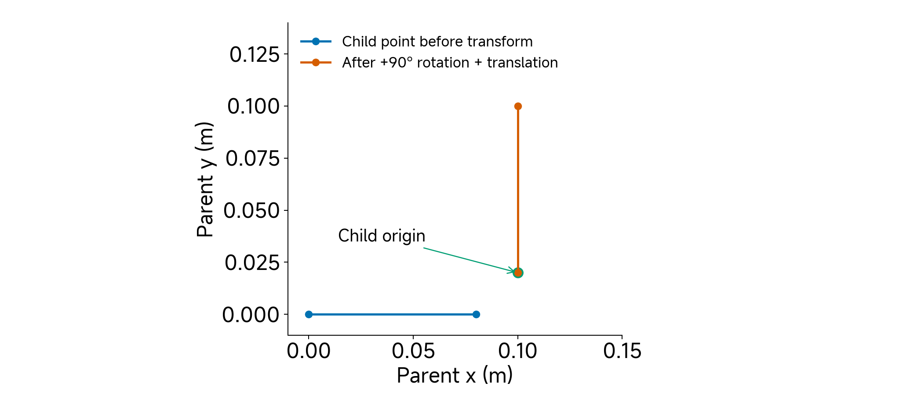
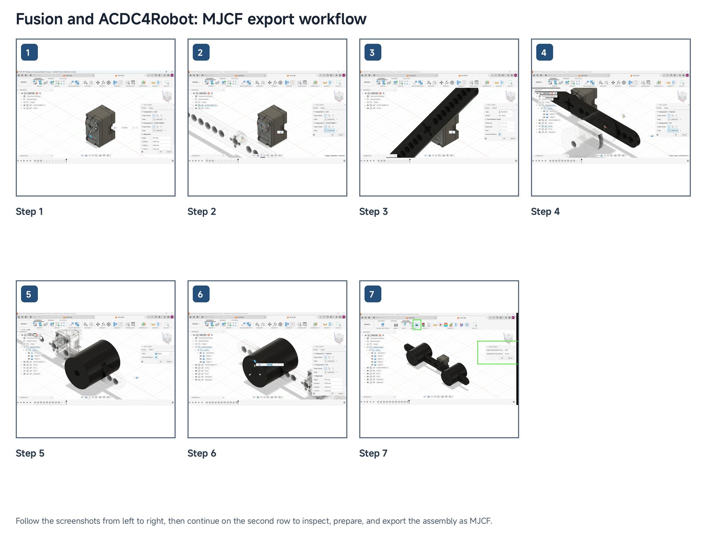

# 03 Basic Digitization of Physical Embodiment

## Central question

What does a digital representation preserve, and which parts can we validate?

Class 02 connected actuator commands with physical feedback. We now ask how to represent the mechanism receiving those commands. A digital model must specify what moves, where motion occurs, how mass is distributed and how effort enters the system. Its usefulness depends on preserving the properties needed for a stated task and checking those properties against appropriate evidence.

Our running example is an XC330 actuator carrying a link and two payload assemblies. We follow it from the physical mechanism through CAD, robot description and MuJoCo. The RS06 demonstration applies the same inspection method to another actuator. The student activity returns to XC330 and changes one declared payload parameter.

By the end, you should be able to:

- Distinguish a digital representation, digital cousin and task-bounded digital twin through their intended use and evidence of correspondence.
- Inspect geometry, frames, joints, mass, inertia and collision assumptions.
- Define validation for a physical actuator with a specified link/payload experiment.

[Lecture](#1-geometry-alone-does-not-establish-behavioral-correspondence) · [Instructor and TA demonstration](#instructor-and-ta-demonstration) · [Student activity](#student-activity)

## 1. Geometry alone does not establish behavioral correspondence

### Start with what moves

Place the physical actuator and its link/payload assembly beside their digital representations. The housing is fixed to the support. The output shaft turns the link. The pins and payloads are attached to the link and move with it. Before discussing software, identify the relative motion: the moving assembly rotates about one axis relative to the housing.


*Figure 1. The declared B2 fixture in physical, CAD and simulator views. Appearance establishes recognizable geometry; each view supports different claims about structure and behavior.* [Figure sources](#figure-sources)

Several manufactured parts can form one moving rigid assembly. Separate model bodies can also preserve component bookkeeping while remaining rigidly attached. Neither the number of parts nor the number of meshes determines the number of degrees of freedom. Our one hinge supplies one rotational coordinate. Adding a payload mesh should not accidentally add another independent motion.


*Figure 2. A declared teaching schematic: the housing is fixed, the link rotates through one hinge, and attached payload bodies have no additional joints. The grouping does not depict internal gearbox components.* [Figure sources](#figure-sources)

This abstraction already contains choices. We treat the link and attachments as rigid and omit cable flexibility and shaft play. Those choices may be adequate for a limited free-motion experiment. They need reconsideration if the task depends on structural vibration, backlash or cable interference.

### Ask what the representation preserves

A photograph records appearance from a viewpoint. CAD describes designed dimensions and assembly relationships. A simulation model additionally declares mechanical structure, physical parameters and the rules used to compute motion. These descriptions overlap, but none automatically supplies all the others.

Two models can produce almost identical pictures while having different joint axes or inertias. Camera zoom can conceal an incorrect length scale. Conversely, a simple link and two primitive payload shapes may preserve the properties needed for an isolated joint experiment better than a visually detailed model with incorrect physical parameters.

Use these working distinctions throughout the course:

| Representation | Claim being made |
|---|---|
| Digital representation | Selected properties of a physical system are described |
| Digital cousin | A similar model supports exploration without establishing correspondence to this particular unit |
| Task-bounded digital twin | An identified physical counterpart and defined correspondence process support tested predictions for stated tasks and conditions |

The stronger claim requires stronger evidence. Calling a CAD assembly a twin does not establish its predictive accuracy. A representation can still be useful for geometric inspection or experiment preparation before its dynamic predictions have been tested.

**Predict:** From Figure 1, what could you inspect visually? What would require a ruler, a scale or a recorded motion experiment?

## 2. Sim2Real differences enter throughout the physical and digital chain

The digital system begins with declared geometry and parameters; the physical system contains manufactured and assembled parts, electronics and embedded control. Their differences have several origins.

| Stage | Concrete example | What to inspect or record |
|---|---|---|
| Design | A cable or compliant connection is omitted | Whether that feature matters for the intended motion |
| Manufacturing | A printed link uses infill rather than solid material | Actual dimensions, mass and process settings |
| Assembly | Clearance permits play or a shaft is misaligned | Fit, mounting, fasteners and reference pose |
| Communication | A command reaches hardware after its recorded request time | Command delivery and observation clocks |
| Controller | The device generates an internal trajectory rather than an instantaneous step | Command mode, gains, limits and available internal signals |
| Simulation | Contact is disabled or a passive effect is omitted | Explicit model settings and their intended scope |

Suppose simulated motion begins earlier than physical motion. Increasing inertia may make the simulated response look slower, but this can compensate for a timing error without explaining it. First inspect what the timestamp means, when the command is applied, and whether the physical and simulated inputs have the same interpretation.

Similarly, a nominally identical printed part can have different mass and stiffness because its material or internal structure differs. A correct outer shape does not establish the correct inertia, and a fitted parameter cannot by itself tell you which manufacturing difference caused an output discrepancy.

A useful diagnostic order is to establish units and topology, check input/output meaning and timing, inspect physical properties, and then evaluate missing mechanisms or uncertain parameters. Change one declared assumption at a time when explaining its effect. This makes the model's improvement interpretable rather than merely making one plot look closer.

**Checkpoint:** Which of the following are different problems: a reversed joint axis, an incorrect payload mass, a delayed command, and an omitted flexible connection? What evidence would distinguish them?

## 3. CAD physical properties are estimates with limited validation

### Mass, centre of mass and inertia answer different questions

Mass describes how much matter moves. The centre of mass describes its mean location. Rotational inertia describes resistance to angular acceleration about a specified axis. Equal masses can have different inertia when placed at different distances from that axis.

CAD computes physical-property estimates from geometry and material assignments. A solid-material density may be a poor description of a printed component with infill and voids. Fasteners or attachments absent from CAD can also change the moving assembly. Weighing the complete assembly provides evidence for its mass, but does not independently measure its centre of mass or inertia tensor.

The inertia tensor describes a body's rotational mass distribution. A joint-axis inertia depends on that distribution, the body's orientation and the axis location. For this class, recognize the tensor in the model and understand one scalar calculation rather than deriving a full spatial-dynamics algorithm.

### Move a payload without changing its mass

For a rigid component, the parallel-axis principle gives

$$
J_{\mathrm{axis}}=J_{\mathrm{COM,parallel}}+m r^2.
$$

The first term is the component's inertia about an axis through its centre of mass parallel to the joint axis. The distance r is perpendicular to those axes. Add the contributions of all components moving with the joint. The term involving squared distance explains why placing a payload farther out increases joint inertia.

Our declared XC330 teaching family uses a 22 g link and two complete 44 g pin–payload assemblies. These masses come from the submission's physical record. The model's component inertias are CAD-derived estimates scaled to the recorded masses. Their status remains different from an independently measured inertia.


*Figure 3. B0, B1 and B2 place equal 44 g assemblies at symmetric radii. G1 places them on one side. Each complete assembly includes its pin. These are declared positions in the 110 g teaching family.* [Figure sources](#figure-sources)

Compare B0 at ±60 mm with B2 at ±100 mm. Convert to SI units before calculating:

$$
m_{\mathrm{moving}}=0.022+2(0.044)=0.110\ \mathrm{kg}.
$$

With component orientation and internal properties unchanged,

$$
\Delta J=2(0.044)(0.100^2-0.060^2)
=0.0005632\ \mathrm{kg\,m^2}.
$$

The link and unchanged central inertia terms cancel from this difference. Moving mass stays constant while inertia increases. For the same angular acceleration, the inertial torque contribution therefore increases.

Balance is a separate question. Equal masses at opposite signed positions can have cancelling first moments, while their squared-distance inertia terms add. The ideal symmetric fixture can be balanced about a horizontal axis and still have substantial inertia. Moving both masses to one side produces a gravity moment whose magnitude and sign depend on orientation and pose. A vertical rotation axis has no gravity moment about that axis.

### Keep a property ledger

| Property | Evidence category | Meaning in this example |
|---|---|---|
| Complete link and payload masses | Source-recorded measurement | Values reported for this fixture family |
| Product dimensions | Manufacturer nominal | Reference values to compare with the available component |
| Component central inertias | CAD-derived | Estimates based on geometry and mass scaling |
| Rigid connections and collision policy | Assumed/model declaration | Choices defining the simulation task |
| Effective actuator/passive terms | Fitted when estimated from responses | Parameters whose interpretation depends on the fitted model |

Scaling a CAD inertia by a mass ratio approximates a density change while retaining shape and centre-of-mass location. It does not establish that the real internal mass distribution changed uniformly. Record that approximation so a later experiment can test its adequacy.

**Checkpoint:** A scale confirms the assembled moving mass. Which entries in the ledger remain estimates or assumptions?

## 4. Define the single-actuator experiment before claiming validation

### Make the comparison specific

A claim such as “the model matches the actuator” leaves too much unspecified. Identify the actuator, link/payload configuration, mounting, joint zero, positive direction, command mode and operating range. State the applied input and measured output, and how their clocks are aligned.

For our later position-response experiment, the target is a specified actuator and fixture under stated commands and controller settings. Contact, thermal behavior and gearbox wear are outside this initial task. Those effects need additional states, observations or experiments before predictive claims about them are justified.


*Figure 4. Declared conceptual comparison. Physical and simulated inputs must have compatible meaning and conditions; measured and predicted outputs must be aligned before comparison. The diagram contains no experimental trajectories.* [Figure sources](#figure-sources)

Three checks answer different questions:

1. **Implementation:** does the model implement the intended body tree, units, parameters and settings?
2. **Physical correspondence:** do its dimensions, axis direction, moving mass and interfaces correspond to the built assembly?
3. **Behavioral validation:** does it predict measured outputs under matched inputs and stated conditions?

A successful compilation supports the first level. A mass measurement or axis-direction check supplies evidence for selected properties at the second. Neither substitutes for the third.

### Connect the model to mechanics

For the isolated hinge, a useful scalar description is

$$
J\ddot q+\tau_{\mathrm{resistance}}+\tau_g(q)
=\tau_{\mathrm{actuator}}.
$$

The inertia term relates mass distribution to angular acceleration. Resistance collects the passive effects represented by the chosen model. The gravity term depends on configuration. The actuator term depends on how control effort is generated and limited. The equation is a way to organize the physical contributions; it does not determine their unknown values.

The XC330 teaching MJCF uses a torque channel. That channel does not recreate the device's embedded position controller. The prepared RS06 model has a position actuator. Its command and effort path therefore differ. Carry the Class 02 distinction between requested quantities and measured physical responses into both models.

### Prepare the behavioral test

Preserve the applied command sequence, controller settings, fixture identity and observations. Establish compatible time bases and compare positions at matched times. Choose an error metric and operating conditions before interpreting agreement. Keep independent trajectories for checking predictions beyond the data used to adjust the model.

Class 03 prepares a structurally inspectable representation and specifies this test. Class 04 develops identification and quantitative response comparison. Our immediate evidence statement should say what was checked, how, and over which conditions.

**Checkpoint:** A model compiles and displays the expected assembly. What additional evidence would you need before using it to predict a new physical position trajectory?

## 5. Follow CAD through robot description into MuJoCo

### Separate three representation layers


*Figure 5. The physical-to-executable chain preserves selected information at each stage. Export transfers a representation; inspection establishes what was transferred.* [Figure sources](#figure-sources)

CAD contains parts, dimensions, assembly relationships and material assumptions. Geometry assets contain exported surfaces and their scale. A robot description contains mechanical structure and parameter declarations. These layers remain conceptually distinct even when an exporter writes them together.

URDF describes robot links and joints; MJCF is MuJoCo's native model description. We use MJCF for the executable example. In MJCF, nested body elements establish the body tree, and joints introduce relative degrees of freedom. A child without joints remains fixed to its parent. See the official [MuJoCo modeling guide](https://mujoco.readthedocs.io/en/3.3.7/modeling.html).

For our assembly, anchor the housing, introduce the link's hinge, and attach the payload bodies rigidly. Inspect the zero pose and axis. A visually convincing export with an unintended joint represents a different mechanism.

### Trace frames and units

A position needs both a value and a coordinate frame. The body's parent-relative pose locates its origin and axes. To express a child-frame point in the parent frame, rotate its coordinates and then add the child origin's parent-frame position:

$$
{}^{A}p={}^A R_B\,{}^B p+{}^A p_B.
$$



*Figure 6. Constructed coordinate example independent of the hardware: rotate by +90° about z, then translate. No fixture measurements are inferred from these teaching coordinates.* [Figure sources](#figure-sources)

The child point [0.08, 0, 0] m becomes [0, 0.08, 0] m after rotation. Adding [0.10, 0.02, 0] m gives [0.10, 0.10, 0] m. An axis is a direction rather than a point, so transform its direction by rotation without adding translation.

Check units separately. An exported 100 mm dimension should span 0.100 m in this package. The mesh scale `0.001 0.001 0.001` converts millimetres to metres; body and joint positions still require their own checks. Zooming the viewer cannot establish correct scale. Record angular units and distinguish a declared joint range from a measured physical stop.

### Separate visual, collision and inertial descriptions


*Figure 7. Three roles for a conceptual link. The collision rectangle is an illustrative candidate, not an enabled contact model in the supplied free-motion fixtures. The inertia sketch identifies a mass-distribution description rather than a rendered surface.* [Figure sources](#figure-sources)

Visual geometry supports recognition. Collision geometry defines the surfaces participating in modeled contact. Explicit inertial properties describe mass distribution. A detailed visual mesh need not be the best collision approximation, and a collision approximation need not determine inertia when inertial records are supplied separately.

The supplied XC330 models disable contact participation using zero `contype` and `conaffinity` flags. A visible plane consequently does not prove floor contact. Adding a contact task would require an appropriate collision model and checks for that task. Use the [XML reference](https://mujoco.readthedocs.io/en/3.3.7/XMLreference.html) to interpret the actual declarations.

### Read a small piece of the executable description

These selected lines come from the supplied [XC330 B2 model](../resources/class03/consolidation/additional_material/models/1DOF-B2.xml); they are not a complete standalone file:

```xml
<compiler angle="radian" inertiafromgeom="false" />
<option timestep="0.002" gravity="0 0 -9.81" />
<mesh name="Link" file="assets/Link.stl" scale="0.001 0.001 0.001" />
<joint name="actuator_joint" type="hinge"
       axis="0 1 1.0963452368173417e-15"
       range="-1.5707963267948966 1.5707963267948966" />
```

The local axis is effectively [0, 1, 0], with a tiny export-roundoff component. Trace its parent transforms before interpreting world direction. The range is approximately ±90°. The explicit inertia records supply body properties; geometry is not being used to infer them automatically. The 0.002 s timestep defines numerical integration rather than a hardware sample period.

The exporter helps transfer geometry and assembly information, but it does not measure the manufactured system or supply unknown embedded control behavior. Inspect the resulting body tree, properties and effort path. The [ACDC4Robot project](https://github.com/ACDC4Robot/Fusion360) provides the Fusion export workflow used in the recorded preparation.

**Checkpoint:** Which declaration would you inspect to explain an incorrect motion direction? Which would you inspect for an incorrect mass or a missing collision?

## 6. Relate printing and assembly to uncertainty

Printing turns nominal geometry into a part with an actual material structure and interfaces. Wall count, infill and orientation influence mass and stiffness; shrinkage, support removal and fastening can affect fit and alignment. A rigid-body model abstracts those details, so inspect whether that abstraction remains appropriate.


*Figure 8. Declared manufacturing schematic. The dashed inner boundary exaggerates a possible bore difference to explain fit inspection; it is not a measured tolerance, print result or deformation prediction.* [Figure sources](#figure-sources)

Choose a functional dimension, such as a shaft interface or mounting-hole location. Compare the nominal CAD value with the prepared printed part and state the measurement method. Check whether the intended fit allows rotation or creates unwanted play. Record the complete moving mass with its fasteners rather than assuming the mass of the link alone represents the assembly.

If the printed link has the expected outline but a different measured mass, update the mass record. Scaling its CAD inertia can be an initial approximation, but it retains assumptions about internal distribution. If the connection visibly flexes or moves relative to the shaft, changing mass alone will not correct the joint model.

The H2D preparation connects these decisions to fabrication. Inspect the supplied part's units, orientation, material selection and sliced preview. Relate the chosen settings to the interface that must fit. Use a prepared printed part for the physical comparison; fabrication can continue as project work.

**Checkpoint:** Which properties can a ruler and scale establish? Which would require an additional experiment before claiming a physically validated model?

## Instructor and TA demonstration

### Inspect the RS06 mechanical reference

Open the [RS06 motor STEP](../resources/class03/preparation/demonstration/rs06/RS06_vendor_motor.step) and compare its output axis and mounting interfaces with the engineering drawing. Identify the component origin, a nominal dimension and the properties reported by CAD.


*Figure 9. Manufacturer mechanical reference supplied with the RS06 material. Nominal drawing values are distinct from measurements of the available unit.* [Figure sources](#figure-sources)

Keep manufacturer values, CAD estimates and actual measurements in separate ledger entries. The motor STEP is a component reference rather than a complete editable fixture assembly. Use the prepared fixture/export records to inspect the assembled mechanism.

### Inspect the joint and export decisions

Identify the fixed base, rotating fixture, revolute joint and rigid attachments. In a prepared jointed CAD assembly, inspect reference pose, axis, material assignment and simplification decisions. Preserve the intermediate export to make those decisions traceable.



*Figure 10. Recorded XC330 interface views illustrate joint/material assignment and export selection. They show the workflow; they are not a new RS06 export.* [Figure sources](#figure-sources)

Open the existing [RS06 source export](../resources/class03/preparation/rs06_fixtures/source-assets/mjcf/test_station_balanced_payload/test_station_balanced_payload.xml) and [export report](../resources/class03/preparation/rs06_fixtures/source-assets/mjcf/test_station_balanced_payload/export_report.txt). Trace meshes, transforms and joint declarations. Use these prepared files when the complete jointed CAD assembly is unavailable.

### Inspect the executable model and gravity

Load the [prepared RS06 B1 model](../resources/class03/preparation/rs06_fixtures/model-sources/B1.xml). Find `rs06_joint`, its local axis, parent transforms, range, inertial records and position actuator. Compare the source export with this prepared model to identify added actuator/passive assumptions.

Inspect a small positive displacement and check its direction. Compare gravity enabled and disabled at the same pose and control settings. A position actuator may resist gravity, so distinguish generalized gravity bias from net acceleration or observed movement. The saved records below use zero velocity and a 0.4 rad joint position in MuJoCo 3.3.7:

| Fixture | Coordinates / velocities / actuators | Gravity-on bias (N m) | Gravity-off bias (N m) |
|---|---:|---:|---:|
| B1 | 1 / 1 / 1 | 0.0003684003 | 0 |
| G1 | 1 / 1 / 1 | 1.165962 | 0 |

These are numerical checks of the declared models, not new physical measurements. [Raw RS06 records](../resources/class03/results/class03-core/rs06-inspection.json) provide the complete saved fallback.

### Compare the printed part and H2D preparation

Show a prepared printed link. Compare a dimension, a clearance and the assembled mass with their design/recorded values. Open [Link_for_H2D.3mf](../resources/class03/preparation/demonstration/h2d/Link_for_H2D.3mf), confirm units, inspect the actual printer/nozzle/plate/material configuration, and review orientation and the sliced preview. Explain how those choices relate to fit and property uncertainty.

Finish by naming one implementation check, one physical check and one behavioral claim that still needs evidence. Keep the RS06 fixture properties distinct from the XC330 teaching family.

## Student activity

### Inspect the supplied XC330 model

Use the B2 model with the 22 g link and two complete 44 g assemblies at ±100 mm. Locate the housing, moving assembly and hinge. Record the joint axis, zero convention, declared range, geometry scale and complete moving mass. Identify one modeling choice such as disabled contact.

### Predict, calculate and inspect one change

Move both payload centres inward to ±80 mm, retaining their masses, internal properties and orientations. Before revealing the output, predict whether moving mass, rotational inertia, balance and joint count change. Calculate the placement-dependent inertia difference using SI units.

In a prepared environment, run the supplied [offline inspection script](../resources/class03/code/class03_inspect.py):

```sh
python code/class03_inspect.py --case B2 --radius-mm 80
```

The command operates on an in-memory copy and keeps the source XML unchanged. If the runtime is unavailable, use the saved model values after making the prediction:

| Quantity | B2 at ±100 mm | Modified B2 at ±80 mm |
|---|---:|---:|
| Moving mass (kg) | 0.110 | 0.110 |
| Coordinates / velocities / actuators | 1 / 1 / 1 | 1 / 1 / 1 |
| Joint inertia (kg m²) | 0.0009813575 | 0.0006645575 |

The [raw inspection output](../resources/class03/results/class03-core/inspection.json) contains the signed inertia change and gravity probes. Those values describe the model under its declared assumptions.

### Compare with the actual or printed component

Check one dimension or mass against the available assembly or printed part. Record its value, unit and method. If using the supplied photograph and mass record instead, identify them as source records and state what additional physical measurement would strengthen the claim. Inspect the printer when feasible.

### Submit a compact inspection record

| Field | Required entry |
|---|---|
| Model identity and task | Actuator, fixture and intended use |
| Mechanical structure | Moving assembly, joint, axis and zero convention |
| Physical property check | Dimension or mass, evidence source and comparison |
| Controlled change | Prediction, inertia calculation and inspected result |
| Assumptions | One chosen parameter or excluded mechanism |
| Validation boundary | What was checked and what requires a physical response experiment |

Conclude with two sentences: what the representation is ready to support, and which claim needs further evidence. A screenshot is not a substitute for the recorded quantities and interpretation.

## Practical preparation and resources

The instructor/TA prepares Fusion, ACDC4Robot, MuJoCo and the slicer before class. Have the reference drawings, intermediate exports, model assets, printed component and mass/dimension records ready. Installation and account registration are preflight tasks.

To prepare the offline inspection environment, run the following from `2026-autumn/resources/class03` in the downloaded repository:

```sh
python3.12 -m venv .venv-class03-core
.venv-class03-core/bin/python -m pip install mujoco==3.3.7
.venv-class03-core/bin/python code/class03_inspect.py --case B2
```

The activity command assumes this environment is selected. The saved tables provide the numerical fallback without an installation during class. CAD, model, engineering drawing and printing files are linked as supporting downloads; the teaching sequence remains on this page.

## Figure sources

| Figures | Inputs and generating source |
|---|---|
| 1, 3, 5 and 10 | Retained physical/CAD/model comparison, 110 g fixture schematic, conceptual workflow and recorded Fusion captures; [submission generator](../resources/class03/consolidation/additional_material/code/generate_figures.py) |
| 2, 4, 7 and 8 | New declared teaching schematics; functions `body_tree`, `evidence_chain`, `geometry_roles` and `printed_interface` in [class03_figures.py](../resources/class03/code/class03_figures.py) |
| 6 | Declared rotation/translation example; [visual_lessons.py](../resources/class03/code/visual_lessons.py) |
| 9 | Manufacturer drawing supplied with the [RS06 manual](../resources/class03/preparation/demonstration/rs06/RS06_User_Manual_260713.pdf) |

[Figure reproduction record](../media/class03/FIGURE-CODE.md#full-notes-teaching-schematics) documents the new MiSans figures, parameters and editable masters. The diagrams introduce no physical measurements or simulated experiments.
