# Class 03 — Practice: assembling and exporting the B0 fixture

This practice begins with the supplied M0 XC330 component and separate link, payload, and pin components. The parts are assembled into the B0 configuration in Fusion 360, assigned the required joints, exported as MJCF through ACDC4Robot, and prepared for actuation in MuJoCo.

## Practice files

Download [Class 03 Fusion 360–to–MuJoCo practice package](../resources/class03/additional_material/downloads/class03-fusion360-to-mujoco.zip).

The package contains:

- the M0 XC330 starting component;
- separate link, payload, and pin STEP files;
- the completed B0 assembly for geometric verification;
- the Fusion 360 assembly sequence;
- an offline copy of the ACDC4Robot add-in;
- the actuator-enabled B0 XML and its mesh assets; and
- the prepared Class 03 MuJoCo project.

Extract the archive to a writable folder before beginning the practice.

## Part I — Assemble and export the B0 fixture in Fusion 360

### B0 assembly structure

The B0 fixture contains one fixed XC330 housing and one moving assembly. The moving assembly consists of the link, two payloads, and two pins. The payload centers are positioned symmetrically at 60 mm on either side of the XC330 rotation axis.

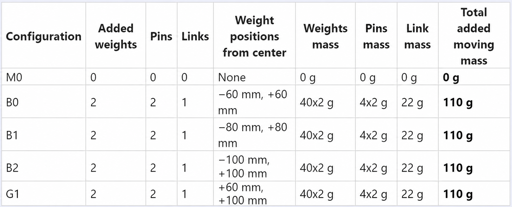

*Figure 1. B0 places two complete pin–payload assemblies symmetrically at 60 mm from the XC330 rotation axis, giving a 110 g external moving assembly.*

The parts are assembled in the following order:

1. M0 XC330 component
2. link
3. first and second payloads
4. first and second pins

### Create the Fusion 360 project and insert M0

1. Start Fusion 360 and create a project named `Class03_B0_Fixture`.
2. Locate the supplied CAD parts in `01_Fusion360/STEP/`.
3. Upload the following files:
   - `1DOF-M0.step`
   - `Link.step`
   - `Payload.step`
   - `Pin.step`
   - `1DOF-B0.step`
4. Create a new design and save it as `Class03_B0_Assembly`.
5. Select **Insert → Insert Component**.
6. Select `1DOF-M0` from the project and insert it into the current design.
7. Break the external link to the inserted component.
8. Ground the XC330 motor housing. It must remain fixed throughout the joint test.

|  |  |
| --- | --- |
| 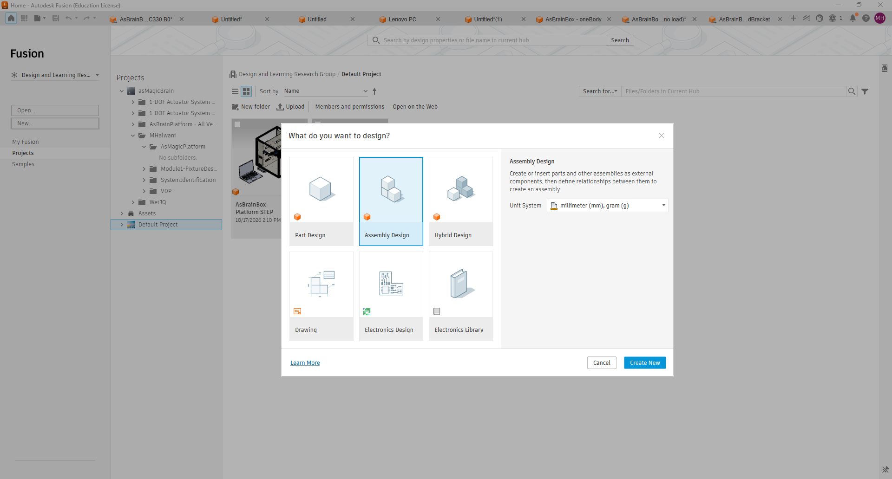 | 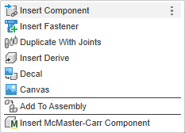 |
| 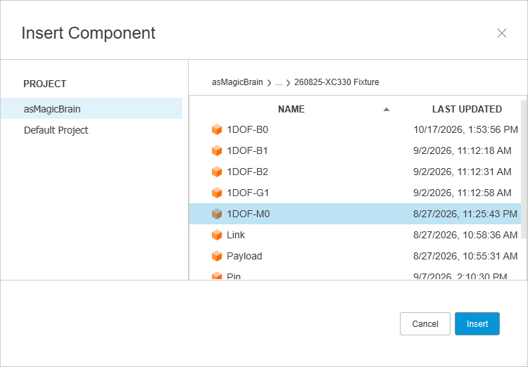 | 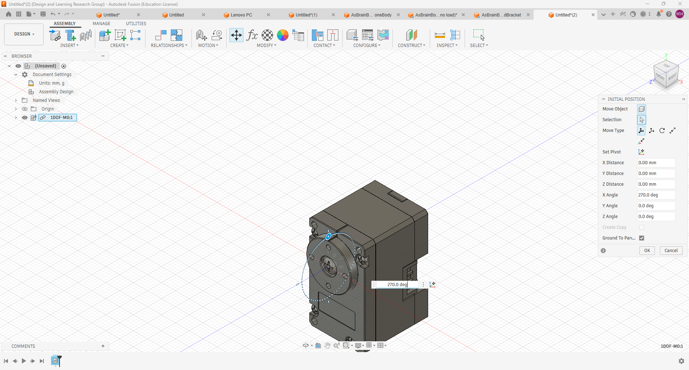 |

*Figure 2. The M0 component is inserted as the fixed starting body of the B0 assembly.*

### Join the link to the XC330 output

1. Select **Insert → Insert Component** and insert `Link.step`.
2. Position the link near the XC330 output horn; exact placement is established by the joint.
3. Choose **Assemble → Joint**.
4. Select the link’s central cylindrical joint origin first.
5. Select the center of the XC330 output horn second.
6. Set the joint type to **Revolute**.
7. Reverse the joint orientation if required so the link lies in the intended B0 plane.
8. Set the joint angle to `0 deg`, then confirm the joint.
9. Drag the link through a small positive and negative angle. The link must rotate about the XC330 shaft while the motor housing remains fixed.

|  |  |
| --- | --- |
| 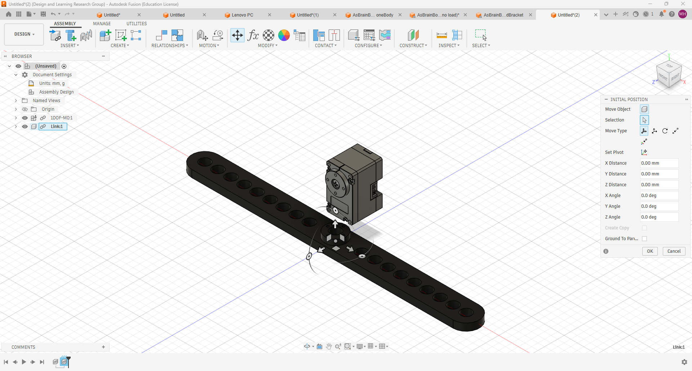 | 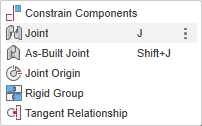 |
| 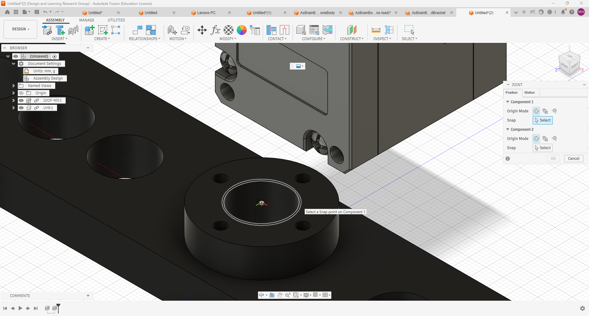 | 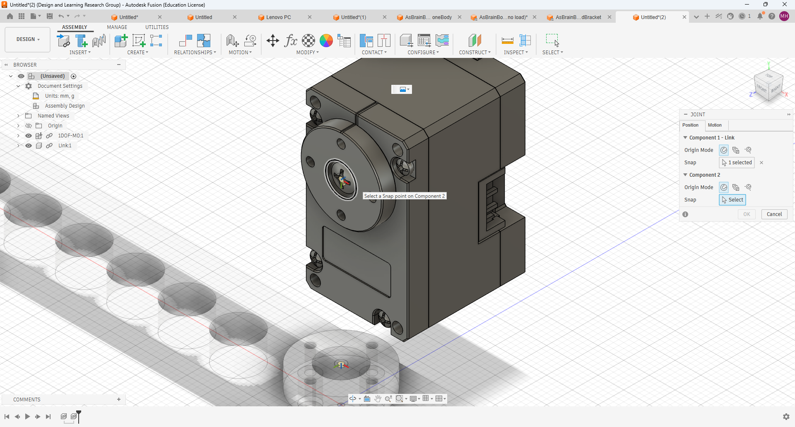 |

*Figure 3. The joint origins are selected at the link center and the XC330 output center.*

|  |  |
| --- | --- |
| 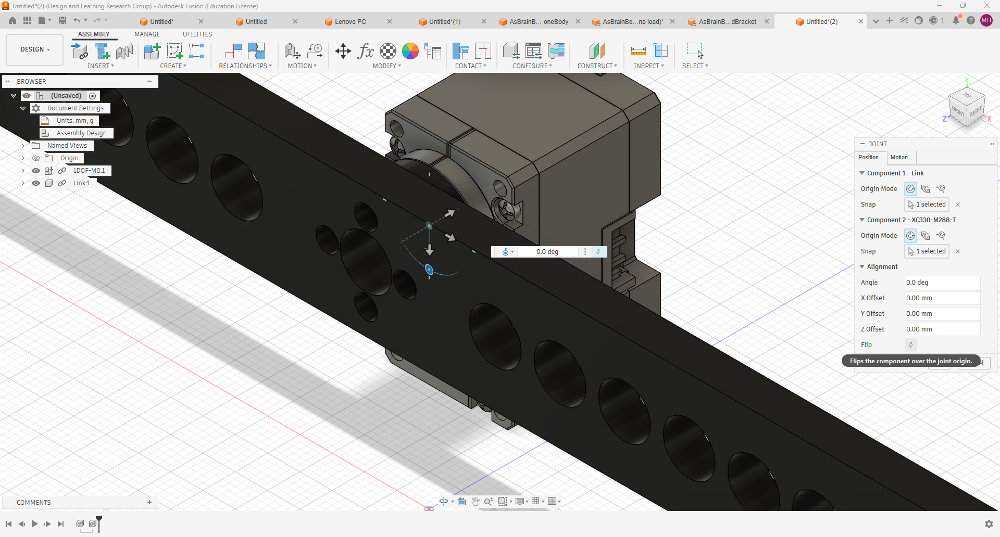 | 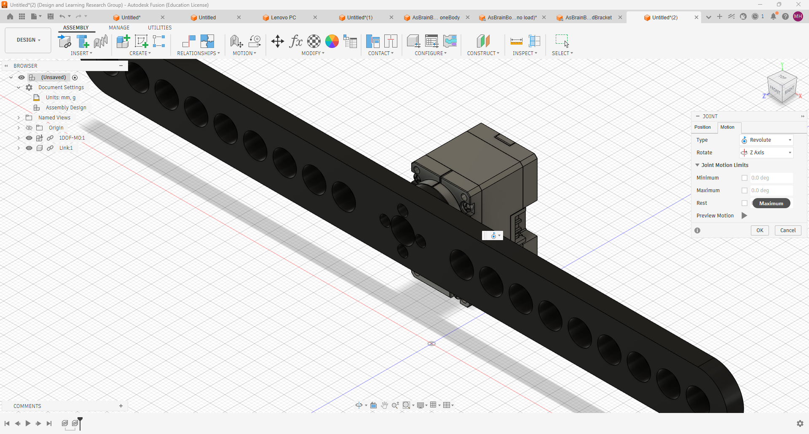 |

*Figure 4. The revolute joint places the link coaxially with the XC330 output shaft.*

### Position the two B0 payloads

1. Insert `Payload.step` as a new component.
2. Choose **Assemble → Joint**.
3. Select the center of the payload first.
4. Select the B0 link hole 60 mm from the XC330 axis second.
5. Set the joint type to **Rigid**.
6. Use the joint orientation shown in the reference sequence. Set the axial offset to `22.5 mm` and use **Flip** if the payload appears on the wrong side of the link.
7. Confirm that the payload center remains at `+60 mm` or `−60 mm` from the motor axis; the axial offset changes its position across the link thickness, not its radial distance.
8. Insert the second payload and choose **Make Independent**.
9. Repeat the rigid-joint operation at the symmetric link hole on the opposite side of the XC330 axis.

|  |  |
| --- | --- |
| 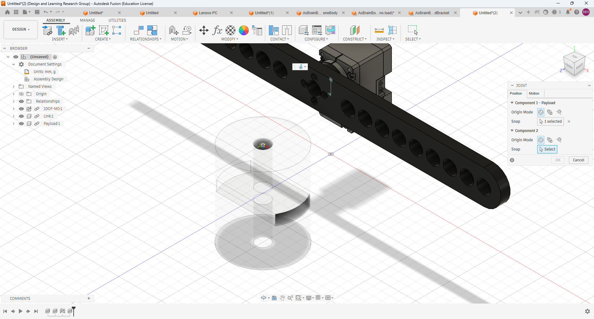 | 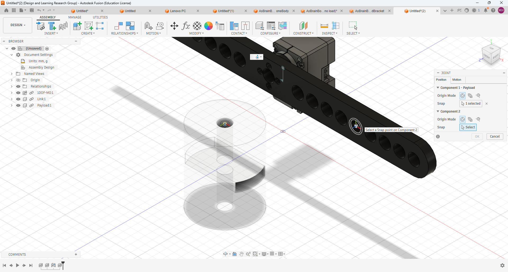 |
| 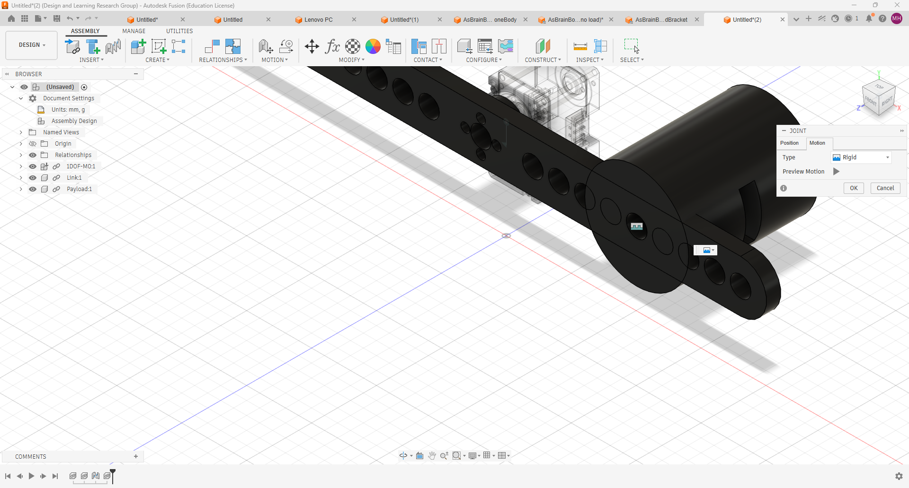 | 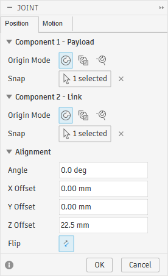 |

*Figure 5. Each payload is rigidly located at one of the two symmetric B0 mounting positions.*

### Insert the two pins

1. Insert `Pin.step` as a new component.
2. Align the pin concentrically with the first payload bore and its corresponding link hole.
3. Create a **Rigid** joint that preserves this concentric alignment.
4. Insert the second pin and choose **Make Independent**.
5. Repeat the rigid-joint operation for the second payload.
6. Move the revolute joint through a small positive and negative angle.

|  |  |
| --- | --- |
| 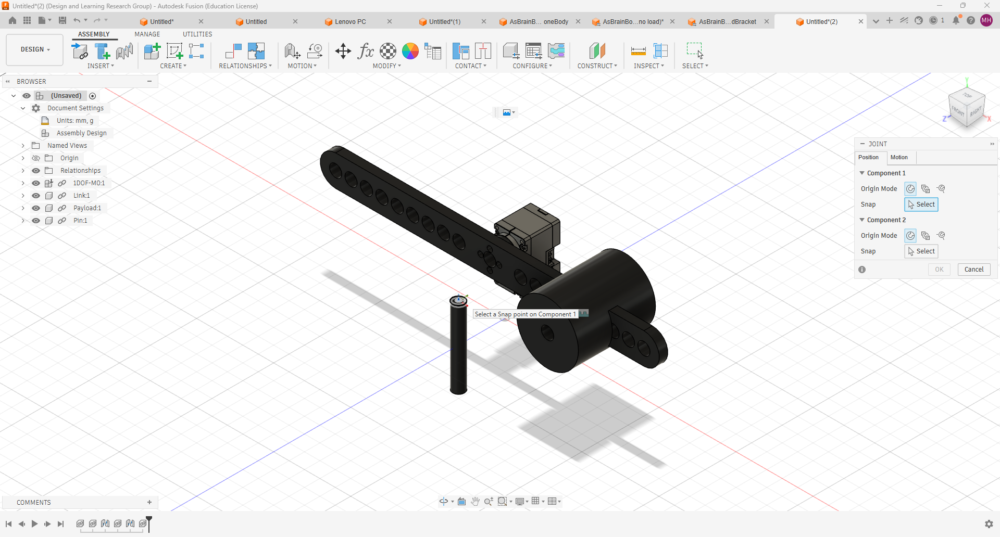 | 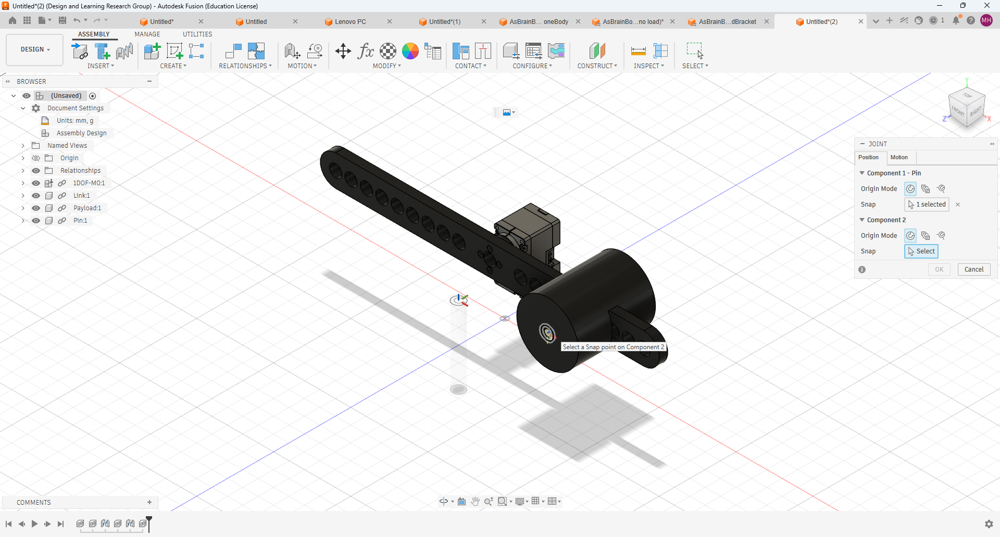 |
| 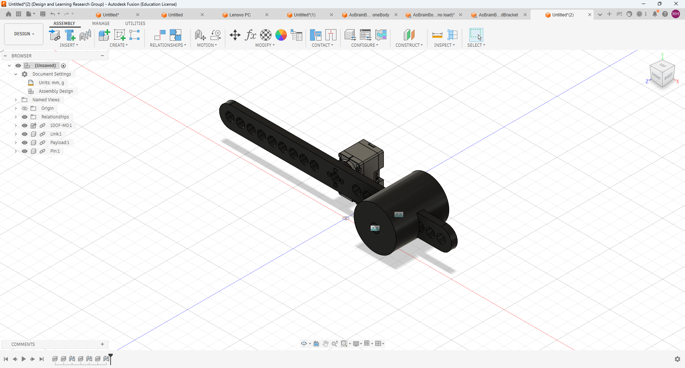 |  |

*Figure 6. The pins complete the two rigid payload attachments in the B0 fixture.*

The link, both payloads, and both pins must move as one rigid assembly. The motor housing must remain fixed. Compare the result with `1DOF-B0.step`; the reference file verifies the completed geometry but does not replace the assembly procedure.

### Check the B0 model before export

Confirm the following properties:

- one revolute joint connects the link to the XC330 output;
- the revolute axis is coaxial with the motor shaft;
- both payloads and both pins are rigidly attached;
- the two payload centers are 60 mm from the motor axis on opposite sides;
- the external moving assembly is the 22 g link plus two 44 g pin–payload assemblies, for a total of 110 g;
- repeated payload and pin occurrences are independent; and
- component names contain only letters, numbers, and underscores.

Save the completed Fusion design before preparing the export copy.

### Install ACDC4Robot

1. Use the supplied offline copy in `02_ACDC4Robot/`.
2. Extract the downloaded archive.
3. Open Fusion 360 and select **Preferences → General → API**.
4. Note the **Default Path for Scripts and Add-Ins**.
5. Copy the extracted `Add-IN/ACDC4Robot/` folder into the Fusion 360 add-ins directory.
6. In Fusion 360, open **Utilities → Add-Ins → Scripts and Add-Ins**, or press `Shift+S`.
7. Select `Fusion2Robot` under **My Add-Ins** and choose **Run**.
8. Enable **Run on Startup** for subsequent sessions.

|  |  |
| --- | --- |
| 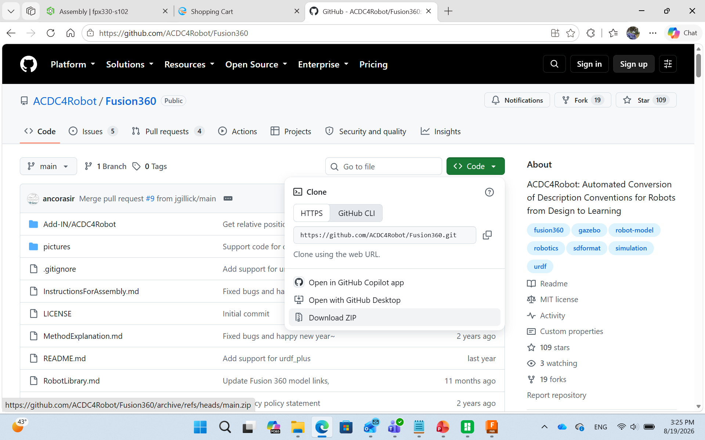 | 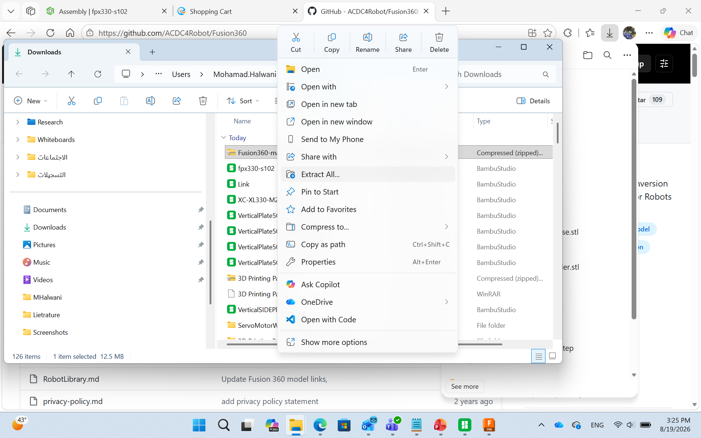 |
| 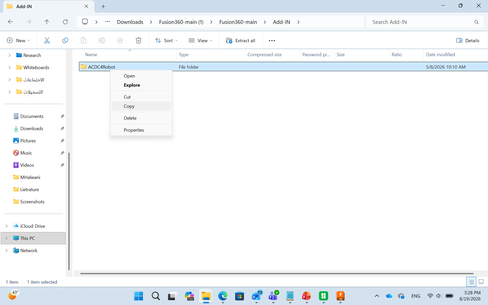 | 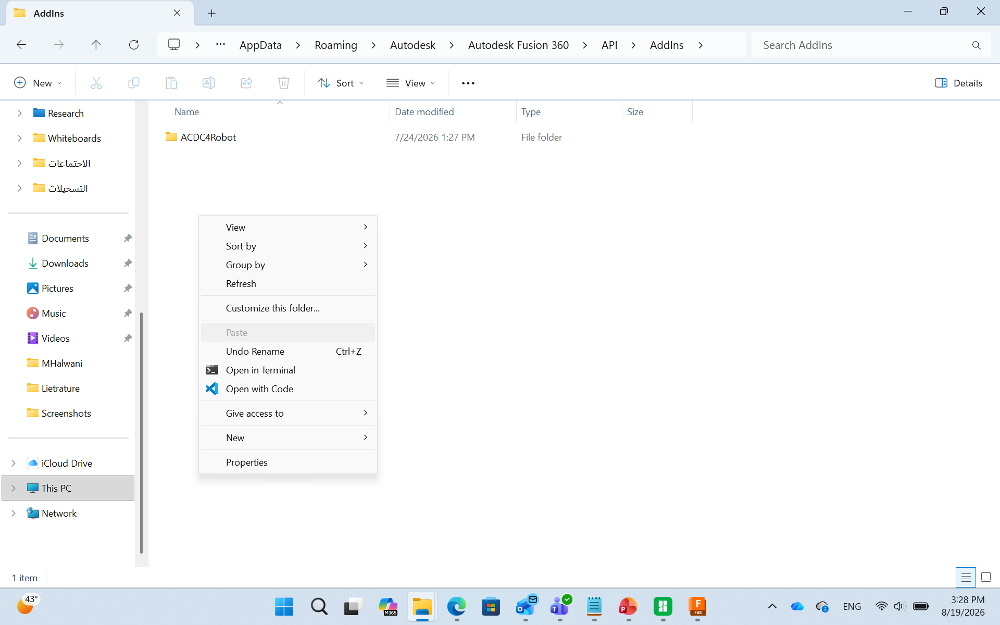 |

*Figure 7. The ACDC4Robot folder is extracted and installed in the Fusion 360 add-ins directory.*

### Prepare and export the MJCF model

1. Save a copy of the completed design as `Class03_B0_MJCF_Export`.
2. Disable **Capture Design History** in the export copy.
3. Break any remaining external component links.
4. Keep the assembly structure flat: the XC330, link, payloads, and pins must be accessible as assembly components rather than nested linked designs.
5. Confirm that the two payload occurrences and two pin occurrences are independent.
6. Set the design units to metres and confirm that the B0 radial offsets remain `0.060 m`.
7. Start ACDC4Robot.
8. Select **MJCF** as the description format and **MuJoCo** as the target simulator.
9. Export the model into a new directory named `Class03_B0_MJCF`.
10. Confirm that the output contains an XML model and its referenced mesh files.

## Part II — Configure and run the B0 simulation on Ubuntu

### Install Git and uv

Open an Ubuntu terminal and install Git and `curl`:

```bash
sudo apt update
sudo apt install -y git curl
git --version
```

Check whether uv is already installed:

```bash
uv --version
```

If the command is not found, install uv:

```bash
curl -LsSf https://astral.sh/uv/install.sh | sh
source "$HOME/.local/bin/env"
uv --version
```

### Clone only the Class 03 material

Use a sparse checkout so the working copy contains only the Class 03 lesson and resources:

```bash
git clone --depth 1 --filter=blob:none --no-checkout \
  https://github.com/asEmbodiedAISyst/2026Autumn.git \
  rob7103-class03

cd rob7103-class03
git sparse-checkout init --no-cone
git sparse-checkout set \
  '/2026-autumn/module-01-actuator-data-for-1-dof-systems/03-practice.md' \
  '/2026-autumn/resources/class03/'
git checkout main
```

Enter the standalone activity directory:

```bash
cd 2026-autumn/resources/class03/additional_material/standalone
```

When using the downloaded practice package instead of the sparse checkout, open a terminal in the extracted `Class03_Fusion360_to_MuJoCo` directory and enter:

```bash
cd 03_MuJoCo/standalone
```

Install the locked Python environment:

```bash
uv sync
```

Keep the terminal in the standalone directory for the remaining simulation commands.

### Add actuation to the exported MJCF

The ACDC4Robot export transfers the bodies, geometry, inertial properties, and revolute-joint structure from Fusion 360. A MuJoCo actuator must then be associated with the exported revolute joint before the model can receive a control input.

Use the supplied actuator-enabled model:

- repository: [`resources/class03/additional_material/standalone/models/1DOF-B0.xml`](../resources/class03/additional_material/standalone/models/1DOF-B0.xml)
- downloaded package: `03_MuJoCo/standalone/models/1DOF-B0.xml`

The ready B0 model associates a torque actuator with `actuator_joint`:

```xml
<actuator>
  <motor name="xc330_motor"
         joint="actuator_joint"
         gear="1"
         ctrllimited="true"
         ctrlrange="-0.1551 0.1551"
         forcelimited="true"
         forcerange="-0.1551 0.1551" />
</actuator>
```

The XML also contains joint-position, joint-velocity, and actuator-effort sensors used by the prepared simulation scripts. Use this ready model for the simulation stage; retain the direct ACDC4Robot export as the record of the CAD-to-MJCF conversion.

### Run the prepared Class 03 simulation

Run the model checks and open the prepared models:

```bash
uv run pytest
uv run python simulation_only/demo.py
```

The prepared simulation scene places the B0 fixture on the asBrain platform with the laptop visible in the environment.

Run the prepared B0 comparison activity with:

```bash
uv run python simulation_only/b0_data_collection.py
```

The activity writes the paired data, comparison figure, and numerical summary to `outputs/`.

## Submission

Submit:

- the completed Fusion 360 B0 assembly;
- the direct ACDC4Robot MJCF export and meshes;
- one image showing the revolute joint axis;
- one image showing the completed B0 payload placement;
- the supplied actuator-enabled B0 XML used for simulation; and
- the output files produced by the prepared B0 simulation activity.
