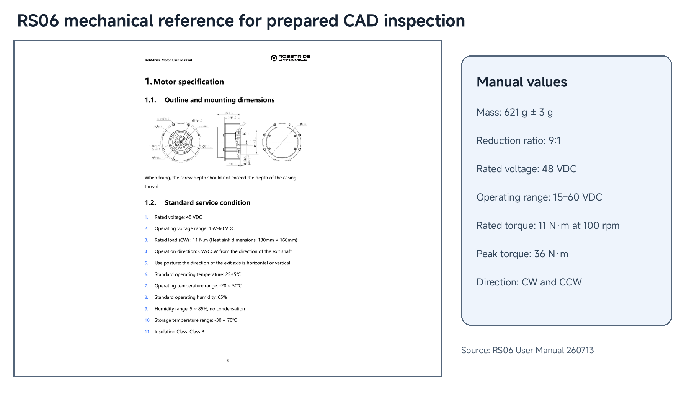
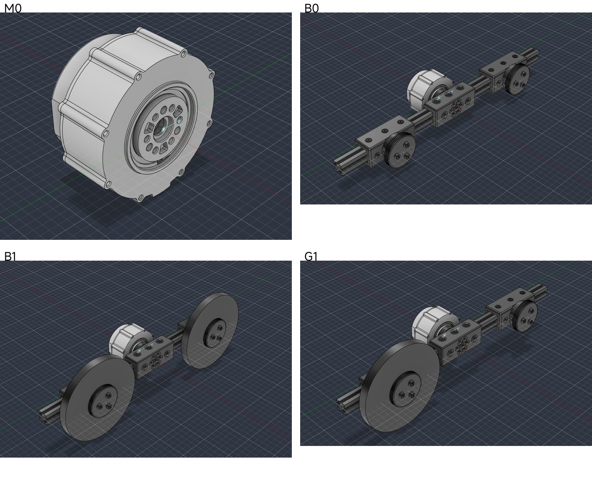

# 03 The RS06 Fixture: Digitization

## Central question

> Which geometric and mechanical properties must the RS06 model preserve before its hardware response can be tested?

This companion follows the RobStride RS06 source fixture from CAD to four frozen MJCF models. It shares the [main lesson's explanations of mass, inertia, frames and validation](03-basic-digitization-of-physical-embodiment.md), while keeping the **RS06 apparatus** separate from XC330. The [RS06 Class 04 companion](04-rs06-hardware-identification.md) uses these fixtures in the measured position-response experiment.

The RS06 load masses below are CAD-derived. They are not the XC330's accepted 110 g external assembly, and RS06 B1 and G1 do not even have equal external mass. Use the actuator identity and source model together whenever interpreting a configuration label.

## The RS06 actuator



*Figure 1. The RS06 outline and mounting dimensions, and the values of its user manual.*

| Item (user manual) | RS06 |
| --- | --- |
| Gear ratio | 9 : 1 |
| Rated torque | 11 N m at 100 rpm |
| Peak torque | 36 N m |
| No-load speed | 480 rpm |
| Mass | 621 g ± 3 g |
| Supply | 48 V (15–60 V) |
| Interface | CAN, 1 Mbit/s |

The RS06 is a quasi-direct-drive actuator: a brushless motor with field-oriented control, an encoder and a
9 : 1 gear in one housing. The low gear ratio keeps the joint backdrivable, so the load and the friction of the
joint act on the motor. The motor runs its own position or impedance loop and receives targets over CAN.

## The fixture and its configurations



*Figure 2. CAD renders of the four configurations M0, B0, B1 and G1.*

The RS06 is mounted with its output axis horizontal. A profile link is fixed to the output flange, and payload
discs can be fixed at its ends. Four configurations exist:

| ID | Configuration | Moving mass (kg) | Inertia about the joint (kg m²) | Gravity first moment (kg m) |
| --- | --- | ---: | ---: | ---: |
| M0 | motor only | 0 | 0 | 0 |
| B0 | balanced link | 0.6872 | 0.01291 | −3.7 × 10⁻⁵ |
| B1 | balanced link with both payloads | 2.4072 | 0.05768 | −3.7 × 10⁻⁵ |
| G1 | one-sided payload | 1.5472 | 0.03529 | −0.1290 |

B0 and B1 are nearly balanced in the CAD record: their first moments are close to zero, and B1 has about 4.5 times the fixture inertia of B0. G1 carries one
payload on one side, so gravity pulls the joint with up to $$0.1290 \times 9.81 = 1.27$$ N m. The values come
from the CAD exports. They are not measurements of the built fixtures, and the inertia does not include the rotor
of the motor.


The images are CAD renders, not photographs of the built fixtures.


## From CAD to MJCF

Each configuration is a Fusion 360 assembly with two components: the fixed base with the motor housing, and the
moving part with the link and the payloads. ACDC4Robot exports it to MJCF with one revolute joint, and the export
report lists no warnings and no errors. The exported files are then frozen as the hardware-matched models, one per
configuration.

| MJCF element | In the RS06 model (`G1.xml`) |
| --- | --- |
| `option` | `timestep="0.002"`, `integrator="implicitfast"`, gravity −9.81 m/s² |
| `body` `base_link` | the fixed base and the motor housing, 0.528 kg |
| `body` `playload-1` | the moving link and payloads, with its CAD mass, centre of mass and full inertia tensor |
| `joint` `rs06_joint` | hinge about the local −x axis, range ±1.1 rad; `armature="0.00125"`, `damping="0.00044"`, `frictionloss="0.048"` |
| `actuator` `rs06_position` | position servo, `kp="50"`, `kv="3.38"`, `ctrlrange="-0.9 0.9"`, `forcerange="-36 36"` |
| `sensor` | `q` (joint position), `qdot` (joint velocity), `tau_actuator` (actuator torque) |

The meshes are millimetre-scale STL files, so each mesh declaration applies `scale="0.001 0.001 0.001"`. The
joint values `armature`, `damping` and `frictionloss` are starting values. Class 04 identifies them from hardware
data. The actuator gains copy the first hardware controller setting as a fixed modelling assumption; equality of the numerical values does not establish calibrated controller equivalence. M0 keeps a moving body
with a tiny mass as numerical regularization. Its zero external-fixture inertia is not a claim that the physical rotor has zero inertia.

```xml
<joint name="rs06_joint" type="hinge" axis="-1.0 0.0 0.0" range="-1.1 1.1"
       armature="0.0012484886" damping="0.0004377347686" frictionloss="0.0481937007" />
<position name="rs06_position" joint="rs06_joint" kp="50" kv="3.38"
          ctrlrange="-0.9 0.9" forcerange="-36 36" />
```

## The four models in MuJoCo


*Figure 3. The four MJCF files loaded in MuJoCo with the joint at 0 rad.*

Load each model and compare it with its CAD render: the link direction, the payload positions and the joint axis
must agree.

The source model check evaluates gravity torque at zero velocity. M0 has no external-fixture gravity moment; B0 and B1 are nearly balanced, consistent with their small CAD first moments. G1 reaches 1.266 N m, the
value of its gravity first moment. This check connects the CAD mass properties to the dynamics before any
hardware runs.

---

## Read the fixture inertia before interpreting a response

The ratio $$0.05768/0.01291\approx4.47$$ compares B1 and B0 **external fixture** inertia. Adding the same actuator armature to both changes the ratio of total joint inertia. It does not multiply gravitational torque or every other torque by 4.47. First moment controls gravity; inertia controls acceleration effort. The CAD table therefore gives two independent ways for the load to affect motion.

The `base_link` mass in the export and the manufacturer's complete module mass describe different records and need not coincide. The 0.528 kg fixed CAD body does not contribute to isolated-hinge moving inertia. Treat it as a CAD/export property when considering a whole-system mass claim. The parameter values in the XML excerpt are starting values, not the Class 04 fitted values.

## Instructor and TA demonstration

Use the manufacturer reference, four CAD renders, G1 XML excerpt and saved MuJoCo load views. Trace the horizontal output axis, fixed housing and moving `playload-1` assembly. Compare B0 with B1 for inertia and compare either with G1 for first moment. Then locate the local −x hinge, mesh scale, position-actuator input and force limit in G1. The expected observation is agreement of declared component identity, axis and load placement across records; it is not yet an experimentally validated position response.

The primary Class 03 source also supplies this RS06 mechanical reference for reading the mounting and output geometry:


*Figure 4. RS06 mechanical reference retained with the XC330 source digitization record.*

The source manufacturer manual identifies the ratings. A peak-torque limit in a model is not a measurement of delivered effort in the later position-mode experiment.

## Student activity

Using the four supplied configurations, submit a short comparison: identify one property that changes B0-to-B1, one that changes balanced-to-G1, and one that remains a modelling assumption. Calculate the fixture-inertia ratio and the approximate G1 maximum gravity moment. Name the units and explain why CAD properties, starting joint-loss values and hardware-fitted effective parameters require different evidence. Use the XML excerpt to distinguish a position target from the direct torque input in the XC330 main lesson.

## Source records

The [RS06 fixture package](https://github.com/asEmbodiedAISyst/2026Autumn/blob/main/course-resources/Class%2003%20%E2%80%94%20Basic%20digitization%20of%20physical%20embodiment/additional_material/rs06_fixtures/README.md) preserves the prepared example. The [vendor CAD](https://github.com/asEmbodiedAISyst/2026Autumn/blob/main/course-resources/Class%2003%20%E2%80%94%20Basic%20digitization%20of%20physical%20embodiment/additional_material/demonstration/rs06/RS06_vendor_motor.step) and [manufacturer user manual](https://github.com/asEmbodiedAISyst/2026Autumn/blob/main/course-resources/Class%2003%20%E2%80%94%20Basic%20digitization%20of%20physical%20embodiment/additional_material/demonstration/rs06/RS06_User_Manual_260713.pdf) support component and rating inspection. Frozen [G1](https://github.com/asEmbodiedAISyst/2026Autumn/blob/main/course-resources/Class%2003%20%E2%80%94%20Basic%20digitization%20of%20physical%20embodiment/additional_material/rs06_fixtures/model-sources/G1.xml), [B0](https://github.com/asEmbodiedAISyst/2026Autumn/blob/main/course-resources/Class%2003%20%E2%80%94%20Basic%20digitization%20of%20physical%20embodiment/additional_material/rs06_fixtures/model-sources/B0.xml), [B1](https://github.com/asEmbodiedAISyst/2026Autumn/blob/main/course-resources/Class%2003%20%E2%80%94%20Basic%20digitization%20of%20physical%20embodiment/additional_material/rs06_fixtures/model-sources/B1.xml) and [M0](https://github.com/asEmbodiedAISyst/2026Autumn/blob/main/course-resources/Class%2003%20%E2%80%94%20Basic%20digitization%20of%20physical%20embodiment/additional_material/rs06_fixtures/model-sources/M0.xml) models retain their source meshes and export records in the package. Keep the CAD property and export-report records with the model when reusing it.
