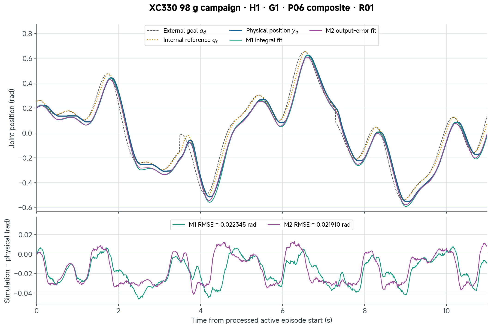
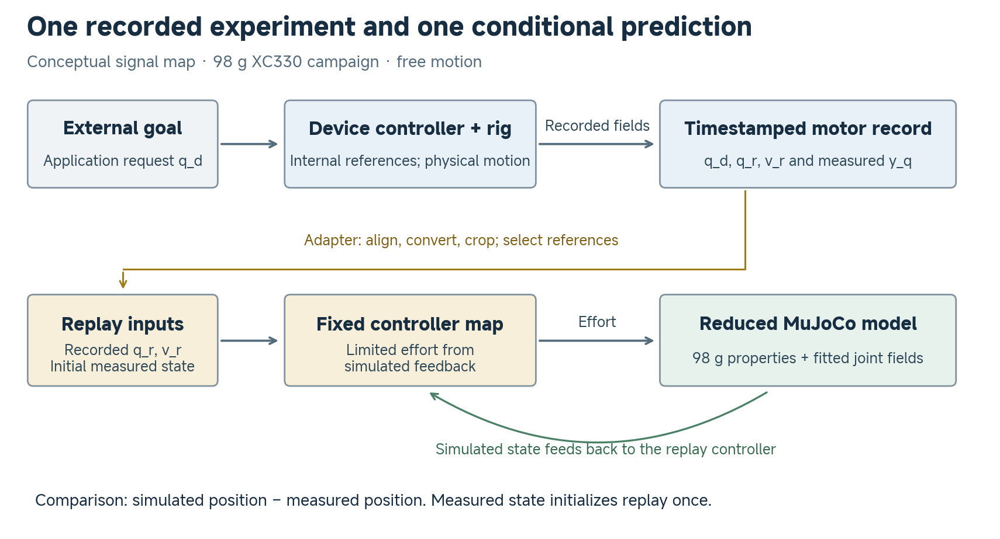
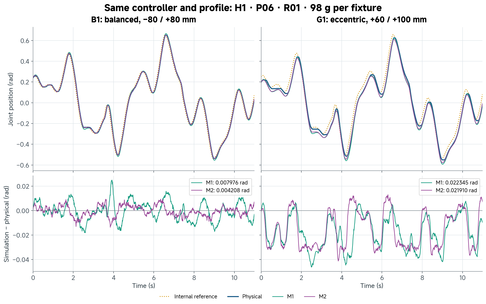
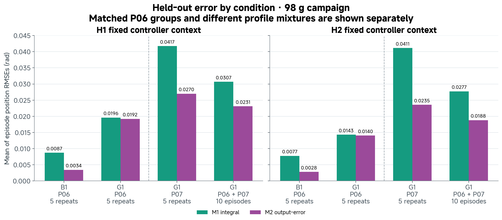
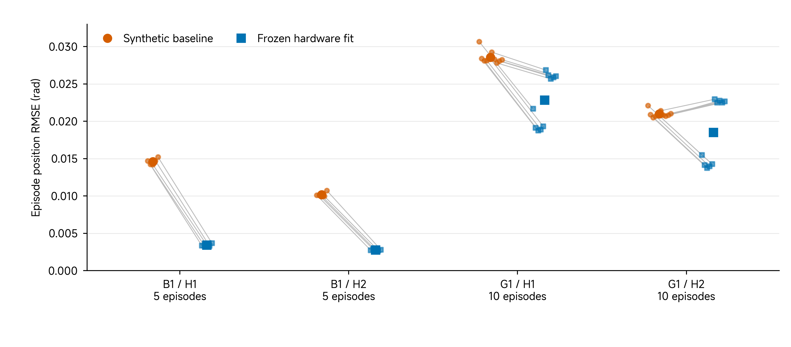
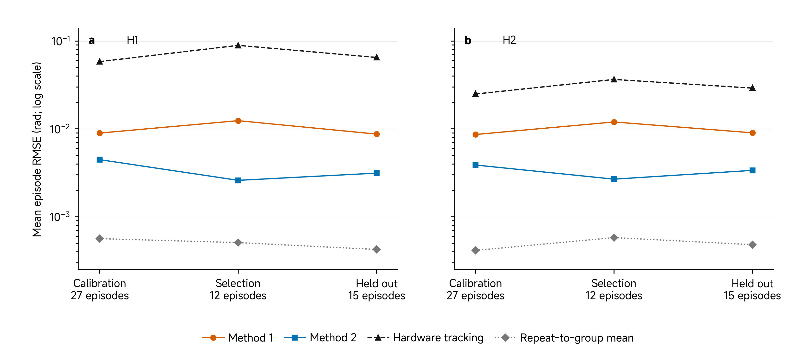
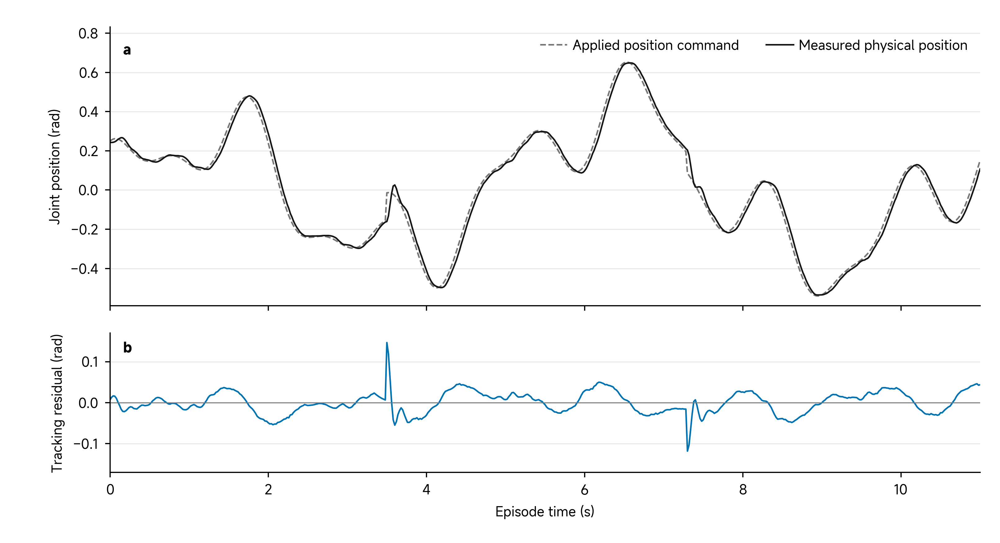

# 04 Basic Quantification of Sim2Real Gap

## Central question

> How do we estimate a MuJoCo model, quantify its discrepancy from physical actuator responses, and judge its usefulness for a specified task?

A simulated trajectory can look close to a physical trajectory while missing a repeatable offset, a reversal or a response under a different load. Conversely, an actuator can follow its requested motion poorly while a model predicts that imperfect response closely. To interpret agreement, we need to name the two quantities being compared, make their conditions compatible and report a numerical discrepancy together with its context.

Our starting example is one **XC330-M288-T in current-based position operation**, driving a rigid link and payload assembly about one joint. The numerical replay receives recorded internal position and velocity references. It predicts position using its own evolving simulated state. This is a conditional response model: it does not predict how firmware generates those references from an external goal.

[Class 03](03-basic-digitization-of-physical-embodiment.md) established how to inspect an executable mechanical representation. Here we estimate uncertain effective parameters and test predictions against recorded physical responses. The derivation and first selected response retain the documented **98 g XC330 case**. A **declared-110 g XC330 fit** and a separate **RS06 hardware-identification case** then test how the same reasoning changes with the model revision and command interface. Their masses, parameters and scores remain attached to their own records.

By the end of this class, you should be able to:

- Specify the signals, input boundary, fixture and conditions of a model-to-hardware comparison.
- Explain the roles of the two identification methods and their effective parameters.
- Calculate or interpret position RMSE with its units and grouping rule.
- Read a signed residual while distinguishing tracking error from model prediction error.
- Make a model-use decision limited to the tested conditions and available evidence.

[Lecture](#from-apparent-agreement-to-a-defined-comparison) · [Instructor and TA demonstration](#instructor-and-ta-demonstration) · [Student activity](#student-activity)

The supplied traces, metric tables and worked calculations support the demonstration and activity on this page. Running a new identification or operating hardware is not required to interpret the retained comparison.

## From apparent agreement to a defined comparison

The **Sim2Real gap** in this class is the difference between simulated and measured **joint position** under declared input, controller, fixture and processing conditions. It is not one permanent number belonging to an actuator or simulator. Changing the command boundary, payload, operating range or scoring rule changes the question.

**Predict:** If hardware and simulation both lag their reference by the same amount, is their model-to-hardware gap necessarily large?

*Figure 1. One recorded XC330 H1/G1/P06/R01 episode and two frozen MuJoCo candidates. The lower panel retains the signed model-to-measurement residual. These are predictions from the 98 g campaign; no parameter is adjusted to this episode. Method 2's position RMSE is approximately 0.02191 rad. Read the signal labels before deciding what the overlay establishes.*

[Class 02](02-actuator-basics-for-controlled-action.md) established how an application request becomes controlled physical motion. [Class 03](03-basic-digitization-of-physical-embodiment.md) represented a joint, coordinate frames and moving mass in an executable model. Here we ask a further question: **how well does a declared model predict a recorded physical response, and what should we change or trust on that evidence?**

Joint position is an angle; its time derivatives are velocity and acceleration. Fixture inertia describes resistance to angular acceleration, and gravity torque depends on mass distribution and pose. Those concepts carry forward. The first numerical dataset belongs to the separately documented 98 g fixture. We establish its identity before developing the two estimation methods, then carry those methods into the newer XC330 and RS06 comparisons.

Begin with a prediction claim and decide which observations can test it. Use informative motions to estimate a model, then compare its frozen predictions with physical records. Constructed examples let us check a calculation against a known answer; the recorded actuator responses test whether that model is useful under the declared conditions. This connects the mechanics to an evidence-based decision about simulation (Ljung 1999).

## Specify the comparison

### Specify the comparison before inspecting the score

“The simulator matches the actuator” leaves the input, output and operating conditions unspecified. Here the claim concerns measured joint-position prediction for a particular controller context, fixture and motion profile. A reference-driven replay, an external-goal-driven predictor and a torque-driven model are different experiments even when each produces an angle plot.

| Quantity | Symbol | Meaning here |
|---|---|---|
| External goal | $$q_d$$ | Application-facing requested position retained in the episode |
| Internal position reference | $$q_r$$ | Device-generated trajectory used as replay input |
| Internal velocity reference | $$v_r$$ | Recorded velocity trajectory used as replay input |
| Physical position | $$y_q$$ | Returned position converted to the declared joint coordinate |
| Physical velocity | $$y_v$$ | Qualified reported/processed physical velocity estimate |
| Simulated position | $$\hat q$$ | Output of the evolving MuJoCo model |
| Simulated velocity | $$\dot{\hat q}$$ | Velocity of that simulated state |

Positions use radians and velocities use rad/s. A hat denotes an estimate or model quantity; it does not turn a reported sensor value into an independent calibration. The [paired CSV](../resources/class04/data/xc330-98g-H1-G1-P06-R01.csv) uses explicit names such as `internal_position_reference_rad`, `physical_position_rad` and `simulated_M2_position_rad`; the [data and units guide](../resources/class04/data/README.md) maps them to these symbols. Use the logged Velocity Trajectory for $$v_r$$ and the logged Present Velocity for $$y_v$$. Differentiating an interpolated position curve would produce another signal and change the declared method. The device register roles follow ROBOTIS (n.d.); their use in this replay follows the preserved campaign implementation (asMagicBrain n.d.).

The **experiment runner** schedules requests and associates them with a record. The **hardware controller** shapes references and produces a limited drive response on the device. The **capture path** preserves commands, observations, timestamps and configuration. In replay, a declared controller approximation computes effort from recorded references and simulated feedback; **MuJoCo** then integrates the mechanics. A torque channel in an XML file supplies a route for effort. It does not, by itself, recreate the embedded position controller.

*Figure 2. The simulation receives recorded internal references and an initial state, then evolves independently. The physical position is the comparison target, not a state repeatedly injected into replay. The external goal remains visible but firmware reference generation lies outside this prediction boundary.*

### Keep the model versions distinct

The first numerical results belong to a **98 g added moving fixture**: a 6 g link, two 4 g pins and two 42 g payloads. Each complete pin/payload assembly is 46 g. Its fixture labels identify placements within this campaign.

| Source or example | What it represents | What carries into this class |
|---|---|---|
| Class 02 motor-only telemetry | An external request, internal references and device-reported response with no added moving fixture | Signal meanings and feedback concepts; a motor-only record does not validate a loaded assembly |
| Class 03: 110 g structural inspection family | A 22 g link and two 44 g assemblies; a unit-gear torque input with no embedded servo model | Body/frame/inertia inspection methods; its mass properties and zero added armature are not this campaign's fitted model |
| Retained 98 g identification case | Measured/source-recorded fixture masses, a reduced joint model and a fixed Mode-5 controller map | The two-method derivation, frozen candidates and selected activity response below |
| Declared-110 g XC330 fit | A later result record and saved MJCFs declaring 22 g plus two complete 44 g assemblies | A distinct baseline-versus-fitted comparison with 30 reserved episodes; its parameters and 28.3% reduction are not the 98 g result |
| RS06 hardware-identification case | Four CAD-defined fixtures, applied position commands and fixed position-mode gains | A separate 108-episode test of prediction, tracking and repeatability |

Shared B0/B1/B2/G1 labels do not establish identical hardware revisions. The later XC330 package explicitly declares 110 g and supplies its own fitted models and scores. That declaration does not independently resolve whether the 110 g/98 g difference arose from different built parts or revised descriptions. Changing a mass in an XML file would create another model; it would not transfer the following validation results to that model.

The primary numerical engine uses one reduced moving body, aggregate fixture inertia and a signed first moment. It does not use the detailed CAD body tree as its executable replay. A picture of that CAD can explain the mechanism, but cannot be labelled as the model producing these scores.

| 98 g fixture | Nominal payload-centre positions | Added fixture inertia about the joint, kg m² |
|---|---|---:|
| M0 | Motor only; no added link/payload fixture | 0 |
| B0 | −60, +60 mm | 0.000371055 |
| B1 | −80, +80 mm | 0.000628655 |
| B2 | −100, +100 mm | 0.000959855 |
| G1 | +60, +100 mm in the source placement description | 0.000665455 |

M0's zero is **added fixture inertia**, not zero actuator inertia. The fitted armature field remains separate. Loaded cases have 0.098 kg of added moving mass. The component central inertias are geometry-derived estimates scaled to the source-recorded masses; they have not been independently measured. For G1, the replay's bench-qualified signed first moment is −0.00736 kg m. Its sign depends on joint zero, positive direction and installation; positive CAD distances alone do not determine it. The maximum declared gravity-torque magnitude is about 0.07220 N m.

The recorded conversion places joint zero at 2048 position counts and converts one count to $$2\pi/4096$$ rad. In the reduced model, increasing angle is a positive rotation about the +Y joint axis and world gravity is [0, 0, −9.81] m/s². The signed G1 first moment is chosen to reproduce the recorded negative-angle resting direction. These conventions belong to this bench/model; they do not inherit another model's world placement. Replay initializes from the first cropped active-profile measurement, not a torque-off or zero-acquisition value from earlier preparation.

### Declare two different errors

Use reference-minus-measurement for the internal tracking error, consistent with the controller's error term:

$$
e_{\mathrm{track}}(t)=q_r(t)-y_q(t).
$$

Use simulation-minus-measurement for the model discrepancy:

$$
\delta q(t)=\hat q(t)-y_q(t).
$$

Positive discrepancy means the simulated angle is above the recorded physical angle in the declared coordinate. External-goal tracking would compare $$q_d$$ with $$y_q$$ and must be labelled separately.

For example, if both hardware and simulation are 0.05 rad below the same internal reference, internal tracking error is 0.05 rad while their instantaneous discrepancy is zero. The model predicts the lag even though the actuator has not followed its reference closely. Validation of a response model and evaluation of actuator tracking answer different questions.

The primary position metric for episode $$e$$ is

$$
R_e=\sqrt{\frac{1}{N_e}\sum_{i=1}^{N_e}\delta q_{e,i}^{\,2}}.
$$

Here $$N_e$$ counts the retained, time-paired samples under the declared processing rules. RMSE measures a typical magnitude in radians, not a signed direction or a causal explanation. We retain the signed residual trace alongside it.

Our **comparison record** binds the fixture, controller, input/output meaning, units, zero, initialization, time alignment, scoring interval, retained samples, frozen parameter candidate, metric and intended use. A numerical acceptance tolerance must come from that intended use. The archive does not provide a universal threshold for “good enough”.

**Checkpoint:** Which claim would become stronger if the model predicted directly from $$q_d$$, and which missing part of the system would it then need to represent?

## Design informative measurements

### Give the unknown parameters something distinguishable to explain

Acceleration changes the inertial contribution to effort. Speed changes viscous resistance. Direction changes alter the sign of moving dry friction. A collection containing only one steady speed can fit a combination of resistance terms without distinguishing them well; it contributes little information about inertia during that steady segment.

Several motion types therefore serve different purposes. The campaign uses a slow triangle, multisine and smooth levels for calibration. Chirp and wide-sine profiles provide model-selection records. A composite motion and a sine-with-hold profile form the reserved evaluation motions. These labels identify records; informative excitation still has to be checked against the actual reference and measured response.

Changing payload distribution also changes inertia and, for an eccentric installation, gravity torque. It tests whether a candidate transfers across declared fixture conditions. It does not isolate a cause if controller settings, motion profiles or processing change simultaneously. Near rest, dry friction is particularly difficult to approximate; at saturation, larger reference error may not produce larger effort. Those regions require their stated treatment rather than silent removal.

An **episode** is one complete declared experiment. A **repeat** is another execution of the same fixture/controller/profile combination. Many samples within one episode are correlated observations of that experiment; they are not independent repeated trials.

### Separate estimation, selection and evaluation

| Role | XC330 primary records | Purpose |
|---|---|---|
| Calibration | M0/B0/B1/B2 × P01–P03 × H1/H2 × 3 repeats = 72 episodes | Estimate each controller context's parameters |
| Model selection | B0/B2 × P04–P05 × H1/H2 × 3 repeats = 24 | Choose among declared candidates or permitted modelling choices |
| Held-out-labelled evaluation | B1/P06 and G1/P06–P07 × H1/H2 × 5 repeats = 30 | Inspect reserved motion/fixture transfer |

The primary set has 126 episodes. The original archive contains additional controller diagnostics, pilots and preparation records; they are not additional primary fitting data. Split complete episodes and relevant conditions, not neighbouring samples selected at random. A model tested on samples adjacent to its fitting samples has faced a weaker prediction challenge than a model tested on a different complete experiment.

### Establish the clocks and processing rules

| Clock or representation | Meaning in this example |
|---|---|
| Original telemetry | Approximately 5 ms average spacing, about 200 samples/s |
| Analysis arrays | 10 ms grid, about 100 samples/s, after active-profile cropping and alignment |
| MuJoCo integration | 2 ms steps, five steps per 10 ms reference interval |
| Embedded firmware loop | Not established by any of those rates |

The adapter converts position and velocity into the bench coordinate, retains the external command with zero-order holding and interpolates sampled telemetry/internal references onto the analysis grid. Scoring excludes preparation, return and post-hold phases. During simulation, sampled references are held between their analysis-grid updates. Interpolating observations and holding commands are different operations, each part of the declared method.

The resulting arrays are reproducible analysis inputs, not raw event streams. A Goal Position register readback must also be distinguished from an independently timestamped host transmission. Time labels should state which event they timestamp.

A timing shift can create a structured residual. Increasing inertia to imitate that delay can make one plot look closer while hiding the incorrect time boundary. Align units, zero and timestamps through a declared rule before estimating parameters. Keep failed or interrupted records with status and exclusion reasons. Fit/scoring eligibility is part of the evidence, not an invitation to keep only attractive trajectories.

**Predict:** Which motion change would help separate inertia from viscous resistance? What must remain fixed for that comparison to be interpretable?

## Estimate the actuator model

### State the model and its fixed controller approximation

For this fixed-axis, rigid-fixture, free-motion example, organize the mechanical balance as

$$
(J_f+J_a)\ddot q+b\dot q+\tau_{\mathrm{dry}}+\tau_g(q)=\tau_C.
$$

This is the one-coordinate specialization of the rigid-body balance used earlier:

$$
H(q)\ddot q+C(q,\dot q)+\tau_f(\dot q)=\tau_a+\tau_{\mathrm{ext}}.
$$

For the present fixed-axis rigid fixture, $$H=J_f+J_a$$ is constant, the velocity-dependent rigid-body bias vanishes, and the remaining bias is gravity. Contact is absent in this experiment, so $$\tau_{\mathrm{ext}}=0$$; the ideal unit-gear actuator applies the declared controller effort, $$\tau_a=\tau_C$$. Friction is still present. This specialization connects the generalized-coordinate balance to the reduced MuJoCo model (Featherstone 2008); it does not introduce a new convention for applied external torque.

The fixture supplies $$J_f$$ and the gravity term $$\tau_g$$. The three estimated fields are additional effective joint inertia $$J_a$$, viscous damping $$b$$ and dry-friction magnitude $$\tau_c$$. They map to MuJoCo `armature`, `damping` and `frictionloss`, with units kg m², N m s/rad and N m respectively. Armature adds to the fixture contribution; it does not replace it.

This restricted equation has no additional contact torque. Constant fixture inertia is appropriate to the declared single-axis rigid assembly. Resistance and gravity are written separately; losses should not also be counted through an extra efficiency correction representing the same effect. MuJoCo handles friction loss through its constraint formulation. The sign-of-velocity expression used in the integral approximation below is not a complete description of sticking. See the [MuJoCo friction-loss discussion](https://mujoco.readthedocs.io/en/3.3.7/computation/index.html#friction-loss) (MuJoCo developers n.d.-a).

The replay computes limited effort using

$$
\tau_C=\operatorname{clip}\!\left(
K_p^C(q_r-\hat q)+K_v^C(v_r-\dot{\hat q}),
-\tau_{\mathrm{lim}},\tau_{\mathrm{lim}}\right).
$$

Clipping limits the result to the stated interval. $$K_v^C$$ is the velocity-error coefficient called $$K_d$$ in a common proportional/derivative notation. The superscript identifies a coefficient in the declared simulation controller, not a raw firmware register.

| Context | Recorded firmware P/I/D | Fixed $$K_p^C$$, N m/rad | Fixed $$K_v^C$$, N m s/rad | Effort limit |
|---|---|---:|---:|---:|
| H1 | 600/0/150 | 1.579836 | 0.202115 | ±0.1551 N m |
| H2 | 800/0/150 | 2.106448 | 0.202115 | ±0.1551 N m |

Firmware registers are dimensionless settings. The source converts their documented scales using a disclosed engineering map and a fixed 0.517 N m/A static torque/current ratio. A 300-count current-related limit maps to 0.300 A and therefore 0.1551 N m in this approximation. This is not a calibrated measurement of shaft torque or proof that the proprietary embedded loop is reproduced exactly.

In particular, the supplied `Present Current` interpretation is device-input current; it cannot simply be substituted for torque-producing winding current. It is not used as measured shaft torque in the primary fit. The [ROBOTIS model documentation](https://docs.robotis.com/docs/dxl/model_reference/x_series/xc_series/xc330-m288/) supplies register and mode definitions; the conversion into this effective SI controller remains a modelling assumption.

H1 and H2 have separate fitted joint vectors. Controller gains are fixed within each context and never optimized here. If the mapping is inadequate, the resulting effective parameters can absorb some of its error. Their predictive performance is still testable, but their interpretation as isolated motor constants is not established.

### Follow the equation into the executable model

The [native replay engine](../resources/class04/native/code/upstream/run_chapter02_real_position_identification_v2.py) creates one hinge and one unit-gear motor named `mode5_controller_torque`. The mechanics are compiled once per fixture/controller context. A candidate then sets three joint fields before replay:

| Equation quantity | Implementation | Interpretation |
|---|---|---|
| $$J_f$$ | Declared fixture inertia, recoverable from `mj_fullM` after subtracting armature | Fixed geometry/property estimate |
| $$J_a$$ | `model.dof_armature[0]` | Estimated extra effective joint inertia |
| $$b$$ | `model.dof_damping[0]` | Estimated viscous resistance |
| $$\tau_c$$ | `model.dof_frictionloss[0]` | Estimated dry-friction bound; MuJoCo also handles sticking |
| $$\tau_g$$ | `data.qfrc_bias[0]` at zero velocity | Left-hand gravity bias, not the applied gravitational force's sign |
| $$\tau_C$$ | `data.ctrl[0]`, through the motor's unit transmission | Limited simulated output effort in N m |

For the reduced G1 body, let $$\mu$$ be the signed first moment along its zero-pose x axis. Its declared centre of mass rotates about +Y, so the gravity term on the left of the balance is

$$
\tau_g(q)=-9.81\mu\cos q.
$$

With $$\mu=-0.00736$$ kg m, the model gives $$\tau_g(0.4)\approx0.0665021$$ N m. This matches `qfrc_bias[0]` at zero velocity; the applied gravitational torque has the opposite sign. The sign follows this installation's coordinate convention, not the positive distances in a payload label. It is a model-consistency check rather than a new measurement.

**Worked control step.** In H1, suppose the simulated state is 0.2 rad and 0.4 rad/s, while the recorded references are 0.3 rad and 0.2 rad/s. Using the unrounded coefficients in the configuration card, let the requested effort before limiting be $$\tau_{\mathrm{req}}$$:

$$
\begin{aligned}
\tau_{\mathrm{req}}&=K_p^C(0.1)+K_v^C(-0.2)\\
&=0.1175606397\ \mathrm{N\,m},\\
\tau_C&=\operatorname{clip}(\tau_{\mathrm{req}},-0.1551,0.1551)\\
&\approx0.117561\ \mathrm{N\,m}.
\end{aligned}
$$

This is a computed model effort, not a measured hardware torque. A position error of 0.2 rad with zero velocity error would request about 0.316 N m before clipping, so only 0.1551 N m is applied in this model. Increasing error beyond that point cannot increase its permitted effort.

Between consecutive 10 ms analysis samples, the engine holds the preceding recorded references and performs five 2 ms MuJoCo steps. It recomputes feedback from the evolving simulated state at **each** substep. The 2 ms integration/controller-update interval is a simulation choice, not a measurement of the firmware loop rate. `ctrl[0]` is torque here because this XML defines a motor; it would mean position in a position-actuator XML such as the separate RS06 example.

### Method 1 integrates the equation

Computing acceleration by differentiating encoder position twice can amplify measurement noise. Instead, integrate the mechanical equation over a qualified moving window. Approximate moving dry friction by $$\tau_c\operatorname{sgn}(\dot q)$$ and collect the known terms:

$$
J_a\Delta\dot q+b\Delta q+
\tau_c\int_{t_0}^{t_1}\operatorname{sgn}(\dot q)\,dt
\approx
\int_{t_0}^{t_1}(\tau_C-\tau_g(q))\,dt-J_f\Delta\dot q.
$$

In the actual calibration subset, M0/B0/B1/B2 have zero declared first moment, so $$\tau_g=0$$. The implementation therefore forms its target as integrated reconstructed effort minus $$J_f\Delta\dot q$$. G1 is evaluated later by replaying a frozen candidate; it is not used to fit this regression. Extending the regression to an eccentric fixture would require the gravity contribution in the general equation above.

Each window supplies one row of $$A\theta\approx z$$, where $$\theta=[J_a,b,\tau_c]^{\mathsf T}$$. The columns are velocity change, position change and signed moving time. The right-hand side is integrated reconstructed controller effort minus the declared gravity and fixture-inertia contributions.

For this method, reconstructed effort uses qualified measured position and velocity in the fixed controller expression. Those measurements are being used to build the regression. In output-error replay, feedback instead uses the simulated state. Confusing those two operations would turn a free-running prediction into a measurement-driven calculation.

**Constructed worked row.** Suppose a 0.2 s window stays in positive motion, with velocity change 0.5 rad/s and position change 0.1 rad. The row is $$[0.5,0.1,0.2]$$. Illustrative parameters $$[0.001,0.04,0.005]$$ give

$$
0.5(0.001)+0.1(0.04)+0.2(0.005)=0.0055\ \mathrm{N\,m\,s}.
$$

These numbers demonstrate the calculation; they are not physical measurements or the campaign's parameter vector. One row cannot determine three unknowns. Several independent motion windows are needed, and bounds constrain the estimates. The actual XC330 implementation uses qualified 0.5 s windows, filtering and moving-fraction rules. Numerical rank concerns distinguishable columns; conditioning concerns sensitivity to small errors. Neither proves that reconstructed effort or the friction approximation is physically exact.

### Method 2 fits the simulated output

Output-error optimization proposes a parameter vector, simulates calibration episodes and compares predicted position with recorded position. It updates the vector within declared bounds and repeats the calculation. It does not require measured shaft torque or numerically differentiated acceleration.

For retained calibration samples, an equal-episode squared-error objective can be written

$$
L(\theta)=\sum_{e\in\mathcal C}\frac{1}{n_e}
\sum_{i\in\mathcal I_e}
\left(\hat q_{e,i}(\theta)-y_{q,e,i}\right)^2.
$$

Here $$\mathcal C$$ is the calibration set, $$\mathcal I_e$$ is the retained optimization sample set and $$n_e=|\mathcal I_e|$$. The packaged solver uses every fourth point of the 100 Hz arrays and normalizes each episode's residual block by the square root of its sample count. Three numerical starts test convergence within the stated bounds; they are not physical baseline models.

Replay starts once from the first measured position and velocity. It then uses five 2 ms physics steps per reference interval, computing feedback from its own state. Later measurements supply the comparison target rather than replacing simulated position or velocity.

The full-episode validation score is calculated separately from the optimizer's subsampled residual. A sum of episode mean squared errors, its square root and a mean of episode RMSE values are related summaries, but they are not numerically interchangeable. Name the one being reported.

Method 2 includes the declared saturation and MuJoCo friction treatment during repeated simulation. It costs more than solving one regression and remains dependent on the model class and fixed controller assumptions. Both methods are parameter estimation, not reinforcement learning.

### Freeze a candidate before evaluating it

The released H1 vectors illustrate how methods can disagree:

| Field | Method 1 | Method 2 |
|---|---:|---:|
| Armature, kg m² | 0.0107069 | 0.00632963 |
| Damping, N m s/rad | 0.0364783 | 0.0425664 |
| Friction loss, N m | 0.0102269 | 0.00736304 |

The values belong to this controller/model/data context. A small output discrepancy does not prove unique rotor inertia, calibrated torque, or accurate behaviour under contact. Compare predictions and parameter plausibility while retaining those limits. Replaying these supplied vectors reproduces a frozen candidate; it is not a fresh fit.

**Checkpoint:** Why can two methods return different parameters even when both execute correctly? Which comparison would help judge their usefulness?

## Test against physical records

### Replace constructed observations with physical records

In a constructed experiment, the generating parameters can be known and later revealed. That lets us distinguish calculation errors from imperfect parameter recovery under a declared observation model. On physical hardware, equivalent MuJoCo parameters are unknown. We evaluate measured-response prediction rather than distance to an unavailable true vector.

The 98 g campaign's evidence chain is a scripted collector, command/telemetry packet records with configuration, an alignment/conversion adapter, complete analysis episodes and a frozen replay. The configuration includes mode, gains, limits, fixture, firmware, coordinate conventions and operating context. The model's geometry-derived inertias and effort mapping remain estimates or assumptions even when their inputs are carefully recorded.

Structured motor records and visual context have different roles. In other supplied historical material, **asBrain** names the command/telemetry capture path and the original **asMagic** supplies phone-based visual context. That material belongs to a separate source family. The 98 g archive's collector records do not establish that those applications acquired this campaign. A video can help explain an installation or event; it does not supply the time-paired joint samples used to calculate this gap. The demonstration therefore follows the verified motor-record path and labels any additional visual illustration by its actual source.

### Preserve the physical comparison contract

The supplied arrays retain the declared fixture, profile, controller, repeat and split identity. The audit checks source hashes, episode identities, monotonic times and finite observations. Such checks support reproducibility and data integrity; they do not independently calibrate a sensor or prove every physical assumption.

The archived evaluation is **retrospective**: the trajectory adapter and controller representation were finalized after the archive existed. Held-out labels preserve a useful reserved-role comparison, but they do not make this an independent prospective confirmation. A prospective campaign would freeze the model class, processing and candidate selection before collecting or revealing new evaluation records.

If a residual motivates a new timing rule, gravity sign or model term, preserve the original result and record the revision. The revised candidate needs fresh evaluation. Moving a validation trace until it overlays neatly would change the comparison after seeing the answer.

## Interpret the Sim2Real discrepancy

### Calculate the discrepancy and keep its meaning

For three constructed residual samples of −0.01, 0 and +0.01 rad, the mean signed error is zero. The positive and negative errors cancel. Their RMSE is

$$
\sqrt{\frac{(-0.01)^2+0^2+(0.01)^2}{3}}
\approx0.008165\ \mathrm{rad}.
$$

Zero mean signed error therefore does not establish an exact prediction. RMSE summarizes magnitude; the signed trace reveals where and in which direction discrepancies occur. A large peak can also matter to an intended task even when the average magnitude is modest.

Now inspect the selected physical record under H1. Keep its identity and scoring rules beside the figure:

| Selected comparison | Declared value |
|---|---|
| Record | XC330, H1, G1, P06 composite, R01 |
| Mechanical/controller context | 98 g fixture; Mode 5; fixed H1 engineering map |
| Candidate used for the activity | Frozen H1 Method 2 armature, damping and friction-loss vector in the parameter table |
| Analysis interval | 0.00–10.99 s from the processed active-profile start |
| Retained observations | 1,100 paired samples at 0.01 s spacing |
| Initialization | First measured position and velocity; simulation then evolves from its own state |
| Scoring | All supplied active-profile samples; no added shift, filter, burn-in removal or mask |

The initialized position sample has zero position residual by construction and remains in the declared score. The remaining measurements are comparison targets, not state resets. The sample count is not a count of independent trials. The [configuration and frozen candidates](../resources/class04/data/xc330-98g-model-config.json), [paired observations and predictions](../resources/class04/data/xc330-98g-H1-G1-P06-R01.csv) and [saved activity metrics](../resources/class04/data/xc330-98g-activity-saved-metrics.json) preserve this comparison.

With the frozen candidates and the same analysis rules:

| P06 first held-out repeat | Method 1 episode RMSE | Method 2 episode RMSE |
|---|---:|---:|
| Balanced B1 | 0.00797565 rad | 0.00420779 rad |
| Eccentric G1 | 0.0223445 rad | 0.0219097 rad |

For the selected G1 episode, Method 2 is about 1.26 degrees in position RMSE. Its mean signed residual is −0.01593 rad and its largest absolute residual is about 0.04129 rad, near 3.83 s. Between 2 and 3 s all its retained residual samples are negative, so simulation underpredicts the measured joint angle throughout that interval. This is a specific observation, not proof of a gravity, timing or friction cause.

The same physical episode has internal-reference tracking RMSE about 0.04985 rad and external-goal tracking RMSE about 0.07643 rad. Those are different comparisons from the 0.02191 rad model gap. Both model candidates face the same episode, initialization and scoring rules. There is no arbitrary nominal physical baseline in this study.

*Figure 3. B1 and G1 first repeats use the same named P06 profile and H1 context. The differing physical initial states and fixture properties are preserved. The comparison helps investigate condition dependence; it does not uniquely establish a failure mechanism.*

### Read a residual before assigning a cause

An approximately constant offset suggests checking zero or measurement bias. A discrepancy that changes around transitions suggests checking reference meaning, timing, saturation or model dynamics. Direction dependence motivates friction, backlash or controller checks. An eccentric fixture motivates inspecting gravity direction, installed zero and signed centre of mass. Several mechanisms can produce similar patterns.

| Observation | Possible explanation | Discriminating check |
|---|---|---|
| Offset across a motion | Coordinate zero or measurement bias | Check a physical reference pose and conversion independently of the scored trace |
| Error concentrated at transitions | Timing or reference/controller mismatch | Inspect timestamp events and recorded internal references under the frozen alignment rule |
| Different errors in opposite directions | Friction, lost motion or controller asymmetry | Compare repeated direction reversals at controlled speed and load |
| Weak eccentric transfer | Gravity/installation or missing load-dependent effects | Check signed geometry and holding behaviour at declared poses; preserve controller settings |

A proposed cause becomes stronger when a check separates it from a credible alternative. Residual shape alone is not proof. At this stage a defensible response is an observation, a hypothesis and a next test—not a confident diagnosis unsupported by measurements.

### Report the aggregation and the condition

The campaign summary is the **arithmetic mean of complete-episode RMSE values**:

$$
\overline R=\frac{1}{E}\sum_{e=1}^{E}R_e.
$$

Each episode has equal weight. Pooling all retained samples instead gives

$$
R_{\mathrm{pooled}}=
\sqrt{\frac{\sum_e N_e R_e^2}{\sum_e N_e}}.
$$

These statistics answer different questions. For two episodes with RMSE 0.002 and 0.010 rad and sample counts 100 and 900, the mean episode RMSE is 0.006 rad while pooled RMSE is about 0.009508 rad. The actuator has not changed; only the weighting question has changed.

The released H1 results also depend strongly on the evaluation condition:

| Evaluation group | Method 1 mean episode RMSE | Method 2 mean episode RMSE |
|---|---:|---:|
| Model selection, 12 episodes | 0.0120930 rad | 0.00434992 rad |
| Held out, all 15 H1 episodes | 0.0233431 rad | 0.0165230 rad |
| Held-out B1/P06, 5 repeats | 0.00869335 rad | 0.003398 rad |
| Held-out G1/P06–P07, 10 repeats | 0.0306679 rad | 0.023086 rad |

*Figure 4. Released mean episode RMSE values, not single-episode scores. B1 and G1 groups have different profile composition as labelled. These bars are deterministic summaries of this archive, not confidence intervals or estimates of a wider actuator population.*

The combined Method 2 held-out value is approximately

$$
\frac{5(0.003398)+10(0.023086)}{15}
\approx0.016523\ \mathrm{rad}.
$$

That aggregate hides the weaker G1 group. Because G1 includes P07 as well as P06, the aggregate contrast does not isolate eccentricity as the cause. Use the matched P06 comparison and additional discriminating checks when investigating the fixture effect.

### Compare prediction with repeatability and intended use

Repeated physical trajectories show how much the recorded response varies under the same declared condition. The archived held-out repeat-to-combination-mean RMSE averages about 0.001375 rad across the 30 primary held-out episodes. This is a run-to-run context measure, not an independent sensor calibration, universal noise floor or ready-made acceptance threshold. The predicted-to-measured gap includes effects that repeatability cannot separately identify.

A useful model decision therefore combines its position metric, residual structure, repeat context, tested operating scope and the consequence of prediction error for the intended task. A tolerable discrepancy for previewing broad free motion might be inadequate for a precise interaction task. This campaign supplies no evidence for contact accuracy or calibrated torque.

The evidence supports investigating the frozen Method 2 candidates for balanced-fixture position prediction within this controller/reference boundary. It leaves eccentric transfer materially weaker and the final prospective claim unresolved. A suitable decision is: **retain the candidate for the stated limited comparison, investigate the G1 discrepancy, and require new reserved evidence before extending the claim.**

**Checkpoint:** Which numerical result would you report for the selected activity episode? Which other result would you report to describe its condition across repeats? Why are those not the same number?

### Evaluate the declared-110 g XC330 fit as a separate case

The newer XC330 record asks whether fitting the physical-response archive improves on a parameter vector estimated from generated simulation data. Its model declaration is a 22 g link plus two complete 44 g payload assemblies, totaling 0.110 kg. The saved B1 and G1 MJCFs carry that added moving mass. This is a declaration and a model-consistency check; it is not a new independent weighing of the physical assembly.

The same named placements change balanced inertia from B0 to B2 and introduce an eccentric gravity load in G1. The later replay still receives the logged internal position and velocity references, uses the fixed H1/H2 controller map and limits effort to ±0.1551 N m. Its processing differs from the retained case: it scores active telemetry samples at approximately 200 Hz and linearly interpolates the recorded references onto a 2 ms physics grid. The retained 98 g replay instead holds references from its 10 ms analysis grid. These are different model/data-processing records, so a difference between their scores cannot be attributed to mass alone.

The recorded split contains 72 calibration, 24 selection and 30 held-out-labelled episodes. Four bounded output-error starts are fitted separately for H1 and H2. The recorded rule selects the successful calibration candidate with the smallest mean episode RMSE on the selection profiles. Its frozen-selection file records that held-out numeric data had not yet been loaded and contains the same vectors as the result file:

| Candidate | Armature, kg m² | Damping, N m s/rad | Friction loss, N m |
|---|---:|---:|---:|
| Synthetic-data baseline, shared | 0.001002523 | 0.014962822 | 0.010094810 |
| Selected hardware fit, H1 | 0.006051241 | 0.046289368 | 0.003541626 |
| Selected hardware fit, H2 | 0.004778799 | 0.047629647 | 0.002773439 |

These are effective parameters of this replay. The selected vectors are inside the declared fitting bounds. Neither their numerical convergence nor a saved stage-order declaration independently proves prospective hold-out integrity or unique physical motor constants.

Use the [30 recorded episode scores](../resources/class04/data/xc330-declared110g-heldout-metrics.csv) to calculate the equal-episode means:

| Reserved condition | Episodes | Synthetic-baseline RMSE, rad | Frozen-fit RMSE, rad |
|---|---:|---:|---:|
| B1 / H1 / P06 | 5 | 0.01461519 | 0.00341971 |
| B1 / H2 / P06 | 5 | 0.01018373 | 0.00276886 |
| G1 / H1 / P06–P07 | 10 | 0.02855784 | 0.02284187 |
| G1 / H2 / P06–P07 | 10 | 0.02098337 | 0.01850580 |
| All reserved episodes | 30 | 0.02064689 | 0.01481398 |

The relative reduction is

$$
100\frac{0.02064688985-0.01481398497}{0.02064688985}
\approx28.2508\%.
$$

Thus **28.3%** is the reduction in the mean of 30 episode position RMSE values for this declared-110 g comparison. It is not a reduction in tracking error, a mean of the 30 episode percentage reductions, or a result for the retained 98 g model.

*Figure 5. Recorded baseline and frozen-fit position RMSE for 30 reserved XC330 episodes in the declared-110 g model revision. Small paired marks show individual episodes; large marks show equal-episode condition means. B1 uses P06; G1 combines P06 and P07. The connecting lines preserve each episode's pairing. These are archive summaries, without confidence intervals or a newly executed fit.*

The fit improves each condition mean, while G1 remains substantially worse than B1. Some individual G1/H2 episodes become worse; the overall mean does not imply universal improvement. The retained 98 g and newer 110 g records both motivate investigating eccentric-load mismatch, but their separate processing and model identities prevent a controlled mass-effect conclusion. The defensible claim is improvement over this revision's own synthetic baseline within its recorded input and evaluation scope.

## Test the same reasoning on the RS06 fixture

### Follow the applied command into a different controller boundary

The RS06 case uses the four fixtures inspected in Class 03 and records position-mode motion over CAN. The host applies a position command every 20 ms. Unlike the XC330 example, the replay input is this **applied position command**, not a pair of logged internal trajectory references. Measured position is the target of the comparison; measured velocity initializes replay once. Firmware-reported torque is a supporting diagnostic and is excluded from both fits.

| RS06 condition | Fixed position stiffness | Fixed velocity damping |
|---|---:|---:|
| H1 | 50 | 3.38 |
| H2 | 100 | 1.95 |

The replay copies these declared gains into the position actuator, whose effective effort is

$$
\tau_C=K_p^C(q_a-\hat q)-K_d^C\dot{\hat q}.
$$

Here $$q_a$$ is `position_applied_rad`; the gain/bias fields implement feedback from the simulated state. In this model the coefficients have units N m/rad and N m s/rad. Copying firmware values into these fields is a fixed modelling assumption, not a calibrated equivalence between the firmware controller and MuJoCo. The H1/H2 labels are local to RS06 and do not identify the XC330 gains.

The fixture properties also belong to RS06. They are computed from CAD inertial tensors, centres of mass and the joint axis, including the parallel-axis contribution. They exclude fitted joint armature and do not establish independently measured as-built masses:

| RS06 fixture | External moving mass, kg | Fixture-axis inertia, kg m² | Physical interpretation |
|---|---:|---:|---|
| M0 | 0 | 0 | No external moving fixture |
| B0 | 0.687213 | 0.0129095 | Balanced link |
| B1 | 2.407213 | 0.0576790 | Balanced link with both payloads |
| G1 | 1.547213 | 0.0352943 | One-sided payload and a gravity load |

In particular, RS06 B1 and G1 do not have equal external mass. Their labels must not inherit the equal-mass XC330 comparison. M0's model contains a tiny numerical regularization body; its declared physical external-fixture mass and inertia remain zero.

### Keep complete episodes and the two estimation methods

The stored audit reports **108 dynamic episodes and 57,694 samples**, collected on 25 August 2026. One sample is invalid and excluded from scoring; no applied command is marked saturated. These are dataset-audit statements, not a general qualification of hardware limits.

| Role | RS06 fixtures and profiles | Episodes across H1/H2 |
|---|---|---:|
| Calibration | M0/B0/B1 × P01–P03 × 3 repeats | 54 |
| Selection | B0/B1 × P04–P05 × 3 repeats | 24 |
| Held out | B1/P06 and G1/P06–P07 × 5 repeats | 30 |

Each replay starts from the first measured position and velocity and holds the applied command over ten 2 ms physics steps. Subsequent measured states remain comparison targets. The split excludes G1 from calibration, giving a test of a previously unseen gravity-loaded fixture as well as reserved motion profiles.

Method 1 uses the same integrated mechanical balance developed above, with 0.2 s moving windows and a bounded linear fit. It reconstructs effort using the fixed controller and measured state. Method 2 advances MuJoCo with its own simulated state and minimizes calibration output discrepancy. The stored output-error diagnostics report three successful numerical starts with closely agreeing objective values and nearby parameter vectors, with no selected parameter at a bound. This is a convergence observation within the chosen model class, not evidence that the motor has one uniquely recovered physical vector.

| Parameter | Method 1, H1 | Method 2, H1 | Method 1, H2 | Method 2, H2 |
|---|---:|---:|---:|---:|
| Armature, kg m² | 0.06257 | 0.01086 | 0.04600 | 0.01221 |
| Damping, N m s/rad | 0.6531 | 0.0694 | 1.2722 | 0.2297 |
| Friction loss, N m | 0.2262 | 0.2993 | 0.2595 | 0.2722 |

The methods disagree strongly on armature and damping, although each returns a bounded numerical solution. The effective terms can absorb controller, friction, timing and representation errors. Their usefulness therefore rests on prediction checks, not only on the apparent plausibility of their names.

### Compare output discrepancy, tracking and repeatability

The [recorded aggregate table](../resources/class04/data/rs06-recorded-aggregate-metrics.csv) gives equal-episode position RMSE on each split. Each controller has 27 calibration, 12 selection and 15 held-out episodes:

| RS06 controller | Method | Calibration, rad | Selection, rad | Held out, rad |
|---|---|---:|---:|---:|
| H1 | 1 | 0.00897881 | 0.01242434 | 0.00874032 |
| H1 | 2 | 0.00447418 | 0.00260380 | **0.00314256** |
| H2 | 1 | 0.00865194 | 0.01201170 | 0.00903686 |
| H2 | 2 | 0.00388679 | 0.00268456 | **0.00338017** |

Method 2 has lower mean output discrepancy in every split. Its held-out B1 means are 0.00358 rad for H1 and 0.00351 rad for H2; G1 means are 0.00293 and 0.00332 rad. In these records the unseen G1 fixture is not harder than B1 by this metric. That observation does not isolate gravity as a cause or establish transfer to arbitrary loads.

The hardware's held-out **command-tracking RMSE** is much larger: 0.06510070 rad for H1 and 0.02915434 rad for H2. The Method 2 output discrepancies are about 21 and 9 times smaller. A good response model can reproduce imperfect command following; low prediction error does not mean that the motor closely tracked its command.

*Figure 6. Recorded RS06 equal-episode RMSE for each controller and split, on a logarithmic vertical scale. Method 1 and Method 2 compare simulated with measured position; hardware tracking compares the applied command with measured position. Repeat-to-group-mean RMSE describes repeat variability within each fixture/profile/controller group. Each panel uses 27/12/15 episodes for calibration/selection/held out. Lines connect categorical summaries; they are not a time trajectory, confidence interval or a new identification run.*

For the held-out records, the mean repeat-to-group-mean RMSE is 0.0004254 rad for H1 and 0.0004821 rad for H2. Method 2's model discrepancy is approximately 7.4 and 7.0 times those repeat measures. A reproducible physical response can still contain a systematic mismatch that the model misses. As in the XC330 case, repeat variability is neither a sensor-calibration result nor an automatic acceptance threshold.

### Inspect the physical residual before interpreting the model score

The [first B1/H2/P06 record](../resources/class04/data/rs06-B1-H2-P06-first-physical.csv) contains 551 valid samples over 0–11 s. Figure 7 compares the applied command with the measured physical response. Its lower panel uses this page's command-minus-measurement sign convention. Read the short residual excursions around the composite profile's command changes near 3.5 s and 7.3 s, as well as the smaller differences during smooth motion.

*Figure 7. Selected recorded RS06 B1/H2/P06 episode, the first chronologically stored repeat. The upper panel contains applied position command and measured position; the lower panel is their signed tracking residual, with all 551 samples retained. Its tracking RMSE is 0.02688410 rad and peak absolute tracking residual is 0.14653971 rad. This is a physical tracking-residual plot, not a simulated-output residual. The source's separately saved Method 2 output-gap RMSE for this same episode is 0.00340486 rad; no replay or fit was executed to draw this figure.*

The canonical episode has distinct applied and acknowledged-command fields. Substituting an echoed target for `position_applied_rad` changes the tracking comparison. Use the field named by the experiment contract before interpreting a lag or a numerical score. Likewise, the selected episode's 0.00340486 rad model discrepancy must not replace H2's 15-episode mean of 0.00338017 rad.

### Use the static-gravity record as a qualified diagnostic

The G1 static record holds seven poses from −2.356 to +2.356 rad, approaching each from both directions under both controllers. Averaging firmware-reported torque over the final second and pairing approach directions gives a regression against MJCF gravity torque. The stored scales are 1.0379 for H1 and 1.0828 for H2, with coefficients of determination 0.9200 and 0.8536. These diagnose broad sign/scale consistency under the CAD and firmware assumptions.

This is not shaft-torque calibration or independent validation of CAD mass. The firmware torque is an estimate; approach-dependent friction and offsets remain, and the diagnostic poses extend beyond the model's ±1.1 rad joint range. They do not expand the dynamic validation domain. The dynamic position records cover approximately ±0.75 rad; evidence outside that range, or under different speed, supply and temperature conditions, remains separate.

Together, the RS06 results support the limited recorded claim that Method 2 predicts these position-mode responses more closely than Method 1 under the declared gains, fixtures and profiles. They do not establish calibrated torque, as-built inertial properties, unique motor parameters or a matched actuator-quality ranking against XC330. The source metrics and this page's arithmetic checks are recorded-evidence analysis; the original identification, hardware experiment and prospective split integrity have not been independently reproduced here.

## Instructor and TA demonstration

The demonstration completes a comparison record using the supplied files, then checks how it changes across the two added cases. Physical hardware can be shown unpowered or through a correctly identified recording. A qualified brief live motion is optional; the numerical argument uses preserved evidence and does not depend on completing a fresh collection.

### Identify the configuration and record

Use the selected comparison record above and Figure 1; the linked configuration file supplies the full-precision values. Identify XC330, Mode 5, H1, the 98 g G1 fixture and P06 first held-out repeat. Trace the external goal, internal references, measured position and simulated output. Locate the scoring interval, initialization and 10 ms analysis grid. Distinguish the original motor-record capture from a visual illustration. State that these figures use the reduced numerical model rather than the 110 g CAD inspection family.

### Show estimation and freezing

Open the H1 parameter table. Identify the fixed quantities and the three estimated fields. Trace the calibration, selection and reserved-evaluation roles. Compare the supplied integral-fit result with the frozen candidate used for prediction. A frozen-candidate replay evaluates that candidate; it does not estimate new parameters. Full output-error optimization belongs to a separate numerical example.

### Quantify and interpret the reserved response

Use the selected-case analysis shown in the figures and metric table. Read the overlay, signed residual and RMSE. Confirm that the selected Method 2 G1 score is about 0.02191 rad. Compare Figure 3's B1 response before looking at the group means. Name one observed discrepancy and one discriminating check. Do not refit, change zero or shift the held-out trace to improve its score.

### Check the declared-110 g result and the RS06 boundary

Read Figure 5 and its 30-episode table. Recalculate 28.3% using the two overall means. Identify the declared mass, reference interpolation, frozen vectors and baseline before comparing that number with any 98 g score. Locate an individual G1/H2 pair that gets worse despite the improved aggregate.

| Item | XC330 example | RS06 source example |
|---|---|---|
| Replay input | Logged internal position and velocity references | Applied position command |
| Controller representation | Fixed mapped limited feedback effort through a motor channel | Fixed position-actuator representation |
| Analysis grid | 10 ms | 20 ms |
| Effort evidence | Device current is not independent shaft torque | Firmware effort is excluded from primary fitting |

H1/H2 names are local to each campaign. Numerically copying RS06 gains into MuJoCo is a modelling hypothesis, not established controller equivalence. The two campaigns do not form a matched actuator-quality contest. The comparison demonstrates how the experiment boundary changes the meaning of a validation result.

Use Figures 6–7 to identify three different quantities: physical command tracking, model-to-physical prediction discrepancy and repeat variability. State why 0.02915434 rad, 0.00338017 rad and 0.0004821 rad are all valid H2 summaries with different meanings. Then compare the selected physical episode with its own saved score, preserving the distinction between one repeat and the aggregate.

Finish the demonstration by stating the candidate, observable, condition, measured gap, limitation and next test.

## Student activity

Analyse the supplied **H1/G1/P06/R01 XC330 episode** using the selected comparison record, Figure 1 and the [saved analysis output](../resources/class04/data/xc330-98g-activity-saved-metrics.json). Its held-out label identifies the retrospective reserved role described above. The saved figures, metric and paired samples supply the evidence for interpretation.

Submit a compact response with five items:

1. **Comparison:** identify the physical and simulated signals, controller context, fixture and input boundary.
2. **Metric:** report the Method 2 episode position RMSE with units and explain what it compares.
3. **Observation:** describe one specific feature of the signed residual and identify where it occurs in the figure.
4. **Hypothesis and check:** propose one possible explanation and a check that could distinguish it from another explanation.
5. **Decision:** state one sentence limiting the model's use to the evidence.

A useful response distinguishes the external goal, internal reference and measured output; reports approximately 0.02191 rad rather than a group mean; and treats its explanation as testable. It does not assert that residual shape proves a root cause. There is no requirement to operate hardware, install software during class, implement an optimizer, change the payload or refit the model.

Assessment concerns the comparison, metric, observation, test and bounded decision. Base the response on the identified evidence rather than whether a program was executed.

Complete two short transfer checks using the same reasoning. First, calculate the declared-110 g XC330 percentage reduction from its overall baseline and fitted means, and explain why this cannot be assigned to the 98 g case. Second, use the RS06 H2 table and Figure 7 to distinguish the 15-episode prediction score, the 15-episode tracking score and the selected episode's tracking residual. State whether the evidence supports good command following, good response prediction, or both, and limit that decision to the declared conditions. Do not compare the two motors as if their fixtures and input interfaces were matched.

## Extend the comparison to multiple actuators

The same comparison record must identify the system, input, output and evaluation conditions when more actuators are added. [Class 05](../module-02-hand-data-for-multi-fingered-manipulation/05-from-single-actuator-to-multi-actuator.md) applies that reasoning to a separate sixteen-motor campaign, where shared infrastructure, motor identity and connected mechanics require different evidence.

## Terminology

For terminology: a **fixture** is the declared link/payload arrangement; an **episode** is one execution; a **residual** is a signed predicted-minus-observed difference; **calibration** estimates the parameters; **held-out** identifies a reserved evaluation role; and **RMSE** summarizes squared discrepancy in the output's units. This archive's retrospective status qualifies how strongly its held-out role can be interpreted.

## References

The [consolidated scientific provenance record](../resources/class04/data/consolidated-evidence-provenance.json) identifies the pinned source revision and blob hashes for the added declared-110 g XC330 and RS06 tables. These preserve recorded experimental evidence and selective scientific columns; they do not certify a new execution of the originating experiments.

asMagicBrain. n.d. *PhyIntel*. GitHub repository, source commit `9821dae9cb14ecfcd9fde3f97f14308a21f5bc00`. [Source snapshot](https://github.com/asMagicBrain/PhyIntel/tree/9821dae9cb14ecfcd9fde3f97f14308a21f5bc00). The [supplied source manifest](../resources/class04/data/xc330-98g-source-manifest.json) identifies the archive, adapter, released results and processed-data export used here.

Featherstone, Roy. 2008. *Rigid Body Dynamics Algorithms*. Springer.

Ljung, Lennart. 1999. *System Identification: Theory for the User*. 2nd ed. Upper Saddle River, NJ: Prentice Hall. [Author's book page](https://www.rt.isy.liu.se/en/books/sysid/).

MuJoCo developers. n.d.-a. “Computation.” *MuJoCo Documentation*, version 3.3.7. Accessed October 17, 2026. [Friction-loss formulation](https://mujoco.readthedocs.io/en/3.3.7/computation/index.html#friction-loss).

MuJoCo developers. n.d.-b. “Modeling.” *MuJoCo Documentation*, version 3.3.7. Accessed October 17, 2026. [Actuator conventions](https://mujoco.readthedocs.io/en/3.3.7/modeling.html#actuators).

ROBOTIS. n.d. “XC330-M288.” *ROBOTIS e-Manual*. Accessed October 17, 2026. [Model-specific register and mode documentation](https://docs.robotis.com/docs/dxl/model_reference/x_series/xc_series/xc330-m288/).

The source campaign supplies the numerical evidence; the dynamics and identification references explain its mathematical setting. MuJoCo's actuator conventions (MuJoCo developers n.d.-b) and the device manual do not establish that the campaign's engineering controller map is a calibrated reproduction of the embedded loop.
