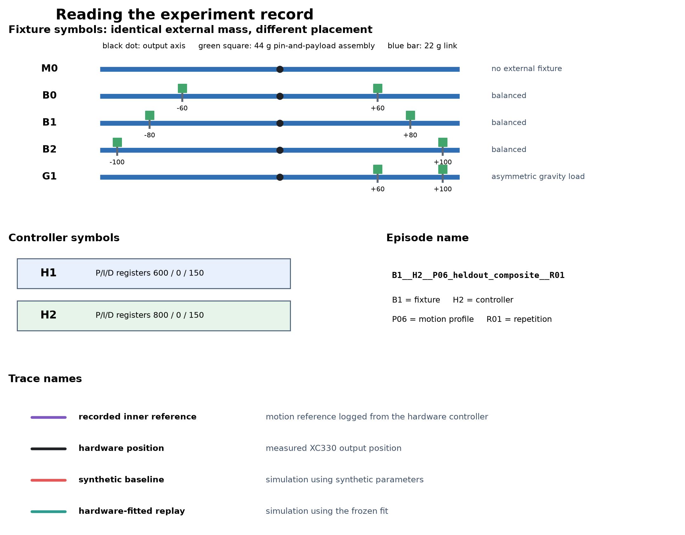
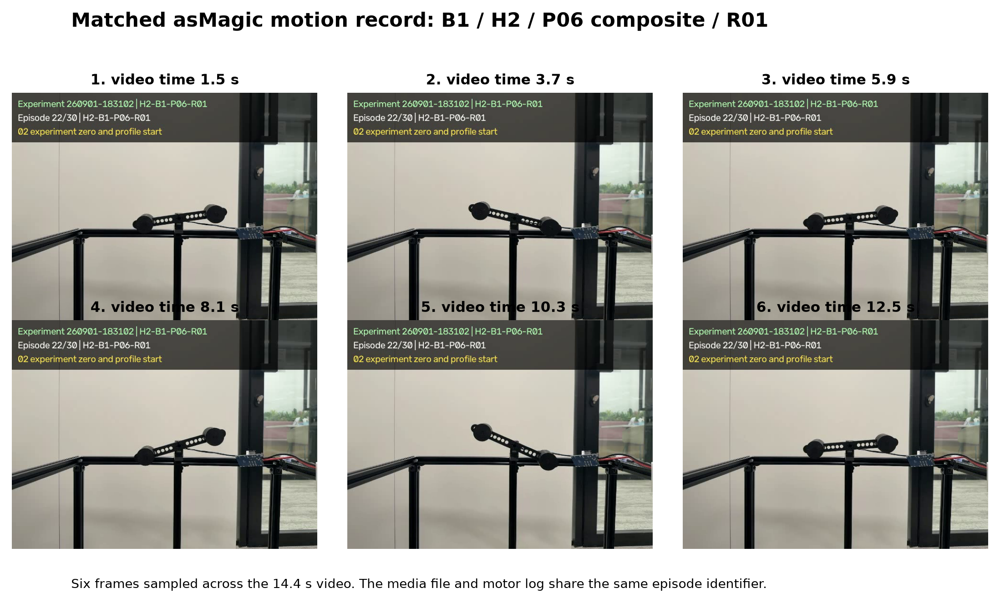
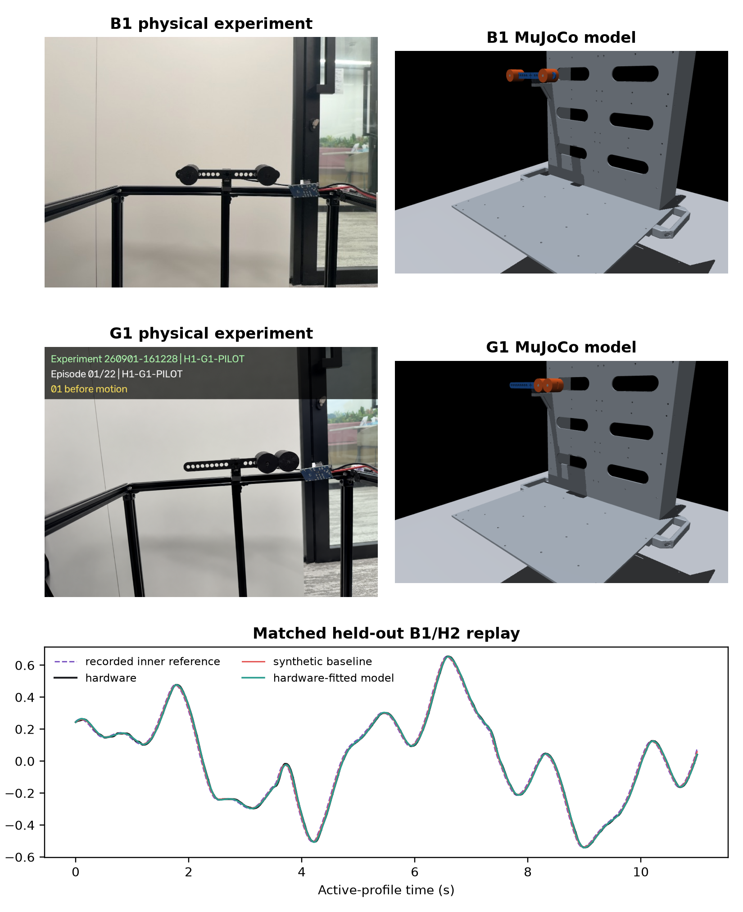
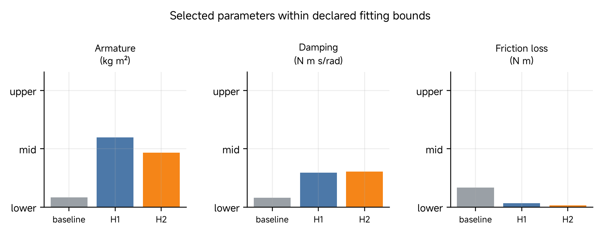
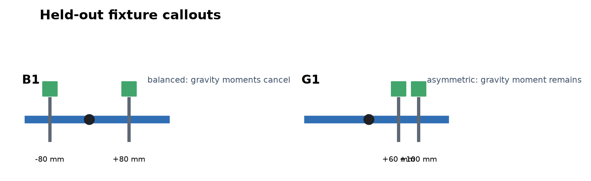
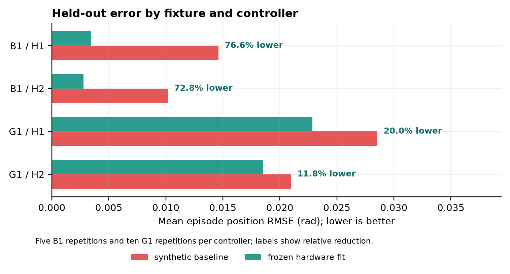
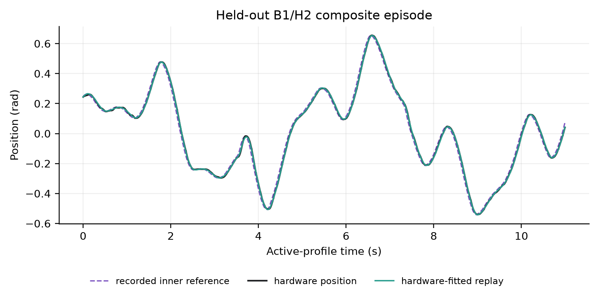

# 04 Basic Quantification of Sim2Real Gap

## Central question

> How do we estimate a MuJoCo model, quantify its discrepancy from physical actuator responses, and judge its usefulness for a specified task?

[Class 03](03-basic-digitization-of-physical-embodiment.md) established a declared geometry, joint, mass distribution and input interface. We now ask whether the digitized fixture predicts measured motion under a named input and controller condition. A convincing overlay is a starting point; a defensible prediction claim also needs a defined signal pair, time base, fitting decision and reserved evaluation.

The main experiment is the source **XC330-M288-T with a declared 110 g external moving fixture**. Its preserved hardware records, controller references and frozen MuJoCo replays supply the demonstration and activity. The [RS06 identification companion](04-rs06-hardware-identification.md) retains the second physical experiment and its two estimation methods. It uses a different command boundary, load family and controller; its numbers must remain with that apparatus.

By the end of this class, you should be able to:

- Identify the replay input, measured output, controller and fixture.
- Explain the roles and units of armature, damping and friction loss.
- Distinguish fitting, model selection and held-out evaluation.
- Calculate a position-discrepancy metric and justify a bounded model-use claim.

[Lecture](#name-the-experiment-before-reading-its-result) · [Instructor and TA demonstration](#instructor-and-ta-demonstration) · [Student activity](#student-activity)

The supplied physical-motion record, signal definitions, selected parameters and saved replay support the demonstration and activity. They follow one identified held-out episode; a new collection or optimizer run is not required.

## Name the experiment before reading its result

A prediction claim selects the fixture, informative motions and recorded signals; data support parameter estimation; the frozen model is then tested against reserved physical responses. Analytical calculations explain the balance, while optimization estimates a candidate within the chosen model class. Neither replaces evaluation against the physical record.

*Figure 1. Notation key for the fixture configurations, controller conditions, episode identifiers, and trace names.*

Figure 1 is the shared vocabulary for the record:

- **M0** has no external fixture.
- **B0**, **B1**, and **B2** are balanced 110 g external fixtures. The equal payload assemblies are placed symmetrically, so their ideal static gravity moments cancel while their rotational inertia changes.
- **G1** carries the same 110 g external mass asymmetrically. Its static gravity moment does not cancel.
- **H1** and **H2** name the two XC330 controller settings. They are different hardware conditions, not labels for simulation quality.
- An episode identifier, such as `B1__H2__P06_heldout_composite__R01`, states the fixture, controller, motion profile, and repetition.
- The recorded inner reference, hardware position, synthetic baseline, and hardware-fitted replay remain separate signals. Their names are not interchangeable.

## The experiment in one view

The physical system is a ROBOTIS XC330-M288-T with one revolute output joint. The loaded cases contain a 22 g link and two 44 g pin-and-payload assemblies:

$$
m_{\mathrm{ext}} = 0.022 + 2(0.044) = 0.110\,\mathrm{kg}.
$$

The payload-centre positions are measured from the XC330 output axis.

| Fixture | Payload-centre positions | Static gravity moment at the reference pose | Primary mechanical change |
|---|---:|---|---|
| M0 | none | none from external fixture | unloaded reference |
| B0 |-60 mm, +60 mm | ideally cancels | balanced inertia |
| B1 |-80 mm, +80 mm | ideally cancels | larger balanced inertia |
| B2 |-100 mm, +100 mm | ideally cancels | largest balanced inertia |
| G1 | +60 mm, +100 mm | remains | asymmetric gravity load |

Two controller conditions are retained:

| Condition | Raw P/I/D | $$K_p$$ (N m/rad) | $$K_v$$ (N m s/rad) |
|---|---:|---:|---:|
| H1 | 600 / 0 / 150 | 1.579836 | 0.202115 |
| H2 | 800 / 0 / 150 | 2.106448 | 0.202115 |

H2 has higher declared replay position stiffness and the same replay velocity damping. These H1/H2 labels belong to this XC330 campaign.

The experiment runner, the embedded XC330 controller, and the MuJoCo replay have distinct roles:

1. The **experiment runner** defines an episode, writes commands, and preserves timestamps.
2. The **XC330 controller** converts requested motion into internal position and velocity references, then drives the physical actuator.
3. The **MuJoCo replay** receives the recorded inner references and predicts the joint motion with an explicit, transparent controller approximation.

The recorded inner reference is therefore the common replay input. An external command records episode context, but it is not substituted for the inner controller reference.

### Preserve the controller record

The [controller condition record](https://github.com/asEmbodiedAISyst/2026Autumn/blob/main/course-resources/Class%2004%20%E2%80%94%20Basic%20quantification%20of%20the%20Sim2Real%20gap/additional_material/data/controller_conditions.json) supplies the fixed replay mapping. Each hardware episode also retains `control_table_before.json` and `control_table_after.json`; the source hardware runner preserves commands and telemetry. `Position Trajectory` and `Velocity Trajectory` are the recorded inner references used by the replay.

Raw XC330 P/I/D registers are not automatically SI gains. The displayed $$K_p$$ and $$K_v$$ values are fixed engineering mappings, rather than mechanical parameters fitted below. An inadequate effort map can be absorbed partly by fitted losses or inertia, so a low position score does not independently calibrate this controller or output torque.

## Matched hardware motion

The asMagic recording documents physical motion for the held-out B1/H2 composite episode `B1__H2__P06_heldout_composite__R01`. It provides fixture context for the motor-side record and is not used as a joint-angle measurement.

*Figure 2. Physical B1/H2 composite motion recorded by asMagic.*

The [recorded video](https://github.com/asEmbodiedAISyst/2026Autumn/blob/main/course-resources/Class%2004%20%E2%80%94%20Basic%20quantification%20of%20the%20Sim2Real%20gap/additional_material/demonstration/asmagic_media/B1__H2__P06_heldout_composite__R01.mp4), [before-motion photograph](https://github.com/asEmbodiedAISyst/2026Autumn/blob/main/course-resources/Class%2004%20%E2%80%94%20Basic%20quantification%20of%20the%20Sim2Real%20gap/additional_material/demonstration/asmagic_media/B1__H2__P06_heldout_composite__R01_before_motion.jpg), command record, telemetry record and replay trace share the same episode identifier. This maintains the connection between visible hardware motion and the numerical comparison without treating video frames as calibrated motion capture.

The motion profiles have distinct decision roles:

| Profile group | Profiles | Decision role |
|---|---|---|
| Calibration | P01 slow triangle, P02 multisine, P03 smooth levels | fit bounded parameter candidates |
| Model selection | P04 chirp, P05 wide sine | select one successful candidate |
| Held-out validation | P06 composite, P07 sine-hold | test the frozen candidate |

The source procedure preserves 72 calibration episodes, 24 model-selection episodes and 30 held-out episodes: 36/12/15 per controller. Calibration establishes candidates, model selection chooses among them, and the frozen-selection record precedes loading numeric P06/P07 held-out data. Complete episodes retain their role; a later replay is another prediction of the same physical record, not another hardware experiment.

### Fixture and model records

The B1 and G1 hardware fixtures, their MuJoCo representations, and the B1/H2 held-out replay document the declared geometry, loading conditions, and position comparison.

*Figure 3. B1 and G1 hardware fixtures, corresponding MuJoCo models, and the B1/H2 held-out position replay.*

## What is compared

For every active sample, the paired archive contains six signal roles:

| Signal | Meaning | Role in the comparison |
|---|---|---|
| External position command | Goal sent by the experiment runner | episode context only |
| Recorded inner position reference | Position reference logged from the XC330 control path | replay input |
| Recorded inner velocity reference | Velocity reference logged from the XC330 control path | replay input |
| Hardware position | Measured XC330 output position | comparison target |
| Synthetic-baseline position | MuJoCo output using the synthetic parameter set | reference baseline |
| Hardware-fitted position | MuJoCo output using the frozen hardware fit | candidate prediction |

The active source telemetry is recorded at about 200 Hz. Position Trajectory is converted with $$2\pi/4096$$ rad per count, and Velocity Trajectory with 0.229 rpm per count. Host command and telemetry timestamps align the active interval; these timestamps do not independently measure command-to-actuation delay.

The replay linearly interpolates both inner references onto a 2 ms MuJoCo physics grid. It starts once from the first measured position and velocity, then advances using its own state. Later hardware samples remain comparison targets; injecting them into every step would answer a different prediction question.

Let $$q_r,v_r$$ denote the logged inner references and $$\hat q,\dot{\hat q}$$ the simulated state. The effective controller effort is

$$
\tau_C=\operatorname{clip}\!\left(
K_p(q_r-\hat q)+K_v(v_r-\dot{\hat q}),
-\tau_{\max},\tau_{\max}\right),
\qquad \tau_{\max}=0.1551\ \mathrm{N\,m}.
$$

Clipping restricts the effort to the declared interval. The position coefficient has units N m/rad; the velocity coefficient has units N m s/rad. The limit belongs to the replay model. It is not independently measured output torque or a continuous actuator rating.

The source implementation is `HardwareReplayer.simulate` in [the fit/replay program](https://github.com/asEmbodiedAISyst/2026Autumn/blob/main/course-resources/Class%2004%20%E2%80%94%20Basic%20quantification%20of%20the%20Sim2Real%20gap/additional_material/code/full_fit_and_replay.py). It supplies the reference feedforward $$K_pq_r+K_vv_r$$ through the actuator control array, configures state feedback $$-K_p\hat q-K_v\dot{\hat q}$$ through actuator bias fields, and limits the resulting force. Thus `ctrl` in this runtime is not itself the final bounded torque. Read the complete actuator declaration and gain/bias settings before assigning physical meaning to that array. This implements the displayed effective law while preserving feedback from the evolving simulated state.

**Illustrative control step.** With H1, take $$\hat q=0.2\ \mathrm{rad}$$, $$\dot{\hat q}=0.4\ \mathrm{rad/s}$$, $$q_r=0.3\ \mathrm{rad}$$ and $$v_r=0.2\ \mathrm{rad/s}$$. These are constructed values, not a recorded telemetry sample:

$$
\begin{aligned}
\tau_{\mathrm{req}}&=1.579836(0.1)+0.202115(-0.2)\\
&=0.1175606\ \mathrm{N\,m},\\
\tau_C&=\operatorname{clip}(\tau_{\mathrm{req}},-0.1551,0.1551)\\
&=0.1175606\ \mathrm{N\,m}.
\end{aligned}
$$

A 0.2 rad position error with zero velocity error would request about 0.316 N m, so this model would apply only 0.1551 N m. Beyond that point, increasing the error cannot increase permitted effort. Neither calculation measures the physical shaft torque.

## Explain what the fitted joint terms do

Why change armature, damping and friction rather than the declared payload mass? The source fixes the fixture geometry and accepted mass record, then asks whether a small effective joint model improves response prediction. For the isolated fixed-axis rigid assembly, write

$$
(J_f+J_a)\ddot q+b\dot q+\tau_{\mathrm{dry}}+\tau_g(q)=\tau_C.
$$

This is a one-coordinate specialization of the rigid-body balance

$$
H(q)\ddot q+C(q,\dot q)+\tau_f=\tau_a+\tau_{\mathrm{ext}}.
$$

Here $$H=J_f+J_a$$ is constant; the rigid-body velocity bias vanishes for this isolated rigid hinge, and the remaining bias is gravity. There is no contact in the declared free-motion experiment, so $$\tau_{\mathrm{ext}}=0$$. Gravity and resistance are counted separately. Do not add an efficiency correction that subtracts a loss already represented by damping or friction.

The fixture contribution $$J_f$$ and gravity term $$\tau_g$$ come from the fixed geometry and mass distribution. **Armature** $$J_a$$ adds effective inertia about the joint, in kg m²: more effort is needed for the same angular acceleration. It can represent reflected rotating effects missing from the rigid CAD bodies; a fitted value is not a separately measured rotor inertia.

**Damping** $$b$$ produces resistance proportional to velocity, with units N m s/rad. **Friction loss** $$\tau_c$$ has units N m and gives the dry-friction magnitude. During motion, a useful approximation is $$\tau_{\mathrm{dry}}\approx\tau_c\operatorname{sgn}(\dot q)$$, opposing the direction of velocity when placed on the left of the balance. Near zero velocity, sticking requires more care; MuJoCo's friction-loss constraint is not fully described by the sign expression.

| Quantity | Source implementation | Interpretation |
|---|---|---|
| $$J_f$$ and $$\tau_g$$ | Fixed fixture bodies/inertial properties and gravity | Declared mechanism |
| $$J_a$$ | `model.dof_armature[0]` | Added effective inertia |
| $$b$$ | `model.dof_damping[0]` | Velocity-dependent resistance |
| $$\tau_c$$ | `model.dof_frictionloss[0]` | Joint dry-friction bound |
| $$\tau_C$$ | Reference input, actuator feedback and force bound | Effective controller effort |

All three terms can alter the same position trace. To distinguish them, the input must excite different accelerations, velocities, directions and settling periods. Symmetric fixture changes probe inertia while reducing ideal gravity loading; G1 adds an eccentric load. A fitted damping increase can also compensate for delay, compliance or effort-map error. Numerical identifiability within a chosen equation is therefore weaker than physical identification of a unique mechanism.

### Two routes from data to parameters

The source XC330 result uses **output-error fitting**. An optimizer proposes $$\theta=[J_a,b,\tau_c]^{\mathsf T}$$, replays calibration episodes, compares predicted with measured position, then updates the bounded vector. It needs neither measured shaft torque nor twice-differentiated encoder position. The physical [RS06 companion](04-rs06-hardware-identification.md) also retains a separate integral-regression result; that experiment provides the actual numerical comparison of both methods.

The integral route follows from the same balance. Integrate over a moving window from $$t_0$$ to $$t_1$$:

$$
\begin{aligned}
J_a\Delta\dot q+b\Delta q
+\tau_c\int_{t_0}^{t_1}\operatorname{sgn}(\dot q)\,dt
\approx{}&\int_{t_0}^{t_1}(\tau_C-\tau_g(q))\,dt\\
&-J_f\Delta\dot q.
\end{aligned}
$$

Each window supplies one row of $$A\theta\approx z$$. Its columns are velocity change, position change and signed moving time; the target is integrated reconstructed effort minus fixed gravity and fixture-inertia contributions. Reconstructed effort uses measured position and velocity in the fixed controller expression. Output-error replay instead uses the simulated state for feedback. Confusing these operations would change the experiment.

**Constructed integral row:** a 0.2 s positive-motion window with $$\Delta\dot q=0.5\ \mathrm{rad/s}$$ and $$\Delta q=0.1\ \mathrm{rad}$$ supplies the row $$[0.5,0.1,0.2]$$. Illustrative parameters $$[0.001,0.04,0.005]$$ give

$$
0.5(0.001)+0.1(0.04)+0.2(0.005)=0.0055\ \mathrm{N\,m\,s}.
$$

This illustrates the integrated units and arithmetic, not a source XC330 Method 1 result. One row cannot determine three unknowns. Independent motion windows and declared bounds are needed; rank and conditioning concern distinguishability and sensitivity, rather than proving the controller approximation correct. Integration avoids differentiating measured velocity into acceleration but still depends on velocity quality, timing and the friction approximation.

For output-error fitting, an equal-episode calibration objective can be written

$$
L(\theta)=\sum_{e\in\mathcal C}\frac{1}{n_e}
\sum_{i\in\mathcal I_e}
\big(\hat q_{e,i}(\theta)-y_{q,e,i}\big)^2.
$$

Here $$\mathcal C$$ is the calibration episode set, $$\mathcal I_e$$ the optimization sample subset and $$n_e=|\mathcal I_e|$$. The source XC330 program uses every fifth active telemetry sample and normalizes each episode residual block by the square root of its sample count; a common scalar factor does not change the minimizing vector. Final full-episode scores are calculated separately. A sum of episode mean squared errors and a mean of episode RMSE values are different summaries.

## Fitting a bounded effective model

The fitted joint terms are effective prediction parameters:

| Parameter | Symbol | Fitting interval | Meaning in this replay model |
|---|---|---:|---|
| Armature | $$J_a$$ | 0.0002–0.010 kg m² | additional reflected rotational inertia |
| Damping | $$b$$ | 0.003–0.150 N m s/rad | velocity-dependent loss |
| Friction loss | $$\tau_c$$ | 0.002–0.050 N m | dry-friction bound |

The synthetic baseline was fitted to generated MuJoCo data for this 110 g fixture, without hardware data. It is a specific reference model, not a claim that every possible simulation has this error.

Four bounded starts are fitted independently for H1 and H2 on the calibration profiles. The selected candidate is the successful candidate with the lowest mean episode RMSE on the model-selection profiles. That choice is frozen before P06 and P07 are opened.

| Set | Armature (kg m²) | Damping (N m s/rad) | Friction loss (N m) |
|---|---:|---:|---:|
| Synthetic baseline | 0.001003 | 0.014963 | 0.010095 |
| H1 selected | 0.006051 | 0.046289 | 0.003542 |
| H2 selected | 0.004779 | 0.047630 | 0.002773 |

Neither selected H1 nor H2 parameter reaches an upper fitting bound. The terms still remain effective closed-loop parameters, because the position record alone cannot uniquely separate inertia and damping from timing, effort scaling, compliance, or reference interpolation.

*Figure 4. Selected parameter values normalized to the widened fitting intervals. Neither controller fit reaches an upper limit.*

## Held-out error

For an episode $$e$$ with $$N_e$$ active samples, the position score is:

$$
\operatorname{RMSE}_e =
\sqrt{\frac{1}{N_e}\sum_{k=1}^{N_e}
\left(q^{\mathrm{sim}}_{e}[k]-q^{\mathrm{hw}}_{e}[k]\right)^2}.
$$

The final aggregate is the arithmetic mean of episode RMSE values:

$$
\overline{\mathrm{RMSE}}=\frac{1}{E}\sum_{e=1}^{E}\mathrm{RMSE}_e.
$$

Equal episode weighting prevents longer episodes from dominating the reported score. A pooled-sample score instead takes the square root after combining all squared residuals and sample counts; it is not interchangeable with this mean. Report the statistical unit and denominator alongside the number.

Define the signed prediction residual $$g=\hat q-q_{\mathrm{hw}}$$. Its mean is bias; RMSE measures its squared magnitude and therefore retains the angle unit. A positive and negative residual can cancel in bias while RMSE remains positive. For illustrative residuals $$[0.01,-0.01,0]\ \mathrm{rad}$$, bias is zero but RMSE is about $$0.008165\ \mathrm{rad}$$. These constructed values illustrate the metric only.

Prediction discrepancy compares simulated with measured output. Physical reference-tracking error compares a reference with measured output. A model can reproduce the actuator's lag accurately even if the actuator does not track its reference closely.

The held-out conditions are B1 and G1, which have equal external mass and different gravity loading.

*Figure 5. Held-out fixture callouts. B1 is balanced; G1 has the same external mass but an asymmetric gravity load.*

| Fixture | Controller | Episodes | Baseline mean RMSE (rad) | Fitted mean RMSE (rad) |
|---|---|---:|---:|---:|
| B1 | H1 | 5 | 0.014615 | 0.003420 |
| B1 | H2 | 5 | 0.010184 | 0.002769 |
| G1 | H1 | 10 | 0.028558 | 0.022842 |
| G1 | H2 | 10 | 0.020983 | 0.018506 |
| All | H1/H2 | 30 | 0.020647 | 0.014814 |

Across all 30 held-out episodes, the frozen hardware-fitted replay reduces mean episode position RMSE by **28.3%** relative to the synthetic baseline. Let $$R_b$$ and $$R_f$$ denote the overall baseline and fitted means. The source table stores approximately 0.02064688985 rad and 0.01481398497 rad respectively:

$$
100(1-R_f/R_b)\approx28.2508\%.
$$

The displayed condition table is rounded; the source result retains the precision used for the percentage.

The asymmetric G1 condition remains harder to predict than B1 in these records, especially under H1. Fixture and profile composition differ, so the table alone does not prove that gravity causes the difference.

*Figure 6. Source XC330 held-out mean episode position RMSE for the synthetic baseline and frozen hardware fit, over 30 B1/G1 episodes. Each episode has equal weight.*

The largest fitted held-out error occurs in `G1__H1__P07_heldout_sine_hold__R01`: fitted RMSE is 0.026859 rad and baseline RMSE is 0.029262 rad. The fitted replay reduces this episode's RMSE but leaves a directional residual bias of about -0.0171 rad. This observation is evidence of remaining mismatch, not a unique identification of its cause.

## Held-out B1/H2 composite episode

The B1/H2 composite episode did not influence parameter fitting or candidate selection. Its hardware-fitted replay has an RMSE of 0.002743 rad, compared with 0.010119 rad for the synthetic baseline.

The signal definitions are:

- **Recorded inner reference** (purple dashed): the motion reference taken from the hardware control record and supplied to the replay.
- **Hardware position** (black): the measured output angle of the physical XC330 fixture.
- **Hardware-fitted replay** (green): the MuJoCo output predicted using the frozen H2 effective parameters.

Compare the green prediction with the black measured output to read model discrepancy; compare the purple inner reference with the black output to read physical tracking.

*Figure 7. Source XC330 B1/H2/P06/R01: recorded inner reference, measured position and frozen H2 replay. This selected episode is separate from the 30-episode aggregate.*

## What the model does and does not establish

The results support a bounded claim: for the declared one-actuator fixture, H1/H2 controller conditions, recorded inner references, and held-out B1/G1 profiles, the frozen replay model improves position prediction over the synthetic baseline.

Several mechanisms can produce similar residuals:

- fixed effort scaling may be imperfect because output torque was not measured;
- host-side timestamps include software and USB timing, while command-to-actuation delay was not independently measured;
- the logged inner references are slower than the hidden embedded control loop;
- the rigid model excludes shaft compliance, printed-part flex, backlash, joint play, cable forces, base motion, temperature effects, stiction, Stribeck behavior, and direction-dependent friction.

Consequently, the fitted terms are not isolated motor constants. The study does not establish torque accuracy, thermal behavior, contact performance, or transfer to a multi-joint mechanism.

A residual is an observation, not a diagnosis. A sign reversal near motion reversal can motivate a friction or backlash hypothesis; a lag can motivate a timing hypothesis. Neither pattern uniquely establishes its cause. Compare repeated responses and propose a discriminating measurement before changing several effects at once. Repeat variability can contextualize a model gap, but is not a sensor-calibration result or an automatic acceptance threshold. The intended use supplies the allowable error.

## Instructor and TA demonstration

**Question:** what does the frozen model predict for one motion it did not fit? Use the source notation key, B1/H2 physical-motion record, controller record, frozen-selection record, held-out table and B1/H2/P06/R01 overlay. These preserved materials carry the numerical argument; a fresh hardware run or optimizer is not a prerequisite.

First identify **XC330, B1, H2, P06, R01** and the declared 110 g external assembly. Locate the external goal, recorded inner references, measured output and frozen replay in the signal table. Explain why the inner references enter the replay and why the video supplies apparatus context rather than calibrated joint-angle data.

Next trace calibration → model selection → frozen candidate → held-out evaluation. Locate the three selected H2 parameters and the fixed controller gains. Explain how the replay starts from measured state once, then advances its own prediction with interpolated references and a bounded effort law.

Finally read the held-out composite overlay and its **0.002743 rad** fitted episode RMSE against the **0.010119 rad** baseline. Compare that one episode with the 30-episode aggregate, then inspect the reported G1 worst case and remaining signed bias. End with a bounded model-use statement and one proposed measurement that could distinguish a timing explanation from a mechanical one. The source figures and saved scores provide the fallback if a model viewer is unavailable.

## Student activity

Analyse the source held-out **B1/H2/P06/R01 XC330** episode using the physical-motion context, signal table, selected H2 parameters and recorded overlay above. Use the supplied [paired held-out result table](https://github.com/asEmbodiedAISyst/2026Autumn/blob/main/course-resources/Class%2004%20%E2%80%94%20Basic%20quantification%20of%20the%20Sim2Real%20gap/additional_material/results/held_out_results.csv) to keep the selected episode separate from the aggregate.

Submit a compact comparison with five items:

1. Identify the fixture, controller, replay input and two outputs compared. Explain the role of the initial measured state.
2. Report this episode's baseline and fitted position RMSE in radians. State why neither number is a hardware command-tracking score or a calibrated torque error.
3. Describe one observed feature of the overlay and identify the relevant signal. Separate that observation from a possible explanation.
4. Recalculate the overall percentage reduction from the two overall means above. State its 30-episode denominator and explain why it need not describe every episode.
5. Give one bounded use decision and one discriminating follow-up measurement. Do not claim that the residual proves the proposed cause.

The required evidence is on the page and in the linked source score table. Further replay or fitting belongs to the prepared source example. For transfer, use the [RS06 companion](04-rs06-hardware-identification.md) to distinguish applied-command tracking from model prediction and compare its two estimation methods without mixing apparatus-specific parameter values.

## Source records and the next class

| Need | Source record |
|---|---|
| Prepared example and demonstration | [Package README](https://github.com/asEmbodiedAISyst/2026Autumn/blob/main/course-resources/Class%2004%20%E2%80%94%20Basic%20quantification%20of%20the%20Sim2Real%20gap/README.md); [current demonstration notes](#instructor-and-ta-demonstration) |
| Episode membership and selection decision | [Episode index](https://github.com/asEmbodiedAISyst/2026Autumn/blob/main/course-resources/Class%2004%20%E2%80%94%20Basic%20quantification%20of%20the%20Sim2Real%20gap/additional_material/data/EPISODES_USED.csv); [frozen selection](https://github.com/asEmbodiedAISyst/2026Autumn/blob/main/course-resources/Class%2004%20%E2%80%94%20Basic%20quantification%20of%20the%20Sim2Real%20gap/additional_material/data/FROZEN_SELECTION_BEFORE_HELD_OUT.json) |
| Parameter and controller definitions | [Fitted parameters](https://github.com/asEmbodiedAISyst/2026Autumn/blob/main/course-resources/Class%2004%20%E2%80%94%20Basic%20quantification%20of%20the%20Sim2Real%20gap/additional_material/data/fitted_parameters.csv); [physical parameter sets](https://github.com/asEmbodiedAISyst/2026Autumn/blob/main/course-resources/Class%2004%20%E2%80%94%20Basic%20quantification%20of%20the%20Sim2Real%20gap/additional_material/data/physical_parameter_sets.json); [controller conditions](https://github.com/asEmbodiedAISyst/2026Autumn/blob/main/course-resources/Class%2004%20%E2%80%94%20Basic%20quantification%20of%20the%20Sim2Real%20gap/additional_material/data/controller_conditions.json) |
| Candidate comparisons and final scores | [Optimizer candidates](https://github.com/asEmbodiedAISyst/2026Autumn/blob/main/course-resources/Class%2004%20%E2%80%94%20Basic%20quantification%20of%20the%20Sim2Real%20gap/additional_material/data/optimizer_candidates.csv); [paired held-out results](https://github.com/asEmbodiedAISyst/2026Autumn/blob/main/course-resources/Class%2004%20%E2%80%94%20Basic%20quantification%20of%20the%20Sim2Real%20gap/additional_material/results/held_out_results.csv); [overall held-out result](https://github.com/asEmbodiedAISyst/2026Autumn/blob/main/course-resources/Class%2004%20%E2%80%94%20Basic%20quantification%20of%20the%20Sim2Real%20gap/additional_material/results/overall_heldout_result.csv) |
| Fit/replay implementation and result record | [Source program](https://github.com/asEmbodiedAISyst/2026Autumn/blob/main/course-resources/Class%2004%20%E2%80%94%20Basic%20quantification%20of%20the%20Sim2Real%20gap/additional_material/code/full_fit_and_replay.py); [result JSON](https://github.com/asEmbodiedAISyst/2026Autumn/blob/main/course-resources/Class%2004%20%E2%80%94%20Basic%20quantification%20of%20the%20Sim2Real%20gap/additional_material/results/result.json) |

The package retains raw motor-side campaigns, paired samples, generated models and episode context with the source records at revision `f7c118edaadc9f33498669736fa9d99160ff629a`. The seven experiment figures above are retained from that source course record. These are preserved results of the originating experiment; this lesson does not claim a new hardware execution or refit.

[Class 05](../module-02-hand-data-for-multi-fingered-manipulation/05-from-single-actuator-to-multi-actuator.md) extends the same comparison contract to a separate sixteen-motor source campaign. Shared infrastructure does not remove the need to identify each motor, clock, input and evaluation condition.

## References

Featherstone, Roy. 2008. *Rigid Body Dynamics Algorithms*. Springer.

Ljung, Lennart. 1999. *System Identification: Theory for the User*. 2nd ed. Prentice Hall. The model and identification theory explains the calculation; the source package supplies this class's experiment and results.

MuJoCo developers. *MuJoCo Documentation*, version 3.3.7. [Friction-loss formulation](https://mujoco.readthedocs.io/en/3.3.7/computation/index.html#friction-loss) and [actuator conventions](https://mujoco.readthedocs.io/en/3.3.7/modeling.html#actuators). Interpret these with the source runtime's actual gain, bias and force-limit settings.

ROBOTIS. “XC330-M288.” *ROBOTIS e-Manual*. [Model-specific register and mode documentation](https://docs.robotis.com/docs/dxl/model_reference/x_series/xc_series/xc330-m288/). Register definitions do not themselves calibrate the replay's fixed SI controller mapping.
