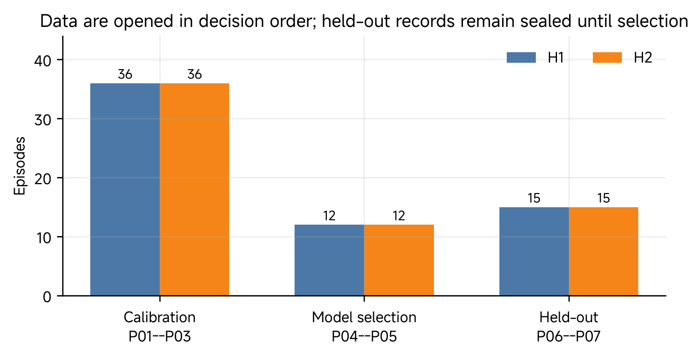
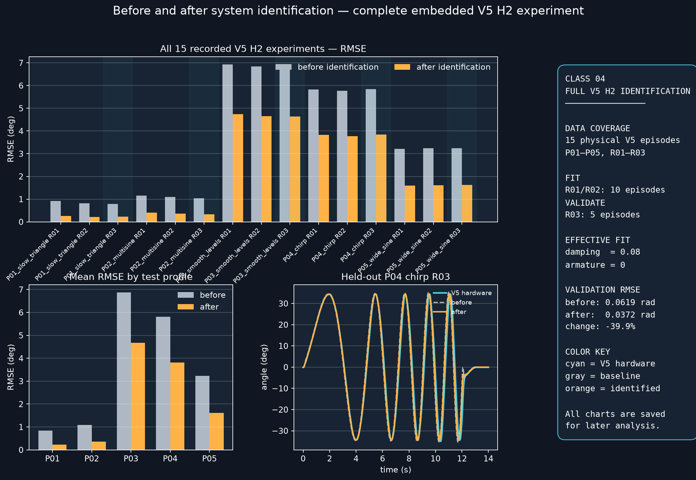

# Class 04 — Practice: quantify the B0 Sim2Real gap

This is the simulation-only student activity for Class 04. It replays supplied B0/H2 measurement records in MuJoCo, fits effective parameters, and evaluates the frozen model on held-out records.

## The experiment at a glance

| Stage | Episodes | Purpose |
| --- | --- | --- |
| Calibration | P01–P05, R01–R02 | select effective damping and armature from 10 recorded B0/H2 episodes |
| Validation | P01–P05, R03 | evaluate the frozen model on 5 B0/H2 episodes not used for fitting |
| Visual replay | P04 chirp, R03 | inspect one held-out episode in MuJoCo and the comparison dashboard |



*Figure 1. R01 and R02 calibrate the effective replay parameters; R03 stays held out until validation.*

## 1. Prepare the student environment

From the repository root, enter the Class 04 standalone activity and create its locked Python environment:

```bash
cd 2026-autumn/resources/class04/practical/additional_material/standalone
uv sync
uv run pytest
```

Keep this terminal in the standalone directory for the rest of the activity. The supplied files contain the B0 MuJoCo model, mesh assets, recorded measurement data for all 15 episodes, replay code, and analysis tools.

## 2. Identify the data split

The B0 record describes a 22 g link and two 44 g pin–payload assemblies:

```math
m_{ext}=0.022+2(0.044)=0.110\ \mathrm{kg}.
```

The recorded B0/H2 dataset contains five profiles (P01–P05), each repeated three times. R01 and R02 are calibration data. R03 is the held-out validation data and must not be used to choose the parameters.

```bash
find data/v5_h2_full -mindepth 1 -maxdepth 1 -type d | sort
```

The command should list 15 episode directories.

## 3. Preview the simulation

```bash
uv run python simulation_only/b0_identification.py --preview-viewer
```

This opens an animated B0 MuJoCo preview immediately. Close the viewer window to return to the terminal.

## 4. Run the full identification experiment

```bash
uv run python simulation_only/b0_identification.py --playback-speed 0.5
```

The program loads all 15 supplied measurement records, fits effective damping and armature with the 10 R01/R02 episodes, replays the baseline and identified simulations, and evaluates the frozen model on the five R03 episodes. It then opens a held-out P04 chirp R03 replay and saved analysis layout.

During the visual comparison: cyan is the recorded measurement, gray dashed is the baseline model, orange is the identified model, and red is the post-identification position residual.



## 5. Read the validation result

The run saves its analysis in `outputs/`. Inspect the held-out rows and their mean RMSE:

```bash
uv run python -c "import pandas as pd; d=pd.read_csv('outputs/b0_full_h2_episode_metrics.csv'); print(d.loc[d.split.eq('validation'), ['episode','before_rmse_rad','after_rmse_rad']].to_string(index=False)); print(); print(d.loc[d.split.eq('validation'), ['before_rmse_rad','after_rmse_rad']].mean())"
```

Compare the baseline RMSE and identified-model RMSE for every R03 episode, then compare their means. This quantifies the B0 Sim2Real gap before and after fitting the effective replay parameters.

The conclusion is limited to the B0 record, H2 condition, logged reference, five motion profiles, and recorded timing. The fitted damping and armature are effective replay parameters, not independently identified motor constants.

## 6. Run without graphical windows

```bash
uv run python simulation_only/b0_identification.py --no-viewer --save-only --playback-speed 100
```

This performs the same 15-episode calculation and saves the figures and tables without opening graphical windows. Return to the [Class 04 lesson](04-basic-quantification-of-sim2real-gap.md) for the replay equation, RMSE definition, and evidence scope.
