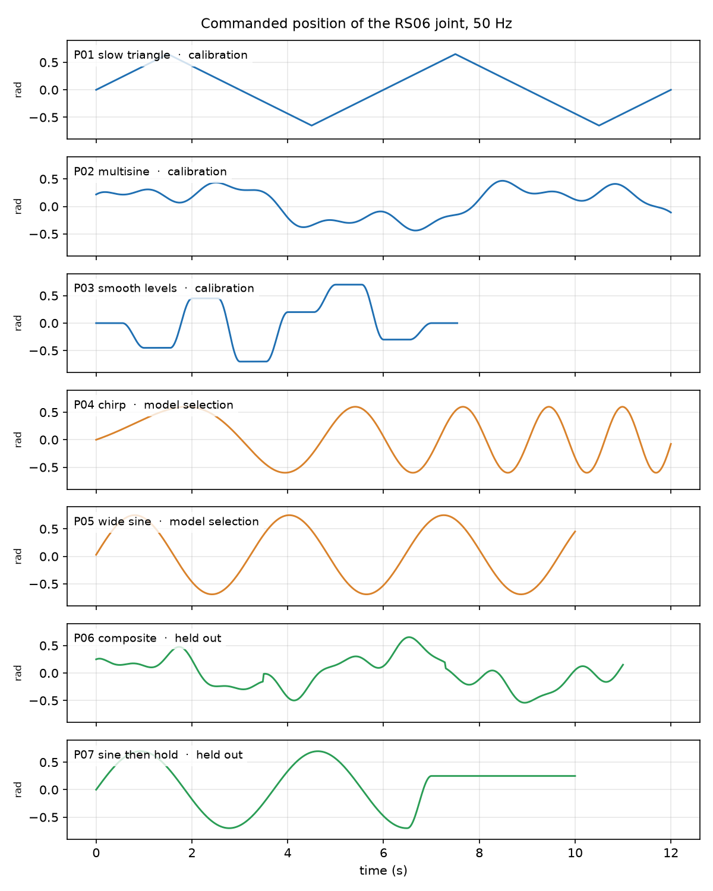
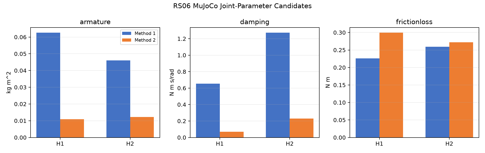
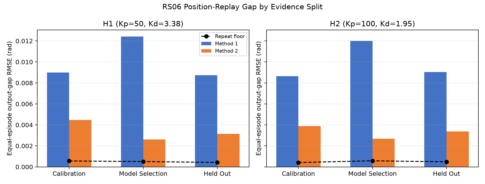
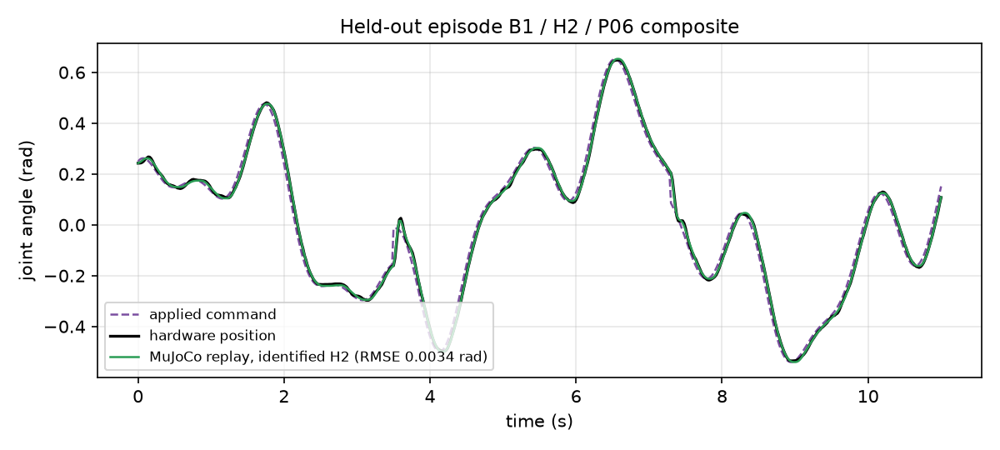
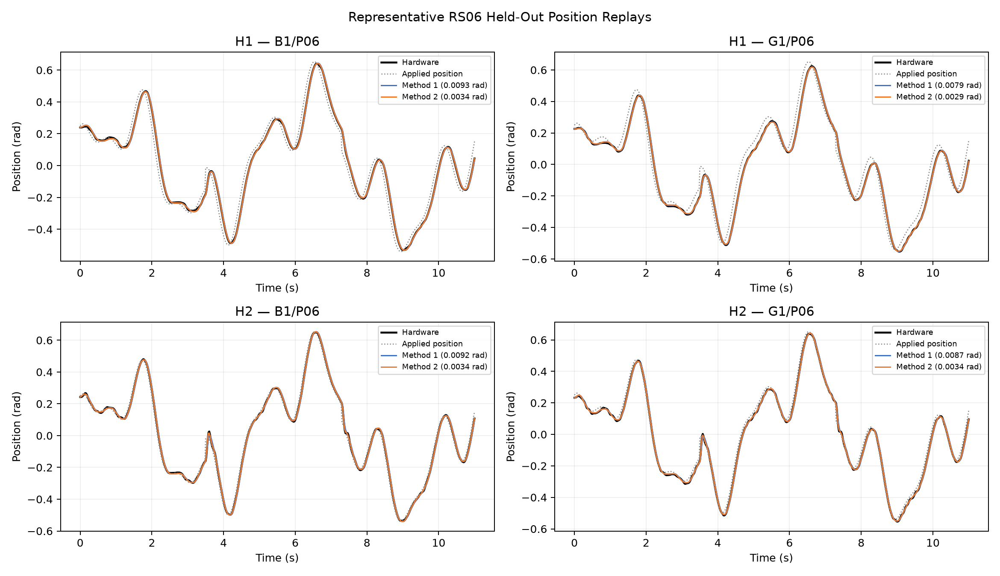
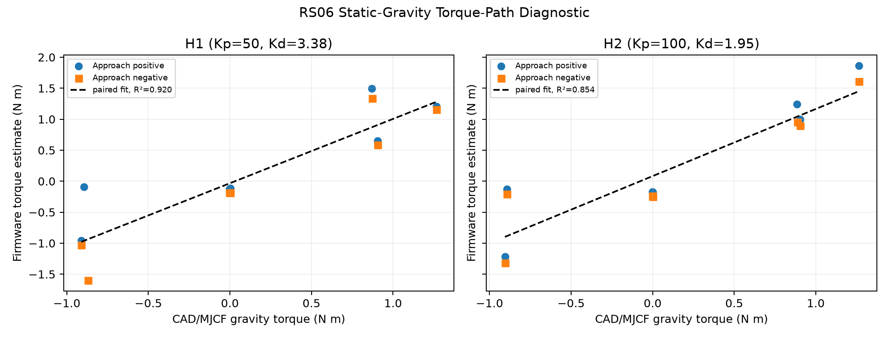

# 04 The RS06 Fixture: Hardware Identification

## Central question

> Does a three-parameter MuJoCo joint model, fitted for one fixed controller setting, predict RS06 position on trajectories and fixtures that were not used to fit it?

This source experiment uses the fixtures in the [RS06 digitization companion](03-rs06-fixture-digitization.md). The [main Class 04 lesson](04-basic-quantification-of-sim2real-gap.md) develops the mechanics, integral equation, output-error objective and metric interpretation. Here those ideas stay with the RS06's actual command interface, hardware episodes and two-method comparison.

Unlike the XC330 replay, RS06 replay receives the **applied position command**, not logged inner position/velocity trajectories. Its CAD load family, fixed gains and error scores therefore belong to a separate experiment. Read the command, measured position and model output as three distinct signals.

By the end of this class, you should be able to:

- Identify the applied-command input, measured position and predicted output.
- Compare integral regression and output-error fitting under one fixed controller.
- Distinguish model discrepancy, command tracking and physical repeat variability.
- Justify the limits of the held-out position claim and static-torque diagnostic.

[Lecture](#the-experiment) · [Instructor and TA demonstration](#instructor-and-ta-demonstration) · [Student activity](#student-activity)

The supplied hardware-episode summaries, parameter tables and source replay figures support the comparison. The activity reads the preserved evidence; it does not require a new fit, powered operation or torque calibration.

## The experiment

The RS06 runs in position mode. The computer sends one position target every 20 ms (50 Hz) over CAN and records
the measured position, velocity and the torque estimate of the motor firmware. The position loop runs inside the
motor with two gains: the stiffness $$K_p$$ and the damping $$K_d$$. Two settings of these gains are used, named
**H1** and **H2** in the rest of the page. Each one is copied into MuJoCo as the fixed gains of the position
actuator and is never fitted. The replay coefficients carry units N m/rad and N m s/rad. Copying the firmware numbers is a modelling assumption, not a calibrated equivalence between the embedded controller and MuJoCo. These H1/H2 names are local to RS06.

| Controller | RS06 mode | $$K_p$$ | $$K_d$$ |
| --- | --- | ---: | ---: |
| H1 | position | 50 | 3.38 |
| H2 | position | 100 | 1.95 |

The four configurations M0, B0, B1 and G1 are those of the Class 03 page: motor only, balanced link, balanced
link with both payloads, and one-sided payload.

### Seven trajectories, three roles

*Figure 1. The seven commanded position profiles, coloured by their role.*

| Role | Episodes | Fixtures × profiles × controllers × repeats | Use |
| --- | ---: | --- | --- |
| Calibration | 54 | M0, B0, B1 × P01–P03 × H1, H2 × 3 | fit the joint parameters |
| Model selection | 24 | B0, B1 × P04–P05 × H1, H2 × 3 | compare the fitted candidates; no fitting |
| Held out | 30 | B1 × P06 and G1 × P06–P07, × H1, H2 × 5 | final test, opened last |

The 108 episodes have 57 694 samples at 50 Hz, recorded on 25 August 2026. The stored dataset audit reports no saturated command, and one
sample of one episode is marked invalid and is left out of every score. The held-out set contains G1, a
configuration with a gravity load that no calibration episode had.

## What is compared

| Signal | Column of the episode file | Role |
| --- | --- | --- |
| Applied command | `position_applied_rad` | input of the hardware and of the MuJoCo replay |
| Hardware position | `position_meas_rad` | comparison target |
| Hardware velocity | `velocity_meas_rad_s` | initial state of the replay |
| Firmware torque | `torque_feedback_Nm` | diagnostic only; not used in a fit |
| MuJoCo position | — | prediction of the model |

The replay starts each episode at the first measured position and velocity, holds each 50 Hz command for ten
physics steps of 2 ms, and computes the joint position. Two different errors must not be confused:

$$
\begin{aligned}
e_{\mathrm{track}}(t)&=q_{\mathrm{meas}}(t)-q_{\mathrm{applied}}(t),\\
g(t)&=\hat q_{\mathrm{sim}}(t)-q_{\mathrm{meas}}(t).
\end{aligned}
$$

The tracking error $$e_{\mathrm{track}}$$ says how well the motor follows its command. The output gap $$g$$ says how well
the model reproduces the motor. A model can reproduce imperfect command following. This source uses **measurement minus applied command** for the signed tracking error; the model gap is **simulation minus measurement**. RMSE is unaffected by reversing the tracking sign, but a signed residual plot is not.

## Three joint parameters

Only three values of the MuJoCo joint are identified, separately for H1 and H2:

| MuJoCo name | Symbol | Unit | Role in the model |
| --- | --- | --- | --- |
| `armature` | $$J_a$$ | kg m² | inertia added to the joint beyond the CAD bodies |
| `damping` | $$b$$ | N m s/rad | torque proportional to the joint velocity |
| `frictionloss` | $$\tau_c$$ | N m | dry friction of the joint |

The masses and inertias of the fixtures come from CAD (Class 03 page), and the gains are fixed. The three values
are effective parameters: they can also absorb rotor and gear dynamics, controller details and timing.

### Two methods

**Method 1, integral regression.** The fixed controller gives the effort
$$\tau_C = K_p\,(q_{\mathrm{applied}} - q) - K_d\,\dot q$$. For the one-joint fixture,

$$
(J_{\mathrm{fixture}} + J_a)\,\ddot q + b\,\dot q + \tau_c\,\mathrm{sgn}(\dot q) + \tau_{g}(q) \approx \tau_C
$$

Integrating over 0.2 s moving windows avoids differentiating measured velocity into acceleration. With fixed fixture inertia $$J_{\mathrm{fixture}}$$ and gravity, each window supplies

$$
\begin{aligned}
J_a\Delta\dot q+b\Delta q+
\tau_c\int\operatorname{sgn}(\dot q)\,dt
\approx{}&\int(\tau_C-\tau_g(q))\,dt\\
&-J_{\mathrm{fixture}}\Delta\dot q.
\end{aligned}
$$

The three unknowns follow from a bounded linear least-squares fit across windows. In this regression, effort is reconstructed from the fixed controller and measured state. In Method 2, the same controller expression uses the simulated state. This distinction separates estimation from a free-running prediction. The sign-of-velocity friction approximation does not fully represent sticking.

**Method 2, output-error optimisation.** MuJoCo is the forward model. For each calibration episode the simulator
receives the applied command, and an optimiser changes only the three parameters to minimise the mean squared
position gap $$\hat q_{\mathrm{sim}} - q_{\mathrm{meas}}$$ over all calibration episodes. The stored three-start diagnostics have closely agreeing objectives and nearby parameter vectors, with no selected parameter at a bound. That is numerical convergence within the declared model class, not proof of a unique physical motor vector.

### Identified values

*Figure 2. The identified joint parameters of both methods and both controllers.*

| H1 parameter | Method 1 | Method 2 |
|---|---:|---:|
| Armature, kg m² | 0.06257 | 0.01086 |
| Damping, N m s/rad | 0.6531 | 0.0694 |
| Friction loss, N m | 0.2262 | 0.2993 |

| H2 parameter | Method 1 | Method 2 |
|---|---:|---:|
| Armature, kg m² | 0.04600 | 0.01221 |
| Damping, N m s/rad | 1.2722 | 0.2297 |
| Friction loss, N m | 0.2595 | 0.2722 |

The two methods do not find the same values. Method 1 gives much more armature and damping. The values are
therefore not unique physical constants of the motor: several effects can be represented by the same three
numbers.

## Held-out error

For an episode with $$N$$ valid samples, the score is the root-mean-square gap

$$
\mathrm{RMSE} = \sqrt{\frac{1}{N}\sum_{k=1}^{N}\big(\hat q_{sim,k} - q_{meas,k}\big)^2}
$$

and each split reports the mean over its episodes.

Before reading the next figure, name each comparison. Model output gap compares simulated with measured position; tracking compares measured with applied position; repeat variability compares physical responses within a condition. The split labels are categorical summaries, not elapsed time.

*Figure 3. Output gap of each method and controller on the three splits, with the repeat floor.*

Each controller contributes 27 calibration, 12 selection and 15 held-out episodes. All scores below are mean episode position RMSE in radians.

| Controller | Method | Calibration | Selection | Held out |
|---|---|---:|---:|---:|
| H1 | 1 | 0.00898 | 0.01242 | 0.00874 |
| H1 | 2 | 0.00447 | 0.00260 | **0.00314** |
| H2 | 1 | 0.00865 | 0.01201 | 0.00904 |
| H2 | 2 | 0.00389 | 0.00268 | **0.00338** |

Relative to the source repeat measure, the H1 held-out ratios are 20.6 for Method 1 and 7.4 for Method 2; the H2 ratios are 18.7 and 7.0. The stored Method 2 held-out means are 0.0031425551 rad and 0.0033801665 rad before the table's rounding.

Method 2 predicts better on every split. Its held-out gap is about 0.2° of joint angle. The source calls the
spread between repeats of the same fixture/profile/controller condition a “repeat floor”, about 0.0004–0.0006 rad. It contextualizes physical repeatability; it is neither calibrated sensor uncertainty nor an automatic acceptance threshold. The model discrepancy is about seven times larger, indicating remaining mismatch above that repeat measure.

| Controller | Method | B1, P06 (rad) | G1, P06–P07 (rad) |
| --- | --- | ---: | ---: |
| H1 | 2 | 0.00358 | 0.00293 |
| H2 | 2 | 0.00351 | 0.00332 |

The one-sided G1 load was not in the calibration data, and its gap is not larger than the gap of the balanced B1 in these records. This does not isolate gravity as a cause or establish transfer to arbitrary loads.
The motor itself tracks its command with a held-out error of 0.065 rad (H1) and 0.029 rad (H2), about 21 and 9
times the output gap of method 2.

## One held-out episode

*Figure 4. A held-out B1 / H2 / P06 episode: applied command, hardware position and the MuJoCo replay with the identified H2 parameters.*

This episode did not take part in the fit or in the model selection. The replay follows the hardware lag behind
the command, including the two offset switches of the composite profile at 3.5 s and 7.3 s. Its RMSE is
0.0034 rad.

*Figure 5. The first held-out repeat of each controller and fixture, with the command, the hardware and both methods.*

## A diagnostic of the torque path

*Figure 6. Firmware torque against the gravity torque of the G1 model, in seven static poses.*

The G1 fixture held seven poses from −2.356 to +2.356 rad, each approached from both directions. The firmware
torque, averaged over the last second of each hold, follows the gravity torque of the MJCF model with a scale of
1.04 (H1) and 1.08 (H2), $$R^2$$ = 0.92 and 0.85. This is a broad consistency diagnostic for the declared CAD and torque-sign/scale assumptions; it does not independently validate as-built mass properties.
It is not a torque calibration: the firmware torque is an estimate of the motor, the poses go beyond the ±1.1 rad
range of the model, and the friction depends on the approach direction.

## What the model does and does not establish

The result supports a bounded claim: for this RS06, position mode at 50 Hz, the two controller settings, the four
configurations with their CAD mass properties and the recorded range of about ±0.75 rad, Method 2 achieves held-out **mean episode** position discrepancies of about 0.00314 rad for H1 and 0.00338 rad for H2. These are aggregate scores, not a guarantee that every sample or episode is within 0.003 rad.

It does not establish:

* unique physical values of the motor: the two methods disagree, and `damping` differs by a factor of three
  between H1 and H2;
* a calibrated output torque;
* behaviour outside the recorded range, speed, temperature and supply;
* the as-built masses, which were not measured.

The static poses do not expand the validated dynamic domain. Firmware torque remains a diagnostic estimate excluded from both identification fits. Direction-dependent friction, offsets and CAD uncertainties can affect the regression, so the scale and $$R^2$$ values must remain with those qualifications.

## Instructor and TA demonstration

**Question:** can the replay predict physical lag without making tracking perfect? Use the source profile/split record, parameter comparison, held-out table and selected B1/H2/P06 overlay. Identify applied position, measured position and predicted position, then trace one initialization followed by ten 2 ms steps per held 20 ms command.

Compare Method 1 with Method 2 under one controller before comparing controllers. Read the selected B1/H2/P06 model RMSE of about 0.0034 rad, then distinguish it from H2's 15-episode mean of about 0.00338 rad. The source overlay shows command offset switches at 3.5 s and 7.3 s; reproducing the physical lag is different from eliminating it.

Finish by contrasting H2's approximately 0.029 rad held-out physical tracking error with its approximately 0.00338 rad model discrepancy. Name the two signals and denominator of each score. Use the static-gravity figure only as a qualified diagnostic of the torque path, not as calibrated output torque.

## Student activity

Use the source parameter tables and held-out figures to submit one comparison with four parts: identify the RS06 replay input and fixed gains; explain why the two fitting methods can return different effective parameters; compare one controller's model discrepancy, tracking and repeat measure; and state a bounded model-use decision with one unresolved physical question. Support the response with an identified figure or source score table. Keep the selected episode separate from the 15-episode controller mean.

An optional mechanics check uses the Class 03 CAD fixture inertia and the integral equation above to explain which term changes when B0 becomes B1 and which term becomes important for G1. Do not copy the XC330's 110 g mass or inner-reference interface into this calculation.

## Source records

The six RS06 experiment figures above are retained from the source course record at revision `f7c118edaadc9f33498669736fa9d99160ff629a`. The [RS06 identification package](https://github.com/asEmbodiedAISyst/2026Autumn/blob/main/2026-autumn/resources/class04/additional_material/rs06_identification/README.md) preserves the source experiment and prepared numerical example. Its [hardware record description](https://github.com/asEmbodiedAISyst/2026Autumn/blob/main/2026-autumn/resources/class04/additional_material/rs06_identification/hardware/README.md) documents the collected episodes, trajectory suites, static-gravity sessions and model sources.

| Need | Source result or implementation |
|---|---|
| Dataset counts and invalid-sample audit | [Dataset audit](https://github.com/asEmbodiedAISyst/2026Autumn/blob/main/2026-autumn/resources/class04/additional_material/rs06_identification/results/hardware-position-v1/dataset-audit.json) |
| Identified parameters | [Joint parameter estimates](https://github.com/asEmbodiedAISyst/2026Autumn/blob/main/2026-autumn/resources/class04/additional_material/rs06_identification/results/hardware-position-v1/joint-parameter-estimates.csv) |
| Split, episode and fixture scores | [Aggregate metrics](https://github.com/asEmbodiedAISyst/2026Autumn/blob/main/2026-autumn/resources/class04/additional_material/rs06_identification/results/hardware-position-v1/aggregate-metrics.csv); [episode metrics](https://github.com/asEmbodiedAISyst/2026Autumn/blob/main/2026-autumn/resources/class04/additional_material/rs06_identification/results/hardware-position-v1/episode-metrics.csv); [fixture metrics](https://github.com/asEmbodiedAISyst/2026Autumn/blob/main/2026-autumn/resources/class04/additional_material/rs06_identification/results/hardware-position-v1/fixture-metrics.csv) |
| Repeat and static diagnostics | [Repeatability](https://github.com/asEmbodiedAISyst/2026Autumn/blob/main/2026-autumn/resources/class04/additional_material/rs06_identification/results/hardware-position-v1/repeatability.csv); [static-gravity diagnostic](https://github.com/asEmbodiedAISyst/2026Autumn/blob/main/2026-autumn/resources/class04/additional_material/rs06_identification/results/hardware-position-v1/static-gravity-diagnostic.csv) |
| Identification implementation | [Source numerical program](https://github.com/asEmbodiedAISyst/2026Autumn/blob/main/2026-autumn/resources/class04/additional_material/rs06_identification/scripts/run_rs06_hardware_identification.py); [result record](https://github.com/asEmbodiedAISyst/2026Autumn/blob/main/2026-autumn/resources/class04/additional_material/rs06_identification/results/hardware-position-v1/result.json) |

These links preserve the originating evidence. No new hardware collection, parameter fit or torque calibration is claimed by the lesson.
