# 05 From Single-Actuator to Multi-Actuator

## Central question

> Why does matching one actuator not establish the behavior of a multi-actuator system?

A good prediction for one actuator is evidence about a particular device, fixture, controller and task. A robot adds more devices, shared infrastructure and, when joints are mechanically connected, new interactions. Our task is to decide which conclusions survive each change and what additional experiment is needed.

We use the author's sixteen-XC330-M288-T V5 campaign to examine this transition. The motors carry separate fixtures: they operate together but do not form a connected hand or arm. That distinction lets us study motor-specific prediction errors before introducing the contact-rich manipulation of Class 06.

By the end of this class, you should be able to:

- Distinguish individual variation, shared-operation effects and mechanical coupling.
- Read the input, output and physical assumptions of a population actuator model.
- Explain the role of a neural actuator model without confusing it with a control policy.
- Compare paired held-out predictions while preserving collection-event grouping.
- State what encoder and camera records establish, and what calibration they still need.

[Lecture](#review-the-single-actuator-validation-task) · [Instructor and TA demonstration](#instructor-and-ta-demonstration) · [Student activity](#student-activity)

The figures, worked examples and result tables provide a complete reading and activity route on this page. The main demonstration and activity compare two motors in the sixteen-motor campaign. The earlier single-motor Transformer is a separate worked comparison and optional extension. CAD software, motors, cameras and neural-network training are not required to complete the main activity.

## Review the single-actuator validation task

### Start with a bounded single-actuator claim

[Class 02](../module-01-actuator-data-for-1-dof-systems/02-actuator-basics-for-controlled-action.md) established controlled action and the meanings of requests, references and reported responses. [Class 03](../module-01-actuator-data-for-1-dof-systems/03-basic-digitization-of-physical-embodiment.md) inspected the mechanical representation, while [Class 04](../module-01-actuator-data-for-1-dof-systems/04-basic-quantification-of-sim2real-gap.md) identified effective joint parameters and evaluated recorded-response predictions. Carry the same comparison record forward: **which physical system, which input, which output and which test conditions?**

The new questions concern scaling: whether a shared parameter vector predicts every motor, whether concurrent operation introduces common disturbances, and what changes when joints are connected. Product surveys, CAD export and the full single-joint fitting derivation remain in the earlier classes. We reuse their concepts here rather than repeat those procedures.

For the present campaign, a replay consumes logged internal position and velocity references, advances a model and compares predicted joint position with recorded encoder position. A position tracking error compares a reference with the measured response. A model prediction error compares the simulated response with that measured response. A device can track its reference imperfectly while a model predicts that imperfection well.

| Comparison | Question |
|---|---|
| Reference versus encoder | How well did the controlled device track its target? |
| Prediction versus encoder | How well did the model reproduce the measured response? |
| One motor versus another | How does predictive performance vary across identities? |

A smaller prediction error does not establish that the physical actuator tracks better. We are evaluating a representation of an observed experiment, rather than changing the hardware controller.

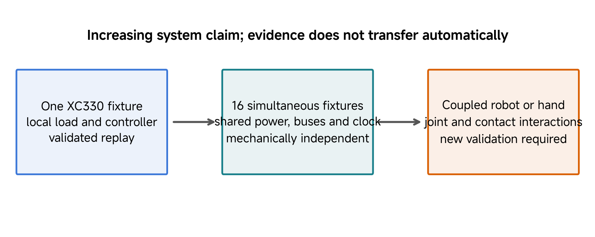

*Figure 1. Source evidence hierarchy: a single fixture, simultaneous independent fixtures and a mechanically coupled robot answer different validation questions. Moving to the next level requires evidence about the interactions introduced there; a larger actuator count alone does not supply it.*

### Preserve fixture identity

The supplied Class 05 construction declares a 25 g link, two 4 g pins and two 40 g payloads: **113 g moving fixture mass** for a loaded configuration. This is a model declaration, not a new weighing result. The 113 g is added moving-fixture mass, excluding the fixed housing. As in the earlier structural example, inherited CAD housing mass is not an independently verified module mass; the fixed housing does not contribute to this isolated hinge inertia. The current Class 03–04 source case uses a separate 110 g declaration. The earlier main-only 98 g replay is historical and is not this lesson's practical evidence. A repeated label such as B2 does not make these the same calibrated physical fixture.

Preserve the dataset-to-model mapping instead of changing a mass until totals agree. To resolve correspondence, obtain fixture identity, component measurements, attachment positions and the actual collection configuration. A total mass alone does not determine inertia: two 40 g point payloads at ±60 mm contribute 0.000288 kg m² about their central axis; at ±120 mm they contribute 0.001152 kg m². Doubling radius quadruples this contribution while payload mass stays constant.

The source describes five configurations: M0 has no external fixture; B0/B1/B2 are balanced arrangements; G1 adds an asymmetric gravity load. The physical array uses two rows and opposing faces, with declared 270 mm spacing on one face, a 135 mm offset on the other, and 500 mm between rows. These dimensions describe the source arrangement, not an independently measured as-built geometry.

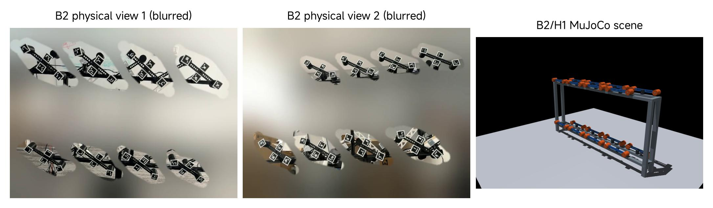

*Figure 2. Source B2 physical views and a combined sixteen-axis MuJoCo scene. Two camera views are observations of the arrangement, not additional experiments. The scene combines independent fixtures for synchronized execution and visualization; the rack does not supply a flexible-support or electrical model.*

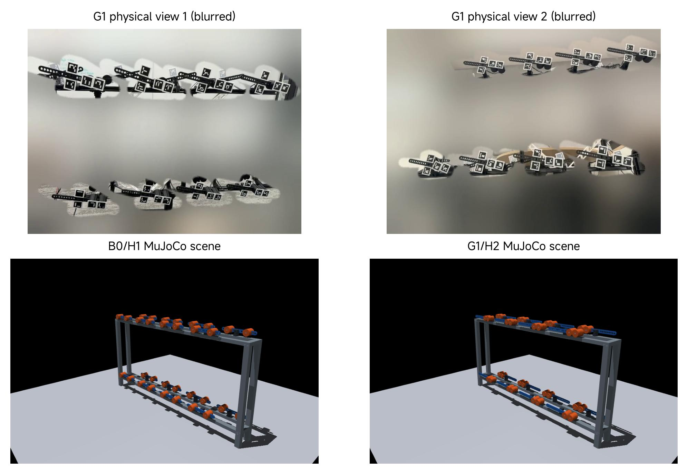

*Figure 3. Additional source configuration gallery: two G1 physical views above, with B0/H1 and G1/H2 simulation views below. It supplies physical context for the balanced/asymmetric fixture distinction. Different configurations and camera views are not a matched dynamic validation.*

**Checkpoint:** Which conclusion follows from a smaller held-out prediction error: better prediction for the tested records, better physical tracking, or verified component inertia? Explain the evidence needed for each.

## Distinguish independent fixtures from connected joints

### More actuators introduce several different changes

Sixteen independent hinges do not become mechanically coupled merely because they appear in one scene. In the supplied construction, each fixture is fixed independently to the world, with one moving joint. Contacts are disabled. The visual supports have no simulated flexibility, and the model does not reconstruct supply dynamics or a communication bus.

For an independent fixture, the relevant motion can be described by a scalar hinge balance. For a connected robot, joint accelerations generally depend on the other joints' positions and motions. A conventional generalized balance is

$$
H(q)\ddot q+C(q,\dot q)+\tau_f(\dot q)
=\tau_a+\tau_{\mathrm{ext}},\qquad
\tau_{\mathrm{ext}}=J_c(q)^\mathsf{T}f_c.
$$

Here $$q$$ is the vector of joint coordinates, $$H$$ is the inertia matrix, and $$C=c+g$$ collects velocity-dependent rigid-body terms and gravity, matching the notation in Classes 02–04. The term $$\tau_f$$ represents passive resistance, $$\tau_a$$ is applied actuator effort, and $$\tau_{\mathrm{ext}}$$ is externally applied generalized effort. For the point-contact expression here, $$J_c$$ maps joint velocity to the contact point's linear velocity, and $$f_c$$ is the force exerted on the robot at that point. Express both in the same frame and use the same point. The transpose maps that force to generalized effort; the body applying it experiences the opposite force. Other applied external loads contribute their own generalized terms (Featherstone 2008). For revolute joints, effort is torque in N m. This equation organizes the terms; it does not supply unknown parameters.

Off-diagonal inertia terms are a concrete example of coupling. Suppose, only for illustration,

$$
H=\begin{bmatrix}0.020&0.004\\0.004&0.010\end{bmatrix}\;\mathrm{kg\,m^2},\qquad
\ddot q=\begin{bmatrix}0\\2\end{bmatrix}\;\mathrm{rad/s^2}.
$$

The inertial effort is [0.008, 0.020] N m. Joint 1 needs inertial effort despite having zero acceleration itself. A diagonal approximation would miss the first contribution. These invented values illustrate the matrix operation; they are not measurements of the XC330 fixtures. Gravity, velocity effects, passive terms and contact must also be included when relevant.

The source combined scene places sixteen independent hinge fixtures on one simulation clock. Its world-fixed topology is a different mechanical model from a connected hand. It does not represent finger-to-finger or object contact.

For independent fixed-axis fixtures, each diagonal entry is its own fixture inertia plus effective armature. Moving motor 9's coordinate cannot change motor 0's inertia or gravitational bias in this model. A connected hand needs a shared body tree and the corresponding configuration-dependent dynamics. Even perfectly identified individual actuators would leave that mechanical problem to solve. Electrical, communication and structural interactions require their own representations; adding off-diagonal rigid-body terms alone would not simulate a voltage drop.

**Predict:** Hold a connected arm's distal joint fixed and change its angle before moving the proximal joint. Why might the proximal effort change? Which of those mechanisms is absent from sixteen fixtures fixed separately to a rack?

## Inspect shared infrastructure and the replay boundary

### Independent motion can still share disturbances

A physical rack can share supply, communication, collection clocks and environment even when the fixtures have no intended mechanical connection.

| Pathway | Possible observation | Useful next measurement |
|---|---|---|
| Communication and scheduling | Several responses begin late together | Command delivery and sample timestamps |
| Supply | Errors coincide with simultaneous demand | Supply voltage and current at appropriate points |
| Mounting and load | Error changes after reassembly | Fixture mass, axis, fit and attachment identity |
| Temperature | Response changes during a session | Device temperature, elapsed operation and load |

These are diagnostic possibilities, not established causes in the supplied data. A shared error pattern can motivate a test without identifying its mechanism. Shared temperatures or warm-up history may influence several devices, but physical thermal interaction also depends on their mounting and environment.

To examine simultaneous-operation effects, keep one motor, fixture and command protocol fixed; compare it alone and with the other motors active while measuring timing and supply. To examine identity, swap the motor while holding the fixture and protocol fixed. Changing identity, fixture and controller together prevents a clean interpretation.

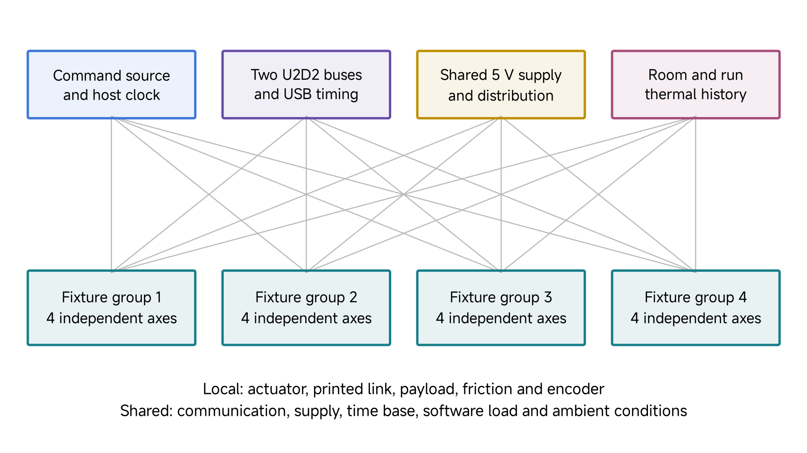

*Figure 4. Source shared/local-pathway diagram. Host timing, communication, supply and run history can influence several fixtures while each retains its own mechanism and encoder. Correlated responses need not imply mechanical coupling. The replay starts at logged references; it does not reconstruct those shared pathways.*

### Read the effective controller

The two campaign contexts use different effective position gains, with the same velocity gain and effort bound:

| Model setting | H1 | H2 |
|---|---:|---:|
| Position gain, N m/rad | 1.579836 | 2.106448 |
| Velocity gain, N m s/rad | 0.202115 | 0.202115 |
| Effort bound, N m | ±0.1551 | ±0.1551 |

For one hinge, write the position and velocity errors against the simulated state as

$$
e_q=q_r-\hat q,\qquad e_v=v_r-\dot{\hat q}.
$$

The bounded controller approximation is

$$
\begin{aligned}
\tau_{\mathrm{req}}&=k_p e_q+k_v e_v,\\
\tau_a&=\operatorname{clip}(\tau_{\mathrm{req}},
-\tau_{\max},\tau_{\max}).
\end{aligned}
$$

The position reference $$q_r$$ and velocity reference $$v_r$$ are separately logged device fields. We do not define $$v_r$$ by differentiating an interpolated position reference. This preserves the Class 04 signal boundary. During prediction, the position and velocity subtracted from those references belong to the simulated state.

With H1, a position error of 0.10 rad and velocity error of 0.20 rad/s request 0.1984066 N m, clipped to 0.1551 N m. This is a model effort limit, not a measured physical torque or a manufacturer stall rating. The firmware-to-SI gain/effort mapping remains a disclosed approximation. A numerical similarity to another campaign's gains does not establish matching hardware, reference timing or calibration.

### Trace the source model's input through the XML

The current combined scene implements the feedback inside an affine MuJoCo actuator. Its reference-dependent input is

$$
u=k_pq_r+k_vv_r.
$$

Its unit gain and state-dependent bias produce

$$
\begin{aligned}
p&=u-k_p\hat q-k_v\dot{\hat q},\\
\tau_a&=\operatorname{clip}(p,-0.1551,0.1551).
\end{aligned}
$$

Here $$p$$ is the unconstrained scalar actuator force. The unit hinge transmission makes the limited output a joint torque in N m. The input $$u$$ is a force-like reference sum in N m; it is neither an angle nor already the final applied torque.

The motor 0 declaration in the supplied H1 XML makes this mapping explicit:

```xml
<general name="xc330_position_m00" joint="actuator_joint_m00"
         gear="1" dyntype="none" gaintype="fixed" gainprm="1"
         biastype="affine" biasprm="0 -1.579836 -0.202115"
         ctrllimited="false" forcelimited="true"
         forcerange="-0.1551 0.1551" />
```

The input itself is not clipped to ±0.1551: the example's reference sum can be 0.5143738 N m. The affine bias first subtracts the simulated position/velocity contribution; the force limit then bounds the resulting actuator output. Because `gear="1"`, its output has the same numerical value as the applied generalized joint torque. This is the same affine feedforward/feedback structure used by the current Class 04 source replay, and it differs from the direct-motor interface inspected in Class 03 (MuJoCo developers n.d.-a, n.d.-b).

| Executable example | Meaning of the input slot | Where feedback is calculated |
|---|---|---|
| Class 03 XC330 motor | Generalized torque request | No embedded position servo in the supplied structural model |
| Class 04 source replay | Position/velocity reference sum | Actuator affine bias subtracts simulated position/velocity |
| Class 05 combined general actuator | Position/velocity reference sum | XML affine bias subtracts simulated position/velocity |

**Worked input check.** Let the references be 0.3 rad and 0.2 rad/s, with simulated state 0.2 rad and 0.4 rad/s. Using the rounded coefficients actually present in the combined H1 XML,

$$
\begin{aligned}
u&=1.579836(0.3)+0.202115(0.2)\\
&=0.5143738\ \mathrm{N\,m},\\
p&=0.5143738-1.579836(0.2)-0.202115(0.4)\\
&=0.1175606\ \mathrm{N\,m}.
\end{aligned}
$$

The applied effort is therefore 0.1175606 N m. If we instead passed an already computed feedback effort into this general-actuator input, its bias would subtract the state contribution again. That double subtraction would request −0.2792526 N m and clip to −0.1551 N m in this example: even the sign would be wrong. Use the actuator definition rather than the array name to determine an input's meaning.

This worked calculation follows the source combined XML; it is an analytical input check, not a new simulation or physical-data replay. The source scene has a 2 ms simulation step; this is not a measurement of the servo firmware or acquisition rate. The [MuJoCo actuation model](https://mujoco.readthedocs.io/en/3.3.7/computation/index.html#actuation-model) and [general-actuator XML reference](https://mujoco.readthedocs.io/en/3.3.7/XMLreference.html#actuator-general) define the gain, bias, force limits and transmission.

Effective armature, damping and friction-loss parameters are selected for each motor/controller pair. They can absorb missing effects as well as physical resistance or inertia. A controller-dependent armature estimate should not be reported as an independently measured invariant rotor inertia. Before interpreting a fitted term, check units, signs, initial state, input identity and clock alignment.

**Checkpoint:** If an internal reference arrives late, could adjusting damping reduce prediction error? Why would that improvement leave the timing explanation unresolved?

## Read the source campaign and compare individuals

### Count events, motor records and predictions separately

The authoritative V5 record contains **125 accepted simultaneous science events**. Every event contains sixteen motor records. The split belongs to complete events, preserving shared timing and experimental grouping.

| Event role | Shared events | Motor records | Profiles used |
|---|---:|---:|---|
| Calibration | 72 | 1,152 | P01–P03 |
| Model selection | 23 | 368 | P04–P05 |
| Held-out evaluation | 30 | 480 | P06–P07 |
| Total | 125 | 2,000 | Accepted science record |

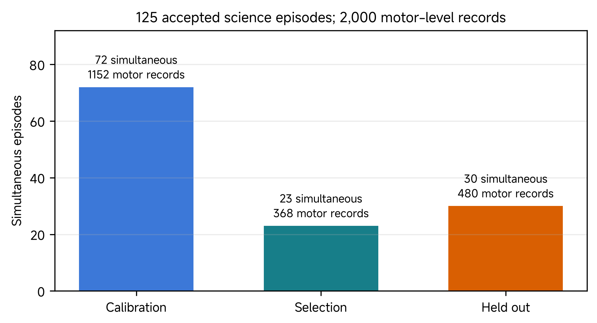

*Figure 5. Source split of the 125 simultaneous events. Each event contains sixteen motor records. The bars retain both counts; a motor record is not another complete execution of the rack.*

There are sixteen motor identities and two controller contexts, giving **32 selected parameter vectors**. Two numerical starts per motor/controller pair produce 64 candidate vectors. Calibration estimates candidates, selection error chooses a successful candidate for each pair, and the source freezes those choices before its held-out scoring stage. A saved stage-order declaration is useful provenance; it is not independent proof of prospective hold-out integrity.

Each held-out motor/controller cell contains fifteen records: five B1/P06, five G1/P06 and five G1/P07. The 480 physical motor records have two predictions each, producing **960 held-out metric rows**. Across all splits, 2,000 records produce 4,000 metric rows. Prediction count does not double the physical experiment count.

Different motors within one event can share disturbances. Retain `simultaneous_episode_id` when joining, splitting or resampling; 480 records are not 480 independent repetitions of the complete setup. The actual selection split has 12 H1 events and 11 H2 events. Do not copy another campaign's 24-event selection matrix into this 23-event record.

The source [event index](https://github.com/asEmbodiedAISyst/2026Autumn/blob/main/course-resources/Class%2005%20%E2%80%94%20From%20single%20actuator%20to%20multi-actuator/additional_material/data/EPISODES_USED.csv), [metric table](https://github.com/asEmbodiedAISyst/2026Autumn/blob/main/course-resources/Class%2005%20%E2%80%94%20From%20single%20actuator%20to%20multi-actuator/additional_material/data/episode_metrics.csv), [selected parameters](https://github.com/asEmbodiedAISyst/2026Autumn/blob/main/course-resources/Class%2005%20%E2%80%94%20From%20single%20actuator%20to%20multi-actuator/additional_material/data/fitted_parameters.csv) and [frozen selection record](https://github.com/asEmbodiedAISyst/2026Autumn/blob/main/course-resources/Class%2005%20%E2%80%94%20From%20single%20actuator%20to%20multi-actuator/additional_material/data/FROZEN_SELECTION_BEFORE_HELD_OUT.json) retain those identities. They are the basis of this comparison; reading their scores does not rerun identification.

### Preserve the prediction boundary and scoring rule

The label **synthetic_baseline** identifies a shared supplied parameter vector. It does not mean that a second hardware motor supplied the comparison trajectory. **hardware_fitted** identifies the selected effective model for each motor/controller pair. Both predictions are compared with the same encoder record.

| Effective parameter | Shared baseline | Selected motor 0 / H1 |
|---|---:|---:|
| Armature, kg m² | 0.000998198 | 0.007187994 |
| Damping, N m s/rad | 0.014961695 | 0.039311835 |
| Friction loss, N m | 0.010089165 | 0.017770652 |

For motor record i, use predicted position $$\hat q$$ and encoder position $$y_q$$ in radians:

$$
E_i=\sqrt{\frac{1}{N_i}\sum_{j=1}^{N_i}(\hat q_{ij}-y_{q,ij})^2},\qquad
\bar E=\frac{1}{K}\sum_{i=1}^{K}E_i.
$$

The campaign mean gives each motor record equal weight. It does not pool every time sample and let a longer record dominate. On the held-out set the source mean changes from **0.024020903 rad** to **0.016337740 rad**:

$$
100\left(1-\frac{0.016337740}{0.024020903}\right)\approx31.9853\%.
$$

Thus 32.0% is a reduction in mean episode position RMSE relative to this baseline. It is not a failure rate, an uncertainty interval or a percentage of physical correctness. It describes model prediction rather than improved physical reference tracking.

| Fixture / controller | Held-out motor records | Baseline RMSE, rad | Fitted RMSE, rad |
|---|---:|---:|---:|
| B1 / H1 | 80 | 0.017982 | 0.004901 |
| B1 / H2 | 80 | 0.012906 | 0.003580 |
| G1 / H1 | 160 | 0.032471 | 0.024588 |
| G1 / H2 | 160 | 0.024148 | 0.020186 |
| All conditions | 480 | 0.024021 | 0.016338 |

G1 has larger discrepancy than B1 in this table, and H2 has lower discrepancy than H1. These are observed condition differences. G1 also combines P06 and P07 while B1 uses P06, so the aggregate contrast does not isolate gravity as the cause. Neither comparison establishes a generally superior controller or the cost of simultaneous operation.

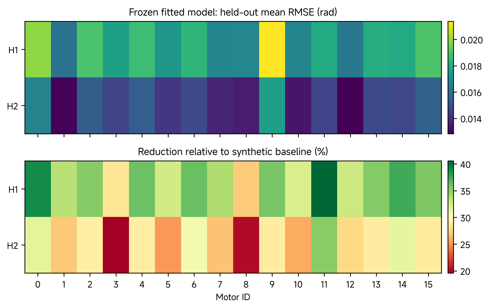

*Figure 6. Source two-panel heatmap for all sixteen motor identities and both controllers. The upper panel is mean fitted position RMSE in radians; the lower is percentage reduction from each cell's synthetic baseline. Each cell averages fifteen held-out records. Read each panel's own scale; colour darkness is not comparable between the quantities.*

All source motor/controller cells improve over their paired baseline, but the remaining error and improvement vary by identity. A shared event can correlate those cells; the image supplies descriptive summaries, not uncertainty intervals or an explanation for the variation.

### Read the author's two-motor trajectory

The source's prepared trajectory example is **B1/H2/P06/R01 for motors 0 and 9**. It is a different question from their mixed-condition cell means.

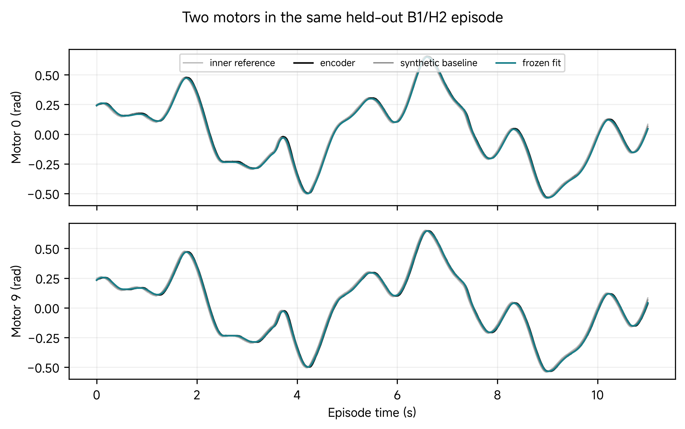

*Figure 7. Source B1/H2/P06/R01 trajectory comparison, with motor 0 above motor 9. The plotted quantities are position in radians against episode time in seconds. Both motors share the event identity while retaining their encoders and selected models. This is the author's selected trace, not a newly run comparison.*

| Legend item | Meaning | Comparison to make |
|---|---|---|
| Light-grey inner reference | Logged target generated inside the actuator | Compare with encoder to discuss physical tracking |
| Black encoder | Reported hardware joint position | Measured output used for prediction RMSE |
| Grey synthetic baseline | Shared baseline simulation prediction | Compare with black to inspect baseline discrepancy |
| Teal frozen fit | Selected motor-specific prediction | Compare with black to inspect fitted-model discrepancy |

Locate a reversal or a region of visible mismatch before reading an aggregate. A teal curve closer to the black encoder supports better prediction in that part of this record. It does not establish a lower physical tracking error or replace the full held-out evaluation. The [source two-motor subset](https://github.com/asEmbodiedAISyst/2026Autumn/blob/main/course-resources/Class%2005%20%E2%80%94%20From%20single%20actuator%20to%20multi-actuator/additional_material/data/two_motor_heldout_subset.parquet) preserves paired samples; this lesson does not substitute another selected event or a new simulated rollout.

The source also supplies these cell means, over all fifteen held-out records per motor/controller pair:

| Motor / controller | Baseline RMSE, rad | Fitted RMSE, rad | Reduction |
|---|---:|---:|---:|
| 0 / H1 | 0.032695 | 0.019939 | 39.01% |
| 9 / H1 | 0.033266 | 0.021375 | 35.75% |
| 0 / H2 | 0.024312 | 0.016654 | 31.50% |
| 9 / H2 | 0.024736 | 0.017582 | 28.92% |

For motor 0, H2 has the smaller fitted error but the smaller relative reduction because its baseline is already better. The numbers are not the selected B1 episode's scores. Inspect each motor's timestamps before joining signals; sharing an event identity does not make row indices a synchronization method.

### Read fitted parameters in their allowed ranges

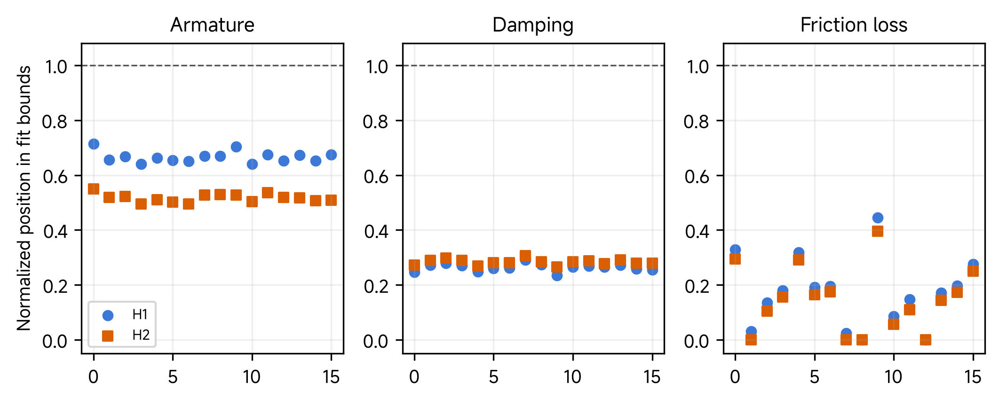

*Figure 8. Source armature, damping and friction-loss distributions for 32 selected models. Blue circles denote H1 and orange squares H2. The vertical axis is normalized position within each parameter's fitting bounds: zero is the lower bound and one the upper bound. It is not a raw SI parameter value.*

| Fitted term | Declared fitting range | Selected range | Selected median |
|---|---|---|---|
| Armature | 0.0002–0.010 kg m² | 0.00505–0.00719 kg m² | 0.00603 kg m² |
| Damping | 0.003–0.150 N m s/rad | 0.03747–0.04806 N m s/rad | 0.04321 N m s/rad |
| Friction loss | 0.002–0.050 N m | 0.00200–0.02340 N m | Not summarized here |

A normalized value of 0.5 means halfway between that term's bounds, not 0.5 kg m² or 0.5 N m. No selected value reaches an upper bound in the source summary. Some friction values are at or near the lower bound; being away from the upper bound is not proof of unique or correct physical parameters.

Motors 0 and 9 can have similar prediction scores and different fitted friction-loss terms. That observation does not identify a physical friction difference. Inertia, loss, timing, effort scaling and controller mismatch can trade off within a closed-loop fit. Independent resistance, timing, voltage or effort measurements would discriminate those explanations. An effective actuator model is judged by its declared predictive use, rather than by naming its terms as measured motor constants.

## Compare encoder and optical evidence

The campaign scores **encoder position**. The cameras help inspect fixture identity, motion, visibility and occlusion. A marker detection is not automatically an independent joint-angle measurement.

The source assigns four ArUco markers to each motor n: `{4n, 4n+1, 4n+2, 4n+3}`. Markers `4n` and `4n+1` are the rotating-link pair; `4n+2` and `4n+3` describe configuration. Image-plane angle is not a three-dimensional shaft angle under arbitrary perspective, and normalized marker separation is not a calibrated metric distance.

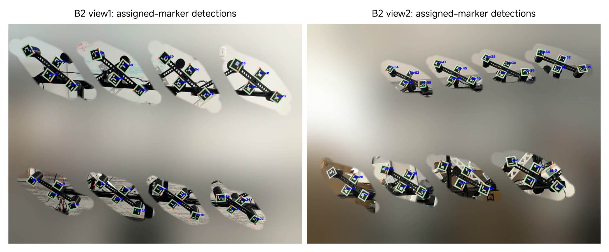

*Figure 9. Source representative assigned-view detections. Outlines and IDs are detector outputs in selected camera frames. They show that markers can be located in those views; they do not supply an all-frame detection rate or calibrated joint-angle ground truth.*

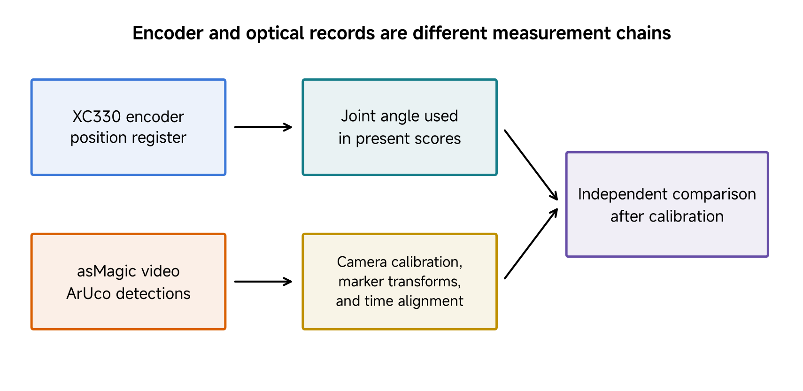

*Figure 10. Source distinction between the scored encoder path and the optical path. Camera intrinsics/distortion, known marker geometry, camera-to-fixture and marker-to-link transforms, joint zero/sign and time alignment are needed before both paths can be compared as joint-angle measurements.*

A camera-derived angle needs the joint axis and a fixed reference as well as those transforms. Occlusion, pose ambiguity and timing add uncertainty. At approximately constant speed of 1 rad/s, a 40 ms delay alone can create about **0.04 rad** apparent disagreement. This first-order calculation is illustrative; it is not a measured delay in this campaign.

If the two channels disagree, inspect what each measures, calibration, mounting, sign, zero and timing. The [OpenCV pose-estimation documentation](https://docs.opencv.org/4.13.0/d5/dae/tutorial_aruco_detection.html) distinguishes corner/ID detection from pose recovery with camera parameters and known marker geometry. Until that measurement chain is established, the source videos and detections remain useful context and are excluded from the fitted encoder RMSE.

## Explain neural actuator models in their research context

An actuator model and a task policy solve different problems. A policy selects commands for a task; an actuator component predicts how commands and recent state produce actuation. A generic history-conditioned proposal is $$\hat\tau_t=f_\theta(h_t)$$, where $$h_t$$ contains available recent signals. That notation is a model class, not a trained result by itself.

Hwangbo and colleagues' 2019 ANYmal study combined a learned actuator network with rigid-body/contact simulation for locomotion. It used position-error and velocity history to predict torque, while a separate policy selected joint targets. It demonstrates the approach in its tested series-elastic quadruped and tasks, not transfer to XC330 or a hand.

The more recent **NeuralActuator** study by Dou and colleagues (2026), used in the author's supporting material, employs a temporal Transformer and differentiable simulation. It predicts a torque surrogate for trajectory propagation and, with the required labels, external-force/contact and motor-condition outputs. The published platforms are OpenManipulator-X, SO-101 and Franka Panda. They are distinct from the local XC330 experiment. [Original paper, version 2](https://arxiv.org/abs/2607.11734v2).

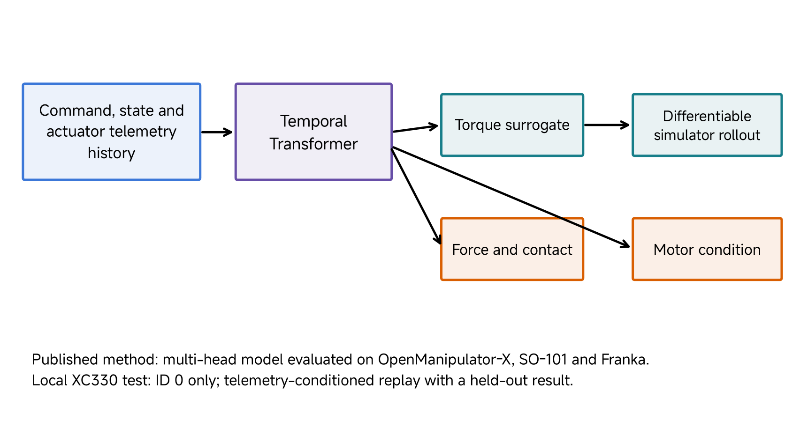

*Figure 11. Source NeuralActuator diagram. The blue history, purple Transformer and teal torque-surrogate/rollout path describe the local modeling route. Orange force/contact and motor-condition heads belong to the published multi-task method and require labels unavailable in this XC330 record. They are not local force-perception results.*

A torque surrogate can be learned through pose prediction without independently measured joint torque. That does not turn the surrogate into a calibrated torque sensor. Force and motor-condition claims need their own labels and evaluation.

### Inspect the local telemetry-conditioned Transformer

The author's local ID-0 example uses two Transformer layers, hidden dimension 64, four attention heads and feed-forward dimension 128. Its eight current features, accompanied by recent history, are:

| Feature order | Source field or construction | Units and source during rollout |
|---:|---|---|
| 1 | Command goal from `q_cmd_rad`, with declared center offset | rad; recorded command |
| 2 | Simulated joint position | rad; simulation state |
| 3 | Simulated joint velocity | rad/s; simulation state |
| 4 | `present_current_mA` | mA; recorded telemetry |
| 5 | `present_pwm_raw` | Raw device counts; recorded telemetry |
| 6 | `present_input_voltage_V` | V; recorded telemetry |
| 7 | `present_temperature_C` | °C; recorded telemetry |
| 8 | Command goal minus simulated position | rad; constructed feature |

The command goal is not the V5 replay's internal `Position Trajectory`. Let $$q_{d,k}$$ denote that local recorded command and $$z_k^{\mathrm{recorded}}$$ the electrical/status channels. The important dependence is

$$
\hat\tau_k=f_\theta\!\left(h_k,q_{d,k},\hat q_k,
\dot{\hat q}_k,z_k^{\mathrm{recorded}}\right).
$$

The scalar output is bounded by `0.93 tanh(·)` and drives an MJX joint rollout. Training uses a Huber position loss plus a small torque penalty. Whole trajectories are split before history windows, and feature normalization is based on the training set. The source code substitutes simulated position and velocity during rollout while retaining measured current, PWM, voltage and temperature.

This makes the model a **telemetry-conditioned replay**. A counterfactual simulation of a new command would not automatically know its resulting current, PWM or temperature. Those channels must be predicted, omitted or supplied by another declared valid source before this becomes a command-only future predictor. Low position error on a recorded trajectory does not remove that input requirement.

The surrogate's ±0.93 N m bound also differs from the population replay's ±0.1551 N m teaching limit. The source calls the former a rated range, but the [XC330-M288-T specification](https://emanual.robotis.com/docs/en/dxl/x/xc330-m288/) identifies 0.93 N m as stall torque at 5.0 V; it is not a continuous rated torque. Bounding a network output by it neither calibrates delivered torque nor makes the two comparisons equivalent.

### Keep the earlier single-motor scores separate

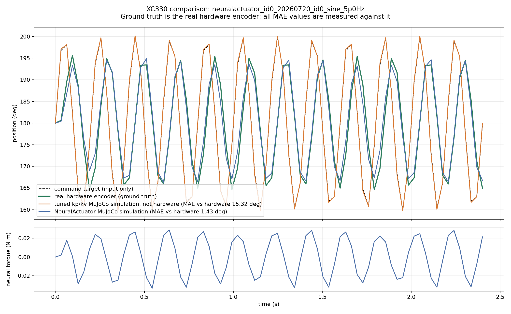

*Figure 12. Source ID-0 full-trajectory comparison on the earlier 5 Hz sine record. Encoder position is the measured reference for the MAE. The neural replay gives 1.4318° and that run's orange parametric comparator 15.3151°. The lower torque trace is a neural surrogate, not independently measured output torque. This is not the sixteen-motor V5 experiment.*

The source [full-trajectory report](https://github.com/asEmbodiedAISyst/2026Autumn/blob/main/course-resources/Class%2005%20%E2%80%94%20From%20single%20actuator%20to%20multi-actuator/additional_material/neural_actuator/results/xc330_lecture_comparison.json) identifies that earlier case and comparator. A separate saved test summary reports short-window MAE 0.4023° and RMSE 1.4078° over 1,168 rollout samples; the best validation MAE is 0.2729°. These are different aggregates, not alternative values for the plotted full trajectory. The full rollout is initialized once, while short windows are initialized from measured state, so accumulated drift and scored intervals differ.

These records support conditional prediction for their supplied inputs and earlier record. They do not isolate improvement caused solely by the Transformer: dataset, load, split, conditioning, effort limits and comparator differ from the V5 population experiment. A controlled future model comparison would hold those conditions fixed and evaluate complete held-out trajectories. The present class reads the author's results; it does not train a replacement model or report a new neural evaluation.

**Checkpoint:** Which of the eight features would be unavailable during a fresh counterfactual rollout? Explain why a low recorded-trajectory MAE does not answer that question.

## Instructor and TA demonstration

Complete the source experiment/controller and two-motor comparison below as the core demonstration. The final measurement/neural comparison is an optional extension; the prepared figures and saved tables support the complete core route.

### Establish the source experiment and controller boundary

Use Figures 1–4 to identify one motor, moving fixture, physical record and combined-scene representation. Distinguish the campaign's declared 113 g fixture from the 110 g declaration in the current Class 03–04 source case; do not import the historical 98 g replay as evidence. Trace internal position/velocity references to the simulated response and scored encoder channel. Use the worked affine-actuator calculation to explain the input meaning; it is an equation-reading exercise, not a newly run scene test.

### Compare the source population result with its selected trace

Use the event table and Figure 5 to count 125 shared events, 2,000 motor records and two predictions per record. Recalculate the overall reduction from the source means. Read Figure 6's two scales before comparing motors 0 and 9. Then inspect the author's B1/H2/P06/R01 trace in Figure 7 and distinguish it from a fifteen-record cell mean.

Use Figure 8 to identify a fitted term, its physical units and its normalized plotted value. State one supported observation and one explanation that requires another measurement. Keep prediction discrepancy separate from command tracking and fitted armature separate from measured rotor inertia.

### Optional extension: compare measurement and learned-model evidence

Use Figures 9–10 to identify what marker detection establishes and what an optical angle still needs. Apply the illustrative timing calculation. Finally, use Figures 11–12 and the eight-feature table to identify the earlier neural record, its surrogate output and its retained telemetry. Explain why the local full-trajectory MAE does not validate a sixteen-motor or command-only neural model.

## Student activity

### Compare two source motor records and make a bounded decision

Use the source four-row motor/controller table, heatmaps and selected B1 trace. Produce one compact record:

1. Record the H1 baseline/fitted means for motors 0 and 9 and calculate one reduction. Use H2 to distinguish smallest absolute error from largest percentage reduction.
2. Explain why 480 held-out motor records represent thirty shared events, and state a grouping-preserving split rule.
3. Read the author's B1/H2/P06/R01 trace. Identify a local prediction discrepancy and distinguish this event from each motor/controller's mixed-condition mean.
4. Read one parameter in Figure 8 against its units and bounds. Propose a measurement that could distinguish a physical-resistance explanation from timing or effort-scaling error.
5. Write one supported model-use statement and one unresolved transfer or measurement question.

| Field | Required entry |
|---|---|
| Identity and boundary | Motor IDs, controller, scored encoder output and selected-event versus cell-mean scope |
| Numerical comparison | Paired model errors, units and one reduction calculation |
| Grouping | Shared-event count and split rule |
| Interpretation | Supported observation and unresolved explanation |
| Next measurement | Quantity, controlled conditions and claim to be tested |

For further practice, use Figure 12 and the eight-feature table to explain the earlier neural result. Identify which inputs come from the command/simulator and which remain recorded physical telemetry. State why the full-trajectory MAE, short-window test score and V5 mean episode RMSE cannot be treated as the same metric or dataset.

## Carry the evidence into manipulation

[Class 06](06-learned-in-hand-cube-reorientation.md) studies the author's custom LEAP continuous-rotation case. Actuator prediction explains one part of its control pathway. A hand also needs connected-body mechanics, contact, object behavior and a policy observation/action contract. The independent fixtures do not supply evidence of successful in-hand transfer; the next class must inspect its own source trial and learning records.

## References

Dou, Zhiyang, John U. Onyemelukwe, Hangxing Zhang, Heng Zhang, Minghao Guo, Yunsheng Tian, Michal Piotr Lipiec, Joshua Jacob, Chao Liu, Peter Yichen Chen, Yuri Ivanov, and Wojciech Matusik. 2026. “NeuralActuator: Neural Actuation Modeling for Robot Dynamics and External Force Perception.” arXiv:2607.11734v2, revised 17 July 2026. [Paper](https://arxiv.org/abs/2607.11734v2).

Featherstone, Roy. 2008. *Rigid Body Dynamics Algorithms*. Springer.

HALWANI, Mohamed. 2026. “From One Actuator to Sixteen: Controllers, Evidence, and Model Comparison.” ROB7103/8103 course collection, source revision `f7c118edaadc9f33498669736fa9d99160ff629a`; lesson blob `a439402b0a1e495582d25c4d869887ba52866067`. The V5 population archive, source figures, combined models and separate ID-0 neural report are the practical evidence used here.

Hwangbo, Jemin, Joonho Lee, Alexey Dosovitskiy, Dario Bellicoso, Vassilios Tsounis, Vladlen Koltun, and Marco Hutter. 2019. “Learning Agile and Dynamic Motor Skills for Legged Robots.” *Science Robotics* 4 (26): eaau5872. [Article](https://doi.org/10.1126/scirobotics.aau5872), [open manuscript](https://arxiv.org/abs/1901.08652).

MuJoCo developers. n.d.-a. “Computation.” *MuJoCo Documentation*, version 3.3.7. Accessed 17 October 2026. [Actuation model](https://mujoco.readthedocs.io/en/3.3.7/computation/index.html#actuation-model).

MuJoCo developers. n.d.-b. “XML Reference.” *MuJoCo Documentation*, version 3.3.7. Accessed 17 October 2026. [General actuator](https://mujoco.readthedocs.io/en/3.3.7/XMLreference.html#actuator-general).

OpenCV contributors. n.d. “Detection of ArUco Markers.” *OpenCV Documentation*, version 4.13.0. Accessed 17 October 2026. [Marker detection and pose estimation](https://docs.opencv.org/4.13.0/d5/dae/tutorial_aruco_detection.html).

ROBOTIS. n.d. “XC330-M288-T.” *DYNAMIXEL e-Manual*. Accessed 18 October 2026. [Exact-model specifications and control table](https://emanual.robotis.com/docs/en/dxl/x/xc330-m288/).
