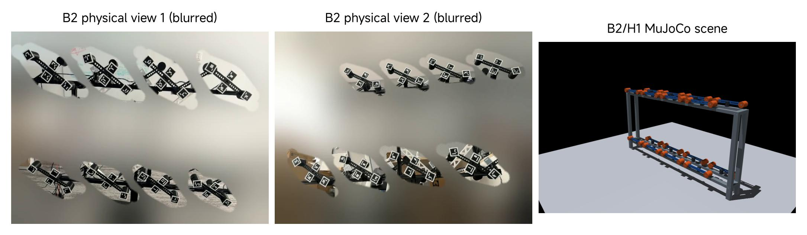
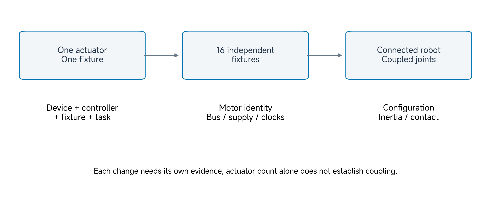
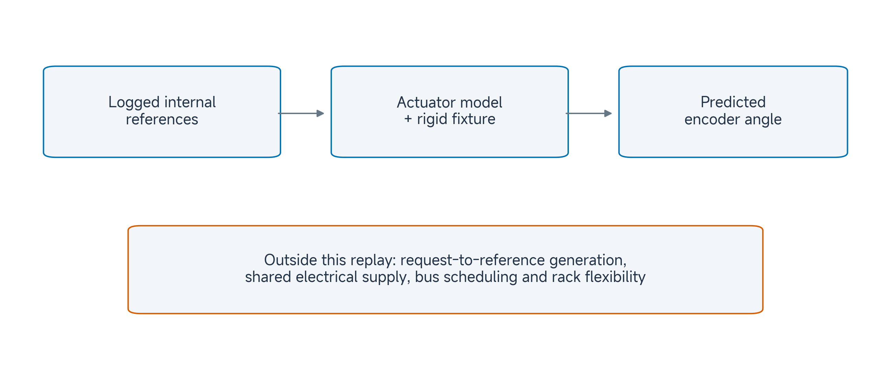
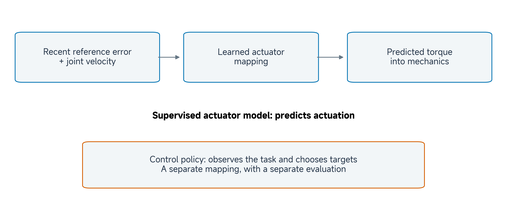
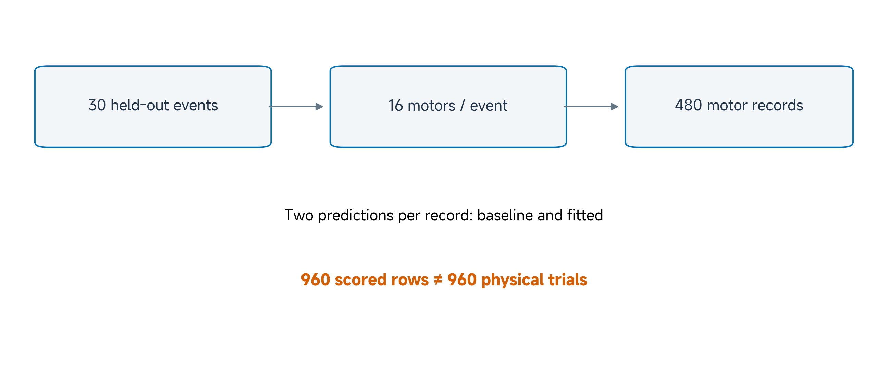
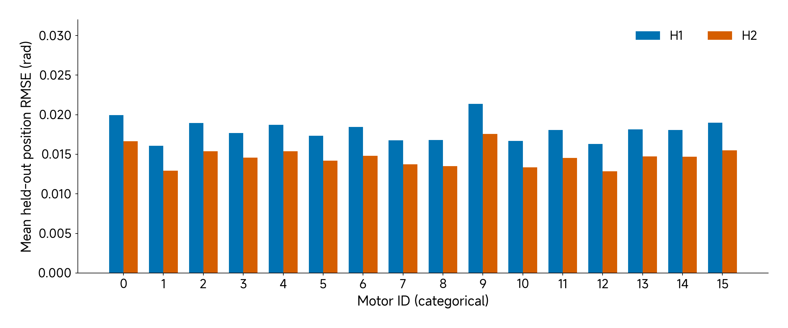
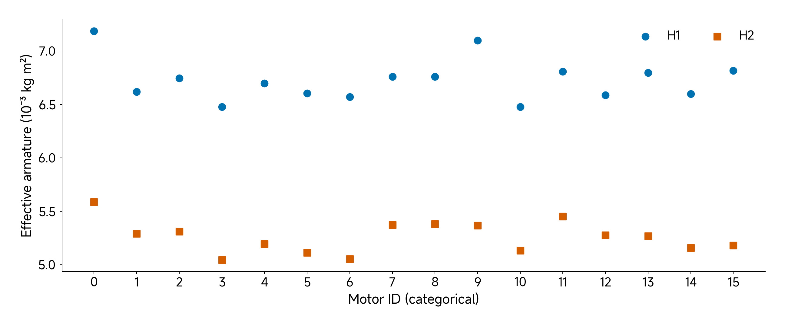
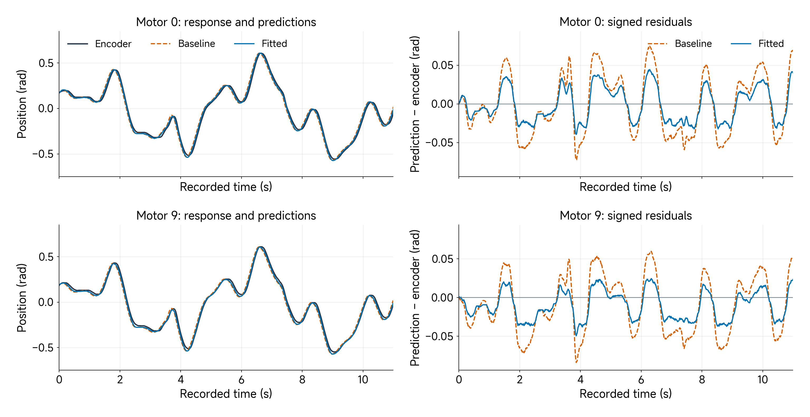
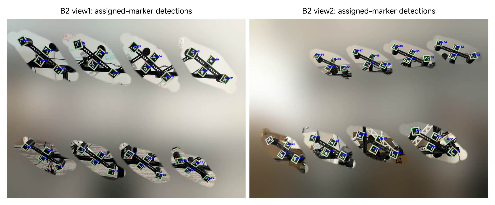
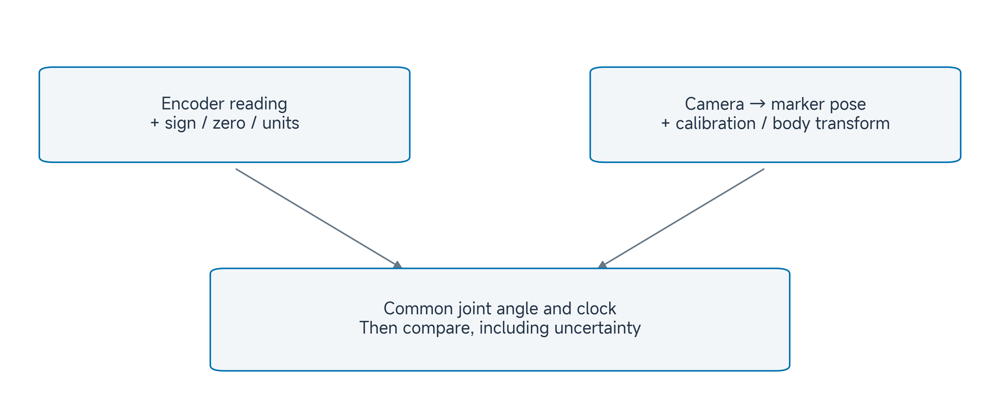

# 05 From Single-Actuator to Multi-Actuator

## Central question

Why does matching one actuator not establish the behavior of a multi-actuator system?

A good prediction for one actuator is evidence about a particular device, fixture, controller and task. A robot adds more devices, shared infrastructure and, when joints are mechanically connected, new interactions. Our task is to decide which conclusions survive each change and what additional experiment is needed.

We use a supplied sixteen-XC330 campaign to examine this transition. The motors carry separate fixtures: they operate together but do not form a connected hand or arm. That distinction lets us study motor-specific prediction errors before introducing the contact-rich manipulation of Class 06.

By the end, you should be able to:

- Distinguish individual variation, shared-operation effects and mechanical coupling.
- Read the input, output and physical assumptions of a population actuator model.
- Explain the role of a neural actuator model without confusing it with a control policy.
- Compare paired held-out predictions while preserving collection-event grouping.
- State what encoder and camera records establish, and what calibration they still need.

[Lecture](#start-with-a-bounded-single-actuator-claim) · [Instructor and TA demonstration](#instructor-and-ta-demonstration) · [Student activity](#student-activity)

The figures, worked examples and result tables provide a complete reading and activity route on this page. The activity uses the supplied figures, metric tables and worked calculations. CAD software, motors, cameras and neural-network training are not required to complete it.

## Review the single-actuator validation task

### Start with a bounded single-actuator claim

[Class 02](../module-01-actuator-data-for-1-dof-systems/02-actuator-basics-for-controlled-action.md) established controlled action and the meanings of requests, references and reported responses. [Class 03](../module-01-actuator-data-for-1-dof-systems/03-basic-digitization-of-physical-embodiment.md) inspected the mechanical representation, while [Class 04](../module-01-actuator-data-for-1-dof-systems/04-basic-quantification-of-sim2real-gap.md) identified effective joint parameters and evaluated recorded-response predictions. Carry the same comparison record forward: **which physical system, which input, which output and which test conditions?**

The new questions concern scaling: whether a shared parameter vector predicts every motor, whether concurrent operation introduces common disturbances, and what changes when joints are connected. Product surveys, CAD export and the full single-joint fitting derivation remain in the earlier classes. We reuse their concepts here rather than repeat those procedures.

For the present campaign, a replay consumes logged internal position and velocity references, advances a model and compares predicted joint position with recorded encoder position. A position tracking error compares a reference with the measured response. A model prediction error compares the simulated response with that measured response. A device can track its reference imperfectly while a model predicts that imperfection well.

| Comparison | Question |
|---|---|
| Reference versus encoder | How well did the controlled device track its target? |
| Prediction versus encoder | How well did the model reproduce the measured response? |
| One motor versus another | How does predictive performance vary across identities? |

A smaller prediction error does not establish that the physical actuator tracks better. We are evaluating a representation of an observed experiment, rather than changing the hardware controller.

*Figure 1. Supplied B2 camera views and the combined B2/H1 MuJoCo scene. The photographs show fixtures from two viewpoints; they should not be counted as separate experiments. The simulated rack illustrates arrangement, including unmeasured front-to-back spacing. Visual correspondence does not validate dynamics.*

### Preserve fixture identity

The supplied Class 05 construction declares a 25 g link, two 4 g pins and two 40 g payloads: **113 g moving fixture mass** for a loaded configuration. This is a model declaration, not a new weighing result. The 113 g is added moving-fixture mass, excluding the fixed housing. As in the earlier structural example, inherited CAD housing mass is not an independently verified module mass; the fixed housing does not contribute to this isolated hinge inertia. Class 03's inspected fixture uses a separate 110 g description; Class 04's retained campaign uses a 98 g description. A repeated label such as B2 does not make these the same calibrated physical fixture.

Preserve the dataset-to-model mapping instead of changing a mass until totals agree. To resolve correspondence, obtain fixture identity, component measurements, attachment positions and the actual collection configuration. A total mass alone does not determine inertia: two 40 g point payloads at ±60 mm contribute 0.000288 kg m² about their central axis; at ±120 mm they contribute 0.001152 kg m². Doubling radius quadruples this contribution while payload mass stays constant.

**Checkpoint:** Which conclusion follows from a smaller held-out prediction error: better prediction for the tested records, better physical tracking, or verified component inertia? Explain the evidence needed for each.

## Distinguish independent fixtures from connected joints

### More actuators introduce several different changes

Sixteen independent hinges do not become mechanically coupled merely because they appear in one scene. In the supplied construction, each fixture is fixed independently to the world, with one moving joint. Contacts are disabled. The visual supports have no simulated flexibility, and the model does not reconstruct supply dynamics or a communication bus.

*Figure 2. Three distinct steps in scope. Moving from one actuator to simultaneous fixtures introduces population and infrastructure questions. Connecting joints adds configuration-dependent mechanics and contact. Each transition needs evidence for its own claims.*

For an independent fixture, the relevant motion can be described by a scalar hinge balance. For a connected robot, joint accelerations generally depend on the other joints' positions and motions. A conventional generalized balance is

$$
H(q)\ddot q+C(q,\dot q)+\tau_f(\dot q)
=\tau_a+\tau_{\mathrm{ext}},\qquad
\tau_{\mathrm{ext}}=J_c(q)^\mathsf{T}f_c.
$$

Here $$q$$ is the vector of joint coordinates, $$H$$ is the inertia matrix, and $$C=c+g$$ collects velocity-dependent rigid-body terms and gravity, matching the notation in Classes 02–04. The term $$\tau_f$$ represents passive resistance, $$\tau_a$$ is applied actuator effort, and $$\tau_{\mathrm{ext}}$$ is externally applied generalized effort. The contact Jacobian $$J_c$$ maps joint velocity to contact motion; its transpose maps contact force $$f_c$$ to generalized effort. For revolute joints, effort is torque in N m. This equation organizes the terms; it does not supply unknown parameters.

Off-diagonal inertia terms are a concrete example of coupling. Suppose, only for illustration,

$$
H=\begin{bmatrix}0.020&0.004\\0.004&0.010\end{bmatrix}\;\mathrm{kg\,m^2},\qquad
\ddot q=\begin{bmatrix}0\\2\end{bmatrix}\;\mathrm{rad/s^2}.
$$

The inertial effort is [0.008, 0.020] N m. Joint 1 needs inertial effort despite having zero acceleration itself. A diagonal approximation would miss the first contribution. These invented values illustrate the matrix operation; they are not measurements of the XC330 fixtures. Gravity, velocity effects, passive terms and contact must also be included when relevant.

For the supplied independent-hinge scene, our inspection finds a diagonal generalized inertia matrix and sixteen coordinates, velocities and actuator inputs. That verifies the declared topology. It does not test a coupled hand.

For independent fixed-axis fixtures, each diagonal entry is its own fixture inertia plus effective armature. Moving motor 9's coordinate cannot change motor 0's inertia or gravitational bias in this model. A connected hand needs a shared body tree and the corresponding configuration-dependent dynamics. Even perfectly identified individual actuators would leave that mechanical problem to solve. Electrical, communication and structural interactions require their own representations; adding off-diagonal rigid-body terms alone would not simulate a voltage drop.

**Predict:** Hold a connected arm's distal joint fixed and change its angle before moving the proximal joint. Why might the proximal effort change? Which of those mechanisms is absent from sixteen fixtures fixed separately to a rack?

## Inspect shared infrastructure and the replay boundary

### Independent motion can still share disturbances

A physical rack can share supply, communication, collection clocks and environment even when the fixtures have no intended mechanical connection.

| Pathway | Possible observation | Useful next measurement |
|---|---|---|
| Communication and scheduling | Several responses begin late together | Command delivery and sample timestamps |
| Supply | Errors coincide with simultaneous demand | Supply voltage and current at appropriate points |
| Mounting and load | Error changes after reassembly | Fixture mass, axis, fit and attachment identity |
| Temperature | Response changes during a session | Device temperature, elapsed operation and load |

These are diagnostic possibilities, not established causes in the supplied data. A shared error pattern can motivate a test without identifying its mechanism. Shared temperatures or warm-up history may influence several devices, but physical thermal interaction also depends on their mounting and environment.

To examine simultaneous-operation effects, keep one motor, fixture and command protocol fixed; compare it alone and with the other motors active while measuring timing and supply. To examine identity, swap the motor while holding the fixture and protocol fixed. Changing identity, fixture and controller together prevents a clean interpretation.

*Figure 3. The replay begins at logged internal references and ends at predicted position. It does not regenerate the device's internal reference from an application request, or simulate shared supply, communication scheduling or rack flexibility.*

### Read the effective controller

The two campaign contexts use different effective position gains, with the same velocity gain and effort bound:

| Model setting | H1 | H2 |
|---|---:|---:|
| Position gain, N m/rad | 1.579836 | 2.106448 |
| Velocity gain, N m s/rad | 0.202115 | 0.202115 |
| Effort bound, N m | ±0.1551 | ±0.1551 |

For one hinge, write the position and velocity errors against the simulated state as

$$
e_q=q_r-\hat q,\qquad e_v=v_r-\dot{\hat q}.
$$

The bounded controller approximation is

$$
\begin{aligned}
\tau_{\mathrm{req}}&=k_p e_q+k_v e_v,\\
\tau_a&=\operatorname{clip}(\tau_{\mathrm{req}},
-\tau_{\max},\tau_{\max}).
\end{aligned}
$$

The position reference $$q_r$$ and velocity reference $$v_r$$ are separately logged device fields. We do not define $$v_r$$ by differentiating an interpolated position reference. This preserves the Class 04 signal boundary. During prediction, the position and velocity subtracted from those references belong to the simulated state.

With H1, a position error of 0.10 rad and velocity error of 0.20 rad/s request 0.1984066 N m, clipped to 0.1551 N m. This is a model effort limit, not a measured physical torque or a manufacturer stall rating. The firmware-to-SI gain/effort mapping remains a disclosed approximation. A numerical similarity to another campaign's gains does not establish matching hardware, reference timing or calibration.

### Trace the input through the combined XML

The current combined scene implements the feedback inside an affine MuJoCo actuator. Its reference-dependent input is

$$
u=k_pq_r+k_vv_r.
$$

Its unit gain and state-dependent bias produce

$$
\begin{aligned}
p&=u-k_p\hat q-k_v\dot{\hat q},\\
\tau_a&=\operatorname{clip}(p,-0.1551,0.1551).
\end{aligned}
$$

Here $$p$$ is the unconstrained scalar actuator force. The unit hinge transmission makes the limited output a joint torque in N m. The input $$u$$ is a force-like reference sum in N m; it is neither an angle nor already the final applied torque.

| Executable example | Meaning of the input slot | Where feedback is calculated |
|---|---|---|
| Class 03 XC330 motor | Generalized torque request | No embedded position servo in the supplied structural model |
| Class 04 reduced motor | Already computed bounded controller effort | Python recomputes feedback from the simulated state |
| Class 05 combined general actuator | Position/velocity reference sum | XML affine bias subtracts simulated position/velocity |

**Worked input check.** Let the references be 0.3 rad and 0.2 rad/s, with simulated state 0.2 rad and 0.4 rad/s. Using the rounded coefficients actually present in the combined H1 XML,

$$
\begin{aligned}
u&=1.579836(0.3)+0.202115(0.2)\\
&=0.5143738\ \mathrm{N\,m},\\
p&=0.5143738-1.579836(0.2)-0.202115(0.4)\\
&=0.1175606\ \mathrm{N\,m}.
\end{aligned}
$$

The applied effort is therefore 0.1175606 N m. If we instead passed an already computed feedback effort into this general-actuator input, its bias would subtract the state contribution again. That double subtraction would request −0.2792526 N m and clip to −0.1551 N m in this example: even the sign would be wrong. Use the actuator definition rather than the array name to determine an input's meaning.

The inspection script checks this arithmetic against the actual XML without changing source models. Its short finite-state run tests the executable scene, not the physical trajectory replay. The scene has a 2 ms simulation step; this is not a measurement of the servo firmware or acquisition rate. The [MuJoCo actuator documentation](https://mujoco.readthedocs.io/en/3.3.7/modeling.html#actuation-model) defines gain, bias, force limits and transmission.

Effective armature, damping and friction-loss parameters are selected for each motor/controller pair. They can absorb missing effects as well as physical resistance or inertia. A controller-dependent armature estimate should not be reported as an independently measured invariant rotor inertia. Before interpreting a fitted term, check units, signs, initial state, input identity and clock alignment.

**Checkpoint:** If an internal reference arrives late, could adjusting damping reduce prediction error? Why would that improvement leave the timing explanation unresolved?

## Explain neural actuator models in their research context

A useful actuator model may need recent history. The same current reference error and velocity can follow different preceding commands, filters or friction transitions. A learned mapping can use a short signal history to predict an actuator contribution.

In Hwangbo and colleagues' [*Learning Agile and Dynamic Motor Skills for Legged Robots* (2019)](https://arxiv.org/abs/1901.08652), the platform was ANYmal, a quadruped with twelve series-elastic actuators. Their approach combined rigid-body/contact simulation with an actuator network learned from physical data. The network used joint-error and velocity history to predict torque; a separate policy chose joint targets for locomotion. The study supports this modeling approach in its tested robot and tasks, rather than demonstrating transfer to XC330 servos or a robotic hand.

*Figure 4. Conceptual separation of two learned mappings. An actuator model predicts how commands and recent state produce actuation. A control policy chooses actions for a task. This diagram contains no Class 05 training result.*

The original study used present and past position-error/velocity samples; its independent-actuator assumption was itself a modeling choice. Shared actuation dynamics can require a joint model instead. The useful lesson is the placement of a learned actuator component inside otherwise explicit mechanics, not that a network removes the need to specify the physical boundary (Hwangbo et al. 2019).

For a generic history-conditioned actuator component, let $$h_t$$ contain available recent references and states. One might propose $$\hat\tau_t=f_\theta(h_t)$$. In simulation this component would feed effort into the rigid-body balance; the policy would still choose task actions. This notation describes a proposed model class here, not a trained Class 05 network. A low error on actuator data and a successful manipulation policy require different evaluations.

For a proposed XC330 neural model, specify the learning target first: torque, a residual effort, or next state? A torque target requires suitable torque evidence; electrical current or a simulated effort field is not automatically calibrated torque ground truth. Specify which signals will exist at inference, their units and timing, and the range covered by training data.

A short-window evaluation repeatedly supplied with measured history differs from an autonomous rollout that feeds predictions back into subsequent inputs. Errors can accumulate in the latter. Split whole collection events **before** constructing overlapping history windows, then evaluate complete held-out trajectories as well as short predictions. Otherwise nearly identical neighboring windows can leak across the split.

The present teaching activity evaluates the supplied parametric baseline and fitted predictions. It does not train a neural model or validate a learned policy. A sensible next experiment would compare a history-conditioned model with the parametric baseline on the same held-out inputs, outputs and scoring intervals, then test its rollout behavior. Improvement in a fixture prediction still needs a separate hand/contact experiment before claiming better manipulation.

**Checkpoint:** A neural predictor has low next-step error when given measured history. What additional result would justify using it as an actuator component inside a long simulation rollout?

## Read the sixteen-motor campaign and compare individuals

### Count events, records and prediction rows separately

The accepted campaign contains 125 simultaneous science events. Every event contains sixteen motor records. The split is assigned to complete events, preserving shared timing and experimental grouping.

| Event role | Shared events | Motor records |
|---|---:|---:|
| Calibration | 72 | 1152 |
| Model selection | 23 | 368 |
| Held-out evaluation | 30 | 480 |
| Total | 125 | 2000 |

There are sixteen motor identities and two controller contexts, giving **32 selected parameter vectors**. Each held-out motor/controller cell has fifteen records. These fits are applied across the campaign's tested fixtures and profiles; they are not 32 unrelated physical tests.

*Figure 5. Thirty held-out events × sixteen motors produce 480 physical motor records. Baseline and fitted predictions create 960 scored rows for those records. Prediction count does not double the physical experiment count.*

Different motors in the same event may share disturbances. Do not treat the 480 records as 480 independent repetitions of the complete setup. Retain `simultaneous_episode_id` when joining, splitting or resampling. For uncertainty in performance on new collection events, preserve that event grouping rather than resampling individual motor rows as if unrelated.

The [episode list](../resources/class05/data/EPISODES_USED.csv), [metric table](../resources/class05/data/episode_metrics.csv) and [selected parameters](../resources/class05/data/fitted_parameters.csv) are included in this repository. The script checks paired model rows and grouping; it does not refit the models or recover measurements omitted from the compact package.

### Know which two predictions are being compared

The label **synthetic_baseline** identifies one supplied parameter vector shared across motor identities and controller contexts. It does not mean that the comparison trajectory was measured on a second physical actuator. **hardware_fitted** identifies a simulator candidate selected for each motor/controller pair. Both produce position predictions for comparison with the same encoder record.

| Effective parameter | Shared baseline | Selected motor 0 / H1 |
|---|---:|---:|
| Armature (kg m²) | 0.000998198 | 0.007187994 |
| Damping (N m s/rad) | 0.014961695 | 0.039311835 |
| Friction loss (N m) | 0.010089165 | 0.017770652 |

The source records describe two numerical fitting starts for each of 32 motor/controller cells: 64 candidate vectors. Calibration records estimate them, model-selection error selects one successful candidate per cell, and the 32 selected vectors are frozen before the source's held-out scoring step. Two starts are alternative optimizer initializations, not two physical trials or two identification methods.

The accepted event list has 36 calibration events per controller, 12 selection events under H1 and 11 under H2, and 15 held-out events under each. Keep the actual 23 selection events; do not copy Class 04's 24-event matrix into this campaign. The compact package preserves scores and selected parameters. Its checks do not rerun the optimizer, reconstruct excluded raw records or independently establish a prospective collection procedure.

### Preserve the scoring rule

For one motor record, the position RMSE over its declared active-profile samples is

$$
E_i=\sqrt{\frac{1}{N_i}\sum_{j=1}^{N_i}(\hat q_{ij}-y_{q,ij})^2},\qquad
\bar E=\frac{1}{K}\sum_{i=1}^{K}E_i.
$$

Predicted position is $$\hat q$$ and the encoder reading is $$y_q$$, both in radians. Each motor record has equal weight in the campaign mean. On the held-out set, the baseline mean is **0.024020903 rad** and the fitted mean is **0.016337740 rad**. The relative reduction is

$$
100\left(1-\frac{0.016337740}{0.024020903}\right)\approx31.9853\%.
$$

This is a reduction in this metric relative to this baseline. It is not a failure rate, an uncertainty interval or a percentage of physical correctness. Class 04's reported RMSEs use another dataset/model contract; comparing their magnitudes with this campaign does not rank the actuators or measure the cost of simultaneous operation.

Class 04 distinguished averaging complete-record RMSEs from pooling all time samples. The same distinction applies here, with a further grouping level: several motor records belong to one shared event. Keep the original per-record score for the reported mean, and preserve event identity when examining dependence or constructing a new split. Neither a larger sample count nor a second prediction creates another physical repeat.

*Figure 6. Mean fitted position RMSE for each motor/controller cell, with fifteen held-out records per bar. Motor ID is categorical. The plot is descriptive and supplies no confidence intervals; shared-event dependence remains relevant.*

### Compare performance without inventing a cause

The activity focuses on motors 0 and 9. All four cells improve relative to their own paired baseline, but absolute error and percentage reduction answer different questions.

| Motor / context | Baseline RMSE (rad) | Fitted RMSE (rad) | Reduction |
|---|---:|---:|---:|
| 0 / H1 | 0.032695 | 0.019939 | 39.01% |
| 9 / H1 | 0.033266 | 0.021375 | 35.75% |
| 0 / H2 | 0.024312 | 0.016654 | 31.50% |
| 9 / H2 | 0.024736 | 0.017582 | 28.92% |

For motor 0, H2 has the smaller fitted error but the smaller relative reduction because its baseline is already better. These observations describe the tested conditions. They do not establish a causal explanation for motor differences or a generally superior hardware controller.

*Figure 7. Effective armature from the 32 selected vectors. Compare H1 and H2 for the same motor: the fitted term depends on controller context. The vertical scale is 10⁻³ kg m². Values describe this effective model rather than independent rotor measurements.*

A different friction-loss parameter similarly does not prove a physical friction difference. Inspect resistance independently, or instrument input timing and effort, according to the competing explanations. Parameters near an optimization bound deserve inspection. A fit inside its bounds still does not establish uniqueness or correct physics. The activity reaggregates saved predictions; it does not rerun optimization or verify the physical cause of a fitted value.

*Figure 8. Left: encoder and stored baseline/fitted trajectories; right: signed prediction-minus-encoder residuals on a common vertical scale. Rows show motors 0 and 9 in the same G1/H1/P06/R01 held-out collection event. The selected trace illustrates local discrepancies, not the population average. The supplied per-motor trace intervals reproduce their corresponding episode metrics; the population table separately averages records.*

The selected CSV permits a direct RMSE check, not only inspection of saved summary scores:

| Selected G1 / H1 / P06 / R01 record | Retained samples | Baseline episode RMSE (rad) | Fitted episode RMSE (rad) |
|---|---:|---:|---:|
| Motor 0 | 1,101 | 0.0381944624 | 0.0222666324 |
| Motor 9 | 1,095 | 0.0381650017 | 0.0213814079 |

For motor 0, square each of the 1,101 fitted-minus-encoder differences, average them and take the square root. The saved calculation performs this check for both models and motors against their corresponding metric rows, allowing only the stored table's decimal rounding. This reproduces a score from saved predictions; it is not a new physics simulation.

The motor 0 result of 0.0222666324 rad belongs to **this episode**. Its H1 cell mean of about 0.019939 rad averages fifteen held-out records. Their difference is expected; substituting the group mean for the plotted episode would mislabel the result.

Each motor retains its own recorded time vector. The two series have different sample counts and end times even though they belong to one shared collection event. Inspect timestamps before aligning signals across motors; matching row indices alone is not a synchronization method. This also means the compact trace cannot establish a new encoder sampling specification for the device.

Read the time series before interpreting the mean. Locate a reversal or region of larger discrepancy, compare prediction with encoder at the same recorded time, and ask whether the difference appears in one motor or both. A visually closer curve is useful evidence for that trace; selecting one favorable event does not replace the full held-out comparison.

## Compare internal encoders with external optical evidence

The campaign scores **encoder position**. Camera views and ArUco detections help inspect fixture identity, visible motion, occlusion and recording conditions. A marker detection is not automatically an independent joint-angle measurement.

*Figure 9. Retained source detection images. The outlines and IDs show marker detections in two views. They do not establish camera calibration, joint-axis angle or synchronized measurement uncertainty. Use the marker arrangement as physical context.*

To construct an optical angle, calibrate the camera and marker geometry, establish the marker-to-moving-body transform and fixed reference, define the joint axis and zero, and align the video clock with the encoder clock. Inspect occlusions and pose ambiguities, then quantify uncertainty. A marker's image-plane orientation is generally not the physical hinge angle under an arbitrary viewpoint.

*Figure 10. The encoder and optical chains need a common angle convention and time base before comparison. Camera calibration and body transforms connect marker pose to joint motion; uncertainty belongs to both measurement paths.*

Timing alone can mimic an angle discrepancy. At roughly constant speed of 1 rad/s, a 40 ms delay produces about **0.04 rad** apparent disagreement when file rows are compared without time alignment. This first-order estimate does not account for acceleration or tracking failures.

If optical and encoder readings disagree, do not choose a winner from visual plausibility. Check what each measures, calibration, mounting, sign, zero and timing. A calibrated external observation can add evidence about physical motion; uncalibrated video remains supporting context.

**Checkpoint:** What additional records would let another student reproduce the conversion from a marker detection to the joint angle used in the score?

## Instructor and TA demonstration

### Establish the experiment boundary

Place Figure 1 beside Figures 2 and 3. Identify one fixed housing, one moving fixture and its motor identity. Contrast the collection rack with a chain of connected joints. State the input and output being compared, and distinguish the campaign's 113 g model construction from the earlier fixture descriptions.

Open the supplied [B2/H1 scene](../resources/class05/models/combined/B2_H1.xml) and [B2/H2 scene](../resources/class05/models/combined/B2_H2.xml) as text. Identify a motor-specific hinge, actuator and passive parameters. Use the saved scene checks below to connect the declared model to the worked input calculation:

| Scene check | B2/H1 | B2/H2 |
|---|---:|---:|
| Coordinates / velocities / inputs | 16 / 16 / 16 | 16 / 16 / 16 |
| Contact-enabled geometries | 0 | 0 |
| Largest off-diagonal hinge inertia (kg m²) | 0 | 0 |
| Effort at zero state for q-reference 0.1 rad, velocity-reference 0.2 rad/s (N m) | 0.1551 | 0.1551 |
| Effort at state (0.2 rad, 0.4 rad/s), references (0.3 rad, 0.2 rad/s), N m | 0.1175606 | 0.1551 |

The inspector checks the initial and worked-example poses, reports the nominal moving-fixture mass, and steps a short prescribed input for finite state. It does not replay the physical campaign, reproduce training or validate rack dynamics. Its numeric input construction follows the effective controller described above.

### Reproduce and challenge the comparison

Read the event and record counts before the improvement percentage. Compare the aggregate result with the worked calculation, then compare motors 0 and 9 under H1 and H2.

The four selected-trace RMSEs can also be checked directly from the saved trajectories. Identify motor 0’s episode result before comparing it with the motor/controller mean. Use Figures 6–8 to connect cell means, parameters and trajectories. Ask for one supported observation, then one possible explanation that would require a new measurement. Keep prediction error separate from reference tracking and fitted armature separate from measured rotor inertia.

### Inspect the measurement evidence

Use the original marker images in Figure 9 and the measurement chain in Figure 10. Identify what the image establishes and list the missing steps for a synchronized optical angle. Apply the 40 ms timing example. End by choosing one next experiment: an alone-versus-simultaneous test, an independently instrumented motor comparison, or a connected-joint test. State which uncertainty that experiment would address.

## Student activity

### Compare two motors and make one bounded decision

Use the four-row comparison table to predict which motor/context has the smallest fitted error and which has the largest percentage reduction. Check the prediction against the supplied values and explain the difference between the two questions.

1. Record the H1 baseline and fitted mean RMSEs for motors 0 and 9. Calculate one reduction yourself; use the supplied H2 rows for comparison without repeating all calculations.
2. Explain why 480 held-out motor records represent thirty shared collection events. State how you would keep that grouping in a new split.
3. Inspect Figure 8 and its selected-episode table. Name one local discrepancy and distinguish the motor 0 episode score from its fifteen-record mean.
4. Select one explanation for a motor difference—resistance, timing, fixture identity or shared supply—and propose a measurement that could distinguish it from an alternative.
5. State a bounded use decision. If your proposed test uses the camera, identify one calibration or synchronization requirement.

Submit a compact record:

| Field | Required content |
|---|---|
| Identity and boundary | Motor IDs, controller context, fixture and scored output |
| Numerical comparison | Both model errors, units, one reduction calculation |
| Grouping | Shared-event count and split rule |
| Interpretation | One supported observation and one unresolved explanation |
| Next experiment | Measurement, controlled conditions and claim to be tested |

A defensible conclusion reports improved held-out encoder-position prediction under the declared campaign conditions. It leaves the physical cause of parameter variation, shared-infrastructure effects and transfer to a coupled hand as questions for further evidence.

## Carry the evidence into manipulation

The next class introduces a multi-fingered manipulation task. Keep today's distinction explicit: actuator predictions describe how commands produce joint motion under a declared model; manipulation also depends on connected-body mechanics, object state, contact, observations and the policy's decisions. A fixture result is a useful component of that argument, and the manipulation experiment must supply the remaining evidence.

## References

Hwangbo, Jemin, Joonho Lee, Alexey Dosovitskiy, Dario Bellicoso, Vassilios Tsounis, Vladlen Koltun, and Marco Hutter. 2019. “Learning Agile and Dynamic Motor Skills for Legged Robots.” *Science Robotics* 4 (26): eaau5872. [https://doi.org/10.1126/scirobotics.aau5872](https://doi.org/10.1126/scirobotics.aau5872). The [open manuscript](https://arxiv.org/abs/1901.08652) supplies the original platform, actuator-learning method and policy-transfer experiments.
