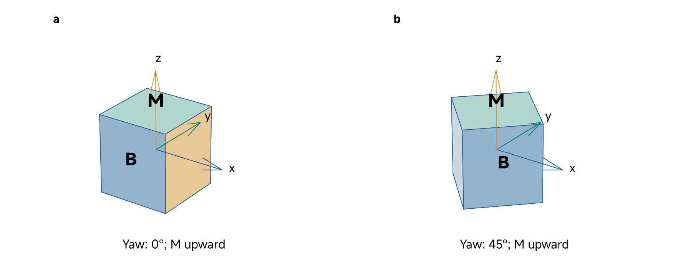
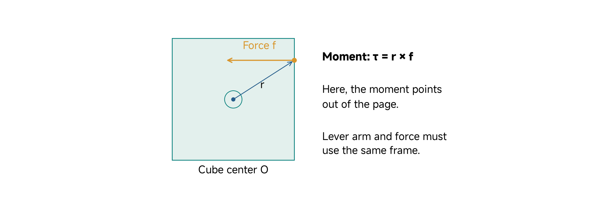
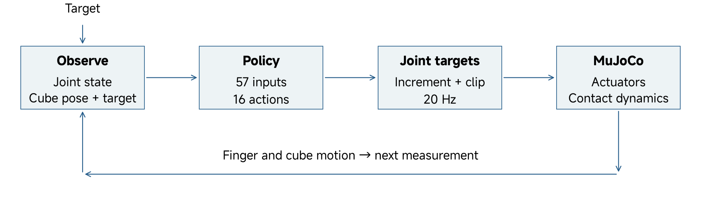
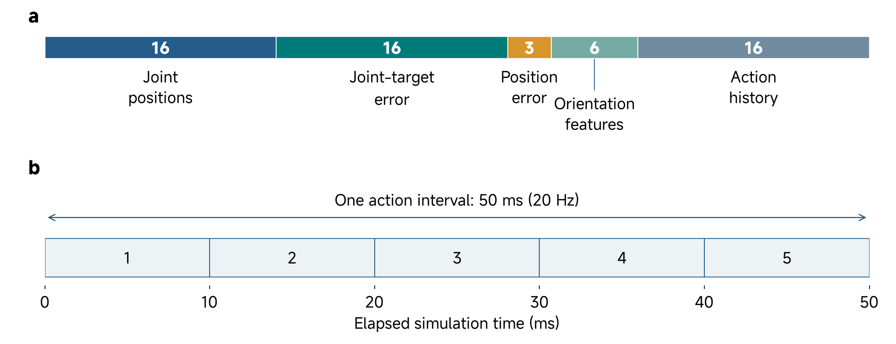
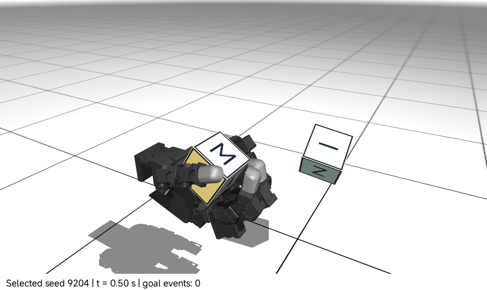
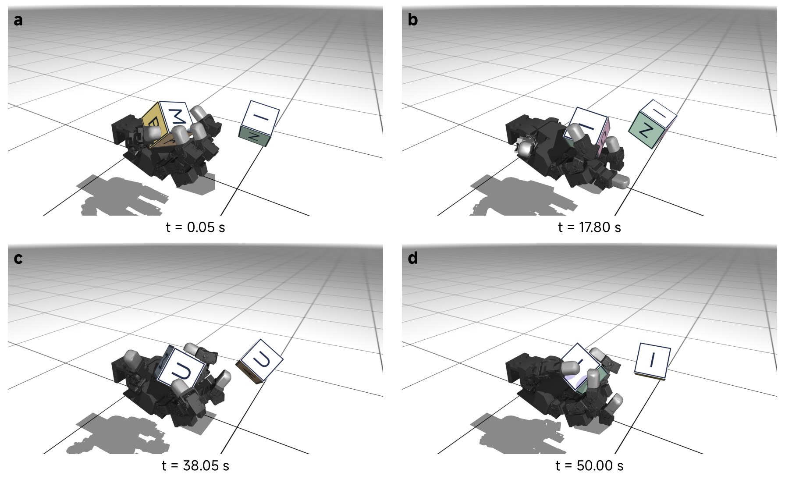
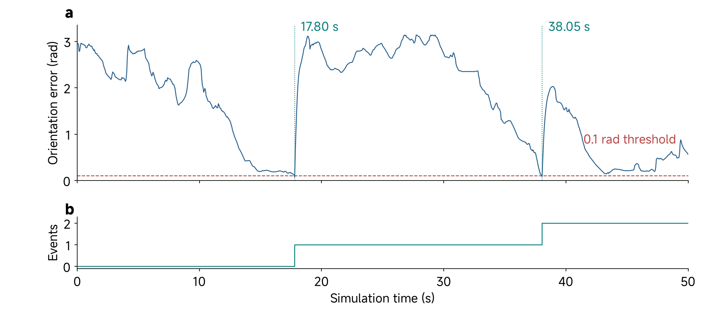
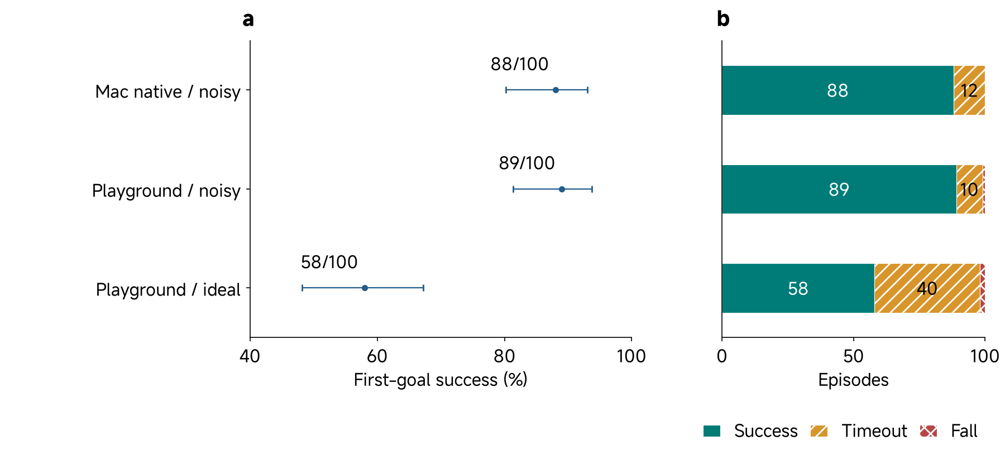
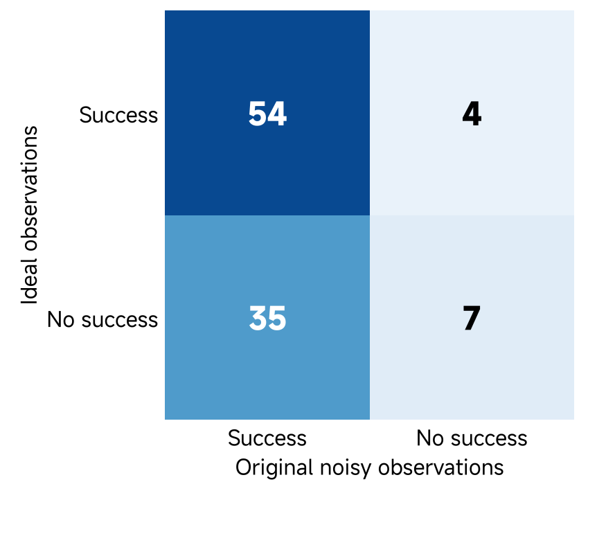

# 06 Learned In-Hand Cube Reorientation

## Central question

How does a learned controller turn a cube through finger contacts while preserving a grasp, and what evidence establishes its performance?

Turning a cube in your hand requires more than moving fingers. Some contacts support the object while others produce rotation; as the cube turns, those roles change. A useful controller must make progress toward its target while keeping the object within the grasp.

We study a simulated LEAP Hand using a supplied pretrained policy. The hand provides a concrete robot-learning platform (Shaw, Agarwal, and Pathak 2023); the policy and reorientation task used here come from MuJoCo Playground (Google DeepMind 2026). The held cube is the physical object in the simulation. A separate goal cube displays the desired orientation. M/B/Z/U/A/I artwork makes the faces easy to follow, but the policy receives joint and cube-pose features—not letters or images. The practical runs the controller in native MuJoCo; it does not train a policy or move hardware.

By the end, you should be able to:

- Distinguish a complete orientation target from a face pointing upward.
- Connect joint targets, actuator response and contact wrench to object motion.
- Explain the policy's 57-input/16-output interface and its two simulation clocks.
- Read a native rollout and distinguish first-goal success, successful steps, stalls and drops.
- Test a display-only cube change while preserving the policy and physical conditions.

[Lecture](#matching-the-upward-letter-is-not-enough) · [Instructor and TA demonstration](#instructor-and-ta-demonstration) · [Student activity](#student-activity)

The figures, animation, equations and saved results provide a complete reading route on this page. The selected recordings, comparison tables and worked calculations support the demonstration and activity without a local simulator.

## Start with the held cube and the goal cube

### Matching the upward letter is not enough

Suppose M faces upward on both cubes. They can still differ by a rotation about the vertical axis: their side faces point in different directions. The task asks for a **full three-dimensional orientation**, not merely an upward face.

*Figure 1. Both illustrated cubes have M upward. A further 45° yaw changes the complete orientation while preserving that upward face. These synthetic poses explain the task and do not prescribe the runner's initial state.*

Identify the held cube and the separate goal in the recording below. The goal is a visual target, not a second object the fingers must grasp. Initial hand configuration, cube pose and target follow the pinned task's reset procedure; there is no required M-up start. The continuous task can update its goal after success, so it is not a single fixed-letter placement exercise.

### Make the claim precise

Classes 02–04 established the difference between a requested quantity, an actuator response and evidence for a simulated model. Class 05 added population variation and the distinction between independent fixtures and connected mechanics. Here we use those ideas in a coupled hand whose contacts change as it manipulates an object. Here the **policy chooses finger commands** for a manipulation task; actuators and contact dynamics determine how those commands affect the cube. The claim we test is whether this policy reaches the task's orientation criterion while retaining the cube under declared simulation conditions.

Keep three questions separate: did the fingers move, did the cube reach its target, and did the controller do so reliably across episodes? A compelling animation can answer part of the second question for one episode. It cannot supply the denominator needed for the third.

**Predict:** If M remains upward but the side faces differ by 45°, would a face-up rule and a full-orientation rule give the same answer?

## Measure full orientation and define success

Let unit quaternions $$Q$$ and $$Q_g$$ represent the cube and target orientations in the same convention. The supplied model records these orientations in the world frame, with quaternion components ordered scalar-first (`wxyz`). A quaternion describes orientation; it is not a vector of four rotation angles. Their shortest angular separation is

$$
e_R=2\arccos\!\left(\min\{1,|Q^\mathsf{T}Q_g|\}\right).
$$

The absolute value accounts for the fact that $$Q$$ and $$-Q$$ represent the same rotation. The clipping protects against small numerical overshoot when normalized quaternions are used. The pinned task computes an equivalent shortest angle from a normalized relative quaternion.

The success criterion is **orientation error below 0.1 rad**, approximately 5.73°. A pure 45° yaw difference is 0.7854 rad and fails; a pure 5° difference is about 0.0873 rad and passes the angular test. A 10° difference is too large. Passing the angle test does not replace the task's retention and termination rules.

| Quantity | Meaning |
|---|---|
| Orientation error | Angular mismatch with the goal, in radians |
| First-goal success | At least the first target is reached before the evaluation ends |
| Successful-step event | A control step satisfies the upstream success criterion |
| Stall | A descriptive behavior requiring a declared diagnostic rule |
| Fall or drop | Loss condition detected by the task's termination rule |
| Timeout | The allowed evaluation horizon or requested runner step limit is reached |

The pinned task detects a fall when its cube-position sensor reports world-frame height below −0.05 m; it also terminates on NaN state values. The first-goal evaluator accepts an angular success only when that step is not a termination. These rules are an operational test, not a direct measurement that every finger remains in contact or that the object can be held indefinitely.

A goal event does not end the supplied continuous demonstration. Its event counter increments on successful control steps; it should not automatically be read as a count of distinct rotations. A stall is not inferred merely because a run timed out.

The task scores uncorrupted pose-sensor information even when the actor's observations are noisy. Keep that evaluation measurement separate from the noisy features presented to the policy. Also keep the task's sensor-phase error separate from a post-step rendering diagnostic: they can refer to different phases of the goal-update sequence.

**Checkpoint:** Why can a screenshot show a large orientation mismatch immediately after a logged success? State which goal and which measurement phase you would inspect.

## Follow actuation through contact to cube motion

### A joint command is not a cube torque

The LEAP Hand has four fingers and sixteen actuated joints. The reference cube is 70 mm wide with a declared mass of 108 g. A network action changes finger joint targets. Actuators respond, the fingers move, and contacts transmit forces to the cube. Contact geometry, gravity, inertia and friction all matter to the resulting motion.

*Figure 2. A synthetic planar contact illustrates displacement, force and moment. The arrows explain geometry; they are not measured fingertip forces. The worked calculation below declares its own cube-centered axes and SI values.*

For a force $$\mathbf f_L$$ applied at displacement $$\mathbf r$$ from origin O, the moment about O is

$$
\mathbf n_O=\mathbf r\times\mathbf f_L.
$$

Use a cube-centered frame with $$\mathbf r=(0,0,0.035)$$ m and $$\mathbf f_L=(1,0,0)$$ N. The moment is (0, 0.035, 0) N m. The 35 mm perpendicular lever arm and 1 N force give a magnitude of **0.035 N m**. Reversing the force reverses the moment. A force through the center, or parallel to the lever arm, produces no moment about that center despite retaining its magnitude.

Following Featherstone's angular-first spatial notation, collect moment and force into a wrench:

$$
\mathcal F_O=\begin{bmatrix}\mathbf n_O\\\mathbf f_L\end{bmatrix}.
$$

The top three components are moments and the lower three are forces. Both use the same stated frame and origin. Moving the reference origin changes the moment part; raw force arrays must not be relabeled as a wrench without checking ordering and frame. See the [MuJoCo dynamics formulation](https://mujoco.readthedocs.io/en/3.6.0/computation/index.html) for how generalized and contact forces enter the simulation. Spatial notation here follows Featherstone (2008).

### The joint target still needs an actuator model

The target-to-effort distinction from Class 02 remains essential. In this hand model, each hinge has one position actuator with unit transmission. Its proportional gain is 3 N m/rad, and the joint's total actuator effort is limited to ±0.2196 N m. With target $$u_j$$ and simulated joint angle $$q_j$$, the corresponding scalar actuator contribution is

$$
\tau_{a,j}=\operatorname{clip}\!\left(3(u_j-q_j),-0.2196,0.2196\right)\quad\mathrm{N\,m}.
$$

For example, a 0.10 rad position error requests 0.30 N m before this limit, so the actuator contribution is 0.2196 N m. That is still not the net joint torque or a fingertip force. The model separately includes joint damping of 0.2 N m s/rad, armature of 0.00149376 kg m², friction-loss magnitude of 0.02 N m, gravity and contact constraints. Joint damping contributes a velocity-dependent resistance; dry-friction constraints also act near rest. They must not be counted again as an invented derivative term inside this position actuator.

These are parameters of the pinned LEAP simulation, not a new calibration of the physical hand or the fixtures in Classes 03–05. The XML's `kp`, `actuatorfrcrange`, `damping`, `armature` and `frictionloss` fields identify where each assumption enters (MuJoCo developers n.d.-a, n.d.-b). Keeping the actor fixed while changing these fields changes the physical feedback process it experiences.

### Rotation and retention must coexist

Contacts push; a separated finger cannot pull the cube back through empty space. Available tangential support depends on normal force and friction. In a simple illustrative Coulomb model, 1 N normal force with coefficient 0.5 permits up to 0.5 N tangential force before idealized sliding. This is not a measured coefficient for the supplied hand or a complete description of MuJoCo's contact settings.

As the cube turns, contact positions and normals change. A push that creates a useful moment may reduce support elsewhere or conflict with another finger. More force is therefore not automatically better rotation. The simulator must solve the interacting system; one isolated force calculation cannot specify a successful finger sequence.

For scale, a uniform cube with mass 0.108 kg and side 0.070 m has principal inertia **8.82 × 10⁻⁵ kg m²**. A free-body calculation using only a 0.035 N m moment would give about 397 rad/s². The grasped cube has several contacts, so this value is not a prediction of its acceleration. It exposes why a local moment example and a complete contact simulation answer different questions.

**Predict:** Name one change that could increase turning moment while also making the cube more likely to slip or lose support.

## Trace observations, policy, targets and simulation

### Preserve the learned interface

*Figure 3. The policy receives a target-relative state, chooses joint-target increments and observes the next simulated state. MuJoCo supplies actuator and contact dynamics. The loop explicitly includes cube pose; it is not a proprioception-only controller.*

The deployed actor receives **57 numbers**:

| Actor block | Count | Meaning |
|---|---:|---|
| Joint positions | 16 | Finger configuration features |
| Joint-position errors | 16 | Noisy measured angle minus motor target, in radians |
| Cube-position error | 3 | Palm position minus noisy cube position, in metres |
| Cube-orientation error features | 6 | Last two rows of the task-defined relative rotation matrix |
| Action history | 16 | Earlier action under the pinned task's ordering |

The 6 orientation values are rotation features, not six independent rotation angles. The task multiplies the cube quaternion by the inverse goal quaternion, converts that product to a 3 × 3 matrix, flattens it by rows and retains entries 3–8. Its `_get_obs` function specifies that order and the error signs. For a measured angle of 0.30 rad and target 0.40 rad, the joint-error feature is −0.10 rad before any observation noise. Reversing the sign to use a familiar target-minus-measurement convention would change a trained input, even though either sign could be used when designing a different controller. Joint and object features use the task's conventions, transforms and optional noise. A vector with the same length but different ordering or units is a different observation contract.

The action has **16 values**, one for each actuated joint. It changes the target vector according to

$$
u_{k+1}=\operatorname{clip}\!\left(u_k+0.5a_k,u_{\min},u_{\max}\right).
$$

Here $$u$$ denotes joint-position targets, $$a$$ is the dimensionless network output, and limits are joint-specific actuator control ranges. The multiplier is 0.5 rad per unit action. This expression uses the pinned task's smoothing factor of one; no additional smoothing is applied. The scale maps actions into target increments. The action does not directly set measured angles or apply an object-space torque.

For a target of 0.20 rad and action 0.40, the requested target becomes 0.40 rad before clipping. An illustrative upper bound of 0.35 rad would clip it to 0.35 rad; this example bound is not a declaration of every hand joint's limit. The actuators still need time to respond, and contact can constrain motion.

The exact history timing also matters. In the pinned task, a returned observation is constructed before the just-executed action is inserted into the stored history. A playback loop that substitutes the newest action for the expected history changes the policy's input. The supplied adapter preserves the task ordering, and its audit reports this distinction rather than assuming all native players are interchangeable.

### Distinguish the policy clock from the physics clock

*Figure 4. The 57-value actor interface and the native task clocks. One 50 ms control interval contains five 10 ms physics steps. These are simulation rates, not measured wall-clock throughput.*

The policy updates at **20 Hz**. Native physics advances at **100 Hz**, with five physics steps per action. Thus 200 actions span 10 simulated seconds, while 1000 actions span 50 simulated seconds if the episode does not terminate early. Initialization, inference and rendering add wall-clock cost; a run's simulated duration is not its execution-time guarantee.

The model's coordinate count is also not its observation count. Sixteen hinge coordinates plus a free cube's position and quaternion give 23 position coordinates. The generalized velocity has 22 components because cube angular velocity uses three components while its unit quaternion uses four constrained coordinates. The actor's 57 values instead combine state-derived features and history.

**Checkpoint:** What changes if a programmer treats the action as an absolute joint angle, or supplies a newly computed action in a history slot expected to contain an older one?

## Separate learning from native playback

During reinforcement learning, a policy samples actions, receives reward and has its weights updated. Orientation progress, cube retention and other costs shape that training signal. A critic may support training by estimating return. The exported actor used here performs inference from fixed weights; loading the ONNX file does not run training or improve those weights.

A reward and a success rule serve different purposes. A policy may earn useful reward while still missing the first target. Raising a reward coefficient in a playback file does not improve a fixed actor. Relaxing the 0.1 rad threshold changes the evaluation task rather than improving performance on the same task.

**MuJoCo** computes physics. **MuJoCo Playground** supplies task definitions and accelerated training/evaluation workflows around MuJoCo. Our package retains a [pinned Playground task and upstream policy](https://github.com/google-deepmind/mujoco_playground/tree/ef4fefc13033c0468af4ef651847f5348af0c7d7), with a course adapter for native CPU physics and JAX task arithmetic. It is a playback implementation of that task, not a new training result or a hardware controller.

Domain randomization can vary selected properties during training to encourage robustness. It does not establish that this actor will handle every new object, observation stream or contact setting. The exact training configuration of this particular exported policy is not fully reconstructed here. Preserve the supplied interface, preprocessing and tested evaluation conditions instead of adding a second external normalization step.

### Watch the selected changing-goal example

The recording uses **seed 9204 with ideal actor observations**. Follow the held cube and separate target. Look at side faces as well as the top face, and identify fingers that appear to retain support while another contact changes. The animation illustrates one selected episode; it does not estimate reliability.

*Figure 5. Four native rendered states with a consistent camera. Interior samples were selected at successful control steps. Frames show rendering-phase poses, while the success test uses task sensor-phase information.*

*Figure 6. The saved sensor-phase error trace has events at steps 356 and 761, corresponding to 17.80 s and 38.05 s. A target update can increase subsequent error. Both events belong to one continuous episode.*

The [selected trace](../resources/class06/saved-runs/selected-demo/trace.jsonl) and [run summary](../resources/class06/saved-runs/selected-demo/summary.json) retain the numerical record behind Figures 5 and 6. Use `orientation_error_rad` for the task error. The runner also saves `render_pose_error_rad` as a separate diagnostic. `goal_quat_wxyz` identifies the goal used for the action and `next_goal_quat_wxyz` the following target. Do not mix a later target with an earlier success measurement.

The event counter measures successful control steps, not necessarily distinct target commands. A repeated-target reliability study would need a declared goal-identity and acceptance rule. Two events in one chosen episode are not two independent successful trials.

## Compare cubes under matched conditions

### Change appearance while preserving the physical model

The reference-to-lettered intervention replaces only the noncontact, zero-density display geometry and artwork on the held and goal cubes. Mass, inertia, collision geometry, friction, actuators, sensors and solver settings are checked for equality. The network observes pose features rather than pixels, so the artwork should not alter its actions when the task, seed and settings match.

| Change | What would need to be checked? |
|---|---|
| Display-only M/B/Z/U/A/I artwork | Model equality and matched action/state traces |
| A manufactured replacement cube | Dimensions, mass, inertia, surface/contact and physical correspondence |
| Camera-derived cube pose | Calibration, frame, latency, noise, dropout and actor-feature construction |

Equality in the first comparison does not qualify the other two. Labels applied to a physical cube can also change contact; the simulation's display-only guarantee is not a guarantee about stickers on hardware.

For the student comparison, run reference and lettered variants for **200 control steps**, with seed 9204, ideal observations and the same supplied policy. The [retained comparison](../resources/class06/evidence/practice-comparison.json) reports that, under the tested runtime, all saved step fields match and no engine warnings occur. The [model comparison](../resources/class06/evidence/physics-contract.json) separately checks the physical fields and a short state/observation rollout. Both runs end at the requested 10 simulated seconds, before the selected episode's first event. Zero events are therefore compatible with a successful controlled comparison.

### Evaluate performance with a denominator

The retained first-goal evaluations use seeds **20000–20099**, a **50 s limit**, the fixed angular threshold and all 100 outcomes per condition. These records are supplied evidence, separately from the selected continuous recording. The [native/noisy receipt](../resources/class06/code/results/native-task-10ms-noisy-heldout/summary.json), [GPU/noisy receipt](../resources/class06/code/results/playground-noise-1/summary.json) and [GPU/ideal receipt](../resources/class06/code/results/playground-noise-0/summary.json) record the conditions and outcome totals; their sibling episode lists preserve all seeds. All three identify the same supplied ONNX actor by its SHA-256 digest. The source revision, actor, adapter, observation setting, timestep and scoring rule together identify a result—an engine name alone does not.

| Retained condition | First-goal successes | Falls | Timeouts |
|---|---:|---:|---:|
| Native Mac, original noise | 88 | 0 | 12 |
| Playground GPU, original noise | 89 | 1 | 10 |
| Playground GPU, ideal observations | 58 | 2 | 40 |

The ideal-observation condition's counts should be read with its own receipt; they do not change the selected ideal-observation demonstration's identity.

*Figure 7. First-goal rates and 95% Wilson intervals, with all outcomes retained. Native playback used MuJoCo 3.6; the GPU records used 3.14. The comparison does not isolate a backend-only effect. These evaluations were retained and audited, not newly rerun for publication.*

The native and original-noise GPU results meet the course's existing **80% observed teaching baseline**. This is enough to teach a working but imperfect example. It is not a promise that every seed succeeds, a lower confidence bound of 80%, or hardware qualification. A one-percentage-point difference between these records does not establish backend superiority.

### Explain an unexpected observation cautiously

Removing actor-observation noise did not improve the retained GPU result. The same seeds can be paired to inspect that observation:

*Figure 8. Among the same 100 GPU seeds, 54 succeeded with both conditions, 35 only with noise, four only without noise and seven with neither. The matrix establishes the paired outcomes, not their mechanism.*

A possible explanation concerns how this policy responds to its input distribution. That hypothesis needs further investigation; this table alone does not establish the policy's training exposure or the cause of failures. Keep unsuccessful episodes in the denominator and avoid selecting only successful demonstrations to characterize performance.

Consider a specific retained failure: **native/noisy seed 20001** ran for 1000 steps, reported no fall and did not reach the first target. Its minimum recorded error was 0.1925 rad (about 11.03°), and its final error was 0.2618 rad. Those values explain its timeout under the unchanged 0.1 rad criterion. They do not establish that the cube wedged, identify a defective actuator or reveal the contact sequence; those claims need a trajectory or additional measurements. This unsuccessful episode remains one of the twelve native timeouts.

In the first-goal evaluator, a timeout means the first target was not reached within the limit. It does not by itself identify wedging, slip or a poor target update. A useful next experiment changes one factor—such as observation delay—while preserving task success, seed protocol, physics and scoring. Tune on development seeds and evaluate the selected change on a fresh declared set.

**Checkpoint:** What can the artwork comparison establish that the noisy-versus-ideal success table cannot? What additional evidence would support a physical replacement cube?

## Instructor and TA demonstration

### Establish the task and interface

Use Figure 1 to test whether matching the top face is enough, then watch the prepared animation. Identify the held cube, target cube and supporting contacts. Work through the 1 N force at a 35 mm perpendicular lever arm. Connect the result to Figure 3: policy action, bounded joint target, actuator response, finger contact, cube motion and next observation.

Use the actor table and Figure 4 to count 57 inputs, sixteen outputs and five physics steps per action. Explain why this is a cube-pose-observing policy and why loading ONNX is inference.

### Inspect the prepared native run

Inspect the selected seed 9204 recording and its trace. Identify the policy, reference/noise settings and event rule before interpreting the outcome. Use the recorded successful-step times below to distinguish task events from later goal updates.

| Retained selected-event check | Value |
|---|---:|
| First recorded successful step | 356 |
| First event time (s) | 17.80 |
| Second recorded successful step | 761 |
| Second event time (s) | 38.05 |
| Episodes represented | 1 |

Read the evaluated goal before its next update. An increased rendered mismatch after a goal change does not retrospectively invalidate an earlier event. Conversely, a visually close pose is not a substitute for the task's recorded error and retention checks.

### Demonstrate the controlled intervention

Predict what changing only artwork should do, then compare the reference and lettered 200-step runs. Show the model equality check and paired trace result. Contrast this single-seed comparison with the 100-episode first-goal table and the seed 20001 timeout. Distinguish what the failed-outcome record proves from what would need a failure trajectory. Finish by naming one additional measurement needed for a manufactured cube or a camera-based pose input.

## Student activity

### Predict, compare and explain

Compare the retained reference and lettered 200-step traces under seed 9204 with observation noise disabled. Only the displayed artwork changes; the policy and physics stay fixed.

Predict the result before revealing the comparison. Inspect the variant, seed, policy identity, noise setting and step count. The expected result is **200 rows per variant, identical saved step fields and zero engine warnings**. The comparison tests a display intervention; it does not require a goal event in this short horizon.

Use the supplied matched-trace result, the model/intervention description and the event-time table above. Label the result as retained evidence and explain what a new experiment would need to preserve. Interpreting that evidence is distinct from executing a new experiment.

Submit a compact record:

| Field | Required entry |
|---|---|
| Task | Full-orientation criterion and grasp-retention requirement |
| Intervention | Exactly what changed and what stayed fixed |
| Evidence | Seed, noise, policy, row count and matched-trace result |
| Interpretation | Why zero events can be expected in this run |
| Boundary | Why display equivalence does not qualify a physical cube or camera tracker |

Also calculate the requested target for 0.20 rad plus action 0.40, and the contact moment for the 1 N/35 mm example. In one final sentence, distinguish an actuator model from this task policy.

## From simulated pose to visual measurement

The reference policy already uses cube-pose information. Class 07 examines what is required to replace the relevant observation with a visual estimate while preserving its frame, timestamp and meaning; changing the cube artwork alone does not supply that measurement pipeline.

## References

Featherstone, Roy. 2008. *Rigid Body Dynamics Algorithms*. Springer. [Spatial-vector resources](https://royfeatherstone.org/spatial/v2/index.html).

Google DeepMind. 2026. “LEAP Cube Reorientation.” *MuJoCo Playground*, source snapshot at commit `ef4fefc13033c0468af4ef651847f5348af0c7d7`. [Task definition](https://github.com/google-deepmind/mujoco_playground/blob/ef4fefc13033c0468af4ef651847f5348af0c7d7/mujoco_playground/_src/manipulation/leap_hand/reorient.py), [native player](https://github.com/google-deepmind/mujoco_playground/blob/ef4fefc13033c0468af4ef651847f5348af0c7d7/mujoco_playground/experimental/sim2sim/play_leap_reorient.py), and [supplied actor](https://github.com/google-deepmind/mujoco_playground/blob/ef4fefc13033c0468af4ef651847f5348af0c7d7/mujoco_playground/experimental/sim2sim/onnx/leap_reorient_policy.onnx). The course native-task adapter preserves the pinned task's feature/history ordering; it is distinct from the supplied native player's callback.

MuJoCo developers. n.d.-a. “Computation.” *MuJoCo Documentation*, version 3.6.0. Accessed October 17, 2026. [Actuation and constrained dynamics](https://mujoco.readthedocs.io/en/3.6.0/computation/index.html).

MuJoCo developers. n.d.-b. “XML Reference.” *MuJoCo Documentation*, version 3.6.0. Accessed October 17, 2026. [Position actuator](https://mujoco.readthedocs.io/en/3.6.0/XMLreference.html#actuator-position).

Shaw, Kenneth, Ananye Agarwal, and Deepak Pathak. 2023. “LEAP Hand: Low-Cost, Efficient, and Anthropomorphic Hand for Robot Learning.” arXiv:2309.06440. [Paper](https://arxiv.org/abs/2309.06440). This paper introduces the hand; the specific supplied actor and task above are attributed separately.
