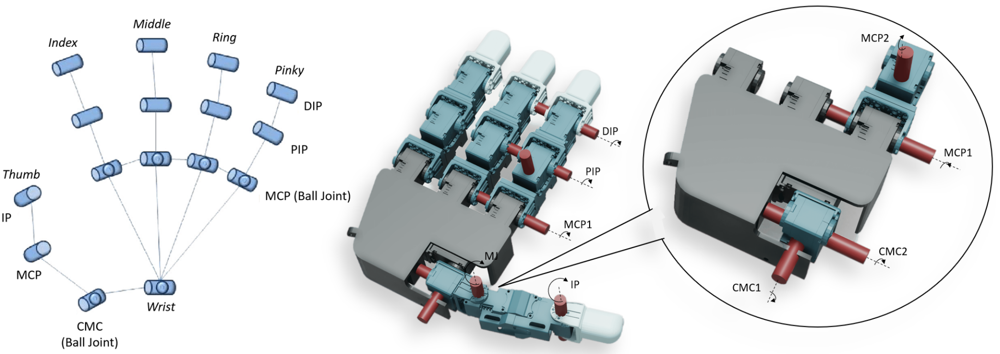
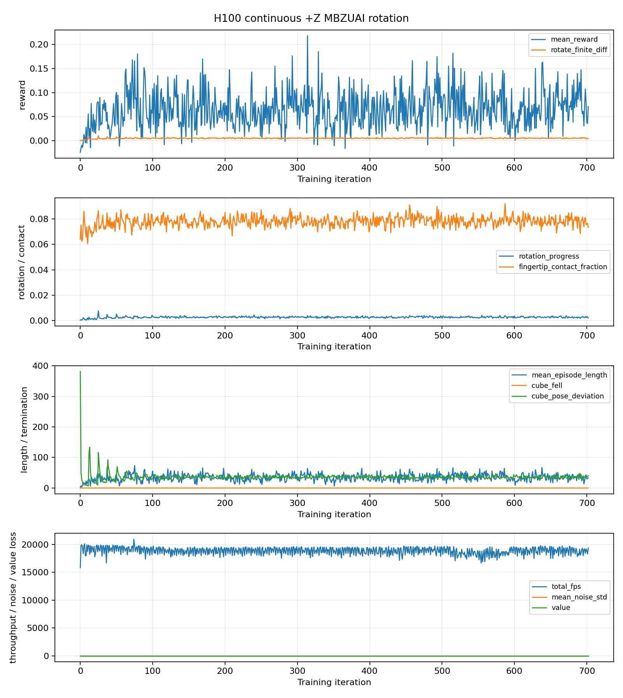
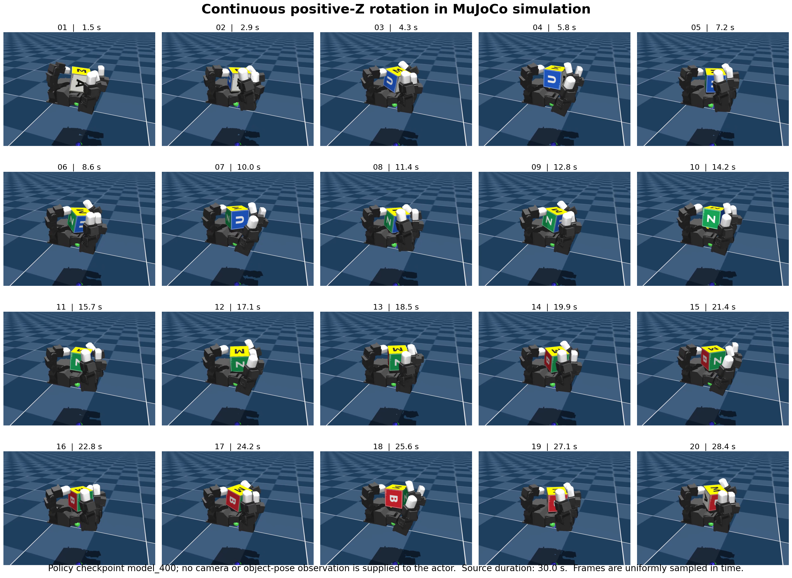
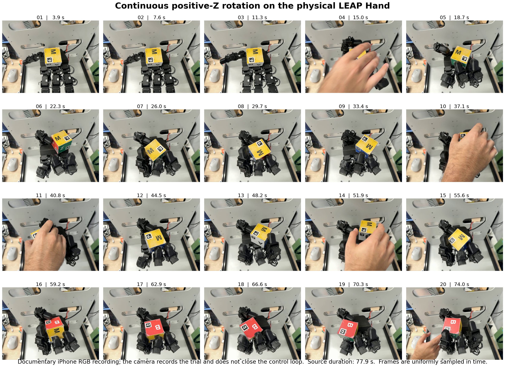
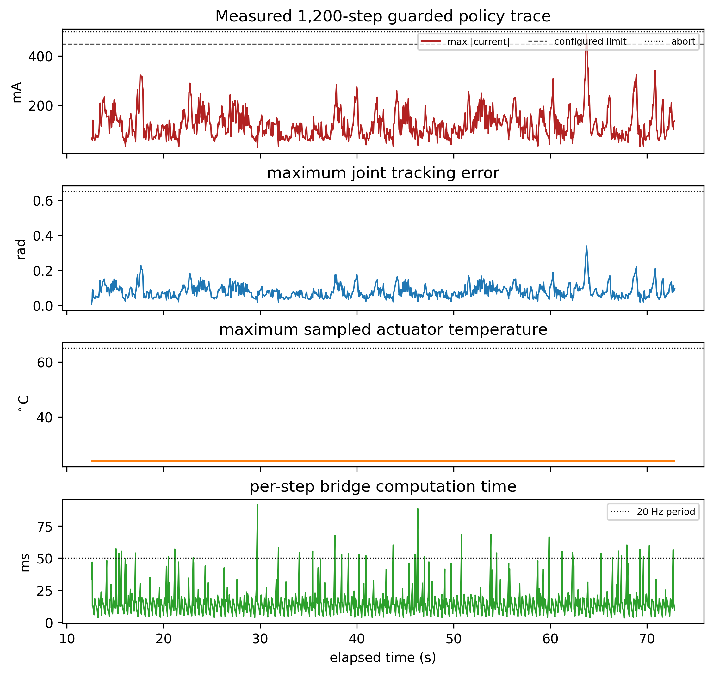
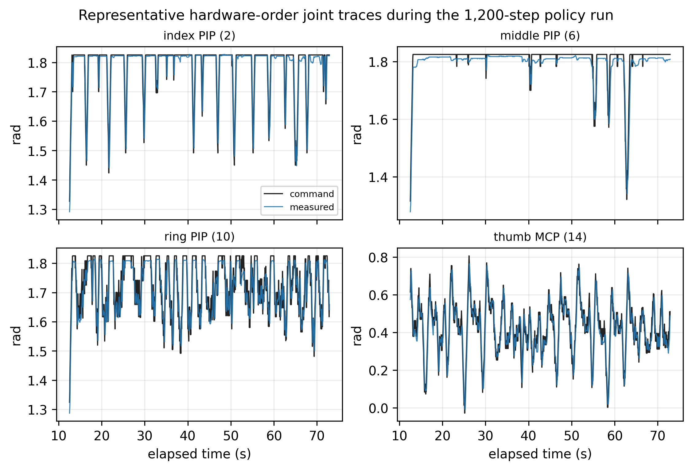
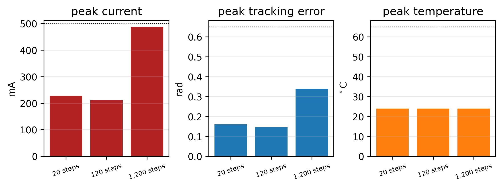

# 06 Learned In-Hand Cube Reorientation

## Central question

> How does a learned controller turn a cube through finger contacts while preserving a grasp, and what evidence establishes its performance?

A right LEAP Hand holds a 58 mm, 85 g MBZUAI cube. Turning the object requires some digits to maintain support while others change their contact positions and directions. A command that moves the fingers can therefore succeed at joint motion while failing to retain or rotate the cube.

This class follows the course's custom **proprioceptive continuous-positive-Z rotation case**. Its actor receives joint-position and previous-command history and produces sixteen joint-position targets. It receives no RGB images, cube pose, requested object orientation or visual-error signal. The iPhone records the trial for observation; it does not close this policy's feedback loop. The source identifies an early, nonconverged `model_400.pt` artifact, so the case teaches the control pathway, learning diagnostics and limits of a physical claim rather than a completed reliable-rotation result.

By the end of this class, you should be able to:

- Explain how LEAP joint anatomy permits changing fingertip contacts while preserving support.
- Map named joint commands and measurements between the reported model and hardware orders.
- Connect joint targets, actuator response and an angular-first contact wrench to cube motion.
- Explain the declared 320-input/16-output history-based policy and distinguish learning from execution.
- Interpret simulation frames, assisted physical frames and motor/training diagnostics as different evidence.
- Justify a bounded trial claim and identify the object measurement needed to test rotation.

[Lecture](#start-with-the-hand-cube-and-task) · [Instructor and TA demonstration](#instructor-and-ta-demonstration) · [Student activity](#student-activity)

The supplied source figures, declared interface, worked calculations and recorded diagnostic patterns support the demonstration and activity. The [source support package](https://github.com/asEmbodiedAISyst/2026Autumn/tree/main/course-resources/Class%2006%20%E2%80%94%20Learned%20in-hand%20cube%20reorientation/README.md) provides the available models, records and original simulation/physical videos, together with explicit missing-file notes. The active deployment bundle containing the checkpoint, bridge, training configuration and raw NPZ logs is referenced outside the source snapshot. The page therefore interprets the author's recorded evidence; it does not claim a fresh policy execution or require powered hardware.

## Start with the hand, cube and task

The physical question is continuous rotation about the declared positive-Z direction while retaining the cube. There is no requested final orientation for the actor to match. A useful evaluation would measure rotation and retention over a declared interval, including drops, resets and manual assistance. Visible movement alone does not supply those measurements or a trial-success denominator.

| Component | Source-declared contract |
|---|---|
| Hand | Right LEAP Hand; three fingers and an opposing thumb; sixteen independently commanded joints |
| Actuators | Sixteen XC330 position-controlled DYNAMIXEL actuators |
| Object | MBZUAI cube, 58 mm per side, nominal mass 85 g |
| Policy rate | Nominal 20 Hz, one target update per 50 ms |
| Simulation timing | 5 ms MuJoCo step with decimation ten |
| Observation | Ten samples containing sixteen joint positions and sixteen previous commands: 320 scalars |
| Action | Sixteen desired joint positions, subsequently clipped and increment-limited by the bridge |
| Camera | Documentary recording, excluded from the actor observations |

Classes 02–04 distinguished a requested quantity, measured response and model prediction. Class 05 then separated shared infrastructure from connected mechanics. The hand now adds contact: actuator response changes a fingertip's interaction with the cube, which changes the load seen by other joints. An independent-fixture actuator fit is useful evidence about one part of this loop, but it cannot identify the complete grasp.

Keep three questions visible throughout the case: did the actuators follow their targets, did the cube undergo the intended motion, and did the learned policy produce that motion without assistance? The records needed for those questions overlap, but they are not interchangeable.

## Read the LEAP anatomy before the action vector

### Connect the knuckle axes to contact motion

Human joint names help explain where motion occurs, but a robot's identifiers define its actual software contract. MCP means metacarpophalangeal, the main finger knuckle. PIP and DIP are the proximal and distal interphalangeal hinges. CMC identifies the thumb's carpometacarpal base, and IP its distal interphalangeal hinge.

*Figure 1. Human joint terminology and the LEAP Hand's powered axes, reproduced from Shaw, Agarwal, and Pathak (2023), [Figure 4](https://arxiv.org/html/2309.06440#S3.F4). The paper credits its human-hand panel to its reference 60. Original source labels are retained. The robot has three fingers and a thumb; the human schematic has five digits. The course model's names and ordering below are a separate contract.*

LEAP approximates the useful knuckle motions with two powered axes. The second MCP-related axis is arranged relative to the flexing finger, preserving a useful motion direction when the finger is extended or flexed. A digit can then change its contact direction while the others maintain support. Its visible effect depends on pose; describing it only as opening the finger sideways misses this role in manipulation.

This is a joint-actuated mechanism. Gear response, joint compliance, fingertip deformation and calibration can affect its behavior. Tendon routing and tendon elasticity are not appropriate explanations for the shown mechanism.

### Follow each model chain from palm to tip

The custom right-hand model uses these exact joint identifiers. Their order is not inferred from the labels in Figure 1.

| Digit | Model chain from palm toward tip | Physical reading |
|---|---|---|
| Index | `if_mcp`, `if_rot`, `if_pip`, `if_dip` | Knuckle flexion, second MCP-related axis, middle hinge, distal hinge |
| Middle | `mf_mcp`, `mf_rot`, `mf_pip`, `mf_dip` | Same four-stage pattern |
| Ring | `rf_mcp`, `rf_rot`, `rf_pip`, `rf_dip` | Same four-stage pattern |
| Thumb | `th_cmc`, `th_axl`, `th_mcp`, `th_ipl` | Base placement, axial motion, knuckle flexion, distal hinge |

The prefixes `if_`, `mf_`, `rf_` and `th_` identify index, middle, ring and thumb. The suffix `rot` is the second MCP-related axis of a non-thumb digit; `axl` is the thumb axial axis. The spelling `th_ipl` is the model's exact identifier, including its final `l`. A familiar anatomical name does not guarantee an identical frame, axis sign or array position in another model.

A coordinated `*_mcp` and `*_rot` change can move a fingertip around the cube; `*_pip` and `*_dip` changes mainly curl or uncurl that digit. Those names help a person interpret the learned output, although the actor itself operates on numbers.

## Preserve named vectors across the hardware boundary

### Convert commands outward and measurements inward

The source declares two sixteen-joint orders. The custom model/policy order begins each non-thumb digit with MCP flexion followed by the second axis. The reported hardware order swaps those first two entries. The thumb order is unchanged.

| Zero-based positions | Canonical model order | Reported hardware order |
|---|---|---|
| 0–3 | `if_mcp`, `if_rot`, `if_pip`, `if_dip` | `if_rot`, `if_mcp`, `if_pip`, `if_dip` |
| 4–7 | `mf_mcp`, `mf_rot`, `mf_pip`, `mf_dip` | `mf_rot`, `mf_mcp`, `mf_pip`, `mf_dip` |
| 8–11 | `rf_mcp`, `rf_rot`, `rf_pip`, `rf_dip` | `rf_rot`, `rf_mcp`, `rf_pip`, `rf_dip` |
| 12–15 | `th_cmc`, `th_axl`, `th_mcp`, `th_ipl` | `th_cmc`, `th_axl`, `th_mcp`, `th_ipl` |

Let $$P$$ be the 16-by-16 permutation selecting canonical entries in the zero-based order `[1,0,2,3,5,4,6,7,9,8,10,11,12,13,14,15]`. For target vector $$\mathbf u$$ and measured position vector $$\mathbf q$$, both in radians,

$$
\begin{aligned}
\mathbf u^{\mathrm{hw}}&=P\mathbf u^{\mathrm{can}},\\
\mathbf q^{\mathrm{can}}&=P^{\mathsf T}\mathbf q^{\mathrm{hw}},\\
P^{\mathsf T}P&=I_{16}.
\end{aligned}
$$

For example, canonical index targets `[0.30, −0.10, 0.50, 0.20]` rad become hardware targets `[−0.10, 0.30, 0.50, 0.20]` rad. The inverse returns the original named vector. Sending the numbers without the swap would request −0.10 rad from the MCP-flexion joint instead of 0.30 rad. The array would still have sixteen entries and valid units.

Both paths matter. Reordering commands while leaving measurements in hardware order makes the actor read the wrong joint state. The active bridge is external to the source snapshot, so this reported permutation still needs verification against the actual implementation. It does not establish encoder offsets, axis signs, motor IDs or handedness.

### Keep limits attached to the named joints

The report declares the following deployment ranges. They are controller limits, rather than a complete measurement of the hand's mechanically reachable configurations.

| Joint group | Reported range, rad |
|---|---|
| `if/mf/rf_mcp`, `if/mf/rf_pip`, `if/mf/rf_dip` | −0.2618 to 1.9199 |
| `if/mf/rf_rot` | −0.5236 to 0.5236 |
| `th_cmc`, `th_axl` | 0 to 1.571 |
| `th_mcp`, `th_ipl` | −0.3491 to 1.7453 |

The source describes applying limits after conversion to hardware order, with an additional deployment margin. A limit array must therefore follow the same names and ordering as its command array. These declared limits do not replace checking the bridge, model revision, sign convention and measured starting pose.

## Follow joint targets through contact to cube motion

### A position target is not a cube torque

The actor requests joint positions. Embedded actuator response and finger kinematics determine how the fingertips move. Contacts then transmit forces to the cube. A separated finger cannot pull the object back through empty space, and a tangential force is limited by the contact's frictional support. Turning and retaining the cube must be achieved together.

Let $$\mathbf c_i$$ be contact position, $$\mathbf p_C$$ the cube center, and $$\mathbf f_i$$ the force exerted **on the cube** at contact i. Express these quantities in the same world-aligned axes. The total contact moment about C is

$$
\mathbf n_C=\sum_i(\mathbf c_i-\mathbf p_C)\times\mathbf f_i.
$$

Following Featherstone's angular-first convention, collect moment and force into a spatial wrench:

$$
\mathcal F_C^{\mathrm{contact}}=
\begin{bmatrix}
\mathbf n_C\\[3pt]
\displaystyle\sum_i\mathbf f_i
\end{bmatrix}.
$$

The upper three components have units N m and the lower three N. The moment uses the declared center C and the same axes as the force. Gravity is a separate external force, acting through the center of mass in this rigid-body description. It must not be added again as part of the contact wrench.

For an illustrative 1 N force along +X applied 29 mm above the cube center, use $$\mathbf r=(0,0,0.029)$$ m and $$\mathbf f=(1,0,0)$$ N. Their cross product is (0, 0.029, 0) N m: a positive-Y moment of 0.029 N m. Reversing the force reverses the moment; directing it through the center produces zero moment about that center. This is a geometric calculation, not a measured fingertip force.

A uniform cube with nominal mass 0.085 kg and side 0.058 m would have principal inertia $$I=ms^2/6=4.7657\times10^{-5}\ \mathrm{kg\,m^2}$$. That assumption gives scale to the mechanics; it is not an as-built inertia measurement. The actual grasp has several changing contacts, so one force and one lever arm cannot predict the cube's trajectory.

### Connect the hand balance to actuator identification

For joint coordinates $$q$$ in radians, the hand's generalized balance can be organized as

$$
H(q)\ddot q+C(q,\dot q)+\tau_f=\tau_a+\tau_{\mathrm{ext}}.
$$

Here $$H$$ is generalized inertia, $$C=c+g$$ contains rigid-body velocity bias and gravity, $$\tau_f$$ is passive resistance, $$\tau_a$$ is actuator effort, and $$\tau_{\mathrm{ext}}$$ contains external generalized effort, including contact loads. Finger forces on the cube and cube forces on the fingers form an opposite action–reaction pair. A joint encoder or motor-current channel alone does not measure that complete contact interaction.

Class 05's sixteen-actuator record shares communication and supply infrastructure while keeping fixtures mechanically independent. Its response models can reduce an actuator-model discrepancy. They do not identify fingertip deformation, cube friction, inter-finger collision, grasp reset or contact transients.

| Record | Declared quantities | Interpretation |
|---|---|---|
| H1 replay-controller map | Proportional coefficient 1.579836 N m/rad; velocity coefficient 0.202115 N m s/rad | Fixed engineering-mapped controller coefficients |
| Independent-fixture identification | Effective armature, damping and friction | Fitted mechanical-response terms for that experiment boundary |
| Archived custom hand XML | Position `kp=3.0`, actuator `kv=0.01`, separate joint `damping=0.03` | Source model defaults; active overrides remain unverified |

The H1 coefficients are not fitted mechanical parameters. Their numerical relationship to firmware settings follows the declared engineering map; it does not establish equivalence to the active hand controller. The source's gain description and archived XML are different records. The actual training and deployment model, firmware settings, passive terms, effort limits and runtime overrides must be reconciled before claiming the same actuator model was used throughout.

**Checkpoint:** How can an actuator model reproduce joint motion well while the cube still slips? Identify a quantity the independent-fixture experiment does not observe.

## Read the learned policy and its training design

### History provides indirect feedback

The reported actor receives ten samples of measured positions and preceding position commands. A clear teaching notation pairs each state with its preceding command in canonical order:

$$
\begin{aligned}
\mathbf h_t&=\begin{bmatrix}\mathbf q_t^{\mathrm{can}}\\\mathbf u_{t-1}^{\mathrm{can}}\end{bmatrix}\in\mathbb R^{32},\\
\mathbf o_t&=\begin{bmatrix}\mathbf h_{t-9}\\\vdots\\\mathbf h_t\end{bmatrix}\in\mathbb R^{320}.
\end{aligned}
$$

This makes the one-step command lag explicit for the explanation. The source equation leaves part of the indexing ambiguous; the absent history implementation must confirm actual stacking, lag, normalization and reset initialization before checkpoint compatibility is asserted. Dimensional agreement alone is insufficient.

A history can reveal response lag or a change in joint loading. It cannot uniquely recover cube pose, contact force or slip. The actor outputs sixteen desired joint positions; the reported bridge separately clips joint ranges and limits each target increment to 0.05 rad. A desired target remains distinct from measured joint position, applied effort and actual object motion.

The nominal 20 Hz actor interval contains ten 5 ms simulation steps. Those are declared simulation clocks. Achieved physical update intervals need timestamps; an intended 50 ms period is not proof of deterministic execution.

### Distinguish learning from deployment

Reinforcement learning changes policy weights using experience and a reward. An actor selects joint commands; a critic supports learning by estimating return. Deployment evaluates a fixed actor. Loading a checkpoint or sending bounded commands does not continue the optimization or show that the intended rotation gait was learned.

The course report gives the following learning design:

| Reported item | Value |
|---|---|
| Actor and critic | ELU multilayer perceptrons with hidden sizes 512, 512 and 256 |
| Algorithm | PPO |
| Initial actor-noise standard deviation | 0.7 |
| Discount factor | 0.99 |
| Trace-decay factor | 0.95 |
| Intended training budget | 3,000 iterations |
| Parallel simulation environments | 8,190 |
| Checkpoint identified in the report | Early, nonconverged `model_400.pt` |

These are the source's reported design values, not an independently reconstructed checkpoint configuration. The active training YAML, weights and checkpoint-selection record are needed to close that association.

Learning is useful because it can search across many contact, slip and recovery transitions instead of prescribing every finger change by hand. Training with varied friction, object pose, mass, actuator response and disturbances can seek a strategy that tolerates a range of modeled conditions. That explains the purpose of domain randomization; it does not establish which ranges this particular checkpoint used or prove robustness on the physical hand.

*Figure 2. Source PPO diagnostic figure for job 16352. Reward, rotation progress, contact fraction, episode/termination metrics and training throughput describe different aspects of learning. The report identifies an early, nonconverged case. This is a diagnostic record, not a physical rotation-success curve.*

Low rotation progress, low fingertip-contact fraction and short episodes motivate examining the task and contact strategy rather than treating a running process as a learned capability. Reward alone does not establish retention or sustained rotation. The plot extends to roughly 700 iterations, while the report names `model_400.pt`; the checkpoint name does not establish where the full job stopped or which plotted interval selected that artifact. Raw metrics, metric definitions and selection records are needed for a more specific diagnosis.

## Inspect the simulation preview before the physical record

Identify which digits appear to support the cube and which reposition. Then ask what the images can show without an independent numerical object-motion record.

*Figure 3. Twenty source frames sampled from the reported 30 s MuJoCo preview associated with `model_400`. They portray the simulated contact sequence under the source model. They are policy output for inspection; images are not actor inputs and the filmstrip is not a fresh rollout or a repeated-trial success estimate.*

A coherent-looking sequence is useful for locating contacts and formulating a question. It cannot establish physical transfer. The hand scene, actor, observation history, initial state and object properties all belong to the rollout identity. The source preview is retained as its own evidence rather than replaced with another policy's successful animation.

## Read the physical trial and motor diagnostics

### Keep operator intervention visible

*Figure 4. Source 20-frame iPhone filmstrip of the physical hand and cube. The reported recording lasts 77.9 s; labels indicate approximate video time. Manual hands are visible at several sampled times, including 15.0, 37.1, 40.8, 51.9 and 74.0 s. This is an assisted trial record, not an autonomous continuous-rotation success demonstration.*

The source title names the intended positive-Z task. The pixels also show manual touches or cube replacement, which must remain part of the interpretation. Video time, bridge elapsed time, startup and policy-active intervals need a common event/time record before they can be aligned. These camera images are documentary observations; they provide neither calibrated cube yaw nor a visual-error signal to the actor.

### Read the quantities actually plotted

*Figure 5. Source four-panel figure for the reported 1,200-step deployment. It plots maximum absolute motor current, maximum joint tracking error, maximum sampled actuator temperature and per-step bridge computation time. Its source labels describe a nominal 60 s policy run. These are published motor/timing diagnostics; their raw NPZ log is external to the supplied snapshot.*

Current is an electrical-load diagnostic, not calibrated output torque, contact force or cube wrench. Tracking error compares a target with reported joint position. Both can be bounded while the object moves incorrectly. The figure does not plot velocity or command increments, so it cannot establish their guard behavior.

Older illustrative materials also remain in the source collection. Telemetry constructed from trigonometric functions and random values, or cube yaw constructed from an assumed rate, is not physical measurement. Those legacy examples are excluded from the interpretation of the reported deployment figures here.

The source plotting script carries the latest finite temperature sample forward. A flat trace therefore needs sampling-age and missing-row checks before supporting a thermal-stability conclusion. Some displayed computation times exceed the nominal 50 ms period. Raw timestamps are needed to count overruns, determine achieved command intervals and relate the plotted time axis to the video and startup interval.

*Figure 6. Source joint-tracking figure for four representative hardware-order joints during the reported 1,200-step run. Commands and reported positions are in radians. Agreement concerns the actuator/bridge response; it does not measure the cube's orientation, retention or autonomy.*

Check names and ordering before interpreting a lag or a tracking difference. A correct target for the wrong named joint would undermine both control and diagnosis. The raw `q_hw`, `command_hw` and timestamps would permit a numerical tracking check; the figure alone does not reproduce that analysis.

*Figure 7. Source summary of peak current, tracking error and temperature for the reported 20-step, 120-step and 1,200-step stages. The bars summarize motor-side quantities, not autonomous task-success rates or a classification of drops, emergency stops and guard aborts. The underlying three NPZ records are external to the source snapshot.*

A longer bounded command sequence and successful cube manipulation are different outcomes. To classify a run as a completed trial, guard abort, emergency stop, drop or assisted reset, inspect the event record and object measurement alongside these motor summaries. A peak-value plot cannot supply those event labels by itself.

### Keep declared guards separate from measured outcomes

| Source-declared guard | Threshold | Diagnostic purpose |
|---|---:|---|
| Current abort | 500 mA | Detect electrical-load excursions beyond the declared condition |
| Temperature abort | 65 °C | Detect reported thermal accumulation |
| Velocity abort | 8 rad/s | Detect excessively rapid reported joint motion |
| Tracking-error abort | 0.65 rad after startup grace | Detect a target/state discrepancy |
| Command-increment limit | 0.05 rad | Bound successive learned targets |

The source current panel also marks a configured 450 mA line. Settings, firmware limits and abort logic have different roles. The active bridge and logs are needed to verify persistence rules, missing-sample handling and whether each guard was respected. No single current or tracking threshold establishes contact safety or task success. A violation calls for stopping and inspecting the experiment, not increasing a threshold until the policy runs.

## Follow the source trial workflow

The author describes a staged deployment route. Read it as the preparation and interpretation needed for this case, rather than evidence that every step has been independently reproduced.

1. With torque disabled, verify motor IDs, bus device, baud rate, encoder convention and named joint order.
2. Read the encoder pose and stage it as the initial target before enabling motion. This prevents a persisted goal from causing a startup jump.
3. Configure the declared mode, gains, velocity profile and current limit, then repeat the measured-pose/target check.
4. Define the ramp from measured pose to the declared grasp and initialize history consistently from measured state.
5. Evaluate a shadow pass with torque disabled, checking actor outputs and bridge conditions.
6. Only after those checks, the teaching team can perform the supervised ramp/trial with a physical power cutoff and inspect video, telemetry and intervention events before extending it.

The source's essential starting point is the actual measured pose, rather than an assumed nominal pose. A policy checksum, model/configuration identity, limits and named vectors make a trial traceable. The external bundle and model dependencies must be resolved before this description can support a fresh execution; the present demonstration uses the source records.

## Instructor and TA demonstration

### Trace the reported control pathway

Use Figure 1 and the joint-name table to identify MCP flexion, the second MCP-related axis and a distal hinge. Map the example index target into hardware order and bring a measured vector back into canonical order. Relate the history to sixteen measured positions plus sixteen preceding commands per sample.

Work through the 1 N force at the 29 mm lever arm. Explain why that moment is a contact contribution and why a position target is not a measured force or object torque. Relate the independent-fixture actuator evidence to the additional contact uncertainties in the hand.

### Read learning and execution as different results

Use Figures 2–3 to distinguish the reported early training state from the simulated preview. Identify a rotation metric, a contact metric and an episode metric. Explain why their definitions and association with `model_400.pt` matter. No new successful-policy run is implied by this inspection.

### Read the assisted physical record

Use Figures 4–7 together. Identify visible manual intervention, one motor-response quantity and one timing limitation. Compare the quantities actually shown with the guard table. State which missing event or object-state record would distinguish assisted motion from autonomous rotation and motor execution from task success.

## Student activity

Use the supplied source figures, declared interface and worked calculations. Produce one compact evidence record; no hardware operation, new training or substitute policy run is required.

| Field | Required response |
|---|---|
| Task and observations | State the continuous-positive-Z objective and list what the actor receives and does not receive |
| Named command and state | Map the four index targets into reported hardware order, invert the mapping, and name a convention not established by the permutation |
| Physical calculation | Calculate the moment of the stated 1 N force at 29 mm and identify the wrench's angular and linear blocks |
| Learning evidence | Select one pattern in Figure 2, explain its bounded implication and name the additional record needed for a stronger diagnosis |
| Physical execution evidence | Identify at least two visible intervention times and distinguish joint tracking, current and computation time from measured cube rotation |
| Claim and next measurement | Write one defensible statement about this source trial and specify a time-aligned object measurement that could test the intended motion |

For the named-vector calculation, use canonical index targets `[0.30, −0.10, 0.50, 0.20]` rad. For the physical interpretation, keep manual touches, resets and unsampled intervals visible in the claim. Do not infer a calibrated yaw trace, autonomous-success fraction or guard-compliance statistic from the images alone.

## From proprioception to object measurement

The natural next question is how to observe the cube itself. Calibrated fiducials or a validated visual pose estimator could provide object orientation, timestamps and uncertainty for evaluation. That measurement could distinguish intended rotation, slip, retention and manual intervention more clearly than motor telemetry alone.

Class 07 develops the visual-measurement problem. For the actor studied here, such a measurement is initially an evaluation channel: it is not replacing a cube-pose input, because this actor has none. Feeding visual pose into control requires an explicitly changed observation/controller contract and its own validation.

## References

Featherstone, Roy. 2008. *Rigid Body Dynamics Algorithms*. Springer. [Spatial-vector resources](https://royfeatherstone.org/spatial/v2/index.html).

HALWANI, Mohamed. 2026. “Learned In-Hand Cube Reorientation with a LEAP Hand.” ROB7103/8103 course experiment collection, source revision `f7c118edaadc9f33498669736fa9d99160ff629a`; source lesson blob `606bb2c915ae77b1b701f0a932a2b531bdee15c3`. Includes the custom right-hand model, declared deployment workflow and simulation/physical/training diagnostic figures. The active external deployment bundle is not included in this source snapshot.

Shaw, Kenneth, Ananye Agarwal, and Deepak Pathak. 2023. “LEAP Hand: Low-Cost, Efficient, and Anthropomorphic Hand for Robot Learning.” arXiv:2309.06440. [Paper](https://arxiv.org/abs/2309.06440). Figure 1 reproduces the source paper's Figure 4; the course's custom controller, model identifiers and experimental records are separately identified above.
