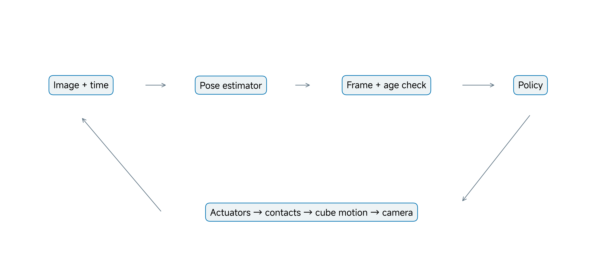
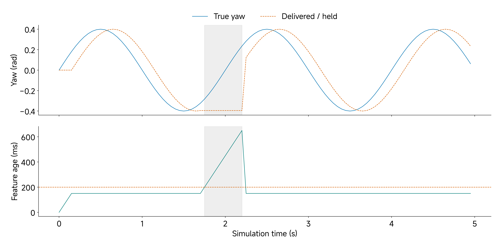
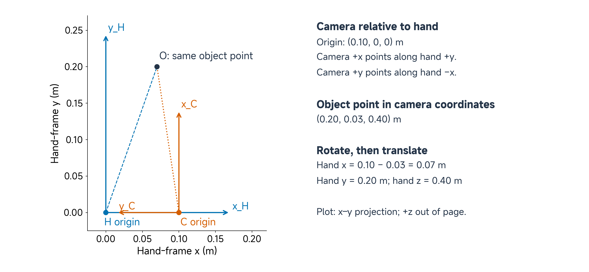
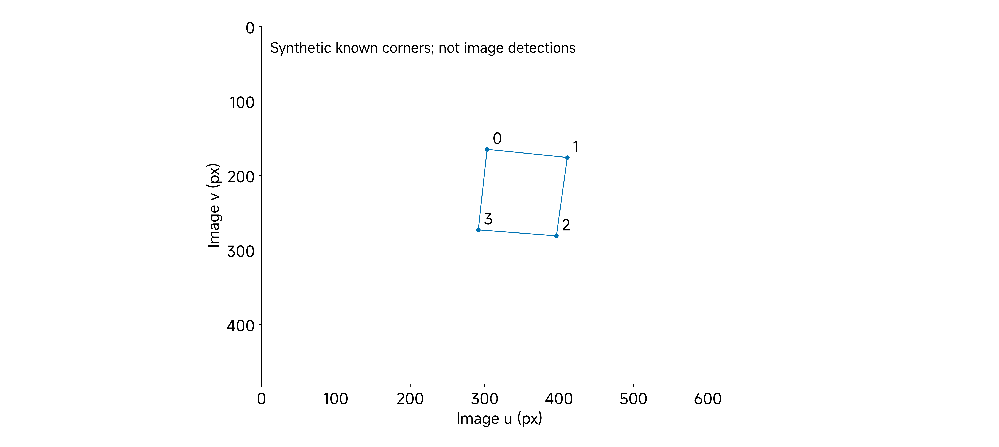
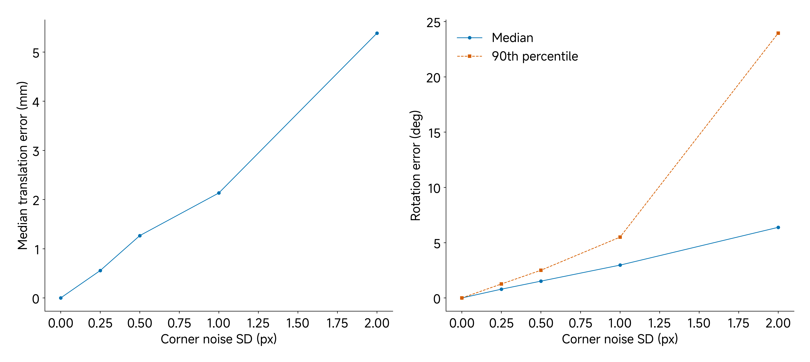
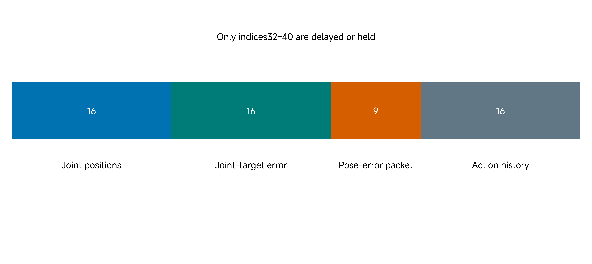
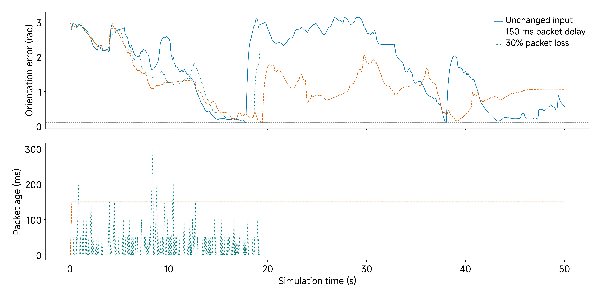
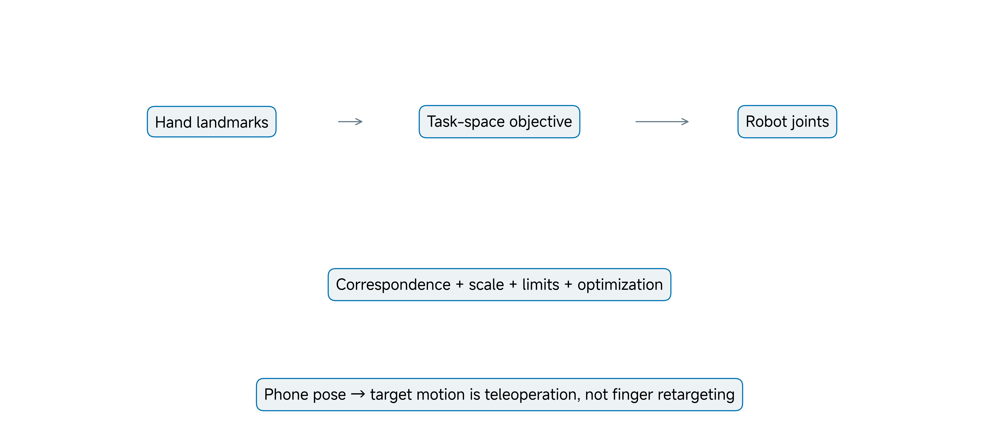

# 07 Rotating a Cube with Visual Feedback

## Central question

> How does visual observation change the robot's feedback loop?

Move a camera around a stationary cube, then rotate the cube while keeping the camera still. The image changes in both cases. A robot must distinguish those motions in the frame where it controls its hand. It also needs to know when an estimate was captured and whether enough of the object was visible to support it.

Classes 02–05 distinguished requested, measured and simulated quantities. The same distinction now applies to object pose: an estimate from an image is neither a direct view of the complete physical state nor a command. The Class 06 pose-observing baseline actor already receives cube-pose features as well as joint information. Today's problem is to supply a usable observation from vision, preserving the policy's required frame, feature convention and timing. We investigate two separate components: a synthetic known-corner pose-estimation exercise, and native MuJoCo diagnostics that delay or hold selected pose-error features. They are reproducible component tests, not a completed image-to-policy system.

By the end of this class, you should be able to:

- Distinguish object reorientation from Rubik's Cube solving.
- Separate device, camera, marker, object and hand poses.
- Compose a camera-to-hand transform and explain calibrated projection.
- Interpret uncertainty, visibility, measurement age and missing observations.
- Design a controlled visual-feedback test and distinguish hand retargeting from phone-pose teleoperation.

[Lecture](#object-reorientation-and-visual-feedback) · [Instructor and TA demonstration](#instructor-and-ta-demonstration) · [Student activity](#student-activity)

The figures, calculations and saved results support a complete reading and activity route on this page. The perception exercise requires no phone, physical hand or GPU. The retained native diagnostics use the Class 06 policy and model. Their reported traces and results provide the evidence for the reading and activity.

## Object reorientation and visual feedback

### Learn from the original example without changing its claim

OpenAI et al. (2018), in [*Learning Dexterous In-Hand Manipulation*](https://arxiv.org/abs/1808.00177), studied learned object reorientation with a physical Shadow Dexterous Hand and a vision-based observation path. Their work used simulation training and randomization to transfer manipulation policies to the physical system. It is a useful reference for separating perception, control and physical evaluation.

Object reorientation changes an object's pose. Solving a Rubik's Cube additionally changes and reasons about its internal face permutations. Our supplied LEAP task changes a rigid cube's complete orientation; it does not solve a puzzle or reproduce the Shadow Hand system.

*Figure 1. A conceptual visual-feedback architecture. Estimation, frame conversion, validity and age checks sit between images and policy input. The diagram describes the intended chain, not an implemented live phone integration.*

A strong pose estimator and a strong controller do not automatically make a strong combined system. Correct object pose in the wrong frame, or accurate pose delivered too late, can produce the wrong action. Conversely, a failed manipulation does not identify perception as its cause without inspecting the rest of the loop.

Retain the Class 06 task definition: complete orientation error below 0.1 rad, with the task's retention and termination rules. A successful-step event is not automatically an independent completed rotation. Replacing the observation source does not justify silently relaxing those criteria.

**Predict:** A camera reports a four-value quaternion. Can it be copied directly into the actor's six orientation-error features? Explain what must be established before constructing the input.

### Choose the policy case before replacing an observation

Class 06 now contains two distinct cases. This class continues the **57-input Playground-derived, goal-conditioned reorientation actor**: its cube-related observation fields make replacing simulated pose by an estimated pose a meaningful interface question. The separate 320-input proprioceptive continuous-rotation actor receives joint/command history and has no cube-pose field. Appending a camera estimate would change its learned input contract and require a compatible newly trained actor; a camera recording alone does not change that controller.

| Question | Pose-observing reorientation case | Proprioceptive continuous-rotation case |
|---|---|---|
| Does the actor use object-pose information? | Yes, in the declared observation construction | No direct cube-pose input |
| What can a calibrated camera replace? | The corresponding simulated object-state source, after frame/time/feature conversion | Evaluation or diagnosis initially; no existing actor input is replaced |
| What stays to be checked? | Feature order/scaling, uncertainty, delay, validity and trained operating conditions | Whether a changed observation design and new policy improve the intended task |

Both cases can use recorded images to assess object motion. Only a declared estimator-to-actor connection makes those images part of visual feedback. Keep actor identity beside every demonstration: the same hand or cube lettering does not make two policies interchangeable.

## Replace a simulated pose with a measurement contract

### What must travel with an estimate?

An estimate needs more than position and orientation. Its identity, reference frames, units, timestamp and validity determine whether it is usable. A controller should be able to distinguish a new image, a valid detection and a valid metric pose.

| Observation field | Why the controller needs it |
|---|---|
| Object identity and frame | Establish which object and origin the pose describes |
| Position, orientation and convention | Establish units, axes, transform direction and quaternion ordering |
| Capture timestamp and clock relation | Determine how old the observation is when used |
| Validity and tracking status | Distinguish a current estimate from absence or rejection |
| Quality or uncertainty description | State the estimator's confidence limits and acceptance conditions |

The table is a proposed interface contract, not a claim that the original phone app already supplies these fields. A confidence score also needs a definition; an arbitrary high score does not establish calibrated uncertainty.

### Visibility and uncertainty are different problems

A fingertip may hide a marker while the cube keeps moving. The network can still receive images, yet the chosen estimator may have insufficient correspondences for pose recovery. Sending zeros invents a new pose. Holding a previous estimate preserves an old value but does not make it fresh.

The synthetic lab requires all four ordered corners of one known square. With only three available, its gate returns unavailable rather than calling the selected solver. This is the rule of this exercise, not a universal statement about every pose-estimation method. Additional markers, geometry, temporal tracking or multiple views can support different acceptance rules.

Noise can perturb accepted measurements. Calibration error or an incorrect marker size can bias them systematically. Averaging may reduce some random variation while retaining the bias; smoothing can reduce variation while adding lag. Evaluate the error source that the processing is intended to address.

### Capture-to-use age matters

If capture and use timestamps share a synchronized time base, measurement age is

$$
a=t_u-t_c.
$$

Here $$t_c$$ is capture time and $$t_u$$ is controller use time. Network arrival time records receipt; it need not equal either. Processing, transport, queuing and scheduling all affect age. Subtracting timestamps from unsynchronized clocks can include a clock offset and should not be reported as measured latency without a clock relationship.

At 20 Hz, three control intervals are **150 ms**. At approximately constant angular speed of 1 rad/s, an exact observation that old can differ from current orientation by about **0.15 rad**, or **8.59°**. That exceeds the unchanged 0.1 rad angular criterion. The calculation is a local constant-speed approximation, not a prediction for every grasp trajectory.

*Figure 2. A synthetic yaw signal is delayed by three samples and held during a declared detection gap. The lower plot shows growing age. Gray shading marks the imposed gap; 200 ms is an illustrative staleness rule, not a hardware safety threshold.*

A 60 Hz camera does not guarantee a valid new cube pose at every control step. Nominal frame rate alone does not determine capture-to-use age. A stream can have a good average rate and still contain harmful bursts of stale observations.

Holding a pose estimate is also different from holding an actuator command. A complete design must specify what the estimator reports during rejection and what the controller does with that status. Predicting pose for a limited horizon, pausing an experiment or retaining a command are different choices that require their own conditions and tests.

**Checkpoint:** A new packet arrives containing the last valid pose. Which timestamp should stay unchanged, and what should happen to its reported age?

## Separate device, marker and object pose in the hand frame

### Name the coordinate maps

Use H for the hand frame, C for the camera, O for the object, M for a marker and W for a declared controller-world frame. An AR tracking world is a separate frame until a calibration establishes its relationship to W. Define a transform by what it maps:

$$
{}^{H}T_C=
\begin{bmatrix}{}^{H}R_C&{}^{H}p_C\\0&1\end{bmatrix}.
$$

It converts C-frame coordinates into H. Its translation is the camera origin expressed in H; its rotation maps camera directions into hand-frame directions. This is a 4 × 4 homogeneous map for points. Featherstone's 6 × 6 spatial-motion and spatial-force transforms have different roles and ordering; a point map must not be applied directly to the six-component wrench introduced in Class 06 (Featherstone 2008). If a pose estimator returns object-to-camera pose, then

$$
{}^{H}T_O={}^HT_C\,{}^CT_O.
$$

Read the multiplication from the coordinate being transformed: first object to camera, then camera to hand. A transform's inverse requires both a transposed rotation and a transformed negative translation:

$$
{}^CT_H=({}^HT_C)^{-1}
=\begin{bmatrix}({}^HR_C)^\mathsf{T}&-({}^HR_C)^\mathsf{T}{}^Hp_C\\0&1\end{bmatrix}.
$$

Negating the translation alone is not a general inverse.

*Figure 3. The worked camera is translated 0.10 m along hand x and rotated 90° about hand z. Camera +x points along hand +y; camera +y points along hand −x. The same point has camera coordinates (0.20, 0.03, 0.40) m and hand coordinates (0.07, 0.20, 0.40) m. The plot shows the x–y projection.*

### Rotate a translation before adding it

For the declared example,

$$
{}^HR_C=\begin{bmatrix}0&-1&0\\1&0&0\\0&0&1\end{bmatrix},\qquad
{}^Hp_C=\begin{bmatrix}0.10\\0\\0\end{bmatrix}\;\mathrm{m}.
$$

Applying it to the point gives

$$
{}^Hp_O={}^HR_C\,{}^Cp_O+{}^Hp_C
=\begin{bmatrix}0.07\\0.20\\0.40\end{bmatrix}\;\mathrm{m}.
$$

Simply adding the translations would yield (0.30, 0.03, 0.40) m, describing a different geometry. An incorrect implementation can appear to work when rotations happen to align. Test known points and the transform/inverse identity across more than one pose. In `perception_lab.py`, `R_HC @ p_CO + p_HC` performs this calculation. The named arrays correspond to the declared rotation, point and camera origin; changing multiplication order changes the geometry.

### A phone's pose does not identify the cube

Device AR tracking may report the phone relative to W. A cube can move independently, so phone pose is not cube pose. The camera can also have a fixed offset and axis convention relative to the device-tracking frame. Declare those relationships rather than assigning the same label to all of them.

If a marker is fixed to the cube, an estimated marker-to-camera pose also needs a marker-to-object relationship:

$$
{}^HT_O={}^HT_C\,{}^CT_M\,{}^MT_O.
$$

A marker origin on one face is not the cube center. If the phone moves relative to the hand, camera-to-hand pose must be updated or otherwise known; a fixed calibration applies only while that mounting relationship remains fixed. A hand/world calibration can help relate a tracked camera to H, but it does not remove the need to observe the cube.

The existing actor's object and palm features are constructed in the simulator's world frame. A hand-frame object estimate therefore needs the hand-to-world map before it can replace that information:

$$
{}^W\widehat T_O={}^WT_H\,{}^H\widehat T_O.
$$

The hat marks an estimate. Extract the position and scalar-first orientation from this result, then construct the same palm-minus-object position error and relative-rotation features described in [Class 06](06-learned-in-hand-cube-reorientation.md#preserve-the-learned-interface). A camera-frame quaternion is not already that six-value feature. The current goal, joint ordering and task-history convention must also be preserved (Google DeepMind 2026). For a moving camera or hand, the transform chain needs a consistent observation time; composing an old image pose with an unrelated newer camera pose can introduce another error.

For this course, original asMagic integration remains a later step after image or marker access, cube estimation, calibration, timestamps and validity are verified. The core lesson does not substitute asMagicPro or assume that phone pose supplies object pose or human finger landmarks.

### Calibrated projection connects geometry to pixels

For an ideal camera point with positive depth,

$$
u=f_x\frac{X_C}{Z_C}+c_x,\qquad
v=f_y\frac{Y_C}{Z_C}+c_y.
$$

The focal lengths are in pixels and (c_x, c_y) is the principal point. The synthetic camera uses image u to the right, v downward and positive Z forward. These are the lab's conventions, not assumed phone-app conventions. Distortion is set to zero and recorded as an assumption.

A 70 mm segment parallel to the image plane, with 700 px focal length, spans about **98 px at 0.50 m** depth and **49 px at 1.00 m**. The object has not shrunk. Known geometry or another scale source is needed for metric recovery.

*Figure 4. Four ordered corners projected from a tilted 70 mm planar square. The correspondences are generated from known geometry and pose; no image detector is being evaluated. Image v increases downward.*

PnP estimates rotation and translation from 3D points, their corresponding image points and camera calibration. OpenCV's [PnP documentation](https://docs.opencv.org/4.10.0/d5/d1f/calib3d_solvePnP.html) defines the returned map into the camera frame (OpenCV developers n.d.). The lab generates projections, adds Gaussian pixel noise and uses `solvePnP` with `SOLVEPNP_ITERATIVE`. Its `rvec` is a Rodrigues axis–angle rotation vector, not three Euler angles or a quaternion; `cv2.Rodrigues` converts it to a rotation matrix. Its `tvec` is the square origin expressed in camera coordinates, in metres because the model points use metres. Point detection, identification and ordering have already been supplied.

The square's origin lies in its plane. If the square represents a marker on a cube face, its origin is not automatically the cube center. The marker-to-object transform above supplies that offset. Using the correct camera pose with an incorrect marker scale or origin still gives the controller an incorrect object pose.

### A good image fit is not an independent pose reference

Reprojection error measures consistency between image points and projections of the fitted model. Incorrect marker dimensions or calibration can still produce a plausible image fit with an incorrect metric pose. This exercise can compare against its known synthetic pose; a physical tracker needs suitable independent reference measurements.

The [supplied sensitivity study](../resources/class07/results/perception-summary.json) records OpenCV 5.0.0, seed 7 and 100 trials at each of five corner-noise levels; its [500 trial rows](../resources/class07/results/pnp-trials.csv) retain the individual errors. All trials use the same tilted square, known camera matrix and declared ground-truth pose. They sample corner perturbations, not 500 different camera setups or detected physical objects. It reports median translation/orientation error and a 90th-percentile orientation error. The percentile describes these generated trials; it is not a confidence interval.

*Figure 5. PnP sensitivity for known correspondences and calibration. The curves exclude detection failures, real occlusion, calibration error and hardware measurements. Noise-free recovery is a numerical check, not a claim that a physical camera is exact.*

| Noise SD (px) | Median position (mm) | Median angle (°) | P90 angle (°) |
|---|---:|---:|---:|
| 0 | <0.00001 | <0.00001 | <0.00001 |
| 0.25 | 0.557 | 0.795 | 1.266 |
| 0.5 | 1.267 | 1.522 | 2.508 |
| 1.0 | 2.134 | 2.971 | 5.504 |
| 2.0 | 5.384 | 6.389 | 23.959 |

The columns report errors, rather than the pose itself. At 2 px noise, the median angle error is about 6.39°, while its 90th percentile is about 23.96°: the median alone hides substantial upper-tail errors in this setting. These are pose-estimation errors against synthetic ground truth, not the Class 06 cube-to-goal task error. A tracker can accurately report a cube that is far from its goal.

The visible face's geometry, point ordering and scale remain essential. A letter may help a person follow the cube while still leaving an estimator's in-plane orientation or correspondence unresolved.

**Checkpoint:** Which errors are excluded by this synthetic experiment, and why would a low reprojection residual not resolve all of them?

## Formulate and test the visual-feedback learning problem

### Choose the interface before choosing a learned model

An estimator can learn image-to-pose mapping while a manipulation policy learns observation-to-action mapping. The supplied PnP estimator is geometric rather than learned: its optimization fits a pose from correspondences, without updating policy weights. An image-based policy is another architecture, requiring compatible training and inference inputs. Raw pixels cannot simply replace the nine pose-error values of a fixed 57-input actor.

To learn image-to-pose mapping, pair images with suitable reference poses at their capture times, and test on separately held-out sequences or conditions. For policy learning, specify what observations are available during action selection, preserve bounded joint-target actions and define the task reward and evaluation rule. Simulator ground truth can score an estimate or task without being supplied secretly as the actor's visual observation.

The present 57-input actor has no dedicated age or validity channels. An external observation handler must decide how to accept, reject or hold an estimate and log that decision. Adding age or validity values to the network input changes its architecture and requires compatible weights; it is not an automatic capability of the supplied actor. The current diagnostics deliberately keep that actor fixed.

A manageable progression is to verify the existing pose-observing policy, characterize an estimator under declared viewpoints and visibility, then test the combined closed loop with calibrated timing. Observation randomization during training may improve robustness, but its effect must be evaluated. The retained Class 06 noisy results are a teaching reference, not a Class 07 performance result.

Report perception and task outcomes together. For example, an estimator accurate on 70 of 100 required samples has 70% coverage; error reported only on those accepted samples omits what the controller received during the missing intervals. This is illustrative arithmetic, not a measured tracker result. Useful evaluation records include pose errors, valid-pose coverage, age, task success, falls and timeouts.

### Test a bounded intervention in native MuJoCo

The supplied diagnostic preserves the Class 06 policy, task and clocks. It uses the same bundled ONNX actor and native MuJoCo 3.6.0 runtime identified in that class. It delays or holds only observation indices **32–40**: three position-error and six orientation-error features. Joint-position features, joint-target errors and action history remain current according to the pinned task's ordering. In `feedback_experiment.py`, `obs[32:41]` selects these nine values because Python excludes the upper bound. The script checks that entries before index 32 and from index 41 onward are unchanged; a different slice would change the experiment.

*Figure 6. Only the nine highlighted pose-error values are changed. They include the goal relation when the feature packet was created. The intervention is not raw-camera latency followed by recomputation against the newest goal.*

This distinction matters when the task changes its target. Delaying a raw object pose but comparing it with the current target is a different experiment from delaying an already-computed target-relative feature. State which data cross the delay boundary before attributing behavior to camera latency.

Three selected conditions use seed 9204, ideal task observation noise, 20 Hz control and a maximum of 1000 steps: unchanged input, three-step delay, and independently sampled packet loss with probability 0.3. The first packet is always initialized. Delayed startup reuses the first available packet until enough history exists. On a loss, the last delivered feature packet is held; the loss generator uses the separate seed 79204. The [baseline](../resources/class07/results/baseline/summary.json), [three-step-delay](../resources/class07/results/delay150/summary.json) and [packet-loss](../resources/class07/results/dropout30/summary.json) receipts identify these conditions; their adjacent traces retain every control step.

Here `feature_age_s` is the additional simulated queue/hold age at policy-input use. Row `time_s` marks the end of the resulting 50 ms control interval. For example, row 4 ends at 0.20 s but uses an input at 0.15 s; under the three-step delay that input carries the initial packet and has 0.15 s extra age. A zero baseline age means no added packet delay, not proof of zero sensing or inference latency. These values are not measured network or camera latency. The orientation-error trace and goal events use the same task sensor-phase convention as Class 06; they are distinct from a new forward-pass/rendered-pose diagnostic.

Once an observation changes the action, later trajectories can diverge. The intervention's consequences belong to a closed loop, rather than a comparison of identical underlying state trajectories.

*Figure 7. One native run per condition. The loss run terminates at its fall and has no invented tail. The lower plot reports delivered-feature age. These traces demonstrate a controlled intervention, not population reliability.*

| Selected condition | First goal (s) | Successful steps | End of run |
|---|---:|---:|---|
| Unchanged input | 17.80 | 2 | 50 s limit; no fall |
| Three-step delay | 19.45 | 1 | 50 s limit; no fall |
| Packet-loss probability 0.3 | 18.60 | 1 | Fall at 19.20 s |

The loss run misses **126 of 384 packets**, approximately 32.8% in this realization, with maximum delivered-feature age of **300 ms**. A configured probability does not guarantee an exact fraction in a finite seeded run. The first-goal event does not erase a later fall.

A successful delayed run does not establish delay robustness, and one loss-associated fall does not prove every loss pattern fails. These examples answer what happened under declared interventions. A robustness claim needs a suitable multi-episode protocol and denominator. Do not relabel a timeout as a particular failure mechanism without inspecting evidence.

**Checkpoint:** Why can the loss run count as a first-goal success while still demonstrating a continuous-manipulation failure?

## Preview retargeting and embodiment differences

Human-hand retargeting maps hand measurements to a robot with different link lengths, joint axes, limits and contact capabilities. Phone-pose teleoperation instead uses device motion to specify a target. A joystick or phone-orientation stream is not a measurement of human finger configuration.

*Figure 8. Conceptual retargeting: measured landmarks, a task-space objective and constrained robot joints. Finger tracking and retargeting are not implemented by the core visual-feedback practical.*

Published systems such as DexPilot illustrate vision-based human-hand teleoperation with a different robot embodiment (Handa et al. 2019). A fingertip-vector objective can be more meaningful than directly copying joint angles. It still requires correspondence, scale, coordinate frames, joint ordering and robot limits, often with temporal regularization. Copying an angle across joints with different axes can move a fingertip in the wrong direction.

Before a human-hand demonstration, verify that valid landmarks or joint observations are actually available and that the mapping is correct. Original phone tracking may require a separate estimator for fingers. This preview identifies a possible continuation; the required activity remains frame, projection and observation-timing analysis without physical hand control.

## Instructor and TA demonstration

### Trace a visual measurement to the policy

Use Figure 1 to identify where estimation replaces simulated pose information. State that the Class 06 pose-observing baseline actor already observes cube pose. Distinguish a camera's motion from the cube's motion and locate the missing calibrations for a live phone implementation.

Work through Figure 3 on paper: rotate the point, then add the camera origin. Ask why translation-only addition gives the wrong answer. Identify what a cube-mounted marker's pose would still need before it represents the cube center in the hand frame.

For a physical phone-stream inspection, first identify the actor case, device/software revision and actual packet fields. Locate an image, matching intrinsics and capture timestamp; then identify the object estimator and hand-frame calibration. The phone's own AR pose is not a cube measurement. If any part is unavailable, use the prepared synthetic case below and record the missing physical evidence instead of labeling the demonstration a completed visual hand-control deployment.

### Recover a declared synthetic pose

Use the synthetic pose-recovery example and its sensitivity results. Read the declared camera matrix, 70 mm square and generated correspondences. Inspect noise-free recovery and the three-correspondence unavailable gate, then compare the sensitivity table with Figure 5. Explain why this test does not implement a marker detector or calibrate a physical camera. Use the declared correspondences and result table to support the interpretation.

### Compare timing interventions

Open Figure 7 and compare the three reported diagnostics. Locate the first delayed feature and a dropped packet in the supplied traces. Compare first-goal time, successful-step count, termination and maximum age. Relate 150 ms to three control intervals and to the 0.15 rad constant-speed estimate. Preserve the capture-time goal distinction.

The saved traces provide the evidence for this comparison. End with one supported observation and a new measurement that would distinguish an alternative explanation.

## Student activity

### Calculate, inspect and bound the conclusion

First name the Class 06 pose-observing baseline actor continued here and explain why replacing its object-state source differs from adding a pose input to the proprioceptive actor.

Use the page's worked examples, synthetic experiment description and result tables.

1. Transform the camera-frame point (0.20, 0.03, 0.40) m into the hand frame using the declared 90° rotation and camera origin. Show the rotation before translation.
2. Calculate the apparent width of the 70 mm segment at 0.50 m depth with 700 px focal length. Predict the width at twice that depth.
3. Inspect the synthetic result at 1 px corner-noise SD. Record its median position and angle errors, and name two real-camera errors excluded from the test.
4. Calculate the approximate orientation discrepancy from 150 ms age at 1 rad/s. Compare it with 0.1 rad without changing the task threshold.
5. Compare the three native diagnostics. State exactly which channels changed and explain why first-goal success and later retention require separate reporting.

Make each prediction before consulting the corresponding worked example or result table. Show the calculation and explain what its assumptions allow you to conclude.

Submit a compact record:

| Field | Required content |
|---|---|
| Geometry | Named frames, units and one checked transform |
| Measurement | Generated correspondences, calibration and visibility rule |
| Timing | Capture/use clock assumption and computed age effect |
| Intervention | Selected feature channels, delay/loss setting and outputs |
| Conclusion | One supported observation and one untested claim |

Identify the supplied tables and traces used as saved evidence. A qualitative camera observation can reveal viewpoint or occlusion changes, but does not replace a calibrated cube-pose experiment. No phone or hardware hand is required.

## Carry the measurement contract to another embodiment

The next module changes from a hand and cube to a reBot arm. The requirements to define coordinates, commands and observations carry forward, but the mechanism, interfaces and calibration records must be established for that arm.

## References

Featherstone, Roy. 2008. *Rigid Body Dynamics Algorithms*. Springer. [Coordinate-transform guidance](https://royfeatherstone.org/spatial/v2/xforms.html).

Google DeepMind. 2026. “LEAP Cube Reorientation.” *MuJoCo Playground*, source snapshot at commit `ef4fefc13033c0468af4ef651847f5348af0c7d7`. [Task and actor-feature definition](https://github.com/google-deepmind/mujoco_playground/blob/ef4fefc13033c0468af4ef651847f5348af0c7d7/mujoco_playground/_src/manipulation/leap_hand/reorient.py). The supplied actor and native adaptation are identified in Class 06.

Handa, Ankur, Karl Van Wyk, Wei Yang, Jacky Liang, Yu-Wei Chao, Qian Wan, Stan Birchfield, Nathan Ratliff, and Dieter Fox. 2019. “DexPilot: Vision Based Teleoperation of Dexterous Robotic Hand-Arm System.” arXiv:1910.03135. [Paper](https://arxiv.org/abs/1910.03135).

OpenAI, Marcin Andrychowicz, Bowen Baker, Maciek Chociej, Rafal Jozefowicz, Bob McGrew, Jakub Pachocki, Arthur Petron, Matthias Plappert, Glenn Powell, Alex Ray, Jonas Schneider, Szymon Sidor, Josh Tobin, Peter Welinder, Lilian Weng, and Wojciech Zaremba. 2018. “Learning Dexterous In-Hand Manipulation.” arXiv:1808.00177. [Paper](https://arxiv.org/abs/1808.00177).

OpenCV developers. n.d. “Perspective-n-Point (PnP) Pose Computation.” *OpenCV Documentation*, version 4.10.0. Accessed October 17, 2026. [Projection, frame conventions and solvers](https://docs.opencv.org/4.10.0/d5/d1f/calib3d_solvePnP.html). The supplied synthetic-study receipt records its runtime separately as OpenCV 5.0.0.
