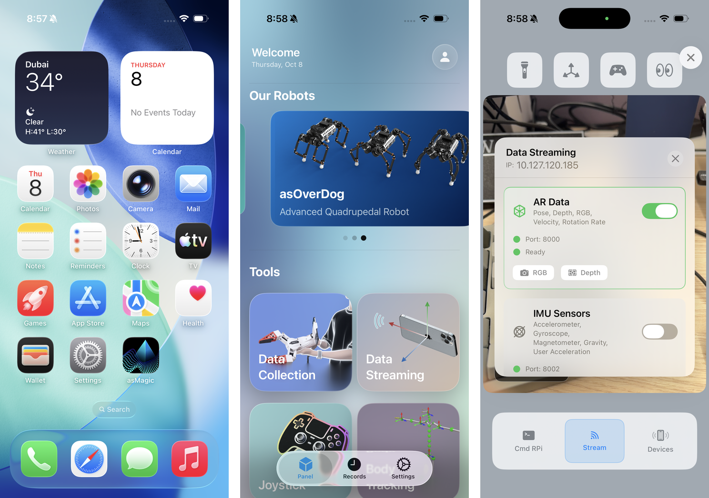

# 07 Rotating a Cube with Visual Feedback

## Central question

> How does visual observation change the robot's feedback loop?

Move a camera around a stationary cube, then rotate the cube while keeping the camera still. The image changes in both cases. A robot must distinguish these motions in the frame in which it acts. It must also establish when an image was captured, whether the object was visible, and what the estimate actually describes.

Classes 02–05 separated requested quantities, measured quantities and simulated state. Class 06 added a learned controller whose input is a history of joint angles and previous commands. **That continuous-rotation actor does not receive cube pose or images.** A camera can first help us observe and evaluate its behavior. Making vision part of its feedback loop would require an explicit estimator-to-controller connection and a compatible controller or newly trained policy. We cannot replace a cube-pose channel that this actor does not have.

By the end of this class, you should be able to:

- Distinguish visual evaluation from visual feedback and object reorientation from puzzle solving.
- Relate device, camera, marker, object and hand frames without treating them as interchangeable.
- Explain how calibration, projection and object geometry connect an image to a metric estimate.
- Interpret measurement age, missing detections, noise, bias and occlusion.
- Specify the observations and evidence needed before adding vision to a learned manipulation system.

[Lecture](#what-vision-adds-to-the-manipulation-problem) · [Instructor and TA demonstration](#instructor-and-ta-demonstration) · [Student activity](#student-activity)

The supplied architecture and geometry figures, app screenshots and worked calculations support the core demonstration and activity. A live stream inspection is conditional on a configured original asMagic receiver. The source has not yet supplied a complete calibrated cube estimator connected to the Class 06 actor, so no powered hand operation or completed visual-control deployment is required.

## What vision adds to the manipulation problem

### A camera can evaluate a controller without controlling it

The Class 06 actor maps a 320-value history to 16 joint targets. Its information comes from 16 measured joint positions and 16 previous commands at each of ten history slots. Contact and object motion influence these signals indirectly, but the input contains no measured cube orientation. Recording an iPhone video alongside a run does not change this information boundary.

A calibrated visual estimate could answer questions that joint telemetry alone cannot: Did the cube rotate? About which axis? Did it slip relative to the fingers? Was it manually repositioned? A video can support qualitative inspection, but a claim about angular displacement, speed or autonomous success needs a defined measurement and evaluation rule.

**Visual feedback** goes further: information derived from images influences the next action. There must be a computational path from image capture through estimation and observation construction to a controller. A recording that is watched after the run is visual evidence, rather than a closed visual feedback loop.

*Figure 1. Prospective visual-feedback architecture: image and capture time → pose estimation → frame and age checks → a compatible policy → actuation and contact → a new image. Trace the path that would make visual information affect an action. The current Class 06 actor does not implement this visual input path.*

OpenAI et al. (2018), in *Learning Dexterous In-Hand Manipulation*, provide a reference system that combined learned dexterous manipulation, simulation randomization and a camera-based observation path on a Shadow Hand. Their robot, observations, training and evaluation must be considered together. The later Rubik's Cube work also involved reasoning about internal face permutations. Rotating a rigid cube and solving a puzzle are different tasks.

Our Class 06 source instead studies continuous positive-Z rotation of a 58 mm, 85 g cube using joint-history feedback. Its task, observations and evaluation differ from the Shadow Hand reference. A similar-looking hand or lettered cube does not establish a compatible policy interface.

### Two possible roles for an object-pose estimate

| Role | What the estimate influences | What must be established |
|---|---|---|
| Evaluation and diagnosis | Recorded measurements and conclusions after or alongside a run | Object identity, calibration, timestamps, validity and an evaluation rule |
| Closed-loop visual control | Current or future controller actions | All evaluation requirements, plus a compatible observation/action interface and controller validation |

A pose estimate can be useful before it is safe or appropriate to feed it to a controller. Conversely, a visually convincing demonstration does not establish the accuracy of the estimate used during control. Keep the measurement record and the action record distinct.

**Checkpoint:** A video shows the cube moving while the joint-history actor runs. What evidence would establish that vision caused the actor to change its action?

## Define what a visual measurement means

### Pose is always relative to a frame

A pose contains position and orientation relative to a declared reference. A device-tracking system may report the phone in its tracking world. An image-based marker detector may report a marker relative to the camera. A manipulation controller may require the cube relative to the hand or robot world. These are different physical relationships.

| Quantity | Meaning | Why it is insufficient alone |
|---|---|---|
| Device AR pose | Device relative to its tracking world | The cube can move independently of the phone |
| Marker pose | Marker relative to camera | Marker origin and axes can differ from the cube's |
| Object pose | Cube relative to a stated frame | The controller still needs compatible frames, timing and conventions |
| Joint positions | Robot joint configuration | They do not directly measure cube orientation under slip |

An estimated pose should travel with its capture timestamp, frame names, units, orientation convention, object identity and validity status. A confidence score needs a definition; a large arbitrary score is not a calibrated uncertainty bound. An image packet can be new while its last valid object estimate is old.

### Transform coordinates before combining observations

Let H denote the hand frame, C the camera, M a marker and O the object. Define a point-coordinate transform by what it maps:

$$
{}^HT_C=\begin{bmatrix}{}^HR_C&{}^Hp_C\\0&1\end{bmatrix}.
$$

It maps coordinates expressed in C into H. The rotation maps camera-frame directions into hand-frame directions, while the translation is the camera origin expressed in H. If an estimator returns object-to-camera pose, then

$$
{}^HT_O={}^HT_C\,{}^CT_O.
$$

The rightmost map acts first. If the estimator observes a marker fixed to a cube face, include the known object pose relative to that marker:

$$
{}^HT_O={}^HT_C\,{}^CT_M\,{}^MT_O.
$$

A marker's origin on a face is not the cube center. Here $${}^MT_O$$ maps object-frame coordinates into marker coordinates; using its inverse would reverse that relationship. The marker mounting and physical dimensions belong to the measurement model, just as link geometry belonged to the actuator fixture model in Class 03.

The inverse transform is

$$
({}^HT_C)^{-1}=\begin{bmatrix}({}^HR_C)^\mathsf T&-({}^HR_C)^\mathsf T{}^Hp_C\\0&1\end{bmatrix}.
$$

Negating translation without rotating it is not a general inverse. A moving phone also requires the camera-to-hand relationship at the relevant observation time; a fixed calibration applies only while the mounting relationship stays fixed.

A device AR pose alone does not supply $${}^HT_C$$. Using it in this chain also needs the mounting transform between the tracked device and camera, a relation between the AR world and the hand, and compatible timestamps. Inspect those relationships before multiplying pose arrays returned by different systems.

These are 4 × 4 maps for points and rigid-body pose. Featherstone's 6 × 6 spatial transforms act on motion or force vectors with declared ordering. Do not apply a point transform directly to an angular-first spatial wrench, and do not identify an image-based pose vector with a spatial velocity (Featherstone 2008).

### Worked example: rotate before translating

Suppose the camera is rotated 90° about hand z and its origin is 0.10 m along hand x:

$$
{}^HR_C=\begin{bmatrix}0&-1&0\\1&0&0\\0&0&1\end{bmatrix},\qquad
{}^Hp_C=\begin{bmatrix}0.10\\0\\0\end{bmatrix}\;\mathrm m.
$$

For a point whose camera coordinates are (0.20, 0.03, 0.40) m,

$$
{}^Hp_O={}^HR_C{}^Cp_O+{}^Hp_C
=\begin{bmatrix}0.07\\0.20\\0.40\end{bmatrix}\;\mathrm m.
$$

Translation-only addition would give (0.30, 0.03, 0.40) m, a different physical location. This is an analytical coordinate example, not a measured calibration or a new pose-estimation demonstration.

*Figure 2. Geometry of the analytical transform example, shown in the x–y plane. Locate the two origins, follow camera +x along hand +y, and read the same point relative to each origin. The diagram explains coordinates; it reports no camera experiment.*

If a controller instead expects object pose in world W, an additional declared hand-to-world map is required:

$$
{}^W\widehat T_O={}^WT_H\,{}^H\widehat T_O.
$$

The hat marks an estimate. Quaternion ordering, active/passive rotation meaning and transform direction must agree at the software boundary. A four-value quaternion does not by itself identify those conventions.

## Connect pixels to physical geometry

### Projection explains why scale and calibration matter

For an ideal camera point with positive depth,

$$
u=f_x\frac{X_C}{Z_C}+c_x,\qquad
v=f_y\frac{Y_C}{Z_C}+c_y.
$$

The focal lengths are in pixels and the principal point is (c_x, c_y). This equation assumes the camera's stated axis convention and an appropriate treatment of lens distortion. A physical camera's intrinsics must match the image resolution and processing used by the estimator.

A 70 mm segment parallel to the image plane, observed with a 700 px focal length at 0.50 m, spans approximately

$$
w_{\mathrm{px}}=700\frac{0.070}{0.50}=98\;\mathrm{px}.
$$

At 1.00 m it spans about 49 px. These are illustrative projection calculations; they do not change the Class 06 cube dimensions or supply an experimentally measured camera calibration. A wrong assumed marker size produces a wrong metric scale even when its image outline looks plausible.

Perspective-n-Point methods estimate pose from known 3D points, corresponding image points and calibration. Detecting the right object, identifying its points and maintaining their correspondence are additional problems. A letter on a face may help a viewer recognize it without supplying sufficient robust geometric correspondences under fingertip occlusion.

A low reprojection residual measures agreement with the image observations and model used in fitting. It is not independent proof that marker dimensions, camera calibration or metric pose are correct. Separate reference measurements are needed to evaluate physical accuracy.

### Visibility, noise and bias require different responses

Fingers may hide a marker exactly when contact changes the cube motion. The network may still deliver images while the estimator has insufficient evidence. Sending a zero pose invents a measurement. Holding the last pose preserves an old value; it does not make that value current.

Random noise may vary between observations. A calibration error can bias every estimate in the same direction. Averaging can reduce some random variation while retaining bias, and smoothing can introduce lag. An estimator should report rejection or missing data explicitly so that the controller or experimenter can distinguish lack of evidence from a confident stationary object.

Useful records include raw images, camera calibration, capture times, estimated poses, accepted/rejected detections and the reasons for rejection. Preserve the object and camera setup identity with the record. Without this evidence, a manipulation failure cannot be attributed specifically to perception.

## Measure age rather than assuming a frame rate

If capture and controller-use timestamps share a synchronized time base, the observation age is

$$
a=t_u-t_c.
$$

Capture, network receipt and controller use are distinct events. Transport, processing, queues and scheduling all contribute. Timestamps from unsynchronized clocks can contain an unknown offset; their difference is not automatically a latency measurement.

At 20 Hz, three control intervals equal 150 ms. Under approximately constant angular speed of 1 rad/s, a pose that old differs from the current orientation by roughly

$$
\Delta\theta\approx\omega a=1(0.15)=0.15\;\mathrm{rad}\approx8.59^\circ.
$$

This local approximation explains why age can matter. It is not a measured delay, a Class 06 success threshold, or a prediction that every delayed trajectory has that error. Continuous rotation needs its own evaluation rule.

The source notes describe nominal pose streaming around 60 Hz and possible Wi-Fi delays of 50–150 ms. Treat these as setup-dependent expectations to measure on the actual configuration, rather than universal app guarantees. Sixty packets per second do not guarantee sixty valid cube estimates or bounded capture-to-use age.

Holding a pose estimate differs from holding an actuator command. An observation-handling rule must specify what happens during rejection, and a controller-handling rule must specify how action changes. A pause, a last-command hold and a predicted state each need their own operating conditions and validation. They are design choices, not automatic safety properties.

**Checkpoint:** If a packet arrives now but contains yesterday's last valid pose, which timestamp determines measurement age? How should the system distinguish that packet from a fresh estimate?

## Inspect the original asMagic stream

*Figure 3. The author's original asMagic interface reference: app icon, home page and Data Streaming panel. Locate AR Data, the displayed IP address and port 8000. These controls identify a stream setup; the screenshot does not establish a cube estimator or the current packet schema.*

The author's Class 07 plan uses the original asMagic app to publish device AR pose, color images, depth and intrinsics over a network, with port 8000 stated in the plan. Availability and synchronization of these fields must be checked in the actual receiver. A phone's AR pose tracks the phone relative to its AR world; it does not directly track the cube in the hand.

The source [Class 09 practice](../module-03-arm-data-for-guided-interaction/09-practice.md#teleoperate-the-pusher-with-the-iphone) provides the next concrete application of the phone stream: mapping device motion to a simulated arm's pusher target. That is phone-pose teleoperation. It is neither cube-pose estimation nor human-finger retargeting. Its supplied receiver and frame conventions must be inspected as implemented; a conceptual frame diagram is not evidence that every software package uses identical axes.

For this class, the source materials establish a stream-inspection and visual-feedback design discussion. They do not yet supply a complete calibrated cube estimator connected to the continuous-rotation actor. Keep that boundary visible when planning or presenting the demonstration.

## Formulate a future visual-feedback learning problem

A learning formulation begins with the available observations. One possible observation set is measured joint state together with estimated object pose, age and validity. A corresponding actor must be trained or otherwise designed for those fields. Adding them to the fixed Class 06 network changes its input contract and requires compatible weights; camera values cannot simply be appended to its 320 inputs.

Training can randomize measurement delay, noise, visibility and dropout under declared distributions. Ground-truth simulator state can support rewards and evaluation without being secretly supplied as a visual observation. Randomization is a hypothesis about robustness; the resulting controller still needs held-out tests under meaningful conditions.

Report accepted-pose accuracy and coverage alongside manipulation behavior. A tracker returning accepted estimates for 70 of 100 required samples has 70% coverage. Accuracy must be evaluated separately on those accepted estimates; acceptance alone does not make them correct, and their error does not describe the 30 missing inputs. This is arithmetic illustrating an evaluation distinction, not a result from our setup.

Human-hand retargeting is another problem: mapping observed landmarks to robot joints under different link lengths, joint axes and limits. DexPilot is a reference example on a different hand-arm system (Handa et al. 2019). It requires finger observations and a declared correspondence; an ordinary device-pose stream does not supply those observations automatically. Retargeting remains an optional direction rather than the required Class 07 implementation.

## Instructor and TA demonstration

### Identify the observation boundary

Use the [Class 06 input definition](06-learned-in-hand-cube-reorientation.md#history-provides-indirect-feedback) and Figure 1. Trace image → estimate → frame/age check, then identify the additional connection and compatible policy required for visual control. Compare that prospective path with the documentary camera in Class 06. State that the existing actor remains proprioceptive; the architecture is a design explanation, not a new policy demonstration.

### Inspect a configured stream

When the author's original asMagic receiver setup is available, inspect the actual device pose, image and metadata fields. Record the app/receiver version, coordinate conventions and timestamps. Move the phone around a stationary object, then move the object with the phone fixed. Explain which changes are represented by device tracking and which require an object estimator.

A viewpoint or occlusion comparison may be shown as an object-pose experiment only when the estimator, calibration and validity output are actually present. Otherwise describe what the images show and identify the missing estimator. A stream arriving in Python or MuJoCo is not by itself a successful visual hand-control deployment.

### Work through the coordinate example

Use Figure 2 to predict the sign of each hand-frame coordinate, then rotate the example point before adding translation. Locate the extra object-to-marker and hand-to-world relationships that an implementation would need. Explain why a camera origin and a cube center cannot be treated as the same point.

No powered hand control is required. If the receiver or calibrated estimator is unavailable, keep the session to the supplied interface figures, geometry and observation-contract analysis; record the missing component rather than claiming a completed live demonstration.

## Student activity

Teams complete the following record using the supplied figures, analytical examples and any configured source stream that is actually available.

1. Explain why Class 06 video recording is not visual feedback to its current actor.
2. Complete the worked point transform and identify the units and map direction.
3. Calculate the 150 ms constant-speed discrepancy and state its assumptions.
4. Identify device pose, camera intrinsics, image timestamp and object pose as separate fields. Mark unavailable fields explicitly.
5. If a valid object estimator is provided, vary viewpoint or cover part of the marker and record acceptance behavior. Without an estimator, describe image visibility without inventing pose-error measurements.
6. State one additional component or measurement needed before visual information could influence a compatible hand controller.

| Response field | What to record |
|---|---|
| Controller | Class 06 proprioceptive input/action contract |
| Geometry | Frames, transform direction and point calculation |
| Timing | Clock assumption, age calculation and limitation |
| Available observations | Actual stream fields or a clearly marked unavailable field |
| Conclusion | What was observed, and what remains unverified |

A team can complete the geometry and interface analysis without a phone. Where stream access is provided, students inspect observations rather than commanding a physical hand.

## Carry the observation contract to an arm

Class 08 introduces a different mechanism; Class 09 uses phone motion to command its simulated pusher. The need to distinguish references, sensed quantities, frames and timestamps carries forward. The object-estimation problem does not disappear, but it must not be confused with device-pose teleoperation.

## References

Featherstone, Roy. 2008. *Rigid Body Dynamics Algorithms*. Springer. [Coordinate-transform guidance](https://royfeatherstone.org/spatial/v2/xforms.html).

Handa, Ankur, Karl Van Wyk, Wei Yang, Jacky Liang, Yu-Wei Chao, Qian Wan, Stan Birchfield, Nathan Ratliff, and Dieter Fox. 2019. “DexPilot: Vision Based Teleoperation of Dexterous Robotic Hand-Arm System.” arXiv:1910.03135. [Paper](https://arxiv.org/abs/1910.03135).

OpenAI, Marcin Andrychowicz, Bowen Baker, Maciek Chociej, Rafal Jozefowicz, Bob McGrew, Jakub Pachocki, Arthur Petron, Matthias Plappert, Glenn Powell, Alex Ray, Jonas Schneider, Szymon Sidor, Josh Tobin, Peter Welinder, Lilian Weng, and Wojciech Zaremba. 2018. “Learning Dexterous In-Hand Manipulation.” arXiv:1808.00177. [Paper](https://arxiv.org/abs/1808.00177).
