# 07 Rotating a Cube with Visual Feedback

## Central question

> How can a camera measurement become a useful, timely and safe action for a multi-fingered hand?

Class 06 used a learned policy to rotate a cube through coordinated contact. This class adds visual observation to manipulation: an iPhone streams images through the asMagicApp, perception software estimates either the **cube** or a **human hand**, and the resulting measurement is expressed in a form that a robot system can use.

The lesson develops two visual pathways that solve different problems:

| Task | Visual input | Estimated quantity | Robot output |
| --- | --- | --- | --- |
| Cube yaw reorientation | ArUco-marked cube | Cube pose in the LEAP palm frame | 16 bounded joint updates from a learned policy |
| Hand retargeting | Human hand | Hand landmarks and correspondence vectors | A feasible 16-joint LEAP posture |

By the end of the class, you should be able to:

- distinguish visual evidence from closed-loop visual feedback;
- trace a cube pose from pixels through camera and palm frames;
- explain why calibration, timestamps, validity and occlusion belong to the observation;
- interpret the 57-value visual-yaw policy input;
- formulate hand retargeting as a constrained correspondence problem; and
- identify what must be checked before either pipeline commands hardware.

[Lecture](#1-the-asmagicapp-as-an-observation-source) · [Instructor and TA demonstration](#instructor-and-ta-demonstration) · [Student activity](#student-activity)

## 1. The asMagicApp as an observation source

The asMagicApp turns an iPhone into a networked sensing device. Its **Data Streaming** tool publishes selected phone measurements to a computer on the same network. In the course configuration, **AR Data** is enabled on port 8000. The app displays the phone's current IP address, which the receiving program uses to create an `ARDataSubscriber` connection.

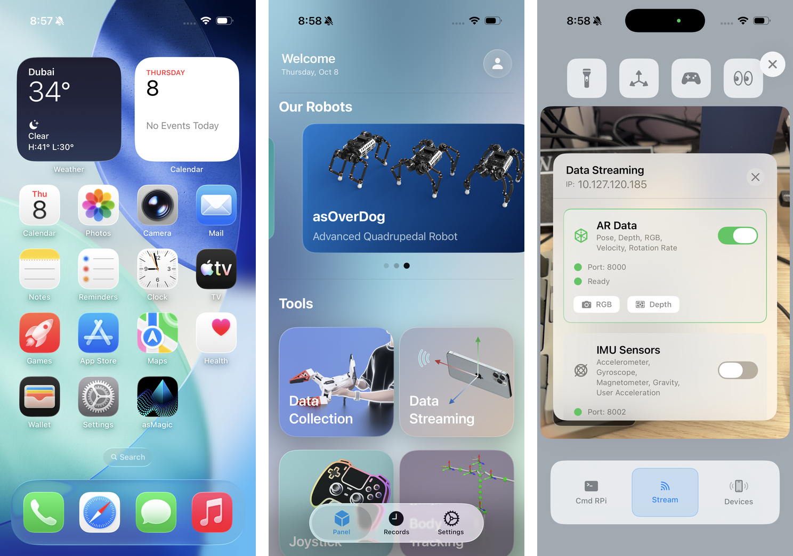

*Figure 1. The asMagicApp provides a Data Streaming interface in which AR Data is enabled and the phone's current network address and port are visible.*

The AR Data panel identifies several possible fields, including device pose, depth, RGB, velocity and rotation rate. Availability in a stream does not mean that every field belongs in a given estimator. The visual-yaw pipeline uses the JPEG-encoded RGB image and the camera intrinsics attached to each frame. The hand-retargeting pipeline also uses RGB, but applies a hand-landmark model rather than an ArUco cube estimator. Neither pipeline treats the phone's device pose as the pose of the cube or the configuration of the human fingers.

The receiving software decodes the color bytes into an image and keeps only the most recent frame in a one-element queue. This prevents a slow consumer from processing an increasingly old backlog. It reduces queue growth but does not eliminate camera exposure time, encoding, Wi-Fi transport, decoding or estimator latency. Capture time and measurement age therefore remain part of the observation contract.

For cube tracking, the receiver converts the per-frame asMagic intrinsics into the camera matrix used at the streamed image resolution. The supplied adapter expects the intrinsics reference to correspond to 1920 × 1440 and rejects an unexpected portrait or auto-rotated aspect ratio. The phone is therefore kept in landscape orientation, with the app foregrounded and the screen unlocked. Because distortion coefficients are not supplied by this interface, the adapter uses zero coefficients and keeps the cube near the image centre. Depth is not used in the supplied tracker because depth-to-color registration is not established by the package.

The stream carries data in camera and device conventions. It does not by itself provide:

- the pose of the marked cube in the camera frame;
- the camera-to-palm calibration;
- human-hand landmarks or their correspondence to LEAP joints;
- a validity decision for an occluded object; or
- a control action for the robot.

These quantities are produced by the perception, calibration and control stages introduced below. The asMagicApp is the sensing and transport layer at the beginning of those pipelines.

## 2. From an image to a cube pose

Visual feedback requires a complete causal path:

> image and capture time → marker detection → camera-frame cube pose → palm-frame cube pose → policy observation → bounded joint target → contact → next image

If the video is only watched after the run, it is **visual evidence**, not visual feedback. Vision becomes feedback only when a quantity derived from an image can change a subsequent action.

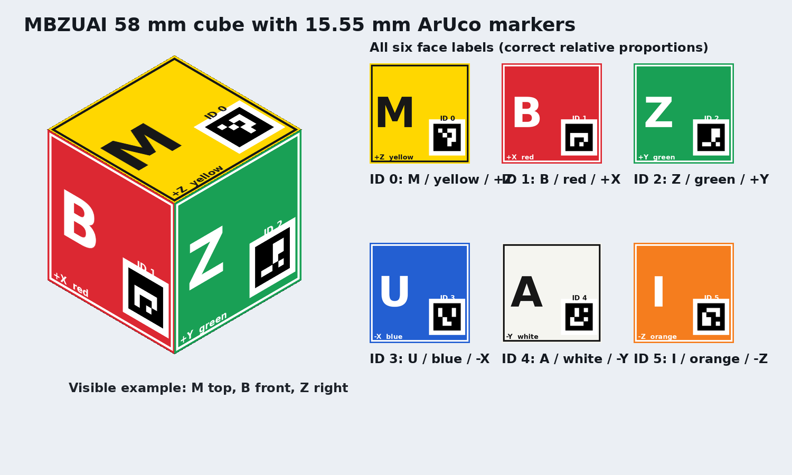

*Figure 2. The marked 58 mm cube used by the supplied visual-yaw task. Known marker geometry provides 3-D/2-D correspondences; it does not make calibration, visibility or timing automatic.*

### Pixels and known geometry

For an ideal pinhole camera,

$$
u=f_x\frac{X_C}{Z_C}+c_x,\qquad
v=f_y\frac{Y_C}{Z_C}+c_y.
$$

The intrinsic parameters $f_x,f_y,c_x,c_y$ must match the image resolution. A pose solver then uses known 3-D marker corners and detected 2-D image corners to estimate the cube pose. If the marker size, corner order or distortion model is wrong, a plausible overlay can still give the wrong metric pose.

The supplied cube defines six markers, one on each face. Multiple faces improve visibility, but a finger can still hide corners. A tracker therefore needs both a pose and a validity decision. Marker geometry also fixes metric scale: an incorrect marker width biases the recovered translation even when the image overlay appears stable. Temporal smoothing can reduce random variation, but it cannot remove a systematic scale error.

## 3. Frames turn a pose into a meaningful observation

Let $C$ be the camera frame, $B$ the cube body frame and $P$ the LEAP palm frame. The tracker estimates $\widehat T^C_B$ and the measured camera mount provides $T^P_C$. The policy needs

$$
\widehat T^P_B(t_{\mathrm{image}})=T^P_C\widehat T^C_B(t_{\mathrm{image}}).
$$

The rightmost transform acts first. The camera-to-palm transform must be measured for the actual mount. A phone's AR/device pose is not the cube pose and is not automatically the palm-to-camera calibration.

| Quantity | Meaning | Common error |
| --- | --- | --- |
| Device AR pose | Phone relative to its AR world | Treating it as cube pose |
| Marker pose | One marker relative to the camera | Treating the face centre as the cube centre |
| Cube pose | Cube body relative to the camera | Omitting the marker-to-cube geometry |
| Palm-frame cube pose | Cube relative to the robot palm | Using an unmeasured camera-to-palm transform |

### Worked transform

Suppose the camera is rotated $90^\circ$ about palm $z$ and its origin is 0.10 m along palm $x$:

$$
{}^PR_C=\begin{bmatrix}0&-1&0\\1&0&0\\0&0&1\end{bmatrix},\qquad
{}^Pp_C=\begin{bmatrix}0.10\\0\\0\end{bmatrix}\mathrm{m}.
$$

For a cube-centre estimate ${}^Cp_B=(0.20,0.03,0.40)$ m,

$$
{}^Pp_B={}^PR_C{}^Cp_B+{}^Pp_C
=\begin{bmatrix}0.07\\0.20\\0.40\end{bmatrix}\mathrm{m}.
$$

Adding the translation without rotating first gives $(0.30,0.03,0.40)$ m and represents a different physical point.

The transform $T^P_C$ remains valid only while the camera mount retains the calibrated relationship to the palm. If the mount moves, marker detection can remain visually stable while the reported palm-frame cube pose becomes systematically displaced or rotated. Recalibration is required after any change to the camera mount, hand base or reference geometry.

## 4. Goal-directed visual yaw

The supplied policy requests a relative yaw change while retaining a full 3-D rotation representation. Its orientation error is

$$
R_{\mathrm{err}}=R^P_{B,\mathrm{observed}}
\left(R^P_{B,\mathrm{goal}}\right)^T.
$$

Using a continuous 6-D rotation representation avoids the discontinuity of wrapping a single angle at $\pm\pi$. The actor receives 57 values:

| Observation group | Count | Purpose |
| --- | ---: | --- |
| Joint position relative to reference grasp | 16 | Current contact-producing configuration |
| Joint tracking error | 16 | Difference between requested and measured joints |
| Cube translation in palm frame | 3 | Object location relative to the hand |
| Continuous rotation error | 6 | Observed orientation relative to the goal |
| Previous action | 16 | Short-term action context and continuity |
| **Total** | **57** | One policy observation |

The policy returns 16 bounded joint updates. It is an inference artifact: loading `model_4900.pt` runs learned weights; it does not retrain the policy.

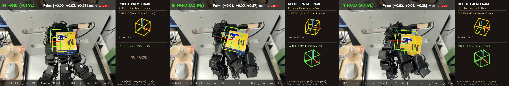

*Figure 3. Frames from a supplied deployment recording. The images are experimental evidence; the pose packet, policy input and command log establish the feedback path.*

Each observation group resolves a different ambiguity. Joint position identifies the configuration that forms the current contacts. Joint tracking error separates commanded motion from measured response. Cube translation locates the object relative to the palm. Rotation error supplies goal progress. Previous action provides short-term control context. Removing any group changes the information available to the trained actor and would require a compatible policy rather than an ad hoc change to the input vector.

### Simulation task and training artifact

The supplied MuJoCo task uses the flat right LEAP Hand and a cube model with a 58 mm edge length and 85 g mass. Physics advances at 200 Hz, while the policy selects a new action at 20 Hz. Each policy action therefore spans ten physics steps in which contacts, joint motion and cube dynamics evolve. This separation is important: the controller does not directly prescribe a cube rotation. It changes joint targets, the simulated actuators move the fingers, contact forces act on the cube, and the next observation reports the result.

Training uses discrete relative yaw goals of −90°, +90° or 180°. A training episode lasts 50 seconds unless the cube falls below the permitted height or a non-finite state is detected. A goal is considered successful when the orientation error is below 10°. The task retains the cube near the palm while rotating it, because matching yaw after dropping or ejecting the object would not constitute successful in-hand manipulation.

The selected checkpoint is `model_4900.pt`, saved at PPO iteration 4900 from a run configured for 5000 iterations with seed 7. The actor and critic use multilayer perceptrons with hidden widths 512, 512 and 256. PPO collects 32 steps per environment, uses a learning rate of $10^{-3}$, discount factor $\gamma=0.99$, generalized-advantage parameter $\lambda=0.95$, and an entropy coefficient of 0.003. The checkpoint contains actor and critic parameters, optimizer state, observation-normalization statistics and the saved iteration number. The preserved parameter files define the training run; the portable bundle does not contain the TensorBoard event history needed to plot a complete reward-versus-iteration learning curve.

The reward combines task achievement with object retention and controlled motion:

| Term | Weight | Training purpose |
| --- | ---: | --- |
| Orientation alignment | +5.0 | Reduce the cube-to-goal orientation error continuously |
| Palm-relative position | +0.5 | Keep the cube in a useful in-hand region |
| Success | +2000.0 before time-step scaling | Reward reaching the 10° goal region |
| Cube fallen | −100.0 | Reject solutions that lose the object |
| Hand-pose cost | −0.5 | Discourage unnecessary departure from useful hand configurations |
| Action-rate cost | −0.001 | Discourage abrupt command changes |
| Energy cost | −0.001 | Discourage unnecessarily costly motion |

The actor is trained with corrupted observations rather than perfect state alone. Joint-position channels receive bounded noise and up to one policy-step lag. Camera-derived cube position and orientation channels use their own noise ranges and up to two policy-step lag. Held observations are also introduced. The critic receives clean task information during training, but the actor must choose actions from the corrupted interface it will use at deployment. This asymmetric arrangement lets the value function use accurate simulator state while teaching the action policy to tolerate an imperfect measurement channel.

### Visualizing reorientation progress

The simulation viewer displays the manipulated cube in the hand and a separate nonphysical goal cube. The goal cube communicates the requested orientation but has no mass, collision or contact effect. Progress is visible when the labeled faces of the manipulated cube approach the orientation shown by the goal cube while the fingers preserve contact and keep the object above the palm.

| Initial orientation and goal | Early contact redistribution |
| --- | --- |
| 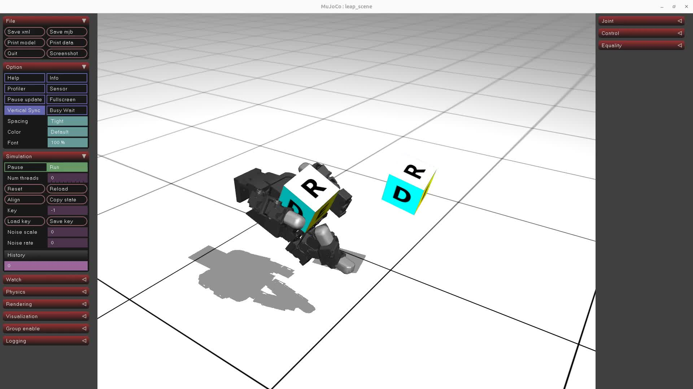 | 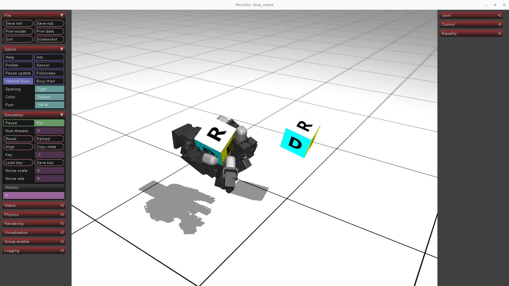 |
| **Intermediate orientation change** | **Later goal-directed orientation** |
| 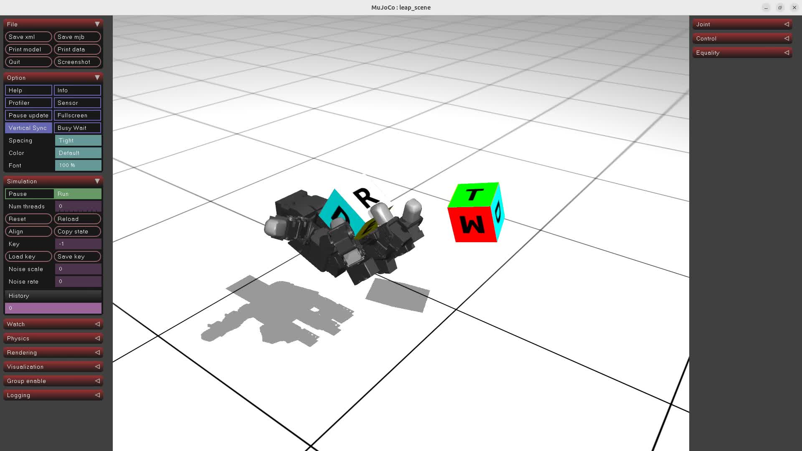 | 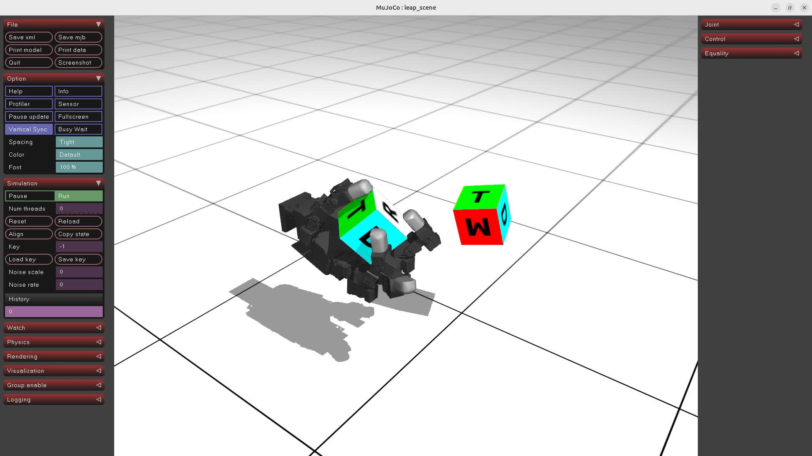 |

*Figure 4. Frames from the supplied MuJoCo goal-conditioned reorientation visualization. The sequence shows progress within one rollout, not improvement across training iterations. The detached cube represents the requested orientation; the cube held by the fingers is the dynamically simulated object.*

The sequence exposes two simultaneous requirements. The cube orientation must approach the target, and the contact arrangement must remain capable of supporting the cube. A policy that minimizes angular error for one instant but loses the object immediately afterwards has not solved the task. The position reward, fall penalty, hand-pose cost and action regularization shape this balance.

### How visual feedback enhances reorientation

In a purely proprioceptive continuous-rotation task, the controller observes the hand and its recent commands but does not directly know the cube's current orientation. It can learn a repeating finger gait that often produces rotation, yet slip, incomplete contact or an unexpected cube pose may go undetected. The same joint motion can produce different object motion under different contact conditions.

Visual feedback changes the problem from **produce a rotation pattern** to **reduce a measured object-to-goal error**. At every update, the measured cube pose contributes a new orientation error. If the cube rotates less than expected, the remaining error stays large and the policy can continue correcting. If the cube moves toward the wrong yaw, the sign and structure of the error change. As the cube approaches the goal, the error contracts and the learned action can settle rather than continuing an open-loop rotation pattern.

This feedback loop adds five capabilities:

1. **Outcome observation:** the controller receives evidence of what happened to the object, not only what happened to the joints.
2. **Goal dependence:** the same hand state can produce different actions for −90°, +90° and 180° targets.
3. **Slip compensation:** unexpected object motion appears in the next visual error and can influence the next correction.
4. **Explicit completion:** the system can evaluate a 10° success region from object pose rather than infer success from elapsed time or finger motion.
5. **Diagnostic separation:** joint tracking, object translation and object rotation are represented separately, making actuator error, object slip and goal error distinguishable.

The enhancement is conditional on measurement quality. A biased camera-to-palm transform creates a biased goal error. Latency makes the controller correct an earlier state. Occlusion can remove the object observation precisely when fingers change contact. Visual feedback therefore improves task observability, but only when calibration, validity and timing remain explicit parts of the loop.

## 5. Time, dropout and occlusion are part of the measurement

A useful pose packet contains more than six pose values:

```text
{pose, capture_time, camera_frame, object_id, valid, reprojection_error}
```

When capture and controller clocks share a time base, pose age at use is

$$
a=t_{\mathrm{use}}-t_{\mathrm{capture}}.
$$

At 20 Hz, three control periods are 150 ms. If the cube rotates at approximately 1 rad/s, a 150 ms-old orientation can differ by about

$$
\Delta\theta\approx\omega a=0.15\;\mathrm{rad}=8.59^\circ.
$$

This is a local timing estimate, not a guaranteed tracking error. Unsynchronised clocks add an unknown offset. A packet arriving now may still contain an old pose.

| Condition | Correct interpretation | Possible guarded response |
| --- | --- | --- |
| Fresh valid estimate | Current visual evidence is available | Build the next policy observation |
| New image, rejected detection | No valid cube estimate from this image | Reject, pause or use a declared short grace rule |
| Repeated last pose | The estimate is ageing | Mark it stale; do not call it a new measurement |
| Large reprojection error | Image/model agreement is poor | Reject or reduce authority |

Holding a pose can smooth a brief occlusion, but it does not make the pose current. Continuing an action through occlusion is a controller policy and must have a bounded duration, a tested stop response and recorded evidence. An invalid detection must remain distinguishable from a valid zero-valued measurement; substituting a zero pose invents evidence that the camera did not provide.

## 6. Hand retargeting: correspondence before command

Cube tracking estimates an **object**. Hand retargeting estimates an **operator gesture**. They may share a camera, but they do not share an output contract.

A human and LEAP Hand have different link lengths, joint axes, digit counts and limits. Copying human joint angles is therefore not meaningful. Retargeting searches for a feasible LEAP configuration $\mathbf q$ whose robot landmarks or vectors correspond to the observed human hand:

$$
\mathbf q^*=\underset{\mathbf q_{\min}\leq\mathbf q\leq\mathbf q_{\max}}{\arg\min}
\;\mathcal L\!\left(f_{\mathrm{LEAP}}(\mathbf q),\mathbf x_{\mathrm{human}}\right)
+\lambda\lVert\mathbf q-\mathbf q_{\mathrm{previous}}\rVert^2.
$$

The second term discourages abrupt frame-to-frame changes. Bounds prevent visually plausible human gestures from requesting infeasible robot joints.

The supplied pipeline is:

> asMagicApp/webcam image → MediaPipe hand landmarks → palm-centred vectors → Dex-Retargeting optimisation → joint-order conversion → MuJoCo LEAP posture

Three correspondence modes are available:

- `enhanced`: includes additional phalanx information for long-finger curl;
- `dexpilot`: emphasises fingertip and pinch-like relations; and
- `vector`: uses the stock vector formulation.

Mirroring, left/right handedness and robot joint order are interface decisions, not display preferences. The script converts retargeter joint order separately for the MuJoCo model and physical IDs 0–15.

| Open-palm correspondence | Closed-hand correspondence |
| --- | --- |
| 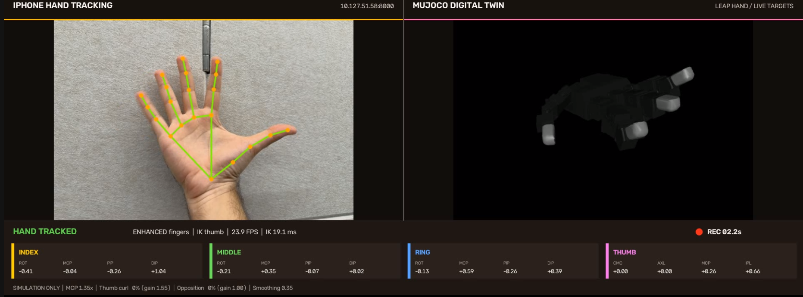 | 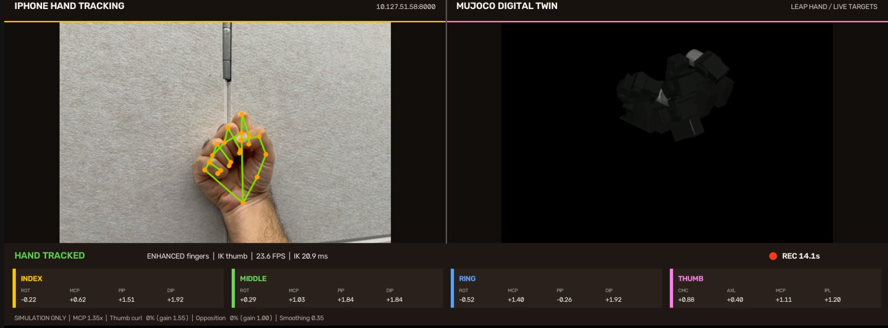 |
| **Thumb extension with flexed fingers** | **Partial finger extension** |
| 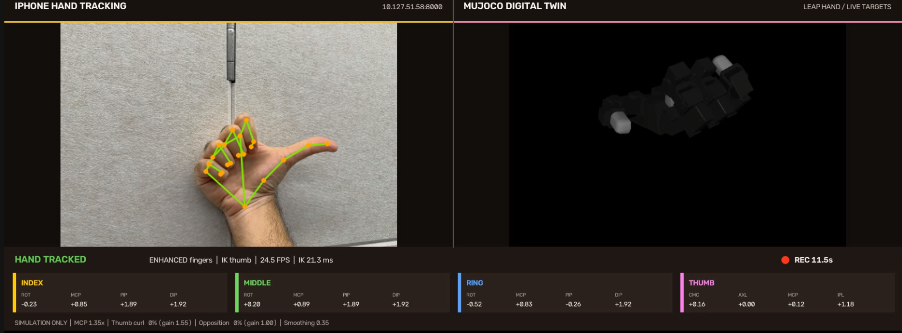 | 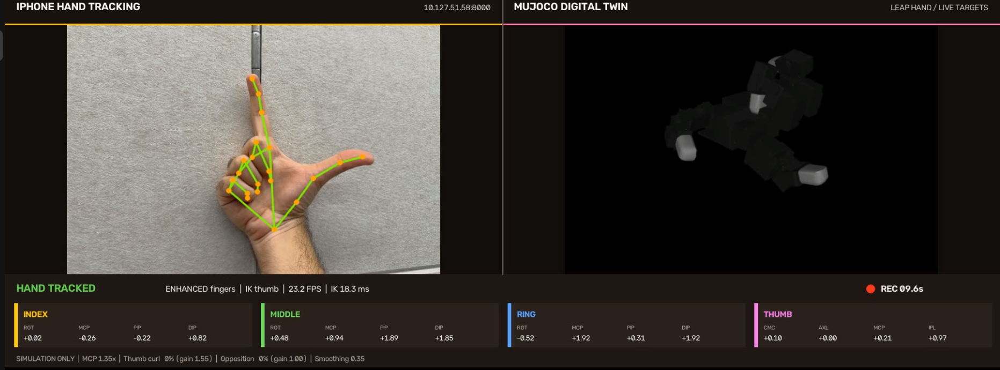 |

*Figure 5. Human landmarks, the MuJoCo LEAP digital twin and joint telemetry across four observed gestures. The retargeter preserves task-relevant fingertip and finger-direction relationships while respecting the simulated hand's different geometry and joint limits.*

For a pinch gesture, fingertip separation and relative fingertip direction are more transferable than a literal copy of every human joint angle. An exact geometric match may still be impossible because the LEAP Hand has different link lengths, joint axes, ranges and digit structure. The optimisation therefore preserves task-relevant relationships while remaining inside robot joint limits.

## Instructor and TA demonstration

Run the supplied visual-yaw simulation with a +90° goal, then show the software-only hand-retargeting preview. Identify the cube-pose feedback path, timestamp/validity check, landmark correspondence and LEAP digital-twin posture. The detailed student procedure is in [Class 07 practice](07-practice.md).

## Student activity

Complete [Class 07 practice](07-practice.md). Compare fresh and delayed/dropout visual observations, then retarget an open hand, closed hand and pinch gesture in simulation. Record one supported result and one limitation before hardware deployment.

## Resources

- [Simulation-only student practice](07-practice.md)
- [Downloadable iPhone-to-LEAP simulation package](../resources/class07/practical/downloads/class07-iphone-leap-simulation.zip)
- [Standalone package README](../resources/class07/practical/downloads/Class07_iPhone_LEAP_Simulation/README.md)
- [Visual-yaw deployment README](../resources/class07/practical/additional_material/visual_yaw_reorientation/README_FIRST.md)

## References

- Shaw, K., Agarwal, A. and Pathak, D. *LEAP Hand: Low-Cost, Efficient, and Anthropomorphic Hand for Robot Learning.* RSS, 2023.
- Qin, Y. et al. *AnyTeleop: A General Vision-Based Dexterous Robot Arm-Hand Teleoperation System.* RSS, 2023.
- OpenAI et al. *Learning Dexterous In-Hand Manipulation.* IJRR, 2020.
