# Class 08 — Assembly guide

**Optional teaching-team preparation.** The required student task is simulation control. This retained source procedure is not a student instruction to assemble, energise or calibrate a physical arm during class.

This page takes you from the five boxes of the kit to a complete arm, ready for the first power-on. Build five
sub-assemblies, stack them from the base up, then wire the driver board. The next step is
[Class 08 — Power-on and zero](08-power-on-and-zero-optional.md).

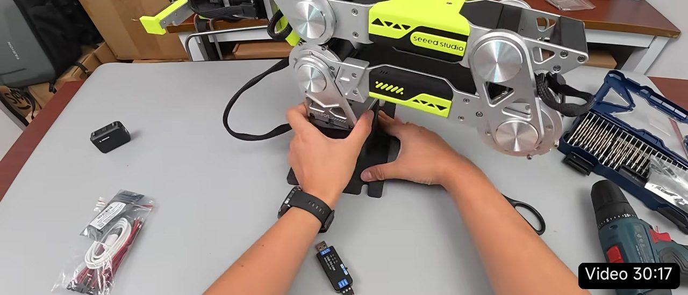

*Figure 1. The finished arm.*


**Source.** The photos are frames from the Seeed Studio video
[Assembly Tutorial for the Fully Open-Source reBot-RS Robotic Arm](https://www.youtube.com/watch?v=Bv60NPO0TRo)
(30:33). The "Video mm:ss" tag on a frame is its time in the video, where you can watch the motion. The part
renders come from [Seeed-Projects/reBot-DevArm](https://github.com/Seeed-Projects/reBot-DevArm) (CERN-OHL-W-2.0).
Screw and cable specifications follow the bill of materials of that repository.


---

## How to read this guide

| Mark | Meaning |
| --- | --- |
| **❶ ❷ ❸** | A picture with several frames: do them in this order |
| **Yellow box** | The key point of the frame: which screws, how many, or an orientation rule |
| `A + B ─[n× screw]→ result` | One sub-step: what joins what, with which screws, and what you get |
| ⚠️ | Easy to get wrong and hard to undo. Check twice. |

---

## Before you start

### One kit, five boxes

| Box | Content |
| --- | --- |
| RS-Pn Power Adapter | 48 V supply, mains and XT30 cables |
| RS-Sn Structure Kit | base plate, printed brackets, bearing, screw bags |
| RS-Mn Motor Kit | three RS-06 and three RS-00 actuators (ID1–ID6), cables, USB-to-CAN adapter, splitter board |
| RS-Cn Clamp for Mounting | the clamp that fixes the base to the table |
| RS-Gn Gripper Kit | gripper rail with its RS-00 actuator (ID7), bracket, screws |

The letter $$n$$ is the number of the arm. The five boxes with the same number belong together: check the number
before you open them.

### Tools

The kit does not include tools.

- Electric screwdriver with Phillips and hex bits (2.0, 2.5, 3.0 mm). ⚠️ **Set the lowest torque.** A stripped
  thread in an aluminium part or a motor housing cannot be repaired.
- Hex keys, for the set screw of the gear and for fine adjustment.
- Scissors or wire strippers, and a small flat screwdriver for the CAN terminals in the driver-board section.
- Optional: thread-locker. The bill of materials notes that joint screws can loosen over long use.

### Screws

Sort the screw bags against the chart first. Each bag is printed with its specification, for example
`KM3x7mm 50PCS`, `KA3x12mm 28PCS` or `HM3x8mm 33PCS`.

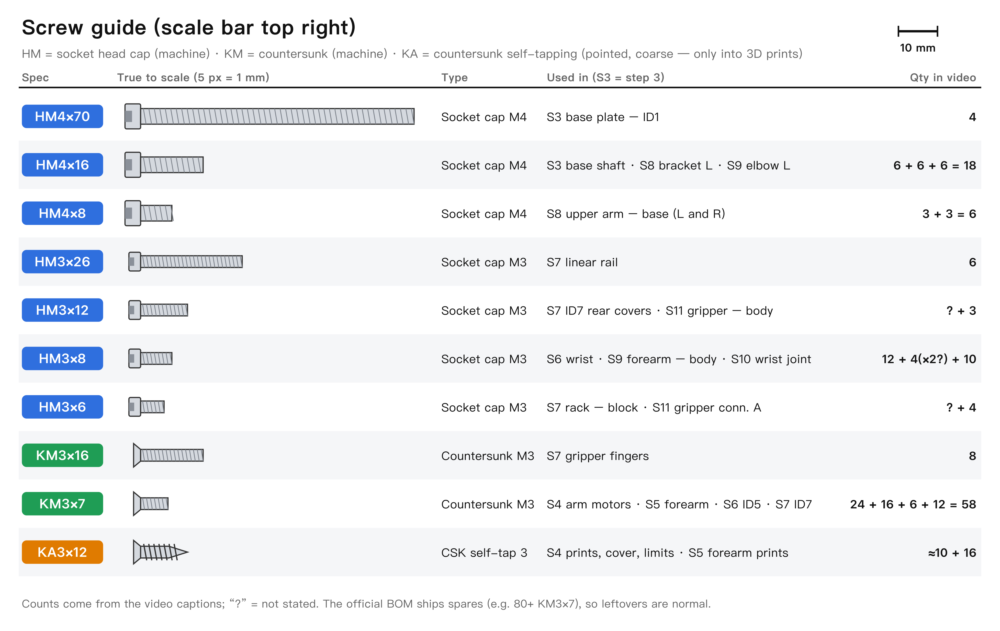

*Figure 2. Screw guide.*

### The order of the work

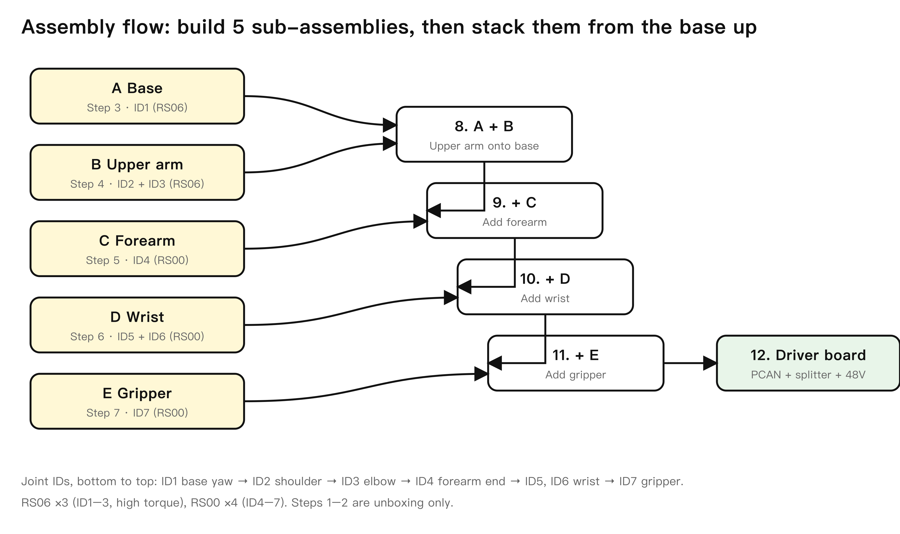

*Figure 3. Assembly flow.*

### Joint IDs

| ID | Motor | Position | Installed in step |
| --- | --- | --- | --- |
| ID1 | RS-06 | Base yaw | 3 |
| ID2 | RS-06 | Shoulder (root of the upper arm) | 4 |
| ID3 | RS-06 | Elbow (end of the upper arm) | 4 |
| ID4 | RS-00 | End of the forearm | 5 |
| ID5 | RS-00 | Wrist | 6 |
| ID6 | RS-00 | Wrist (turns the gripper) | 6 |
| ID7 | RS-00 | Gripper open and close | 7 |


The motor IDs are written at the factory and printed on a label on each housing. **Check the label at every
step.** A motor in the wrong place means taking a whole section apart again.


---

## Unbox: motor kit

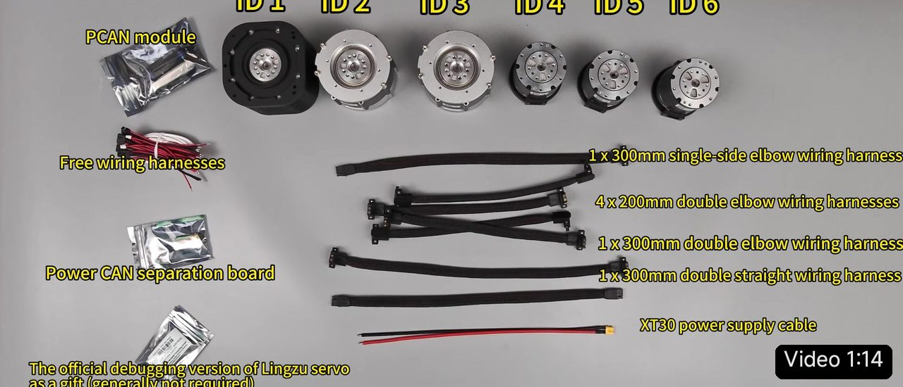

*Figure 4. Motor kit contents.*

Check:

- [ ] Motors ID1–ID6 (ID7 is in the gripper kit)
- [ ] Cables: 300 mm single-elbow ×1, 200 mm double-elbow ×4, 300 mm double-elbow ×1, 300 mm double-straight ×1,
  XT30 power cable ×1
- [ ] PCAN USB-to-CAN module, power and CAN splitter board, loose 2-pin JST cable
- [ ] RobStride debug board (an extra, usually not needed)


Cable types: **single-elbow** has one angled end and one straight end; **double-elbow** has two angled ends;
**double-straight** has two straight ends. The 300 mm double-elbow is the longest angled cable of the kit. The forearm section
needs it.


## Unbox: structural kit

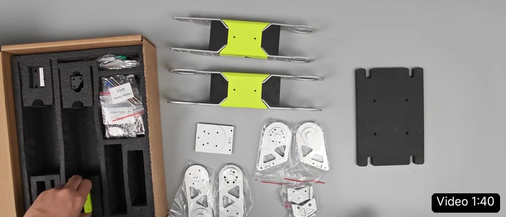

*Figure 5. Structural kit.*

Metal parts, printed parts, screw bags and the base plate. Paired parts are engraved with L or R: sort them into
left and right before you start.


**Photo to be added:** all structural parts laid flat, each labelled with the name used below.


---

## Base (sub-assembly A)

**Parts for this step**

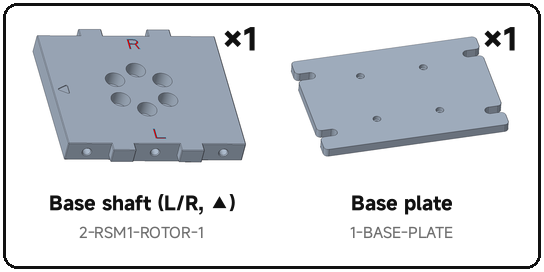

*Figure 6. Parts – base.*

Also: ID1 (RS06), AXK5578 flat thrust bearing ×1, `4× HM4×70`, `6× HM4×16`

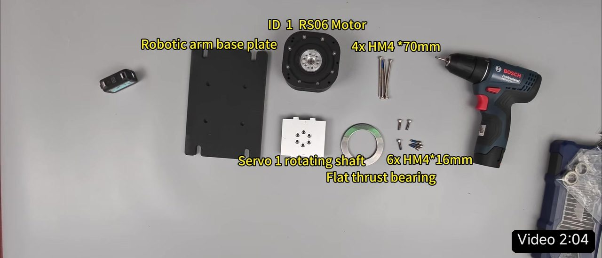

*Figure 7. Parts for this step.*

### Base plate + ID1

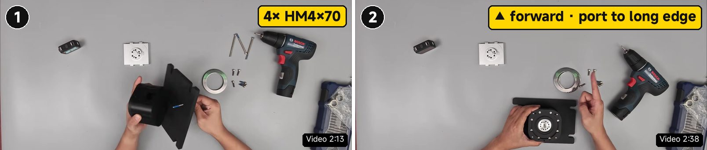

*Figure 8. Source assembly view: Base plate + ID1.*

`Base plate + ID1 ─[4× HM4×70]→ base plate assembly`

- ⚠️ The **▲ arrow** on the base plate points **forward** (toward the front of the arm).
- ⚠️ ID1's **connector faces the long edge** of the base plate.
- The screws go through the plate into the motor (around video 2:12).


**Photo to be added:** underside of the base plate showing the screws, plus ID1's connector direction (one shot from above, one from below).


### Thrust bearing + base shaft

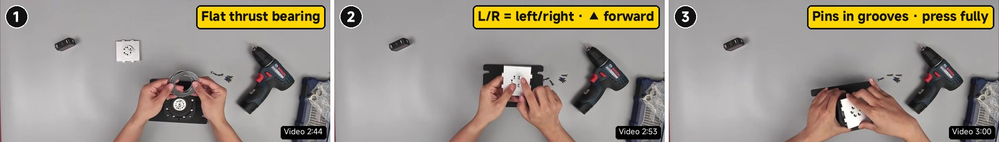

*Figure 9. Source assembly view: Thrust bearing + base shaft.*

`Base plate assembly + AXK5578 thrust bearing + base shaft → press into place`

1. Lay the thrust bearing flat on the outer ring of ID1's output.
2. Base shaft: **▲ forward**, and its engraved **L/R match the arm's left and right**.
3. Line up the shaft's **locating pins with the grooves in the motor's output disc** and press it all the way down.

### Tighten

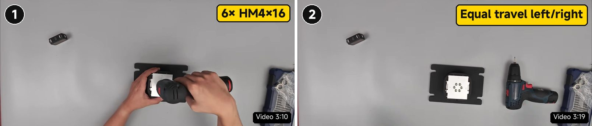

*Figure 10. Source assembly view: Tighten.*

`Base shaft ─[6× HM4×16]→ ID1 output disc`

- Afterwards, turn the shaft by hand: **travel must be equal both ways.** If it isn't, the pins didn't seat; take it off and redo it.


**Result:** base sub-assembly A


---

## Upper arm (sub-assembly B)

**Parts for this step**

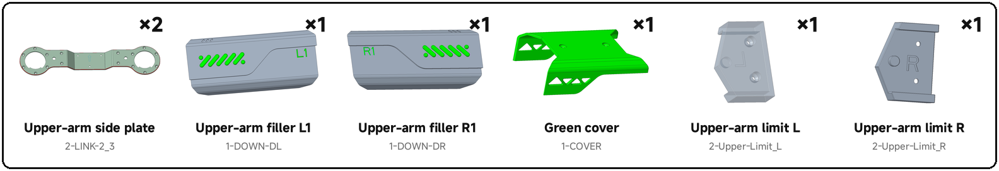

*Figure 11. Parts – upper arm.*

Also: ID2, ID3 (RS06), 200mm double-elbow cable ×1, `24× KM3×7`, about 10× `KA3×12`

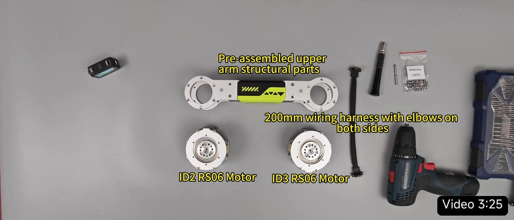

*Figure 12. Parts for this step.*


The upper-arm frame arrives **pre-assembled as one piece** (two metal side plates around the printed parts). Remove one side before fitting the motors.


### Open the pre-assembled frame

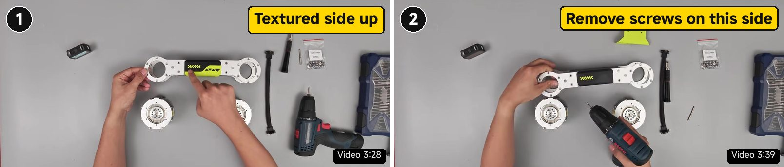

*Figure 13. Source assembly view: Open the pre-assembled frame.*

- Lay it **textured side up**.
- Remove the screws on the upward-facing side. Keep them; you'll need them again in 4.5.


**Photo to be added:** both sides of the frame before disassembly, with the screws to remove circled.


### Pre-route the cable: ID2 ⇄ ID3

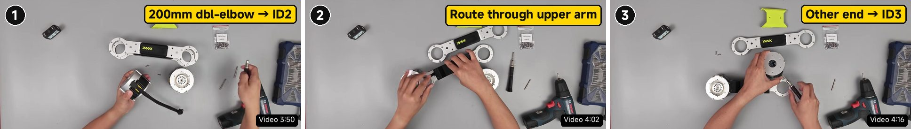

*Figure 14. Source assembly view: Pre-route the cable: ID2 ⇄ ID3.*

`200mm double-elbow cable: one end → ID2, through the upper arm, other end → ID3`

- After plugging in, tighten the retaining screws on each plug.

### Set the connector directions ⚠️

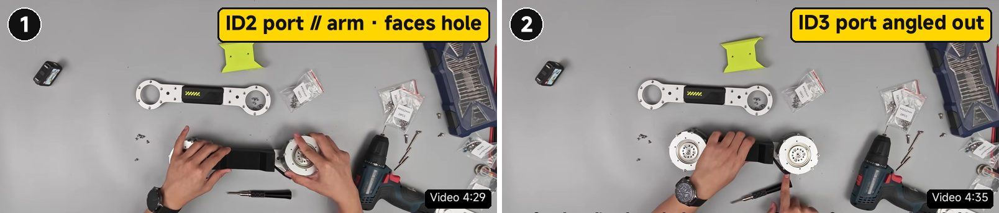

*Figure 15. Source assembly view: Set the connector directions ⚠️.*

- **ID2**: connector **parallel to the upper arm**, with one side **facing the opening in the arm**.
- **ID3**: after routing, the connector sits **at an angle to the arm**, so each motor can later be unplugged on its own for debugging.

### First side plate

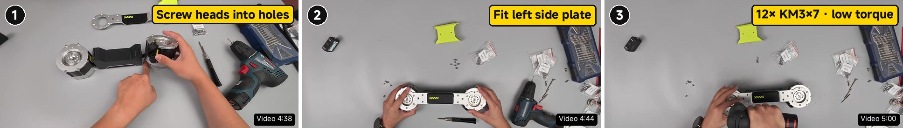

*Figure 16. Source assembly view: First side plate.*

`ID2 + ID3 + upper arm (left side plate) ─[12× KM3×7]→ half-built arm`

- First nudge the motors until **the screw heads on the motor face drop into the holes below**, then fit the left side plate.
- 6 per motor, 12× KM3×7 in total. ⚠️ **Low torque.**

### Other side + green cover

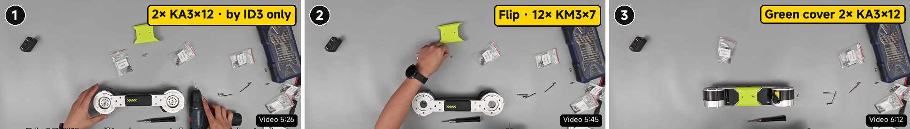

*Figure 17. Source assembly view: Other side + green cover.*

1. `Metal side plate + printed part ─[2× KA3×12]`: **only the two holes next to ID3** (video 5:14).
2. Flip the arm and move the screws over from the other side (video 5:30), then fix this side's motors with `12× KM3×7`.
3. `Green cover ─[2× KA3×12]→ upper arm`


**Photo to be added:** close-up of the two KA3×12 next to ID3 after flipping. The video only says to move the screws over from the other side and doesn't show exactly which ones.


### Self-check

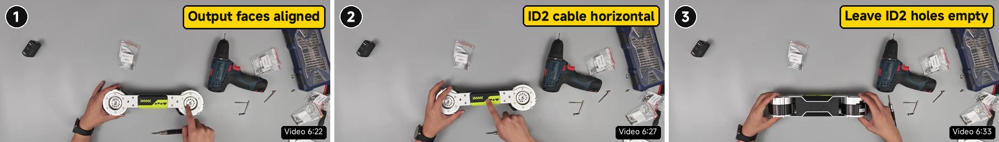

*Figure 18. Source assembly view: Self-check.*

- [ ] Both motors' **output faces are flush** (the side-plate texture lines up)
- [ ] ID2's cable runs horizontally; ID3's cable follows the direction in the picture
- [ ] Self-tapping screws next to ID3 are in; **leave the holes next to ID2 empty** for the limit blocks

### Upper-arm limit blocks L / R

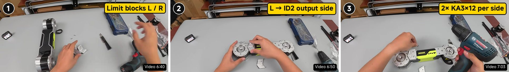

*Figure 19. Source assembly view: Upper-arm limit blocks L / R.*

`Limit block L ─[2× KA3×12]→ ID2 output side`, then flip: `Limit block R ─[2× KA3×12]→ same spot on the back`


**Photo to be added:** close-up of both limit blocks installed (both sides), showing which way the L/R markings face.



**Result:** upper-arm sub-assembly B (ID2 + ID3)


---

## Forearm (sub-assembly C)

**Parts for this step**

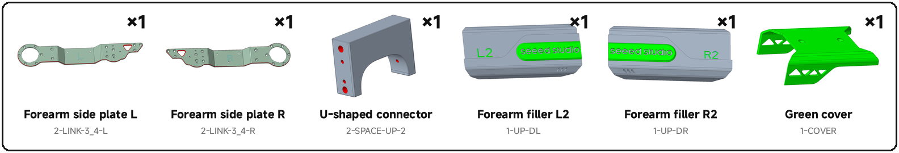

*Figure 20. Parts – forearm.*

Also: ID4 (RS00), **300mm double-elbow cable** (the longest one), `16× KM3×7`, `16× KA3×12`

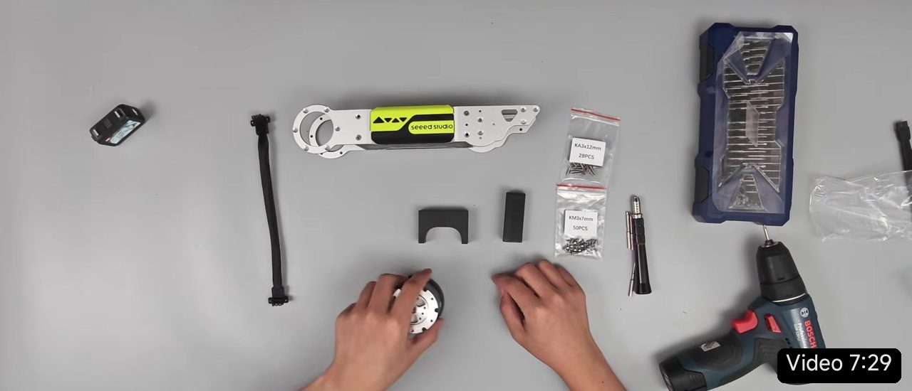

*Figure 21. Parts for this step.*


The cable shown in this part of the video is the wrong one (an on-screen note in the top-right corner corrects it). **Use the 300mm double-elbow**, the longest angled cable in the kit.


### Route the cable

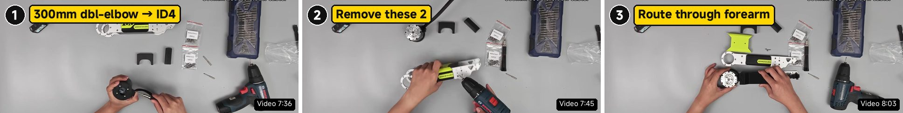

*Figure 22. Source assembly view: Route the cable.*

1. `300mm double-elbow cable → ID4`, tighten the plug screws.
2. Remove 2 screws from the pre-assembled forearm (video 7:45).
3. Feed the cable through the inside of the forearm.


**Photo to be added:** which 2 screws are removed at 7:45, circled.


### First side

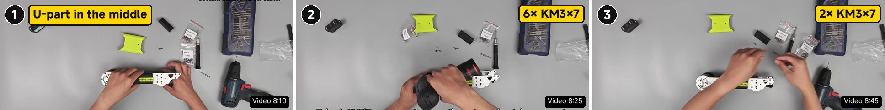

*Figure 23. Source assembly view: First side.*

- Place the `U-shaped connector` in the **middle** of the forearm.
- `ID4 + metal side plate ─[6× KM3×7]`
- `Forearm + U-shaped connector ─[2× KM3×7]`

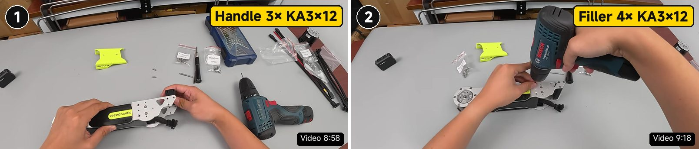

*Figure 24. Source assembly view: First side.*

- `Handle ─[3× KA3×12]→ forearm`. Make sure the handle's outline and orientation match the picture.
- `Internal printed filler ─[4× KA3×12]→ forearm`

### Second side (same set)

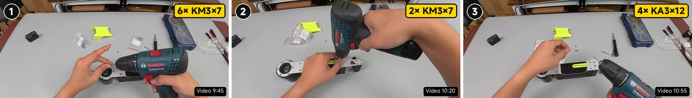

*Figure 25. Source assembly view: Second side (same set).*

`6× KM3×7 (motor)` → `2× KM3×7 (U-part)` → `4× KA3×12 (filler)`

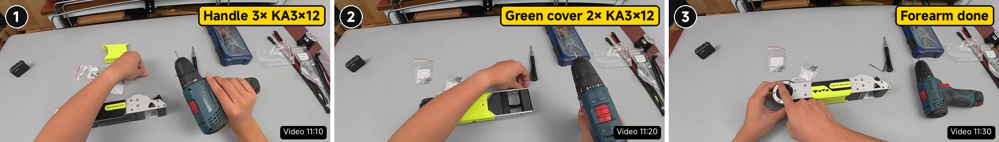

*Figure 26. Source assembly view: Second side (same set).*

- `Handle ─[3× KA3×12]`
- `Green cover ─[2× KA3×12]→ forearm`


**Result:** forearm sub-assembly C (ID4, with the 300mm double-elbow cable trailing out the back)


---

## Wrist (sub-assembly D)

**Parts for this step**

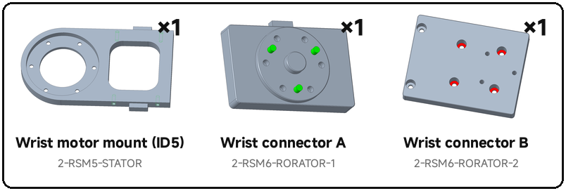

*Figure 27. Parts – wrist.*

Also: ID5, ID6 (RS00), `6× KM3×7`, `12× HM3×8`

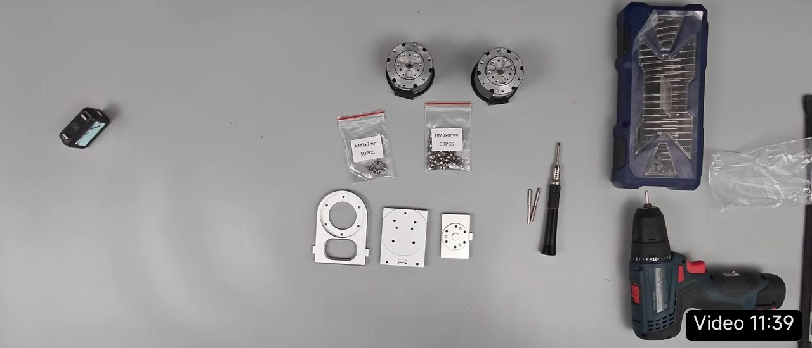

*Figure 28. Parts for this step.*


The parts labels at video 11:35 say “ID4 / ID5”, but this step's captions and every later step use **ID5 / ID6** (ID4 is already in the forearm). Go by **the label on each motor housing**.


### ID5 + wrist motor mount

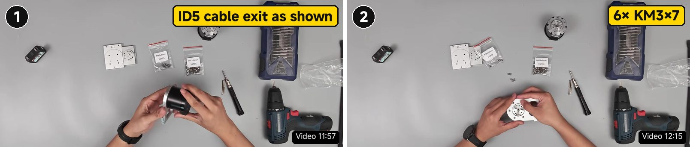

*Figure 29. Source assembly view: ID5 + wrist motor mount.*

`ID5 + wrist motor mount ─[6× KM3×7]`

- ⚠️ ID5's **cable exit points the same way as in the picture**.

### Connector on ID5's output

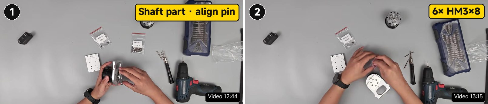

*Figure 30. Source assembly view: Connector on ID5's output.*

`Wrist connector ─(align locating pin, press tight)─[6× HM3×8]→ ID5 output disc`

### Second connector

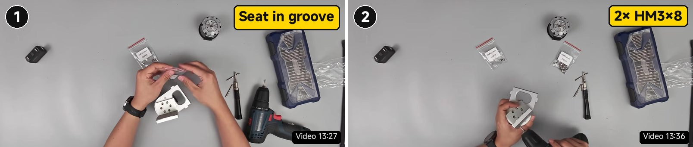

*Figure 31. Source assembly view: Second connector.*

`Other metal connector ─(seat it in the groove first)─[2× HM3×8]`

### ID6

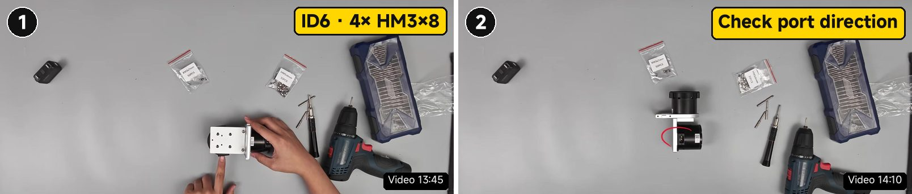

*Figure 32. Source assembly view: ID6.*

`ID6 ─(align holes)─[4× HM3×8]→ metal connector`

- ⚠️ Check that **ID6's connector faces** the same way as in the picture.


**Result:** wrist sub-assembly D (ID5 + ID6)


---

## Gripper (sub-assembly E)

**Parts for this step**

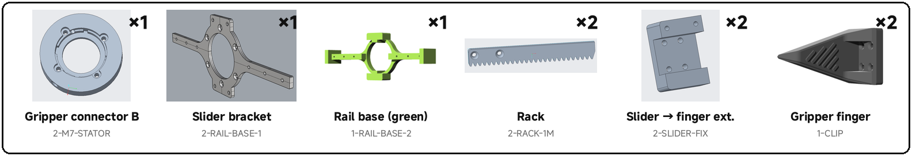

*Figure 33. Parts – gripper.*

Also: ID7 (RS00), MGN9 linear rail ×1 + carriages ×2, module-1 16-tooth gear ×1, `HM3×12`, `12× KM3×7`, `6× HM3×26`, `HM3×6`, `8× KM3×16`

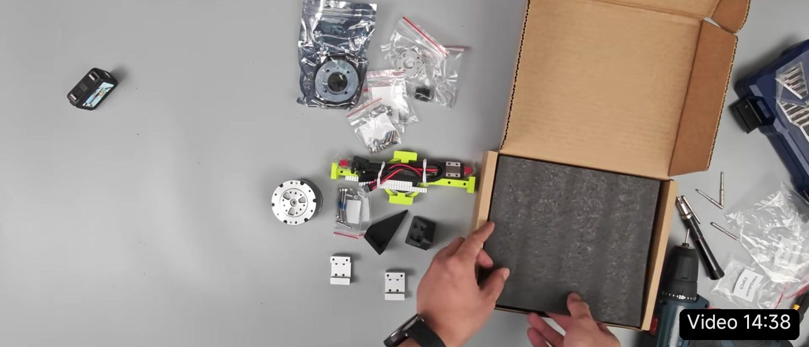

*Figure 34. Gripper kit.*

### ID7 + front and rear metal parts

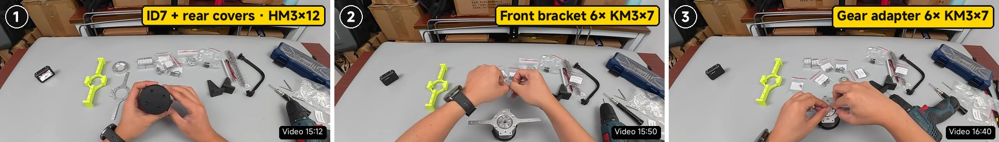

*Figure 35. Source assembly view: ID7 + front and rear metal parts.*

1. `ID7 + two rear metal covers ─[HM3×12]` (the video doesn't say how many)
2. `Front metal bracket ─[6× KM3×7]→ front of ID7`
3. `Gear adapter ─[6× KM3×7]→ ID7 output disc`


**Photo to be added:** screw positions on ID7's rear covers, and how many HM3×12 in total.


### Gear + rail base

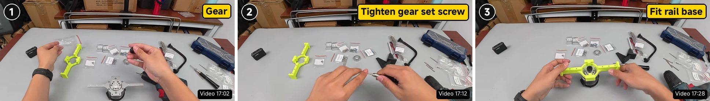

*Figure 36. Source assembly view: Gear + rail base.*

1. Slide the gear onto the adapter's shaft and **tighten the gear's set screw** with a hex key.
2. Fit the green rail base over it.


**Photo to be added:** close-up of the gear set screw, and how the green rail base is held in place (the video doesn't explain).


### Linear rail

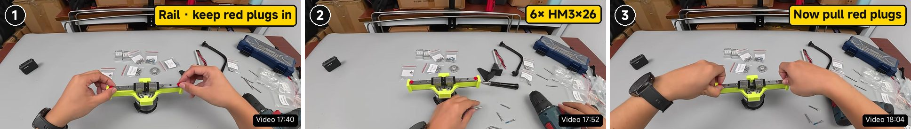

*Figure 37. Source assembly view: Linear rail.*

1. Take out the rail. ⚠️ **Leave the red end plugs in for now**, or the carriages' balls will fall out.
2. `Rail ─[6× HM3×26]→ rail base`
3. **Only after** the rail is fixed, pull the red plugs.

### Racks

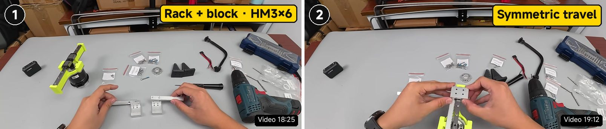

*Figure 38. Source assembly view: Racks.*

1. `Rack + slider block ─[HM3×6]` (make two sets)
2. Line up the holes and mount both racks on the carriages, meshing with the gear. ⚠️ **Left and right travel must be symmetric.** Push them by hand and check both sides open the same distance.


**Photo to be added:** rack positions with the gripper fully closed and fully open (one shot each), as a reference for “symmetric”.


### Fingers

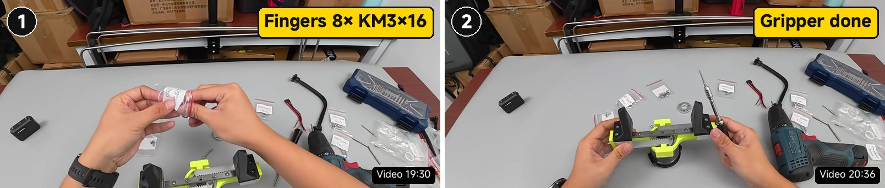

*Figure 39. Source assembly view: Fingers.*

`Gripper fingers ×2 ─[8× KM3×16]→ carriages`


**Result:** gripper sub-assembly E (ID7)


---

## Upper arm onto base (A + B)

**Parts for this step**

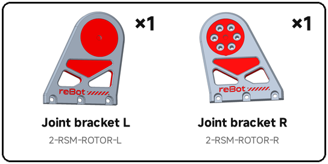

*Figure 40. Parts – shoulder.*

Also: 6803ZZ bearing ×1, `6× HM4×16`, `6× HM4×8`, 300mm single-elbow cable

### Joint bracket L → ID2

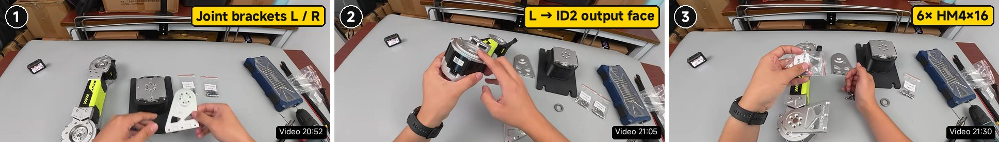

*Figure 41. Source assembly view: Joint bracket L → ID2.*

`Joint bracket L ─(press onto ID2 output face)─[6× HM4×16]`

### Fix the upper arm to the left of the base

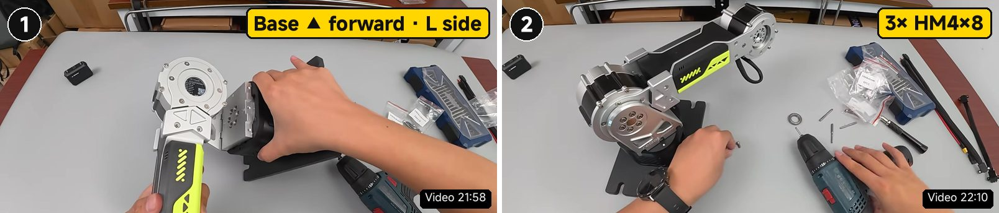

*Figure 42. Source assembly view: Fix the upper arm to the left of the base.*

`Upper-arm sub-assembly B ─[3× HM4×8]→ L side of the base shaft`

- ⚠️ Base **▲ arrow forward**, then mount the upper arm on the **L side**.

### Right side: bearing + bracket R

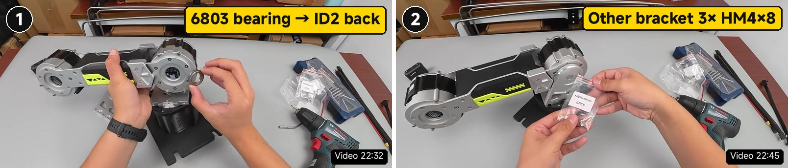

*Figure 43. Source assembly view: Right side: bearing + bracket R.*

1. `6803 bearing → back of ID2`
2. `Joint bracket R ─[3× HM4×8]→ other side of the base shaft`

### Cable ID1 ⇄ ID2

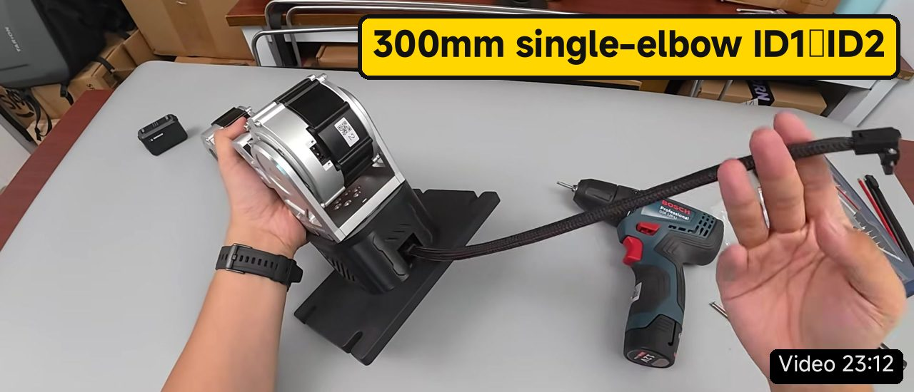

*Figure 44. Source assembly view: Cable ID1 ⇄ ID2.*

`300mm single-elbow cable: ID1 ⇄ ID2`


**Result:** base + upper arm


---

## Add the forearm (+ C)

**Parts for this step**

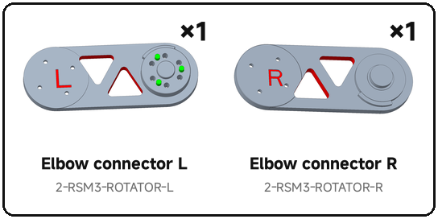

*Figure 45. Parts – elbow.*

Also: 6803ZZ bearing ×1, `6× HM4×16`, `HM3×8`

### Elbow connector L → ID3

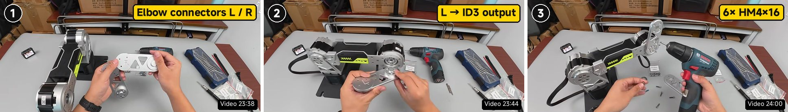

*Figure 46. Source assembly view: Elbow connector L → ID3.*

`Elbow connector L ─(press onto ID3 output)─[6× HM4×16]`

### Forearm → body, repeat on the back, plug in

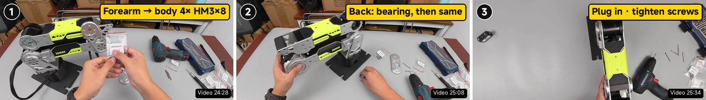

*Figure 47. Source assembly view: Forearm → body, repeat on the back, plug in.*

1. `Forearm sub-assembly C ─[4× HM3×8]→ elbow connector L`
2. Back side: fit the bearing first, then elbow connector R, fixed the same way.
3. Plug the 300mm double-elbow cable coming out of the forearm into ID3 and tighten the plug screws.


**Photo to be added:** the back (R side) after assembly, to confirm how many screws of which type. The video only says “same procedure”.


---

## Add the wrist (+ D)

**Parts for this step**

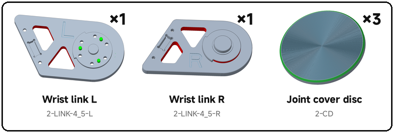

*Figure 48. Parts – wrist joint.*

Also: bearing ×1, `10× HM3×8`

### Wrist link L → ID4

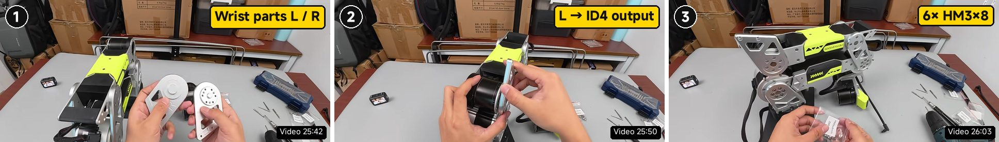

*Figure 49. Source assembly view: Wrist link L → ID4.*

`Wrist link L ─(press onto ID4 output)─[6× HM3×8]`

### Mount the wrist sub-assembly

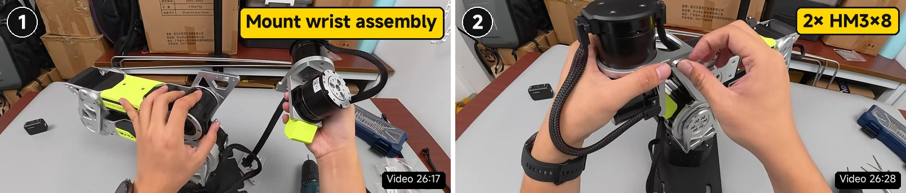

*Figure 50. Source assembly view: Mount the wrist sub-assembly.*

`Wrist sub-assembly D ─[2× HM3×8]→ wrist link L`

### Right side + cable

*Figure 51. Source assembly view: Right side + cable.*

1. `Bearing → back of ID4`, then `Wrist link R ─[2× HM3×8]`
2. Connect the cable at the wrist and tighten the plug screws.

### Cover discs

*Figure 52. Source assembly view: Cover discs.*

Stick the metal cover discs (2-CD) on the outside of each joint to **hide the screws**. They're cosmetic and can go on last.


Once the discs are on, taking a joint apart is a hassle. Fit them after a successful power-on test.


---

## Add the gripper (+ E)

**Parts for this step**

*Figure 53. Parts – gripper mount.*

Also: `4× HM3×6`, `3× HM3×12`, 200mm double-elbow cable ×2

### Gripper connector A → ID6

*Figure 54. Source assembly view: Gripper connector A → ID6.*

`Gripper connector A ─[4× HM3×6]→ front of ID6`

### Gripper → body

*Figure 55. Source assembly view: Gripper → body.*

`Gripper sub-assembly E ─(align with groove)─[3× HM3×12]→ gripper connector A`

### Cables

*Figure 56. Source assembly view: Cables.*

Use the two 200mm angled cables to connect the body and the gripper (ID6 ⇄ ID7, etc.).


**Photo to be added:** overall view of the cable routing from wrist to gripper. The video doesn't say which cable goes where between ID4 and ID7.



**Result:** complete arm body


---

## Driver board

*Figure 57. Wiring.*

### PCAN ⇄ splitter board

*Figure 58. Source assembly view: PCAN ⇄ splitter board.*

1. Take out the 2-pin JST cable, the PCAN module and the power/CAN splitter board.
2. Strip the loose ends of the JST cable.
3. ⚠️ **Red to CANH, black to CANL**, then tighten the terminal screws.

### The last three connections

*Figure 59. Source assembly view: The last three connections.*

1. `300mm double-straight cable: splitter ⇄ ID1`
2. `PCAN USB → computer`
3. `48V supply → splitter XT30 input`


Make every signal connection and check red and black first. **Connect the 48 V supply last.** Never plug or
unplug a motor cable while the power is on.


### Debug board (optional)

*Figure 60. Source assembly view: Debug board (optional).*

The free RobStride debug board usually isn't needed. Use it only to tune low-level parameters of an individual motor.


**Photo to be added:** both sides of the splitter board (CANH/CANL silkscreen, XT30 port positions).


---

## Final checklist

- [ ] With power off, turn each joint through its full range by hand: no binding, no rubbing on cables, symmetric travel
- [ ] Every joint's cables still have slack at the end stops; nothing pulled tight
- [ ] All 7 motor IDs are in the right positions (see the joint ID table under Before you start)
- [ ] Gripper opens and closes smoothly, both fingers symmetric
- [ ] Base ▲ points forward
- [ ] Optional: print `RS_Motor1_wiring_harness_clip.stp` from the repo (cable clips on both sides of ID1, ×2) to keep ID1's cable from wearing out its connector over time

The arm is now ready for its first power-on: [Class 08 — Power-on and zero](08-power-on-and-zero-optional.md).

## Further reading

- Software, calibration and host tools: [Seeed Wiki · Robotics](https://wiki.seeedstudio.com/cn/robotics_page)
- Full BOM, 3D-printing settings, STEP files: [reBot-DevArm / hardware / reBot_B601_RS](https://github.com/Seeed-Projects/reBot-DevArm/tree/main/hardware/reBot_B601_RS)
