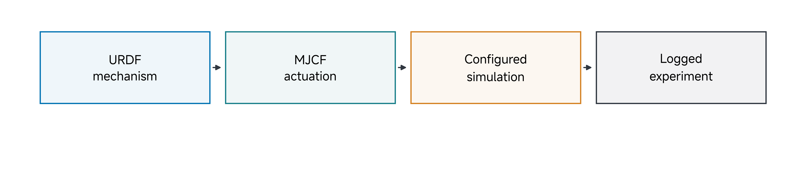
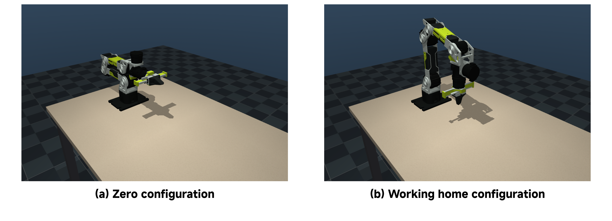
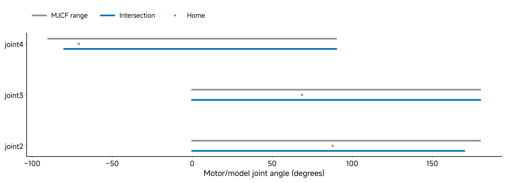
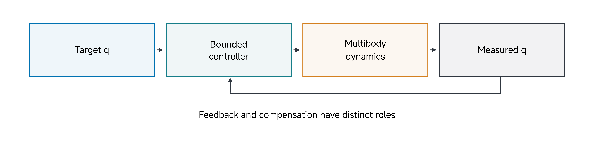
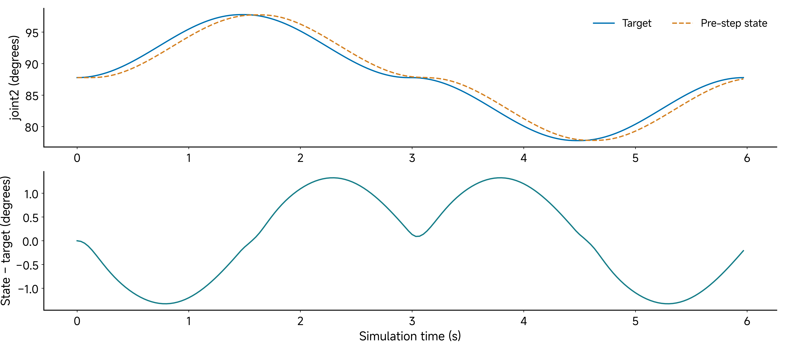
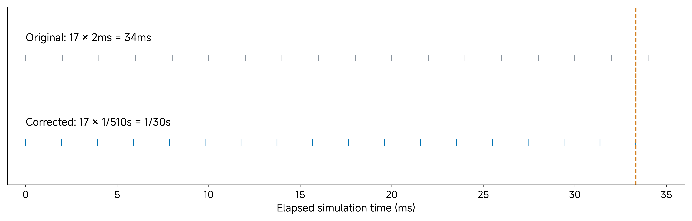

# 08 Let's Build a Simple Arm & Turn it On

## Central question

What evidence shows that an arm or its simulation is ready for a controlled experiment?

A robot that moves can still have the wrong joint order, an incorrect sign, an unsuitable limit or a misinterpreted gripper command. A rendered arm can look convincing while its control interface is inconsistent. Commissioning means establishing the configuration and evidence needed for a specified next operation.

This class uses the **reBot Arm B601-RS MuJoCo simulation**. The mechanism has six rotary arm joints and a parallel gripper. We will inspect its description, identify its frames and interfaces, predict which movements are permitted, and examine bounded motion. The same questions guide a physical commissioning session, with additional checks of the actual assembly, communication and calibration.

By the end of this class, you should be able to:

- Read the arm's joint and actuator arrangement from the compiled model.
- Distinguish a coordinate frame, model zero, working home configuration and physical calibration zero.
- Interpret joint order, signs, units and the separate gripper interface.
- Intersect model and software limits before requesting a movement.
- Compare targets and responses using a declared sampling rule.
- State which next experiment the evidence supports and which checks remain open.

[Lecture](#from-individual-joints-to-a-serial-arm) · [Instructor and TA demonstration](#instructor-and-ta-demonstration) · [Student activity](#student-activity)

The explanation, figures, worked examples and saved records provide a complete reading and activity route without operating an arm or launching a simulator.

## From individual joints to a serial arm

Classes 02–04 separated a command from an actuator response and a simulated model from a physical calibration. Class 05 distinguished independent fixtures from connected mechanics. Classes 06–07 added task and observation contracts. Here we apply those ideas to a different embodiment; the arm needs its own joint, tool and gripper conventions.

In a serial arm, moving a proximal joint changes the positions and orientations of the links that follow it. Their weight and inertia contribute to the effort at that joint. Extending the elbow can change shoulder effort even when the shoulder angle and total mass remain unchanged: the downstream centres of mass move relative to the shoulder axis.

Identify the body tree before reasoning about motion: fixed base, moving links, joint axes and tool. The arm configuration is the vector of its joint coordinates. **Forward kinematics** maps that configuration to tool pose. **Dynamics** relates configuration, velocity and effort to acceleration. A kinematic solution for a desired tool pose does not establish that the available actuators can track it.

**Predict:** If the elbow extends while the shoulder angle stays fixed, must the shoulder's gravity effort stay fixed? Explain your answer using the downstream bodies and their lever arms.

### What the mechanism description supplies

A URDF describes links, joint origins and axes, geometry, inertial properties and joint limits. A runnable MuJoCo experiment also needs actuation, passive parameters, an environment, initial conditions and a stepping rule. Those additions are modeling decisions with their own provenance.

*Figure 1. The description-to-experiment chain. The arrows represent modeling and inspection steps; physical readiness requires evidence from the actual system.*

The retained mechanical source is Seeed's RS arm description. The course model includes its URDF and meshes, a converted MJCF arm, and a scene with a table, lights and cameras. Its position actuators and gravity-compensation settings are simulation choices. They do not by themselves identify the physical drive's embedded controller. The [model notice](../resources/class08/model/rebot_b601_rs_mjcf/NOTICE.md) identifies the source and the retained [CERN-OHL-W-2.0 license](../resources/class08/model/rebot_b601_rs_mjcf/LICENSE.CERN-OHL-W).

Inspect both the files and the compiled model. The files show the intended names, axes, transmissions and ranges. The compiled model shows the coordinate addresses, constraints and actuator configuration that MuJoCo will execute. Keep that compiled configuration with the results of an experiment. The [retained inspection](../resources/class08/results/inspection.json), [source record](../resources/class08/SOURCE.md) and [package manifest](../resources/class08/MANIFEST.json) identify the supplied model and records. The tested native runtime is MuJoCo 3.14.0 with Python 3.12 and NumPy 2.5.4; it is separate from the Class 06–07 native runtime. MuJoCo's [XML reference](https://mujoco.readthedocs.io/en/3.14.0/XMLreference.html) documents these model elements.

### Count coordinates and actuators separately

The supplied compiled scene has:

| Quantity | Value | Meaning in this scene |
| --- | ---: | --- |
| `nq` | 8 | Six rotary coordinates and two sliding finger coordinates |
| `nv` | 8 | The corresponding velocity coordinates |
| `nu` | 7 | Six arm actuators and one gripper actuator |

The finger coordinates are coupled by an equality, and a tendon-based actuator drives the gripper. Thus the number of position coordinates, independent motion directions and actuators need not be identical. Read the constraints and transmissions as well as the counts. Seven control entries do not mean seven unconstrained rotary joints.

For finger coordinates $$s_L$$ and $$s_R$$, the fixed tendon uses

$$
\ell_g=0.5s_L+0.5s_R.
$$

The equality couples the two sliding coordinates, while the actuator requests tendon length. With equal finger strokes, this average equals one finger's stroke. It is not the sum of both strokes or a direct measurement of total jaw aperture. The compiled coordinate count still includes both fingers; a constraint does not remove an entry from `qpos`.

## Frames, reference configurations and calibration

A **frame** has an origin and axes. A **pose** gives position and orientation relative to a frame. A **reference configuration** gives joint coordinates. A tool centre point, or **TCP**, is the model site used to describe the tool pose. Its definition is part of the experiment.

The course base convention is x forward, y left and z up. The all-zero arm vector produces a folded configuration. The working home configuration places the gripper approximately vertically above the table:

$$
\mathbf q_{\mathrm{home}}
=\begin{bmatrix}0&1.532&1.197&-1.236&0&0\end{bmatrix}^{T}\,\mathrm{rad}.
$$

The corresponding compiled TCP positions are:

| Configuration | TCP position in the declared base/world frame |
| --- | --- |
| Zero arm vector | Approximately [0.28671, 0, 0.21775] m |
| Working home | Approximately [0.25003, 0, 0.09986] m |

*Figure 2. Native simulation renders of the retained model with the same camera. Zero and home are declared joint configurations, not photographs or measurements of physical calibration.*

The names “zero” and “home” do not determine a TCP position. The model and tool definition do. A TCP position alone also does not fully specify a pose: orientation matters, and inverse kinematics can admit different joint configurations for a requested pose.

**Physical calibration zero** is established by a physical procedure. It relates encoder readings and mechanism geometry through the chosen zero, sign, scale and transmission conventions. Setting a simulated `qpos` vector to zero performs a state reset; it does not calibrate an encoder. Likewise, selecting a convenient working home pose does not establish a hardware zero.

Record the joint vector, frame, tool definition and calibration identity together. A different tool can require a different working home even when the arm body is unchanged.

**Check:** What information would be missing if a teammate recorded only “home TCP = [0.25, 0, 0.10] m”? Include orientation, joint configuration and tool definition in your answer.

## Joint order, units and signs

The six arm joints are `joint1` through `joint6`. The supplied viewer declares these channel names, with the gripper last:

| Entry | Model interface | Declared channel |
| ---: | --- | --- |
| 1 | joint1 | shoulder_pan |
| 2 | joint2 | shoulder_lift |
| 3 | joint3 | elbow_flex |
| 4 | joint4 | wrist_flex |
| 5 | joint5 | wrist_yaw |
| 6 | joint6 | wrist_roll |
| 7 | Gripper tendon actuator | gripper |

A command vector needs an order and a schema. Here, arm position targets in MuJoCo use radians; the retained course motor-state convention uses degrees. Convert explicitly:

$$
\theta_{\mathrm{deg}}=q_{\mathrm{rad}}\frac{180}{\pi}.
$$

For example, the shoulder-lift home coordinate is 1.532 rad, approximately 87.777 degrees. Sending the number 1.532 to a degree-valued interface would request a substantially different angle.

### Action coordinates and motor coordinates

The retained software convention maps action coordinates to motor targets with the direction/scale vector:

$$
\mathbf d=\begin{bmatrix}1&1&-1&-1&-1&1&6\end{bmatrix}^{T},
\qquad \boldsymbol\theta_{\mathrm{motor}}=\mathbf d\odot\mathbf a.
$$

The symbol $$\odot$$ denotes elementwise multiplication. Under this convention, an elbow action of −30 degrees maps to a motor target of +30 degrees. This action mapping is separate from the model joint axis. The declarations are in the bundled `view_arm_scene.py`; `controlled_motion.py` instead accepts model-coordinate targets directly and does not apply this direction vector. Do not add another sign conversion while reproducing that example.

The supplied source declares that each arm model coordinate in radians corresponds to the motor angle in radians; its software bounds are declared in **motor degrees**. Therefore, convert those bounds to the model's units before intersecting them, and do not apply the action direction vector a second time. This is the source package's interface contract. Physical sign and zero calibration must still be checked against the exact hardware and driver revision. The external B601 driver repository is a separate source, not an executable dependency of this bundle. Its reviewed [snapshot](https://github.com/Seeed-Projects/lerobot-robot-seeed-b601/tree/0da1a1a5575905d77823227003ffee7672059780) distinguishes DM support from an RS path still being refined. A source comment about matching a vendor driver does not establish physical compatibility with every version (Seeed Studio n.d.-b).

### The gripper has a separate schema

The last control entry is not another arm angle. Its simulation target represents a **single-finger stroke in metres**, with a declared actuator range of 0–0.05 m. The bounded example opens to 0.03 m. Two finger coordinates, the equality coupling and the tendon transmission implement the modeled opening.

The retained software action range 0–45 maps to a gripper motor range of 0–270 degrees through the scale factor six. That declaration does not supply a measured motor-angle-to-finger-stroke calibration. Do not feed a degree-valued motor number directly into a metre-valued simulation gripper control.

**Check:** Before using a seven-element vector, identify which six entries are arm positions, the units of those positions, the meaning and units of the gripper entry, and whether the vector is expressed in action or motor coordinates.

## Choose motion inside the applicable limits

Model joint ranges, actuator control ranges and software operating bounds describe different constraints. Convert the relevant bounds into the same coordinate convention and units before planning a test.

For one joint, the intersection of model and software intervals is:

$$
\begin{aligned}
q_{\min}&=\max\left(q_{\mathrm{model,min}},q_{\mathrm{soft,min}}\right),\\
q_{\max}&=\min\left(q_{\mathrm{model,max}},q_{\mathrm{soft,max}}\right).
\end{aligned}
$$

If the lower bound exceeds the upper bound, the two declarations have no common interval. Even a valid intersection does not guarantee a collision-free or dynamically feasible movement; inspect the actuator bounds and intended scene as well.

*Figure 3. Selected joint ranges converted to degrees, their intersections with the supplied software bounds, and working home coordinates. The software declarations are not measured hardware calibration.*

The arm intervals are:

| Joint | Compiled model range in degrees | Model/software intersection in degrees |
| --- | --- | --- |
| joint1 | −160.428 to 160.428 | −145 to 145 |
| joint2 | 0 to 179.909 | 0 to 170 |
| joint3 | 0 to 179.909 | 0 to 179.909 |
| joint4 | −89.954 to 89.954 | −80 to 89.954 |
| joint5 | −89.954 to 89.954 | −89.954 to 89.954 |
| joint6 | −179.909 to 179.909 | −130 to 130 |

**Worked comparison:** joint2 has a model range of 0–3.14 rad, approximately 0–179.909 degrees, and a software bound of 0–170 degrees. Software is tighter. Joint3 has the same model range but a declared software bound of 0–200 degrees. Here the compiled model is tighter. There is no general rule that one source of limits is always narrower.

### Predict a rejected excursion

Joint4 home is −1.236 rad, approximately −70.8176 degrees. A nominal pair of ten-degree excursions requests:

$$
q_{4,+}\approx-60.8176^\circ,\qquad
q_{4,-}\approx-80.8176^\circ.
$$

The positive excursion lies inside the declared intersection. The negative excursion is below the −80-degree software bound and is skipped by the supplied joint-by-joint demonstration. A skipped request is useful evidence that the declared test is respecting its gate.

The joint-by-joint script checks its soft bounds for these particular small excursions. The IK implementation intersects model and software ranges explicitly. Neither turns an arbitrary new trajectory into a qualified plan. Inspect the limits and scene for each proposed operation. In particular, a valid endpoint does not establish clearance for the intervening links or a feasible torque throughout the path.

## Targets, feedback and bounded motion

A position target is a request; the measured joint position is a response. Their difference depends on the configured gains, effort limits, gravity, inertia, damping and target trajectory.

*Figure 4. Conceptual feedback path. The supplied simulation and a physical embedded controller can have different internal states, compensation and limits.*

A conceptual feedback expression is:

$$
\boldsymbol\tau_{\mathrm{cmd}}=
\operatorname{clip}\left(
K_p(\mathbf q_d-\mathbf q)-K_d\dot{\mathbf q}+\mathbf g_{\mathrm{ff}},
\boldsymbol\tau_{\min},\boldsymbol\tau_{\max}\right).
$$

This expression identifies target error, damping, compensation and effort bounds. The actual MJCF uses position actuation and body gravity compensation through MuJoCo's mechanisms; it need not implement every term inside the single clipping operation shown here. Read the actual actuator and compensation settings before making an implementation claim.

A stationary arm could be supported by feedback effort, configured gravity compensation, a constraint or a configuration with little gravity moment. Observing that it holds still does not identify the cause. Inspect the configuration and choose a test that distinguishes the explanations relevant to your experiment.

### Connect a joint request to the model's applied effort

For joint2, the XML declares a position gain of 50 N m/rad, velocity gain of 5 N m s/rad, unit transmission and actuator-force limits of ±36 N m. For an in-range target $$u_2$$, its servo contribution is

$$
f_{a,2}=\operatorname{clip}\!\left(50(u_2-q_2)-5\dot q_2,-36,36\right)\quad\mathrm{N\,m}.
$$

The derivative term damps measured joint velocity; this actuator does not receive a separately commanded target velocity. Joint damping and friction-loss settings remain separate model terms. A 0.10 rad position error at zero velocity gives a 5 N m servo contribution before any force limit becomes active.

The moving bodies also declare `gravcomp="1"`, and the arm hinges use `actuatorgravcomp="true"`. MuJoCo supplies model-based gravity compensation and places that contribution in the generalized actuator-effort array, `qfrc_actuator`. Thus `actuator_force` for a position servo and the total effort at its joint need not agree (MuJoCo developers n.d.-a, n.d.-b).

At the declared stationary home, the compiled joint2 gravity-compensation contribution is approximately **−5.081 N m**. Adding the illustrative +5 N m servo contribution gives about **−0.081 N m** in that joint's generalized actuator-effort entry. The sign follows the model joint axis. This is a simulation calculation, not a measured motor torque. The servo's ±36 N m limit does not by itself cap a separately added compensation term; no joint-total actuator-force clamp is declared here.

This extends the rigid-body balance used in Classes 03–05: gravity remains in the body dynamics, while compensation is an additional applied effort (Featherstone 2008). It must not be interpreted as removing mass or proving physical holding performance. The same shoulder coordinate with a different elbow configuration can require a different gravity effort. The compensated simulation can hide the uncompensated sag a physical installation might show.

### Shape a bounded request

For an initial movement, the supplied script interpolates joint targets with a half-cosine profile:

$$
q_d(t)=q_a+(q_b-q_a)\frac{1-\cos(\pi t/T)}{2},
\qquad 0\leq t\leq T.
$$

The continuous profile starts and ends with zero commanded velocity. Smooth target changes help control the request, while tracking lag and physical constraints remain part of the response. A smooth command alone does not qualify a physical movement.

## Read a tracking result at its sampling boundary

The classroom trace moves joint2 from home to +10 degrees and back, then to −10 degrees and back. Each row pairs the current target with the state recorded **before** the corresponding control update is stepped.

*Figure 5. Retained simulation trace with 180 rows. The residual is pre-step measured position minus the paired target. No filtering or alignment shift is applied; the record contains no hardware measurements.*

Define that residual as:

$$
e_k=q_{\mathrm{pre},k}-q_{d,k},\qquad
e_{\max}=\max_k\left|e_k\right|.
$$

The [supplied trace](../resources/class08/results/joint2-trace.csv) has maximum absolute pre-step error approximately **1.326 degrees**. That value describes this trajectory, model, control rule and sampling boundary.

The full joint-motion script compares each selected joint after stepping with that iteration's target. Its corrected run reports approximately **1.00 degree** maximum joint error. A smaller post-step error does not contradict the pre-step trace: it uses a later response sample from that iteration. The runner reads the task data after `mj_step`; derived site positions have their own computation phase. Keep this recorded API boundary rather than silently substituting a fresh forward-pass measurement.

**Worked reading:** a target of 90 degrees paired with a pre-step state of 89 degrees has state-minus-target residual −1 degree. If the subsequent state is 89.4 degrees, the post-step residual is −0.6 degree. Both calculations can be correct. The comparison rule determines which one a plot reports.

Before comparing plots or scores, identify the joint and coordinate convention, target/state pairing, units, retained sample window and aggregation. Moving a trace to reduce its plotted error changes the comparison; it does not establish improved control.

## Simulation time and wall-clock time

The controlled-motion runner requests a 30 Hz control period. Its copied implementation chooses seventeen physics substeps and sets the physics timestep so that their product matches the period:

$$
\Delta t_p=\frac{1}{510}\,\mathrm{s},\qquad
\Delta t_c=17\Delta t_p=\frac{1}{30}\,\mathrm{s}.
$$

*Figure 6. Arithmetic comparison of the earlier rounded period and the corrected period used by the classroom controlled-motion runner. The diagram describes simulation stepping, not operating-system scheduling.*

The scene originally declares a 2 ms physics step. Seventeen unchanged 2 ms steps would cover 34 ms, approximately 29.412 Hz. The controlled-motion runner overrides that timestep to approximately 1.960784 ms. This numerical-model change is recorded with the example and distinguishes its corrected results from older runs.

The independent scene viewer may still step the scene's declared timestep; it is not the 30 Hz controlled-motion runner. A nominal simulation period also does not ensure equally spaced wall-clock samples. Rendering, computation, communication and file writing can delay actual execution. Record timestamps when an experiment depends on real timing.

## A tool-space request and its limits

Forward kinematics computes the TCP pose from the joint coordinates. Inverse kinematics, or **IK**, seeks joint coordinates for a desired TCP pose. A numerical solver starts from a guess, computes a pose error and uses a local Jacobian to update the joints.

The supplied drawing example uses a damped least-squares form. It stacks world-frame translational Jacobian rows above weighted world-frame angular rows:

$$
J=\begin{bmatrix}J_p\\w_RJ_\omega\end{bmatrix},\qquad
\mathbf e=\begin{bmatrix}\mathbf e_p\\w_R\mathbf e_R\end{bmatrix},\qquad w_R=0.3.
$$

Here $$\mathbf e_p$$ is target TCP position minus current position. The local orientation residual is computed from corresponding axes of the current and target rotation matrices; it is useful near the requested orientation, not a globally valid three-angle parameterization. The coefficient weights orientation relative to position in this numerical objective; it is a declared modeling choice, not a universal conversion between metres and radians.

The resulting position update is

$$
\Delta\mathbf q=J^T\left(JJ^T+\lambda I\right)^{-1}\mathbf e,
\qquad \lambda>0.
$$

This solver uses translation-first rows. Featherstone's angular-first spatial-motion ordering remains the course convention for spatial vectors; either Jacobian row order can be used if the residual and operations use that same order. MuJoCo's `mj_jacSite` supplies separate `jacp` and `jacr` arrays; `controlled_motion.py` stacks them as shown. The regularization coefficient is 0.001, added directly as the displayed $$\lambda$$ rather than squared.

Damping reduces sensitivity near poorly conditioned configurations. The complete implementation adds a damped posture-bias term with gain 0.05 toward home, bounds the update norm to 0.2 rad per iteration and clips coordinates to the model/software intersection. A damped inverse does not make that posture term an exact null-space projection. The loop permits at most 30 iterations and tests position and local orientation residuals; the lesson's displayed equation describes its main error-reduction term, not every addition. Its stopping condition and residual must be inspected; ending an iteration loop is not itself evidence that a requested pose was reached. The [Modern Robotics numerical IK explanation](https://modernrobotics.northwestern.edu/nu-gm-book-resource/6-2-numerical-inverse-kinematics-part-1-of-2/) develops the underlying local Jacobian and root-finding idea.

The example traces **ROB** with the TCP above the table, using a separate lift between strokes. It is a free-space trajectory, with no contact-writing or object-manipulation outcome. The corrected headless example reports approximately **6.4 mm** maximum TCP position error against its requested path.

The drawing-speed constant sets segment duration before half-cosine interpolation; it is not a guaranteed peak-speed ceiling. Treat the drawing as a simulation inspection exercise, not a hardware speed or positioning specification.

## Commissioning is an evidence decision

Separate assembly, communication and motion readiness. A closed check should name its evidence and scope.

| Gate | Questions | Evidence available in this class |
| --- | --- | --- |
| Assembly | Is the correct structure mounted, with correct parts, fasteners and cable routing? | Inspect the model and source description. Actual hardware needs physical inspection. |
| Communication and conventions | Do identity, channel order, units, signs, zero and feedback agree? | Inspect compiled interfaces and declared mappings. A real bus and encoder calibration need their own records. |
| Motion | Can the configured system execute the chosen bounded operation and report its response? | Run or inspect the declared simulation, limit decisions and target/response records. |

Keep an unresolved check visible. A model load closes a different question from a correct joint movement; a small simulated tracking error closes a different question from physical readiness. The decision is always readiness for a **specified next operation**.

For example: “The compiled reBot RS simulation has a declared channel schema, home configuration, checked limits and a recorded bounded joint2 response. This supports a further simulated recording experiment. Physical mounting, communication and calibration remain separate checks.”

### Conditional physical session

When physical arms are available, teaching staff preassemble and inspect them. Students can complete a small number of final screws or connections under supervision, then work through the commissioning record. Full kit assembly is not required for the simulation session.

Use the exact RS kit, supply, communication configuration, motor identities and software revision. With power off, check mounting, parts, fasteners and cable routing. Teaching staff then verify communication and feedback conventions, the defined zero/calibration procedure, configured limits, stop behavior and a bounded first movement. Record results for the actual arm. A properly operating arm is the intended physical-session outcome, after those checks have passed.

The [vendor B601-RS quick start](https://wiki.seeedstudio.com/rebot_b601_rs_getting_started/) provides revision-specific assembly and calibration instructions; the [B601-RS LeRobot tutorial](https://wiki.seeedstudio.com/rebot_arm_b601_rs_lerobot/) describes that software integration. These are source references for the physical route, not evidence that the course simulation has qualified a particular physical installation. The supplied course scripts operate the simulation only. This class does not assume interchangeability with a different arm or software branch.

## Instructor and TA demonstration

### Identify the model and interface

Open the supplied inspection result and name the model, coordinate counts and seven channels. Identify a joint's compiled range, declared software bound and home value. Ask for a prediction of zero versus home before showing Figure 2. Explain the two finger coordinates and single gripper actuator.

### Predict the limit decision

Convert joint2 and joint3 limits into a common unit. Calculate joint4's positive and negative excursions. State which request should be skipped before running the joint-by-joint example. Compare the reported skip with the prediction. Keep the original bounds rather than widening them to complete a visual demonstration.

### Run bounded joint and gripper motion

Show the prepared joint and gripper motion recording or a rehearsed demonstration. Follow the selected joint's target, then explain the gripper target in metres. A viewer is useful for motion inspection; its appearance does not replace the logged conventions and limits.

### Read target and response

Display the joint2 trace and select a rising segment. Identify the target, the pre-step measured position and the residual sign. Compare the definition with the full joint-motion script's post-step maximum. Keep their sampling rules attached to the reported values.

### Inspect a tool-space request and decide readiness

Inspect the prepared ROB trajectory and its saved result. Identify the TCP definition, path and reported position error. Ask what additional object interaction and outcome rule would be needed to call it a manipulation experiment.

Finish with one supported next simulated operation and one physical check still open. The supplied inspection result, trace and figures provide the evidence for the same reasoning without operating hardware.

## Student activity

Use the supplied inspection result, trace and figures. The task is to interpret the declared mechanism, limits and response; software installation is not part of the evidence of understanding.

### Inspect the mechanism

1. Record `nq`, `nv` and `nu`. Explain the two finger coordinates, their coupling and the single gripper actuator.
2. List the seven channel names in order. State the units and meaning of the six arm targets and the gripper target.
3. Describe zero and working home using the joint configuration, TCP frame and orientation. State what a physical calibration record would add.

### Check a proposed movement

4. Convert the compiled joint2 and joint3 ranges to degrees and compare them with the supplied software bounds. Give each intersection and identify the tighter bound.
5. Calculate both ten-degree joint4 endpoints around home. Identify the rejected endpoint and the bound it violates.
6. Explain why an action-coordinate sign conversion must not be applied again to a bound already expressed in motor coordinates. If a viewer is available, describe the positive joint3 motion; keep the model-axis observation separate from the action mapping.

### Read the evidence and make a decision

7. Choose one joint2 trace row. Report its target, pre-step state, residual and unit. Explain how a post-step comparison would differ.
8. Write a short readiness decision: name a next simulated operation supported by the evidence and one physical commissioning check still required. Include the model/configuration identity used.

Use this compact record for your team:

| Record | Your answer |
| --- | --- |
| Model and output identity | Model files or revision, saved/fresh outputs and sampling rule |
| Coordinates and channels | Counts, explanation, order and units |
| Reference configuration | Joint vector, frame, tool and zero/calibration distinction |
| Limits | Joint2/joint3 intersections and joint4 endpoint decision |
| Tracking observation | One target/state/residual calculation |
| Readiness decision | Supported next operation and one open physical check |

Keep the record with the team's experiment files. The evidence should allow another reader to reconstruct the meaning of the command and the reason for the readiness decision.

## Carry the interface into teleoperation

The bounded joint and gripper interface becomes the robot side of the next class’s teleoperation system. A phone pose must still be mapped through named frames, units, limits and timing before its motion can be interpreted as a robot command.

## References

- [Model source notice](../resources/class08/model/rebot_b601_rs_mjcf/NOTICE.md) and [source license](../resources/class08/model/rebot_b601_rs_mjcf/LICENSE.CERN-OHL-W).
- [Pinned Seeed RS mechanical description](https://github.com/Seeed-Projects/reBot-DevArm/tree/c247ea9cb0da29cd52c31953659cc8c47e6d1a6e/Rebot_Arm_description/RS).
- [Seeed B601 LeRobot driver reference](https://github.com/Seeed-Projects/lerobot-robot-seeed-b601/tree/0da1a1a5575905d77823227003ffee7672059780), separate from the course simulation interface.

The course adaptation retains the reBot RS mechanical source and its notices, adds the MuJoCo actuation/environment and controlled examples, and records their limits. The six illustrations distinguish conceptual diagrams, compiled declarations and simulated responses. They support this class's readiness decision without implying a completed hardware deployment.

Featherstone, Roy. 2008. *Rigid Body Dynamics Algorithms*. Springer. [Spatial-vector and dynamics resources](https://royfeatherstone.org/spatial/v2/index.html).

Lynch, Kevin M., and Frank C. Park. 2017. *Modern Robotics: Mechanics, Planning, and Control*. Cambridge University Press. [Numerical inverse-kinematics explanation](https://modernrobotics.northwestern.edu/nu-gm-book-resource/6-2-numerical-inverse-kinematics-part-1-of-2/).

MuJoCo developers. n.d.-a. “XML Reference.” *MuJoCo Documentation*, version 3.14.0. Accessed October 17, 2026. [Position actuators](https://mujoco.readthedocs.io/en/3.14.0/XMLreference.html#actuator-position) and [joint gravity-compensation routing](https://mujoco.readthedocs.io/en/3.14.0/XMLreference.html#body-joint-actuatorgravcomp).

MuJoCo developers. n.d.-b. “Computation.” *MuJoCo Documentation*, version 3.14.0. Accessed October 17, 2026. [Actuation and dynamics](https://mujoco.readthedocs.io/en/3.14.0/computation/index.html).

Seeed Studio. n.d.-a. “reBot RS Mechanical Description.” *reBot-DevArm*, commit `c247ea9cb0da29cd52c31953659cc8c47e6d1a6e`. [RS source](https://github.com/Seeed-Projects/reBot-DevArm/tree/c247ea9cb0da29cd52c31953659cc8c47e6d1a6e/Rebot_Arm_description/RS). Source geometry, inertial declarations and licences are identified by the bundled model notice; course actuation and environment are additional simulation choices.

Seeed Studio. n.d.-b. “Seeed reBot Arm B601 Follower Integration with LeRobot.” Commit `0da1a1a5575905d77823227003ffee7672059780`. [Reviewed driver reference](https://github.com/Seeed-Projects/lerobot-robot-seeed-b601/tree/0da1a1a5575905d77823227003ffee7672059780). This separate documentary reference does not qualify a hardware driver for the supplied simulation.

Seeed Studio. n.d.-c. “B601-RS Quick Start.” *Seeed Studio Wiki*. Accessed October 17, 2026. [Assembly and calibration reference](https://wiki.seeedstudio.com/rebot_b601_rs_getting_started/).

Seeed Studio. n.d.-d. “B601-RS LeRobot Tutorial.” *Seeed Studio Wiki*. Accessed October 17, 2026. [Physical software-integration reference](https://wiki.seeedstudio.com/rebot_arm_b601_rs_lerobot/).
