# 08 Let's Build a Simple Arm & Turn it On

## Central question

> What evidence shows that an arm or its simulation is ready for a controlled experiment?

Classes 02–05 connected actuator requests with physical responses; Classes 06–07 studied a hand's task and observation contracts. We now apply the same discipline to the Seeed reBot Arm B601-RS: six arm joints and a parallel gripper. Moving it requires a consistent mechanism description, joint order, frames, controller and record.

The core class route is **control in simulation**. The kit and physical motion-test record explain the apparatus behind the model. Assembly, power-on and encoder-zero procedures are optional preparation references for the teaching team; students are not asked to assemble or power the arm.

By the end of this class, you should be able to:

- Identify the kit, motors, power path and shared CAN bus.
- Read joint order, units, signs, model ranges and software limits.
- Relate forward kinematics and joint dynamics to the configured controller.
- Interpret a bounded simulation and the separate physical motion-test record.
- State which commissioning checks require the physical apparatus.

[Lecture](#the-arm-and-its-kit) · [Instructor and TA demonstration](#instructor-and-ta-demonstration) · [Student activity](#student-activity)

The explanation and supplied records can be read without executing code. The separate [practice page](08-practice.md) retains the source workflow, setup and commands. A reported result is identified as a retained source record; a new execution must save its own configuration and outcome.

## The arm and its kit

### The reBot Arm B601-RS


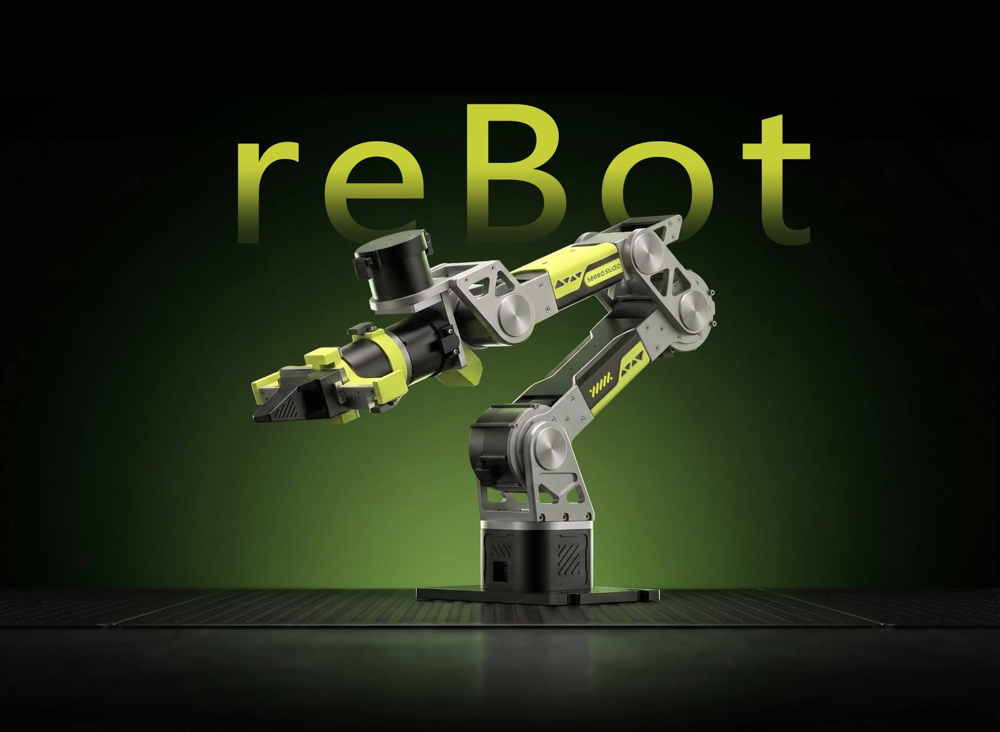

*Figure 1. The reBot Arm B601-RS (image: Seeed Studio).*


**Photo to be added:** the course arm on the bench, clamped to the table, with its supply.


The course arm is the Seeed reBot Arm B601-RS. It has six joints and a parallel gripper. It is clamped to the
bench, with its 48 V supply behind it. Each joint is a RobStride motor of the kind seen in Class 02.

### One kit, five boxes


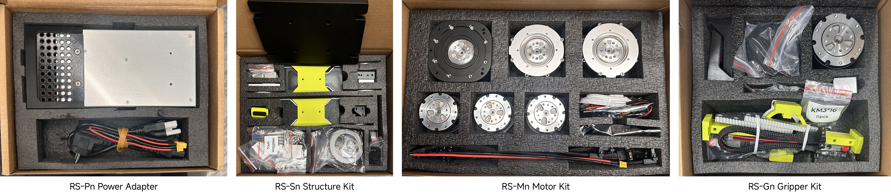

*Figure 2. The four boxes of the kit: RS-Pn Power Adapter, RS-Sn Structure Kit, RS-Mn Motor Kit and RS-Gn Gripper Kit. Four of the five boxes of the kit.*


**Photos to be added:** the parts of each box, laid out.


The arm comes in five boxes: the power adapter, the structure kit, the motor kit, the clamp and the gripper kit.
The [assembly guide](08-assembly-optional.md) lists the content of each box and builds the arm step by step.

### Read the motor datasheet

The arm uses seven motors: three RS-06 for the shoulder and the elbow, and four RS-00 for the wrist and the
gripper. The user manual of each motor gives the values below. Find them in the manual yourself.

| Item (manual, Section 1) | RS-06 | RS-00 |
| --- | --- | --- |
| Rated torque (at 100 rpm) | 11 N m | 5 N m |
| Peak torque | 36 N m | 14 N m |
| No-load speed | 480 rpm | 315 rpm |
| Gear ratio | 9 : 1 | 10 : 1 |
| Mass | 621 g | 310 g |
| Supply | 48 V (15–60 V) | 48 V |
| Bus | CAN, 1 Mbit/s | CAN, 1 Mbit/s |

The model uses these numbers. The torque limit of each actuator in the MJCF file is the peak torque of its motor:
`forcerange="-36 36"` for joints 1–3 and `forcerange="-14 14"` for joints 4–6. Rated torque applies under the manufacturer's stated thermal, supply and operating conditions; it is not an unconditional continuous-output guarantee.

### How the computer reaches the motors

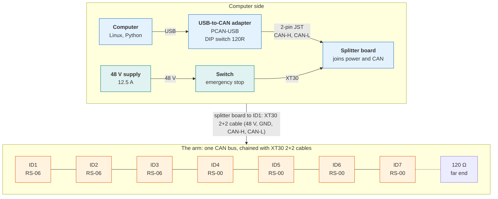

**The cables.** Follow the chain from the computer to the gripper:

| Link | Connector and cable | Carries |
| --- | --- | --- |
| Computer → adapter | USB | commands and feedback, packed in USB transfers |
| Adapter → splitter board | 2-pin JST cable: red to CAN-H, black to CAN-L | the CAN signal |
| Supply → splitter board | XT30 power cable, through the switch | 48 V |
| Splitter board → ID1 | XT30 2+2 cable, 300 mm, both ends straight | 48 V and the CAN signal in one cable |
| ID1 → ID2 → … → ID7 | XT30 2+2 cables, 200–300 mm | the same four wires, from motor to motor |

"2+2" means two power pins (48 V and ground) and two signal pins (CAN-H and CAN-L). One cable chain brings power
and commands to every motor.

**The topology.** The chain is one bus: CAN-H and CAN-L pass through every motor, so the adapter and the seven
motors sit on the same two wires. A 120 Ω resistor at each end of the bus stops signal reflections: the DIP switch
120R of the adapter is one end, and the other end is after ID7. The bus runs at 1 Mbit/s (ISO 2015).

The course application coordinates command/reply exchanges on the bus. CAN itself permits arbitration among transmitting nodes; this is an application-level polling design, not a universal single-master property. Each motor has an identifier from 1 to 7. The computer sends a
command to one identifier, and that motor answers with one feedback frame: angle, velocity, torque and
temperature. In the course setup a motor sends only when it receives a command. One control cycle is therefore
seven commands and seven answers, one after the other.

**The software.** A command passes through these layers on its way to a motor:

| Layer | On the course arm |
| --- | --- |
| Your script | Python, for example `real_gripper_motion_test.py` |
| Arm driver | `lerobot-robot-seeed-b601`, the LeRobot driver of the arm |
| Motor library | `motorbridge`: turns a command into a RobStride CAN frame |
| Operating system | Linux SocketCAN: the network interface `can0`, driver `peak_usb` |
| Adapter | PCAN-USB: moves frames between USB and the CAN bus |
| Motor | RobStride driver: decodes the frame, runs its control loop, answers |

The section on commanding the motors shows what one frame contains.

### The files of the arm

| What | File | Where |
| --- | --- | --- |
| CAD of the arm (STEP) | `reBot_B601_RS_v1.0_20260625.step` | [Seeed reBot-DevArm repository, `hardware/reBot_B601_RS/`](https://github.com/Seeed-Projects/reBot-DevArm/tree/main/hardware/reBot_B601_RS) |
| Vendor URDF and meshes | `Rebot_Arm_description/RS/` | [Seeed reBot-DevArm repository](https://github.com/Seeed-Projects/reBot-DevArm/tree/main/Rebot_Arm_description/RS) |
| CAD and user manual of the RS-06 | `RS06-new.step`, `RS06User Manual260428.pdf` | [RobStride Product_Information, `RS06/`](https://github.com/RobStride/Product_Information/tree/main/Product%20Literature/RS06) |
| CAD and user manual of the RS-00 | `RS00.step`, `RS00User Manual260428.pdf` | [RobStride Product_Information, `RS00/`](https://github.com/RobStride/Product_Information/tree/main/Product%20Literature/RS00) |
| Course model (MJCF) | [`rebot_b601_rs.xml`](https://github.com/asEmbodiedAISyst/2026Autumn/blob/main/course-resources/class08_build_simple_arm/additional_material/model/rebot_b601_rs_mjcf/rebot_b601_rs.xml) | [course repository, `additional_material/model/rebot_b601_rs_mjcf/`](https://github.com/asEmbodiedAISyst/2026Autumn/tree/main/course-resources/class08_build_simple_arm/additional_material/model/rebot_b601_rs_mjcf), with the meshes |
| Motion-test data of the physical arm | [`motion_test_20261010_000129.json`](https://github.com/asEmbodiedAISyst/2026Autumn/blob/main/course-resources/class08_build_simple_arm/additional_material/results/motion_test_20261010_000129.json) | [course repository, `additional_material/results/`](https://github.com/asEmbodiedAISyst/2026Autumn/tree/main/course-resources/class08_build_simple_arm/additional_material/results) |

---

## Joint conventions

### Order, limits and directions

| ID | Motor | Type | Soft limit (deg) | Direction |
| --- | --- | --- | --- | --- |
| 1 | shoulder_pan | RS-06 | −145 … 145 | +1 |
| 2 | shoulder_lift | RS-06 | 0 … 170 | +1 |
| 3 | elbow_flex | RS-06 | 0 … 200 | −1 |
| 4 | wrist_flex | RS-00 | −80 … 90 | −1 |
| 5 | wrist_yaw | RS-00 | −90 … 90 | −1 |
| 6 | wrist_roll | RS-00 | −130 … 130 | +1 |
| 7 | gripper | RS-00 | 0 … 270 | ×6 |

### Three numbers for one joint

| Quantity | Unit | Relation |
| --- | --- | --- |
| MuJoCo joint angle | rad | equals the motor angle in radians |
| `observation.state` | degrees | the motor angle |
| `action` | command space | motor target = action × direction |

The simulated and the physical arm record the same numbers, as in the vendor LeRobot driver. A dataset with one
sign reversed drives that joint the wrong way. Thus, check the direction vector before you use any data.

### Coordinates, constraints and the gripper

A coordinate count is not an actuator count. The model has six arm hinges and two finger slides, but one gripper actuator drives a coupled tendon. Inspect `nq`, `nv`, `nu`, the equality constraint and the actuator transmission together. A free-joint object in a scene adds state coordinates without adding a motor.

For equal finger strokes $$s_L=s_R$$, the tendon coordinate $$\ell_g=0.5s_L+0.5s_R$$ equals one finger stroke. It is not the total jaw aperture. The gripper's driver-style degree channel is a conversion convention; the simulation's finger stroke is in metres and is not an independently calibrated physical encoder measurement.

**Worked coordinate check:** `action.elbow_flex = −30` maps through direction −1 to a +30° motor target. A state of +29° gives state-minus-target = −1°, not the raw 59° difference. Convert to radians explicitly before sending a radian-valued joint request.

### Read the positive direction


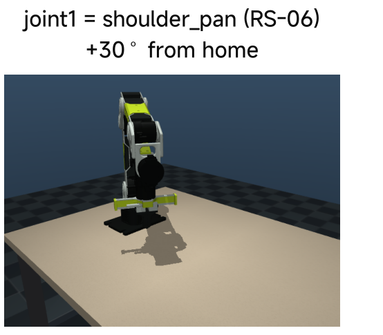

*Figure 3. Joint 1 at +30 degrees from home.*

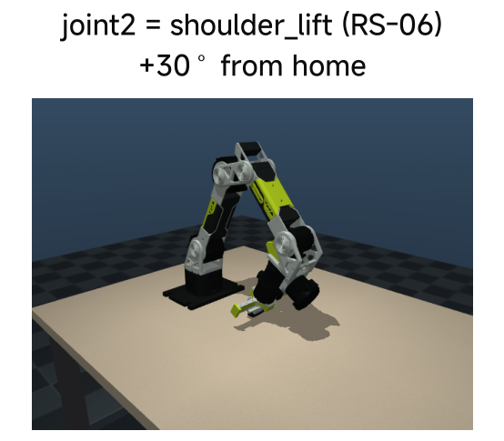

*Figure 4. Joint 2 at +30 degrees from home.*

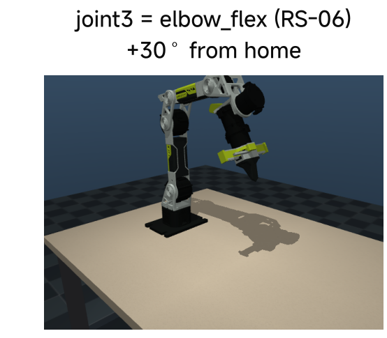

*Figure 5. Joint 3 at +30 degrees from home.*

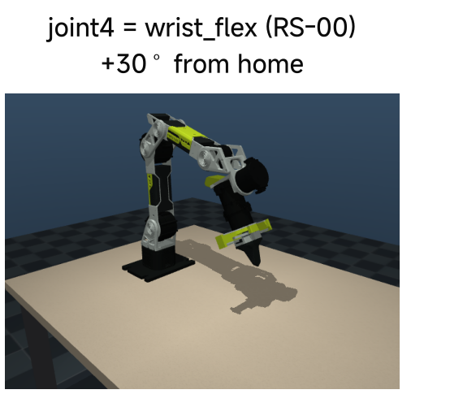

*Figure 6. Joint 4 at +30 degrees from home.*

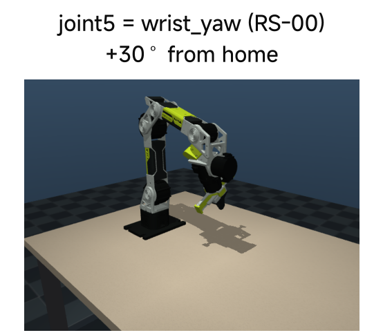

*Figure 7. Joint 5 at +30 degrees from home.*

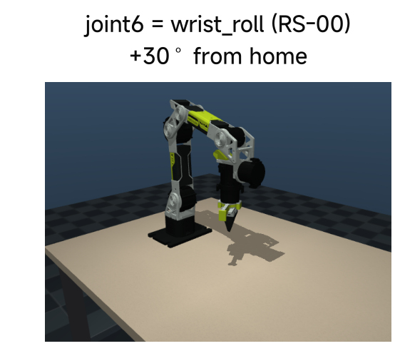

*Figure 8. Joint 6 at +30 degrees from home.*

Each image shows one joint at +30° from the home pose (the zero and home configurations below). Read the positive direction of each joint. A
target outside the declared limits is skipped and reported. It is not clipped without a message.

---

## Frames and reference poses

### World frame and tool centre point

The world origin is the centre of the base on the table surface: $$x$$ points forward, $$y$$ to the left and
$$z$$ up. The tool centre point (TCP) is a site 15 mm inside the fingertips. A position of the gripper in this
course always means the TCP in the world frame.

### Forward kinematics

$$
{}^{w}T_{tcp}(q) = {}^{w}T_{0}\;\prod_{i=1}^{6} {}^{i-1}T_{i}(q_i)\;{}^{6}T_{tcp}, \qquad
{}^{i-1}T_{i}(q_i) = {}^{i-1}T_{i}(0)\;\mathrm{Rot}(a_i, q_i)
$$

Each factor is a fixed transform, then a rotation by $$q_i$$ about the joint axis $$a_i$$. In the MJCF file the
fixed transform is the `pos` and `quat` of a body, and the axis is the `axis` of its joint:

```xml
<body name="link2" pos="0.020343 0.027237 0.07" quat="0.7071055 -0.7071081 0 0" gravcomp="1">
  <joint name="joint2" class="arm_joint" axis="0 0 1" range="0 3.14" armature="0.02"/>
```

The derivative gives the Jacobian, $${}^{w}\dot p_{tcp} = J_p(q)\,\dot q$$. Class 09 uses it for inverse
kinematics.

### Zero pose and home pose


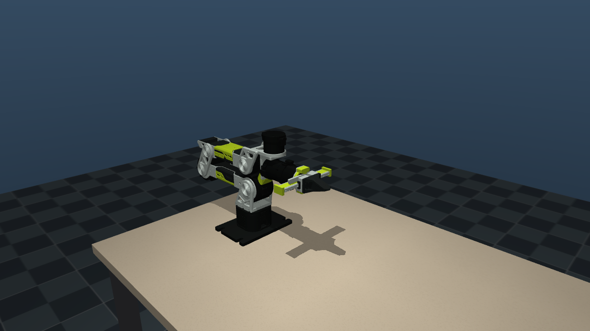

*Figure 9. Zero pose of the model.*

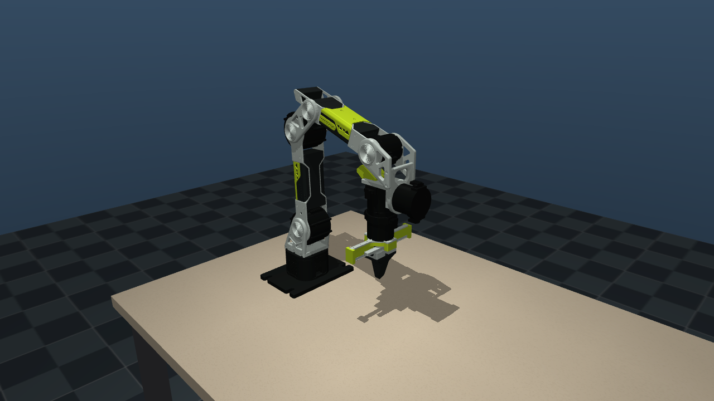

*Figure 10. Home pose of the model.*

| Pose | Joints | Use |
| --- | --- | --- |
| Zero | all joints at 0: folded, gripper horizontal and forward | calibration; the motors store this zero |
| Home | `[0, 1.532, 1.197, −1.236, 0, 0]` rad | start of every example; gripper down, TCP at (0.25, 0, 0.10) m |

The zero pose defines the angles. The home pose is a convenient place to work from. Do not confuse them.

---

## Control in the model

### Why moving one joint changes another joint's effort

The serial body tree couples motion through the links. In Featherstone's angular-first convention a link spatial velocity is $$v_i=[\omega_i^T\;u_i^T]^T$$. Motion transforms $$X_{i\lambda(i)}$$ map the parent velocity into the child's coordinates, while a revolute joint contributes $$S_i\dot q_i$$:

$$
v_i=X_{i\lambda(i)}v_{\lambda(i)}+S_i\dot q_i,\qquad
f_i=I_i a_i+v_i\times^{*}(I_i v_i)-f_i^{\mathrm{ext}}.
$$

The inverse-dynamics backward pass carries child forces to a parent through the transpose of the motion transform. The joint effort is $$\tau_i=S_i^T f_i$$ after the child contributions have been accumulated (Featherstone 2008). Extending the elbow changes the downstream mass geometry and the shoulder effort, even if the shoulder coordinate is held fixed. The familiar joint-space summary is

$$
M(q)\ddot q+C(q,\dot q)\dot q+g(q)=\tau+J_c(q)^T f_c.
$$

Here $$C\dot q$$ represents velocity-dependent terms, $$g$$ is the effort required to oppose gravity, and $$f_c$$ represents contact forces. Passive joint terms and actuation limits must also be included when present. Forward kinematics predicts pose; inverse dynamics predicts effort for a specified motion. Neither proves that the physical arm was assembled or calibrated correctly.

### The control law

The static gravity effort is the inverse-dynamics result $$g(q)=\operatorname{RNEA}(q,0,0)$$ under the declared gravity convention, with external loads handled separately. MuJoCo's general bias force at nonzero velocity also includes velocity-dependent terms, so it must not be called gravity alone. The body `gravcomp` and joint `actuatorgravcomp` settings determine how this model routes compensation.


$$
\tau_i = \mathrm{clip}\Big(K_{p,i}\,(q_{d,i} - q_i) - K_{d,i}\,\dot q_i + g_i(q),\; \pm\tau_{max,i}\Big)
$$

Each joint has a position actuator with stiffness $$K_p$$ and damping $$K_d$$. It receives one target $$q_d$$ per
control period. $$g(q)$$ is the gravity torque: the torque that holds the arm still against gravity at the pose
$$q$$. MuJoCo computes the compensation from the model mass distribution and gravity. The torque is limited to the peak torque
of the motor. In the MJCF file, one line gives this law for joint 2:

```xml
<position name="joint2" joint="joint2" kp="50.0" kv="5.0" ctrlrange="0 3.14" forcerange="-36 36"/>
```

`actuatorgravcomp="true"` on the joint sends $$g(q)$$ through the actuator, so the torque limit also applies to
it. On the physical arm, the same target goes to the motor in MIT mode (the CAN command below). The physical gains are lower:
$$K_p$$ = 40 N m/rad for joint 2 in the motion test. The model gains do not authorise you to copy commands
directly to hardware.

### Requested rate and implemented period

The examples request 30 Hz. A physics step of 0.002 s does not divide 1/30 s exactly. Thus the script uses 17
sub-steps and shortens the physics step to 1/510 s (approximately 1.96 ms):

```python
self.n_sub = round(1.0 / CONTROL_HZ / self.model.opt.timestep)   # 17 physics steps per control period
self.model.opt.timestep = 1.0 / (CONTROL_HZ * self.n_sub)         # 1/510 s
```

The implemented control period is then exactly 1/30 s, the LeRobot recording rate. Always record the implemented
period, not only the nominal rate.

### Intersect limits before making a request

The permitted interval is the intersection of the model range, the software bound and the experimental bound. Joint 3's declared software upper limit of 200° does not enlarge a compiled model range near 180°. Use the tighter limit. Apply a direction conversion to a command only once; a limit already expressed in motor coordinates must not be reversed a second time.

At home, joint 4 is approximately −70.8°. A −10° excursion would request −80.8°, below the declared −80° software lower limit, whereas +10° gives −60.8°. This arithmetic predicts a rejected excursion before a viewer is opened. A skip is an intentional bounded-control outcome, not evidence that the motor failed.

### Does it hold, does it follow


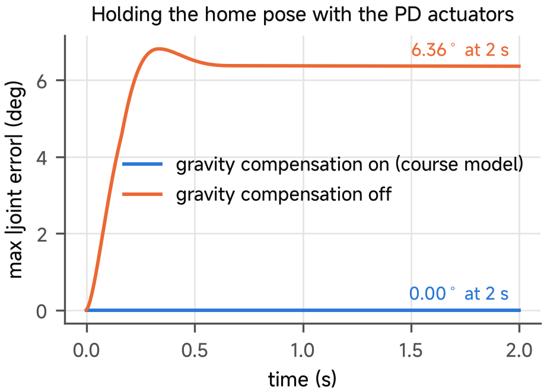

*Figure 11. Gravity-compensation hold at the home pose. Hold at home, with and without g(q).*

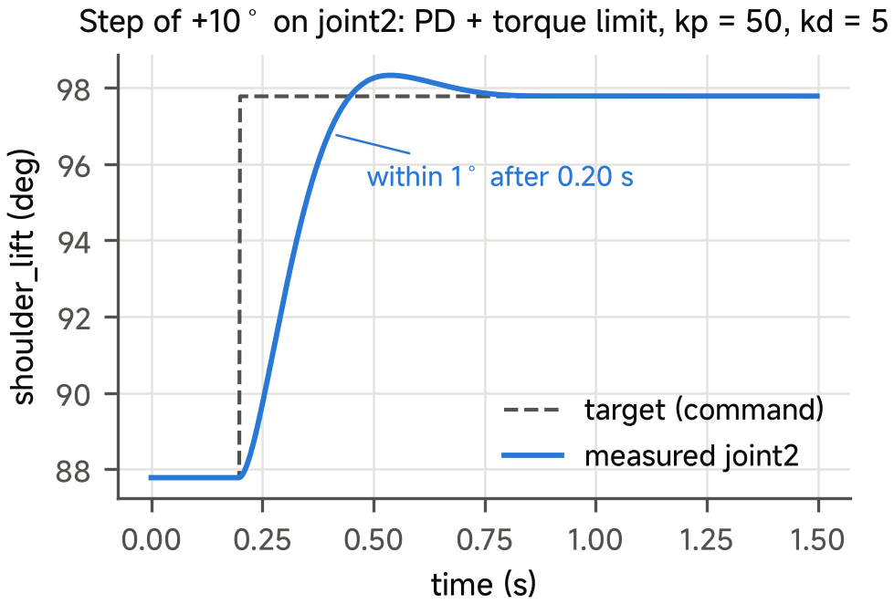

*Figure 12. Step response of one joint. A 10° step on one joint.*

With gravity compensation, the arm stays within a small error at the home pose. Without it, the PD term alone
must carry the weight: the joint sags until $$K_p\,(q_d - q) = g(q)$$. A 10° step settles to within 1° in
approximately 0.20 s in the model. This is a property of the model. Measure the physical step response on the arm.

### Read the error at its sampling boundary

Define the residual before comparing scores: $$e_k=q_k-q_{d,k}$$ is a signed state-minus-target residual; $$\max_k|e_k|$$ is a trajectory maximum. A pre-step state and a post-step state answer different questions. A model trace, a firmware torque field and an external torque measurement are also different observations. Preserve their identities when reading the saved physical motion-test JSON below.

A simulation can advance at the correct simulated period while rendering more slowly in wall-clock time. The 30 Hz stepping calculation above describes the model clock; it does not establish physical bus throughput, phone latency or a GUI refresh rate.

### The cameras of the scene


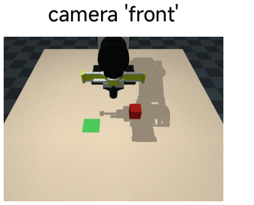

*Figure 13. Front camera.*

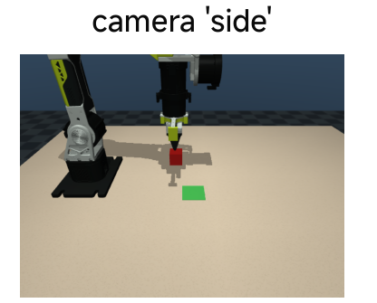

*Figure 14. Side camera.*

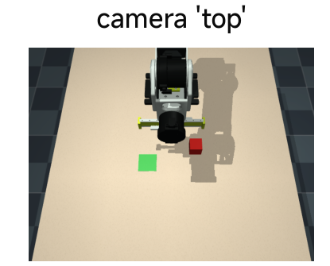

*Figure 15. Top camera.*

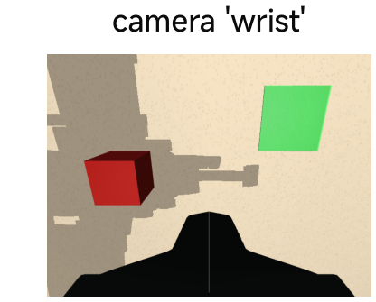

*Figure 16. Wrist camera.*

The scene has four cameras. `front`, `side` and `top` are fixed; `wrist` moves with the gripper. Each renders
640 × 480 images, the image size of the course datasets.

---

## Commanding the motors over CAN

### One CAN frame

Every message on the bus is one frame. The motors use the extended format: a 29-bit identifier and up to 8 data
bytes. The identifier says what the frame is and which motor it is for. The data bytes carry the numbers. For a
RobStride motor, the identifier holds the message type and the motor ID, and a command uses its spare bits for one
more 16-bit number.

### How many frames the bus can carry

An extended CAN frame with 8 data bytes has 131 bits, and up to approximately 155 bits with stuffing bits. At
1 Mbit/s it takes 0.13–0.16 ms. One control cycle of the arm is 7 commands and 7 answers, approximately 2 ms. At
the 150 Hz command stream of Class 10 the bus load is

$$
150 \times 14 \times 155\ \text{bit/s} \approx 0.33\ \text{Mbit/s},
$$

approximately one third of the nominal bus capacity under this frame-budget assumption. Arbitration, USB batching, extra traffic and scheduling still need measurement; this arithmetic does not guarantee a physical update rate.

### The MIT command

Each motor runs its own impedance controller, the operation-control or “MIT mode” interface associated with proprioceptive actuation (Katz, Di Carlo, and Kim 2019):

$$
\tau_m = K_p\,(p_d - p) + K_d\,(v_d - v) + \tau_{ff}
$$

One command gives five numbers: the target position $$p_d$$, the target velocity $$v_d$$, the stiffness
$$K_p$$, the damping $$K_d$$ and the feed-forward torque $$\tau_{ff}$$. The motor closes this loop itself, at a
rate much higher than the bus. The course code sends the five numbers with one call:

```python
motor.send_mit(pos, vel, kp, kd, tau)    # rebot_sim/real/gripper_arm.py
```

With $$v_d = 0$$ and $$\tau_{ff} = g(q)$$, this is the model control law above. With $$K_p = K_d = 0$$, the motor
gives only $$\tau_{ff}$$: this is the gravity hold of the power-on test.

### The MIT command in one frame

| Part of the frame | RS-06, operation control (manual, Section 4.1.2) |
| --- | --- |
| 29-bit identifier | message type 1; the feed-forward torque (16 bit, −36 to 36 N m); the motor ID |
| Bytes 0–1 | target angle, 16 bit, −4π to 4π rad |
| Bytes 2–3 | target velocity, 16 bit, −50 to 50 rad/s |
| Bytes 4–5 | $$K_p$$, 16 bit, 0 to 5000 |
| Bytes 6–7 | $$K_d$$, 16 bit, 0 to 100 |

Each number is mapped linearly to an unsigned 16-bit integer:

$$
u = \mathrm{round}\!\left(\frac{x - x_{min}}{x_{max} - x_{min}}\,(2^{16} - 1)\right)
$$

The angle step is then $$8\pi / 65535 \approx 3.8 \times 10^{-4}$$ rad, or 0.022°. Command quantisation and encoder quantisation are distinct: this conversion step is not a measurement of angular accuracy.

---

## Commissioning and the first data

### Three gates

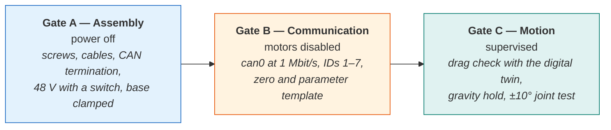

Do not start a gate before the earlier gate is closed.

| Gate | Question | What simulation can establish |
| --- | --- | --- |
| A — Assembly | are the mechanical and electrical interfaces assembled correctly? | nothing: wiring, fasteners and assembly are physical |
| B — Communication | do identifiers, units, signs and feedback agree? | the simulated interface only |
| C — Motion | can the configured system execute a bounded test? | evidence for this model and controller |

A simulated arm that moves correctly shows that the model, the conventions and the scripts agree. It says nothing
about a loose screw, a swapped CAN identifier or a motor zero set at the wrong pose. Each physical gate needs its
own check on the arm. The page [Class 08 — Power-on and zero](08-power-on-and-zero-optional.md) gives the steps of each gate.

### The data of the motion test

The joint test of Gate C writes one JSON file. This is the data contract of that file:

| Field | Content | Unit |
| --- | --- | --- |
| `hold.pose_deg` | the 7 motor angles while the arm holds the zero pose | deg |
| `hold.feedforward_nm` | the model gravity torque $$g(q)$$ of joints 1–6 | N m |
| `hold.measured_torque_nm` | the torque in the feedback frame of each motor | N m |
| `hold.model_error_nm` | $$K_p\,(q_d - q)$$: the torque that the model $$g(q)$$ did not give | N m |
| `gravity_sweep` | joint 2 at 0, 10, 20, 30°: target, measured angle, $$g(q)$$, model error | deg, N m |
| `gravity_fit` | the fit $$a\cos q_2 + b\sin q_2$$ of the model error, and its largest residual | N m |
| `joints` | per joint: amplitude, speed, worst tracking error, peak torque, temperature | deg, deg/s, N m, °C |
| `args`, `kp` | the options of the run and the stiffness of each motor | — |

### What the data say

The file of 10 October 2026 records one run of the test, on joint 2 only.

| Check | Result on the course arm, 10 October 2026 |
| --- | --- |
| Folded pose | within 0.62° of zero on all seven motors |
| Joint 2 (RS-06), ±10° at 5°/s | worst tracking error 1.87° |
| Joint 2 torque field | peak 1.92 N m reported by firmware; distinct from an independent torque measurement |
| Motor temperature | 27 °C at the end of the test |
| Gravity model of joint 2 | error fit $$a = -0.55$$, $$b = 1.18$$ N m, largest residual 0.37 N m, 4 angles from 1° to 30° |

At rest, the motor gives $$\tau_{ff} + K_p\,(q_d - q)$$. The feed-forward is the model $$g(q)$$. Thus the
position error times $$K_p$$ is a **quasi-static controller residual**, not an independent calibrated torque measurement. It can include gravity-model error, friction, gain mismatch, zero error and external loads. The source fits a gravity-shaped correction from this residual; the four closely spaced angles leave parameter identifiability and generalisation unresolved. A wider, separately tested sweep would improve excitation, but no universal 45° threshold proves identifiability.

---

## Instructor and TA demonstration

Use the prepared simulation practice to identify the arm, its joint table and its zero/home poses. Predict the rejected wrist excursion before running the bounded joint test. Show the supplied gain/step figures and compare target, state, units and sampling rule. A lower stiffness changes a closed-loop response, not the mechanism's geometry.

Then display the retained physical joint-2 motion-test record from the source package. Identify its tested joint, maximum tracking error, firmware torque field and temperature. A single-joint summary is not an all-joint qualification or an independently calibrated torque measurement. No student powered operation is required.

The complete simulation procedure is on [Class 08 practice](08-practice.md). [Assembly](08-assembly-optional.md) and [power-on and zero](08-power-on-and-zero-optional.md) are optional teaching-team preparation references.

## Student activity

Use the source practice record or a fresh bounded simulation. Submit the seven channel names and units, the two joint-4 excursion endpoints, one target/state residual with its sampling rule, and a short readiness decision. Name one next simulated operation supported by the evidence and one physical check still open. Record any changed gain and restore the source value after the comparison. The extended practice page provides the complete inspection checklist.

## References

Featherstone, Roy. 2008. *Rigid Body Dynamics Algorithms*. Springer. [Spatial-vector resources](https://royfeatherstone.org/spatial/v2/index.html).

Lynch, Kevin M., and Frank C. Park. 2017. *Modern Robotics: Mechanics, Planning, and Control*. Cambridge University Press. [Numerical inverse-kinematics explanation](https://modernrobotics.northwestern.edu/nu-gm-book-resource/6-2-numerical-inverse-kinematics-part-1-of-2/).

MuJoCo developers. n.d.-a. “XML Reference.” *MuJoCo Documentation*, version 3.14.0. Accessed October 17, 2026. [Position actuators](https://mujoco.readthedocs.io/en/3.14.0/XMLreference.html#actuator-position) and [joint gravity-compensation routing](https://mujoco.readthedocs.io/en/3.14.0/XMLreference.html#body-joint-actuatorgravcomp).

MuJoCo developers. n.d.-b. “Computation.” *MuJoCo Documentation*, version 3.14.0. Accessed October 17, 2026. [Actuation and dynamics](https://mujoco.readthedocs.io/en/3.14.0/computation/index.html).

Seeed Studio. n.d.-a. “reBot RS Mechanical Description.” *reBot-DevArm*, commit `c247ea9cb0da29cd52c31953659cc8c47e6d1a6e`. [RS source](https://github.com/Seeed-Projects/reBot-DevArm/tree/c247ea9cb0da29cd52c31953659cc8c47e6d1a6e/Rebot_Arm_description/RS). Source geometry, inertial declarations and licences are identified by the bundled model notice; course actuation and environment are additional simulation choices.

Seeed Studio. n.d.-b. “Seeed reBot Arm B601 Follower Integration with LeRobot.” Commit `0da1a1a5575905d77823227003ffee7672059780`. [Reviewed driver reference](https://github.com/Seeed-Projects/lerobot-robot-seeed-b601/tree/0da1a1a5575905d77823227003ffee7672059780). This separate documentary reference does not qualify a hardware driver for the supplied simulation.

Seeed Studio. n.d.-c. “B601-RS Quick Start.” *Seeed Studio Wiki*. Accessed October 17, 2026. [Assembly and calibration reference](https://wiki.seeedstudio.com/rebot_b601_rs_getting_started/).

Seeed Studio. n.d.-d. “B601-RS LeRobot Tutorial.” *Seeed Studio Wiki*. Accessed October 17, 2026. [Physical software-integration reference](https://wiki.seeedstudio.com/rebot_arm_b601_rs_lerobot/).

ISO. 2015. *ISO 11898-1:2015: Road Vehicles—Controller Area Network (CAN)—Part 1: Data Link Layer and Physical Signalling*. [Standard record](https://www.iso.org/standard/63648.html).

Katz, Benjamin, Jared Di Carlo, and Sangbae Kim. 2019. “Mini Cheetah: A Platform for Pushing the Limits of Dynamic Quadruped Control.” In *Proceedings of the IEEE International Conference on Robotics and Automation*, 6295–6301. [Primary paper](https://doi.org/10.1109/ICRA.2019.8793865).
