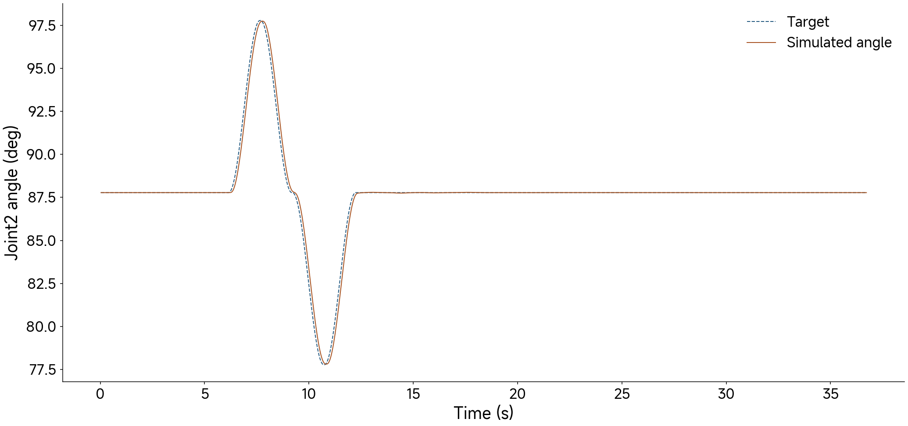

# Class 08 — Practice

On this page you control the simulated reBot arm yourself. You open the model, read its joint table, move each
joint, run a bounded joint motion and a Cartesian path, then change one gain and see its effect. The class page
[Class 08](08-lets-build-a-simple-arm-and-turn-it-on.md) explains why each step matters. You need only a laptop: no hardware.

---

## Set up

The runnable class folder is
[`course-resources/class08_build_simple_arm/`](https://github.com/asEmbodiedAISyst/2026Autumn/tree/main/course-resources/class08_build_simple_arm)
in the course repository.

You need Ubuntu 22.04 or 24.04 with a desktop session, or macOS 12 or later (Apple silicon or Intel). No GPU is needed.

The setup below installs `uv` in a course-local `.course-tools` environment and class dependencies in a package-local `.venv`. It does not change a system Python installation. If `uv` is already available, the three `.course-tools` bootstrap lines may be skipped.


Get the code and make the environment:

```bash
git clone https://github.com/asEmbodiedAISyst/2026Autumn.git rob7103
cd rob7103
python3 -m venv .course-tools
.course-tools/bin/python -m pip install uv
export PATH="$PWD/.course-tools/bin:$PATH"
cd course-resources/class08_build_simple_arm/additional_material
uv sync
```

If you already have the course checkout, update it with `git pull --ff-only` before opening the class package.

`uv sync` creates a package-local `.venv` with the declared MuJoCo and NumPy dependencies. Setup time depends on downloads and the platform.

**macOS:** the MuJoCo window must run under `mjpython`. The commands that open a window use `uv run mjpython`
instead of `uv run python`; the steps below give both.

---

## Check and move the arm in simulation



### Open the arm and read the joint table



```bash
uv run python code/view_arm_scene.py
```



```bash
uv run mjpython code/view_arm_scene.py
```



The terminal prints the joint table before the window opens:

```
ID  MJCF joint        LeRobot name   motor  MJCF range (deg)    soft limit (deg)  dir
 1  joint1            shoulder_pan   RS-06  -160.4 to  160.4    (-145, 145)       +1
 2  joint2            shoulder_lift  RS-06     0.0 to  179.9    (0, 170)          +1
 3  joint3            elbow_flex     RS-06     0.0 to  179.9    (0, 200)          -1
 4  joint4            wrist_flex     RS-00   -90.0 to   90.0    (-80, 90)         -1
 5  joint5            wrist_yaw      RS-00   -90.0 to   90.0    (-90, 90)         -1
 6  joint6            wrist_roll     RS-00  -179.9 to  179.9    (-130, 130)       +1
 7  gripper_joint1/2  gripper        RS-00  0.000 to 0.050 m    (0, 270)          +6
```

**Look at:** the model range and the soft limit are different, and the gripper is in metres, not an angle.
`--list` prints only the table, without the window.



### Zero and home

In the viewer, press `Z` for the zero pose and `H` for the home pose. In zero the arm is folded and the gripper
points forward. In home the gripper points down, with the TCP at (0.25, 0, 0.10) m.



### Positive directions

Open the Control group of the right panel. Move one slider at a time. Predict the direction before you move it.

**Try:** an increasing target on joint 3 moves the elbow which way? Why can the model keep the URDF sign while
the dataset multiplies this joint by −1?



### Bounded joint motion



```bash
uv run python code/controlled_motion.py --mode joints
```



```bash
uv run mjpython code/controlled_motion.py --mode joints
```



Each joint moves ±10° about home with a cosine profile. Expected terminal output:

```
joint1: largest tracking error 0.54 deg
joint2: largest tracking error 0.97 deg
joint3: largest tracking error 0.96 deg
joint4: -10 deg skipped (outside the soft limit)
...
```

**Try:** why does joint 4 skip −10°? At home the wrist flex angle is −70.8°, so −10° would go to −80.8°, beyond
the soft limit of −80°. The script reports the skip. It does not clip without a message.



### A Cartesian path



```bash
uv run python code/controlled_motion.py --mode letters
```



```bash
uv run mjpython code/controlled_motion.py --mode letters
```



The TCP draws the letters ROB 3 cm above the table at 0.04 m/s, with the gripper vertical. Inverse kinematics
changes each TCP target into joint targets. The largest TCP tracking error is approximately 6 mm, because the
position actuators lag behind a moving target. The red dots in the viewer are the drawn path.



*Figure 1. Joint 2 tracking during the example.*




### Change one gain

Make a copy of the class folder first. In `model/rebot_b601_rs_mjcf/rebot_b601_rs.xml`, find the actuator of
joint 2 and halve its stiffness:

```xml
<position name="joint2" joint="joint2" kp="25.0" kv="5.0" ctrlrange="0 3.14" forcerange="-36 36"/>
```

Run the bounded joint motion again without the window:

```bash
uv run python code/controlled_motion.py --mode joints --no-viewer
```

**Expected:** the largest tracking error of joint 2 grows from 0.97° to approximately 2.0°. The other joints do
not change. **Try:** predict the error for `kp="100.0"` before you run it. Then put the original value back.



---

## Check what you found

| Check | Record |
| --- | --- |
| Actuator order | the seven names from the printed table |
| Joint 2 and joint 3 | model range, units and declared soft limit |
| Zero versus home | the difference and the purpose of each |
| Joint 3 sign | observed direction for an increased target |
| Gain | tracking error of joint 2 at `kp` 25, 50 and 100 |
| Datasheet | rated and peak torque of the RS-06; the line of the MJCF file that uses the peak torque |
| Timing | nominal rate and implemented period |
| CAN | the angle step of a 16-bit command; the bus load at 150 Hz |
| Commissioning boundary | one check established in simulation, one that needs hardware |

Change one limit with degrees = radians × 180 / π, and keep the model range and the software limit apart.

Start with the `README.md` of the class folder. The commands of the physical arm are on the page
[Class 08 — Power-on and zero](08-power-on-and-zero-optional.md).
