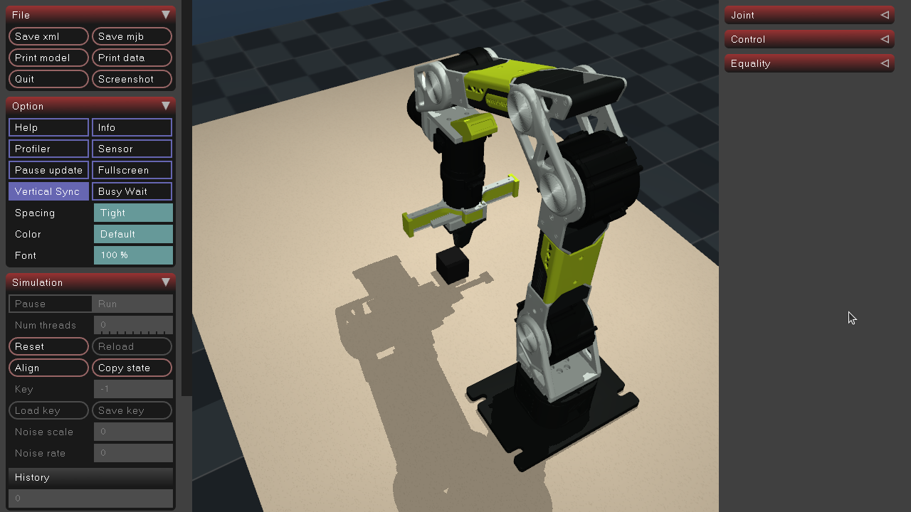

# Class 09 — Practice

The core demonstration uses an iPhone with asMagic to teleoperate the **simulated pusher** and push a black cube into its green target. The pusher script and commands below come from the source practice. A deterministic local phone publisher tests the protocol without an iPhone; its motion is not a successful human cube-pushing trial. The original gripper workflow remains an optional comparison. See [Class 09](09-teleoperation-by-streaming-from-asmagic.md) for frames, mapping, IK and timing.

---

## Set up

The code is the Class 09 folder of the course:
[`2026-autumn/resources/class09/practical/additional_material/`](https://github.com/asEmbodiedAISyst/2026Autumn/tree/main/2026-autumn/resources/class09/practical/additional_material).

You need Ubuntu 22.04 or 24.04 with a desktop session, or macOS 12 or later (Apple silicon or Intel).

The setup below installs `uv` in a course-local `.course-tools` environment and class dependencies in a package-local `.venv`. It does not change a system Python installation. If `uv` is already available, the three `.course-tools` bootstrap lines may be skipped.


Get the code and make the environment:

```bash
git clone https://github.com/asEmbodiedAISyst/2026Autumn.git rob7103
cd rob7103
python3 -m venv .course-tools
.course-tools/bin/python -m pip install uv
export PATH="$PWD/.course-tools/bin:$PATH"
cd 2026-autumn/resources/class09/practical/additional_material
uv sync
```

If you already have the checkout, start from its `rob7103/` root and update it with `git pull --ff-only`; do not clone another copy or recreate an existing `.course-tools` environment. Continue from the `export PATH` line, then enter this page's package directory. Each class has its own `.venv`; switching to another class package does not reuse its dependencies automatically.

In every additional terminal, open the **same package directory** and expose the course-local `uv` command before running the examples:

```bash
export PATH="$(git rev-parse --show-toplevel)/.course-tools/bin:$PATH"
```

This line assumes the terminal is already inside the cloned repository. Omit it if your existing `uv` is already on `PATH`. Check `pwd` before using a relative data or output path.

**macOS:** the MuJoCo window must run under `mjpython`. The two teleoperation scripts open the window, so they
run with `uv run mjpython`; the phone simulator keeps `uv run python`. The steps below give both.

`uv sync` installs the declared MuJoCo and asMagic receiver dependencies into the package-local `.venv`. No GPU is needed for this simulation practice.

| Script | What it does |
| --- | --- |
| [`code/teleop_rebot_rs_sim.py`](https://github.com/asEmbodiedAISyst/2026Autumn/blob/main/2026-autumn/resources/class09/practical/additional_material/code/teleop_rebot_rs_sim.py) | Phone teleoperation of the simulated arm with the gripper |
| [`code/teleop_common.py`](https://github.com/asEmbodiedAISyst/2026Autumn/blob/main/2026-autumn/resources/class09/practical/additional_material/code/teleop_common.py) | The parts of the class page: phone receiver, mapping `PhoneMapper`, inverse kinematics |
| [`code/fake_phone.py`](https://github.com/asEmbodiedAISyst/2026Autumn/blob/main/2026-autumn/resources/class09/practical/additional_material/code/fake_phone.py) | Phone simulator: publishes poses with the asMagic protocol |
| [`code/teleop_rebot_rs_pusher_sim.py`](https://github.com/asEmbodiedAISyst/2026Autumn/blob/main/2026-autumn/resources/class09/practical/additional_material/code/teleop_rebot_rs_pusher_sim.py) | Teleoperation with the pusher tool instead of the gripper |

---

## Keys

Click the MuJoCo window first: the keys work when the window has the focus.

| Key | Action |
| --- | --- |
| Space | Engage or pause the mapping; re-engagement stores the current phone and tool poses as references. |
| Right arrow | Start recording; press again to stop and save the diagnostic episode. |
| Left arrow | Discard the recording in progress. |
| Enter | Gripper comparison only: open/close. The pusher has no gripper and reports that fact. |

Close the window to quit. An active recording is saved on window closure; use the discard key first if you do not want to retain it.

---

## Teleoperate the pusher with the iPhone

### The pusher tool

For the local fallback, keep a second terminal in the same package folder and run the unchanged source publisher:

```bash
uv run python code/fake_phone.py
```

For the iPhone route, do not start the local publisher; use the phone IP in the pusher command.

The pusher is the tool of Classes 10 and 11: a printed rod with the iPhone on it. The phone sits on the tool, so
the tool moves with the phone as one rigid body. The phone camera is approximately 16 cm behind the rod tip, so a
rotation of the phone swings the tip about the phone, as the printed tool does in your hand.



```bash
uv run python code/teleop_rebot_rs_pusher_sim.py --phone-ip 127.0.0.1      # with fake_phone.py in terminal 1
uv run python code/teleop_rebot_rs_pusher_sim.py --phone-ip <phone IP>     # with the iPhone
```



```bash
uv run mjpython code/teleop_rebot_rs_pusher_sim.py --phone-ip 127.0.0.1    # with fake_phone.py in terminal 1
uv run mjpython code/teleop_rebot_rs_pusher_sim.py --phone-ip <phone IP>   # with the iPhone
```



After setup, start the phone simulator in a separate terminal if needed, or use the iPhone IP shown by asMagic Data Streaming. Switch AR Data on and keep the phone and computer on the same local network. Click the MuJoCo window for key input. Hold the phone in landscape, the back camera looking
forward and down at the table, and press Space. The scene has the black cube and a green square to push it into.

The two command lines in each operating-system tab are **alternatives**: run one local-publisher client or one iPhone client, not both. Replace `<phone IP>` with the address shown by the app; the angle-bracket text is not a literal shell argument.

**Try:** with `fake_phone.py --pattern tilt` the phone only rotates. Watch the rod tip: it moves several
centimetres while the phone stays in place.


### Demonstration and activity

Predict one tool-tip direction before engaging. Press Space, move the phone slowly, and push the cube toward the green square. Pause and reposition the phone, then engage again. Stop AR Data briefly and inspect the hold message. Record what was requested, what moved and whether the cube reached the target; a streamed pose alone is not a task outcome. To keep a diagnostic episode, press Right arrow before the motion and again after it. The source writes `recordings/pusher/episode_000/` (then the next free index), including six joint state/action channels and front/side/phone images. This is the Class 09 diagnostic format, not the nine-component LeRobot learning format introduced in Class 10. The bridge does not automatically score a cube-goal success; identify the terminal observation yourself. Keep a manual event record with the episode ID and frame index or elapsed time for each Space press, pause/re-engagement and deliberate AR Data interruption. The saved `phone_age` and `blocked` fields do not include a pause/engagement flag, so a stationary fresh stream alone cannot establish why the arm held.

## Optional gripper interface comparison

### Teleoperate the simulated arm



#### Start without an iPhone

Open two terminals in `additional_material/`. The first runs the phone simulator, the second the teleoperation:



```bash
uv run python code/fake_phone.py                                   # terminal 1
uv run python code/teleop_rebot_rs_sim.py --phone-ip 127.0.0.1     # terminal 2
```



```bash
uv run python code/fake_phone.py                                   # terminal 1
uv run mjpython code/teleop_rebot_rs_sim.py --phone-ip 127.0.0.1   # terminal 2
```



The window opens with the arm in its home pose and a small black cube in front of it:



*Figure 1. The MuJoCo window of the teleoperation: the arm at its home pose above the table, the black cube under the gripper.*

The terminal shows:

```
waiting for the phone stream (AR Data on, same network)
phone stream received (pose as 7 values)
```

Press Space. The gripper now follows the phone simulator and draws a horizontal circle of radius 8 cm:

```
teleop started at TCP (0.250, -0.000, 0.100) m; the gripper now follows the phone
```

**Look at:** the circle starts where the gripper was when you pressed Space, not at a fixed place. Only the motion
of the phone since Space counts.



#### Start with the iPhone

If you have an iPhone, install asMagic from the App Store:


{% column width="33%" %}


*Figure 2. QR code for the asMagic App Store page. Scan to install.*



{% column width="67%" valign="middle" %}
**Download:** [asMagic on the App Store](https://apps.apple.com/us/app/asmagic/id6661033548)

**Documentation:** [doc.ancoraspring.com/asmagic](https://doc.ancoraspring.com/asmagic)




**The computer and the iPhone must be on the same local network**, for example both on the campus Wi-Fi. The
script reads the stream from the IP address of the phone. A complex network, with many devices or several access
points, can delay the stream, and the arm then moves in jerks.


Open asMagic and open **Data Streaming**: the page shows the IP address of the phone.


*Figure 3. The asMagic icon on the iPhone home screen, the home page of the app and the Data Streaming page with the IP address.*

Start the script with this address, then switch **AR Data** on:



```bash
uv run python code/teleop_rebot_rs_sim.py --phone-ip <phone IP>
```



```bash
uv run mjpython code/teleop_rebot_rs_sim.py --phone-ip <phone IP>
```



Hold the phone as the gripper, as in the frames figure of the class page: screen up, the back camera toward the
table, the right edge of the phone pointing forward, away from the base. The top of the phone, with the camera,
then points to your left when you look outward from the base, and to your right when you face the arm. Press
Space. Move slowly: the target moves at most 0.25 m/s and 90°/s.



#### Three directions

Before each motion, predict the direction of the gripper. Then move the phone:

* along its camera direction, toward the table;
* toward its right edge;
* toward its top.

Then turn the phone about the vertical: the gripper turns the same way. Compare each motion with the frames of
the frame description of the class page. The black cube is on the table: push it if you like.



**Options:** `--scale 0.5` halves the motion, `--no-rotation` keeps the gripper orientation and moves only the
position, `--scene table` removes the cube, `--debug` prints a status line every 5 s.

#### When the stream stops

If the phone stream stops, for example when AR Data is off or the phone simulator is stopped with Ctrl-C, the
terminal reports

```
phone stream lost: the arm holds its last target (check Wi-Fi and the AR Data switch)
```

and the arm holds its last target. When the stream comes back, the gripper follows again.

#### When a target is out of reach

With the gripper pointing straight down, the wrist limit stops the arm above approximately 0.12 m. The arm holds at
the limit and follows again when the phone comes back; with `--debug` the status line shows
`(at the reach limit)`. Tilt the phone to tilt the gripper and reach higher.

---

#### Gripper comparison activity

* [ ] **Run:** press Space; move the phone along its camera direction, toward its right edge and toward its top.
  Which gripper direction does each motion give?
* [ ] **Clutch:** pause with Space, move your hand to another place, press Space again. Where does the gripper
  continue from?
* [ ] **Holds:** stop the stream for one second. What does the arm do, and what does the terminal report?
* [ ] **Reach:** lift the phone until the arm stops. At which height does it stop, and how do you get higher?
* [ ] **Rotation:** run once with `--no-rotation`. What changes, and when is it easier to use?

---

## End-effector interfaces and physical context

The gripper is one end effector. The mapping can be reused with another tool when the model, start pose and complete phone-to-tool transform agree. To change the end effector, change three things:

| What | Gripper | Pusher tool |
| --- | --- | --- |
| Model | `rebot_b601_rs.xml`, `tcp` site between the fingertips | `rebot_b601_rs_pusher.xml` with `tool_pusher.xml`, `tcp` site at the rod tip |
| Start pose | gripper down, TCP at (0.25, 0, 0.10) m | rod down, tip at (0.22, 0, 0.10) m |
| `ee_tf_iphone` | the phone is held like the gripper: one constant rotation, no offset | the phone is mounted on the tool: rotation and position of the phone camera in the rod-tip frame |

### An end effector of your own

1. Design the tool and export its mesh as an STL in metres, or scale it in the mesh declaration.
2. Copy `rebot_b601_rs_pusher.xml` and `tool_pusher.xml`, and replace the tool body under `link6` with yours:
   a visual geom, simple collision geoms, and a `tcp` site at the working point. If the phone sits on the tool,
   add a camera named `phone` where the phone camera is.
3. Copy `scene_pusher_cube.xml` and include your model.
4. In a copy of `teleop_rebot_rs_pusher_sim.py`, set the scene, a start pose that puts the tool where you want it,
   and the workspace box of the `tcp` site.
5. Run it with the phone simulator first, then with the iPhone.

### The pusher on the physical arm

{% embed url="https://1750588168-files.gitbook.io/~/files/v0/b/gitbook-x-prod.appspot.com/o/spaces%2FCq8PJ6eHO7umpiGK34s5%2Fuploads%2Fgit-blob-faabf7de6ae3aebac849b2c12e998a34590a9571%2Fteleop-real-pusher.mp4?alt=media" %}
Phone teleoperation of the physical arm with the pusher tool: Push Cube (18 s).


The physical arm with the pusher runs with the package of Class 10, `rebot_pusher`. A second phone on the robot
tool gives the camera image. The arm must first pass the power-on of [Class 08](08-power-on-and-zero-optional.md), and only
the teaching team runs it.
