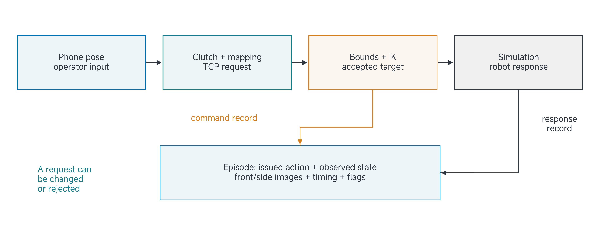
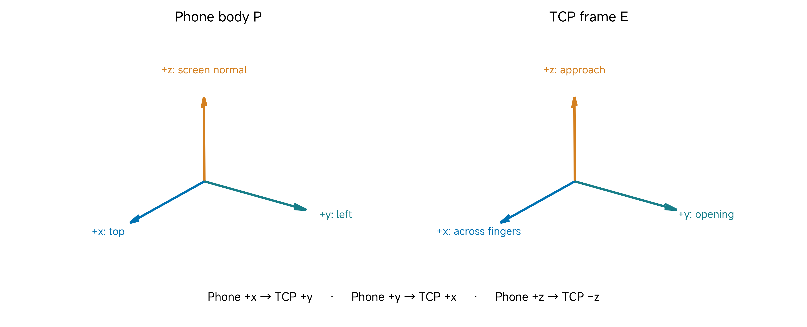
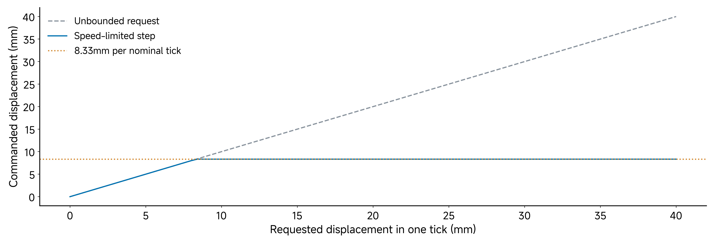
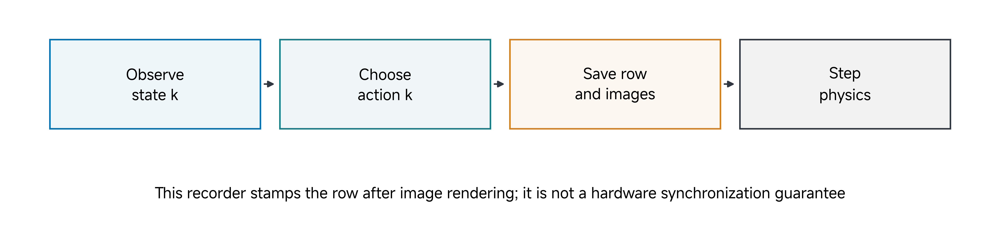
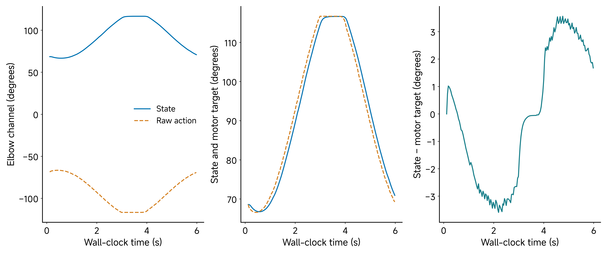
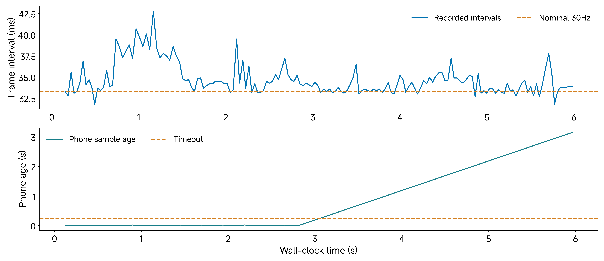
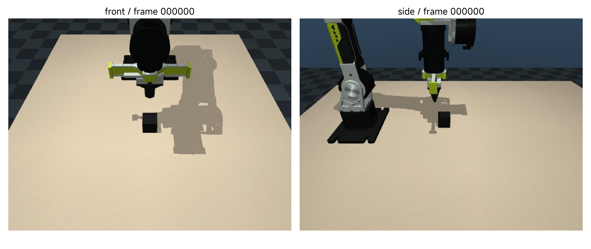

# 09 Teleoperation by Streaming from asMagic

Move a phone, and an arm moves. That observation is only the beginning. To use the movement as data, we must know what the phone measured, how its coordinates became a robot request, which request reached the simulated actuator, and which robot state and image belong beside it.

This class uses a supplied reBot B601-RS simulation with an arm, gripper, table and two cameras. All required models, code and recordings are included in the current student repository. An asMagic phone can provide the operator pose, but a local phone simulator provides the required reproducible path. We will study the command path, coordinate mapping, limits, recording order and timing. The output is an inspectable episode, not a trained policy or a claim of hardware teleoperation readiness.

**Central question:** What must align for a teleoperated demonstration to become usable robot data?

By the end of this class, you should be able to trace operator input through mapping and control to robot response; check frames, units and limits; distinguish phone streams from robot observations; and audit an episode’s identity, ordering and timestamps.

[Lecture](#lecture) · [Instructor/TA demonstration](#instructor-ta-demonstration) · [Student activity](#student-activity) · [Completion checks](#completion-checks)

### Lecture

## Teleoperation command and response paths

A usable recording must connect the operator input to the actual command and response. We will inspect that connection at each conversion boundary. The same approach applies whether the input comes from a physical phone or the deterministic local publisher.

### Follow both paths through the experiment

The command path starts with a phone pose. A mapping converts its change into a desired TCP pose. Limits and inverse kinematics convert that request into joint targets. Position actuators then act on the mechanism. Each step can change the request.

The response path starts with the simulated mechanism. It supplies joint positions and rendered observations. The recorder writes those beside the issued action, timing information and episode identity. The operator's phone motion is not the robot's measured motion.

> Figure 1. Schematic of the supplied bridge. The recorder must retain action and response semantics with separate command and robot-response paths.

Suppose the operator asks for a point outside the workspace. The controller may clip it or reject an IK update. A record of phone positions alone would suggest movement that the robot never executed. A record of final joint positions alone would omit what was requested and would not distinguish blocked commands from a stationary operator.

**Predict:** Which signals would you inspect when the phone moves but the robot holds? Check the received pose, its age, the mapped target, clipping, IK acceptance and the issued joint target before assuming a communication fault.

## Mapping, units, bounds and calibration

### The same vector can have several meanings

The bridge uses at least four representations: phone pose, TCP pose, MuJoCo joint coordinates and driver-style action/state channels. Their dimensions do not establish their meaning.

The six arm coordinates are radians in MuJoCo. Saved arm state channels are motor angles in degrees. Saved actions are command-space values. The conversion vector is

$$
d=[1,1,-1,-1,-1,1,6]^T,\qquad m_{target}=d\odot a.
$$

Here `a` is the saved action, `m_target` is the corresponding motor target, and the product is element-wise. A negative elbow action maps to a positive motor angle. For the gripper the factor is a scale as well as a convention: a command value of 10 maps to a declared motor target of 60°.

**Worked example:** A row has `action.elbow_flex = −30` and `state.elbow_flex = +29`. Their raw difference is 59°, which is not the tracking error. Convert the action first: the motor target is +30°, so state-minus-target is −1°. An apparent sign failure can be a schema failure.

The declared gripper motor angle is mapped to simulated finger stroke. Its physical conversion remains uncalibrated. Keep that qualification even when the simulated channels look consistent.

### Give every rotation a source and a destination frame

A position vector needs a frame. A rotation matrix maps coordinates between frames. We use the notation `R_AB` for a matrix that maps a vector expressed in B into coordinates expressed in A.

The supplied app/interface convention defines phone x toward its top, phone y toward its left edge, and phone z out of its screen. This is the convention used by the current bridge, not a claim that every phone API reports the same axes. The TCP frame uses z as the gripper approach direction, y as the finger-opening direction and x across the fingers.

The declared body-to-body rotation is

$$
C=R_{EP}=\begin{bmatrix}0&1&0\\1&0&0\\0&0&-1\end{bmatrix}.
$$

Its columns are the phone's axes expressed in TCP coordinates. Phone x becomes TCP +y, phone y becomes TCP +x, and phone z becomes TCP −z. The phone's back-camera viewing direction is opposite its screen-normal direction, so it maps to the TCP approach direction in this convention.

> Figure 2. Declared axis correspondence in the supplied software. The axes are drawn independently; use the stated mapping to relate them. This is a frame convention, not a physical calibration measurement.

**Worked check:** Multiplying C by the phone vector `[0.01, 0.02, 0]` gives `[0.02, 0.01, 0]` m in the TCP-oriented coordinates. Multiplication by its transpose reverses the mapping. In this particular matrix C equals its transpose, but that coincidence is not a general rule for rotations.

**Calibration check:** A useful verification is to move along one phone axis at a time and inspect the mapped TCP direction. Test rotation as well as translation. A plot that looks plausible from one camera can hide a swapped or reversed axis.

### Why use a clutch and a relative mapping?

The absolute location of the phone's tracking origin is usually irrelevant to the arm's task. We need a mapping that starts from the current operator pose and current robot command. Engaging the clutch stores both. Pausing lets the operator reposition the phone without issuing the corresponding robot movement; re-engaging establishes new references.

Let P denote the phone body, E the TCP, W the phone tracking frame and B the robot base frame. At engagement, store `p_WP0`, `R_WP0`, `p_BE0` and `R_BE0`. Define the rotation between the two world-coordinate descriptions as

$$
A=R_{BE0}\,C\,R_{WP0}^T.
$$

Then the unfiltered desired target is

$$
p_{BE}=p_{BE0}+sA(p_{WP}-p_{WP0}),
$$

$$
R_{BE}=A R_{WP} C^T.
$$

The scale `s` is 1 in the supplied default. The equations guarantee that the start maps to the start under the declared body-axis relationship. They do not estimate a globally calibrated physical transform between the phone's room and the robot's room.

**Worked example:** Assume both initial orientations are identity, initial phone position is zero, and the robot starts at `[0.25, 0, 0.10]` m. A first phone displacement `[0.01, 0.02, 0]` m maps to target `[0.27, 0.01, 0.10]` m. This is the declared arithmetic example in `code/lesson_lab.py mapping`; the actual home orientation need not be identity.

The supplied filter retains 0.3 of the previous filtered position and takes 0.7 of the new mapped position:

$$
\bar p_k=0.3\bar p_{k-1}+0.7p_k.
$$

The first sample initializes the filter directly. Do not reverse these coefficients when describing the implementation. Smoothing changes responsiveness and can add lag; a filtered pose is not the original phone measurement.

### Limits turn an operator request into an executable candidate

The supplied TCP workspace is x from 0.12 to 0.42 m, y from −0.25 to +0.25 m, and z from 0.03 to 0.30 m. The lower z limit concerns the TCP definition; the fingertips extend beyond it. A coordinate inside this box is not necessarily reachable with the requested orientation and joint limits.

The translational speed limit is 0.25 m/s at nominal 30 Hz. Thus one accepted positional target update is limited to

$$
\|\Delta p\|\le v_{max}\Delta t=0.25/30=0.008333\ldots\ \mathrm{m}.
$$

> Figure 3. Constructed arithmetic showing how the speed bound limits an individual requested displacement. It is not a measured arm trajectory.

**Worked example:** An unbounded 40 mm request cannot become a 40 mm jump in the next target. The nominal bound allows about 8.33 mm. The remaining displacement may be requested again on subsequent ticks. Orientation is separately limited to 90°/s, or 3° per nominal tick. These are target limits, not guarantees about physical end-effector velocity during a failure.

The controller runs damped least-squares IK with joint limits. It accepts a candidate when the achieved pose is within the declared position and orientation tolerances, approximately 5 mm and 5°. Otherwise it retains the previous target and joint command and marks the controller blocked. A workspace clip and an IK acceptance test answer different questions: one bounds coordinates; the other checks this particular kinematic candidate.

### Why a pose inside the box can still be rejected

With the gripper pointing down, some seemingly nearby positions require wrist angles outside their limits. A position-only test would miss this. Near a kinematic boundary, increasing the number of IK iterations cannot create an unavailable degree of freedom or widen a configured joint limit.

The Jacobian maps small joint changes into small tool-pose changes. The solver balances positional and rotational errors, uses damping, clips iteration steps and pulls toward a home posture. These choices make it a particular numerical procedure rather than a proof of global reachability.

**Diagnostic sequence:** First inspect frame and unit consistency. Then inspect the requested orientation and intersected joint limits. Finally inspect the numerical residual and initial guess. If a different initial guess succeeds, the original failure may have been a local solver limitation. If all candidate solutions violate the configured bounds, the requested pose is not allowed under that model.

Keep the distinction between an IK success flag and task success. Reaching a gripper pose does not establish that a cube moved into its goal. It also does not establish contact-force suitability or physical collision clearance.

## Original asMagic streams and Python reception

The original [asMagic app](https://apps.apple.com/us/app/asmagic/id6661033548) supports AR/device-pose, camera, IMU and joystick functionality. A stream’s availability does not establish how a particular bridge uses it. This lesson uses the original interface and Python `asmagic==0.1.4`; it does not require asMagicPro. The local publisher exercises the same pose reception path without a phone.

| Input or observation | What it can contribute | What this bridge actually retains |
| --- | --- | --- |
| AR/device pose | A tracked position and orientation for operator commands | Latest accepted pose drives mapping; raw pose packets are not saved in the episode |
| Phone camera | Scene appearance and, when supplied, camera calibration | Not a saved camera observation in this recorder |
| IMU | Inertial measurements with their own axes, units and timestamps | Not used by this pose controller or saved in its CSV |
| Joystick | Discrete or continuous operator input | Not the selected command source here; a separate adapter would be needed |
| Robot state and issued action | What the mechanism did and what the controller asked it to do | Seven state and seven action channels, plus timing and flags |
| Simulated front/side cameras | Views of the robot scene | Two RGB images per saved row |

An IMU reading is not itself an absolute position. A phone camera image is not a robot joint measurement. Combining streams requires an explicit frame and clock relationship. The prepared exercise chooses one command source so that every conversion is inspectable.

### Receive and parse a pose

The local fake phone publishes Protocol Buffers messages over a loopback ZeroMQ stream. Its default uses port 8000; the tests can select a private local port such as 18739. The subscriber keeps the most recent received pose. The bridge accepts a seven-value position/quaternion representation or a sixteen-value homogeneous-matrix representation.

The seven-value form is `[tx, ty, tz, qx, qy, qz, qw]`. Quaternion element order matters. A vector with scalar-first order passed as scalar-last may still contain four numbers but represents a different rotation. The sixteen-value form also needs its row/column layout interpreted correctly. The supplied parser includes handling for the declared layouts; this does not certify every arbitrary 4×4 input as a valid rigid transform.

## Record robot actions, states and observations

The bridge observes joint state, renders the two cameras, appends the row and images, then advances physics under the command. The saved state therefore precedes the simulated transition caused by that row's action.

> Figure 4. Schematic of the code's observation/action/step ordering. The recorder stamps its row after rendering; this is not a claim of simultaneous physical camera and encoder acquisition.

The row contains `frame_index`, wall-clock `timestamp`, seven `state.*` channels, seven `action.*` channels, `phone_age` and `blocked`. The episode metadata records scene, nominal rate, channel names and conventions. Separate `front` and `side` directories hold corresponding simulated camera images.

The current bridge does not turn every field of a phone packet into a saved learning observation. In particular, its two saved images are the simulation's rendered views. A phone's AR pose is used for command input. Do not infer that a phone-camera policy dataset has been collected merely because the protocol can also carry images.

The channel order is fixed: `shoulder_pan`, `shoulder_lift`, `elbow_flex`, `wrist_flex`, `wrist_yaw`, `wrist_roll`, `gripper`. Array length alone cannot detect a swapped wrist or an incorrect gripper scale.

| Record item | Meaning and association | Audit question |
| --- | --- | --- |
| Episode folder + `meta.json` | One attempt, model/scene, channel names, conventions and nominal rate | Can another person identify the same embodiment and reset? |
| `frame_index` | Contiguous row index within that attempt | Does row k match image filename k? |
| `timestamp` | Receiver computer’s monotonic elapsed seconds, sampled after rendering | Is it increasing, and how large are the gaps? |
| `state.*` | Motor-angle observations before this row’s transition | Are radians/degrees and gripper conventions declared? |
| `action.*` | Command-space targets associated with that observation | Has the direction/scale conversion been applied? |
| `phone_age`, `blocked` | Receiver freshness and controller rejection diagnostics | Does a hold follow stale input or a rejected IK update? |
| `front/000000.jpg`, `side/000000.jpg` | RGB simulation views for frame 0; indices continue with the rows | Are both cameras present with the expected shape? |

The retained metadata uses the input label `asmagic` for both a real app and the protocol-compatible local publisher. For a fresh experiment, add a small run note with `input_source: fake_phone` or the actual app/device build, pose format, publisher pattern, port, code version, reset procedure and interruptions. A matching protocol label alone cannot establish the acquisition device.

A training pair at time k is a declared observation and action. The next measured state belongs to the transition outcome. Accidentally pairing action k with state k+1 can leak future information or change the interpretation of an imitation-learning target. Preserve temporal order even when plotting a visually smoother trace would be easier.

### Read the recorded action/state relationship

> Figure 5. The retained local circular-motion recording. Left: raw elbow action and state. Middle: action converted into motor-target coordinates. Right: measured state minus converted motor target. These are simulation records, not physical tracking data.

Read the panels in order. First notice the raw sign difference. Next apply the declared direction conversion. Only then interpret the residual. A flat segment can mean a stationary request, a workspace/IK rejection, a stale stream or a paused operator. Inspect `blocked`, pose age and command history before assigning a cause.

Our deliberate matrix-input interruption test received the matrix form, detected stream loss, and kept the last ten saved actions unchanged to floating-point precision. That supports the stated stale-input target-hold behaviour in this simulation. It does not establish physical tracking, real Wi-Fi reliability or correct behaviour under every malformed packet.

## Timestamps, missing data and a reproducible episode

There are at least three clocks: phone capture, control-loop wall time and simulation time. The bridge's `phone_age` measures elapsed receiver-side monotonic time since the latest accepted pose. It is not automatically capture-to-actuation latency. A delayed packet can have a recent receive time while containing an older sensor measurement.

The stream timeout is 0.25 s. Once a received pose becomes stale by this rule, the controller holds its previous target. “Hold target” does not mean the mechanism stops instantaneously. The dynamics can continue while tracking that target. It is a simulation behaviour check, not a hardware stop-system qualification.

### Nominal frequency is not the observed acquisition rate

The corrected simulation covers exactly `1/30` s per control update, with seventeen physics steps at `1/510` s. The wall-clock loop still performs rendering, bookkeeping and waiting. Its rows need not arrive exactly every `1/30` s.

> Figure 6. Upper panel: intervals from a recorded local fake-phone run, compared with the nominal 30 Hz period. Lower panel: receiver-side pose age during a separate deliberate stream interruption. The two panels are different tests, not a shared time-synchronized experiment.

The retained circular-motion test contains 170 frames over about 5.86 s of recorded timestamps. Its effective rate is approximately 28.84 Hz, although metadata declares nominal 30 Hz. The largest observed interval is about 42.8 ms. These values describe this local test and workload, not a guarantee for every Mac.

Compute effective rate as `(N−1)/(t_last−t_first)`. Using N divided by the interval introduces a small counting error. Also examine interval variation: two recordings with the same average frequency can have different gaps and jitter.

If training requires a uniform time grid, define how observations and actions are resampled, how gaps are handled and which clock is authoritative. Replacing measured timestamps by `frame_index/30` hides irregularity rather than solving it. A wall-clock recording and a uniformly indexed learner need an explicit adapter.

### Define a task separately from an episode

An episode is a recorded attempt. A task definition specifies what attempts mean. For a reproducible cube-pushing task, record the object and target geometry, initial-condition range, tool start pose, reset procedure, time limit, success criterion and interventions.

“Push the cube” is insufficient. Specify whether success means crossing a boundary, reaching a final distance, remaining there for a hold time, or satisfying another outcome. Declare whether operator clutching is permitted and whether stream loss invalidates the attempt or simply becomes a logged hold.

The class's short circle/line recording is an interface exercise. It does not promise to solve the cube task. Separate a test of command mapping from a task-success experiment. This makes the record useful: a failed manipulation does not necessarily invalidate its role as an interface diagnostic.

**Worked task contract:** Use the simulated cube scene; reset the arm to the declared home pose; set a reproducible cube/goal arrangement; end after a fixed time or completed geometric criterion; log every interruption. The exact start distribution and geometric threshold must be chosen and recorded before comparing attempts. Class 10 develops that dataset contract more fully.

### Carry forward the correct interface

Class 10 introduces a pusher tool and a nine-value episode-frame pose representation. This is not a new name for the seven motor channels used here. Changing embodiment changes geometry, observations, action semantics and reset conventions.

A valid transition can reuse principles—identity, timing, frames and evidence—while requiring a different data adapter. A dataset converter needs to reconstruct the relevant tool pose from the correct model and calibration and preserve the intended observations. It cannot manufacture a tool-camera image from a joint-angle CSV.

The important result of this class is an inspectable command/response episode with a narrow scope. It is the basis for deciding what data a learner can legitimately consume.

### Instructor/TA demonstration

#### Inspect the mapping and retained recording

Use the declared identity-orientation example to check the target [0.27, 0.01, 0.10] m. Then inspect the retained circular-motion episode: 170 frames, seven state/action channels, increasing timestamps and an effective rate near 28.84 Hz. These are properties of this recorded simulation, rather than guaranteed streaming specifications.

#### Trace action, observation and transition

Select a row and its matching front/side image pair. Check channel order, convert the elbow action into motor-target coordinates and interpret the residual. Locate when the state and images are recorded relative to the issued action and the subsequent physics step. Explain why using the following state as the same-step observation would change the learning example.

> Figure 7. Front and side views from frame 0 of the retained circle episode. Both are rendered simulation images, associated with the same CSV row. Neither is a phone camera image. The two views make the scene and camera keys concrete; they do not establish physical camera calibration.

A local protocol-compatible publisher supplies the retained operator pose. The two images are rendered simulation views; neither is a phone-camera observation. Compare clock intervals and recording provenance rather than assuming that the nominal update rate describes every acquisition.

#### Interpret one timing fault

Inspect the retained interruption trace. Predict what should hold when the latest input becomes stale: the target stays fixed, while the simulated mechanism can continue converging. Observe receiver-side age, the timeout rule and the last ten action rows. A flat action trace supports a held command; it does not prove zero measured velocity. Contrast stale input with a rejected IK candidate marked by `blocked=1`.

#### Compare with the original app interface

When an already prepared asMagic interface is available, identify its AR/device-pose, camera and IMU streams. Test the meaning of one translation and rotation axis. Explain which streams the bridge actually uses and which observations the recorder retains. A protocol-compatible pose source can test the mapping without establishing physical camera calibration or wireless reliability.

Pause and re-engagement provide a final comparison: re-engagement establishes new references from the current commanded TCP pose, while actual motion may still lag that command. Name the additional calibration and timing evidence needed before interpreting a physical phone-to-arm experiment.

### Student activity

Work from the retained circle/dropout episodes or a fresh simulation run. No phone is required.

1. **Check the interface.** Identify the seven channel names in order and both image keys. Select a row and open its matching front and side images. Record episode identity, frame index, image dimensions and timestamp. Explain why the two images do not make this a phone-camera dataset.
2. **Convert before comparing.** Copy the selected elbow action and state, apply the direction vector and calculate state-minus-motor-target in degrees. Explain why a raw sign difference is insufficient evidence of an inverted motor.
3. **Audit time and missing input.** Report frame count, elapsed timestamp interval, effective frequency and largest inter-frame gap from the retained timestamp record and the reported checks. Inspect the dropout tail and distinguish receiver age from sensor-to-actuator latency. Name another possible cause of a flat trace.
4. **Define one repeatable task.** Complete the contract below. Separate a mapping diagnostic from an attempted manipulation and define how a reset reproduces the start.

| Contract field | Your declaration |
| --- | --- |
| Episode ID and input source | Include fake-phone pattern or actual app build, plus code/model version |
| Object, tool and target | Geometry, units and coordinate frame |
| Initial conditions | Robot pose, gripper state, object placement and permitted variation |
| Reset procedure | Who resets which component, in what order, and how the start is checked |
| Success criterion | A measurable threshold and observation used to assess it |
| Episode end | Outcome rule and maximum attempt duration |
| Interventions | Whether clutching is allowed and how pauses/stream loss are recorded |
| Data acceptance | Required channels/images and conditions that invalidate an attempt |

For an interface diagnostic, “a circle command was received and recorded” can be the outcome; it is not cube-pushing success. For a manipulation task, choose an object/goal arrangement and geometric criterion before collecting attempts. Preserve failures with their labels when they are valid attempts rather than silently changing the target after observing the result.

Submit one short audit record containing your episode/row references, converted residual, timing results, interpretation of the interruption and completed task contract. Include one limitation of the evidence.

### Completion checks

You should be able to trace the received phone pose, relative TCP request, bounded/accepted joint target and observed response; explain each frame and unit conversion; find a row’s two simulation images; and distinguish a timestamp gap, stale-input hold and controller rejection. A reusable record also needs the task/reset definition and explicit acquisition provenance.

The result is a reproducible teleoperation episode that can be inspected before dataset conversion. It establishes a simulation interface and recording contract. Physical calibration, contact suitability and a learner-specific observation/action adapter require their own experiments.
