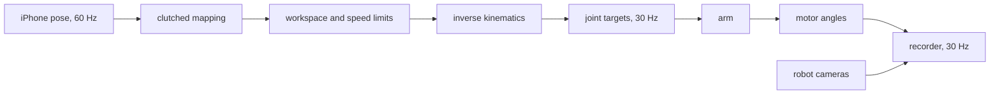
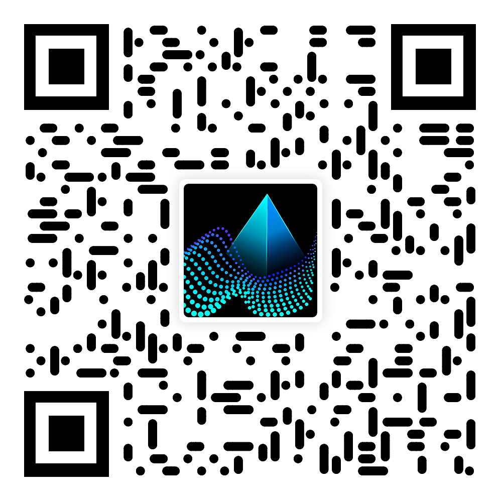
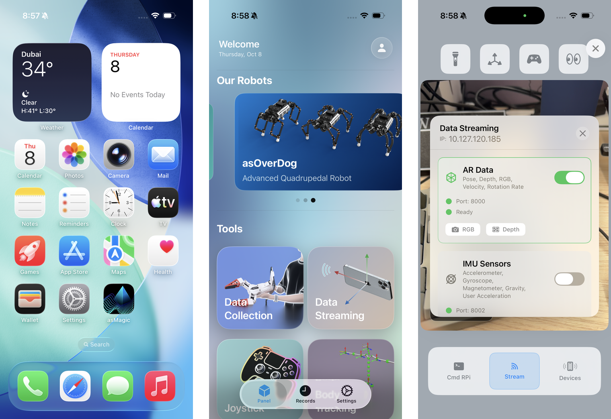
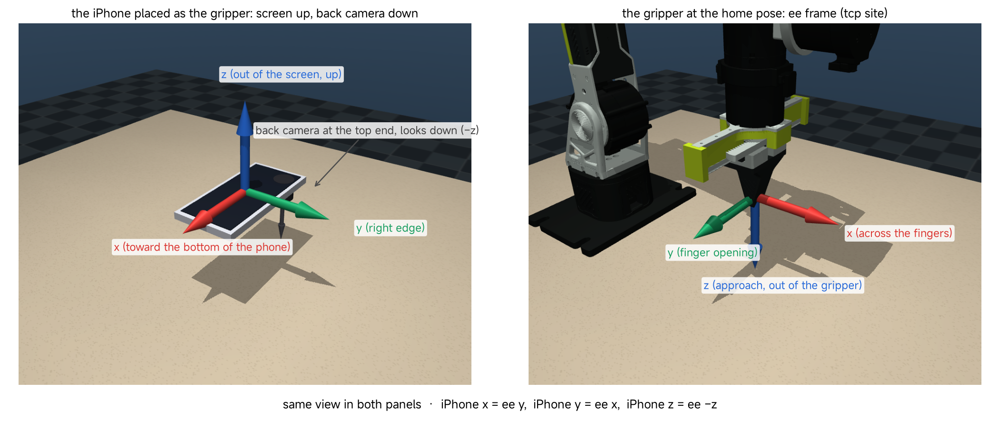
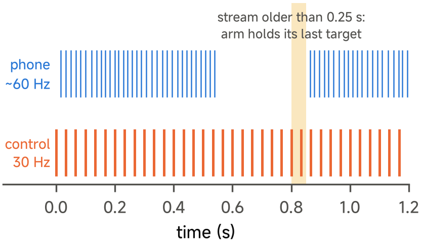
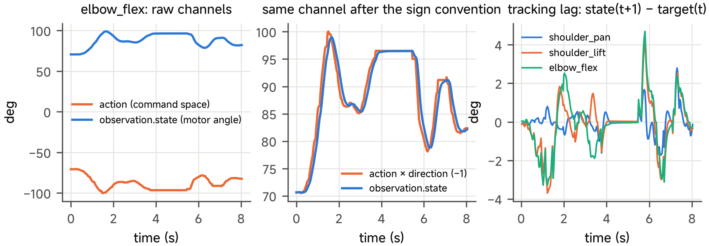

# 09 Teleoperation by Streaming from asMagic

## Central question

> What must align for a teleoperated demonstration to become usable robot data?

The leader supplies an operator pose; the follower must convert that pose into feasible motion. The class task is **use an iPhone with asMagic to teleoperate a simulated pusher and move a cube toward its target**. This continues Class 08's joint/frame/control conventions and prepares Class 10's demonstrations.

The source also includes a gripper bridge and a real-phone gripper recording. We use those as explicit interface examples. A pusher has a different tool centre and a nonzero phone-to-tip offset, so the two cases must not silently share one action schema.

By the end of this class, you should be able to:

- Trace operator pose through mapping, limits, inverse kinematics and the robot response.
- Read frame labels, units, quaternion ordering and tool transforms.
- Explain the clutch and distinguish a relative mapping from a physical calibration.
- Interpret sample age, a blocked target and the action/state alignment.
- Demonstrate the source iPhone-to-pusher simulation route or analyse its retained record.

[Lecture](#command-and-response) · [Instructor and TA demonstration](#instructor-and-ta-demonstration) · [Student activity](#student-activity)

The explanation and supplied records can be read without executing code. The separate [practice page](09-practice.md) retains the source workflow, setup and commands. A reported result is identified as a retained source record; a new execution must save its own configuration and outcome.

## Command and response

### Two paths that must agree



| Path | Content | Rate |
| --- | --- | --- |
| Command | phone pose → mapping → gripper target → limits → inverse kinematics → joint targets | 60 Hz phone, 30 Hz control |
| Response | motor angles, camera images, timestamps → recorder | 30 Hz |

The command path decides what the arm must do. The response path records what the arm did and what its cameras
saw. A demonstration is usable data only when both paths are recorded under one episode identity.

### The phone alone is not a robot record

The phone stream has the pose of the phone and its own camera image. It does not have the joint angles of the
arm, the robot cameras, or the commands after the limits and the inverse kinematics. A phone stream alone does not establish what action this follower executed; a learning task requires a suitable action/observation record and task contract.

### What the leader must measure

In teleoperation the operator moves a leader device and the robot, the follower, repeats the motion. Our follower
is the simulated reBot arm with the pusher tool for the cube task. The command path starts from the pose of the operator's hand. Thus the leader must measure a
pose, position and orientation, many times per second and without jumps.


**Question for the class.** The follower is the reBot arm. What could the leader be? Name a device that you know
and say what it measures: a joint angle, a velocity, or a full pose.


<details>

<summary>Some possible leaders</summary>

| Leader | What it measures | What it needs |
| --- | --- | --- |
| A leader arm, a small copy of the robot | joint angles | the same kinematics as the follower |
| A joystick or a 3D mouse | velocities, not a pose | the operator integrates the motion in the head |
| A VR controller | a full pose | a headset and its tracking |
| A motion-capture system | a full pose | a room of cameras and markers |
| A smartphone with AR tracking | a full pose, from its cameras and inertial sensors | only the phone |

</details>

Our group developed an iPhone app, asMagic, that streams the pose of the phone to a computer. The phone becomes
the leader: the operator holds it like the gripper, and the gripper follows.

---

## An iPhone as the leader

### asMagic

From the [asMagic documentation](https://doc.ancoraspring.com/asmagic):

> **asMagic.** Robot control and sensor data collection on iPhone and iPad.
>
> * **Start with the App.** Install asMagic, choose a feature and allow the access it needs.
> * **Receive data in Python.** Connect your iPhone, copy a receiving example and read your first frame.
> * **Record data.** Capture photos or episodes and find them in Capture history.
> * **Use a controller.** Use on-screen joysticks or pair a game controller.


{% column width="33%" %}


<figure><figcaption><p>Figure 1. QR code for the asMagic App Store page. Scan to install.</p></figcaption></figure>



{% column width="67%" valign="middle" %}
**Download:** [asMagic on the App Store](https://apps.apple.com/us/app/asmagic/id6661033548)

**Documentation:** [doc.ancoraspring.com/asmagic](https://doc.ancoraspring.com/asmagic)



### The device


<figure><figcaption><p>Figure 2. The asMagic icon on the iPhone home screen, the home page of the app and the Data Streaming page with the IP address. The app on the iPhone, its home page and the Data Streaming page.</p></figcaption></figure>

The course uses an iPhone Pro with the asMagic app. The phone tracks its own pose with ARKit, from its cameras and
its inertial sensors. The Pro models also have a LiDAR sensor, so the app can stream depth. The phone needs no SIM
card: it uses Wi-Fi only.

### The phone stream is data too

The app publishes over the local network with ZeroMQ on port 8000. This is the data contract of the stream:

| Channel | Content | Unit | Rate |
| --- | --- | --- | --- |
| Pose | position (3) and quaternion (4) of the phone in the ARKit world frame | m, unit quaternion | approximately 60 Hz |
| Colour image | the image of the main camera | pixels | with the pose |
| Depth | LiDAR depth image (Pro models) | m | with the pose |
| Intrinsics | focal lengths $$f_x, f_y$$ and principal point $$c_x, c_y$$ | pixels | with the image |

The source lesson assumes a gravity-aligned, z-up tracking frame. The receiver parses the incoming pose; that assumption must be checked against the installed app and any upstream conversion. Native phone APIs and bridge conversions need their own declared axis conventions; do not assume every raw ARKit packet already has these axes. The tracking origin and heading are arbitrary at the start, and drift is a reason to inspect and reset the mapping rather than assume a fixed global calibration. Class 10 shows the
effect of this drift on data. The intrinsics give the field of view of the camera:
$$\mathrm{fov}_y = 2\arctan\!\big(c_y / f_y\big)$$.

### Four steps to start

1. Install asMagic from the App Store, and put the phone and the computer on the same Wi-Fi.
2. Open **Data Streaming**. The page shows the IP address of the phone.
3. Start the teleoperation script with that IP address.
4. Switch **AR Data** on. The script reports `phone stream received`.

---

## Frames

### Naming transforms

We write $${}^{a}T_{b}$$ for the pose of frame $$b$$ expressed in frame $$a$$, and $${}^{a}R_{b}$$ for its
rotation. With this notation the chain of frames reads from left to right. Two transforms combine when the inner
letters agree: $${}^{a}T_{c} = {}^{a}T_{b}\,{}^{b}T_{c}$$.

### The phone frame and the gripper frame

<figure><figcaption><p>Figure 3. Left: the iPhone placed where the gripper is, with its frame. Right: the gripper at the home pose with the end-effector frame. Same view in both panels.</p></figcaption></figure>

The app gives the phone frame of ARKit: $$x$$ toward the bottom of the phone (the charging port), $$y$$ toward
its right edge, $$z$$ out of the screen. Thus the back camera, at the top end of the phone, looks along $$-z$$. The end-effector frame is at the TCP: $$z$$ points out of the
gripper, $$y$$ along the finger opening, $$x$$ across the fingers.

### One constant rotation

$$
{}^{ee}R_{iphone} = \begin{bmatrix} 0 & 1 & 0 \\ 1 & 0 & 0 \\ 0 & 0 & -1 \end{bmatrix}
$$

The columns are the phone axes expressed in the gripper frame: phone $$x$$ is gripper $$y$$, phone $$y$$ is
gripper $$x$$, phone $$z$$ is gripper $$-z$$. This matrix declares the body-axis correspondence for the gripper example. A mounted pusher also needs a camera-to-tip translation; its source script supplies a rigid transform.

Hold the phone as in the left panel: screen up and parallel to the table, the back camera toward the table, its
right edge pointing forward, away from the base. The top of the phone, with the camera, then points to the left
when you look outward from the base of the arm, and to the right when you face the arm. Treat this as the source gripper convention. Verify axes against the installed app and receiver before reusing the mapping on a physical follower.

---

## A clutched, relative mapping

### Why relative motion

The ARKit world of the phone and the robot base are two unrelated frames. The mapping does not calibrate one to the
other. It uses only the motion of the phone since a chosen moment. The operator can stand anywhere and hold the
phone in a comfortable way.

### Engage

$$
{}^{wr}p_{ee} = {}^{wr}p_{ee,0} + s\,{}^{wr}R_{w}\,\big({}^{w}p_{iphone} - {}^{w}p_{iphone,0}\big)
$$

Space stores the phone pose and the gripper pose as references (index 0). Then the gripper position is its
reference plus the displacement of the phone, rotated into the robot frame $$wr$$ and scaled by $$s$$. The
rotation $${}^{wr}R_{w}$$ is fixed at engage from the two reference orientations and the matrix above.

### Rotation follows the same way

$$
{}^{wr}R_{ee} = {}^{wr}R_{w}\;{}^{w}R_{iphone}\;{}^{iphone}R_{ee}
$$

The gripper orientation is the phone orientation through the same fixed rotations. A tilt of the phone is a tilt
of the gripper about the corresponding axis.

### Pause and engage again

Space again pauses: the arm holds its last target, and the phone can move freely. The next Space stores new
references. Thus the operator can move the hand to a new place without moving the arm. This is the clutch of a
teleoperation system.

---

## A mounted pusher changes the tool transform

For the source pusher, the phone camera is displaced from the rod tip. Let $${}^{P}T_E$$ be the calibrated pose of the tip frame in the phone frame. Then

$$
{}^{W}T_E={}^W T_P\,{}^P T_E,\qquad
{}^W p_E={}^W p_P+{}^W R_P\,{}^P p_E.
$$

Rotating the phone changes the second term even when its tracked origin is stationary. A 0.16 m offset rotated by a small illustrative angle $$\delta\theta=0.1\,\mathrm{rad}$$ gives a first-order tip displacement of about $$0.016\,\mathrm{m}$$ when the offset is perpendicular to the rotation axis. This is geometry, not a measured tracking result. The source `--pattern tilt` example makes this effect observable without moving the phone origin.

The gripper example above supplies the body-axis rotation and a convenient relative reference. The pusher script additionally supplies a translation and its own start pose and workspace. Reusing the gripper's matrix while dropping this offset would give the wrong contact point. The practical page promotes the existing source pusher route; the gripper remains a useful contrast.

## From the gripper target to joint targets

### Limits on the target

| Stage | Rule |
| --- | --- |
| Workspace | $$x$$ 0.12–0.42 m, $$y$$ ±0.25 m, $$z$$ 0.03–0.30 m |
| Speed | 0.25 m/s and 90 °/s |
| Inverse kinematics | damped least squares on the MuJoCo Jacobian, 30 iterations per period |

### One step of the inverse kinematics

The Jacobian of Class 08 relates joint velocities to the velocity of the TCP. The inverse kinematics uses it
backwards. For a target position $$p_d$$ and orientation $$R_d$$, the error is

$$
e = \begin{bmatrix} p_d - p \\ \tfrac12\, e_R \end{bmatrix}, \qquad
e_R = \tfrac12 \sum_{k=1}^{3} r_k \times r_{d,k}
$$

where $$r_k$$ and $$r_{d,k}$$ are the columns of $$R$$ and $$R_d$$. The step is the damped least-squares
solution (Lynch and Park 2017, chap. 6):

$$
\Delta q = J^{\top}\big(J J^{\top} + \lambda^2 I\big)^{-1} e \;+\; \big(I - J^{+} J\big)\,k\,(q_{home} - q)
$$

The damping $$\lambda^2 = 10^{-3}$$ regularises the inverse near a singularity. It does not by itself enforce every step bound or prove global reachability. The second term biases the arm toward home. With a damped inverse it is not an exact null-space projection and can change the task residual; the subsequent acceptance check remains necessary. The step is limited to
0.2 rad. The rotation rows of $$J$$ are scaled by ½, as the rotation error is. In the code:

```python
J = np.vstack([self.jacp[:, self.dofadr], 0.5 * self.jacr[:, self.dofadr]])     # from mj_jacSite
J_pinv = J.T @ np.linalg.solve(J @ J.T + 1e-3 * np.eye(6), np.eye(6))
dq = J_pinv @ e + (np.eye(6) - J_pinv @ J) @ (0.05 * (self.home - q))           # teleop_common.py
```

### Read this Jacobian in the correct ordering

The solver stacks translation before rotation. Featherstone spatial motion vectors stack angular before linear components. Both are valid representations when the matrix rows, residual and code agree; a permutation is required before treating one as the other. The factor 0.5 is an engineering weight between position and orientation residuals, not a universal physical conversion between metres and radians. Damping, posture bias, initial guess, joint clipping and the acceptance tolerance together define this particular numerical solver.

**Worked limit check:** At 30 updates/s and a 0.25 m/s target-speed bound, one positional increment is at most $$0.25/30=0.00833\ldots\,\mathrm{m}$$. A 40 mm operator request therefore cannot become a 40 mm one-tick target jump. The same arithmetic does not guarantee a physical tool speed in a fault.

### A step is accepted only if it is reached

The inverse kinematics can fail for a target that is inside the box but outside the reach of the arm. The
controller takes a step only if the solution reaches the target within 5 mm and 5°. If not, the arm holds and the
record marks the frame as `blocked`. With the gripper pointing straight down, the arm cannot go above
approximately 0.12 m because of the wrist limit. Tilt the phone to tilt the gripper and reach higher.

### When the stream stops

If no phone sample arrives for 0.25 s, the arm holds its last target and the log reports the loss. It continues
when the stream comes back. A hold can also follow an operator pause or a stationary request. The saved fields support a partial diagnosis: sample age indicates stale input and `blocked` records the controller's reach check, but neither field records engagement or a Space-key event. A fresh stream with a stationary target does not distinguish a pause from an engaged operator who is holding still.

---

## Teleoperation in simulation

With the device, the frames, the mapping and the inverse kinematics, everything is ready. First try
teleoperation on the simulated arm.

### The source gripper recording and the pusher task

The following source video is a gripper-interface recording with a real iPhone and the simulated arm. It illustrates the mapping and record contract, not the pusher task score. The class demonstration and practice use the source pusher script: an iPhone drives the simulated rod tip to push the black cube into the green target. The pusher script is already part of the source package; it is not a newly invented deployment.

{% embed url="https://1750588168-files.gitbook.io/~/files/v0/b/gitbook-x-prod.appspot.com/o/spaces%2FCq8PJ6eHO7umpiGK34s5%2Fuploads%2Fgit-blob-6702971cb3f5f34868a0d0afff07075f7c82031a%2Fteleop-sim-iphone.mp4?alt=media" %}
An iPhone with asMagic drives the simulated arm; front and side cameras of the scene (8 s).



The gripper video shows an episode recorded with a real iPhone and the simulated arm. The video is made from the record:
the recorded joint commands are sent again to the same model, and the two scene cameras are rendered. The
simulation needs no arm and no CAN bus, so you can rehearse teleoperation with only a phone. The practice page
shows how to run it yourself.

### Why rehearse in simulation

In simulation a wrong mapping, a lost stream or a reach limit costs nothing. You see each fault in the record
before you see it on hardware. The source provides physical variants, but configuration, calibration and operating limits require a separate physical commissioning record. Simulation rehearsal does not authorise hardware operation.

---

## Timing

### Two rates

<figure><figcaption><p>Figure 4. Timing of the phone stream and the control loop.</p></figcaption></figure>

The phone publishes at approximately 60 Hz. The control loop and the recorder run at 30 Hz. In every control
period the script uses the latest phone sample, so approximately every second sample is skipped. The record keeps
the age of the sample that was used.

### Two clocks and a sample-selection rule

A latest-sample receiver intentionally omits intermediate phone packets. Publication rate, controller rate and saved-frame rate are therefore different quantities. Let $$t_k^r$$ be the receiver timestamp and $$t_k^c$$ the control timestamp on a declared clock. Then $$\Delta t_k=t_k^c-t_{k-1}^c$$ describes the actual control interval and $$a_k=t_k^c-t_{\mathrm{sample}(k)}^r$$ describes receiver-side sample age. Neither measures the phone's full sensing-to-control delay unless the phone and receiver clocks are aligned.

A nominal 60 Hz stream does not guarantee a new packet for every controller update. Check interval distributions, missing-frame indices, duplicate samples and holds. A blocked IK flag, stale sample and operator pause have different causes even when the resulting target is stationary. The current recorder has sample age and `blocked`, but no separate stream-loss, engagement or pause-event field. Keep a manual intervention record alongside the episode: episode ID, frame index or elapsed time, Space press/pause/re-engagement, AR Data switch or network interruption, and the observed response. Mark an unknown cause as unknown; do not infer an unrecorded event from stillness alone.

### What the recorder writes about time

Every frame stores elapsed time from a monotonic clock, the age of the phone sample
(`phone_age`) and the `blocked` flag. The metadata calls this elapsed timestamp wall-clock time; it is not a synchronised phone timestamp. These columns let you measure the recorded control interval and jitter, identify stale samples and inspect reach-check failures. They cannot identify every cause of a hold. Use the manual intervention record to interpret deliberate pauses and stream interruptions; if that record is missing, keep the ambiguity explicit. Adding an engagement field would require a separately versioned recorder and schema, rather than relabelling these historical records.

---

## The episode record

The example in this section is the source gripper bridge, with seven driver-style channels and two scene cameras. The Class 09 pusher bridge removes the gripper and retains six joint channels plus front, side and phone images. Class 10 switches to the `rebot_pusher` learning recorder with nine-component tip-pose features. These contracts are not interchangeable: identify the script, recorder and tool before reusing a row.


### Folder layout

```
episode_000/
  meta.json      fps, frames, scene, input device, robot type, channel names and units, direction vector
  frames.csv     frame_index, timestamp, state.<7 motors>, action.<7 motors>, phone_age, blocked
  front/*.jpg    640 x 480
  side/*.jpg     640 x 480
```

### Units and signs

`state` is the motor angle in degrees, and `action` is in command space, as in the LeRobot driver of the physical
arm. The motor target is

$$
\text{motor target} = \text{action} \times [1, 1, -1, -1, -1, 1, 6]
$$

Thus the elbow state and action use opposite sign conventions; their numerical values need not have opposite signs at every instant, for example during a reversal or large tracking error. The state is the observation before the
action of the same frame is applied. Keep this alignment when constructing a supervised target: the action request and the response after its application belong at different points in a transition.

### A real episode

<figure><figcaption><p>Figure 5. Traces of an eight-second episode recorded with an iPhone.</p></figcaption></figure>

This is the seven-channel gripper episode shown in the source video above. It is not the Class 09 six-joint pusher diagnostic or the Class 10 nine-component tip-pose learning record. The left panel shows the raw elbow channels, the middle panel the
same channels after the direction vector, the right panel the tracking lag of the first three joints: the state
one frame later minus the target. The lag stays within 5°.

---

## The physical arm

The source supplies a **separate physical gripper script**, `teleop_rebot_rs_real.py`. It reuses the gripper mapping, keys and seven-channel record conventions, while replacing the simulation backend with seven CAN-connected motors. Its declared gains, 0.1 s target filter and 2° per-cycle joint bound belong to that physical gripper configuration. Agreement of the high-level interface is not a physical commissioning result.

The physical **pusher** clip is another configuration: the gripper is removed, six arm motors carry the tool, and the source uses the Class 10 `rebot_pusher` package. The source reports 11 pusher Push Cube episodes from 10 October 2026; the practice page links its retained video. Those records are not a seven-motor gripper run, a new class execution or an autonomous-policy success rate. Physical operation remains optional teaching-team work after its own checks. The required classroom demonstration remains iPhone control of the simulated pusher.

---

## Instructor and TA demonstration

The instructor or TA uses the [source pusher simulation procedure](09-practice.md#teleoperate-the-pusher-with-the-iphone). Before engaging, show the cube, target and rod tip and predict the sign of each phone translation. Engage the clutch, push toward the target, pause and reposition the phone, then re-engage. Show a stream interruption and distinguish the held target from an IK-blocked target. Save a new record only if its tool, frame, timestamps and outcome can be identified.

A deterministic local phone publisher is a protocol and mapping fallback. Its circle or tilt is not a successful human pusher demonstration. If an iPhone session is unavailable, inspect the supplied source figures/video and explain the mapping instead of claiming a new task completion. The original gripper procedure remains an optional interface comparison.

## Student activity

Use the demonstration or source practice to record three phone motions and their predicted tool directions. Explain what changes at a clutch re-engagement. Identify one sample-age field, one controller acceptance field and one final robot-state field; explain which can distinguish a stale stream from a kinematic limit. Write a compact task record for pushing the cube, including the initial cube/goal layout, tool, frame and terminal observation. Completing a movement is not yet a dataset acceptance decision; Class 10 adds that audit.

## References

ASMagic Team. 2026. “asmagic.” Version 0.1.4. Released January 19, 2026. *Python Package Index*. [Versioned API and data-format documentation](https://pypi.org/project/asmagic/0.1.4/). This identifies the Python interface, not an installed iOS build or a physical-frame calibration.

Featherstone, Roy. 2008. *Rigid Body Dynamics Algorithms*. Springer. [Spatial-vector resources](https://royfeatherstone.org/spatial/v2/index.html).

Lynch, Kevin M., and Frank C. Park. 2017. *Modern Robotics: Mechanics, Planning, and Control*. Cambridge University Press. [Numerical inverse kinematics](https://modernrobotics.northwestern.edu/nu-gm-book-resource/6-2-numerical-inverse-kinematics-part-1-of-2/).

MuJoCo developers. n.d. “Simulation.” *MuJoCo Documentation*, version 3.14.0. Accessed October 17, 2026. [Simulation stepping and control](https://mujoco.readthedocs.io/en/3.14.0/programming/simulation.html).

Seeed Studio. n.d. “reBot RS Mechanical Description.” *reBot-DevArm*, commit `c247ea9cb0da29cd52c31953659cc8c47e6d1a6e`. [RS mechanical source](https://github.com/Seeed-Projects/reBot-DevArm/tree/c247ea9cb0da29cd52c31953659cc8c47e6d1a6e/Rebot_Arm_description/RS). The [bundled notice](https://github.com/asEmbodiedAISyst/2026Autumn/blob/main/2026-autumn/resources/class09/practical/additional_material/model/rebot_b601_rs_mjcf/NOTICE.md) and [CERN-OHL-W licence](https://github.com/asEmbodiedAISyst/2026Autumn/blob/main/2026-autumn/resources/class09/practical/additional_material/model/rebot_b601_rs_mjcf/LICENSE.CERN-OHL-W) accompany the adapted model; the teleoperation controller and recording schema are separate course software choices.

Shenzhen AncoraSpring Robotics Technology Co., Ltd. n.d. “asMagic.” *Apple App Store*. Accessed October 17, 2026. [Original app listing](https://apps.apple.com/us/app/asmagic/id6661033548).
