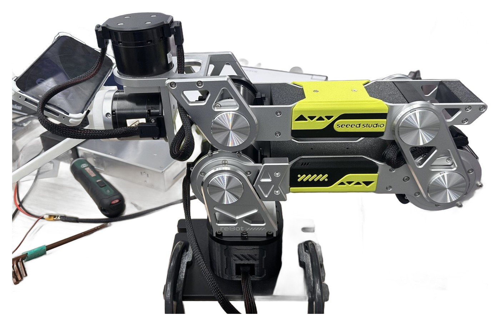
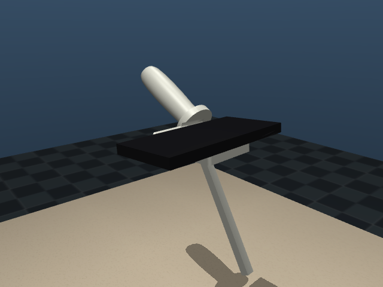
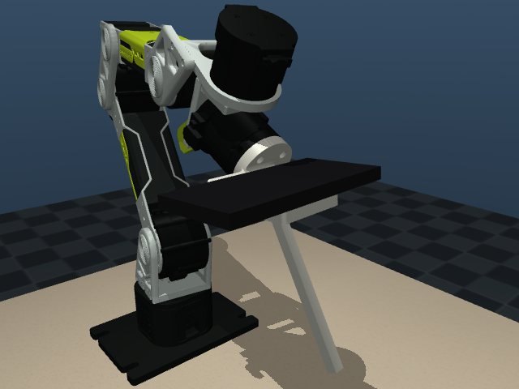
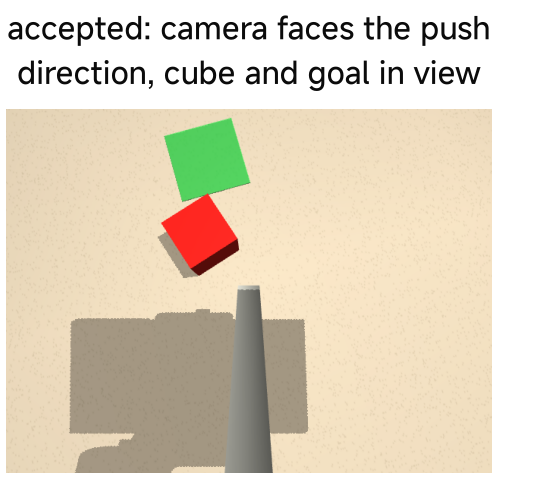
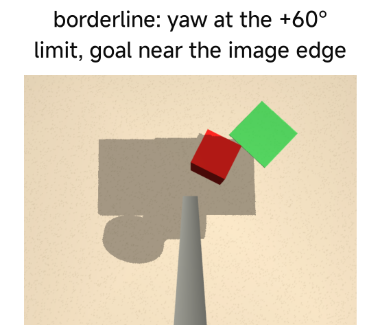
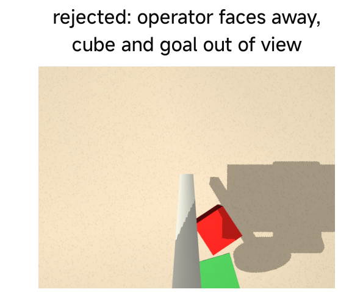
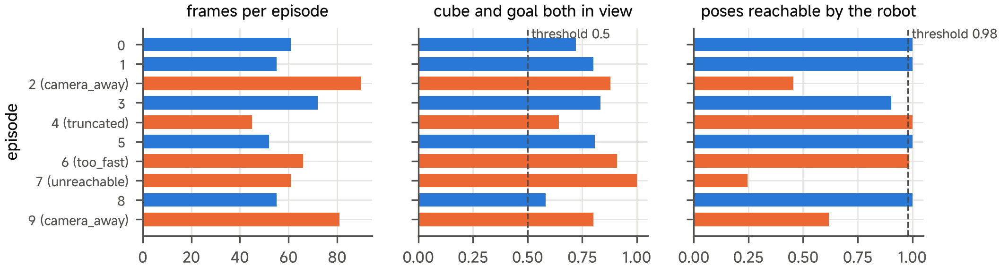

# 10 Collect Demonstrations for Robot Learning

## Central question

> How do we collect robot data that are useful for learning and defensible as evidence?

This class follows **push a cube with the pusher tool** from a task definition to an auditable demonstration dataset. The question is not how many frames we can save, but whether those frames preserve what a learner needs: observation, action, context, timing and outcome.

Class 09 supplied the operator-to-tool mapping. Here we compare the source's scripted simulation, simulated-arm teleoperation and physical handheld/teleoperation records for that same pusher-cube task. Class 11 uses saved ACT results for the required evidence exercise, with training and new evaluation as optional extended practice; a successful record and a successful learned policy are different forms of evidence.

By the end of this class, you should be able to:

- Explain the different records required by imitation learning, reinforcement learning and evaluation.
- Define pusher-cube initial conditions, reset, outcome and intervention rules.
- Interpret the tool transform, episode frame and nine-component pose encoding.
- Audit numeric integrity, visibility, executability and outcome separately.
- Write a dataset contract and split by the unit of the intended generalisation claim.

[Lecture](#why-collect-data) · [Instructor and TA demonstration](#instructor-and-ta-demonstration) · [Student activity](#student-activity)

The explanation and supplied records can be read without executing code. The separate [practice page](10-practice.md) retains the source workflow, setup and commands. A reported result is identified as a retained source record; a new execution must save its own configuration and outcome.

## Why collect data

### What each learning method needs

| Record | Made by | Necessary content |
| --- | --- | --- |
| Demonstration (imitation learning) | human teleoperation, a scripted expert, a handheld pusher | observation, selected action, task string, episode identity |
| Online RL experience | the learner's own policy in a simulator | observation, action, reward, next observation, done flag, reset distribution |
| Evaluation record | the trained policy on held-out seeds | outcome per episode, steps, final error, interventions; never used for training |

Handheld recording derives the action label from the next observed tool pose. Arm teleoperation instead records the accepted controller target after its limits/IK handling; that target need not equal the next measured tip pose. Preserve the recorder identity and field definition when training or comparing these datasets. A shared nine-number layout does not make their action semantics identical.


### Two methods, two kinds of data

The LEAP policy of Class 06 was trained with reinforcement learning. It needed a reward and millions of simulated
transitions, and nobody demonstrated anything. The arm skill of this class needs a few hundred demonstrations and
no reward. Success is used only to decide which episodes to keep and to score the policy. If you call a
demonstration dataset "RL data", you hide this difference.

### The task of this class

Push Cube: push a black 40 mm cube into a green 60 mm target with the pusher tip. The policy sees the cube and the
target only in the phone image, so it must use vision. One push direction is enough, so a simple policy can learn
it.

---

## A demonstration is a conditional learning target

For behaviour cloning, the source record supplies an observation $$o_t$$, state $$s_t$$ and selected action $$a_t$$. A supervised objective has the general form

$$
\hat\theta=\arg\min_\theta\frac{1}{N}\sum_{i,t}\ell\big(\pi_\theta(o_{i,t},s_{i,t}),a_{i,t}\big).
$$

A low loss says that a model matches its selected targets under the sampled data distribution. It does not establish what the robot should do in a new state reached after an error. Once deployed, its own actions change later observations; the resulting distribution can differ from the demonstrations (Ross, Gordon, and Bagnell 2011). Coverage, recovery behaviour and complete episodes therefore matter, not only frame count.

A saved action is also not automatically the best possible action. It may include an operator hesitation, a clipped target or a save gesture. Define whether the label is an operator request, an accepted controller command or the next measured tip pose. These alternatives are not interchangeable. Inspect the source recorder and `DATA_FORMAT.md` rather than infer timing from a column named `action`.

For reinforcement learning, an experience tuple additionally needs the transition, reward and terminal/reset semantics used by the learner (Sutton and Barto 2018). Calling a demonstration an RL dataset does not add those missing meanings. This class prepares demonstrations for ACT; rewards are not required to fit that supervised policy.

## Define the task before you collect

### The four parts of a task

| Part | Push Cube with the tool |
| --- | --- |
| Initial conditions | 40 mm cube and 60 mm goal in $$x$$ 0.30–0.48 m, $$\lvert y \rvert$$ ≤ 0.12 m, 5–10 cm apart, goal within ±70° of $$+x$$; pusher tip starts at (0.33, 0, 0.12) m |
| Reset | who moves what, in which order; simulation: a seed; bench: tape marks and a printed layout |
| Outcome | cube centre within 1.5 cm of the goal centre; time limit 15 s (450 steps) |
| Interventions | engaging the clutch again; the discard key; timeout; stream loss |

The task string recorded with every frame is `Push the black cube into the green target area.` It is the only
language input of a vision-language-action policy, so the contract fixes it.

---

## How to collect

### Why change the end effector


<figure><figcaption><p>Figure 1. The physical arm with the arm-mounted pusher and the phone. The physical arm with the pusher tool and the phone.</p></figcaption></figure>

A person cannot demonstrate with the gripper of the arm in hand, but can hold a tool. The course replaces the
gripper by the pusher tool, a printed rod with a plate for the phone. A person records demonstrations with one copy of the tool.
The arm uses another copy. The approach follows the Universal Manipulation Interface (UMI) (Chi et al. 2024) and MagiClaw (Wu et al. 2025): one tool of the same structure serves as a handheld device for collection and as the end effector of the robot for deployment.

### Two prints of the pusher tool


<div><figure><figcaption><p>Figure 2. The handheld pusher with a handle. Handheld pusher, with a handle.</p></figcaption></figure> <figure><figcaption><p>Figure 3. The arm-mounted pusher with a flange. Arm-mounted pusher, with a flange for motor 6.</p></figcaption></figure></div>

Rod, plate and camera are at the same position relative to the pusher tip in both prints. Thus the nominal camera-to-tip geometry is shared when a person or the arm holds it. Background, hands, lighting, image timing and mounting tolerances can still change the observation. The phone image is the observation of the policy. The phone pose gives
the pose of the pusher tip. The STL files of both prints are in the class folder
(`rebot_pusher/hardware/hand_tool.stl`, `robot_tool.stl`).

### Conditions for sharing demonstrations across embodiments

| Condition | How it is met |
| --- | --- |
| Matched camera-to-tip geometry | the camera is on the tool; compare actual views for occlusion and appearance |
| Relative pose | each episode has its own frame (below); only gravity is shared by the phone and the robot |
| Declared executor limits | simulation-controller contract: tip virtual workspace x 0.22–0.56 m, y ±0.20 m, z 0.003–0.20 m; linear speed 0.25 m/s, angular speed 2 rad/s, pusher-tool tilt 30°, yaw ±60° |

The scripted simulation expert stores controller-limited targets. The assigned simulated-arm teleoperation command on the [practice page](10-practice.md#start-the-recorder) explicitly selects those limits; `--robot sim` alone retains the script's different teleoperation defaults. Physical handheld recording does not clip measured poses to this contract: its next-pose labels require a separate executability audit. Equal limits are a condition to establish when sharing demonstrations, not a property guaranteed by equal field names. The supplied later checker diagnoses observed-pose reachability, speed, tilt and yaw; it does not test virtual-workspace membership, angular speed or contact dynamics.

### The episode frame

The Class 09 pusher bridge uses its own six-joint diagnostic record. This class switches to the source `rebot_pusher` learning recorder, whose state/action are nine-component tip poses. Its `DATA_FORMAT.md` and the Class 09 bridge comments also use different phone-axis wording. Before sharing a physical input across packages, verify the installed app axes and each camera-to-tip transform. Agreement of the file name `asMagic` alone does not resolve that convention.


Every episode has its own frame $$e$$. Its $$x, y$$ origin is the pusher tip at the first frame, its $$x$$ axis is
the heading $$\psi_0$$ of the tool at the first frame, and $$z$$ points up. With the table as the height reference
(see [Data from the physical bench](10-physical-bench-optional.md)), the pose at time $$t$$ is

$$
{}^{e}p_t = R_z(\psi_0)^{\top}\big({}^{w}p_t - o\big), \quad o = \big(p_{0,x},\; p_{0,y},\; z_{table}\big), \qquad
{}^{e}R_t = R_z(\psi_0)^{\top}\,{}^{w}R_t
$$

$$w$$ is the ARKit world of the phone, or the base frame of the arm. A person and the arm thus give the same
numbers for the same motion, without a calibration between the phone and the robot.

### Pose encoding

| Feature | Content |
| --- | --- |
| `observation.images.phone` | the phone image, 480 × 640 |
| `observation.state` | pusher-tip pose of this frame: position and the first two columns of $${}^{e}R_t$$ (9 values) |
| `action` | next observed pusher-tip pose for handheld recording; accepted next target for arm teleoperation, in the same form |

The two columns $$a_1, a_2$$ are a continuous representation of the rotation (Zhou et al. 2019). A network output gives back a
rotation matrix by Gram–Schmidt:

$$
b_1 = \frac{a_1}{\lVert a_1 \rVert}, \quad
b_2 = \frac{a_2 - (b_1^{\top} a_2)\,b_1}{\lVert a_2 - (b_1^{\top} a_2)\,b_1 \rVert}, \quad
b_3 = b_1 \times b_2
$$

Both the handheld recorder and the teleoperation script declare these features at 30 fps. Matching names and shapes does not establish matched visibility, noise, action timing or height semantics. Verify those fields before merging records.

### Why a pose representation needs validity checks

The Gram–Schmidt reconstruction assumes a nonzero first vector and a second vector not collinear with it. A degenerate network output requires rejection or a declared numerical fallback; division by zero does not create a valid rotation. The two rotation columns are dimensionless while position is in metres. State/action normalisation must respect their declared ordering and be computed on the training partition.

This pose representation concerns a rigid transform. It is not Featherstone's six-dimensional spatial velocity. The tip twist is a derivative with an angular-first ordering when used in spatial mechanics; the nine pose features are learning coordinates with a separate encoding. Treating their dimension as a physical degree-of-freedom count would confuse representation with mechanism.

### Three ways to collect

| Way | Who chooses the actions | Where |
| --- | --- | --- |
| Scripted expert | a program that knows the true poses of the cube and the target; the course adds small hand-like disturbances | simulation, with the handheld pusher |
| Handheld pusher | a person holding the handheld pusher with the phone; no robot is necessary | physical table (see [Data from the physical bench](10-physical-bench-optional.md)) |
| Teleoperation | a person moving a second phone that drives the arm (Class 09) | simulation or the physical arm |

All three write the same features. The course datasets in simulation come from the scripted expert (the dataset section below).

---

## The dataset

### Seven files

The source example below has seven named files: a README for people and six data/metadata files. This is the layout of that small LeRobot v3 record, not a universal seven-file limit; larger datasets are sharded into additional files.

```
real_teleop_push_cube/
  README.md                                          dataset card: source, task, scene, splits, contract
  meta/info.json                                     features, shapes, names, fps, robot_type, file paths
  meta/stats.json                                    min, max, mean, std and quantiles of every feature
  meta/tasks.parquet                                 the task strings and their index
  meta/episodes/chunk-000/file-000.parquet           one row per episode: length, first and last index, files
  data/chunk-000/file-000.parquet                    one row per frame: state, action, timestamp, indices
  videos/observation.images.phone/chunk-000/file-000.mp4   the phone images of all episodes, AV1 video
```

### The data contract

| Item | Value in the course datasets | File |
| --- | --- | --- |
| Features | `observation.images.phone` (480 × 640 × 3), `observation.state` (9), `action` (9) | `meta/info.json` |
| Names | `x, y, z, r11, r21, r31, r12, r22, r32` | `meta/info.json` |
| Units | m for the position; the rotation columns have no unit | README |
| Frame | episode frame; the height reference `z_frame` (`table` or `start`) | README |
| Rate | 30 fps | `meta/info.json` |
| Embodiment | `robot_type`: `rebot_pusher_tool_real` | `meta/info.json` |
| Task | `Push the black cube into the green target area.` | `meta/tasks.parquet` |
| Normalisation | per-feature mean and standard deviation | `meta/stats.json` |
| Scene, operator, date, splits, rejects | as recorded | README |

LeRobot reads only the six data files. The README is the part of the contract that a program cannot check. Thus a
dataset without a README cannot be audited by a person.

### The course datasets in simulation

| Dataset | Episodes | Frames | Mean length | How it was made |
| --- | --- | --- | --- | --- |
| Push Cube, handheld pusher | 300 | 17 659 | 2.0 s | scripted expert; 355 attempts, 55 discarded because the arm could not reach a pose |

The Push Cube dataset uses the current simulated scene (the photo texture of the course table and the measured green of
the printed target), 30 fps, the features of the contract above and `robot_type` `rebot_pusher_tool_handheld`.

The source package supplies the generator and the pilot records. A generated training dataset must be saved and identified before a training result is attributed to it.

The scripted expert and the teleoperation recorder are supplied in the source package. [Class 10 practice](10-practice.md) retains the exact collection, replay and audit commands; [Class 11 practice](11-practice.md) generates the declared 300-episode Push Cube training set. The count above is the source's reported retained dataset, not a fresh generation during this review.

## After collecting: pilot, audit and splits

### A pilot finds a bad design early


<div><figure><figcaption><p>Figure 4. Accepted: the camera faces the push direction. Accepted: cube and goal in view.</p></figcaption></figure> <figure><figcaption><p>Figure 5. Borderline: yaw at the limit. Borderline: goal near the edge.</p></figcaption></figure> <figure><figcaption><p>Figure 6. Rejected: the operator faces away. Rejected: objects out of view.</p></figcaption></figure></div>

In the first handheld experiment the operator could face any direction, and the goal could be anywhere. Cube and
goal were both visible at the start of only 19 of 50 episodes. The trained policy reached approximately 5 % in
its own training domain. Then the task was changed: face the push direction, start high, and put the goal in
front of the cube. Then 95 % of the frames showed both objects, and success went above 50 %. More data could not
fix the first design. Only a different task definition could.

### What a pilot answers

A pilot is five to ten episodes collected for an audit, not for training. It answers: can the camera of the policy
see the objects; are the actions within the limits of the robot; is the episode length reasonable; does the reset
work; is the outcome recorded?

### A fixed list of checks

| Check | What to look at |
| --- | --- |
| Images | keys present, 480 × 640 × 3, objects in view for most frames, no hands in a physical collection |
| State and action | dimension, names in contract order, units, direction convention, values within the limits |
| Timing | declared fps, constant timestamp step, no gaps in the frame index, plausible length |
| Terminal outcome | success flag and final error recorded, truncated episodes marked, reject reason written |
| Executability | for handheld data: the fraction of poses the arm can reach, peak speed and tilt |
| Start pose and scene | the start height above the table against the start pose of the robot (12 cm); the table, the goal and the light, as the contract gives them |

Run the list on every episode and write a reason for every rejection.

### Episode length is an audit quantity


An unusually long or short pusher-cube episode can indicate a stall, truncation, hesitation or reset problem. Inspect it before deciding; a duration outlier is a flag, not an automatic proof of a fault. The physical Push Cube audit below supplies the relevant duration comparison for the two collection routes.

### A pilot with injected faults

<figure><figcaption><p>Figure 7. Audit of the pilot dataset.</p></figcaption></figure>

The pilot contains ten **simulated handheld** Push Cube episodes. Five episodes have deliberately injected changes: facing away (two episodes), truncation, a raised speed limit and a removed yaw limit. The historical `audit_reference.json` records the injection label and source metrics; `fault: none` means no injected change, not acceptance. For example, episode 3 has `fault: none` but only 0.903 robot reachability, below the 0.98 diagnostic gate.

Use the [pilot acceptance interpretation](../resources/class10/practical/additional_material/data/pilot_push_cube_handheld/ACCEPTANCE.md) after writing your own decision. It separates injection identity, outcome and diagnostic gates, and identifies image review still needed for a full acceptance decision. There is no rule that exactly five episodes must be rejected. The retained pilot values are existing source simulation records, not new physical measurements or a newly collected dataset.

### A numeric pass is only one part of acceptance

Let $$c_{i,j}$$ denote check $$j$$ for episode $$i$$. Keep the check vector $$c_i$$ and a reason for rejection rather than collapsing everything into a single unexplained score. Finite values and regular timestamps establish numeric integrity. Visibility concerns whether the learner can observe task-relevant state. Reachability concerns whether this target arm and solver can execute the motion. A terminal distance concerns the task outcome. These are different predicates.

A commanded cube-goal distance is not a measured contact outcome. An arm that reaches all recorded tip poses can still fail to push the cube because timing, friction or collisions differ. The source pilot intentionally includes faults that the numeric-only audit cannot detect; inspecting its images and model check remains part of the task.

### Splits and leakage

Training and evaluation must not share episodes, seeds or operators in a way that raises the score. The course
uses training seeds from 1000 (scripted) or 3000 (tool) and evaluation seeds from 100000. For a physical
collection, the last 20 episodes are held out and removed from training with `--dataset.episodes`. Compute the
normalisation statistics on the training set only. Write the splits into the README of the dataset. Frames adjacent in one episode are correlated; a random frame split can leak nearly identical observations across training and evaluation. Choose the statistical unit from the claim: a new episode, operator, object layout or scene. Different seeds alone do not establish generalisation to a new table or camera.

---

## Data from the physical bench

The physical recordings of Push Cube, their audit and the estimate of the simulated scene are on the page [Data from the physical bench](10-physical-bench-optional.md).

---

## Instructor and TA demonstration

Use the [source practice page](10-practice.md) for the single core task: with the iPhone, teleoperate the simulated arm with the pusher tool and push the cube into the green target, and save or discard the episode. Show `info.json`, `stats.json`, one action/state row and the recorded image. Explain the table/start height convention before comparing any two records.

Then inspect the ten-episode Push Cube pilot. Run or read the source numeric audit first, predict which faults it can miss, then inspect visibility and the source reachability check. The audit reference is a check after a student's decision, not a substitute for the reasoning. The 150 handheld/11 teleoperated physical records are retained Push Cube evidence for comparison; they are not newly collected in class.

## Student activity

The core deliverable is one accepted or rejected Push Cube episode with a short data contract: task and outcome, tool and frame, height reference, feature names/units, image source, timing, operator or generator, interventions and split role. Give one numeric check, one visual check and one execution/outcome check. State a reason for each acceptance or rejection.

The separate practice gives the complete five-episode collection and ten-episode pilot audit. Complete the pilot decisions before consulting its reference answers. Handheld physical collection remains optional and uses the same cube task; no alternative task is introduced as evidence for this class.

## References

ASMagic Team. 2026. “asmagic.” Version 0.1.4. Released January 19, 2026. *Python Package Index*. [Versioned API and data-format documentation](https://pypi.org/project/asmagic/0.1.4/).

Chi, Cheng, Zhenjia Xu, Chuer Pan, Eric Cousineau, Benjamin Burchfiel, Siyuan Feng, Russ Tedrake, and Shuran Song. 2024. “Universal Manipulation Interface: In-The-Wild Robot Teaching Without In-The-Wild Robots.” In *Proceedings of Robotics: Science and Systems*. [Paper and project](https://umi-gripper.github.io/).

Featherstone, Roy. 2008. *Rigid Body Dynamics Algorithms*. Springer. [Spatial-vector resources](https://royfeatherstone.org/spatial/v2/index.html).

Ross, Stephane, Geoffrey Gordon, and Drew Bagnell. 2011. “A Reduction of Imitation Learning and Structured Prediction to No-Regret Online Learning.” In *Proceedings of the Fourteenth International Conference on Artificial Intelligence and Statistics*, 15:627–35. [Primary paper](https://proceedings.mlr.press/v15/ross11a.html).

Shenzhen AncoraSpring Robotics Technology Co., Ltd. n.d. “asMagic.” *Apple App Store*. Accessed October 17, 2026. [Original app listing](https://apps.apple.com/us/app/asmagic/id6661033548).

Sutton, Richard S., and Andrew G. Barto. 2018. *Reinforcement Learning: An Introduction*. 2nd ed. MIT Press. [Publisher record](https://mitpress.mit.edu/9780262039246/reinforcement-learning/).

Wu, Tianyu, Xudong Han, Haoran Sun, Zishang Zhang, Bangchao Huang, Chaoyang Song, and Fang Wan. 2025. “MagiClaw: A Dual-Use, Vision-Based Soft Gripper for Bridging the Human Demonstration to Robotic Deployment Gap.” In *Data@CoRL 2025 Workshop*. [arXiv:2509.19169](https://arxiv.org/abs/2509.19169).

Zhao, Tony Z., Vikash Kumar, Sergey Levine, and Chelsea Finn. 2023. “Learning Fine-Grained Bimanual Manipulation with Low-Cost Hardware.” In *Proceedings of Robotics: Science and Systems*. [Primary paper](https://www.roboticsproceedings.org/rss19/p016.html).

Zhou, Yi, Connelly Barnes, Jingwan Lu, Jimei Yang, and Hao Li. 2019. “On the Continuity of Rotation Representations in Neural Networks.” In *Proceedings of the IEEE/CVF Conference on Computer Vision and Pattern Recognition*, 5745–53. [Author manuscript](https://arxiv.org/abs/1812.07035).
