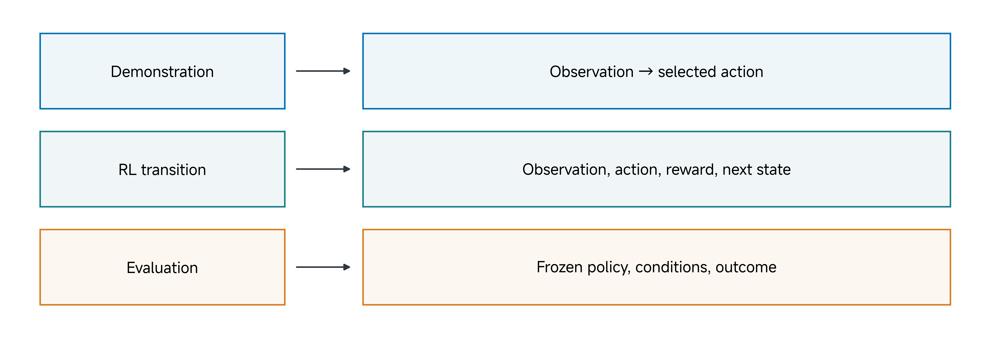
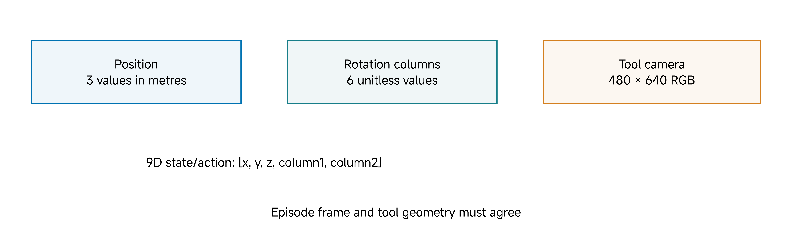
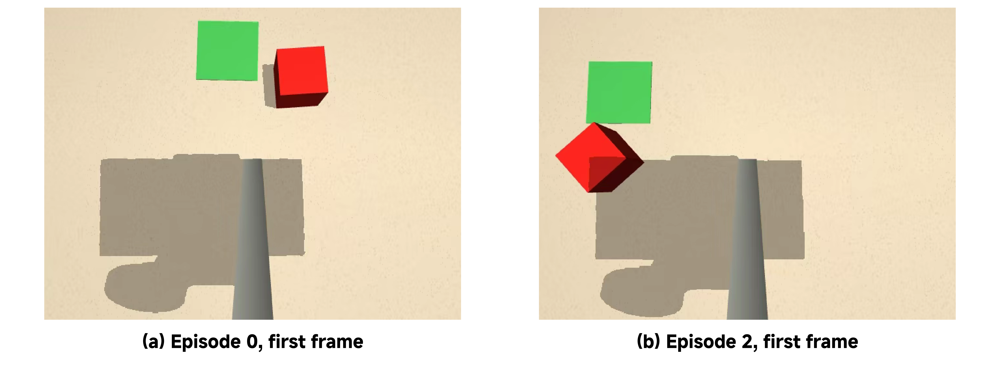
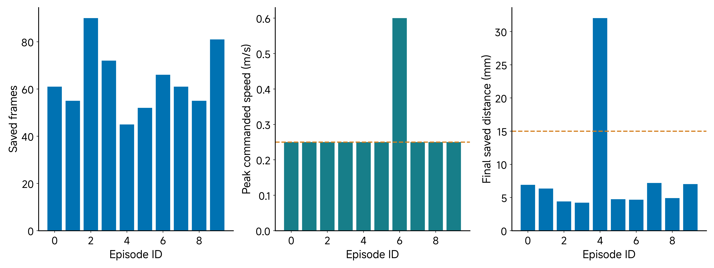
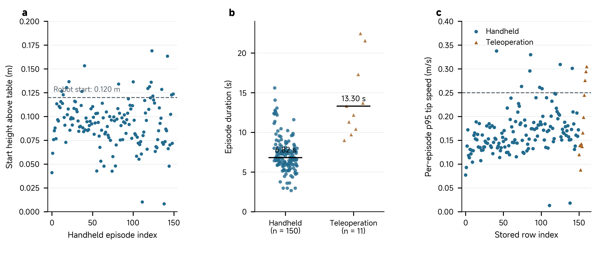
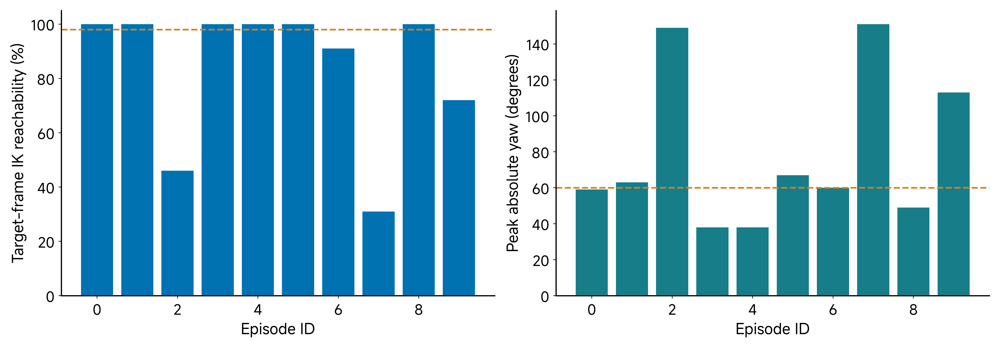
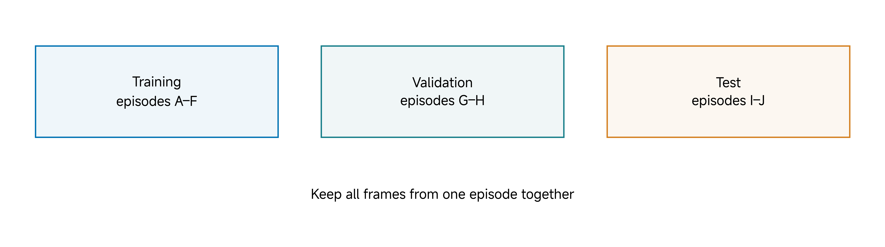
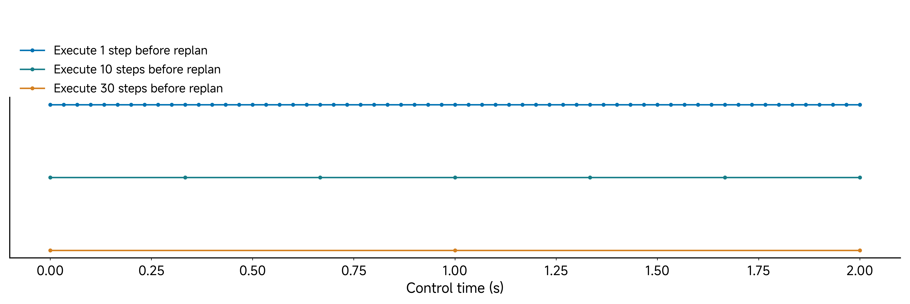

# 10 Collect Data for Reinforcement Learning

## Central question

> What must a dataset establish before it is suitable for the intended learner and executor?

Robot data acquire meaning through their task, observations, actions and collection procedure. A large folder can contain correctly shaped arrays that are poorly aligned, visually uninformative or impossible for the target robot to execute. Collecting more of those records preserves the problem.

This class separates reinforcement-learning experience from demonstrations and evaluation records. Its concrete arm-learning example is **demonstration-based imitation learning with ACT**. We inspect a small simulated pusher pilot and a 161-episode physical collection audit, identify what their records establish, and write a dataset contract. The practical uses a numeric audit and a prepared model/IK check; full training and physical robot operation are outside the required activity.

Classes 02–05 established the meanings of requested, measured and simulated quantities. Classes 06–07 showed why a learner's observations and timing must match its implementation. Classes 08–09 established an arm interface and a traceable command/response record. Here we decide whether a collection procedure supplies the evidence an intended learner and executor require. We change to a camera pusher, so we must declare the new tool and schema instead of simply renaming Class 09's motor channels.

By the end of this class, you should be able to:

- Distinguish demonstration pairs, reward-bearing experience and frozen-policy evaluation records.
- Define a task through initial conditions, reset, outcome and intervention rules.
- Audit image, pose, action and timing conventions before expanding a pilot.
- Separate structural validity, observability, executability and task outcome.
- Choose a split unit that matches the intended generalization claim.
- Read an ACT configuration and result without confusing different tools, datasets or action spaces.
- Write a concise contract and justify whether to collect, adapt, inspect or reject.

[Lecture](#choose-the-record-from-the-learning-question) · [Instructor and TA demonstration](#instructor-and-ta-demonstration) · [Student activity](#student-activity)

The supplied figures, worked examples, pilot audit results and physical collection summaries support the demonstration and activity on this page. Inspecting the recorded ACT result is distinct from rerunning its checkpoint; neither training nor hardware operation is required for the activity.

## Choose the record from the learning question

A **demonstration** records observations and actions selected by an operator or another declared expert. A behavior-cloning learner uses those pairs as supervised examples. A **reinforcement learner** optimizes a reward objective using interaction experience. An **evaluation record** describes what a frozen policy did under specified conditions and how its outcomes were judged.



*Figure 1. Record types answer different questions. Their roles depend on available information and intended use, not on file extensions.*

A simple behavior-cloning objective is:

$$
\min_\theta\frac{1}{N}\sum_{i=1}^{N}
\ell\left(\pi_\theta(o_i),a_i\right).
$$

Here $$o_i$$ is the observation, $$a_i$$ is the demonstrated action, and the policy's prediction is compared with that action through a loss. This expression states the supervised-learning idea; it does not specify ACT's complete architecture or training loss.

A reinforcement-learning objective instead maximizes expected discounted return (Sutton and Barto 2018):

$$
\max_\theta\;\mathbb E_{\pi_\theta}
\left[\sum_{t=0}^{T}\gamma^t r_t\right].
$$

A transition record can include observation, action, reward, next observation and termination information. Its contract must distinguish task termination from a collection or time-limit truncation. A demonstration dataset can support an offline RL method when it supplies the required information and assumptions; an episode success flag alone does not turn behavior cloning into RL.

**Worked distinction:** an image, measured tool pose and demonstrated next pose can supervise an imitation learner. A success flag can support filtering or evaluation. In the LEAP hand RL example, a cube-manipulation policy obtains reward-bearing simulator transitions and is optimized for return. The ACT pusher learner instead imitates recorded observation/next-pose pairs. Both require declared observations and actions, but their supervision and update procedures differ.

An observation need not reveal the full physical state. A tool pose alone does not describe cube motion, contact forces or camera visibility. A learning method may need images, recent history or another state estimate to distinguish situations that look identical in the chosen features. This connects to Class 06's explicit policy-observation construction: a file called `observation.state` is not automatically a complete Markov state or the full generalized state of a rigid-body model.

### Why low demonstration loss is insufficient

A demonstrator visits particular states. A learned policy's own small errors can take it to different states and images, after which it must act on observations that may be poorly represented in training. Ross, Gordon, and Bagnell (2011) develop this policy-induced distribution issue in [DAgger](https://proceedings.mlr.press/v15/ross11a.html). It motivates closed-loop rollout and failure review here; this class does not implement DAgger.

**Predict:** a dataset contains successful approaches to a cube but no recovery after the tool passes it. What will the learner see after its first overshoot? More copies of the same clean approach may not supply the missing recovery behavior. A decision to collect more should identify the intended coverage change.

## Identify the tool and the action space

The pilot uses a **pusher tool with a tool-mounted camera**. Its state/action representation is a tool pose, rather than six arm angles and a gripper command. Handheld and robot-mounted collection aim to preserve a useful tool-camera relationship while changing who moves the tool.

The [Universal Manipulation Interface](https://umi-gripper.github.io/) motivates careful relative-trajectory and latency interfaces (Chi et al. 2024). The simpler course pusher is a separate implementation; it does not inherit UMI's transfer results.



*Figure 2. The pusher schema contains three position values and two rotation-matrix columns. It describes a pose interface, not nine robot joints.*

The pilot declares:

| Field | Shape | Meaning |
| --- | --- | --- |
| `observation.images.phone` | 480 × 640 × 3 | Tool-camera RGB observation |
| `observation.state` | 9 | Measured tool pose in the episode frame |
| `action` | 9 | Demonstrated next pose for the retained handheld recording convention |
| `observation.environment_state` | 5 | Simulated cube x/y/yaw and goal x/y, used by the declared audit |

The nine pose features are ordered:

```text
x, y, z, r11, r21, r31, r12, r22, r32
```

Position is in metres. The other six values are unitless entries from the first two rotation-matrix columns. They encode three-dimensional orientation; they are not six independent rotational degrees of freedom. A decoder must recover a valid orthonormal rotation and specify how degenerate predictions are handled. Zhou et al. (2019) explain the motivation for continuous rotation representations in neural networks. In the supplied code, `to_rot6d` concatenates the first two columns; `from_rot6d` orthogonalizes predicted columns. For nonzero, nonparallel input vectors u and v, its geometric construction is

$$
b_1=\frac{u}{\|u\|},\qquad
\tilde b_2=v-(b_1^Tv)b_1,\qquad
b_2=\frac{\tilde b_2}{\|\tilde b_2\|},\qquad
R=[b_1\ b_2\ b_1\times b_2].
$$

The third column is reconstructed by a cross product. Six stored orientation values therefore describe a three-degree-of-freedom rotation through a constrained representation. The code protects division with a small denominator floor, but that alone does not make zero or parallel predictions valid rotations: an all-zero input produces a zero matrix, not a member of SO(3). An executor needs an explicit validity test and a declared reject/hold rule. Valid stored rotations and arbitrary network outputs require different checks.

The simulated environment-state field is privileged evaluation information. Do not silently add object/goal coordinates to a deployed actor that receives only camera images and tool pose. A third-person scene render can also reveal information absent from the policy's camera.

### A tool shared by a person and an arm

The physical tool case explains why the pose interface is useful. The handheld print has a handle; the robot print has a flange for the arm's sixth motor. Both place a printed rod and phone mount in the intended same relationship to the rod tip. A person can therefore demonstrate a push with the handheld tool while the arm carries the robot-mounted version. The source includes the two STL geometries and a photograph of the physical arm carrying the phone and rod.

This design aims to preserve a useful camera-to-tip geometry across embodiments, following the interface idea of UMI (Chi et al. 2024). The camera observes from the tool rather than a fixed room viewpoint. Its tracked pose and calibrated mounting transform locate the rod tip. The learner predicts a tool pose, leaving the robot's kinematics and limits to the executor. A human hand in the image, mount flex, a different phone alignment, unreachable poses or different contact dynamics can still distinguish the two routes. Shared CAD dimensions are a hypothesis about correspondence to check, rather than proof of interchangeable observations.

| Collection route | Who chooses motion | Information and limits to retain |
| --- | --- | --- |
| Scripted expert in simulation | A program using privileged cube/goal state | Script and reset revision, sampled disturbances, rejects and the policy's restricted observation |
| Physical handheld tool | A person directly moves the tool | Camera-to-tip calibration, table reference, images, pose/time association and target-frame executability |
| Physical or simulated teleoperation | A person moves a separate leader | Mapped request, applied limited command, follower response and intervention history |

The routes can write the same nine feature names while recording different action semantics and visual/contact distributions. This is why dataset merging requires a scientific decision as well as a successful file conversion.

### Define what an action actually means

In the retained **handheld recorder**, the previous measured state and image are paired with the next measured tool pose as `action`. That action is a demonstration target derived from motion, not an issued motor command. A robot teleoperation recorder uses a different convention: previous observation paired with the limited applied command.

For this pilot, all 628 available within-episode adjacent pairs satisfy `action[k] = observation.state[k+1]` exactly. Thus a row contains the current observation and a next-pose target expressed in the same episode frame. The action is not the difference between the two poses. Do not shift it forward again during conversion. Each episode's last action has no following saved state in that episode; never attach the next episode's first state as its outcome.

This also differs from Class 09: that bridge saves the current joint observation beside the joint command issued for the subsequent simulated transition. A pose derived from what a demonstrator did next and a bounded command sent to a robot can share a learning role while having different acquisition semantics.

Identical feature names and dimensions do not make those semantics identical. The training and execution pipeline must preserve the declared alignment, units and meaning. An off-by-one-frame error, an unrecorded executor limit or a change from measured pose to applied target can alter what the learner is being asked to predict.

## Transform camera pose into the episode frame

The pose stream initially describes a camera. Define W as a gravity-aligned collection frame, C as the camera frame, T as the tool-tip frame and F as the episode frame. As in Classes 03, 07 and 09, `R_AB` maps coordinates from B into A, while `p_AB` locates the origin of B in A. This explicit source/destination convention follows the coordinate discipline of Featherstone (2008). A homogeneous point transform here is distinct from a 6 × 6 spatial motion or force transform.

A fixed mounting transform locates the tool tip relative to the camera:

$$
\begin{aligned}
\mathbf p_{WT}&=\mathbf p_{WC}+R_{WC}\mathbf p_{CT},\\
R_{WT}&=R_{WC}R_{CT}.
\end{aligned}
$$

The original handheld recorder implements this through `tcp_pose`, `P_CAM_TCP` and `R_CAM_TCP`, after converting the incoming tracking coordinates to a declared z-up frame. A camera frame, the phone body frame used in Class 09 and an episode frame are separate definitions. Do not copy Class 09's body-axis matrix into this camera interface without verifying the relationship.

Changing the tool-camera mounting offset changes the recorded tip pose even when the image still looks plausible. As an illustrative calculation, let the offset be [0,0,−0.16] m. A +90° camera rotation about world y turns that offset into [−0.16,0,0] m. Adding the offset directly without rotation would put the tip at the wrong point. The physical mounting transform, scale and time alignment belong in the contract; a relative representation does not remove mounting errors.

For the pilot's start-relative convention, each episode establishes an origin at its initial tool-tip position and a **yaw-only heading**, while retaining world up. Let `p_WT0` be the initial tip position and `R_WF` the rotation about world z given by the initial tool yaw. Then

$$
\mathbf p_{FT}=R_{WF}^T(\mathbf p_{WT}-\mathbf p_{WT0}),\qquad
R_{FT}=R_{WF}^TR_{WT}.
$$

`EpisodeFrame.encode` implements these two operations; `to_rot6d` stores the orientation columns. `EpisodeFrame.decode` reverses them using the chosen origin and heading. A robot's new initial position/heading selects a new realization of the same relative trajectory; it does not recover the original physical room coordinates unless those were retained.

**Worked reconstruction:** choose robot start [0.33,0,0.12] m and an episode heading of +90° about base z. The relative position [0.10,0,0] m decodes to [0.33,0.10,0.12] m. It is ten centimetres along episode +x, which is base +y here. Because F is yaw-only, the initial downward tool rotation remains in the orientation features; the first rotation is not necessarily identity. With the declared downward start, its stored columns are [1,0,0,0,−1,0].

Relative coordinates remove a declared dependence on global origin and heading. They do not establish reachability, equivalent contact, camera-domain compatibility or latency matching. A human trajectory that is convenient in one frame may become unsuitable when reconstructed at a different robot start.

### Anchor height to the table when the task requires it

A start-relative record sets height zero at the first tool pose. A table-relative record sets height zero at the table while retaining the episode's horizontal origin and heading. Both are valid conventions if the learner and executor agree. They answer different questions: “how far below my start?” versus “how high above the contact surface?”

The physical handheld recorder's table-reference design uses a recent still table touch before each episode. It searches the preceding 30 s for the lowest still tip height and requires it to be at least 5 cm below the start. These are the recorded algorithm's window and separation rules, not evidence that every touch was correct. A false touch, tracking jump or moving tip can corrupt the height anchor. Repeating the touch makes each episode's local reference inspectable; it does not independently measure tracking drift or remove camera-to-tip error.

**Worked height mismatch:** the 150 handheld records below have median start height 0.0940736 m above the table, while the declared robot start is 0.120 m. For an illustrative contact pose 0.0740736 m below that median start, the tip would be 0.020 m above the table. Decoding the same start-relative displacement from 0.120 m gives 0.0459264 m: approximately 25.9 mm higher. This calculation isolates the reference-height effect; individual episodes and actual contact require their own poses. Table-relative data encode the intended 0.020 m contact height directly, provided the table and tool calibration agree.

Do not relabel a start-relative dataset as table-relative. Conversion needs each episode's table offset and provenance, followed by renewed geometric and executor checks. Normalization and dataset cards must identify the converted revision.

## Define task, reset and outcome before collecting labels

The pilot's recorded task text is **“Push the red cube into the green target area.”** Some related source descriptions name a black cube. Preserve the actual dataset's task record and inspect its images; reconcile that naming difference before combining records.

A usable task definition identifies the tool and object, initial-condition distribution, reset procedure, target geometry, outcome rule, time limit and allowed interventions. Declare whether a clutch action, stream pause, operator correction or restart remains part of an episode. Preserve unsuccessful and interrupted attempts with meaningful labels.

### A concrete pusher reset

The retained pusher task factory supplies this collection preset:

| Setting | Pusher preset |
| --- | --- |
| Cube and target | 4 cm cube; 6 cm target area |
| Object and goal workspace | Robot-base x from 0.30 to 0.48 m; y from −0.12 to 0.12 m |
| Initial cube-to-goal centre separation | 0.05–0.10 m |
| Push direction | Within ±70 degrees of robot-base +x |
| Nominal tool-tip start | [0.33, 0, 0.12] m, pointing downward |
| Default simulated start variation | Independent position noise within ±[0.02, 0.04, 0.02] m; yaw within ±0.4 rad |

The simulated environment resets the task and settles for five environment control steps before counting the attempt. A handheld layout helper uses the same placement preset as guidance; an operator must still place and record the physical objects. These code settings describe the retained pusher environment, not verified generation parameters for every pilot episode.

Configuration identity matters: the generic task class has a different workspace, 0.10–0.22 m separation and no direction constraint until the pusher factory overrides them. The canonical IK audit below fixes the nominal start without the reset noise. Record the instantiated environment and overrides, rather than inferring the reset distribution from a class name or one initial frame.

For the geometric check used here, let the planar cube and goal centres be $$\mathbf c$$ and $$\mathbf g$$:

$$
d=\lVert\mathbf c-\mathbf g\rVert_2,\qquad
\text{inside goal if }d<0.015\,\mathrm m.
$$

The threshold is a centre-distance criterion. It must not be confused with cube dimensions or inferred from the apparent width of a rendered target.

### Keep the evaluator identity with a success label

The sources contain distinct outcome rules:

| Record or evaluator | Rule or observation |
| --- | --- |
| Pilot numeric audit | Tests the last saved frame against the strict 15 mm centre-distance threshold |
| Retained pusher task code | Tests the instantaneous distance; its environment terminates immediately on success |
| Source prose | Describes a 0.5 s hold requirement, which the retained task code does not implement |
| Pusher policy-evaluation script | Defaults to 600 steps, or 20 nominal seconds at 30 Hz |
| Separate recorded gripper baseline | Result rows use a 450-step cap, or 15 nominal seconds |

These are not interchangeable protocols. If you require a hold duration, implement and version that evaluator, then label the results it produces. Do not retroactively infer a hold from one inside frame.

**Worked outcome:** 14 mm is inside a 15 mm radius; 24 mm is outside. Neither number alone establishes a 0.5 s hold. Likewise, a saved final frame, a collector's terminal label and a policy evaluator's success flag can refer to different boundaries. The contract must say which is used.

## Use a small pilot to test the collection procedure

The supplied simulated pilot contains **ten episodes and 638 retained frames**. It includes useful fault cases. A pilot tests the task, recording and audit procedure before collection expands; it is not a persuasive policy-performance experiment.



*Figure 3. Selected frames from the supplied phone-camera simulation video. They support visual inspection, not an automatic visibility score or a physical collection claim.*

Inspect the learner's actual observation. Can the cube, goal and relevant tool interaction be seen? Are task phases missing? Does a camera turn away just as contact matters? A schema can pass while its images provide inadequate task information.

A good pilot audit keeps four questions separate:

| Question | Evidence required |
| --- | --- |
| Structural validity | Metadata, counts, shapes, finite values and sequence integrity |
| Observability | Relevant image frames and the declared learner inputs |
| Target executability | Decoded poses, target frame, robot model, limits and executor checks |
| Task outcome | The versioned evaluator, termination and intervention records |

Passing one column does not automatically close the others. An episode can reach the goal at a speed the robot would limit, or be kinematically reachable while the goal is outside the policy camera.

## Audit numeric structure and temporal integrity

The portable numeric audit checks counts, dimensions, finite values and stored timestamp increments. It also derives speed from successive action-position values and computes the final saved cube-to-goal distance from the privileged environment field.



*Figure 4. Retained pilot audit. Lines mark the stated 0.25 m/s speed limit and 15 mm final-frame distance threshold. The plotted speed is inferred from the pose sequence and nominal sample rate; no policy is trained or evaluated.*

For nominal sample rate $$f$$, the action-pose finite-difference speed is:

$$
v_k^{\mathrm{pose}}=
f\left\lVert\mathbf p^{a}_{k+1}-\mathbf p^{a}_{k}\right\rVert_2.
$$

This is a speed implied by the sampled demonstration sequence. For example, at 30 Hz a 20 mm change between successive action positions implies 0.60 m/s. A 0.25 m/s executor can advance a target by only about 8.33 mm per nominal interval, so it cannot follow that sampled timing unchanged. This calculation concerns successive target poses and nominal intervals; it is separate from the state-to-next-target displacement in one row.

The original report calls it `peak_command_speed`, but the handheld action is a next measured pose. It is not a calibrated measurement of physical command velocity or camera-acquisition timing.

### Two contrasting episodes

| Episode | Last saved distance | Peak implied pose speed | Separate conclusions |
| --- | ---: | ---: | --- |
| 4 | 32.03 mm | Approximately 0.25 m/s | Outside the final-frame goal radius; speed alone does not reject it |
| 6 | 4.67 mm | Approximately 0.60 m/s | Inside the final-frame radius, but exceeds the declared 0.25 m/s speed limit |

Use the final saved environment-state values to reconstruct the geometry directly. The following coordinates are rounded to six decimals; the retained audit uses the full stored precision.

| Episode | Cube x (m) | Cube y (m) | Goal x (m) | Goal y (m) |
|---|---:|---:|---:|---:|
| 4 | 0.406478 | 0.042160 | 0.433564 | 0.025060 |
| 6 | 0.381522 | 0.014925 | 0.376856 | 0.014661 |

For episode 4, the centre difference is approximately [−0.027086,0.017100] m. Its Euclidean norm is about 0.03203 m, so the final snapshot lies outside the strict 0.015 m radius. Episode 6 gives approximately [0.004666,0.000264] m and 0.00467 m, inside that radius. The test uses both planar coordinates; comparing only x would discard part of the error.

Episode 6's implied peak speed is about 2.4 times the target limit. An executor that slows or clips that trajectory changes its timing and potentially its contact and image sequence. Declare the adaptation and re-evaluate it, or recollect under the intended limits.

The copied speed-warning procedure has a 5% reporting margin above the configured limit. This audit tolerance is distinct from the 0.25 m/s execution limit; it does not authorize faster motion.

For episode 4, the [source fault-reference file](../resources/class10/saved/audit-reference-source.json) reports a different distance, 23.9 mm, and labels it truncated and unsuccessful. The current last-saved-frame computation is 32.03 mm. Keep both records and their definitions visible rather than changing a tolerance to force agreement. An unverified settling explanation would be a hypothesis, not an established reconciliation.

### Stored timestamps need acquisition provenance

The pilot audit can verify the sample grid stored in the dataset. It cannot establish that a real camera acquired frames at precisely that cadence. The retained handheld recorder samples the latest streamed pose/image on a nominal loop and does not pass independent acquisition timestamps into the recorded dataset. Its previous observation can also persist across stream loss. The next received pose can then become the target paired with an older observation even when the saved index grid remains uniform. Class 09's receiver-age field and this pilot's nominal timestamps are different diagnostics; neither supplies a missing packet-specific capture-to-action association.

Therefore, uniformly spaced stored timestamps do not prove the absence of gaps or a physically measured 30 Hz camera stream. Record acquisition, reception and action times where available, together with resampling and gap-handling rules. A correct time grid can still pair the wrong image and action.

## Learn from the larger physical collection

The [physical episode-statistics CSV](../resources/class10/data/physical-collection/real-episode-stats.csv) contains **161 rows: 150 handheld and eleven teleoperated episodes**. This is an aggregate audit of a physical collection, separate from the ten-episode simulated pilot. It records frame count, duration, start/minimum height, path length and derived speed summaries per episode. The CSV makes the arithmetic inspectable; it does not contain all original images, packets or trajectory samples.



*Figure 5. Recomputed from all 161 stored episode-statistics rows. Left: all 150 handheld start heights, with the nominal 0.120 m robot start. Middle: all durations, separated by collection route. Right: each episode's stored 95th-percentile tip speed, with the declared 0.25 m/s limit. Markers distinguish handheld and teleoperation; no rows are removed. These are recorded summaries, not a new physical collection or independently measured acquisition timing.*

| Recomputed audit quantity | Handheld | Teleoperation | Teaching consequence |
| --- | ---: | ---: | --- |
| Episode count | 150 | 11 | Keep route and episode identity through a merge |
| Median duration | 6.8167 s | 13.3 s | Different duration distributions can alter training-frame weighting |
| Median handheld start height | 0.0940736 m | — | Compare the training height reference with the executor's 0.120 m start |
| Episodes with stored 95th-percentile speed above 0.25 m/s | 8 | 3 | Eleven episodes need an executor/collection decision; the threshold is not a new accepted speed |

Only 69 of the 150 handheld starts lie within ±0.025 m of 0.120 m. The median height alone therefore hides a substantial distribution. The p95 warning means a per-episode speed statistic exceeds the stated bound; it does not identify the exact violating frames or prove a controller clipped them. The trajectory and time-base records are needed for that test. Likewise, a longer teleoperation median may reflect route, operator or task differences rather than follower dynamics alone.

The source reports a separate kinematic audit in which all 150 handheld episodes were solver-reachable, with sixteen exceeding a speed, tilt or yaw condition. The aggregate CSV here independently supports the eleven p95-speed warnings; it does not contain all the per-pose IK and orientation data needed to reproduce the sixteen-episode combined warning. Preserve that distinction when accepting episodes.

### Reconstruct the scene from measurements with declared limits

The physical source also describes moving from a white sheet and drawn outline to the course table and printed goal. A file merge can succeed while combining those scenes. The simulated scene was revised using phone intrinsics for camera field of view, a table photograph with known sheet corners for planar rectification and scale, goal pixels for appearance, table touches for height, and the declared 40 mm cube/60 mm goal dimensions.

Each measurement constrains a different part of the model. Intrinsics constrain the image projection. A homography can rectify the table plane, but does not recover arbitrary three-dimensional geometry. Matching a goal colour under one exposure does not characterize all illumination. A table texture does not identify friction. These changes make specific observation assumptions more defensible; they do not by themselves demonstrate a smaller physical policy error.

The source summarizes a 300-episode simulated Push Cube collection and a 100-episode Push-T extension. Those full collections are described separately from the packaged small examples and this 161-row audit. A summary, generator or placeholder download is not the complete dataset. Before reproducing training, identify a versioned full-data manifest or a clearly bounded public sample, the accepted episode list, scene/reset revision and held-out split. Preserve the ten-episode pilot as its own inspectable diagnostic rather than treating it as the reported training collection.

## Check executability in the target robot frame

Returning to the ten-episode simulated pilot, the prepared IK audit reconstructs observed tool poses at a declared canonical robot start: position [0.33, 0, 0.12] m with the tool pointing downward. It uses the supplied pusher model, limits and numerical solver, trying a previous solution and a home-pose retry.



*Figure 6. Retained model/solver-dependent audit. Reach percentages are rounded terminal values. The 98% reach fraction and ±60-degree yaw lines are audit thresholds, not hardware qualification.*

The labels “reachable” in the saved report mean **solver-reported success under this particular audit**, rather than certified reachability. It uses position residual below 5 mm and cross-product orientation residual norm below 0.05. That orientation residual is a small-error measure; it is not a global geodesic-angle bound and can vanish for a 180° mismatch. The numerical solver is useful locally, while a qualified executor needs a final-pose check with an appropriate rotation metric.

The audit uses angular weight 0.3, unlike Class 09's 0.5, and can retry for 300 iterations after a 30-iteration initial solve. These are implementation choices, not changes to the meaning of a rigid-body rotation. Keep them with the model/frame identity when comparing reports.

In the retained check, episode 2 has approximately **46%** solver-reported reachable frames and episode 7 approximately **31%**. Episode 6 is approximately 91%, and episode 9 approximately 72%. Other records raise yaw warnings even when their IK fraction is high.

The IK audit computes its speed diagnostic from decoded observed-state positions. The numeric audit computes speed from action positions. Preserve that distinction even when their values happen to be similar in this pilot.

A reference file describing injected faults can differ from a current target-frame result. The measured warning depends on the frame, geometry, solver, initial guesses and limits. Report those choices before changing data to match an expected fault label.

An IK pass does not certify collision freedom, contact, effort, acceleration or timing. An IK failure does not prove global kinematic impossibility when a numerical solver or initial guess may be inadequate. Use this audit to decide what to inspect or adapt next.

## Decide acceptance using several evidence columns

Use concrete reasons rather than one undifferentiated “good episode” flag:

| Observation | Possible decision and required justification |
| --- | --- |
| Goal reached at excessive implied tool speed | Recollect within limits, or document an adaptation and test its consequences |
| Numeric structure valid, visibility unreviewed | Retain for image review; do not mark visibility as passed |
| Low IK fraction at the canonical start | Inspect frame/model/solver assumptions before changing collection geometry |
| Truncated approach ending outside the goal | Reject as a successful full demonstration; retain for another explicitly declared purpose if useful |
| Task text and observed object identity disagree | Reconcile task and image provenance before combining datasets |

The numeric-only audit leaves visibility and reachability unassessed. Its successful execution means the procedure ran; it does not mean every episode was accepted. Keep rejected and unresolved records with their audit decisions so filtering can be reproduced.

## Split by the unit of the intended claim

Adjacent frames in one episode are strongly related. Randomly distributing them across training and testing can make the test set almost a replay of the training trajectory. That evaluates a different question from performance on a new attempt.



*Figure 7. Constructed episode-level split. A–J are an illustration; they are not an executed split of the supplied pilot.*

Choose the split unit from the claim. For new attempts under the same conditions, hold out complete episodes. For a new operator, object arrangement, camera or session, reserve that factor explicitly. Different seeds identify distinct simulator attempts under a versioned reset; they do not automatically establish the desired distribution shift.

The retained metadata assigns all ten pilot episodes to `train: 0:10`. It contains no demonstrated held-out test allocation. Ten episodes and 638 frames also do not provide 638 independent task trials.

Fit normalization and other learned preprocessing on training data only. An episode-selection option does not by itself establish that a copied statistics file excludes the test set. Keep training, model selection and final evaluation roles separate. Once final evaluation motivates a revision, plan a new evaluation for the revised model.

## Understand the ACT example and its interface

[Action Chunking with Transformers](https://tonyzhaozh.github.io/aloha/) predicts sequences of actions through an imitation-learning model (Zhao et al. 2023). Its original design uses a transformer-based conditional generative formulation. For this class, the practical questions are what an action sequence means and how the executor uses it.

Distinguish **predicted chunk length** from **executed actions before replanning**. A policy can predict a long sequence while an executor applies only a prefix before requesting a new observation. Some implementations combine overlapping predictions; inspect the actual executor rather than assuming every implementation uses the same options.



*Figure 8. Constructed replanning examples at nominal 30 Hz. They illustrate feedback opportunities, not a measured ranking of policy success.*

If the executor applies $$n$$ actions at nominal rate $$f$$, its nominal open-loop interval is:

$$
T_{\mathrm{exec}}=\frac{n}{f}.
$$

At 30 Hz, ten actions span approximately 0.333 s, thirty span 1 s and one hundred span approximately 3.333 s. These are nominal horizons; wall-clock inference and actuation can differ. Changing the executed prefix changes feedback opportunities and temporal behavior. Its effect on success requires an experiment under fixed conditions.

### Keep the two supplied branches separate

| Item | Pusher pilot audited here | Recorded ACT gripper baseline |
| --- | --- | --- |
| Tool and action interface | Camera pusher; nine-value relative tool pose | Arm/gripper baseline with seven channels |
| Training data identity | Ten-episode handheld-style simulation pilot | Reported sixty scripted demonstrations, approximately fourteen thousand frames |
| Camera context | Tool/phone-camera input | Reported front and side views |
| Evidence used in this class | Dataset, numeric audit and conditional IK check | Supplied training recipe, fifty-episode result and selected clips |
| What can be reproduced here | Contract, numeric checks and prepared headless model/IK check | Result arithmetic; exact policy inference is not supplied |

The recorded baseline reports **24 successes in 50 episodes**, or **48%**, on seeds 100000–100049. This is a result for that separate baseline, not for the nine-value pusher pilot. The copied pusher evaluator supports its own six- or nine-dimensional interfaces and cannot reproduce a seven-channel gripper policy merely because the arm family or algorithm name is similar.

The retained recipe specifies ACT, 40,000 training steps, batch size sixteen, saving every 10,000 steps and CUDA execution, with external logging and hub publication disabled. These are reported recipe fields. Exact weights, processors and training configuration are absent, so they do not define a locally reproduced training run or checkpoint demonstration. The [recorded-policy source record](../resources/class10/recorded-policy/README.md) keeps that boundary with the result and clips.

## Write a dataset contract

A contract turns the collection assumptions into an inspectable specification. Each row should resolve an ambiguity that could change training, execution or evaluation.

| Contract field | What to record for this example |
| --- | --- |
| Purpose and learner | Pusher demonstration audit; intended imitation learner or separately specified RL use |
| Task and reset | Actual task text; tool/object/goal initial conditions, sampling ranges, seed/reset procedure |
| Observation schema | Phone-camera key and dimensions; pose feature names, order, units and frame |
| Action semantics | Handheld next measured pose or robot applied target; exact observation/action pairing |
| Transforms | Camera-to-tip mounting transform; yaw-only episode origin/heading; target robot reconstruction |
| Timing | Nominal rate, available measured timestamps, resampling, stream gaps and latency handling |
| Outcome | Exact evaluator/version, strict radius, implemented hold rule, timeout and interventions |
| Acceptance | Structural checks, image review, target-frame/executor checks and explicit reject/inspect rules |
| Splits and preprocessing | Whole-episode or factor-based allocation; train-only statistics and selection/test roles |
| Identity and provenance | Dataset/model/code versions, raw-source identity, derived records and audit outputs |

Keep the contract version with the accepted episode list and audit decisions. If a field changes, identify what must be recollected, adapted or re-evaluated. A failed learner may call for a camera or frame correction rather than a larger dataset.

## Instructor and TA demonstration

Use the ten-episode pilot for row-level geometry, speed and IK reasoning; use the 161-row physical summary for collection-level height and duration comparisons. Keep the separate gripper ACT outcome record identified when discussing its score. The demonstration inspects these saved records and does not train or execute a policy.

### Identify the learner's observations and target

Show the pilot-camera examples and feature schema. Locate an episode's task, image, measured pose and next-pose action. Identify the privileged object coordinates used for auditing and explain why they are not automatically policy input.

### Inspect the numeric audit

Inspect counts and shapes, then compare episodes 4 and 6. Calculate the last-frame geometry and implied pose-speed decisions against the declared thresholds. Give separate verdicts for geometry, speed and unresolved visibility. Locate the stored timestamp grid and explain what acquisition evidence it does not contain.

### Audit the physical collection and height convention

Read the two route counts and recompute the handheld median start height, both duration medians and eleven p95-speed warnings from the supplied CSV. Use Figure 5 to inspect the distribution behind those medians. Work the 25.9 mm height-offset example. Explain which fields are required to convert an episode from a start reference to a table reference, and why the aggregate CSV alone cannot rerun IK or policy inference.

### Inspect the target-frame model check

Inspect the retained canonical IK/physics report. Compare episodes 2 and 7 and identify the start frame, model, limits and solver. Keep the source fault-reference file separate from the current result. State a candidate explanation and what additional observation would distinguish it.

### Interpret the training recipe and recorded result

Open the separate ACT baseline recipe, result JSON and selected successful/failed clips. Count 24 successes across all fifty trials. Identify the seven-channel gripper branch before discussing the score. Explain which missing artifacts prevent exact inference reproduction. The [selected failure clip](../resources/class10/recorded-policy/class10_act_push_cube_ep000.mp4) and [selected success clip](../resources/class10/recorded-policy/class10_act_push_cube_ep002.mp4) illustrate individual attempts. Their selection cannot replace the 50-trial denominator. No full training run or checkpoint substitution is needed for this demonstration.

### Draft the contract together

Fill the feature, action-alignment, timing, outcome and split rows. Turn one warning into a justified next action. Use the supplied outputs and figures to support the audit reasoning.

## Student activity

Use the supplied pilot or physical collection evidence to make one acceptance decision. The core response requires no new training or robot rollout.

### Core classroom response

Choose **one** audit route:

- **Pilot episode:** choose episode 4 or 6. Use its saved distance and implied pose speed to give separate geometry and speed verdicts against the declared thresholds. Identify the episode and evidence used.
- **Physical frame:** use the worked height example. Decode a contact 0.0740736 m below a 0.120 m start, compare it with the 0.020 m table-relative target, and name one calibration or metadata field needed for a valid conversion.

Finish with one decision sentence: **collect, adapt, inspect or reject**, with the evidence supporting that choice and one unresolved condition. Submit the selected data identity, your calculation or verdicts, and that sentence.

### Further practice and project follow-up

Use the complete prompts and response record below to develop a full audit and dataset contract. They extend the chosen core route to the remaining episode, executability, split and collection questions.


#### Make separate episode decisions

For episodes 4 and 6, record the last-frame distance, implied pose speed, applicable threshold and evidence source. Give separate geometry and speed verdicts. Mark visibility as requiring image review unless you cite actual frames and observations. Explain why episode 6 can meet the snapshot geometry criterion while still being unsuitable as an unmodified robot demonstration.

#### Investigate a target-frame warning

Choose an IK, yaw or reachability warning. State the observed result, one possible explanation and one additional detail needed before altering collection or labels. Keep a solver warning separate from proof of physical impossibility.

#### Complete the short contract

Refer to the declared nine-feature schema, frame definitions, action alignment and timestamp limitations rather than copying or reordering them. State the intended learner and make three decisions: which outcome rule applies, what split/preprocessing boundary you propose, and which evidence still prevents acceptance. Cite the known definitions and complete these decision fields in the expanded response. Develop the full contract when preparing an actual collection.

#### Compare the physical collection contract

Use the 161-row audit to state the two route counts, the handheld median start height and the speed-warning denominator. Decode a contact 0.0740736 m below a 0.120 m robot start and compare it with a 0.020 m table-relative target. Decide which calibration and episode metadata a conversion needs. Explain why the stored eleven p95-speed warnings are different from a per-step clipping record.

#### Choose the next action

Select **collect, adapt, inspect or reject**, and name the evidence supporting that choice. Preserve a dataset identity and the distinction between source labels and derived audit fields.

For project follow-up, use this full response record:

| Record | Your answer |
| --- | --- |
| Dataset and learner | Data identity, tool/interface and intended learning use |
| Episodes 4 and 6 | Geometry, speed and visibility decisions with units and evidence |
| Target-frame warning | Observation, hypothesis and discriminating check |
| Physical comparison | Route counts, height-reference calculation and speed-warning denominator |
| Contract | Schema/alignment, frames, timing, outcome, split and acceptance rule |
| Next action | Collect, adapt, inspect or reject, with a reason |

Save the contract and audit with the team's experiment files. A useful response makes clear what is accepted, what is rejected and what remains unresolved; a final-frame geometry flag is not a complete policy-success label.

## Resources and continuation

- [Dataset-contract template](../resources/class10/dataset-contract-template.md).
- [Separate recorded ACT baseline evidence](../resources/class10/recorded-policy/README.md).
- [DAgger](https://proceedings.mlr.press/v15/ross11a.html), [ACT](https://tonyzhaozh.github.io/aloha/) and [UMI](https://umi-gripper.github.io/) primary research sources.

Full ACT or RL training can continue as a project when the matching dataset, environment, executor, checkpoints and compute are arranged. The course supplies examples and repositories rather than guaranteed GPU capacity. Preserve the task and interface contract, reserve evaluation conditions before tuning, and test the resulting policy in closed loop.


Class 11 follows these interface assumptions into deployment: a matched feature shape must still become a valid, timed command for the chosen mechanism. Keep the dataset, tool, camera, normalization, executor and evaluator identities attached to each result when diagnosing a Sim2Real gap.

## References

The [physical-case source record](../resources/class10/data/consolidation-source.json) identifies the pinned development passages and stored artifacts added to this lesson. Source inspection and arithmetic checks are distinct from a fresh experiment.


The [pilot metadata](../resources/class10/data/pilot_push_cube_handheld/meta/info.json), [exported frame records](../resources/class10/data/pilot_push_cube_handheld/frames.csv), [numeric audit](../resources/class10/saved/numeric-audit.json), [canonical IK report](../resources/class10/saved/canonical-ik.json) and [separate ACT outcome record](../resources/class10/recorded-policy/results_act_push_cube_40k.json) identify this lesson's supplied evidence. The [model notice](../resources/class10/model/rebot_b601_rs_mjcf/NOTICE.md) and [CERN-OHL-W licence](../resources/class10/model/rebot_b601_rs_mjcf/LICENSE.CERN-OHL-W) identify the retained mechanical source. Algorithm papers support the concepts; their reported performance does not become a result for this course pilot.

Chi, Cheng, Zhenjia Xu, Chuer Pan, Eric Cousineau, Benjamin Burchfiel, Siyuan Feng, Russ Tedrake, and Shuran Song. 2024. “Universal Manipulation Interface: In-The-Wild Robot Teaching Without In-The-Wild Robots.” In *Proceedings of Robotics: Science and Systems*. [Paper and project](https://umi-gripper.github.io/).

Featherstone, Roy. 2008. *Rigid Body Dynamics Algorithms*. Springer. [Spatial-vector resources](https://royfeatherstone.org/spatial/v2/index.html).

Ross, Stephane, Geoffrey Gordon, and Drew Bagnell. 2011. “A Reduction of Imitation Learning and Structured Prediction to No-Regret Online Learning.” In *Proceedings of the Fourteenth International Conference on Artificial Intelligence and Statistics*, 15:627–35. [Primary paper](https://proceedings.mlr.press/v15/ross11a.html).

Sutton, Richard S., and Andrew G. Barto. 2018. *Reinforcement Learning: An Introduction*. 2nd ed. MIT Press. [Publisher record](https://mitpress.mit.edu/9780262039246/reinforcement-learning/).

Zhao, Tony Z., Vikash Kumar, Sergey Levine, and Chelsea Finn. 2023. “Learning Fine-Grained Bimanual Manipulation with Low-Cost Hardware.” In *Proceedings of Robotics: Science and Systems*. [Primary paper](https://www.roboticsproceedings.org/rss19/p016.html).

Zhou, Yi, Connelly Barnes, Jingwan Lu, Jimei Yang, and Hao Li. 2019. “On the Continuity of Rotation Representations in Neural Networks.” In *Proceedings of the IEEE/CVF Conference on Computer Vision and Pattern Recognition*, 5745–53. [Author manuscript](https://arxiv.org/abs/1812.07035).
