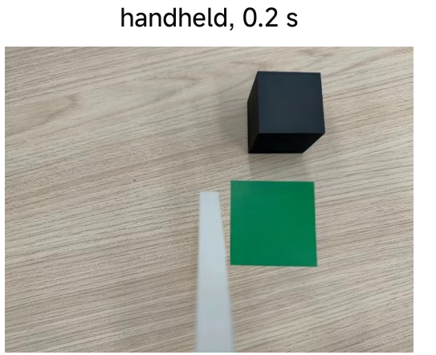
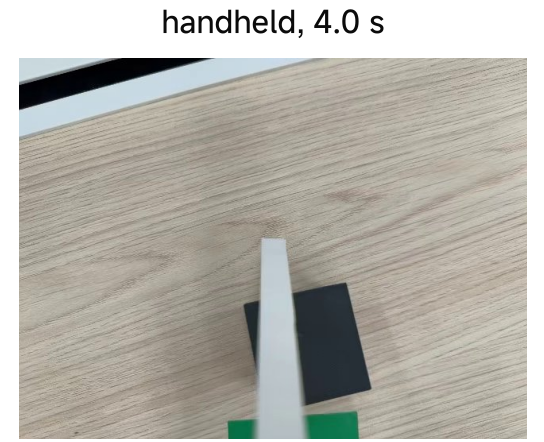
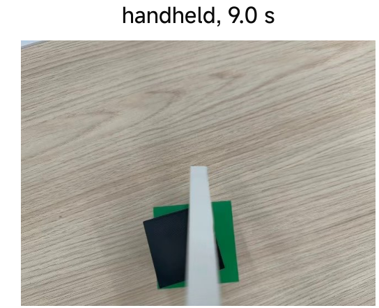
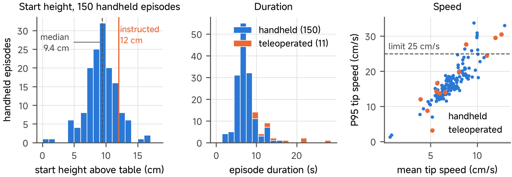

# Class 10 — Data from the physical bench

This page continues [Class 10](10-collect-data-for-reinforcement-learning.md) on the physical table: the two recording routes, the height reference, the audit of the physical episodes and the estimate of the simulated scene from these data.

## Two routes, one format

The two routes can share field names while differing in noise, visibility, reset, timing and feasible motion. File-format compatibility is a necessary interface check; it is not sufficient evidence that the records form one learning distribution.

| Route | How | Dataset (15 October 2026) |
| --- | --- | --- |
| A — Handheld | a person holds the handheld pusher with the phone; no robot is necessary | 150 Push Cube episodes |
| B — Teleoperation | a second phone drives the arm with the arm-mounted pusher | 11 Push Cube episodes |

Both routes write the same features and the same `robot_type`, which can satisfy part of a merge tool's structural requirements. Before merging, also establish matched fps, scene, height reference, action-label meaning and timing, and record the participant/session split. A next-measured-pose handheld label and an accepted teleoperation target remain different definitions even when a tool permits the files to be joined.

## The height reference and the table touch

| Height reference (`z_frame`) | $$z = 0$$ at | Written by |
| --- | --- | --- |
| `table` | the table | the handheld recorder (default) |
| `start` | the pusher tip at the first frame of the episode | the teleoperation script (default), older handheld data |

Calibration depends on the selected input mode. In the default **keyboard mode**, the recorder calibrates the table once at the beginning of the session: rest the tip for one second or accept its current height with Enter. Lift to about 12 cm, then press Enter again to start each episode. Touching the table while waiting between keyboard episodes does not run the per-episode calibration branch. The estimate can be lowered after a saved episode that went more than 5 mm below it; this is not a general drift correction. Restart and calibrate a new, separately identified session if the reference has drifted.

With **`--gesture`**, rest the tip on the table before each episode, then lift to the start pose, hold still and move to start. That branch searches its 30-second still-sample history for a table touch at least 5 cm below the start. If none is found, it warns and reuses the previous table height; record that warning rather than treating the episode as freshly calibrated. The [optional handheld practice](10-practice.md#optional-physical-handheld-collection) gives separate keyboard and gesture procedures. Do not mix height conventions in one training set.

## What the phone saw

<figure><figcaption>
Figure 1. Handheld episode at 0.2 s. Handheld, 0.2 s.
</figcaption></figure> <figure><figcaption>
Figure 2. Handheld episode at 4.0 s. Handheld, 4.0 s.
</figcaption></figure> <figure><figcaption>
Figure 3. Handheld episode at 9.0 s. Handheld, 9.0 s.
</figcaption></figure>

A handheld episode on the course table with the printed green goal. The pusher tool is always at the same place in the
image, as the tool design intends.

## The audit of 161 physical episodes

<figure><figcaption>
Figure 4. Audit of the physical data: start height, duration and speed.
</figcaption></figure>

The figure shows the start height of the 150 handheld episodes, the duration of all 161 episodes and the tip speed
of each episode. Three findings changed the data. None of them occurs in simulation, where the scripted operator
always starts at the same pose.

| Finding | Measured | Consequence |
| --- | --- | --- |
| 1. Start height | median 9.4 cm, instruction 12 cm; only 69 of 150 within ±2.5 cm | with `start` heights the arm pushes 3 cm too high; the height axis now refers to the table |
| 2. Scene | white sheet with a drawn outline against the course table with the printed goal | the merge succeeds without an error, but teaches two scenes; a merge is a decision |
| 3. Speed and duration | median 6.8 s (handheld) and 13.3 s (teleoperated); 95th-percentile tip speed above 25 cm/s in 11 episodes (8 handheld, 3 teleoperated) | the arm clips these moments; in the kinematic replay all 150 handheld episodes are reachable, and 16 exceed the speed (95th percentile), tilt or yaw limit |

## Estimate the simulated scene from the data

Observation agreement is one relevant Sim2Real condition, alongside geometry, control, timing and contact. The source estimated the following scene values from physical records; this is more informative than assuming that visually plausible rendering is sufficient:

| Scene value | Estimated from | Result |
| --- | --- | --- |
| Camera field of view | the asMagic intrinsics of the iPhone 17 Pro: $$\mathrm{fov}_y = 2\arctan(c_y / f_y)$$ | 54.4° (the first model assumed 57°) |
| Table texture | a photo of the table with the A4 goal sheet on it; the sheet corners give a homography $$\tilde u' \sim H\,\tilde u$$ to a true top view at a known scale | light oak texture, 1.2 × 0.8 m |
| Goal colour | the pixels of the printed goal in the rectified photo | opaque green `#066a45` |
| Table height | the table touches of the handheld episodes | $$z = 0$$ of the `table` frame |
| Object sizes | the printed objects | 40 mm cube, 60 mm goal square |

### Simulation and reality, side by side

<figure><figcaption>
Figure 5. Real phone image.
</figcaption></figure> <figure><figcaption>
Figure 6. Simulated phone image with the estimated scene. Simulated phone image, estimated scene (with the grid of Class 11).
</figcaption></figure>

The same provenance discipline applies to dynamics. Damping and friction require suitable dynamic excitation and an identification protocol; the static sweep alone does not identify them. A parameter added to the MJCF needs its source, units, fitted conditions and validation record.

### What the estimate does not fix

A policy trained only on 300 simulated episodes was worse than holding still on real images (Class 11). A closer scene makes the gap smaller. It does not remove light changes, motion
blur or the hand of the operator. For this course case, physical data and physical evaluation remain necessary evidence. Mixing simulated and physical data is a decision that the held-out evaluation must support, not an automatic improvement.
