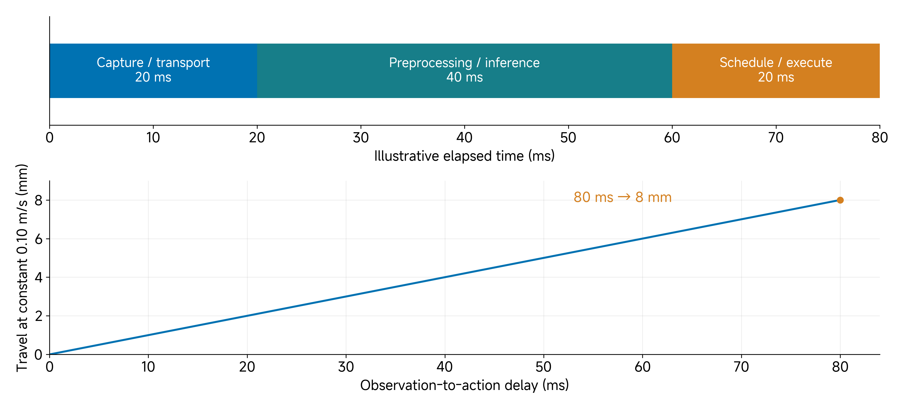
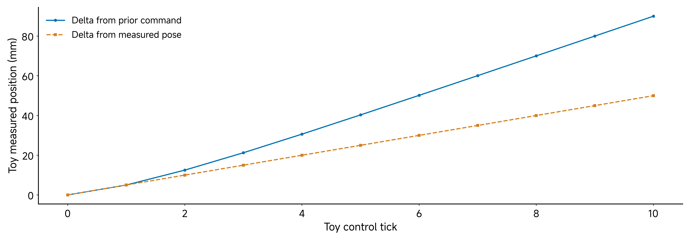
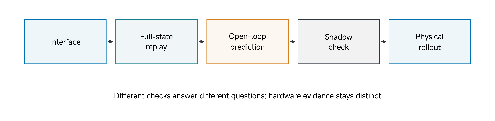
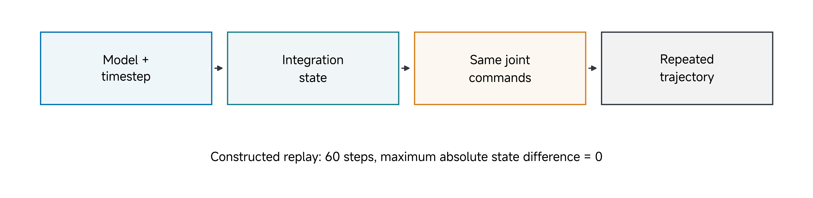
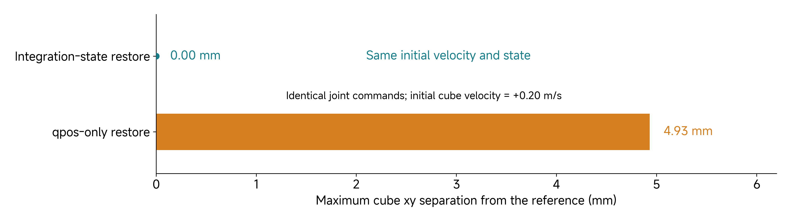
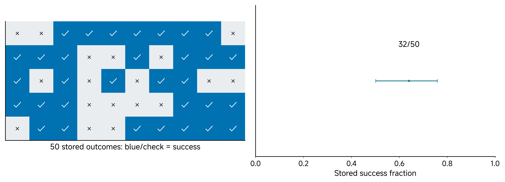
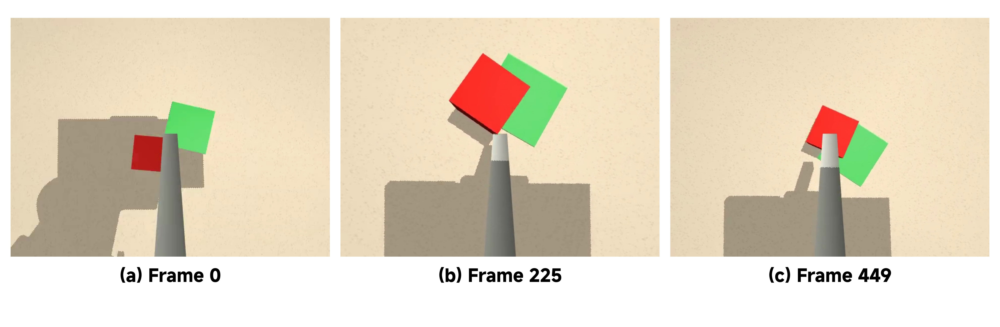
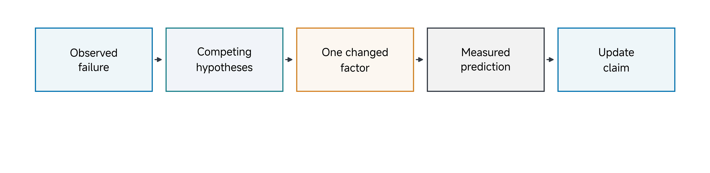

# 11 Sim2Real Gap in Hardware Deployment

A policy can perform well in one simulator and fail when the camera, timing or executor changes. It can also fail because an interface was interpreted incorrectly rather than because learning itself was ineffective. Our task is to distinguish these explanations and state what a result actually supports.

The required session remains simulation-based. We can inspect interfaces, run a constructed full-state replay, examine recorded policy outcomes and diagnose a selected failure. The current student repository includes the replay model/code, outcome JSON and selected success/failure videos. It does not include the exact learned-policy weights and saved processors needed to rerun those evaluations. Hardware teleoperation reported by the source is distinct from measured physical policy rollout evidence.

**Central question:** What evidence supports a claim that a learned behavior transfers and remains useful?

By the end of this class, you should be able to inspect a deployment interface, separate timing/contact mismatch from an interface error, explain the evidence provided by replay and shadow checks, diagnose a recorded failure, and write a bounded claim with a discriminating next experiment.

[Lecture](#observation-action-compatibility-and-calibration) · [Instructor and TA demonstration](#instructor-and-ta-demonstration) · [Student activity](#student-activity) · [Project handoff](#project-handoff)

## Observation/action compatibility and calibration

Evaluate the complete configured system and identify which comparison each test makes. A narrow, repeatable simulation result is useful evidence. Extending it to a new observation domain or physical mechanism requires additional tests rather than a broader label.

### A deployment claim names a system, not just a policy file

A checkpoint is one component. A running policy system also contains observation production, preprocessing, action interpretation, limits, scheduling, reset logic and an environment. Changing one component can change behaviour even when the checkpoint is identical.

Define the claim before selecting a score. For example: “Under these simulated reset conditions, this checkpoint and executor reach the cube goal in this fraction of attempts.” That differs from “The policy transfers to physical hardware” and from “This representation permits handheld-to-robot demonstrations.” Each requires different evidence.

The project can make a useful simulation claim without physical deployment. A missing physical test limits a physical claim; it does not automatically invalidate an honestly scoped simulation result. Likewise, completing a hardware demonstration does not remove the need to inspect failures or generalization.

**Predict:** If a policy produces the right-shaped vector but the robot moves incorrectly, has the policy failed? Possibly, but first inspect semantics, normalization, frames, timing and executor behaviour. Shape compatibility is only the first check.

### Check the complete observation/action contract

For each observation feature, identify its key, shape, type, units, frame, camera geometry and acquisition time. For every action, identify whether it is a joint target, a velocity, an incremental pose or an absolute pose in an episode frame.

| Interface question | A concrete failure |
| --- | --- |
| Is the camera key the expected one? | Correct image shape, wrong viewpoint |
| Is the channel order identical? | Shoulder value interpreted as elbow target |
| Are units and direction conversions preserved? | Degrees treated as radians, or command sign ignored |
| Is preprocessing the trained one? | Raw values used with a normalized policy, or normalization applied twice |
| Does a target mean measured-relative or commanded-relative motion? | Repeated lag changes accumulated movement |
| Is the tool transform the same? | A pose target refers to the gripper TCP while the executor uses a rod tip |
| Is the clock convention preserved? | Actions trained on one time interval executed on another |

A checkpoint that loads without an exception has not passed these checks. Even identical feature names can refer to different physical quantities. The pusher's `x` value is meaningful only with its episode frame, start definition and tool geometry.

A normalization transform also belongs to the policy interface:

$$
z=\frac{x-\mu}{\sigma}.
$$

Here x is a raw feature and the mean and scale come from the saved training processor. With `μ = 0.30 m`, `σ = 0.05 m` and raw position `x = 0.35 m`, the normalized value is 1. Passing 0.35 where 1 is expected changes the input. Applying the same normalization again changes it differently. This example is illustrative; the policy's actual statistics must come from its saved processors.

For the supplied pusher representation, `observation.state` and `action` each have nine values: `[x, y, z, r11, r21, r31, r12, r22, r32]`. The first three are rod-tip position in metres; the remaining six are the first two columns of an orientation matrix. The action is an absolute pose target in an episode frame. Its origin is the initial rod-tip position, its horizontal heading follows the initial tool yaw, and its vertical axis follows gravity. This representation is different from the seven motor-style action/state channels used with the gripper. A nine-value pose is not nine joint commands.

The policy image key is `observation.images.phone`: a tool-mounted camera view in this simulation. A front or side observer view may be useful to a human but cannot be substituted for the trained policy view without evaluating that change. The actual checkpoint must specify tensor order, scaling, resizing and preprocessing; the dataset’s stored RGB layout is not enough to infer the model’s tensor layout.

**Calibration belongs to the contract.** A correct joint order does not fix an incorrect zero offset. A correct pose encoding does not fix an incorrect camera-to-tip transform. Declare which quantities came from CAD, which were measured, and the load/configuration under which a calibration was checked. A representation match makes a test meaningful; it does not establish equal physical behaviour.

## Timing, latency, actuation and contact mismatch

### Follow the age of an observation to the actuator

An image describes an earlier system state. Capture, transport, preprocessing, inference, scheduling and actuator execution each contribute to the interval before its action takes effect. A nominal control rate alone does not identify that age. Log timestamps at the relevant boundaries, clock relationships, missed deadlines and the action actually issued after limits.

**Worked timing example:** Travel during a constant-speed delay is

$$
d=v\tau.
$$

At a constant tool speed of 0.10 m/s, an 80 ms observation-to-action delay corresponds to 8 mm of travel. That is more than half the supplied cube task’s 15 mm goal-distance threshold. This arithmetic is illustrative: a real motion is not necessarily constant, and it does not imply an 8 mm task error. It explains why a geometrically small tolerance makes time alignment consequential.

Holding the last command when a frame is late, skipping a policy update and executing a longer action chunk produce different trajectories. The controller’s timeout and the policy’s replan interval therefore belong in the evaluated configuration.

> Figure 1. Constructed timing example: 20 ms capture/transport, 40 ms preprocessing/inference and 20 ms scheduling/execution sum to 80 ms. The lower-panel travel scale assumes constant 0.10 m/s. These values illustrate a timing budget; they are not measured phone, robot or policy latency.

### Match actuation and contact under a declared experiment

A target pose is converted to joint commands, then to actuator effort and mechanism motion. Effort saturation, velocity limits, gravity compensation, payload, friction and compliance can change the response. When a tool touches a cube, object mass, contact geometry, friction and tool alignment also affect the outcome.

Use an aligned comparison: the same declared command, initial pose, payload/object, timing and measurement frame. Compare joint tracking during free motion before attributing a pushing failure to contact. Then inspect object response during a controlled contact experiment. Changing both the controller gain and surface material can improve a rollout while leaving the cause unresolved.

### The executor can change a policy's effective dynamics

An incremental action needs a reference. If `Δp` is added to the previous commanded pose, the command can continue advancing while the mechanism lags. If the same `Δp` is added to the measured pose, the next command starts behind it. The two conventions can produce different speeds and contact sequences.

> Figure 2. Constructed one-dimensional lag example. Each tick requests a 10 mm increment and the toy mechanism closes half the remaining target error. This is not robot data or a reproduction of a reported policy result.

**Worked sequence:** Start at 0 mm. Under command-relative updates, successive targets are 10, 20 and 30 mm; the toy measured positions become 5, 12.5 and 21.25 mm. Under measured-relative updates, targets are 10, 15 and 20 mm; measured positions become 5, 10 and 15 mm. The same numerical increment has different closed-loop consequences.

Neither convention is universally correct. It must match the representation, demonstrations and executor under test. The supplied tool system supports absolute episode-frame pose targets as another choice; those do not have the same incremental accumulation rule.

If changing this convention improves success, the result shows the complete system is sensitive to that choice. It does not prove the policy was intrinsically correct before or identify a unique physical cause of all previous failures.

### Separate observation, dynamics and task mismatch

An observation mismatch concerns what the policy receives: camera placement, appearance, blur, missing features or preprocessing. A dynamics mismatch concerns what the system does under commands: effort limits, delay, friction, compliance or contact. A task mismatch concerns initial conditions, objectives or reset/outcome rules.

The categories can interact. Camera delay affects which physical state an image describes. A contact model changes the images that follow a command. A new tool changes geometry, observation and actuation together. The point of separating categories is to design a test, not to claim they are independent in every system.

| Candidate mismatch | A useful discriminating check |
| --- | --- |
| Action sign/order | Known bounded command and inspected converted target |
| Recorded timing | Timestamp and sample-age audit |
| Initial simulated object state | Full-state restoration versus a deliberately incomplete reset |
| Tool/camera geometry | Known frame/pose check against the configured transform |
| Contact behaviour | Matched controlled motion with measured object response |
| Learned recovery | Fixed-policy rollouts from declared near-failure states |

Changing several items at once can repair a system but makes causal explanation harder. Record each change and separate a practical repair from an identified mechanism.

## Replay, shadow checks and supervised physical evaluation

### Use checks that answer different questions

A useful progression is interface inspection, deterministic replay, open-loop prediction, a shadow check and supervised physical evaluation when the project makes a physical claim.

> Figure 3. Conceptual progression of checks. The order helps control cost and isolate faults; it is not a universal project grade or proof that every project needs hardware.

An interface check can detect wrong units before any action is executed. A replay can test whether recorded state and commands suffice to reproduce a transition. Open-loop prediction tests a policy against held-out recorded observations. A shadow check can inspect proposed commands before physical execution. A physical rollout finally observes the real system under a declared protocol.

These checks are complementary, not interchangeable. A perfect replay of recorded actions does not show that a policy will choose those actions. A good open-loop action error does not establish closed-loop task completion. A command that stays within a numerical workspace box may still fail to move the object usefully.

**Checkpoint:** Which check directly supports “the recorded model and state reproduce this simulated sequence”? Replay. Which directly supports “the complete system completes the physical task under these conditions”? A suitably logged physical task evaluation. Neither statement follows solely from loading a checkpoint.

### Why replay needs more than joint angles

A simulator's next state depends on more than the visible arm position. Relevant fields include velocities, object configuration, actuator states where present, controls, integration time and other integration-state components. The model and numerical settings must also match.

Consider replaying a pushing sequence with the cube shifted. The arm's initial joint values can be identical while contact occurs at a different point. A replay difference may therefore arise from incomplete initial state rather than an incorrect integrator or a policy problem.

> Figure 4. Constructed simulation replay with the retained pusher model. The example restores MuJoCo's integration state and issues the same scripted joint targets. The reported zero difference is conditional on this exact repeat.

The local example runs sixty control steps, covering two seconds, then restores the saved integration state and repeats the commands. The maximum numeric difference across recorded position and velocity entries is zero in the tested run. These entries have different units; a zero-equality diagnostic is meaningful here, but their combined maximum is not a physical error magnitude for comparisons between nonidentical runs. It uses MuJoCo 3.14.0 and the same model/timestep. It is not a replay of the missing trained policy and is not a hardware comparison.

MuJoCo provides state access functions for selected state specifications; the [simulation documentation](https://mujoco.readthedocs.io/en/stable/programming/simulation.html) explains the state/control stepping context. In this example the code uses `mjSTATE_INTEGRATION`. Record that specification rather than call a `qpos` array “the full state.” Restoring state also does not restore a different model file or parameter configuration.

### Deliberately omit a part of the initial state

The bundled reset-comparison experiment gives the cube an initial +0.20 m/s velocity in robot-base x, then runs the same sixty joint commands. Restoring the integration state reproduces the reference cube trajectory. Restoring only initial `qpos` after a reset omits that velocity and other integration-state fields, producing a maximum cube xy separation of about 4.93 mm in the tested run.

> Figure 5. New controlled simulation experiment using the bundled model. Both reset procedures are compared with the same scripted reference. Full integration-state restoration has zero recorded xy discrepancy; the deliberately incomplete reset differs. This diagnoses state completeness in this constructed case, not a learned policy or a physical friction parameter.

### Match the numerical error to the question

For a joint replay, a position residual can be written as

$$
e_{q,k}=q_{replay,k}-q_{recorded,k}.
$$

For a tool-position predictor, a Euclidean distance is

$$
e_{p,k}=\|p_{predicted,k}-p_{reference,k}\|_2.
$$

These quantities have different units and interpretation. A rotation error needs a rotational metric, not subtraction of arbitrary quaternion entries. A task score may depend on object position rather than tool pose. Do not call every residual “the Sim2Real gap.”

A replay within the same simulator mainly tests recording/state completeness and implementation consistency. A model-versus-hardware comparison adds physical mismatch. A policy-versus-demonstrator action difference adds a learning/reference question. State what is being compared before choosing an explanation.

**Worked distinction:** A 3 mm tool prediction error on a recorded observation and a 31 mm final cube-goal distance are not directly comparable failures. One concerns an action-prediction horizon; the other concerns a closed-loop object outcome. Reducing one need not reduce the other without a demonstrated connection.

### Open-loop prediction has a useful but limited role

An open-loop policy check supplies a recorded observation and asks for future actions or a chunk. It compares those predictions with the declared demonstrated targets, using the saved feature and timing conventions. A hold-still predictor is a useful baseline: some short-horizon motion datasets change slowly enough that doing nothing can have a small error.

At nominal 30 Hz, horizons of one, ten and thirty steps correspond to approximately 0.033, 0.333 and 1 s. A low error at one step does not establish a useful one-second plan. State whether the policy is queried once for a chunk or repeatedly on recorded future observations; those are different procedures.

Even beating the baseline cannot prove a unique correct action. More than one action can solve a task, and a single demonstrated path is not the complete solution set. Conversely, low loss can coexist with closed-loop drift when the policy encounters its own off-demonstration states.

A policy trained on physical camera images can be evaluated in simulation as a separate visual-domain stress test if the observation interface is made explicit. Its score would not automatically measure physical skill or an equivalent training-domain task. The broad claim that such evaluation is always meaningless is too strong. The valid question and interpretation depend on the visual and physical correspondence.

The supplied inference scripts require exact weights and processors. Until those are available, this class can inspect the procedure and source records, but cannot claim to have rerun their learned-policy predictions.

## Nominal and held-out conditions, failures and bounded claims

### Read the denominator and the exact run

The supplied Class 11 summary contains fifty simulated evaluation episodes with thirty-two successes:

$$
\hat p=\frac{32}{50}=0.64.
$$

This result belongs to the specified ACT/pusher evaluation, associated in the source with a 300-demonstration model, 60k training steps and executed chunk setting `n = 100`. The outcome JSON verifies the count. The training configuration and missing checkpoint must still establish the exact inference artifacts before a reproduction claim is made.

> Figure 6. Left: the fifty supplied binary outcomes. Right: the 32/50 fraction with a descriptive 95% Wilson interval, approximately 0.501–0.759. The interval assumes independent comparable Bernoulli trials; it is not a hardware-transfer interval or a training-seed uncertainty estimate.

Fifty evaluation attempts do not make a score exact. Outcomes can also share training runs, conditions and implementation errors. The interval only describes a particular sampling model. It does not cover uncertainty from a new trained checkpoint, changed camera or hardware.

The Class 10 gripper result of 24/50 is a different system/data configuration. Comparing 48% and 64% does not isolate an improvement due to a single method. Match the task, observation, training data, executor and test protocol before making a causal comparison.

### Test the conditions named by the claim

A nominal score answers a question about the chosen evaluation distribution. A held-out episode split tests unseen attempts from a declared distribution; a held-out condition tests a deliberately excluded factor, such as camera displacement, payload, cube placement or surface friction. New seeds alone do not necessarily create a new condition.

Choose the varied range and acceptance rule before seeing the outcome. Report nominal and shifted-condition results separately, with counts of attempted, successful, failed and excluded episodes. Record interventions and why any attempt was excluded. Keep the checkpoint and executor fixed when testing a deployment condition; changing training and the test environment together prevents a clean comparison.

For example, compare the same frozen system under nominal camera placement and a specified 50 mm displacement, using paired reset layouts where appropriate. This would test that camera perturbation. It would not establish robustness to all camera positions, new contact surfaces or physical deployment. No such held-out-condition experiment is claimed for the supplied 32/50 record.

### Diagnose a failure without inventing its cause

The selected failure is episode 0 of the supplied video set. Its summary reports 450 steps, success false, final cube-goal distance approximately 0.031074 m and `ik_ok = 1.0`. At nominal 30 Hz, 450 control steps correspond to fifteen seconds of simulated control time.

> Figure 7. Selected frames 0, 225 and 449 from the supplied episode-0 failure video. The figure crops the policy-view half of the two-view video, without retouching; the full video retains the observer view. These samples alone do not locate the exact onset of failure.

An IK success fraction of 1.0 does not make the task successful. It says the logged IK criterion was satisfied; the cube can still stop outside the goal. Likewise, the final distance alone does not tell us whether the problem was visibility, action execution, contact or insufficient recovery data.

Inspect the policy's available image, not only the observer view. Identify when progress stops and what the tool does next. Record a frame/time range and describe the observation before naming a cause. If the supplied video cannot establish a fact, leave that field unresolved instead of supplying a plausible story.

**Worked hypothesis:** “Long action execution before replanning prevents recovery near the goal.” A test can keep the checkpoint, reset seeds and environment fixed while changing executed chunk length. Predict a change in recovery behaviour and success rate, and define what result would weaken the hypothesis. Without the checkpoint this is a proposed experiment, not a completed one.

### Make a bounded next-experiment decision

A failure analysis should connect observation, competing explanations and a measurement. “Improve the model” is not a complete experiment. Name the changed factor, fixed conditions, predicted observation and decision rule.

> Figure 8. Conceptual design of a discriminating next experiment.

For example, keep the controller and target trajectory fixed and compare full-state versus incomplete-state replay. If only the incomplete reset changes the result, the finding supports a state-completeness explanation for that replay discrepancy. It does not identify a hardware friction error.

For a camera hypothesis, vary a declared camera factor while keeping the physics and action convention fixed. A successful robustness test under that variation supports only the tested range. It is stronger to specify a five-centimetre camera displacement and an evaluation protocol than to say “the policy is robust.”

A shadow check can inspect a policy's proposed actions in a simulated or non-actuating path before a physical trial. Its role is bounded: acceptable numeric outputs do not establish that the physical task will succeed. Physical operation requires its own approved setup and supervision; this session does not issue hardware commands.

## Connect actuator validation, LEAP and reBot evidence

The course’s experiments address different system boundaries. A result at one boundary supports later work only when the relevant conditions still match.

| Experiment boundary | What to measure | What that evidence can support |
| --- | --- | --- |
| Single actuator with a declared link/payload | Command, joint response, load, timing and chosen model residual | A validated actuator/model property within the tested operating range |
| LEAP hand manipulation | Object outcome, joint/observation interface, reset conditions and disturbances | Task-level performance for that hand, policy and observation setup |
| reBot arm with pusher | Tool/camera transforms, command execution, contact response and object-goal outcome | Task-level performance for the declared arm/tool/environment configuration |

Actuator validation can reveal a delay, saturation or payload error that later affects manipulation. It does not determine every friction/contact parameter or guarantee a learned recovery strategy. Conversely, successful cube rotation or pushing can coexist with model errors that become visible outside the tested load and motion range.

**Worked connection:** Suppose a single-actuator experiment identifies increased lag under a heavier payload. A plausible manipulation hypothesis is that the same load change delays the tool during contact. The next test should log joint tracking and object motion under matched nominal/heavier-load conditions. If joint tracking stays unchanged while object slip changes, the actuator-lag explanation is weakened and contact becomes a better candidate. This is a proposed causal test, not a result from the supplied videos.

A useful project therefore links measurements across levels: parameter/property check → controlled response → task outcome → bounded claim. It does not compress these into one universal “Sim2Real gap” number.

## Instructor and TA demonstration

**Scope:** This demonstration uses simulation replay and supplied simulated policy-rollout records. It does not execute a learned policy on physical hardware. Missing evidence for a physical deployment claim includes the exact checkpoint/processors, calibrated hardware interface, measured timing and actuation response, and logged supervised physical task trials.

### Interpret the retained replay checks

Read the supplied replay, reset contrast and outcome summary as three different checks. The replay reports sixty steps, two seconds, finite state values and zero maximum difference under the restored state and scripted commands. The reset contrast reports zero full-restore cube xy discrepancy and about 0.00493 m for the incomplete reset. The separate policy record contains 32 successes in fifty trials, with the descriptive interval near [0.5014, 0.7586].

Explain why replay equality does not reproduce the policy's decisions and why the reset contrast does not measure physical deployment accuracy. Neither check replaces the missing original checkpoint or a calibrated physical experiment.

### Audit the interface and replay boundary

Write down the pusher’s nine-value pose feature, image key, episode frame and absolute-target convention. Contrast them with seven motor channels. Work the normalization example and identify the saved statistics/processor artifact needed before policy inference. An absent processor is an unresolved dependency, not an invitation to guess its statistics.

Trace the replay and reset-comparison definitions: model, state specification, initial cube velocity and scripted commands. Predict why the two reset procedures differ, then compare their retained results. Ask what would have to change for this to be a physical model-validation experiment.

### Inspect both outcomes and diagnose the failure

Use the [recorded failure, episode 0](../resources/class11/consolidation/package/additional_material/data/videos/class11_rollout_pusher_ep000.mp4), [recorded success, episode 2](../resources/class11/consolidation/package/additional_material/data/videos/class11_rollout_pusher_ep002.mp4), and [complete 50-episode outcome record](../resources/class11/consolidation/package/additional_material/data/videos/results_act_ip17_cube300_handheld_060000_pusher_n100.json). All are included in the current student repository. If playback is unavailable, use the selected failure frames and outcome JSON; leave motion-specific observations unresolved.

Compare episode 0’s 450 steps, 31.07 mm final distance and `ik_ok=1.0` with episode 2’s 125 steps, 14.53 mm final distance and success flag. The bundled task code uses a 15 mm centre-distance threshold. Inspect the policy view and observer view separately. Mark a frame range for an observed failure, then propose competing causes without treating the summary as a causal diagnosis.

Finish with a shadow-check plan: supply real observations to the frozen policy without actuating, log raw and limited actions plus age, and inspect them under the declared interface. Exact artifacts are required to execute that plan. A later supervised physical rollout must record commands, response, outcomes and interventions under the approved physical setup.

## Student activity

Use the retained failure case and reported summary. No new training or hardware is required.

1. Record episode ID, seed, success flag, step count, final distance and IK field. Explain how valid IK can coexist with task failure.
2. Identify one directly visible observation with a frame range, and two competing explanations. Mark what the video cannot establish.
3. Propose one experiment: changed factor, fixed conditions, measured prediction and a result that would weaken your explanation. State which missing artifact or physical observation it needs.
4. Draft a two-sentence claim naming system, conditions, metric, evidence source and limits. Separate the supplied policy record from a test you executed yourself.

Save the diagnosis, claim, experiment and assessed source/commit in the team repository. For example: “The supplied pusher evaluation records 32 successes in 50 nominal simulated attempts. The retained replay check verifies state/command reproducibility under the supplied model; physical policy transfer and a rerun of the original checkpoint remain unestablished.”

## Project handoff

Use the six-stage record below in your team’s repository. Keep evidence paths and milestone commits with each revision, and retain earlier versions when a claim changes. The class pages for Classes 12–17 provide the current worksheet checkpoints and deadlines.

| Stage | Record to carry forward |
| --- | --- |
| Claim | Capability, system/context, bounded claim, baseline and falsifiable test |
| Experience | Interaction episode, human/system actions, observable outcome and alternative explanations |
| System | Embodiment, sensing, actuation, information flow, boundaries and assumptions |
| Grounding | Measurements supporting representations/claims, calibration, provenance and uncertainty |
| Learning | Data, adaptation or policy/model changes; splits, baselines and failure evidence |
| Decision | Supported conclusion, remaining limits, discriminating next experiment and justified action |

Use the [student course repository](https://github.com/asEmbodiedAISyst/2026Autumn) for supplied resources and your team’s own repository for project code, data references, results and revisions. Include instructions that reproduce the assessed version. No private assistant repository is required for this class.

Unfinished printing, actuator identification, data collection, retargeting or training can continue during project work. A simulation/iPhone project is a viable baseline when additional hardware is unavailable. Choose a claim supported by available evidence, then use the next experiment to decide whether to broaden it.
