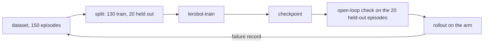
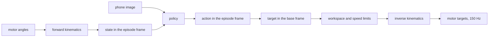
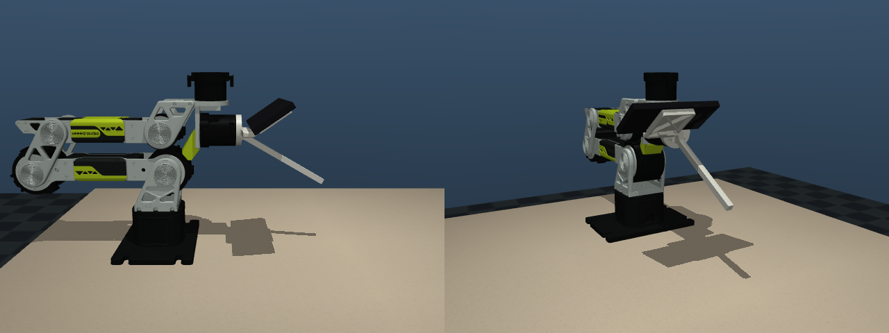
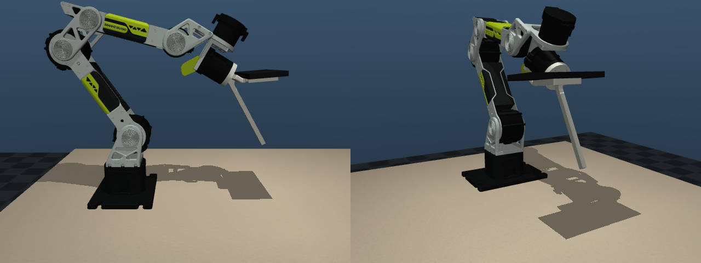
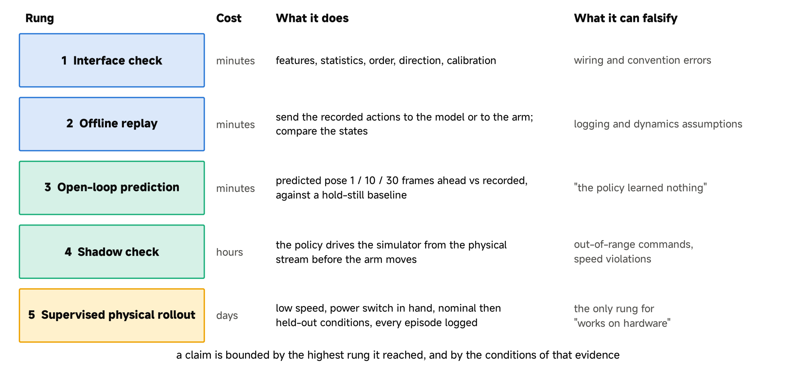
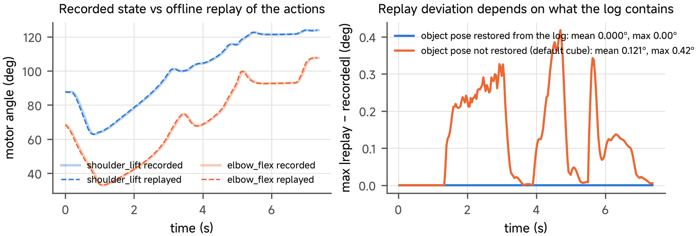
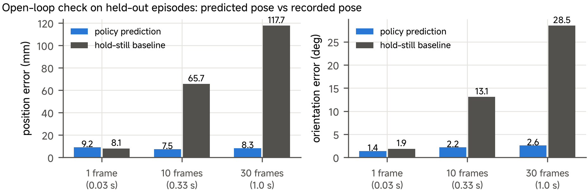
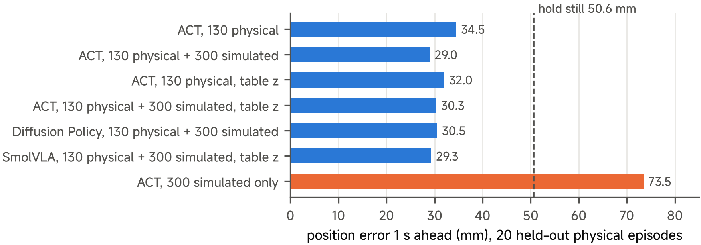

# 11 Sim2Real Gap in Hardware Deployment

## Central question

> What evidence supports a claim that a learned behaviour transfers and stays useful?

A policy can predict recorded actions well and still fail when its own actions change the next observation. This class connects the pusher-cube data from Class 10 to a learned controller, a controlled simulation evaluation and the source's separate physical failure reports.

**ACT is the main method.** Diffusion Policy and SmolVLA illustrate different sequence models and their reported comparisons. The experimental values are supplied course records; reading them is different from carrying out a new execution. The optional VLM page studies a different, slower simulation controller.

By the end of this class, you should be able to:

- Explain ACT action chunks, training losses and checkpoint contents.
- Trace a learned tool-pose action through frame conversion, limits, IK and actuation.
- Check observation/action compatibility and identify timing, contact and actuation mismatch.
- Distinguish replay, offline prediction, closed-loop simulation and physical evidence.
- Write a bounded result and propose a discriminating next experiment.

[Lecture](#from-collected-data-to-a-policy) · [Instructor and TA demonstration](#instructor-and-ta-demonstration) · [Student activity](#student-activity)

The explanation and supplied records can be read without executing code. The separate [practice page](11-practice.md) retains the source workflow, setup and commands. A reported result is identified as a retained source record; a new execution must save its own configuration and outcome.

## From collected data to a policy

### The pipeline



### What the network learns

The policy is a function $$\pi_\theta$$ from the current phone image $$o_t$$ and rod-tip state $$s_t$$ to a chunk
of future actions:

$$
\big(\hat a_{t+1}, \dots, \hat a_{t+k}\big) = \pi_\theta(o_t, s_t)
$$

The actions are poses in the episode frame of Class 10. Before the network sees a state or an action, each value
is normalised with the statistics of the training set, $$\bar x = (x - \mu)/\sigma$$. The values of $$\mu$$ and
$$\sigma$$ come from `meta/stats.json` and are stored in the checkpoint.

### Three policies on the same data

| Policy | What it outputs | Chunk |
| --- | --- | --- |
| ACT (Zhao et al. 2023) | a chunk regressed with an L1 loss and a KL term (below) | 100 steps |
| Diffusion Policy (Chi et al. 2023) | a sequence sampled by iterative denoising | configured observation, prediction and execution horizons; inspect the checkpoint |
| SmolVLA (Shukor et al. 2025) | a chunk from a vision-language-action model that also reads the task string | 50 steps; approximately 150 ms per chunk on the course GPU |

The source uses LeRobot training for all three, with declared physical and/or simulated dataset variants. The model configuration, learning schedule, horizon and preprocessing differ; changing only a policy-type name is not a complete matched training protocol. Training uses random brightness and contrast on the images, because the light on the bench changes.

### ACT: action chunking

ACT (Zhao et al. 2023) is a transformer that predicts a chunk of the next $$k$$ actions (by default 100, or 3.3 s at 30 Hz) from
the current image and state. It is trained as a conditional variational auto-encoder:

$$
\mathcal{L} = \sum_{i=1}^{k} \big\lVert \hat a_{t+i} - a_{t+i} \big\rVert_1
+ \beta\, D_{KL}\!\big(q_\phi(z \mid a_{t+1:t+k}, s_t)\,\big\Vert\,\mathcal N(0, I)\big)
$$

The first term is the L1 error of the predicted actions. The second term keeps the latent style variable $$z$$
close to a standard normal distribution. LeRobot uses $$\beta = 10$$ (`kl_weight`). At inference $$z = 0$$. A chunk
changes the planning/execution horizon; it does not guarantee that compounding error disappears. The robot executes $$n$$ actions of a chunk before the policy plans
again, and $$n$$ is an evaluation setting.

### What the checkpoint contains

| File | Content |
| --- | --- |
| `config.json` | the input features (`observation.state` 9, `observation.images.phone` 480 × 640 × 3), the output `action` 9, the chunk size |
| `model.safetensors` | the weights |
| preprocessor and postprocessor files | the normalisation statistics and the camera names |
| `train_config.json` | the dataset, the episodes used for training, the steps, the batch size |

A checkpoint without its statistics is not usable. The robot must give the features of `config.json`, in the
same units and frame.

---

## Deploying the policy on the arm

### The deployment loop



The loop runs at 30 Hz. The state comes from the motor angles through the forward kinematics of Class 08. The
action goes back to the motors through the inverse kinematics of Class 09.

### From the episode frame to the base frame




*Figure 1. Zero pose of the arm with the tool.*



*Figure 2. Episode start pose of the arm with the tool. Episode start pose: rod tip 12 cm above the table.*

At the start of each episode the arm moves to its start pose. That pose fixes the episode frame $$e$$. Its origin
is the rod tip, and its heading is the heading of the tool. For data in the table frame, $$z = 0$$ is at the table. An action
$$a = ({}^{e}p, {}^{e}R)$$ becomes a target in the base frame $$b$$ of the arm:

$$
{}^{b}T_{tip} = {}^{b}T_{e}\;{}^{e}T_{tip}(a)
$$

In the code, `EpisodeFrame` stores $${}^{b}T_{e}$$ at reset, and `decode` applies it:

```python
origin = pos if self.z_frame == "start" else np.array([pos[0], pos[1], 0.0])   # rebot_sim/real/env.py
self.frame = EpisodeFrame(origin, rot)
...
p_des, R_des = self.frame.decode(action)            # episode frame -> base frame
p, R = self.ctrl.command(p_des, R_des)              # workspace box, speed limits
res = self.ik.solve(p, R, self.q_cmd, max_iters=30) # refused if out of reach: the arm holds
```

### Smooth execution: temporal ensembling

If the arm executes a full chunk and then asks for a new one, the motion jumps at each new chunk. ACT can instead
run at every step and average all the predictions for the current step (Zhao et al. 2023):

$$
a_t = \frac{\sum_i w_i\, \hat a_t^{(i)}}{\sum_i w_i}, \qquad w_i = \exp(-m\, i)
$$

$$\hat a_t^{(i)}$$ is the prediction for step $$t$$ of the $$i$$-th chunk, with $$i = 0$$ for the oldest chunk.
With $$m = 0.01$$ (`--temporal-ensemble 0.01`) nearby overlapping predictions receive similar weights. Check the implementation's prediction-age indexing before interpreting which prediction is favoured. Averaging can reduce discontinuities but does not establish stability or contact success.

### The options of the deployment script

| Option of `rollout_real.py` | Effect |
| --- | --- |
| `--z-frame table` | runs a policy trained on data with a table-anchored height |
| `--start-z` | starts the arm at the start height of the demonstrations (for data in the start frame) |
| `--temporal-ensemble 0.01` | ACT only: runs the policy at every step and averages the overlapping chunks |
| `--max-steps` | the time limit of an episode (600 steps = 20 s) |
| `--max-speed 0.10` | the tool speed limit for the first runs |
| `--video-dir` | saves the phone image and the state of each rollout, for comparison with the data |

---

## Interface compatibility

### Features and normalisation

A policy expects the features it was trained on, with the statistics in its checkpoint. A robot with another zero,
another unit, another image size or another height reference is out of distribution before the policy sees its
first frame.

### Order, direction and calibration

| Item | What can go wrong |
| --- | --- |
| Joint order and direction | the driver multiplies actions by [1, 1, −1, −1, −1, 1, 6]; one wrong sign can request the wrong direction; bounds and executor response must be checked |
| Motor zeros | the wrist-roll zero changes when the tool is mounted and must be set again |
| Camera-to-tip transform | a phone mounted 5 mm off moves every recorded pose by 5 mm |
| Height reference | a policy trained in the table frame and run in the start frame pushes at the wrong height |
| End effector | a gripper policy cannot run on the tool arm |

The interface checklist of the class makes these items into tick boxes. It is the first rung of the ladder.

---

## Dynamic mismatches

### Timing and latency

The simulator advances a nominal 30 Hz model clock. A local inference process can still have wall-clock delay; a headless evaluator and a real-time deployment loop do not have identical timing semantics. On the bench the phone image goes over Wi-Fi and arrives
with a reported 50–150 ms delay in the source development case, and the control loop has jitter. A policy that acts on old images pushes where the cube was, not
where it is. In a rollout the arm stops when the image is older than 0.3 s.

### Actuation and contact

The model uses PD actuators with gravity compensation and estimated friction (Class 08). The physical arm runs the
motors in MIT mode at 80 % of the vendor gains, filters the targets with 0.1 s, and caps the torque. The hollow
15 g cube slides on a real table surface whose friction was never measured. Each of these changes how far the cube
moves for the same command.

### Observation and the action convention

Rendered images have no motion blur and no exposure change. Real images have both. The action convention also
matters: in simulation, applying each motion step to the measured pose instead of the commanded pose dropped
success from 12 % to 0 %. The policy was the same. The execution rule changed the dynamics.

---

## Model-based and learning-based control

The arm block uses two kinds of controller. Each uses a different part of the model.

| Controller | Uses the dynamics model | Uses data | In the course |
| --- | --- | --- | --- |
| Model-based: joint PD with gravity feed-forward | $$g(q)$$ from RNEA (Class 08) | the motion-test record checks the declared gravity model | every motor command |
| Model-based: inverse kinematics | the kinematics and the Jacobian (Classes 08, 09) | none | teleoperation and every rollout |
| Learning-based: imitation policy (ACT, Diffusion Policy, SmolVLA) | no; it learns image-to-motion from data | demonstrations | Push Cube from the phone image |

The learned policy decides where the tip must go. The model-based layers below it decide how the motors get
there, and refuse what the arm cannot do. Thus a learned policy on the arm is always a combination of both kinds.
The second controller of this class, [a vision-language model as the controller](11-vlm-controller-optional.md), replaces the
learned policy by a VLM, with the same model-based layers.

---

## The evidence ladder

### Five rungs



*Figure 3. The evidence ladder.*

The rungs are ordered by cost and by what each one can falsify. A claim is bounded by the highest rung it has
reached and by the conditions of that evidence.

### What each rung can falsify

| Check | Question | What a pass does not establish |
| --- | --- | --- |
| Interface compatibility | Do features, units, frames, statistics and tool identity agree? | Stable execution or task success |
| Replay | Can a specified state/action record be reconstructed under a declared reset? | Generalisation or physical contact prediction |
| Offline prediction | Does the policy predict held-out recorded behaviour better than a baseline? | Recovery after its own mistakes |
| Bounded/shadow checks | Are issued candidates admissible before contact execution? | A successful closed-loop rollout |
| Closed-loop evaluation | Does this full system meet the task outcome under these conditions? | Transfer to untested hardware, objects or scenes |

A later rung does not repair a wrong earlier interface. Conversely, a failed rollout can be scientifically useful when its observation, command, intervention and terminal state are recorded. The purpose is to choose the next discriminating experiment rather than collect a succession of unqualified successes.

### Rung 2: offline replay



*Figure 4. Offline replay of recorded actions in the model.*

Sending the recorded actions of an episode back to the model reproduces the recording exactly (deviation below
$$10^{-5}$$ degrees) when the logged object pose is restored. Without the object pose, the arm touches the cube
elsewhere and the replay deviates by 0.42°. On the physical arm the same replay will deviate because of the
dynamics. That deviation is **not measured yet**.

### Rung 3: open-loop prediction

For each held-out frame the policy predicts a chunk, and the predicted pose 1, 10 and 30 frames ahead is compared
with what the operator did. A policy that only holds still is the baseline.




*Figure 5. Open-loop prediction error on simulated handheld data.*



*Figure 6. Open-loop error 1 s ahead of policies trained on physical data. Physical handheld data.*

| Policy | Training data | Error 1 s ahead (mm) |
| --- | --- | --- |
| Hold still (baseline) | none | 50.6 |
| ACT | 130 physical | 34.5 |
| ACT | 130 physical + 300 simulated | 29.0 |
| ACT, table-anchored $$z$$ | 130 physical | 32.0 |
| ACT, table-anchored $$z$$ | 130 physical + 300 simulated | 30.3 |
| Diffusion Policy | 130 physical + 300 simulated | 30.5 |
| SmolVLA, table-anchored $$z$$ | 130 physical + 300 simulated | 29.3 |
| ACT | 300 simulated only | 73.5 |

On the 20 held-out physical episodes (130–149), every policy with physical data is better than holding still. It
predicts the correct direction of motion in 81–87 % of the time steps. These reported point estimates do not establish a statistically resolved ranking of the
three model families. The policy trained on simulated data only is worse than holding still: the rendered images are not the
real ones. Values from the development log of the course lead, 13–15 October 2026.

### What the open-loop check cannot show

A low error is cheap and necessary evidence. It does not show that the policy succeeds when its own actions
change what it sees. It did not establish success in the first physical rollouts discussed below.

### Rung 5 in simulation: ACT on Push Cube

ACT trained on the 300 simulated Push Cube demonstrations of Class 10 (batch 16, 60k steps), evaluated in closed
loop: 50 episodes per cell, with seeds disjoint from training (a maximum binomial standard error near 7 percentage points, not a 95% confidence interval). $$n$$ is the
number of actions executed per chunk.

| ACT, Push Cube, 60k steps | $$n$$ = 10 | $$n$$ = 100 |
| --- | --- | --- |
| on the handheld tool (as in the data) | 70 % | 58 % |
| on the arm | 62 % | 56 % |

**Source result boundary.** These four cells are the source manuscript's reported 60k-step comparison. Its supplied `results_act_ip17_cube300_handheld_060000_pusher_n100.json` instead contains 32 successes among 50 episodes, or 64%. The source transfer figure also uses 64% for that setting. The source has not identified whether the scene, checkpoint or executor changed. Retain the table as a reported comparison, and treat the matching artifact identity as unresolved before calling either score reproduced. The practical page supplies a new-run protocol rather than concealing this discrepancy.

{% embed url="https://1750588168-files.gitbook.io/~/files/v0/b/gitbook-x-prod.appspot.com/o/spaces%2FCq8PJ6eHO7umpiGK34s5%2Fuploads%2Fgit-blob-13c279afe79eecb17f2ff0b2724e276a4206d785%2Fact-push-cube-sim.mp4?alt=media" %}
Success on the simulated arm: phone image (left) and scene (right), 4 s.


{% embed url="https://1750588168-files.gitbook.io/~/files/v0/b/gitbook-x-prod.appspot.com/o/spaces%2FCq8PJ6eHO7umpiGK34s5%2Fuploads%2Fgit-blob-4355e6155cd14d95f2fc74edb8893a17e545ec50%2Fact-push-cube-sim-failure.mp4?alt=media" %}
Failure of the same policy: the time limit of 450 steps is reached with the cube 2.6 cm from the goal (15 s).


A failure record keeps the final error, the step where the motion stalled and the observation at that moment.

### Training loss and task success answer different questions

A falling training loss establishes improvement against the selected supervised targets. Closed-loop success measures a different property of the policy, executor, observation pipeline and task together. Compare two checkpoints on the same reset protocol before attributing an improvement to more gradient steps. Compare data quantities with a fixed scene and evaluation rule before attributing an improvement to more demonstrations. Source figures that mix earlier scenes or another task are not used as the primary cube benchmark here.

### Optional VLM controller in simulation

A pretrained vision-language model can select checked motion tools without training a task-specific imitation policy. It still relies on pretrained data, perception, an executor and API access. The [optional simulation page](11-vlm-controller-optional.md) retains the source controller, model identifiers, logs and a careful accounting of checked versus self-declared outcomes. This small exploratory sample is not a matched benchmark against ACT and does not authorise hardware operation.

---

## Rung 5 on the physical arm

### The first rollouts

On 14 October 2026 the course lead ran two policies on the arm, 10 episodes each, at 0.10 m/s. ACT trained on the
130 physical handheld episodes moved toward the cube and pushed it, but always off its line: 0 of 10. ACT trained
on physical and simulated data sometimes moved away from the cube. Rung 3 had given both policies a small error.

### Diagnosed mismatch: the start height

The poses of the first data were relative to the start pose. Most demonstrations started approximately 9 cm above
the table, and the arm started at 12 cm. Thus it pushed on the upper half of the cube. The correction is the table
height reference of Class 10, with `--z-frame table` on the arm.

### Candidate mechanism: the end of the demonstrations

In later rollouts the course lead saw a second problem. The policies often stopped after approximately 200 steps.
Then they stayed in place, or moved a little without a push. The tip also seemed to look for a view in which the cube
appeared inside the goal. The data explain this:

| Measured in the 150 handheld episodes | Value |
| --- | --- |
| Median episode length | 204 frames (6.8 s) |
| Episodes that end with a lift of approximately 8 cm and a hold | 93 % |
| Duration of this end phase | approximately the last 3 s |

The lift and the hold are the save gesture of the recorder (Class 10). The matching timing motivates a hypothesis that the policy learned the save phase as part of the
task. It does not isolate the cause without an ablation or a new evaluation. The policy also has no success signal. It learned
which motion follows which image. A view with the cube inside the goal was followed by the lift in the data.
A policy may associate that view with the lift rather than continue effective contact. This is a candidate explanation, not direct access to what a network intends.

### Separate a diagnostic hypothesis from a causal result

The observed height mismatch has a direct geometric interpretation. The save-gesture explanation is a mechanism to test. Neither a plot nor an appealing story establishes that removing one factor will repair the policy. Hold the task, checkpoint selection protocol, scene, reset seeds and executor fixed when comparing an ablation. Save both success and failure records; choosing only a successful video changes the evidence.

A dataset correction changes the training distribution. A controller correction changes the deployed dynamics. A scene correction changes observations. These interventions can interact, so changing all three at once may improve performance without identifying the cause. State the narrower question the comparison can answer.

### The planned correction

Cut the save gesture from the end of each episode, retrain, and run the same rollout series again. This is a
planned measurement, not a result. It shows the usual shape of rung 5: a good rung-3 result, a failed rollout, a
cause found in the data, a new measurement.

### State of the physical evidence

| Item | State (15 October 2026) |
| --- | --- |
| Rung 1 on the tool arm (features, zero, camera-to-tip) | done by the scripts; the pivot check is not recorded |
| Rung 2, physical replay deviation | **missing: no replay recorded** |
| Rung 3, open loop on physical held-out episodes | done: 29–35 mm against 51 mm |
| Rung 5, learned policy, first series | 0 of 10, 14 October 2026 |
| Rung 5, later series | stalls after approximately 200 steps; success rate not recorded |

Every item marked missing or not recorded is a planned measurement, not a result.

---

## Writing a bounded claim

### Nominal and held-out conditions

Nominal conditions are those that the training data covers: the ranges of the contract, the same objects, cameras
and operator position. Held-out conditions change one factor at a time, for example a larger start distance, a
heavier cube, a camera moved by 5 cm or another table texture. A claim names which of the two it was tested on.

### Count an outcome and its uncertainty

For $$s$$ successes among $$N$$ declared independent evaluation episodes, $$\hat p=s/N$$. For the source manuscript's reported arm setting $$n=10$$, 62% of 50 is 31/50; this uses the manuscript cell for illustration, not a reconciliation with the supplied64%artifact. The binomial standard-error estimate is

$$
\mathrm{SE}(\hat p)=\sqrt{\hat p(1-\hat p)/N}\approx0.0686.
$$

That is about 6.9 percentage points, not a 95% interval. A Wilson 95% interval is approximately 48.2–74.1%. Dependence between layouts, selected videos and repeated tuning can invalidate a simple independent-trial interpretation. Keep seeds, failed outcomes and the exact checkpoint rather than using a rounded score as its identity.

A fresh run must save its checkpoint, scene, execution horizon and seed list. The source-score discrepancy described beside the ACT table prevents treating its reported cell values as a fully reconciled reproduction target.

### An example claim

The following wording illustrates how to bound the manuscript-reported simulation cell. Its checkpoint/result identity remains unresolved; the separate physical0/10series does not validate this simulated cell.

> ACT trained on 300 simulated handheld demonstrations pushes the cube into the target in 62 % of 50 nominal
> simulated episodes on the arm, executing 10 actions per chunk. This particular result is a nominal simulation evaluation, not evidence of successful hardware transfer or held-out-condition robustness.

Simulation success does not predict physical success unless the simulator was shown to predict that task. Domain
randomisation (Tobin et al. 2017) makes the nominal set wider. It does not replace the measurement.

---

## Project handoff

### One idea for the project

The baseline project continues this class: a learned Push Cube policy, trained on collected data and deployed on
the arm. Raise its success rate. An optional improvement target is 80% or more on the simulated arm. Physical testing, if authorised for a project, requires
separate commissioning and complete rollout records; it is not a compulsory continuation of the class simulation. The open hypotheses in the physical case are a good start: the end of
the demonstrations, the scene, the amount of physical data.

The [vision-language model as the controller](11-vlm-controller-optional.md) is the second controller of the arm block. It
needs no new task-specific demonstrations or policy training, so a project can compare it with a learned policy on the same task.

### The project record

The six worksheets of Classes 12–17 are Claim, Experience, System, Grounding, Learning and Decision. Without more
hardware, the baseline project uses simulation and an iPhone, and it reproduces or extends the LEAP example
(Class 06) or the reBot example (Classes 08–11).

---

## Instructor and TA demonstration

Use [Class 11 practice](11-practice.md) to inspect the source Push Cube generation/training/evaluation route with ACT. Long training is preparation or optional work; demonstrate an existing source checkpoint only if its required files are actually supplied and verified. Otherwise use the retained source result tables and success/failure recordings, and present the training command as a recipe rather than a completed reproduction.

Compare one successful and one failed source rollout. Identify the checkpoint/configuration, embodiment, action-chunk execution length, seed, terminal distance and 450-step limit. Then compare the reported offline physical-data errors with the physical 0/10 rollout report. Ask why a low prediction error need not imply closed-loop success.

Diffusion Policy and SmolVLA provide conceptual and source-result comparisons. The VLM controller is an optional simulation extension with network/API prerequisites, not part of the required ACT demonstration.

## Student activity

Write a bounded ACT claim with the task, training data, checkpoint identity or explicit missing identity, scene, embodiment, execution horizon, episode denominator and success rule. Explain one failure using an observation and a separately labelled hypothesis. Propose one controlled change and the new record required to evaluate it. Do not claim a fresh rollout or hardware transfer from a saved video.

For extended practice, evaluate the supplied or newly trained source policy on the unchanged seed protocol and retain every outcome. Report the exact numerator and denominator and compare matched settings only. The six project worksheets will carry these distinctions into claim, experience, system, grounding, learning and decision.

## References

Chi, Cheng, Siyuan Feng, Yilun Du, Zhenjia Xu, Eric Cousineau, Benjamin CM Burchfiel, and Shuran Song. 2023. “Diffusion Policy: Visuomotor Policy Learning via Action Diffusion.” In *Proceedings of Robotics: Science and Systems*. [Primary paper](https://www.roboticsproceedings.org/rss19/p026.html).

Chi, Cheng, Zhenjia Xu, Chuer Pan, Eric Cousineau, Benjamin Burchfiel, Siyuan Feng, Russ Tedrake, and Shuran Song. 2024. “Universal Manipulation Interface: In-The-Wild Robot Teaching Without In-The-Wild Robots.” In *Proceedings of Robotics: Science and Systems*. [Paper and interface/latency experiments](https://umi-gripper.github.io/).

Featherstone, Roy. 2008. *Rigid Body Dynamics Algorithms*. Springer. [Spatial-vector resources](https://royfeatherstone.org/spatial/v2/index.html).

MuJoCo developers. n.d.-a. “Simulation.” *MuJoCo Documentation*, version 3.14.0. Accessed October 18, 2026. [State, control and simulation stepping](https://mujoco.readthedocs.io/en/3.14.0/programming/simulation.html).

MuJoCo developers. n.d.-b. “Types.” *MuJoCo Documentation*, version 3.14.0. Accessed October 18, 2026. [State specification and data fields](https://mujoco.readthedocs.io/en/3.14.0/APIreference/APItypes.html#mjtstate).

NIST/SEMATECH. n.d. “Confidence Intervals.” *e-Handbook of Statistical Methods*, section 7.2.4.1. Accessed October 18, 2026. [Binomial proportion intervals and assumptions](https://www.itl.nist.gov/div898/handbook/prc/section2/prc241.htm).

Shukor, Mustafa, Dana Aubakirova, Francesco Capuano, Pepijn Kooijmans, Steven Palma, Adil Zouitine, Michel Aractingi, Caroline Pascal, Martino Russi, Andres Marafioti, Simon Alibert, Matthieu Cord, Thomas Wolf, and Remi Cadene. 2025. “SmolVLA: A Vision-Language-Action Model for Affordable and Efficient Robotics.” *arXiv*, 2506.01844. [Primary paper](https://arxiv.org/abs/2506.01844).

Zhao, Tony Z., Vikash Kumar, Sergey Levine, and Chelsea Finn. 2023. “Learning Fine-Grained Bimanual Manipulation with Low-Cost Hardware.” In *Proceedings of Robotics: Science and Systems*. [ACT primary paper](https://www.roboticsproceedings.org/rss19/p016.html).

Tobin, Josh, Rachel Fong, Alex Ray, Jonas Schneider, Wojciech Zaremba, and Pieter Abbeel. 2017. “Domain Randomization for Transferring Deep Neural Networks from Simulation to the Real World.” In *Proceedings of the IEEE/RSJ International Conference on Intelligent Robots and Systems*. [Primary paper](https://arxiv.org/abs/1703.06907).
