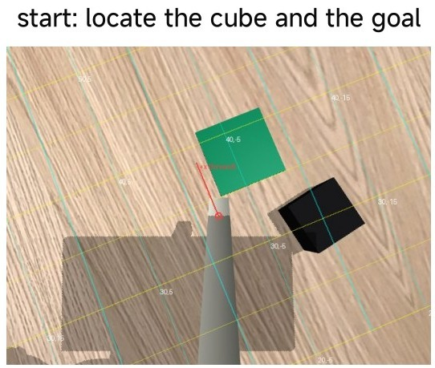
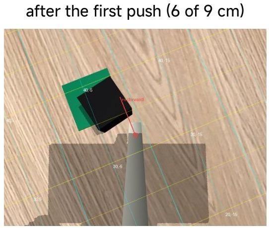
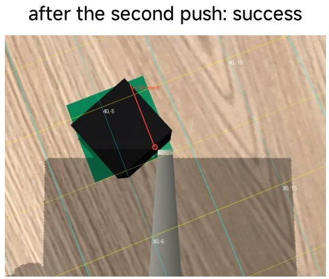
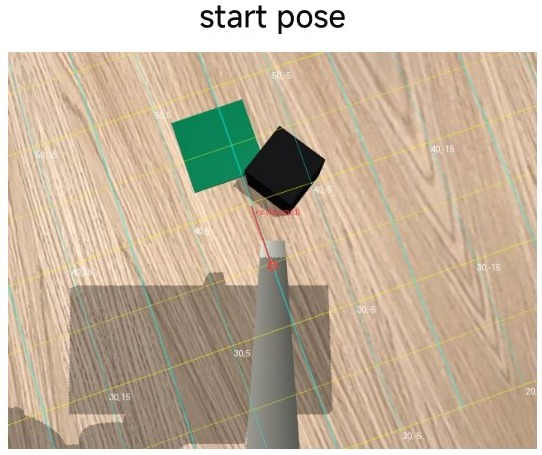
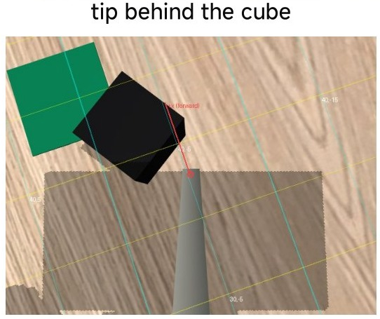
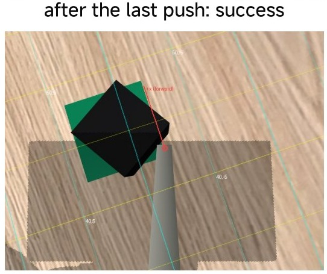

# Class 11 — A vision-language model as the controller

This optional simulation controller needs no new task-specific demonstrations or policy training; it does rely on a pretrained model, its earlier data, API access and the source executor. A large pretrained
vision-language model (VLM), Claude, looks at the phone image and decides the motion. The same model-based layers
as in [Class 11](11-sim2real-gap-in-hardware-deployment.md) execute it. The controller is `agent_control.py` of the course package. It ran in 20
simulated episodes with four model settings, The core exercise is simulation only.

---

## The approach

A learned policy needs demonstrations. A pretrained VLM can instead act as a high-level controller and leave the
motion to a reliable executor. SayCan grounds language choices in a repertoire of skills and their affordances (Ahn et al. 2022). Code as Policies composes robot behaviours as programs (Liang et al. 2023). VoxPoser constructs spatial value maps for planning (Huang et al. 2023). MOKA and PIVOT use visual marks or iterative visual proposals to connect language models with geometric actions (Liu et al. 2024; Nasiriany et al. 2024). These are related design approaches; this small course controller is not a reproduction of all their evaluation protocols.

## One call per step

`agent_control.py` applies this approach to the pusher tool, with Claude as the model. Each control step is one call
to the model. The model receives the phone image with a 5 cm table grid, the rod-tip position and the results of
its earlier actions. The grid is projected from the known camera pose: a table point $$P$$ goes to the pixel

$$
\tilde u \sim K\,\big[{}^{c}R_{b} \;\; {}^{c}p_{b}\big]\,\tilde P
$$

with the intrinsics $$K$$ of the phone and the camera pose from the forward kinematics. The image is reduced to
512 × 384 pixels to reduce the cost.

## Four tools

The model must call exactly one tool per step. A tool call is a structured request with named arguments.

| Tool | What it does |
| --- | --- |
| `move` | up to three relative moves of the rod tip (forward, left, up, in cm; optional yaw) |
| `locate` | the model gives a pixel; the script gives back its table coordinates (the inverse of the projection) |
| `push` | push mode only: the model marks the cube and the goal; a fixed primitive pushes along the line, at most 6 cm per call |
| `done` | the episode ends; in simulation the simulator checks the claim |

## Rejected, not clipped

The script checks each `move` target against the workspace box, the inverse kinematics and a step length of 15 cm.
A target that fails is rejected with the reason, and the moves after it do not run. The model reads the reason and
plans again. With `locate`, the model does the perception, and the script does the geometry.

## What the model saw


<div><figure><figcaption><p>Figure 1. Push mode, start. Push mode: locate the cube and the goal.</p></figcaption></figure> <figure><figcaption><p>Figure 2. Push mode, after the first push. After the first push (6 of 9 cm).</p></figcaption></figure> <figure><figcaption><p>Figure 3. Push mode, success. After the second push: success.</p></figcaption></figure></div>

<div><figure><figcaption><p>Figure 4. Step mode, start pose. Step mode: start pose.</p></figcaption></figure> <figure><figcaption><p>Figure 5. Step mode, tip behind the cube.</p></figcaption></figure> <figure><figcaption><p>Figure 6. Step mode, success. After the last push: success.</p></figcaption></figure></div>

Yellow and cyan lines: the 5 cm table grid, labels in cm. Red circle: the rod tip projected on the table. Red
arrow: the forward direction. Top row: push mode with Sonnet 5.5. Bottom row: step mode with Opus 5.5.

## Episodes in simulation

{% embed url="https://1750588168-files.gitbook.io/~/files/v0/b/gitbook-x-prod.appspot.com/o/spaces%2FCq8PJ6eHO7umpiGK34s5%2Fuploads%2Fgit-blob-c78d7c8e9ff435d68f76f6621f0a7b3ff674cd11%2Fagent-sim-highlights.mp4?alt=media" %}
Claude controls the simulated arm with the pusher tool: three episodes (step mode with Sonnet 5.5 and Opus 5.5, push mode with Sonnet 5.5) and the results (66 s).


## Results in simulation

| Model | Mode | Success | Mean calls | Mean time | Cost of 5 episodes |
| --- | --- | --- | --- | --- | --- |
| Sonnet 5.5 | push | 5/5 | 2.2 | 6 s | USD 0.04 |
| Sonnet 5.5 | step | 5/5 (see note) | 5.4 | 20 s | USD 0.17 |
| Opus 5.5 | step | 5/5 | 5.2 | 23 s | USD 0.30 |
| Haiku 5.5 | step | 4/5 | 9.4 | 35 s | USD 0.03 |

Simulated Push Cube, the random layouts of the policy evaluation (seeds 0–4), 15 October 2026; cost at the list
prices of the API. Note: one Sonnet 5.5 step episode ended by the model's own `done` claim before the simulator
checked claims. That layout was run again with the check and succeeded in 4 calls.

## Reading the results

Across the original twenty attempts, eighteen have checked success, one has checked failure and one ended with an unchecked `done` claim. A checked rerun of that layout succeeded. Replacing the unchecked attempt gives nineteen successes out of twenty selected checked layouts, but the complete execution record contains twenty-one attempts. Keep both denominators rather than silently calling the first twenty attempts 19/20 successes. Model identifiers and API costs below are historical labels from the source record, not a guarantee of current API availability or pricing.


In this small recorded sample push mode used the fewest API calls and had five checked successes; that sample does not establish general reliability. In push mode the model finds only two points, and the primitive does the
motion. In step mode Sonnet 5.5 and Opus 5.5 close the loop through the image in 4–8 calls. Haiku 5.5 reached the
limit of 25 calls in one episode. The source manuscript reports ACT56–62% on the simulated arm task, with the unresolved manuscript/result-file identity described in Class11. These are not matched trials against the small VLM sample
([Class 11, ACT simulation comparison](11-sim2real-gap-in-hardware-deployment.md#rung-5-in-simulation-act-on-push-cube)).

## What the result supports

The agent requires no task-specific policy training for this setup; its pretrained model is not data-free. The sample contains checked outcomes and a self-declared outcome, which must be counted separately. It does not run at
30 Hz: each call takes 2–5 s and needs a network connection and an account. The simulated result does not measure
perception on real images. The source also mentions a physical-arm success without a complete trial denominator or logs. That report is not part of this simulation practice and does not qualify deployment or establish a physical success rate.


## The API key


**The script reads the key from the environment variable `ANTHROPIC_API_KEY` or from the file `.claude.env` at the
package root; git ignores this file. Never put a key in a script, a notebook, a commit, a zip or a screenshot. The
course does not supply a key.**


## Commands

The package and its set-up are those of [Class 11 — Practice](11-practice.md#set-up). The script opens a
MuJoCo window, so on macOS use `uv run mjpython` in place of `uv run python` for this same source command. Confirm that the historical model identifier is available to the API account before running; API access is optional and is not supplied by the course.

```bash
# simulation (from additional_material/rebot_pusher/ of the Class 11 folder; key in the environment)
uv run python scripts/agent_control.py --robot sim --episodes 5 --model claude-sonnet-5-5 \
    --mode push --log-dir outputs/agent/sim_push
```

The agent logs and images of the simulated runs are in `additional_material/data/agent_sim/` of the Class 11
folder.

## References

Ahn, Michael, Anthony Brohan, Noah Brown, Yevgen Chebotar, Omar Cortes, Byron David, Chelsea Finn, Chuyuan Fu, Keerthana Gopalakrishnan, Karol Hausman, Alex Herzog, Daniel Ho, Jasmine Hsu, Julian Ibarz, Brian Ichter, Alex Irpan, Eric Jang, Rosario Jauregui Ruano, Kyle Jeffrey, Sally Jesmonth, Nikhil J. Joshi, Ryan Julian, Dmitry Kalashnikov, Yuheng Kuang, Kuang-Huei Lee, Sergey Levine, Yao Lu, Linda Luu, Carolina Parada, Peter Pastor, Jornell Quiambao, Kanishka Rao, Jarek Rettinghouse, Diego Reyes, Pierre Sermanet, Nicolas Sievers, Clayton Tan, Alexander Toshev, Vincent Vanhoucke, Fei Xia, Ted Xiao, Peng Xu, Sichun Xu, Mengyuan Yan, and Andy Zeng. 2022. “Do As I Can, Not As I Say: Grounding Language in Robotic Affordances.” *arXiv*, 2204.01691. [Primary paper](https://arxiv.org/abs/2204.01691).

Huang, Wenlong, Chen Wang, Ruohan Zhang, Yunzhu Li, Jiajun Wu, and Li Fei-Fei. 2023. “VoxPoser: Composable 3D Value Maps for Robotic Manipulation with Language Models.” *arXiv*, 2307.05973. [Primary paper](https://arxiv.org/abs/2307.05973).

Liang, Jacky, Wenlong Huang, Fei Xia, Peng Xu, Karol Hausman, Brian Ichter, Pete Florence, and Andy Zeng. 2023. “Code as Policies: Language Model Programs for Embodied Control.” In *Proceedings of the IEEE International Conference on Robotics and Automation*. [Primary paper](https://arxiv.org/abs/2209.07753).

Liu, Fangchen, Kuan Fang, Pieter Abbeel, and Sergey Levine. 2024. “MOKA: Open-World Robotic Manipulation through Mark-Based Visual Prompting.” *arXiv*, 2403.03174. [Primary paper](https://arxiv.org/abs/2403.03174).

Nasiriany, Soroush, Fei Xia, Wenhao Yu, Ted Xiao, Jacky Liang, Ishita Dasgupta, Annie Xie, Danny Driess, Ayzaan Wahid, Zhuo Xu, Quan Vuong, Tingnan Zhang, Tsang-Wei Edward Lee, Kuang-Huei Lee, Peng Xu, Sean Kirmani, Yuke Zhu, Andy Zeng, Karol Hausman, Nicolas Heess, Chelsea Finn, Sergey Levine, and Brian Ichter. 2024. “PIVOT: Iterative Visual Prompting Elicits Actionable Knowledge for VLMs.” *arXiv*, 2402.07872. [Primary paper](https://arxiv.org/abs/2402.07872).
