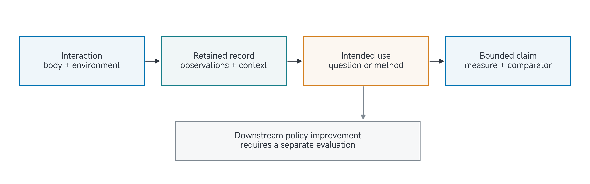
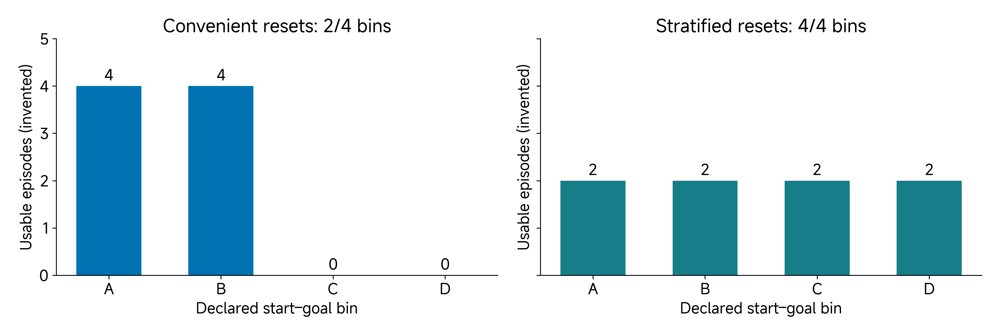

# 12 Final Project I: Claim

A project can produce hours of video without answering a useful question. Before building more hardware or collecting more episodes, decide what capability those records should support and what comparison could show that the capability is missing.

This reading helps you turn a project idea into a bounded claim. Read it before class and use it while working on your project. Most of the session is reserved for project work and targeted instructor/TA discussion. The worksheet records your reasoning at a checkpoint; it does not require a successful experiment today.

[Reading](#by-the-end-of-this-class) · [Project work](#apply-this-to-your-own-project) · [Submission](#submit-before-leaving-class)

## By the end of this class

Prepare Worksheet 1, **Claim**, with a selected capability, the conditions in which you will test it, a measure/comparator and a feasible next experiment. Keep two candidate claim sentences and explain why you selected the narrower one. You can complete this checkpoint before obtaining a numerical result.

## Experience as data with a purpose

For this practical project sequence, treat experience as data generated through interaction. An operator, controller or policy acts; a body and environment respond; observations and contextual records make the interaction interpretable. The data might support training, state inference, evaluation, model identification or a design decision. The intended use determines what must be retained.

A folder of images does not by itself identify actions, resets or outcomes. Conversely, an actuator response log can be valuable experience for identification even without a camera. Identify the interaction and the inquiry rather than treating a file format as the project contribution. A simulation can support a clearly digital investigation; it does not establish that the represented physical interaction has occurred on hardware.

The six worksheets examine the same project. Claim defines the question; Experience identifies the episode; System explains its production; Grounding tests correspondence; Learning examines the use of the data; Decision justifies a next action. Later evidence can require you to revise an earlier answer. Keep the original submitted version and the reason for the change.

## Separate the ambition, capability and contribution

“Build an intelligent manipulation system” expresses an ambition. It does not specify which behaviour will be tested, under which conditions or against what alternative. “Record cube-pushing episodes” identifies an activity but still leaves their usefulness unresolved.

A capability claim names an observable result. A contribution explains what the proposed system or method changes relative to an appropriate alternative. Your contribution might be a more reliable measurement, a clearer data-generation protocol or evidence that a proposed improvement does not work under certain conditions. It need not be a new neural-network architecture.

A useful claim sentence is:

> Under [conditions], our [identified system or method] provides [capability], assessed using [measure and criterion] against [comparison].

The bracketed conditions do important work. They identify the embodiment/tool, task, reset distribution, observation channel and operating range that the evidence covers. Exclusions prevent a narrow digital result becoming a general physical-deployment claim. Choose the conditions because they define a useful question, rather than restricting them afterwards to remove failures.

> Figure 1. A data-generation claim connects interaction, retained records, intended use and a measurable comparison. Downstream policy improvement is a separate claim that needs its own evaluation. This is a conceptual map, not an experimental result.

## Define the trial before counting outcomes

A trial is the unit on which you assess an outcome: for example one attempt from a declared reset to a termination event. Define its start, end and inclusion rule before collecting the assessed evidence. A video frame is usually not an independent manipulation attempt.

The denominator matters. If a recorder saves only completed successes, “all saved episodes succeeded” says little about the probability that a new attempt will succeed. Preserve attempts that fail, are interrupted or violate the protocol, with their disposition and reason. Excluding an invalid measurement may be justified; silently deleting inconvenient attempts is not.

A comparison also needs an accounting boundary. Equal recording duration, equal attempts and equal usable samples are different budgets. A method that requires many more resets or operator interventions may generate more data while increasing the work required. State which costs matter to your claim and retain the others as limitations.

## Worked example: make “better data” testable

Consider a proposed simulated arm/pusher system collecting cube-pushing interaction data. One protocol lets the operator choose convenient start–goal arrangements. Another selects resets from declared start–goal bins. Both use the same recorder and minimum episode schema. This is a running design example; no new collection campaign or learned-policy result is claimed.

The first candidate claim is “stratified collection produces better demonstrations for learning.” It is too broad because “better” could mean more complete records, more successful pushes, wider state coverage or better downstream policy performance. Those quantities can disagree.

A narrower candidate is: “At a fixed acquisition budget, stratified reset selection increases the number of declared start–goal bins represented by usable episodes compared with convenient reset selection.” Define usable episodes through the intended analysis: required channels, interpretable association, documented reset/outcome and intervention status. Usable need not mean task-successful; a failed attempt may be informative data.

The pilot should establish whether the bins are reachable and observable and whether the common recorder supports the proposed measure. It should also expose the work needed to reset and label attempts. If the pilot reveals that one bin cannot be executed, record that finding and revise the protocol before the assessed comparison.

### Work the coverage measure

For an illustrative four-bin scheme, define coverage as

$$
C=\frac{1}{4}\sum_{b=1}^{4}\mathbf{1}[n_b\geq 1],
$$

where $$n_b$$ is the number of usable episodes in bin $$b$$. The indicator is one when the condition is true. In the invented fixture below, every attempt is usable and both methods have eight attempts.

| Collection fixture | Usable counts in bins A, B, C, D | Coverage |
| --- | --- | --- |
| Convenient resets | 4, 4, 0, 0 | 2/4 = 50% |
| Stratified resets | 2, 2, 2, 2 | 4/4 = 100% |

> Figure 2. Invented equal-budget counts show why total dataset size and coverage are different quantities. Covering these bins does not establish coverage of every relevant condition or a gain in learned behaviour.

The result follows partly from how the sampling protocol was designed. It is evidence of compliance with a chosen coverage objective, not automatically scientific novelty or improved manipulation. A useful project must explain why those bins matter and whether their additional coverage supports the intended use.

### Repair a misleading comparison

Suppose the convenient route records only successful attempts while the stratified route retains all attempts. Their counts now reflect different record-selection rules as well as different resets. You cannot attribute the difference to reset selection alone. Use a common minimum recorder and preserve attempted, usable, failed and intervened counts for both routes. If several collection changes are intentionally bundled, make the claim about the bundle and do not identify one component as the sole cause.

An improved learned policy would be another experiment. It needs identified data, training or frozen-method conditions, evaluation resets, a comparator and failure accounting. Leave that claim open until those artifacts exist.

## Apply this to your own project

Bring your idea, available equipment or simulation, inspected sources and two possible claims. Check that necessary models, data or checkpoints can actually be accessed. A release announcement alone does not establish that your team inspected the required artifact.

Use the four Claim fields to make your question concrete:

| Worksheet field | What your answer should establish |
| --- | --- |
| System and capability | What interaction or capability is being claimed, and which mechanism produces it? |
| Conditions and boundary | Which task, configuration, operating range and exclusions apply? Is the entry planned, observed or source analysis? |
| Measure and comparison | What quantity, units, trial unit, outcome rule and comparator could challenge the claim? |
| Purpose and next test | What contribution is proposed and what feasible pilot would expose a consequential weakness? |

Use project work to check feasibility, perform a pilot or narrow the claim. An actuator, sensing or existing-data project can answer these questions without copying the cube-pushing example. The appropriate stopping point is a testable claim and feasible next action, not a finished system.

## Check your reasoning together

Before submitting, compare what changed with the artifact that supports it. Identify what remains assumed, planned or unresolved; decide whether an earlier worksheet needs revision; and name the next useful action. Ask the instructor/TA to challenge a specific uncertainty when needed. A complete worksheet can report a failed pilot, a negative finding or a blocked test honestly.

## Submit before leaving class

**Deadline: 13 November 2026 at 10:50.** Follow an explicitly announced schedule change if one occurs.

Submit the complete handwritten **Worksheet 1: Claim** package, signed by every team member, including its evidence/team-review page. Use pages **1–2** of the [blank submission pack](../resources/project-workbook/Submission-Worksheets.pdf). Digital drafts support preparation but do not replace the signed handwritten original. No proxy signatures.

Preserve a legible scan, the current project record, supporting artifacts or accessible references, and the milestone commit in your private team repository. The [editable project record](../resources/project-workbook/project-record.md) can hold all six views and their evidence; do not start six separate projects. Keep later dated, signed revisions traceable without overwriting the original submission.

**Useful checkpoint:** One selected claim, its conditions, a measure/comparator and the next feasible test. A numerical result is not required.

**Supporting record:** Selected and rejected claim sentences; proposed protocol and outcome rule; comparison/budget definition; resource/access check; pilot plan and available source or configuration references.

If an experiment is unfinished, complete the worksheet from the available evidence and identify the exact missing evidence/dependency, owner, next verification and affected claim. This documents the checkpoint; it does not complete the experiment. The supporting record is part of the same project, not an additional form or duplicate upload. Signatures record team review, not scientific success.

## Carry the project forward

Attempt the pilot if feasible. Bring its actual record, including failures and interventions, or identify the dependency that prevented it. Determine where an episode starts and ends and what data distinguish command, response and outcome.
