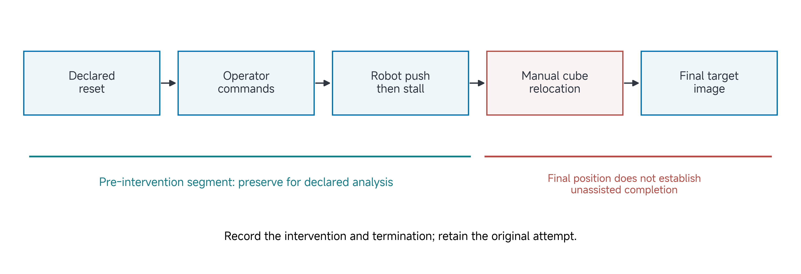
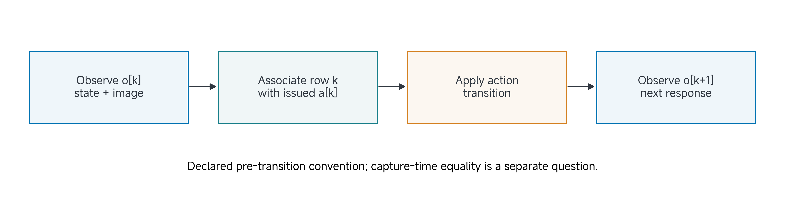

# 13 Final Project II: Experience

## Submit before leaving class

**One PDF per team. Submit by 17 November 2026 at 10:20, Abu Dhabi time (UTC+4).**

| Requirement | What your team must do |
| --- | --- |
| Download | [Worksheet 2: Experience](../resources/project-workbook/Class13-Experience.pdf) |
| Required contents | Both A4 pages: the worksheet canvas and the signed evidence/team-review page. Include any labelled continuation pages in the same PDF. |
| Team identifier | Use your assigned **Team01–Team08**, matching your private repository, for example `2026Autumn-Team01`. Write this identifier and the project title on every page. |
| Folder | `submissions/class13/` in your assigned private team repository |
| Filename | `TeamNN-Class13-Experience.pdf` — replace `NN` with your assigned two-digit team number |
| Example for Team01 | `submissions/class13/Team01-Class13-Experience.pdf` |
| Branch | Remote `main` on GitHub |

### Prepare and submit

1. Complete the worksheet by hand. Answer each prompt, or explain what is unfinished and what you will do next. Every member signs the team-review page.
2. Scan all required pages into **one readable PDF**. Check page order, orientation and that nothing is cropped. Keep the paper original for your records.
3. Name the PDF as shown above and put it in the specified folder in **your assigned private repository**. Reference supporting evidence by its existing repository path; do not copy it into another submission form.
4. Commit and **push to `main` before the deadline**. Open the PDF on GitHub and confirm every page is present and readable. A file saved only on your computer or an unpushed commit is not submitted.

### How the teaching team collects it

At the deadline, the TA collects the named PDF from your team's remote `main` branch, records the repository commit and collection time, and retains that version. The repository, filename and identifier on the pages connect the PDF to your team. Confirm teaching-team access before the deadline; report an access problem promptly.

**No separate upload, email, release, tag, manifest or physical hand-in is required.** Later changes do not replace the collected version. Keep the initial PDF; save later dated, signed revisions in `submissions/class13/revisions/`.

The file above is the required worksheet submission. The [editable project record](../resources/project-workbook/project-record.md) is a working aid, not a second submission. Use the guidance below while doing your project work.

## Reading and project guidance

A cube finishes inside a goal. Did the robot push it there, did an operator intervene, or was it already there after an incorrect reset? A final image cannot distinguish these histories. To use an interaction as data, preserve enough of the episode to explain what happened.

Read this page before class, then use project work to inspect or instrument one real record from your own study. If a pilot has not run, work on an explicitly labelled plan and the dependency preventing execution. The goal is an interpretable episode, not a polished clip.

[Reading](#by-the-end-of-this-class) · [Project work](#apply-this-to-your-own-project) · [Submission](#submit-before-leaving-class)

## By the end of this class

Complete Worksheet 2, **Experience**, with a representative episode map, an inspected pilot record or explicitly planned record, and a justified next variation. Update the Claim view if the episode exposes an untestable assumption.

## An episode connects a question to a record

A task specifies what attempts mean. An episode is one attempt under that task definition. Its initial conditions, inputs, actions, responses, termination and interventions determine how the record can be used. Changing the reset procedure can change the experiment even when the camera filenames remain identical.

For an interaction record, identify objective → start → input → action → response → outcome → record and reuse. The arrows represent relationships to establish, not a compulsory software architecture. A source-based episode can reconstruct what a paper reports; label it as source analysis rather than a team observation. A planned episode helps design acquisition but does not establish performance.

In the running manipulation-data project, the operator provides commands, the simulated arm/tool interacts with the cube, and the recorder retains associated observations/actions and episode context. The experiment is about an interpretable record, not whether the final clip looks impressive.

## Keep intention, action, response and outcome distinct

An operator may intend to move the cube rightward. A mapping produces a tool request, limits admit a particular command, the mechanism responds and the cube may move or slip. These are different events. A target inside a numerical workspace is not proof that the tool reached it or that contact produced useful motion.

The saved record should distinguish the quantities needed by your claim. For identification, a known input and aligned response may matter most. For imitation, the observation/action association is central. For task evaluation, resets, outcomes, denominators and interventions are essential. More channels are useful only when their interpretation and association are clear.

A representative episode illustrates a mechanism or ambiguity. It does not establish a population success rate, and adjacent frames do not supply independent trials. Keep the full trial index so the representative example remains connected to the attempts from which it was selected.

> Figure 1. A constructed episode separates intended operator control from an unplanned manual object relocation. The relocation changes the interpretation of the outcome and must remain in the record. The diagram is not a newly measured trial.

## Define starts, endings and interventions

A start rule should identify the robot/tool state, object/goal arrangement and readiness of required streams. “Press record” is insufficient if recording begins before the physical reset is complete. An end rule might be success under a geometric criterion, timeout, a fault or an operator stop. Declare which rule applies and how incomplete attempts are treated.

Distinguish intended teleoperator input from an intervention that changes the protocol. In a teleoperated collection task, human commands are the normal input. A person reaching into the scene to reposition a stuck cube is a different event. If assistance is part of the intended task, define and record it rather than calling the result unassisted.

A reset between episodes should not be silently included as an action to imitate within an episode. Conversely, deleting every intervention segment can remove precisely the recovery evidence a project needs. Choose a treatment according to the intended reuse and retain the original event history.

## Associate observations and actions deliberately

Episode identity and frame index help locate records, but matching filenames does not establish simultaneous acquisition. A camera has a capture interval; a state sample has a measurement time; rendering, communication and bookkeeping can add delay. Specify the relevant clocks and whether an observation precedes or follows the action's transition.

For a declared pre-transition convention, row $$k$$ associates observation $$o_k$$ with issued action $$a_k$$. The next observation $$o_{k+1}$$ describes an outcome of that transition, not an interchangeable copy of $$o_k$$. A dataset may legitimately choose another convention; the point is to state and preserve it.

> Figure 2. A conceptual pre-transition record associates observation and action at row k, then records the next response. It does not assert that every course recorder uses identical capture timing or that two sensors expose simultaneously.

| Record component | Interpretation to preserve |
| --- | --- |
| Episode and configuration IDs | Which attempt and system version produced the data? |
| Reset and task conditions | What initial conditions and outcome rule define this attempt? |
| Observation channels | What was sensed or rendered, in which frame/units and at what time? |
| Issued action | What command was actually admitted after conversions and limits? |
| Response and outcome | What changed, and which observation supports the outcome? |
| Intervention and termination | What altered or ended the attempt, and how does that affect reuse? |

Treat missing or delayed samples explicitly. Replacing recorded timestamps with a nominal uniform sequence hides irregularity. If downstream use needs resampling, document the transformation, gap rule and original time base. A receiver freshness flag is not automatically a sensor-to-action latency measurement.

## Worked example: repair a false success interpretation

Continue the proposed simulated arm/pusher collection study. An illustrative attempt starts outside the goal; the operator commands a push; the tool makes contact; progress stalls. A team member manually relocates the cube into the target. A final-frame label says success.

The final position may be correctly represented while the causal interpretation is wrong. The label cannot support “the robot pushed the cube into the goal without intervention.” Nor should normal teleoperator commands be confused with the manual relocation: one is part of the defined input, while the other altered the object outside that pathway.

Revise the episode record to include the event and its source/frame range. Preserve the original attempt, identify the pre-intervention segment and apply the declared outcome treatment. For an unassisted-completion study, count it as an intervened attempt rather than an unassisted success. For a recovery-data study, part of the record might remain relevant, provided its meaning is retained.

A revised record can state: “Attempt ended after stalled progress and manual relocation; the final target position does not establish unassisted completion. The pre-intervention segment remains available for contact/progress analysis.” That statement is more useful than either silently deleting the episode or treating its last image as proof of success.

### Choose a next variation that challenges the explanation

If the suspected difficulty is an unobservable object near a particular pose, repeating only an easy starting arrangement will not resolve it. Select a variation that changes the relevant condition while preserving what must be compared. State the predicted observation and what result would weaken the explanation.

The choice should follow the claim and evidence. A different start–goal bin may test coverage; a planned interruption may test recording semantics; a controlled contact may test a response model. A visually different clip is not automatically a scientifically useful variation.

## Apply this to your own project

Bring a pilot or inspected source episode, your current claim and its protocol/configuration identity. If execution is blocked, bring an episode plan and the exact missing dependency. Use project work to inspect a record or instrument one ambiguity.

| Worksheet field | What your answer should establish |
| --- | --- |
| Objective and start | Which claim and source/observed/planned episode is this? How is it reset? |
| Input and action | What observations and commands enter the interaction, with known timing and meaning? |
| Response and outcome | What happened, which criterion applies, and what failures/interventions occurred? |
| Record and reuse | Which artifacts will support learning, inference or evaluation, and what can they not establish? |

An adequate checkpoint can contain a failed pilot. Its value is that the record supports a clear interpretation and a useful next action. A diagram of a planned episode remains a plan until the corresponding record exists.

## Check your reasoning together

Before submitting, compare what changed with the artifact that supports it. Identify what remains assumed, planned or unresolved; decide whether an earlier worksheet needs revision; and name the next useful action. Ask the instructor/TA to challenge a specific uncertainty when needed. A complete worksheet can report a failed pilot, a negative finding or a blocked test honestly.

## Check your completed worksheet

**What the worksheet should explain:** One representative episode map, an inspected pilot record or explicit recording plan, and a justified next variation.

**Evidence to reference where available:** Episode/reset/termination map; linked pilot/log/image/video record or missing-evidence plan; record schema and intervention treatment; next condition and any resulting claim revision.

If an experiment is unfinished, complete the worksheet from the available evidence and identify the exact missing evidence/dependency, owner, next verification and affected claim. This documents the checkpoint; it does not complete the experiment. The supporting record is part of the same project, not an additional form or duplicate upload. Signatures record team review, not scientific success.

## Carry the project forward

Bring the episode map and configuration. Select one arrow whose quantity, conversion or timing could invalidate the record, and gather what is needed to test that interface.
