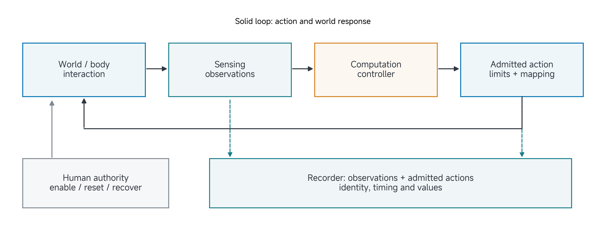
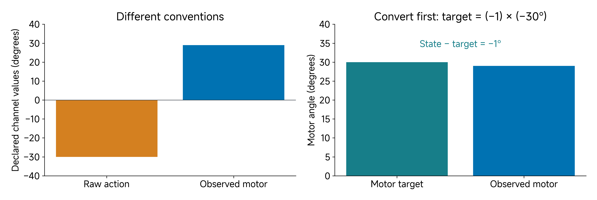

# 14 Final Project III: System

A policy can issue the intended target and the mechanism can still move incorrectly because an interface changes its meaning. A recorder can produce a complete-looking file while associating the wrong image with an action. These are system questions: how do quantities travel through the loop, and where can their meaning change?

Read this page before class. Use most of the session to trace your implemented or proposed system and inspect one consequential interface. Your diagram should help another person understand a record and design a test.

[Reading](#by-the-end-of-this-class) · [Project work](#apply-this-to-your-own-project) · [Submission](#submit-before-leaving-class)

## By the end of this class

Complete Worksheet 3, **System**, with a labelled loop, an identified configuration and one consequential interface acceptance test. Preserve its actual result or the dependency that prevents it from running.

## Draw the smallest complete loop

A list of sensors, motors and software packages is an inventory. A system explanation shows how they produce an interaction: world/body → observations → computation/decision → admitted action → world response. Put the human and recorder where they actually influence or observe that loop.

The loop should explain at least one real or planned episode from Class 13. Which measurement reaches the controller? Which action reaches the actuator after limits? What response is observed? Where is that response linked to the claim's outcome? If an arrow cannot be interpreted, the diagram is exposing a useful project question.

Keep the system boundary explicit. In a simulation project, body/environment dynamics are simulated. In a source analysis, some interfaces may only be externally described. A data investigation can trace acquisition, preprocessing and analysis while stating that the physical acquisition system was not inspected. Do not draw an implemented physical sensor merely because a paper or model contains one.

> Figure 1. A conceptual feedback loop places the recorder and human authority alongside observation and action pathways. Every consequential arrow needs meaning, timing and a source/configuration identity. The drawing is not a hardware wiring diagram.

## Arrows carry quantities, not just information

An action vector needs ordering, units, frame and interpretation. A joint position target, joint velocity, motor-space command, incremental tool displacement and absolute episode-frame pose are different interfaces. A vector with the expected length can still be wrong.

The same applies to observations. A camera key must identify the intended viewpoint and processing. A position needs an origin and axes. A measured angle needs its calibration and sign. An estimate needs the observations and transformation from which it was computed. Record what is known rather than inferring missing settings from a familiar device name.

For the running arm/pusher project, distinguish the nine-value pose representation from lower-level joint actuation. The pose feature contains three position values and two columns of an orientation matrix. It is not nine motor commands. A controller converts that target into admissible joint commands; a recorder must preserve which representation each channel contains.

| Boundary | Questions needed to interpret it |
| --- | --- |
| Sensor to observation | Quantity, units/frame, channel key, preprocessing and acquisition time? |
| Policy/controller to request | Absolute or incremental target, reference frame, ordering and intended rate? |
| Limits to admitted action | Which clipping, rejection or hold rule changes the request? |
| Action to mechanism | Which actuator mapping, gains, limits and configured model apply? |
| Observation/action to record | Which episode, timestamp convention and transition ordering associate them? |

## Identify the configuration behind a record

A system version includes more than the latest code commit. Tool geometry, sensor placement, calibration, model parameters, controller gains, policy/processors, scene conditions and scheduler can change behaviour. The relevant configuration is the one that produced the assessed trial.

Use an identified configuration record and refer to it from episodes and results. If the camera or tool transform changes, preserve old and new identities and note which comparisons must be repeated. A plot cannot be interpreted reliably if its data came from one configuration and its legend describes another.

The complete inventory belongs in the repository; the worksheet should identify the consequential structure and point to that inventory. Avoid copying an entire dependency list onto the canvas while leaving the observation/action boundary unexplained.

## Worked example: convert before comparing

Use an illustrative lower-level joint-command diagnostic, separate from the pusher dataset's nine-value pose feature. The declared elbow direction factor is −1. A row contains command-space action −30 degrees and observed motor angle +29 degrees. These values are a teaching fixture, not a new measurement.

If $$a$$ is the saved command and $$d$$ the direction factor, the motor target is

$$
m_{\mathrm{target}}=da=(-1)(-30^\circ)=+30^\circ.
$$

The signed tracking residual in motor coordinates is

$$
e_m=m_{\mathrm{observed}}-m_{\mathrm{target}}=29^\circ-30^\circ=-1^\circ.
$$

Subtracting the raw action from the state gives 59 degrees, but mixes conventions. It does not show a 59 degree tracking failure or an inverted physical motor. First put both quantities in the same coordinate convention and unit.

> Figure 2. Illustrative elbow values show why raw command/state differences can be misleading. Conversion establishes a comparable target; it does not prove calibration accuracy or identify physical dynamics.

### Turn the correction into an acceptance test

The weak diagram labels both signals “joint angle” and omits where conversion occurs. Revise it to label command-space and motor-space values separately and identify the conversion component. Choose a known bounded input and inspect the converted target in the declared channel order.

State the acceptance rule before inspecting the result. A synthetic conversion check can establish sign/order/scale for that software boundary. It does not validate physical zero offsets, actuator response or contact. A sensing project can use the same reasoning for a known image point transformed into world coordinates.

If the test fails, isolate the boundary before changing several components. A corrected sign and a new gain applied together may repair motion but obscure which change mattered. If a reference or calibration is unavailable, preserve that dependency rather than claiming the mapping was verified.

## Timing, limits and human authority belong in the loop

Two interfaces with the same numerical values can behave differently when they operate at different times. Identify source clocks, nominal rates, observed ages and missed-update treatment where consequential. “Runs at 30 Hz” does not establish capture-to-action latency or simultaneous sensor exposure.

A requested target may be clipped, rejected or held. Record the admitted command when that distinction affects the claim. If stale input holds the previous target, the mechanism may still move while converging; a held command is not proof of an instantaneous stop.

Locate who can enable, pause, reset and recover the system. In a physical project, those actions belong to the actual approved setup. In a simulation or digital-analysis project, state the appropriate scope rather than copying a hardware commissioning claim. A paper's interface description cannot verify your team's build.

## Apply this to your own project

Bring your claim, episode map, configuration information and one candidate boundary to test. Use project work to trace an actual record, inspect a controlled input or repeat a test from a fresh process. Select a consequential interface rather than a convenient check that has no effect on the claim.

| Worksheet field | What your answer should establish |
| --- | --- |
| World and observations | Embodiment/environment, sensing, reference frames and meaning of the data. |
| Decision and action | Computation/controller, action interpretation, ordering, rates, limits and fallback. |
| Authority and record | Human roles, logging, reset/recovery and configuration reference. |
| Critical interface evidence | Known input, acceptance rule, inspected result or exact missing test/dependency. |

Separate a suspected constraint from a demonstrated one. A slow plot alone may not identify whether sensing, computation or actuation caused the delay. Your checkpoint should leave another person able to interpret the tested boundary and identify what remains unresolved.

## Check your reasoning together

Before submitting, compare what changed with the artifact that supports it. Identify what remains assumed, planned or unresolved; decide whether an earlier worksheet needs revision; and name the next useful action. Ask the instructor/TA to challenge a specific uncertainty when needed. A complete worksheet can report a failed pilot, a negative finding or a blocked test honestly.

## Submit before leaving class

**Deadline: 18 November 2026 at 11:50.** Follow an explicitly announced schedule change if one occurs.

Download [Worksheet 3: System](../resources/project-workbook/Class14-System.pdf). Complete both pages by hand and obtain every team member's signature on the evidence/team-review page. Scan the complete package, including any identified continuations, into one legible PDF.

**Required file in your assigned private team repository:** `submissions/class14/worksheet.pdf`

Commit and **push** this file before the deadline. Open it on GitHub to check that every page is readable and confirm that the TA has repository read access. The TA collects this file directly; no separate physical hand-in is required. Retain the paper original. These printable PDFs have no interactive fields. No proxy signatures.

Cite supporting evidence using exact paths within the same team repository, with run/configuration IDs and an existing evidence version or commit where useful. Do not duplicate large artifacts in each submission folder. Mark missing or restricted evidence and its effect on the claim. The [editable project record](../resources/project-workbook/project-record.md) supports your work; the signed worksheet PDF is the required checkpoint file.

Preserve the initial `worksheet.pdf`. Put later dated, signed revisions in `submissions/class14/revisions/` with a short change record; do not rewrite Git history. A worksheet can cite an earlier evidence commit, but cannot contain the hash of the commit that first contains itself. The [complete blank pack](../resources/project-workbook/Submission-Worksheets.pdf) remains available for printing all six worksheets.

**Useful checkpoint:** A complete labelled loop, configuration identity and one consequential interface test with a result or unresolved dependency.

**Supporting record:** Architecture; configuration/version reference; observation/action contract; known test input and acceptance rule; actual outcome/log or exact dependency; interpretation of the tested boundary.

If an experiment is unfinished, complete the worksheet from the available evidence and identify the exact missing evidence/dependency, owner, next verification and affected claim. This documents the checkpoint; it does not complete the experiment. The supporting record is part of the same project, not an additional form or duplicate upload. Signatures record team review, not scientific success.

## Carry the project forward

Choose the assumption or interpretation most important to your claim. Bring a reference that could challenge it and the units, frames, timing and conditions needed to make the comparison meaningful.
