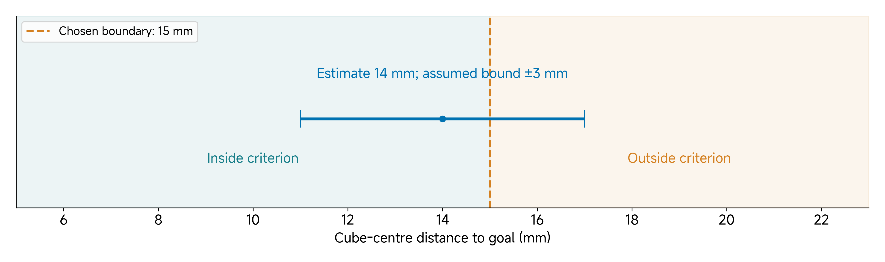
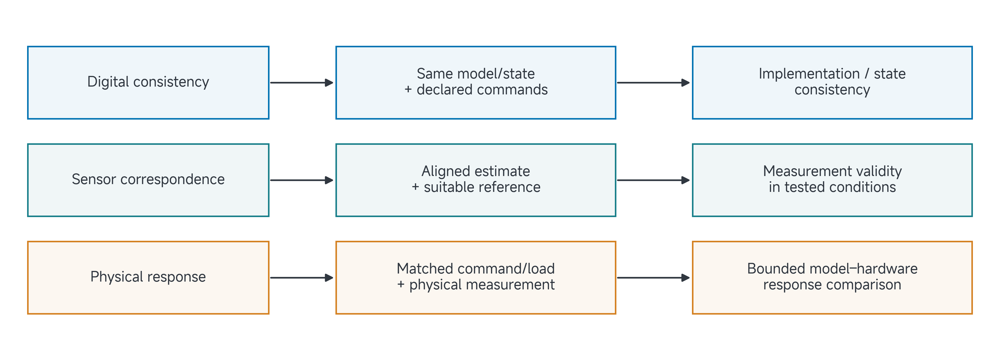

# 15 Final Project IV: Grounding

A label says “success,” a model predicts a position, or a sensor reports an angle. Each is a representation of something else. Grounding asks what evidence connects that representation or interpretation to the quantity you intend to discuss.

Read this page before class, then use project work to examine one consequential correspondence. Choose the comparison your claim needs: it may concern a sensor, a model, a task label or a digital record. A quantitative hardware-transfer experiment is necessary only when your claim depends on that physical correspondence.

[Reading](#by-the-end-of-this-class) · [Project work](#apply-this-to-your-own-project) · [Submission](#submit-before-leaving-class)

## By the end of this class

Complete Worksheet 4, **Grounding**, with one matched comparison or correspondence analysis, its evidence and uncertainty/limits, and a bounded interpretation. Select the representation or assumption whose failure would matter most to the claim.

## Identify what is being represented

A CAD dimension, simulated trajectory, sensor estimate and task-success label represent different things. Their validation questions are therefore different. A model may preserve geometry while predicting the wrong response under load. A sensor may return repeatable values with a calibration offset. A final image may correctly show the object in the goal without establishing how it arrived there.

State the representation and the reference explicitly. Ask whether the reference is sufficiently independent and informative for the question. Comparing two quantities derived from the same unverified transformation may establish software consistency while leaving the transformation itself untested.

The running manipulation-data project depends on interpretable outcomes and records. A useful grounding check might compare image-estimated object position with an appropriate reference, inspect the action/state transformation or validate episode labels against intervention records. Choose the check that can invalidate the claimed data use.

## Match the comparison before calculating an error

A difference is interpretable only when the quantities should agree under the declared conditions. Match the reference point, frame, units, time, initial state, input, load and relevant environment. Not every experiment needs all of these quantities, but every omitted condition needs a reason when it could change the result.

| Comparison element | Example ambiguity |
| --- | --- |
| Quantity/reference point | Rod-tip position compared with gripper-centre position. |
| Frame and units | Camera-relative millimetres compared with base-frame metres. |
| Time | Object location before contact compared with a later image. |
| Configuration | A calibration from one camera/tool arrangement applied to another. |
| Measurement validity | A label treated as exact despite occlusion or uncertain position. |

For paired positions in a common frame and unit, one possible residual is

$$
e_k=\lVert p_{\mathrm{estimate},k}-p_{\mathrm{reference},k}\rVert_2.
$$

This measures a positional discrepancy. It is not a rotational error, a complete dynamics error or a universal “Sim2Real gap.” Identify what is compared before naming an explanation.

A matched simulator replay is digital evidence of state/implementation consistency. A model-versus-hardware comparison adds a physical reference. A policy prediction compared with a demonstration asks another question about learning and its target. Keep those findings separate even when all three are expressed as a distance.

## Worked example: an uncertain success label

Suppose the task uses a chosen goal-radius criterion of 15 mm. An illustrative image-based estimate places the cube centre 14 mm from the goal, and the uncertainty analysis for this fixture gives a bounded ±3 mm interval. These are teaching assumptions, not team measurements or a course-wide acceptance tolerance.

The interval is

$$
[14-3,\;14+3]=[11,17]\ \mathrm{mm}.
$$

It crosses the 15 mm boundary. Under this bounded-uncertainty model, the estimate cannot establish an unambiguous success label. It also cannot establish a definite failure. The correct result is an ambiguity to retain and address under a declared evaluation rule.

> Figure 1. The invented 11–17 mm interval spans the chosen 15 mm outcome boundary. The interval is a bounded teaching assumption, not a fitted confidence interval or measurement from a student experiment.

### Repair the interpretation

First inspect the measurement procedure: calibration, camera-to-world transform, visibility, timing and the goal/object reference points. A more precise-looking number cannot compensate for the wrong reference point. Repeating nearby image frames may reduce some noise but does not automatically remove systematic error or create independent evidence.

For a digital exercise, compare image estimates with simulator ground-truth positions at corresponding times and configurations. That can test the digital measurement pipeline. For a physical claim, obtain a suitable physical reference and repeat the comparison under the claimed conditions. Simulator truth cannot supply an unmeasured physical location.

Then state how ambiguous cases enter the analysis. A conservative bound, an explicitly uncertain label or improved measurement may be appropriate depending on the question. Define the treatment before examining the assessed outcomes. Moving the threshold after seeing failed trials changes the question rather than validating the old result.

The revised conclusion might be: “The available image estimate is compatible with both sides of the criterion. This episode remains ambiguous pending a better reference.” That is a useful finding because it identifies what is needed before reusing the label for training or evaluation.

## Choose evidence appropriate to the claim

An actuator/payload study can compare a declared command and joint response under matched loads. A sensor project can validate a transform or measurement range. A dataset project can examine correspondence between records, labels and their intended interpretation. A simulation-only project can make a supported digital claim without inventing a physical comparison.

> Figure 2. The reference and matched conditions determine the claim a comparison can support. A digital check, a sensor comparison and a hardware-response experiment are related but distinct evidence boundaries.

For a hand-rotation study, simulation angular velocity and an illustrative hardware video do not form a paired numerical measurement from which to subtract a transfer gap. Preserve each source's actual conditions and observation limits. The distinction developed in the earlier manipulation and deployment classes applies equally to your project.

A physical measurement is not automatically a valid label or causal explanation. A well-controlled digital check can strongly support a digital proposition. What matters is how the record answers the scoped question, not whether it occupies a supposedly higher evidence category.

## Separate discrepancy from cause

Suppose a tool estimate and reference disagree. Candidate causes include calibration, timing, an incorrect frame or the underlying model. Changing all of them may repair the result while leaving the cause unclear. Select a discriminating next test with a predicted observation.

If delay is suspected, compare aligned records with an independently checked time offset while preserving the spatial transform. If a load-dependent model is suspected, use matched commands and initial conditions at declared loads. State what result would weaken the explanation. A plausible story about friction is not friction identification.

Preserve failed and invalid measurements, with reasons. They may be unusable for a particular estimate while still revealing an important limitation. A filtered “clean” dataset should remain traceable to its original records and selection rules.

## Apply this to your own project

Bring a consequential assumption, the relevant system/configuration and a reference that could challenge it. Use project work to run a paired check, inspect a source comparison, analyse ambiguity or obtain a better reference.

| Worksheet field | What your answer should establish |
| --- | --- |
| Comparison boundary | Representation/interpretation, reference, matched conditions and exact question. |
| Quantities and validity | Measures, units, calibration/reference, proposed tolerance and measurement limits. |
| Results and uncertainty | Actual outcomes and trial units/counts, or explicit unexecuted/unexamined status. |
| Interpretation and challenge | Supported conclusion, alternative causes, diagnostic next test or scope restriction. |

You need not create a hardware test solely to fill the worksheet. If the claim requires physical evidence that is unavailable, identify that dependency and restrict the supported conclusion. A missing physical measurement does not erase a useful digital finding, but it limits the physical claim.

## Check your reasoning together

Before submitting, compare what changed with the artifact that supports it. Identify what remains assumed, planned or unresolved; decide whether an earlier worksheet needs revision; and name the next useful action. Ask the instructor/TA to challenge a specific uncertainty when needed. A complete worksheet can report a failed pilot, a negative finding or a blocked test honestly.

## Submit before leaving class

**Deadline: 20 November 2026 at 10:50.** Follow an explicitly announced schedule change if one occurs.

Submit the complete handwritten **Worksheet 4: Grounding** package, signed by every team member, including its evidence/team-review page. Use pages **7–8** of the [blank submission pack](../resources/project-workbook/Submission-Worksheets.pdf). Digital drafts support preparation but do not replace the signed handwritten original. No proxy signatures.

Preserve a legible scan, the current project record, supporting artifacts or accessible references, and the milestone commit in your private team repository. The [editable project record](../resources/project-workbook/project-record.md) can hold all six views and their evidence; do not start six separate projects. Keep later dated, signed revisions traceable without overwriting the original submission.

**Useful checkpoint:** One matched comparison or correspondence analysis, its uncertainty/limits and a justified interpretation or scope revision.

**Supporting record:** Paired protocol or correspondence table; identified input/reference records; available comparison plot/table; measurement uncertainty or validity limits; discrepancy interpretation and diagnostic next action.

If an experiment is unfinished, complete the worksheet from the available evidence and identify the exact missing evidence/dependency, owner, next verification and affected claim. This documents the checkpoint; it does not complete the experiment. The supporting record is part of the same project, not an additional form or duplicate upload. Signatures record team review, not scientific success.

## Carry the project forward

Identify how the data will be used. Bring candidate/comparator identities, data origins and development/test roles. Freeze the comparison before using held-out outcomes to select changes.
