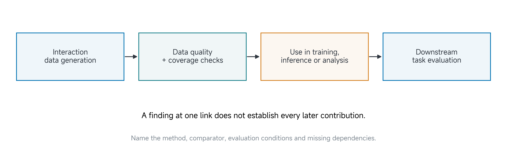
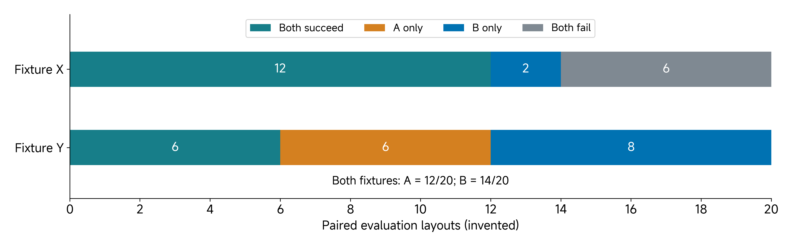

# 16 Final Project V: Learning

A larger dataset, a lower training loss and a more impressive demonstration can all coexist with no useful improvement on the intended task. Learning asks how experience is used and what contribution the evidence supports.

Read this page before class. Use project work to execute or inspect a fair comparison, examine a failure and decide what to retain or revise. A negative finding can be useful. An unavailable result remains unavailable, rather than becoming evidence of failure or success.

[Reading](#by-the-end-of-this-class) · [Project work](#apply-this-to-your-own-project) · [Submission](#submit-before-leaving-class)

## By the end of this class

Complete Worksheet 5, **Learning**, with the role of experience, data/evaluation boundary, a fair comparison or explicitly incomplete protocol, failure analysis and a bounded contribution statement. New training and a positive improvement are not universal requirements.

## Identify how experience changes the system or inquiry

Interaction data can train a policy, estimate a state, support adaptation, evaluate a method or inform a design revision. Identify the pathway actually present in your project. A frozen pretrained component uses prior learning even if your team does not update its weights. A record analysis can contribute knowledge without adding a learned component.

Do not relabel routine manual tuning as learning merely to fit the worksheet title. If learning is outside your claim, state that boundary and evaluate the contribution you do claim. If a learned contribution is proposed but not demonstrated, say so. “No improvement was observed” requires an executed comparison; it differs from “the evaluation could not be run.”

For the running arm/pusher project, increased coverage of usable episodes is a data-generation finding. Improved learned task performance is a further claim. It requires identified data and methods, a controlled comparison and an appropriate evaluation. The first finding can be useful even when the second remains unresolved.

> Figure 1. A data-generation result does not automatically establish a downstream learning benefit. Each link needs evidence appropriate to the claim. The pathway is conceptual, not a report that training or evaluation has been completed.

## Freeze a comparison that answers the question

Identify the candidate and comparator before the assessed evaluation. Preserve their configuration, policy/processors or analysis versions. State what differs and what must remain comparable: task, reset distribution, observations, executor, outcome criterion and relevant resource budget.

Equal acquisition budget and equal training-data amount answer different questions. If a collection protocol produces more usable episodes per attempt, training on all of them may evaluate the benefit of that whole acquisition route. Holding the number of training episodes fixed asks a different question about the selected data. Both can be legitimate; label the comparison rather than claiming to isolate a factor you changed along with several others.

An ablation removes or changes a component to investigate its contribution. It is useful only when the remaining comparison makes sense. A different architecture, data amount and controller tested together is a system comparison, not a clean test of one architectural feature.

## Protect the role of held-out evidence

Development data help choose parameters and repair errors. Validation data may help choose a candidate under a declared protocol. Held-out evaluation addresses the resulting frozen question. If you repeatedly inspect test outcomes and select changes, disclose that use and establish what independent evaluation remains.

Keep related frames and episodes together where their dependence could leak information. Splitting neighbouring frames from the same attempt between development and test can give a misleading estimate of generalization. A new seed does not necessarily test a new condition: a camera displacement or changed payload may be a separately defined held-out condition.

A split manifest should identify the records or conditions and their roles. Source data remain source data; do not infer an unreported split from a familiar dataset name. If the original checkpoint/processors are absent, the source's published score does not become a local rerun.

## Worked example: a ten-point difference needs its trial record

Suppose two frozen candidate systems are evaluated on the same declared set of twenty layouts. Candidate A succeeds on 12 and B on 14. These are invented teaching outcomes, not measured course or student results.

The observed fractions and difference are

$$
\hat p_A=\frac{12}{20}=0.60,\qquad
\hat p_B=\frac{14}{20}=0.70,
$$

$$
\hat p_B-\hat p_A=0.10,
$$

or ten percentage points. This is an observed difference on this evaluated set. It does not establish general superiority, a reliable effect across training runs or improved physical transfer.

The per-layout record matters because the outcomes are paired. Two marginal totals do not reveal which layouts improved and which regressed. Consider two possible joint outcome tables, both consistent with 12/20 and 14/20:

| Paired outcome | Fixture X | Fixture Y |
| --- | --- | --- |
| Both succeed | 12 | 6 |
| A only succeeds | 0 | 6 |
| B only succeeds | 2 | 8 |
| Both fail | 6 | 0 |
| Total paired layouts | 20 | 20 |

> Figure 2. Two invented paired records have the same marginal success counts but different patterns of regressions and gains. They support different failure questions. No statistical significance or population improvement is claimed by the diagram.

In X, B preserves every success of A and adds two on these layouts. In Y, B gains eight while losing six. A project that records only the totals cannot distinguish these behaviours or perform an appropriate paired analysis. Repeated trials or additional independent training runs may be needed for the claim; more frames from the same attempt do not replace them.

### Repair the overclaim

The weak conclusion is “our learned method is generally better.” A defensible statement identifies the frozen systems, the evaluated layouts, the observed difference and the limitations. Inspect at least one failure, regression or counterexample where available. Ask whether the difference could reflect data amount, reset selection, executor changes or stochastic variation rather than the proposed mechanism.

If a checkpoint is unavailable, do not insert these teaching numbers into the project result. Preserve the protocol and missing artifact, then report the supported data-quality or source-analysis finding. A plan to train later is not an executed learning comparison.

## Account for all outcomes and uncertainty

Retain attempted, successful, failed, intervened and excluded trials with reasons. Choose the trial unit and outcome criterion before the assessed run. A selected successful video illustrates an episode; it does not supply the denominator of a reliability estimate.

Uncertainty depends on the design. Repeated layouts, shared training runs and correlated interventions can violate a simple independent-trial interpretation. Distinguish variation across evaluation attempts from variation across trained checkpoints. Do not attach an unexplained error bar or claim certainty because a score is a percentage.

A negative or inconclusive result can justify retaining a simpler method, revising the data protocol or conducting a discriminating test. An incomplete evaluation justifies identifying the remaining dependency and affected conclusion. Preserve these distinctions in the project record and final artifacts.

## Apply this to your own project

Bring the frozen versions, data origins, split/condition manifest and current trial record. Use project work for a matched evaluation, failure inspection or a feasible part of the comparison. A frozen pretrained method, adaptation/estimation study or justified nonlearning comparison can answer the worksheet when its scope is explicit.

| Worksheet field | What your answer should establish |
| --- | --- |
| Role of experience | Training, inference/adaptation, evaluation or design insight, and the contribution claimed. |
| Data and independence | Origins, sampling, development/test roles, related trials and leakage checks. |
| Comparison and limits | Frozen methods, matched conditions, denominators, failures and actual ablations. |
| Supported contribution | What is supported, not improved or unresolved; alternatives and a next test or restriction. |

Choose retain, revise or reject on the evidence available. Do not require a favourable result to complete the view, and do not make an absent experiment appear negative merely to write a conclusion.

## Check your reasoning together

Before submitting, compare what changed with the artifact that supports it. Identify what remains assumed, planned or unresolved; decide whether an earlier worksheet needs revision; and name the next useful action. Ask the instructor/TA to challenge a specific uncertainty when needed. A complete worksheet can report a failed pilot, a negative finding or a blocked test honestly.

## Submit before leaving class

**Deadline: 24 November 2026 at 10:20.** Follow an explicitly announced schedule change if one occurs.

Download [Worksheet 5: Learning](../resources/project-workbook/Class16-Learning.pdf). Complete both pages by hand and obtain every team member's signature on the evidence/team-review page. Scan the complete package, including any identified continuations, into one legible PDF.

**Required file in your assigned private team repository:** `submissions/class16/worksheet.pdf`

Commit and **push** this file before the deadline. Open it on GitHub to check that every page is readable and confirm that the TA has repository read access. The TA collects this file directly; no separate physical hand-in is required. Retain the paper original. These printable PDFs have no interactive fields. No proxy signatures.

Cite supporting evidence using exact paths within the same team repository, with run/configuration IDs and an existing evidence version or commit where useful. Do not duplicate large artifacts in each submission folder. Mark missing or restricted evidence and its effect on the claim. The [editable project record](../resources/project-workbook/project-record.md) supports your work; the signed worksheet PDF is the required checkpoint file.

Preserve the initial `worksheet.pdf`. Put later dated, signed revisions in `submissions/class16/revisions/` with a short change record; do not rewrite Git history. A worksheet can cite an earlier evidence commit, but cannot contain the hash of the commit that first contains itself. The [complete blank pack](../resources/project-workbook/Submission-Worksheets.pdf) remains available for printing all six worksheets.

**Useful checkpoint:** A fair comparison or explicitly incomplete protocol, failure analysis and a bounded statement of the contribution of experience.

**Supporting record:** Frozen candidate/comparator and protocol; split/condition manifest; all available trial outcomes with interventions/exclusions; comparison and limits; inspected failure/counterexample where available; retain/revise/reject decision or exact missing dependency.

If an experiment is unfinished, complete the worksheet from the available evidence and identify the exact missing evidence/dependency, owner, next verification and affected claim. This documents the checkpoint; it does not complete the experiment. The supporting record is part of the same project, not an additional form or duplicate upload. Signatures record team review, not scientific success.

## Carry the project forward

Reconcile the earlier five views. Bring references for all 27 Decision checks, the exact next action, critical unknowns, consequential disagreements and the configuration/evidence version to assess.
