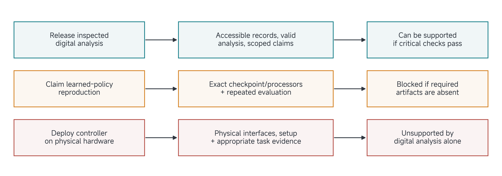
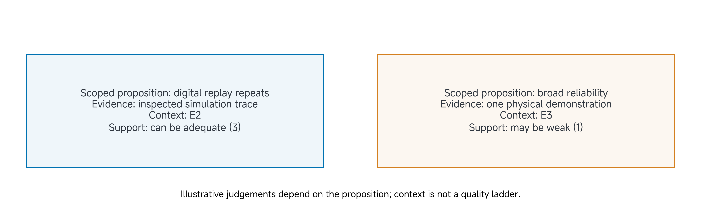

# 17 Final Project VI: Decision

## Submit before leaving class

**One PDF per team. Submit by 25 November 2026 at 11:50, Abu Dhabi time (UTC+4).**

| Requirement | What your team must do |
| --- | --- |
| Download | [Worksheet 6: Decision](../resources/project-workbook/Class17-Decision.pdf) |
| Required contents | All three pages: both A3 Decision sides and the signed A4 evidence/team-review page; retain all 27 checks. Include any labelled continuation pages in the same PDF. |
| Team identifier | Use your assigned **Team01–Team08**, matching your private repository, for example `2026Autumn-Team01`. Write this identifier and the project title on every page. |
| Folder | `submissions/class17/` in your assigned private team repository |
| Filename | `TeamNN-Class17-Decision.pdf` — replace `NN` with your assigned two-digit team number |
| Example for Team01 | `submissions/class17/Team01-Class17-Decision.pdf` |
| Branch | Remote `main` on GitHub |

### Prepare and submit

1. Complete the worksheet by hand. Answer each prompt, or explain what is unfinished and what you will do next. Every member signs the team-review page.
2. Scan all required pages into **one readable PDF**. Check page order, orientation and that nothing is cropped. Keep the paper original for your records.
3. Name the PDF as shown above and put it in the specified folder in **your assigned private repository**. Reference supporting evidence by its existing repository path; do not copy it into another submission form.
4. Commit and **push to `main` before the deadline**. Open the PDF on GitHub and confirm every page is present and readable. A file saved only on your computer or an unpushed commit is not submitted.

### How the teaching team collects it

At the deadline, the TA collects the named PDF from your team's remote `main` branch, records the repository commit and collection time, and retains that version. The repository, filename and identifier on the pages connect the PDF to your team. Confirm teaching-team access before the deadline; report an access problem promptly.

**No separate upload, email, release, tag, manifest or physical hand-in is required.** Later changes do not replace the collected version. Keep the initial PDF; save later dated, signed revisions in `submissions/class17/revisions/`.

The file above is the required worksheet submission. The [editable project record](../resources/project-workbook/project-record.md) is a working aid, not a second submission. Use the guidance below while doing your project work.

## Reading and project guidance

A project can support release of a simulation analysis while leaving physical deployment unsupported. It can produce a defensible negative finding while exposing a useful next experiment. A decision connects what the evidence establishes to one specific action and its conditions.

Read this page before class and bring your earlier views and drafted Decision references. Most of the session is for resolving consequential evidence, reconciling the claim and completing the project record. Do not begin all 27 checks from an empty sheet today.

[Reading](#by-the-end-of-this-class) · [Project work](#apply-this-to-your-own-project) · [Submission](#submit-before-leaving-class)

## By the end of this class

Complete Worksheet 6, **Decision**, including both A3 Decision sides and the evidence/team-review page. Review all 27 checks, identify the conditions critical to the exact next action, preserve the assessed evidence version and state the conclusion and owned next steps.

## Name the action as well as the claim

A conclusion states what is supported. An action states what you propose to do with that conclusion. Releasing an analysis, collecting a further dataset, changing a controller and executing a physical rollout have different dependencies. “The project is ready” hides those differences.

Identify the claim, configuration, evidence freeze, intended action and scope before deciding which checks are critical. A record can support one action while leaving another blocked. Narrowing the action can remove a dependency, but does not supply the evidence that was missing for the broader action.

The six worksheet views should now refer to one project. Check that the task, data, calibration, policy, comparator and outcome criterion match the versions actually assessed. Preserve the history when later findings revise an earlier view. An attractive poster or completed worksheet is not a substitute for an experiment.

> Figure 1. In a hypothetical project, evidence for an inspected digital analysis can support a bounded analysis release while leaving policy reproduction or physical deployment unsupported. The diagram does not approve an actual student release.

## Read the full Decision screen

The instrument contains one decision, three branches—**Generate, Use and Manage**—nine gates and 27 checks. The branches are linked concerns, not a sequence of commercial or maturity stages. Retain the full questions below; the worksheet's evidence page records the basis of your judgement for each entry.

Generate examines the interaction mechanism, embodiment/interfaces and commissioning/records. Use examines the claim and use of experience, correspondence/coverage and reconstruction/evaluation. Manage examines identity/change, resources/benefit and monitoring/continuation. These concerns have been developing throughout the earlier classes; they are not one-to-one labels for the six worksheets.

## Separate evidence origin, context and support

For an evidence entry, retain where it came from, what context it represents, how it supports the scoped question and what was inspected. An externally reported physical experiment is still externally reported physical evidence; it does not become your team's measurement. A plan can support design reasoning but not executed performance.

| Support | Meaning for the scoped question |
| --- | --- |
| 0 | Available evidence directly contradicts it; identify the conflict. |
| 1 | Relevant evidence exists but is weak or inadequate. |
| 2 | Partial or conditional support; identify the supported and missing parts. |
| 3 | Adequate support under the stated conditions. |
| 4 | Strong convergent support with important alternatives addressed. |
| NR | Not reported in the identified inspected scope. |
| NE | Relevant material was not examined or accessed. |
| NA | Inapplicable to this claim/action, with a reason. |

Use a numeric rating only when an actual evidential basis is identified. A citation is a pointer; explain how its content answers the check. Several references to one trial do not create several independent trials.

| Context | Kind of evidence used by the check |
| --- | --- |
| E1 | Relevant reasoning, design, theory, protocol or plan. |
| E2 | Executed analysis, simulation or inspectable digital artifact. |
| E3 | Reported or directly observed physical/integrated evidence in the stated conditions. |
| E4 | Physical evidence supporting declared held-out representative coverage or external auditability, with limits. |
| E5 | Explicit independent reproduction or sustained operational evidence for the claimed scope. |

Contexts are not a quality ladder. Digital evidence can strongly support a digital claim; a physical demonstration can weakly support a broad reliability claim. Duration or publication alone does not confer E5. Keep access and confidence separate from support, and use a dash rather than automatically assigning E1 to NR/NE/NA entries.

> Figure 2. Evidence context describes the kind of record; support describes how it answers a particular proposition. Neither a higher context label nor an average support score clears a missing action-critical condition.

## The 27 questions

For every check, record the source/configuration basis, origin, support, context, relevance, material limit and follow-up where needed. Identify the clauses critical to the proposed action. The complete editable record and printable submission pack accompany this page.

### Generate

| Check | Question |
| --- | --- |
| G1.1 | Mechanism: Is the claimed mechanism explicit, physically credible and open to challenge? |
| G1.2 | Closed loop: Are the implemented body, observations, controller, actions, environment and human roles identified? |
| G1.3 | Task boundary: Are task conditions, episode boundaries, outcomes and exclusions stated? |
| G2.1 | Embodiment: Is the embodiment or physical coupling realized and identified at the claimed stage? |
| G2.2 | Observability: Are measurements and references suitable for the claimed outcomes, with relevant validity limits? |
| G2.3 | Interfaces: Are consequential interfaces, action meanings, units and timing described or verified? |
| G3.1 | Commissioning: What limits, resets, interventions, fault handling and recovery are described or tested? |
| G3.2 | Experience record: What observations, actions, outcomes and contextual records are available or described? |
| G3.3 | Grounding gap: How are model, measurement or interpretation connected to physical evidence under comparable conditions? |

### Use

| Check | Question |
| --- | --- |
| U1.1 | Claim: Can the available evidence support or challenge the specific claim, without expanding its scope? |
| U1.2 | Role of experience: Is the role of experience in learning, inference, adaptation, evaluation or design insight explicit? |
| U1.3 | Comparators: Are comparators or alternative explanations appropriate to the contribution being claimed? |
| U2.1 | Correspondence: Are data, model, policy, embodiment and evaluation configurations linked where needed? |
| U2.2 | Coverage: Are coverage, sampling, failures, evaluation partitions and leakage addressed for the claim? |
| U2.3 | Governance: What provenance, rights, human participation and data safeguards are reported where relevant? |
| U3.1 | Reconstruction: What is available to reconstruct the system and evaluation, and what remains unverified? |
| U3.2 | Evaluation: Are protocol, denominators, repetitions, uncertainty and exclusions reported appropriately? |
| U3.3 | Failure analysis: Are failure modes, interventions, competing explanations and negative results examined? |

### Manage

| Check | Question |
| --- | --- |
| M1.1 | Identification: Are claims, configurations, datasets and experiments distinguishable and source-linked? |
| M1.2 | Change control: Are variants, updates or corrections traceable, and is their effect on conclusions assessed? |
| M1.3 | Counterevidence: Are material failures, null findings, ambiguous outcomes and counterevidence retained? |
| M2.1 | Resources: Are relevant hardware, compute, time, skills and maintenance resources stated? |
| M2.2 | Data burden: Are collection, annotation, reset, storage and human effort addressed where consequential? |
| M2.3 | Benefit: Is the claimed benefit justified against costs and relevant alternatives within the study? |
| M3.1 | Monitoring: What detects mismatch, degradation, invalid measurements or faults in the claimed setting? |
| M3.2 | Operations: What human authority, maintenance, recovery and update practices are described for this stage? |
| M3.3 | Sustainment: What duration, units, contexts or repeated-use evidence supports the claimed persistence? |

## Worked example: distinguish a scoped release from deployment

Continue the manipulation-data project as a hypothetical case. Suppose the team has inspectable simulation records, a validated analysis transformation and reproducible coverage plots. It also cites an externally reported learned-policy score, but lacks the exact checkpoint/processors needed to rerun that evaluation. No physical policy-rollout evidence has been collected.

A release limited to the inspected data analysis might be justified if its own critical evidence, artifact access, provenance and other applicable conditions are adequate. It should identify the policy score as externally reported and exclude a claim of local policy reproduction. If an asset required for the analysis is itself inaccessible, the dependent analysis action remains conditional or blocked.

Claiming reproduction of the learned evaluation depends on the absent artifacts. Physical deployment depends on physical interfaces, commissioning, supervision and task evidence appropriate to that action. The digital analysis cannot substitute for those dependencies. A reasoned scope restriction is not a physical-transfer result.

### Repair an averaged readiness verdict

Suppose a team averages favourable ratings and uses the result to say “ready for hardware.” That arithmetic ignores which evidence is essential to the action. Many successful simulations do not resolve an unverified physical action mapping. A reported high score does not supply an inaccessible checkpoint.

Revise the decision by naming one action, inspecting its critical checks and preserving contradictions or unknowns. Green means required checks are adequate without a blocking contradiction or unknown. Amber identifies an addressable condition that can be managed within the proposed action; it is not permission to ignore a critical dependency. Red blocks an action whose essential condition is unsupported or contradicted.

A condition should specify an owner, verification and trigger for reassessment. “Check it later” is insufficient. For example: “Before a learned-policy reproduction claim is released, the experiment owner must identify the exact checkpoint and processors, rerun the declared evaluation and preserve the resulting versioned record.” This condition does not assert that the work has been completed.

For source analysis, conclude by claim family—supported, partial, contradicted or unresolved in the inspected scope. Do not treat a missing extension experiment as proof that the original paper is false. Project development asks what your own evidence permits next; keep these two uses distinct.

## Freeze evidence without freezing learning

An evidence freeze identifies the configuration, protocol, data and analysis on which the assessed conclusion rests. It does not prohibit later improvements. Record the change, affected claims/artifacts and necessary rechecks under a new identity.

The same bounded claim should appear in the poster, README and video. A selected clip must identify its episode and limits; a plot must identify its data and configuration; a reproduction instruction must refer to the assessed version. Do not silently replace failed trials or change an outcome criterion after results are known.

Resource and data burden also belong in the conclusion when relevant: operator/reset effort, annotation, compute, storage, maintenance and access can change whether a next action is justified. Evaluate these within the actual prototype scope rather than demanding unsupported claims about long-term fleets.

## Apply this to your own project

Bring all earlier views, the evidence index, drafted references for the 27 checks, consequential disagreements and the next action you want to justify. Have members inspect important checks independently before reconciling them. Use project work to close a gap, repeat a disputed analysis, inspect a record or narrow the action.

| Worksheet field | What your answer should establish |
| --- | --- |
| Decision boundary | Claim, exact action, configuration, evidence freeze, scope and required evidence floor. |
| Evidence screen | All 27 entries, their evidence/statuses, relevance and justified scope exclusions. |
| Conclusion and conditions | Supported/unsupported claims, disposition, owners and verification. |
| Reassessment and submission | Triggers, changed/invalidated evidence and the final-artifact handoff. |

Choose advance, advance with conditions, revise and reassess, or stop/rescope for the stated action. Do not manufacture experiments solely to populate boxes. Where an essential test is unfinished, preserve its dependency and block or restrict the action that needs it.

## Check your reasoning together

Before submitting, compare what changed with the artifact that supports it. Identify what remains assumed, planned or unresolved; decide whether an earlier worksheet needs revision; and name the next useful action. Ask the instructor/TA to challenge a specific uncertainty when needed. A complete worksheet can report a failed pilot, a negative finding or a blocked test honestly.

## Check your completed worksheet

**What the worksheet should explain:** The complete Decision screen, a bounded conclusion, owned conditions and an identified evidence freeze.

**Evidence to reference where available:** Both A3 Decision sides and the evidence/team-review page; all 27 check references/statuses; reconciled claim; action-critical conditions and disagreements; configuration/evidence-freeze commit; reproduction record or unresolved dependencies.

If an experiment is unfinished, complete the worksheet from the available evidence and identify the exact missing evidence/dependency, owner, next verification and affected claim. This documents the checkpoint; it does not complete the experiment. The supporting record is part of the same project, not an additional form or duplicate upload. Signatures record team review, not scientific success.

## Carry the project forward

Carry the same assessed record into the poster, code/reproduction package and video. Prepare before the submission milestones; Classes 19–20 do not provide attended work sessions. Keep later corrections traceable and follow the existing final-deliverable requirements.
