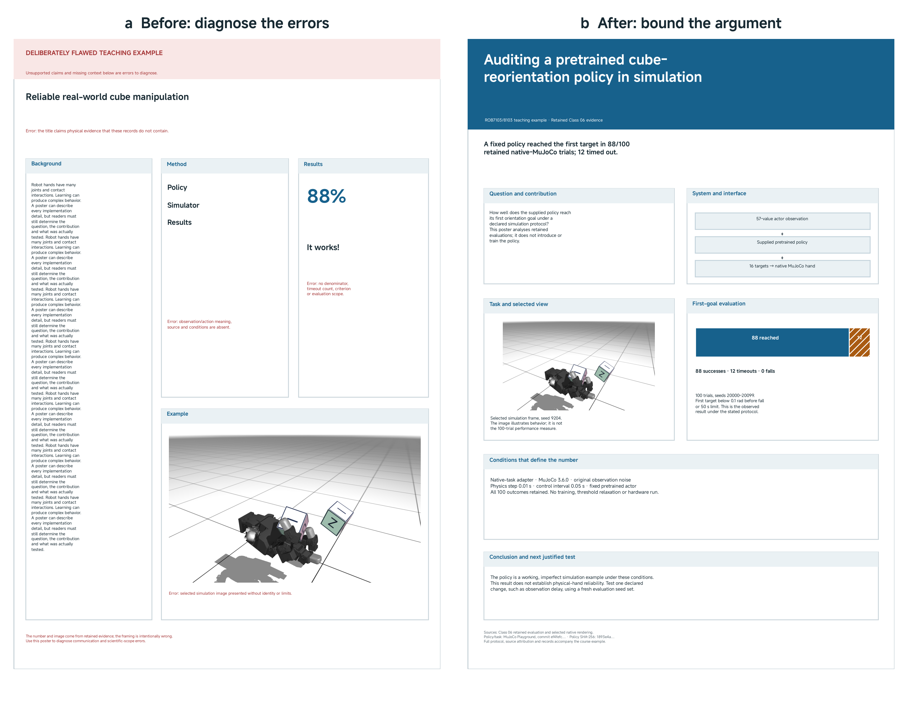
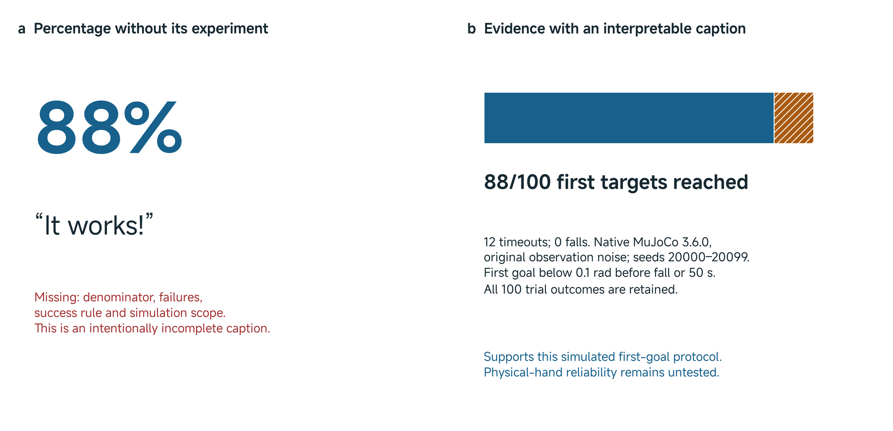

# 18 Final Poster Submission

## Turn the project into a scientific argument

What can a robotics reader understand and challenge about your project from one poster? Your task is to make the question, contribution, evidence and conclusion recoverable without a long explanation from the authors. A poster supports discussion, but it must also give a reader enough context to start that discussion productively.

This class combines explanation, a worked poster review and team preparation. Bring your current project record, a rough poster, traceable results, a draft route for reproducing an important result, and available footage or a feasible recording plan. These are preparation materials, not additional assessed submissions. Use the class to resolve consequential scientific and communication problems and finalize the poster you will submit.

The three final milestones develop one project progressively. The poster communicates its scientific argument. The code makes the supporting experiment inspectable within a declared reproduction scope. The video explains the contribution through relevant behavior and evidence. You may continue development between milestones; explain material changes rather than silently presenting different results as the same experiment.

## Apply the conference guidance

We adopt the **A0 portrait format, 841 mm wide × 1189 mm high**, from the official [RSS 2026 presenter instructions](https://roboticsconference.org/2026/information/presentationInstructions/). For this course, submit the exported **PDF** in your assigned team repository. The conference's printing, installation and conference submission arrangements do not replace the course workflow.

The deadline is **27 November 2026 at 10:50, Abu Dhabi time (UTC+4)**. The assessed artifact is `poster/final-poster.pdf`. The repository procedure is introduced using the actual team repositories in Class 01 and is repeated at the end of this page.

An RSS-style format establishes the physical canvas; it does not require every project to use an identical layout. Choose a reading path that suits your contribution. A simulation study, comparison, reproduction, negative result or carefully explained limitation can support a complete poster. The strength of the argument depends on what the evidence establishes.

## Decide what the reader should learn

Assume the reader understands robotics but has not followed your team's work. First write one sentence stating what the project contributes. Then select the evidence needed to assess that sentence. This order prevents a poster becoming an inventory of everything the team tried.

For example, “We built a robot learning system” says little about the contribution or its evaluation. “We reconstructed a supplied policy's first-goal evaluation and identified the conditions under which its reported result applies” describes a contribution that a reader can inspect. If your project proposes a change, state what changed and compare it under declared conditions. If it reproduces prior work, identify the reproduced component and the differences from its reference.

Build the argument through connected questions:

| Reader's question | Information the poster should supply |
|---|---|
| What problem did you investigate? | A concrete task and the uncertainty that motivated the work |
| What did your team contribute? | Your implementation, reproduction, comparison or finding, distinguished from reused work |
| How does the system work? | The essential components, interfaces and conditions needed to interpret the experiment |
| What did you test? | A meaningful comparison or evaluation, its metric and its trial population |
| What did you find? | Results, material failures and a conclusion matched to their scope |
| Where does the conclusion stop? | The principal limitation and a justified next test |

Use the existing Classes 12–17 project records to answer these questions. Select the relevant reasoning and evidence; do not reproduce every worksheet field. Put implementation detail in the repository when it would interrupt the poster's argument, while keeping enough information on the poster to interpret the result.

## Learn from a complete poster revision

The example below uses **retained Class 06 simulation evidence**, not a new student experiment. The first composition deliberately contains errors: an unsupported physical claim, excessive background, an unexplained method and a percentage without its experiment. The revised poster uses the same underlying evidence to make a narrower, inspectable argument.



*Figure 1. Two complete A0 portrait teaching compositions. The left version is deliberately flawed and labelled as such; the right version reorganizes the retained simulation evidence into a question, method, interpretable result and bounded conclusion. This overview shows composition. Inspect the full-size [before PDF](../media/class18/poster-before-a0.pdf), [revised PDF](../media/class18/poster-after-a0.pdf) and [editable revised SVG](../media/class18/poster-after-a0.svg) for text and export detail. [Figure source and provenance](../media/class18/FIGURE-CODE.md).*

### Narrow the claim before changing the layout

The flawed title claims reliable real-world manipulation. The evidence is a native MuJoCo evaluation of a supplied pretrained LEAP Hand policy. No physical-hand evaluation follows from those records. The revised title names the simulated task and the analysis being performed. Its contribution statement attributes the supplied policy instead of implying that the poster authors trained it.

A selected rendered frame helps a reader understand the hand, held cube and orientation target. It cannot establish performance over the full evaluation. The revised caption identifies that image as a selected simulation view from seed 9204 and keeps it separate from the 100-trial result. Likewise, a visually successful pose alone does not establish when the evaluator's orientation test passed.

### Make the result interpretable

The [retained evaluation summary](../resources/class06/code/results/native-task-10ms-noisy-heldout/summary.json) reports **88 first-goal successes, 12 timeouts and no falls in 100 trials**, using seeds 20000–20099. The native-task condition uses MuJoCo 3.6.0, original observation noise, a 0.01 s physics step and a 0.05 s control interval. A successful trial reaches its first target with orientation error below 0.1 rad before a fall or the 50 s limit. These are simulation conditions, not lecture timings.

Read those conditions before interpreting the percentage. The outcome is first-goal success under this protocol. It is not the number of successful control steps, repeated-goal reliability, a training result or a physical deployment result. The [individual episode records](../resources/class06/code/results/native-task-10ms-noisy-heldout/episodes.jsonl) retain the unsuccessful trials as well as the successful ones.



*Figure 2. The same observed proportion can support very different interpretations depending on its caption. The revised statement preserves all 100 outcomes and identifies the success rule and simulation scope. These records establish the observed result under that protocol; they do not certify hardware performance. [Figure source and provenance](../media/class18/FIGURE-CODE.md).*

The revised poster's conclusion is therefore limited but useful: the supplied policy provides a working, imperfect simulated example under the stated conditions. Its next test changes one declared factor while preserving a meaningful evaluation. A poster should not invent a cause for the 12 timeouts. Diagnosing their mechanism requires evidence beyond the outcome counts.

## Compose a readable poster

### Establish hierarchy and a reading path

Make the title and main finding easy to locate. Use descriptive panel headings, consistent alignment and useful whitespace to show how the argument develops. A reader should be able to find the central result without first reading every background paragraph.

The revised example gives substantial space to the system and result because they explain the contribution. Its method diagram identifies the observation, supplied policy and output targets. Your diagram should similarly explain an interface or mechanism that the reader needs. Several boxes with unexplained labels add little.

Shorten text by removing repetition and details that do not affect interpretation. Preserve qualifications that change the claim. “88/100 simulated first-goal trials” carries more useful meaning than a large “88%” accompanied by a long general introduction.

### Give each visual a job

Choose a plot to answer a comparison question, a diagram to explain a mechanism or interface, and a photograph or simulation frame to establish relevant physical context. Do not use a large screenshot merely to fill space. Keep labels, units, legends, trial counts and comparison conditions readable.

Use the same scale for comparisons when scale affects the conclusion. Identify selected episodes, explain uncertainty when shown, and retain material failures in the denominator. Distinguish your own results from reproduced or published results. Cite reused diagrams, methods, code and footage where the reader encounters them.

Use MiSans for authored text and figure labels. Inspect the actual exported glyphs and text at the intended poster scale. A figure that is clear on a laptop at high zoom can be unreadable when embedded in the poster. A QR code may help readers reach the repository, but a visible descriptive link and essential explanation should remain usable without it.

### Write captions that support interpretation

A useful caption tells the reader what is shown, which conditions matter, what comparison to inspect and what the result supports. It should not repeat the panel heading. If the visual is an illustration rather than a measurement, say so. Put the main limitation close to the conclusion it qualifies.

## Demonstration and team poster studio

### Follow the instructor's poster review

Start with the flawed full-size PDF. Before the explanation, state its apparent contribution and identify the evidence you would need to believe it. Locate the missing denominator, ambiguous system description and unsupported physical scope.

Then inspect the revised PDF. Trace its 88/100 statement to the summary and episode records, read the selected-frame caption, and compare the conclusion with the evidence. The demonstration uses saved records and exported posters; no simulation or hardware operation is needed. Its purpose is to show how scientific decisions and visual decisions work together.

### Review, repair and recheck your own poster

Work on the proposed submitted poster, using your project record and existing evidence. Ask another reader to inspect it without author narration. The reader should state the question, contribution, main evidence and limitation in their own words.

Compare that interpretation with what you intended. Select one consequential misunderstanding or evidence problem. Together, trace an important numerical result or qualitative claim to its supporting record: check the experiment conditions, metric, trial identities and source attribution. If the record cannot support the claim, revise the claim or complete the missing analysis.

Repair the poster and ask for another reading. Inspect the exported PDF rather than relying only on the editing application. Instructor feedback should help resolve substantive problems during this process. The activity produces an improved poster; it requires no separate worksheet or assessment form.

## Finalize and submit through the team repository

Keep the assessed file unmistakable:

```text
poster/
  final-poster.pdf
  source/
  figures/
```

Place the editable poster source in `source/` and poster-specific artwork or generation material in `figures/`. Reference shared data and project code through clear repository paths rather than duplicating every dataset. Retain attribution and identify any external dependency needed to edit an asset.

Before the deadline, open the complete PDF and check its A0 portrait dimensions, readable figures, clipping, missing glyphs, references and links. Confirm that the contribution, conditions, numbers and limitation agree. Commit and push the folder to the assigned repository's **`main` branch**, then open the uploaded copy on GitHub and verify the intended PDF and supporting files.

The instructor team collects the repository state at the deadline, records the collected commit and collection time, and retains that snapshot. Later pushes do not replace it. You do not need a separate submission page, release, tag, manifest or student collection record. A local commit that has not been pushed is not available for collection.

## Carry the argument into code and video

Before leaving this milestone, identify which code, configuration, inputs and analysis support the submitted poster. In [Class 19](19-final-code-submission.md), make a bounded route through that evidence inspectable by another person. Keep unresolved reproduction issues explicit and preserve the poster's collected version.

In [Class 20](20-final-video-submission.md), use relevant behavior, diagrams and explanation to communicate the same contribution. If later development changes a result, identify the new version and explain the difference. The final artifacts should give a reader three connected ways to understand one project.
