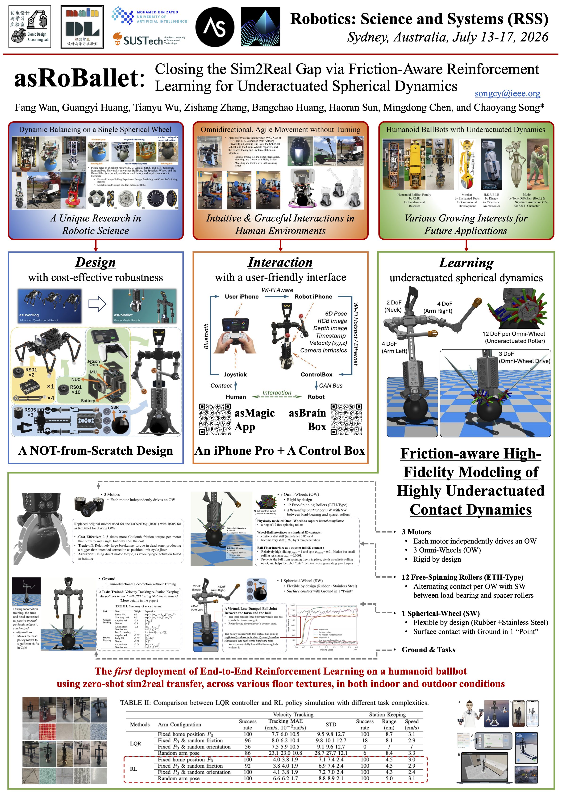

# 18 Final Poster Submission

**Deadline: 27 November 2026, 10:50 — Abu Dhabi time (UTC+4).**

## Submission requirements

The [RSS 2026 poster instructions](https://roboticsconference.org/2026/information/presentationInstructions/) specify:

> A0 (841 wide x 1189mm high) and portrait orientation.

For this course, submit one **PDF**. Name it `TeamNN-poster.pdf`, replacing `NN` with your two-digit team number: `01`–`08`. Team 01 submits `poster/Team01-poster.pdf`. The teaching team prints posters submitted by the deadline; teams arrange printing for late submissions.

## How to submit and how we collect

Commit and push the PDF to the `main` branch of your assigned team repository before the deadline. Open the uploaded PDF on GitHub to confirm it is available.

At the deadline, the teaching team records and collects the remote `main` revision. We rename the collected file `TeamNN-poster-YYMMDD-HHMMSS.pdf`. The suffix is the GitHub-recorded push time of the submitted file version, in Abu Dhabi time (UTC+4), used to check the deadline. We record collection time separately. Later pushes do not replace the collected submission. No separate submission form or record is required.

## Example and preparation guidance

Use the original **asRoBallet poster from RSS 2026** as a reference for connecting the contribution, system illustrations and results. Its design, interaction and learning panels show how one project can be explained visually.

*Figure 1. Original asRoBallet poster preview, Fang Wan et al. (2026), retained from the earlier course notes. [Open the full-size image](../media/class18/asroballet-poster-original.png) · [Paper and research source](https://bionicdl.ancorasir.com/?p=2238). Use it as an example; prepare your own A0 PDF.*

Optional tips: Thomas C. Erren and Philip E. Bourne, [“Ten Simple Rules for a Good Poster Presentation”](https://journals.plos.org/ploscompbiol/article?id=10.1371/journal.pcbi.0030102), PLOS Computational Biology (2007).
