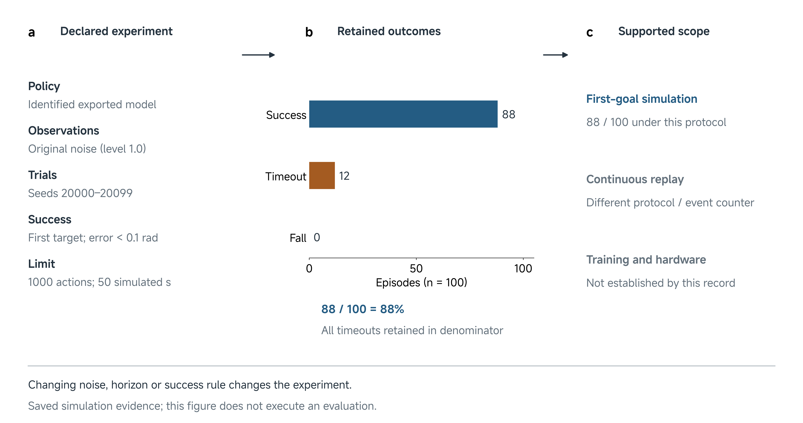

# 19 Final Code Submission

Your poster makes a scientific claim. The code submission should let another person inspect how the experiment produced the evidence for that claim. A program that starts successfully is useful, but it does not establish that the intended experiment, inputs or evaluation were reconstructed.

**Central question:** Can another person reconstruct and inspect the experiment supporting your project’s claim?

This class develops the code milestone through a research-code example, an evidence walkthrough and an independent review of your team’s package. Use the session to resolve missing dependencies, unclear scientific conventions and differences between the current implementation and the submitted poster.

**Deadline: 1 December 2026 at 10:20, Abu Dhabi time (UTC+4).** Submit through the existing `code/` folder in your assigned team project repository. Push the completed work to `main` before the deadline and check its availability on GitHub. The instructor team collects the remote repository revision at the deadline and retains that snapshot. Subsequent changes remain available for continued work, but do not replace the collected submission.

*Calendar note: this date is a public holiday. Delivery arrangements are separate from the complete teaching content and the submission milestone described here.*

## Use established research-code guidance

The [NeurIPS code and data guidelines](https://neurips.cc/public/guides/CodeSubmissionPolicy) connect experimental claims to the code and data needed to inspect them. They also recognize that specialized hardware and restricted dependencies can limit execution; those limits require explanation. We apply that principle to the reproduction target your team declares, rather than requiring every project to repeat training or physical experiments (NeurIPS n.d.).

The linked [research-code guidance](https://github.com/paperswithcode/releasing-research-code) and [README template](https://github.com/paperswithcode/releasing-research-code/blob/master/templates/README.md) provide a useful starting point: describe dependencies, relevant training and evaluation procedures, model availability, and expected results with precise reproduction instructions. Adapt the template to your actual contribution. Remove placeholders and explain inapplicable sections rather than inventing work to fill them (Papers with Code n.d.).

Conference anonymity rules, supplementary-upload arrangements and file-size limits do not define this course’s submission procedure. Your assigned team repository remains the submission location. Keep its existing access arrangements, attribution and licenses.

## Declare a meaningful reproduction target

Choose a bounded target tied to an important project result. A target such as “regenerate the comparison plot from the retained trial records” has identifiable inputs, processing and outputs. “Run our code” leaves the reviewer guessing what successful execution should establish.

Different targets support different conclusions:

| Target | What a successful check establishes |
| --- | --- |
| Recalculate an analysis | The retained records produce the stated summaries or figures under the declared processing |
| Replay an episode | A particular retained sequence can be reconstructed or inspected |
| Run policy inference | The identified model accepts the declared inputs and produces interpretable outputs |
| Repeat an evaluation | The declared trials can be executed and scored under the intended protocol |
| Repeat training | The stated training procedure can produce a model under the documented conditions |

These checks are connected, but one does not automatically establish another. Loading weights does not test the evaluation protocol. Regenerating a figure does not repeat physical data collection. For stochastic evaluations, specify what agreement means; a new run need not produce identical individual outcomes to be informative.

A negative or limited result can have a strong reproduction target. For example, another person might reconstruct a timing analysis showing that the available camera stream cannot support the intended controller. The package should preserve the evidence and reasoning behind that conclusion.

## Make the experiment recoverable

Follow the connection from **claim → inputs and configuration → execution → outputs → interpretation**. Each link supplies information that code alone may leave implicit.

The claim defines the question and scope. Inputs include data, initial conditions, robot or simulator models, trained weights and calibration. Configuration selects the trial set, processing, controller and evaluation conditions. Execution applies those choices. Outputs preserve what happened. Interpretation explains how the outputs answer the question and where the conclusion stops.

*Figure 1. A schematic review of the retained Class 06 native-simulation result. The 88/100 score depends on its first-goal protocol and all 100 outcomes; the selected continuous replay and retraining are different checks. The diagram summarizes existing records and does not depict a newly executed evaluation. [Figure source and provenance](../media/class19/FIGURE-CODE.md).*

Scientific interfaces need precise definitions. An array called `state` needs its fields, order, frames and units. A pose model needs its orientation convention. A policy may need image resizing, normalization or action scaling. A file named `success` needs the event, threshold, horizon and aggregation that give it meaning. Preserve these definitions beside the entry points or link to their authoritative configuration.

Also distinguish your contribution from the system you reused. A team may contribute an analysis, integration, controller modification or evaluation protocol while using an upstream simulator and policy. Identify the upstream versions and licenses, then explain the changes your team actually made. Do not imply that an imported trained model was trained by the team.

## Walk from a result back to its implementation

Consider this bounded statement from the retained Class 06 evidence:

> In the retained native simulation evaluation with original observation noise, the supplied policy reached its first target in 88 of 100 episodes before a fall or the evaluation limit.

Read the [retained evaluation summary](../resources/class06/code/results/native-task-10ms-noisy-heldout/summary.json) and [evaluator source](../resources/class06/code/qualification.py) together. The summary reports 88 successes, zero falls and 12 timeouts. Thus the reported fraction is 88 divided by 100, or 88%. The timeouts belong in the denominator.

The accompanying conditions explain what that number means:

| Item | Retained definition |
| --- | --- |
| Trial set | 100 episodes, seeds 20000–20099 |
| Task outcome | First target reached before termination; orientation error below 0.1 rad |
| Evaluation limit | Up to 1000 control steps, equivalent to 50 simulated seconds |
| Sampling | 20 Hz policy control; 100 Hz native physics |
| Observation condition | Original noise, `noise_level: 1.0` |
| Policy identity | Recorded `policy_sha256` in the configuration |

In `qualification.py`, each episode receives a `first_goal_success` outcome. The evaluator stops that episode at the first success, a fall or the limit. It writes the per-episode outcomes, then counts successes and divides by the number of completed episodes. The summary retains the simulator and policy identities that qualify the score. A reviewer can therefore ask whether all requested episodes completed before interpreting the rate.

This walkthrough inspects saved evidence. It is not a fresh evaluation or a training reproduction. The supplied continuous replay is also a different experiment: it can continue through goal changes, and its successful-step counter is not the number of independent successful trials. A selected attractive replay cannot replace the 100-episode evaluation.

Now suppose a revised package uses ideal observations or stops after a shorter horizon. Even with the same weights, that package evaluates a different condition. Reproducing the poster’s result requires the original condition; evaluating the revision can be useful additional work, clearly identified. Likewise, changing the 0.1 rad threshold changes the success rule. A higher resulting score would not by itself establish a better policy on the original task.

## Organize one clear code entry point

Keep `code/README.md` as the first destination for the code submission. It should state the contribution and reproduction target before presenting operational detail. Put the project’s actual, tested setup and execution commands there or in a clearly linked reproduction document. This lesson explains what those instructions must establish; it is not a universal installation recipe.

Use relative references to the existing shared project material. For example, the README can identify a dependency specification under `../environment/` and a retained trial set under `../results/`. The directory names alone are insufficient: identify the relevant files and explain their roles. Keep one authoritative environment description and one authoritative set of results rather than introducing parallel copies that can disagree.

A compact result entry should let the reader recover:

- The claim or poster figure it supports.
- The input records, model and configuration it uses.
- The procedure that produces the result and its expected output.
- The applicable units, outcome rule, exclusions and denominator.
- What was verified, under which environment, and what remains unresolved.

For external or large assets, document a stable accessible location and exact version. Identify a model by more than “latest checkpoint.” Restricted components need an honest access boundary. Do not solve an access problem by changing the team repository’s visibility or distributing material without permission.

## Instructor and TA demonstration: review before trusting the result

The demonstration follows a reviewer’s questions rather than presenting a long software installation. Have the retained Class 06 summary, evaluator excerpt and a sample README ready. Students can complete the reasoning from these displayed materials without executing the simulator.

First, locate the headline result and trace its conditions to the configuration and scoring code. Ask which file establishes the denominator and which rule separates success from timeout. Compare the first-goal evaluator with the selected continuous recording. Explain the distinct conclusion supported by each.

Next, consider an **illustrative faulty submission**: its README promises policy evaluation, but the required checkpoint or normalization file is unavailable. A dependency or import check may pass while inference is blocked. Identify the missing input and the affected claim. Restoring the exact asset and documenting access would permit a new check; the saved 88/100 record does not establish that this faulty package executed.

Finally, inspect a second illustrative fault: the program executes with a changed noise condition or outcome threshold. Execution succeeds, but the original protocol has not been reconstructed. Repair the configuration or explicitly describe the new experiment, then identify which checks require repetition. These are review examples, not claims of new successful runs.

## Student activity: let another person follow your package

Bring your proposed submission, poster result and retained evidence. Choose one consequential result as the reproduction target. An authorized team member who did not write the instructions should follow them from a clean checkout or unrelated working directory, without relying on undocumented files from the author’s machine.

The reviewer first explains the intended target in their own words. They then follow the documented path far enough to inspect inputs, execute the declared check where feasible, and compare its outputs with the expected result. Authors should record missing assumptions before repairing them. Update the instructions and recheck the affected path after a consequential repair.

Keep a concise verification account with the code, using explicit outcomes:

| Outcome | Meaning |
| --- | --- |
| Verified | The stated check ran, with identifiable inputs, environment and interpretable outputs |
| Blocked | The check was attempted but a stated dependency, access or execution problem prevented completion |
| Not run | The check was not attempted; explain the remaining scope |

Record protocol agreement separately from execution. A verified demo may coexist with an evaluation that used different trials. A retained-data analysis may be verified while training and physical replication remain not run. State material differences and whether they change the claim. The activity output is the improved package and its concise account, not an additional assessment form.

## Finalize the repository and prepare the video

Review the actual pushed `code/` folder before the deadline. Confirm that its README identifies the reproduction target, required inputs, contribution, first documented route, expected outputs and current verification status. Check relative links and instructor access. Preserve attribution and known failures. Keep environments, caches, credentials and unrelated files out of the submission.

Your team does not need to create a release, tag, submission manifest or separate collection record. The instructor’s deadline snapshot identifies the collected version. Scientific evidence still needs identifiable trials, model versions and processing; these explain the result rather than administer collection.

Compare the current package with the collected poster. If a repaired evaluator changes a result, explain that difference and retain the earlier evidence. Carry the correction into [Class 20’s video](20-final-video-submission.md), identifying which project version, episodes and numbers the viewer sees. The final video should communicate the scope the code actually supports.

## References

NeurIPS. n.d. “Code and Data Submission Guidelines.” Accessed 17 October 2026. [Official guidance](https://neurips.cc/public/guides/CodeSubmissionPolicy).

Papers with Code. n.d. “Tips for Publishing Research Code.” Accessed 17 October 2026. [Guidance and checklist](https://github.com/paperswithcode/releasing-research-code); [README template](https://github.com/paperswithcode/releasing-research-code/blob/master/templates/README.md).

ROB7103/8103. 2026. “Class 06: Native first-goal evaluation.” [Retained summary](../resources/class06/code/results/native-task-10ms-noisy-heldout/summary.json) and [evaluator](../resources/class06/code/qualification.py). These retained simulation materials support the worked review; this class does not claim a new run.
