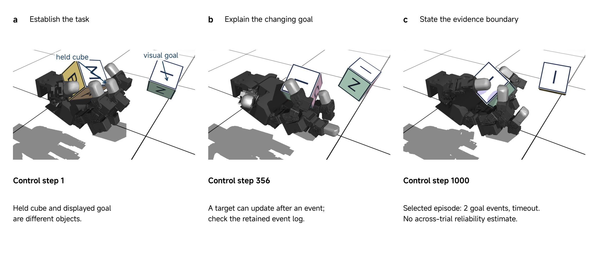

# 20 Final Video Submission

A viewer sees a robot move and hears a confident conclusion. What connects that behavior to the project's scientific claim? The final video must make the contribution understandable, show relevant evidence, and explain the boundary of the conclusion. Attractive footage helps only when the viewer can interpret it.

This class completes the progression from the poster's argument through the code's inspectable experiment to a self-contained scientific presentation. It combines example review, an edit demonstration and preparation of your own team's video. Continue useful project work where it resolves a remaining submission issue. A simulation study, limited reproduction or negative result can support a complete and honest presentation.

**Submit by 2 December 2026 at 11:50 (Abu Dhabi, UTC+4) through your assigned team project repository.** The assessed video is `video/final-video.mp4` on remote `main`. The instructor team collects the repository revision at the deadline. The finalization steps below use the repository workflow introduced in Class 01.

## Apply the RSS guidance to the course video

The [RSS 2026 presenter instructions](https://roboticsconference.org/2026/information/presentationInstructions/) provide the production reference: a recording no longer than four minutes, at 1920 × 1080 pixels, in MPEG-4 format. These are our course requirements too. Use a landscape composition that remains readable at this resolution.

RSS's recording accompanies a presenter speaking live, so its normal instructions omit recorded narration. **Our adaptation is a self-contained video with narration or explanatory captions.** A viewer must understand the presentation without the authors standing beside it. The conference's filename, upload form and submission date do not apply to this course; use the team repository and course deadline above. H.264 video and AAC audio are reasonable compatibility choices within an MP4 container, rather than additional assessed specifications.

Use the official guidance for export preparation. The rest of this page addresses scientific decisions and the course submission, so it does not replace your editor's manual.

## Build one scientific story

Start from the actual project result. Write a sentence identifying the question, what your team changed or investigated, and what the available evidence establishes. This sentence determines which diagrams, footage and numbers belong in the presentation.

For a reproduction, the contribution may be a verified implementation, a controlled comparison or a diagnosed limitation. Explain which parts came from upstream work. Reusing a policy is compatible with a useful project; describing its training as your team's contribution would change the meaning of the work.

A coherent story normally connects the following elements. They need not receive equal space or become compulsory section titles.

| Element | What the viewer should recover |
| --- | --- |
| Question and contribution | The problem and the specific work performed by the team |
| System or method | Enough mechanism, inputs and outputs to interpret the behavior |
| Demonstration and evidence | What happened, under which conditions, and how it relates to the result |
| Conclusion and limitation | What the evidence supports and the consequential boundary |

A diagram can explain a controller interface more clearly than a camera view. A continuous task view can show a recovery or failure more clearly than a diagram. A result table can state a trial count that footage cannot supply. Choose each element for the question it answers; do not read the whole poster aloud.

Do not construct a stronger result to fit the planned story. If the intended experiment remains blocked, show the implemented component, the actual obstacle and the next justified test. If the method fails under a tested condition, explain that failure with the same care as a success.

## Read an actual RSS research video

Use Shaw, Agarwal, and Pathak's **LEAP Hand** as the attributed research example. The [RSS 2023 paper entry](https://rss2023.github.io/rss2023-website/program/papers/089/), [paper](https://arxiv.org/abs/2309.06440), [author video](https://youtu.be/VKAlJPypQFI) and [original Isaac Gym repository](https://github.com/leap-hand/LEAP_Hand_Sim) let us inspect communication alongside its scientific context. The video is a short project presentation associated with an RSS 2023 paper; it is not an example of compliance with the later RSS 2026 plenary instructions.

The opening montage places the named hand beside several manipulation behaviors, making the platform's purpose immediate. Its different demonstrations do not constitute one continuous experiment or supply a performance denominator. Make your opening specific enough that later evidence can answer it.

The finger-motion comparison uses side-by-side hardware views and movement labels to make a design distinction visible. Show the mechanism responsible for your contribution. Refer to the paper for fuller design and comparison conditions.

The repeatability segment combines physical footage with an error-versus-time plot. Footage identifies the apparatus; the plot communicates change during the test. A small inset can become unreadable after export. Enlarge the necessary result and explain its axes and conditions.

Later segments distinguish teleoperation, autonomous behavior and simulation-to-real learning. Simulation and physical panels make the domain change visible. Their appearance alone does not establish matched initial states or synchronized trajectories. State what each view demonstrates and consult the paper's protocol before making a stronger comparison.

The linked repository reinforces this distinction by documenting simulation inference and physical deployment separately. A project video can connect these stages while preserving their different requirements. It should not imply that showing a simulator rollout establishes physical deployment.

These are selected visual-reading observations. Treat the authors' experimental results as published research, and consult their paper for methods and quantitative claims. Our course replay below is a different experiment with different code and evidence.

## Turn a course episode into an interpretable sequence

The retained Class 06 example uses a supplied pretrained policy in native MuJoCo. A lettered held cube interacts with the fingers; a separate cube displays the target orientation. The letters aid the viewer and are not image observations supplied to the policy. This is course simulation evidence, not footage of the RSS hardware experiment.

Figure 1 proposes how to explain that episode. First establish the held object and goal. Then show motion with the goal visible. Finally state the retained outcome and its scope. The three frames are selected snapshots, not a replacement for continuous playback.



*Figure 1. A proposed video explanation assembled from retained Class 06 simulation renders at control steps 1, 356 and 1000, for selected seed 9204 with zero added observation noise. The target can update after an event, so a rendered pose is not itself the task's event measurement. The retained summary reports two goal events and timeout at 1000 steps; this one episode supplies no reliability estimate. The 0.05 s control interval gives a 50 s simulation horizon, which does not establish real-time execution. Authored annotations use MiSans. [Figure source and provenance](../media/class20/FIGURE-CODE.md).*

A defensible narration is: “This selected native-MuJoCo episode uses the supplied policy. The retained log records two goal events before timeout. We use the views to explain the changing target; this episode does not estimate success across trials.” A caption such as “Our robot reliably solves manipulation” would introduce unsupported hardware, authorship and reliability claims.

The course recording illustrates another important distinction. Source simulation time, exported playback duration and computation time are separate quantities. Playing a 50 s simulation in 25 s would require a **2× playback** label. This is an illustrative editing choice, not a claim that the supplied figure is an accelerated movie. If runtime is part of your contribution, measure and report it independently.

## Preserve the meaning of the footage

Select episodes using their retained identities and conditions. A successful example illustrates a behavior. An aggregate evaluation needs its trial unit, denominator and outcome rule, including material failures. When the video shows both, explain their relationship explicitly.

Keep an original clip or trace for consequential sequences and enough editing information to find it again. The source notes can live beside the editable project under `video/source/`; this is production support, not another submission form. For each important segment, identify its evidence source, relevant project version, edits and credits.

Cuts and playback changes are normal presentation tools. Label them when they affect interpretation. A montage of several trials should remain recognizable as a montage. A human-assisted reset between shots cannot be narrated as uninterrupted autonomous recovery. A replay must remain identifiable as replay. An upstream research clip must remain attributed to its authors, rather than presented as something your team executed.

Place short overlays near the relevant evidence without covering contact, the object or the target. Use MiSans for authored titles and labels. Explain technical terms through narration or captions, check automatic transcriptions, and preserve relevant units. A source screenshot can retain its original typography; new annotations follow the course figure style.

## Instructor and TA demonstration: review and repair an edit

The demonstration uses the original LEAP author video, its paper/repository links, the retained course frames in Figure 1 and the Class 06 episode summary. The question is whether the viewer can distinguish an explanation of selected behavior from a broader performance claim.

First inspect the research video's mechanism comparison and the simulation/physical panels. Identify what the views reveal, what the labels contribute and which conditions require the paper or repository. If the video service is unavailable, use the visual-reading analysis above and Figure 1; the class does not depend on a successful stream.

Next inspect the proposed course sequence with the deliberately overbroad caption “Our robot reliably solves manipulation.” Repair it by identifying the simulator, supplied policy, selected seed, logged result and limitation. Keep the held cube and goal visible. Check the revised statement against the retained summary rather than infer success from one attractive frame.

Finally compare the episode source with a proposed shortened edit. Identify where a cut or speed label is necessary and which evidence must remain continuous. The expected result is a clearer explanation with a narrower supported claim, not a new experimental result. No hardware operation or policy training is required for this demonstration.

## Team preparation and viewer review

Bring your draft video or a sequence of actual material ready to assemble, together with the submitted poster, code instructions and relevant retained evidence. Use the following cycle to finalize your team's presentation:

1. State the contribution and select the diagrams, clips and result summary needed to explain it. Replace planned claims with the results actually available.
2. Assemble or revise the story. Identify reused material, episode conditions, consequential edits and the project version producing the shown outputs.
3. Ask a viewer who did not write the presentation to watch without extra explanation. Ask them to state the contribution, supporting evidence and principal limitation.
4. Compare that interpretation with your intended meaning. Trace one important displayed result to its source and repair a consequential misunderstanding or inconsistency.
5. Recheck the repaired sequence and the complete exported file.

The activity output is the improved video and its useful editable source material. No additional worksheet or review form is required. A limited or negative result is acceptable evidence when represented accurately; describe unperformed work as unperformed.

## Check the export and submit through the team repository

Check the **exported file**, not only the editing timeline. Watch it completely on another available player or machine. Confirm full playback, readable diagrams and captions, narration or explanatory captions, correct aspect ratio and cropping, and the adopted duration, resolution and MPEG-4 requirements. Inspect the ending as well as the opening.

Read the poster's conclusion, the code README and final narration together. If later project work changed a result, identify the relevant versions and explain the difference. The video cannot retroactively change the earlier collected poster or code submission.

Keep the assessed artifact unambiguous:

```text
video/
  final-video.mp4
  source/
```

Place editable slides or editing material and useful source/credit notes under `source/`. Reference shared project evidence through clear paths. Make sure the actual video is available to the teaching team from the repository; a local editor path or an unavailable asset is insufficient. Check large-video handling before the deadline, rather than assume that an editor export has been pushed successfully.

Commit and push the completed folder to remote `main` **before 2 December 2026 at 11:50 (Abu Dhabi, UTC+4)**, then check the uploaded artifact and access on GitHub. The instructor team captures the remote revision and collection time at the deadline and clones that revision. Students do not create a release, tag, manifest or separate collection record. Later pushes do not replace the collected snapshot.

For the final showcase, use the verified video as an identified recorded resource or fallback. Be ready to explain the contribution, one important result, one limitation and the next justified test. Keep recorded playback distinguishable from live operation.

## References

Robotics: Science and Systems Foundation. 2026. [“Presenter Information.”](https://roboticsconference.org/2026/information/presentationInstructions/) Accessed October 17, 2026. Conference recording requirements are adapted above for a self-contained course submission.

Shaw, Kenneth, Ananye Agarwal, and Deepak Pathak. 2023. [“LEAP Hand: Low-Cost, Efficient, and Anthropomorphic Hand for Robot Learning.”](https://arxiv.org/abs/2309.06440) *Robotics: Science and Systems XIX*. See the [author video and project materials](https://v1.leaphand.com/) and [original simulation repository](https://github.com/leap-hand/LEAP_Hand_Sim).
