# Class 02 detailed technical reading

These notes retain the motor, transmission, response-analysis and campaign material developed before the current consolidation. They extend the [classroom lesson](../../module-01-actuator-data-for-1-dof-systems/02-actuator-basics-for-controlled-action.md) and support Classes 03-04. The required Class 02 demonstration and practice use the motor-only ID 5 record described in the lesson and [the class activity](activity.md).

## Read the experiment identity first

The current core record is M0, Mode 5, H2, ID 5, with about 200 Hz telemetry and no external moving load. The earlier weighted/light recording below uses Mode 3, IDs 1 and 2, nominal 60 Hz and different assemblies. The PhyIntel model-comparison campaigns have their own adapters, controllers and episode roles. Keep their clocks, references, limits and claims distinct.

This page preserves the existing worked motor/power relationships, effort/saturation examples, measured step/frequency interpretation, confounding analysis and campaign calculations. Detailed fitting and reserved-episode arguments are extensions; the original historical timed demonstration/practice has been replaced by the aligned core tasks in the [lecture](../../module-01-actuator-data-for-1-dof-systems/02-actuator-basics-for-controlled-action.md) and [activity](activity.md).

## A motor and an integrated actuator

A motor converts electrical energy into mechanical motion. An integrated servo actuator combines the motor with some or all of a transmission, position sensor, drive electronics, embedded controller and communication interface. The XC330 is an integrated actuator. The host sends commands through its digital interface; the host does not directly apply the winding voltage.

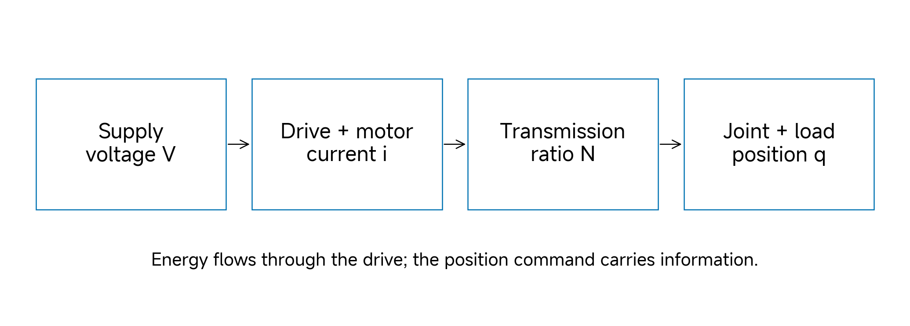

*Figure 1. Conceptual energy path; no device constants are inferred.*

**Read the diagram:** identify the energy source, where current becomes motor torque, and where transmission changes speed and effort. The host position request belongs to the information path in the next section; it supplies no mechanical energy by itself.

---

For an idealised permanent-magnet DC motor, a useful first model is

$$
V = R i + L\frac{\mathrm{d}i}{\mathrm{d}t} + k_e\omega_m,
\qquad \tau_m = k_t i.
$$

Here, voltage has units V, resistance has units ohm, current has units A, inductance has units H, angular velocity has units rad/s and torque has units N m. The back electromotive force increases with motor speed. Torque and speed therefore cannot both remain at their maximum values under the same voltage supply. These equations explain the mechanism; they do not identify this device's unknown electrical constants.

Let the transmission ratio be $$N=\omega_m/\dot q$$. An approximate output relationship is

$$
\tau_{\mathrm{out}} = \eta N\tau_m,
\qquad J_{\mathrm{reflected}}=N^2J_m.
$$

---

Efficiency $$\eta$$ is a modelling approximation, not a measured constant here. The squared ratio in reflected inertia matters: a small rotor inertia can make a substantial contribution at the output joint. Do not apply the ratio a second time to a quantity already expressed at the output.

**Check:** If the ratio doubles while the motor inertia remains unchanged, the reflected inertia becomes four times as large. This does not imply that the entire mechanism inertia increases fourfold; the moving link has its own inertia.

## Trace the signal path

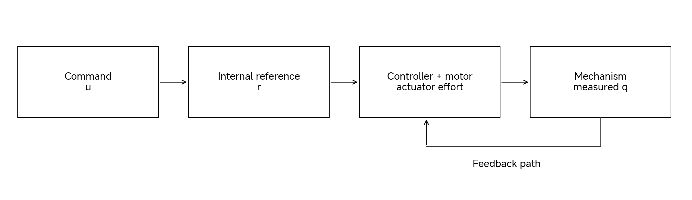

*Figure 2. Conceptual signal path, not a measured circuit diagram. The internal reference is distinct from the host command.*

---

Use three symbols throughout the sequence:

- $$u(t)$$: requested position from the host;
- $$r(t)$$: internal or modelled reference used by the controller;
- $$q(t)$$: actual joint position.

The measured position $$y(t)$$ is an observation of $$q(t)$$ with finite resolution, possible latency and noise. It is not a perfect continuous observation. A servo may construct a smooth reference from a discontinuous command; it may also clip requests or apply a profile. Thus $$u$$, $$r$$ and $$q$$ need not be equal during motion.

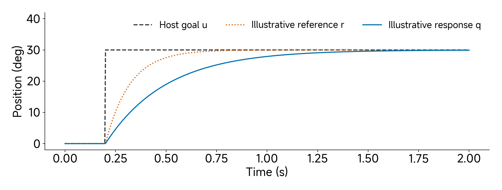

*Figure 3. Constructed curves show why u, r and q can differ; they are not fitted or measured XC330 trajectories.*

**Predict, then explain:** which curve changes discontinuously? Which one could be shaped by firmware? Which belongs to the moving mechanism? Compare this illustration with the recorded campaign figures later; do not transfer its time constants to the hardware.

---

A simplified position controller applies

$$
\tau_a=\operatorname{clip}\left(k_p(r-q)-k_v\dot q,-\tau_{\max},\tau_{\max}\right).
$$

For $$q$$ in rad and unit joint transmission, $$k_p$$ has units N m/rad and $$k_v$$ has units N m s/rad. A larger position error demands greater effort until saturation is reached. Velocity feedback resists motion and can reduce oscillation. This equation is an illustrative actuator model. It is not a claim that the physical firmware implements exactly this law with these numerical gains.

---

**Worked calculation:** With $$k_p=3$$ N m/rad, a 30-degree error is $$\pi/6$$ rad, so the proportional demand is $$\displaystyle 3\pi/6=1.571$$ N m. With the model's assumed 0.93 N m limit, the effort clips. The initial response therefore cannot be inferred from the unsaturated linear gain alone. The 0.93 value is a modelling bound inherited from the source, not a permitted continuous hardware operating torque.

## Choose what the actuator is asked to control

In position operation, the request is an angle. In velocity operation, it is an angular speed. In a current or torque-oriented interface, it is an electrical current or a torque-related request. A PWM request concerns drive duty, not a guaranteed position or mechanical torque. Available modes and the meaning of each register depend on the actuator model.

---

Our recorded XC330 experiment used **operating mode 3, position mode**, firmware 53, position P/I/D registers 1100/0/0 and a nominal 5 V supply. The two motor IDs were 1 and 2. The integer gain register 1100 is not the same quantity as the MuJoCo gain 3 N m/rad. A gain conversion would require the firmware equations and units, followed by validation. Copying a numerical gain between interfaces does not establish equivalence.

The ROBOTIS manual distinguishes goal position, measured position and internal trajectory registers. It also notes that XC330 current sensing concerns input-power current. A current-related value must not automatically be interpreted as calibrated winding current or output torque. See the [XC330 manual](https://emanual.robotis.com/docs/en/dxl/x/xc330-m288/).

**Question:** Does a zero position D register prove that the complete embedded servo has no velocity-dependent behaviour?

---

### Discuss the prediction

No. Other loops, filtering, motor physics and transmission resistance can create it.

## Define the experiment before interpreting it

ID 1 carries the weighted assembly; ID 2 carries the light assembly. Both use the same declared controller settings. The test battery contains steps of 5, 15 and 30 degrees, a 20-degree sine command at seven frequencies from 0.1 to 5 Hz, and a 0.1–5 Hz chirp.

The metadata requests 60 Hz. The recorded intervals vary. Use the CSV time column for time-domain work instead of replacing it with an exact $$\displaystyle 1/60$$ sequence. Time restarts for each step-amplitude block and each sine-frequency block. Treat those blocks as separate experiments; do not interpret the resets as backward physical time or join them into a continuous trajectory.

The CSVs contain position in degrees and velocity in revolutions per minute. Convert explicitly:

$$
q_{\mathrm{rad}}=q_{\mathrm{deg}}\frac{\pi}{180},
\qquad \dot q=\omega_{\mathrm{rpm}}\frac{2\pi}{60}.
$$

A velocity of 6 rpm is approximately 0.628 rad/s. For example, multiplying rpm by $$\pi/180$$ would give a wrong conversion because a revolution is 360 degrees and a minute is 60 seconds.

---

The logged `load_pct` field does not establish output torque. Preserve its original name and explain the source mapping before quantitative use. This package uses position as the primary measured variable. PWM and temperature are auxiliary context; they cannot identify efficiency or provide an independent torque calibration.

## Read a step response

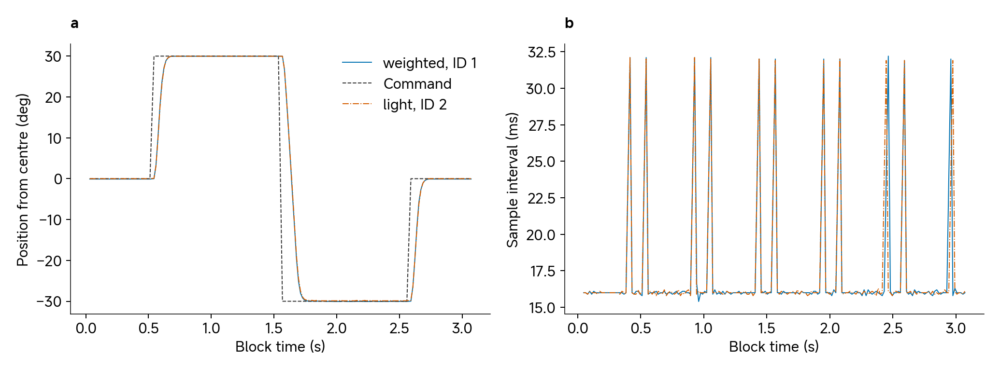

*Figure 4. Entire 30-degree-amplitude block for each assembly, including positive and negative requests. Position is measured relative to 180 degrees. The right panel shows actual consecutive sample intervals within that block. These are two assemblies, not repeated trials of one motor.*

---

Read the plot in this order: identify the command transitions, find the direction of motion, inspect the approach to the requested angle, then inspect the interval plot. Do not start with a single summary number.

The response has finite rise time. A rise-time definition usually specifies two fractions of the commanded change, such as 10% and 90%. Define the local starting and ending levels, isolate one transition and interpolate the threshold crossings if appropriate. Overshoot concerns departure beyond the intended final level; it is not the same as the largest command-tracking error. Settling time requires both a tolerance band and a minimum period of remaining inside it.

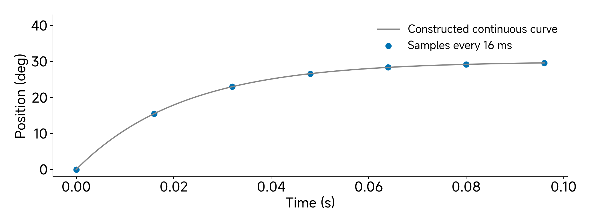

*Figure 5. Illustrative 30-degree response with a 22 ms exponential time constant and 16 ms observations; the continuous curve is known by construction.*

**Count the evidence:** count intervals spanning the visible rise. The smooth curve between samples is an assumption in this constructed example. For the hardware recording, only the timestamped samples are observed. The offline sampling explorer uses a separate stated 30 ms time constant; compare the principle rather than treating either illustration as a hardware fit.

---

At about 16 ms per sample, a 64 ms rise contains only about four sampling intervals. Reporting many decimal places would imply more temporal precision than the observations support. More samples would help resolve the transition, but cannot repair unknown command-transmission timing retrospectively.

Use measured minus reference throughout this sequence. For the earlier command-tracking example, define tracking error as

$$
e_i=y_i-u_i,\qquad
\operatorname{RMSE}=\sqrt{\frac{1}{n}\sum_{i=1}^{n}e_i^2}.
$$

---

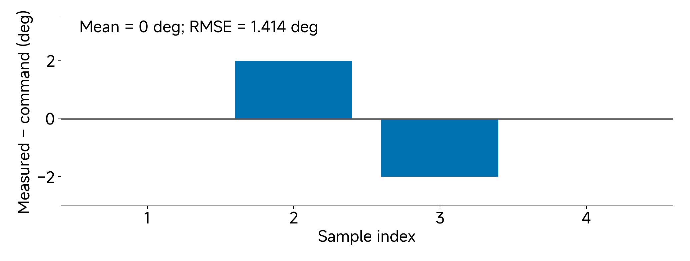

*Figure 6. Constructed errors [0, 2, −2, 0] degrees; the zero signed mean conceals nonzero tracking error.*

**Work before revealing:** calculate the signed mean, then square each error and calculate RMSE. Explain why the sign cancellation disappears after squaring.

---

**Worked example:** For errors 0, 2, −2 and 0 degrees, RMSE is $$\sqrt{8/4}=1.414$$ degrees. The signed mean is zero. A zero mean error therefore does not imply accurate tracking. A 30-degree target can produce a large transient RMSE even if its final error is small.

An RMSE between command and hardware measures tracking. In Class 04, an RMSE between simulation and hardware measures model prediction. Those questions have different reference signals and must not share an ambiguous label.

### Inspect one transition

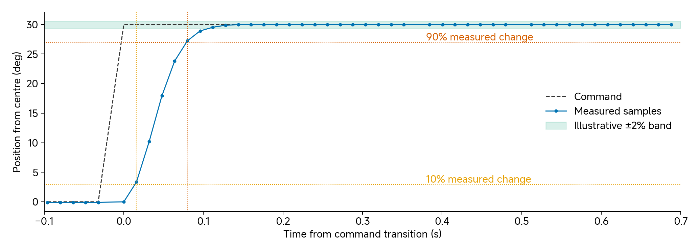

*Figure 7. First positive 30-degree command transition for weighted ID 1 in the earlier Mode3 recording. Thresholds use local measured starting and ending levels. The ±2% band is illustrative; it is not a certified hardware tolerance. Markers show actual samples.*

---

Read the horizontal axis before interpreting the threshold crossings. Locate the 10% and 90% levels, count intervening samples and compare that temporal resolution with the apparent rise. A line between samples is interpolation, not a new measurement. Settling requires a declared observation duration as well as a band; entering the shaded band once does not establish settling.

## Read a frequency response

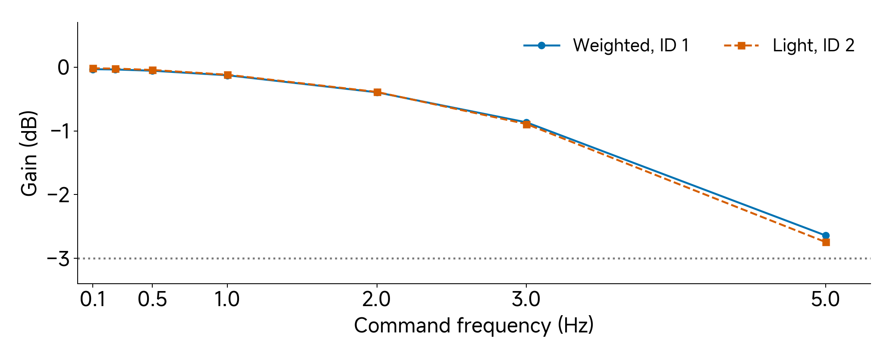

*Figure 8. Recorded harmonic gain estimates at seven frequencies; first cycle excluded from each block. The horizontal −3 dB line is a reference, not an observed bandwidth crossing.*

**Read:** locate 5 Hz. Both assemblies remain above −3 dB in this tested range. A bound on bandwidth is justified; its exact crossing frequency is not.

---

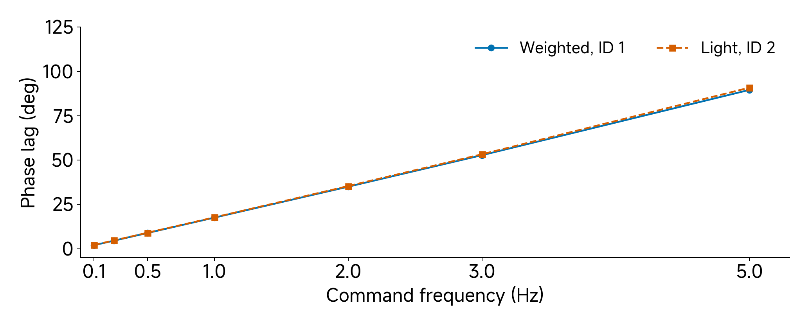

*Figure 9. Phase-lag estimates from the same recordings and selection. Linear frequency ticks make values directly readable; connected points do not add experiments.*

**Read:** compare 1 Hz and 5 Hz. A small gain loss can coexist with a substantial phase lag. Explain why reaching the correct amplitude does not imply following the reference at the correct time.

---

For a sinusoidal command, describe both the amplitude ratio and the phase relationship. A response with the right amplitude but substantial lag still produces large pointwise tracking error.

$$
G_{\mathrm{dB}}=20\log_{10}\left(\frac{A_y}{A_u}\right),
\qquad \phi=\phi_y-\phi_u.
$$

A gain of −3 dB corresponds to an amplitude ratio of approximately 0.708. It does not mean a position error of three degrees. In these recordings, the gain has not crossed −3 dB by 5 Hz. The tested range therefore gives a bound; it does not establish the exact −3 dB bandwidth.

At 5 Hz, one period is 0.2 s. A pure 10 ms delay creates a phase lag of $$\displaystyle 360\times5\times0.010=18$$ degrees. This calculation explains why communication and internal command shaping can matter even when the final steady angle is correct.

---

**Explore amplitude versus delay:** open the [offline actuator explorer](interactive/actuator-explorer.html), choose Amplitude and delay, keep ratio 1 and set delay 10 ms. Compare 1 Hz with 5 Hz; predict 3.6 degrees and 18 degrees of lag before reading the output. Then set zero delay and ratio 0.708: the gain changes but there is no imposed delay. This constructed waveform illustrates the definitions; the recorded actuator can have coupled frequency-dependent gain and phase.

Our fit uses sine and cosine coefficients plus a constant offset. Removing the first cycle limits startup influence. It does not manufacture independent repeats. The seven frequencies are conditions; the two assemblies are separate devices. We have no basis for confidence intervals representing a population of actuators.

## What can we conclude about the load?

The weighted and light responses are similar under the tested conditions. This supports a narrow observation: these two assemblies with their declared settings had similar response behaviour. It does not establish that load never matters.

Motor identity and load changed together.

---

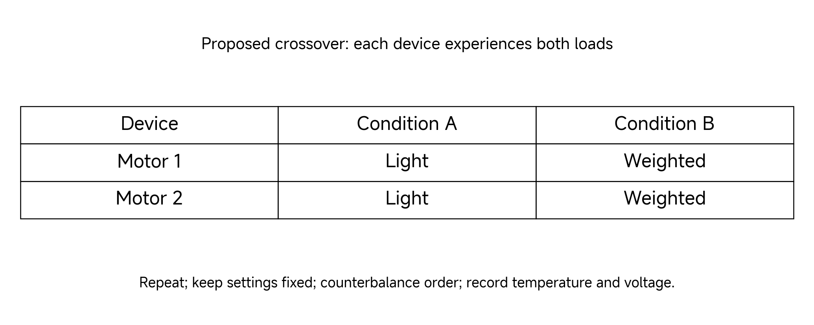

*Figure 10. Proposed future design; these crossed conditions are not supplied measurements.*

**Compare designs:** the existing recording couples motor identity and load. This table would let each device experience both loads. Which comparisons isolate load within a device? Repetition still needs recorded settings and controlled conditions.

---

To isolate the load effect, use a crossover experiment: test each motor with each load, keep settings fixed, randomise or counterbalance run order, and repeat the measurements. Record voltage, temperature and assembly changes. A different result might reflect inertia, friction, supply or device variation; the design must make those alternatives distinguishable.

Follow the six-stage reasoning:

---

| Stage | Application in this class |
|---|---|
| Claim | A position request does not guarantee a specified trajectory. |
| Experience | Record steps and sine tracking under stated conditions. |
| System | Identify host, servo, transmission, load and observation pipeline. |
| Grounding | Check settings, units, timestamps and the actual load assembly. |
| Learning | Compare the prediction with recorded behaviour and revise the explanation. |
| Decision | Choose the next measurement that distinguishes plausible causes. |

## Move from a response recording to a controlled campaign

The August 17 weighted/light recording is useful for learning to read signals. It does not provide repeated motor–load crossover tests. The PhyIntel repository contains a separate XC330 hardware campaign and a separate RS06 campaign that let us ask a stronger question: can a model calibrated on some complete experiments predict other complete experiments?

Keep the three records distinct. A shared actuator name does not make the controller, fixture, clock or experimental question identical.

---

| Record | Interface and context | What this class uses it for |
|---|---|---|
| Earlier XC330 weighted/light recording | Position mode 3; P/I/D 1100/0/0; two motor–load assemblies; nominal 60 Hz | Step and harmonic-response interpretation |
| PhyIntel XC330 campaign | Current-based position mode 5; H1 P/I/D 600/0/150 and H2 800/0/150; archived events adapted to a 100 Hz comparison grid | Repeated fixture and trajectory experiments; inner-reference modelling |
| PhyIntel RS06 campaign | Position interface; H1 KP/KD 50/3.38 and H2 100/1.95; 50 Hz episode records | The same experiment logic with another actuator and controller boundary |

The H1 and H2 names are local to each campaign. They are not universal gains. A result labelled “H1” is incomplete until the actuator and interface are named.

### Read the experiment names

M0 means no external moving load. B0/B1/B2 identify balanced fixtures; G1 identifies an eccentric fixture. These labels are local to the actuator campaign; a matching label does not mean matching dimensions. H1/H2 identify two declared controller settings. P03/P06 identify source trajectory profiles; P03 appears in the command-boundary example and P06 in the final replay examples. Read the full identity as actuator → controller → fixture → profile → repeat → role. These are historical campaign examples, not the dataset or commands for the current Class 02 activity.

### External goals and internal references

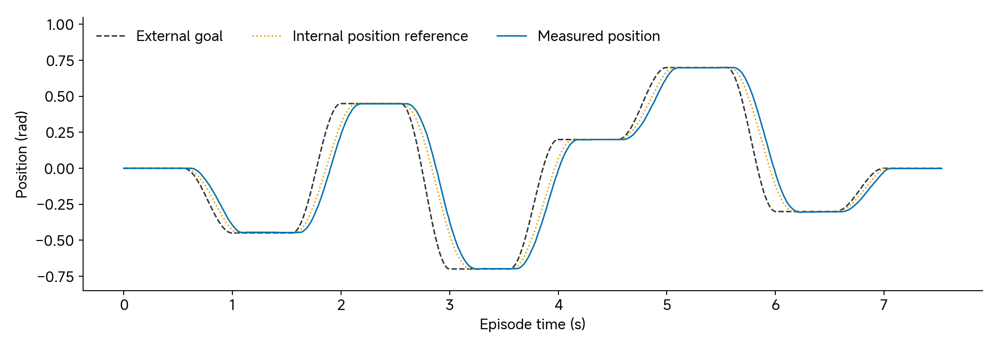

*Figure 11. XC330 H1/B1/P03: distinguish external goal, internal reference and measured motion.*

---

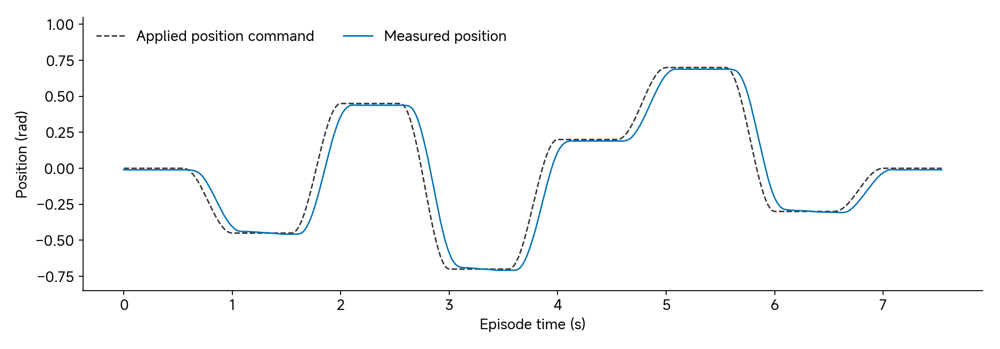

*Figure 12. First recorded H1/B1/P03 repeat in each campaign. The XC330 exposes an external goal and an internal position trajectory; the RS06 dataset exposes the applied command. These signals are not assumed interchangeable.*

---

For the mode-5 XC330 model, the controller references are the logged internal position trajectory and velocity trajectory. We do not ask a three-parameter mechanical model to explain firmware profile generation at the same time. With $$\displaystyle r_q$$ and $$\displaystyle r_v$$ denoting those references, the model applies

$$
\tau_C=\operatorname{clip}\left(K_p(r_q-q)+K_v(r_v-\dot q),-\tau_{\lim},\tau_{\lim}\right).
$$

Notice the velocity reference. Replacing this expression with $$\displaystyle K_p(r_q-q)-K_v\dot q$$ changes the controller whenever $$\displaystyle r_v$$ is nonzero. This is a concrete reason why copying a familiar PD equation into the simulator can give the wrong motion.

The source uses a fixed engineering conversion from register units: H1 has $$\displaystyle K_p=1.579836$$ N m/rad, H2 has $$\displaystyle K_p=2.106448$$ N m/rad, and both have $$\displaystyle K_v=0.202115$$ N m s/rad. The assumed current-to-torque factor is 0.517 N m/A. A 300 mA goal-current limit becomes a model effort limit of 0.1551 N m. These are disclosed modelling conversions, not an independent torque calibration. No controller coefficient is fitted during the joint-parameter study.

---

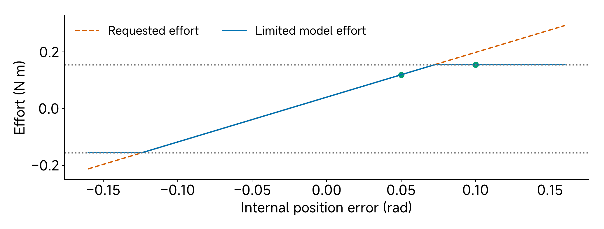

*Figure 13. Engineering-map calculation at velocity-reference error 0.20 rad/s; points mark position errors 0.05 and 0.10 rad. Not a torque measurement.*

**Predict:** follow the orange demand and blue limited effort. Increasing error beyond the bound no longer increases applied model effort. Open the [offline actuator explorer](interactive/actuator-explorer.html) and test both points; if the app shows the file source, open the self-contained HTML as an explanatory visualization.

---

**Worked calculation:** Suppose an internal position error is 0.05 rad and velocity error is 0.20 rad/s under XC330 H1. The unsaturated model effort is $$\displaystyle 1.579836(0.05)+0.202115(0.20)=0.119415$$ N m. If position error doubles to 0.10 rad with the same velocity error, demand becomes 0.198407 N m and clips to 0.1551 N m. The same gain law then produces a different effective response because it has entered saturation. A successful simulation must preserve the limit as well as the gains.

For RS06, the model instead uses

$$
\tau_C=K_p(u-q)-K_d\dot q.
$$

The source copies the recorded numerical KP/KD values into the model. Their SI equivalence is a hypothesis, not an independently measured conversion. Treat the identified joint parameters as effective parameters for that complete controller context. In particular, do not interpret the difference between an RS06 fit and an XC330 fit as a measured difference in bare motor friction.

### Why change the fixture?

M0 has no external moving load. Balanced fixtures change inertia while keeping the gravity moment small. G1 places load eccentrically, introducing a substantial gravity moment. The balanced and eccentric conditions are designed to separate mechanisms that can look similar in one trajectory. Each fixture ID belongs to its own actuator campaign: XC330 B1 and RS06 B1 are not the same object or mass.

**Prediction:** If a model works on balanced loads but fails on an eccentric load, which first checks are justified? Check orientation, zero angle, signed centre of mass, mass properties and gravity representation. Immediately increasing an optimizer's parameter count does not establish which of those is wrong.

### Repeats and reserved experiments

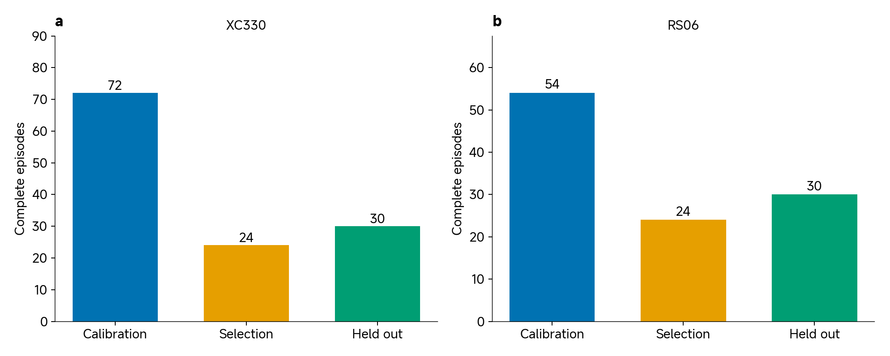

*Figure 14. Counts of complete primary episodes after the declared analysis adapters. Diagnostic XC330 records are outside these bars. A sample is not an independent trial.*

---

The XC330 archive contains 260 complete episode directories. Its primary H1/H2 study uses 126: 72 calibration, 24 model-selection and 30 held-out episodes. The RS06 study uses 108: 54 calibration, 24 model-selection and 30 held-out episodes. Both hold out five repeats for each controller/fixture/profile combination in the final comparison. Calibration and selection combinations use three repeats.

Calibration estimates model parameters. Model selection tests choices on other trajectories. Held-out evaluation measures the final frozen model on reserved trajectory/fixture combinations. If the developer changes the adapter or model after examining all records, that last evaluation is retrospective even when the files carry a held-out label. A new prospective test would freeze those choices before collecting or revealing new records.

For any reported experiment, identify its actuator, controller, fixture, profile, repeat and split role. Explain why 1000 time samples from one episode do not provide the same evidence as 1000 independent experiments. The current Class 02 activity uses the identified motor-only record; Classes 04–05 develop model-fitting and held-out comparisons with their own declared datasets.

### From Claim to Decision

Our claim is restricted to position prediction in a declared context. The experience is repeated physical motion. The system includes the actuator, fixture, controller and logger. Grounding means checking identity, signals, units and the model boundary. Learning will estimate a small set of model parameters. The decision will use unseen trajectories and explicit limitations. Class 03 develops the mechanical model; Class 04 completes that cycle.

## Continue the experiment

Follow the [class activity](activity.md) and the selected source package linked from the [resource index](README.md). Preserve the distinction between a constructed illustration, a replay of a fitted model and a new physical validation. The earlier [offline actuator explorer](interactive/actuator-explorer.html) illustrates amplitude/delay, sampling and effort limits; the new [telemetry explorer](interactive/hardware-telemetry.html) inspects the supplied physical record.
