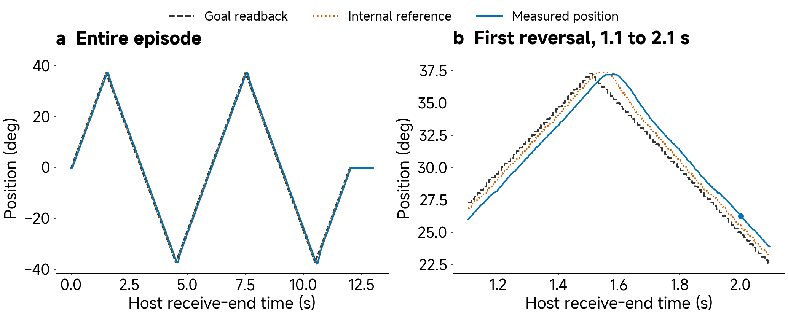
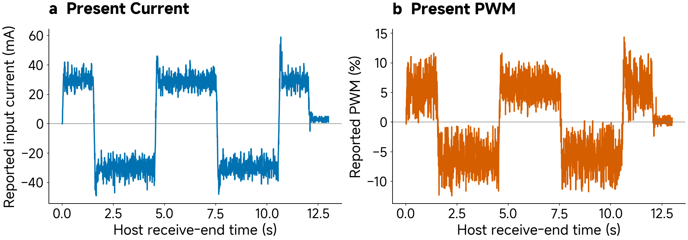

# Optional worked example — reading XC330 telemetry

This supporting example preserves the detailed recorded-data work developed for Class 02. It can be read after class or used during preparation. The required ten-minute class activity is the unpowered inspection and XC330/XL330 document comparison in [activity.md](activity.md).

## Turn telemetry into physical quantities

Our worked record is **one motor-only XC330 episode** from 1 September 2026. It uses ID 5, firmware 53, current-based position mode 5 and controller label H2, with P/I/D registers 800/0/150. M0 means no external moving horn, link, pin or payload. It does not mean the actuator has no inertia or friction.

The supplied record contains **2,601 telemetry rows** and **1,301 command rows** over approximately 13 seconds. The host polling rate is approximately 200 Hz. The timestamps used below mark host receive-end time. They do not independently measure the physical sensor-sampling instant or the internal controller frequency. The [data record](data/xc330-hardware-demo/README.md) identifies the source and the original files.

---

*Supplement Figure S1. All 2,601 readings in the supplied episode, with a fixed 1.1–2.1 s first-reversal window on the right. Goal Position is a register readback; the internal reference is Position Trajectory; the measured output is Present Position. All positions use raw count 2,048 as the declared zero. The dot marks original row 400. Lines connect observed samples; no filtering or new samples are added. [Figure source and reproduction](media/FIGURE-CODE.md#telemetry-motion).*

**Read before calculating:** find the direction reversal, then compare the three curves around it. Which register describes what was requested? Which describes the internal trajectory? Which reports the moving output? Their separation during a reversal is more informative than only checking the final angle.

---

### Decode the position

For this episode, let $$p$$ be the already signed position count and choose count 2,048 as the reference. The conversion is

$$
y_{\mathrm{deg}}=(p-2048)\frac{360}{4096},
\qquad
y_{\mathrm{rad}}=(p-2048)\frac{2\pi}{4096}.
$$

Choosing a reference is part of the experiment definition. It does not prove that the corresponding physical shaft direction is aligned with a world frame. Homing offsets, mode changes and the intended coordinate frame must be recorded when building the model.

---

At original **row 400**, host receive-end time is about **2.001918 s**. The goal count is 2,330, the internal trajectory count is 2,337, and the measured count is 2,347. Their corresponding relative angles are approximately 24.785°, 25.400° and 26.279°. The output is already moving in the negative direction. A positive difference between measured and goal position is therefore consistent with a mechanism returning from the positive peak.

---

### Decode the other channels

The conversion factors below are specific to XC330-M288-T's documented control table. The supplied raw columns have already been decoded as signed values where appropriate. Applying a second sign conversion would corrupt them.

| Field | Conversion | Original row 400 |
|---|---|---|
| Present Velocity | Raw × 0.229 r/min | −19 → −4.351 r/min |
| Present Current | Raw × 1 mA | −32 → −32 mA reported input current |
| Present PWM | Raw × 0.113% | −8 → −0.904% |
| Present Input Voltage | Raw × 0.1 V | 51 → 5.1 V |
| Present Temperature | Already degrees Celsius | 22 → 22 °C |

To express angular velocity in SI units, multiply r/min by $$\frac{2\pi}{60}$$. Thus −4.351 r/min is approximately −0.456 rad/s. Converting revolutions per minute by the degrees-to-radians factor alone would give the wrong result.

---

*Supplement Figure S2. Reported input current and PWM from all rows of the same record. The signs and documented unit conversions are preserved. No torque conversion is applied. [Figure source and reproduction](media/FIGURE-CODE.md#telemetry-electrical).*

---

Present Current on XC330 is measured at the input supply, according to the manufacturer. It must not be silently treated as winding phase current or calibrated output torque. The sign in the device's reported channel also does not, on its own, establish a calibrated bidirectional electrical-power measurement. PWM reports drive modulation; it does not directly measure external mechanical load.

This distinction matters when interpreting a stalled or slow response. Several channels can help narrow an explanation, but a current trace alone does not identify friction, output torque or efficiency. Those claims need a defined model and appropriate additional measurement.

---

*Supplement Figure S3. Reported supply voltage and internal temperature, with explicit expanded vertical scales. All readings are retained and displayed as quantized values. A short record provides operating context, not long-duration thermal qualification. [Figure source and reproduction](media/FIGURE-CODE.md#telemetry-environment).*

The voltage readings range from 5.0 to 5.1 V, while reported temperature spans 22–24 °C in this record. The axis limits are visible: the figure is intended to show small reported changes. It does not establish how the device would behave under a longer, heavier or different experiment.

**Explore a sample:** open the [offline telemetry explorer](media/interactive/hardware-telemetry.html). Select row 400 and switch between raw counts and engineering units. The explorer reads the same supplied record and does not operate an actuator. The static figures and sample table above provide the same required evidence.

## Make a claim that the observation can support

The record shows a configured actuator moving through a requested trajectory and returning telemetry. It supports checking the three position signals, units, recorded timing and selected operating conditions. It provides a concrete example of controlled action with a declared configuration.

It does not by itself establish output-torque accuracy, long-duration thermal limits, population reliability or a universal response for every XC330. A motor-only episode also cannot validate a model of a loaded arm. The teaching fixture photograph, the dataset manifest and the plotted channels each contribute different kinds of information.

---

### A small tracking-error calculation

For measured position $$y_i$$ and an explicitly identified goal $$u_i$$, define tracking error as $$e_i=y_i-u_i$$. Four illustrative errors of 0, 2, −2 and 0 degrees have zero signed mean, but

$$
\operatorname{RMSE}
=\sqrt{\frac{1}{n}\sum_{i=1}^{n}e_i^2}
=\sqrt{\frac{8}{4}}
\approx1.414\text{ degrees}.
$$

The calculation explains why errors of opposite signs do not disappear in a squared-error measure. It is a constructed exercise, separate from the measured episode. In Class 04 we will compare a simulation with hardware; that uses a different reference signal and asks a different question from command tracking.

---

For the next experiment, record the model and firmware, operating mode, gains, profiles, limits, mounting, load, signals, units and timestamps. This is how a physical movement becomes useful experimental experience. The course's Claim → Experience → System → Grounding → Learning → Decision progression begins with such an explicit, testable statement; later classes develop its modelling and decision stages.
